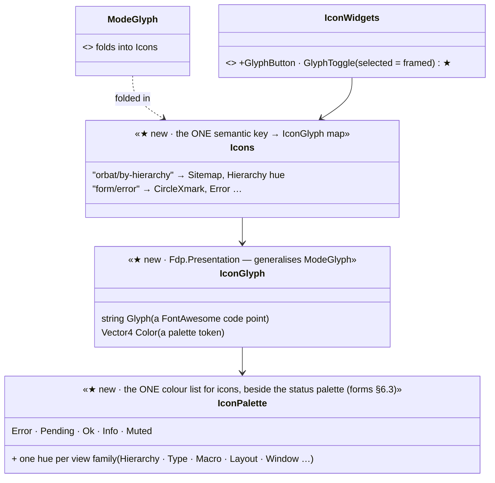

<!--STATUS
state: LIVE
build-state: DESIGN — top-level; coloured FontAwesome as THE icon style (R-4139, revising R-4138's Silk); the colour per icon approved per surface from a rendered strip
updated: 2026-11-06 (REVISED by the user: FontAwesome glyphs stay, in colour — not the Silk atlas; R-4139) · 2026-11-06 (first version — Silk atlas; superseded the same day)
current-answer: §2 the model · §3 the surfaces · §4 stages · §5 questions
stale-below: §⛔ HISTORY (the Silk version)
known-rot: none
known-conflict: none
related-designs:
  - DESIGN_Details_Forms.md — §6 the forms' marks are the first coloured glyphs; §6.6 the fidelity rule this slice follows too
  - DESIGN_Editing_UX.md — the programme; slice E16
  - ../DESIGN_Replay_Time_Axis_And_Review.md — §9a OWNS the mode indicator (R-3060 / R-3061: each mode its own glyph and colour) — the precedent this slice generalises
  - ../designs/main-toolbar-1/DESIGN.md — the toolbar and perspective icons (Silk today); §5 Q-I3
-->

# DESIGN — colourful icons: FontAwesome glyphs drawn in a colour that says what they are

## 0. Why

🔒 *"there is lots of icons in the ui with different styles (monochrome) where i would much more like colored ones — like orbat panel group
mode switching, details panel mode switcher and probably others"* · then: *"The font awesome glyphs are not bad but they should not be
monochrome as this is way more difficult to optically quickly recognize what is what."* (user, `2026-11-06`)

## 1. INVENTORY *(2026-11-06)*

Queries:

- `search_graph ".*(Theme|Style|Palette|Colors|Colours|Icon|Glyph|Font|FieldMark|Notification|Toast|Badge|Chip).*" Class`: 138 results.
- grep for `IconsFontAwesome6.`, for raw code points, for `ModeGlyph`, and for the font scaling.
- The Silk atlas, rendered as a sheet.

Coverage could not be checked.

| what exists | where | for this design |
|---|---|---|
| **FontAwesome 6 solid**, merged into every UI font size and re-baked when the UI scale changes (0.5–3×, DPI × user) | `EditorFontService.cs:38-40, :255-290` (`MergeFontAwesome`); `IconsFontAwesome6.cs` (the code points) | ⭐ crisp at every scale — one colour per glyph |
| **a coloured-glyph precedent**: the mode indicator draws each mode's glyph in its own colour | `MainToolbarTimeControlSection.ModeGlyph(mode)` (glyph + `Color`), used by `RunModeChoice.cs:655-680` | ⭐ the pattern to generalise — glyph + colour as one value |
| **monochrome FontAwesome glyphs** as buttons / switches — **12 files** | Details panel 11 (`LayerGroup`, `TableColumns`, `Thumbtack`, `UpRightFromSquare`) · AI graph canvas 10 · time controls 5 · mode indicator 4 (already coloured) · ORBAT 3 (`Sitemap`, `Cubes`, `PuzzlePiece`) · timeline 3 · mission panel 2 · four Blueprint attachments | the surfaces to colour |
| **the Silk atlas** (16 × 16 bitmaps) | window icons and Help (`WindowManager.cs:25,1043`), the perspective toolbar (`PerspectiveIconKeys.cs`), the AI editors' node icons (`SilkIconProvider`) | ⚠ a second style; a fixed-size bitmap blurs or shrinks at 1.5× and above (§5 Q-I3) |

## 2. The model

*What the picture shows that the prose hid:* the colour belongs to the icon's KEY, not to the call site. Every place that draws "by
hierarchy" gets the same glyph in the same colour, and a panel cannot pick its own (R-174). It is the mode indicator's `ModeGlyph`, applied
to every icon.

| rule | |
|---|---|
| **colour by meaning, in families** | status: Error red · Pending amber · Ok green · Info blue · Muted grey; actions: play green, pause amber, stop red; view modes: each option of a switch its own hue (hierarchy teal · type orange · macro violet); window / panel actions: blue |
| **a switch** | every option always in its own colour; the selected one framed (`IconButtonChrome`) and at full strength, the others at ~60 % — ⛔ never the selected one coloured and the rest grey (the user's complaint) |
| **a neutral button behind a coloured glyph** | 📐 rendered `2026-11-06`: on ImGui's default blue button the blue and violet glyphs nearly vanish ⇒ a glyph button / toggle uses a dark neutral background (unselected ≈ #1C1C22, selected ≈ #34343E with a light frame), not `ImGuiCol.Button` |
| **shape AND colour** | the glyph already differs per meaning; the colour makes it fast to find — a colour-blind user still reads the shape |
| **text stays text** | a glyph inside a menu label keeps the label's colour unless the item is a status |

## 3. The surfaces

| surface | glyphs | colours (lean, shown in the rendered strip for approval) |
|---|---|---|
| ORBAT group-mode switch | `Sitemap` · `Cubes` · `PuzzlePiece` | hierarchy teal · type orange · macro violet |
| Details panel switch | `TableColumns` · `LayerGroup` · `Thumbtack` · `UpRightFromSquare` | layout blue · layers violet · pin amber · pop out blue |
| time controls, mission panel | `Play` · `Stop` · `ForwardStep` | play green · stop red · step blue |
| mode indicator | as today (R-3061) | as today — the precedent |
| AI graph canvas | `Bolt` · `Gear` · `CircleQuestion` · `File` · `DiagramProject` · `CircleNodes` · `LayerGroup` · `Sitemap` | events amber · settings grey · help blue · file blue · graph teal · nodes teal |
| timeline | `ClockRotateLeft` · `Flag` | review blue · bookmark amber |
| the forms' marks | `CircleXmark` · `HourglassHalf` · `Lock` · `RotateLeft` · `TriangleExclamation` · `CircleInfo` · `Crosshairs` | Error · Pending · Muted · Info · Pending · Info · Ok |

## 4. Stages

| stage | what | owner | acceptance |
|---|---|---|---|
| **I1** | `IconGlyph`, `IconPalette`, `Icons` in `Fdp.Presentation`; `ModeGlyph` folded in; `GlyphButton` / `GlyphToggle` in `IconWidgets` | ui | the mode indicator unchanged on screen |
| **I2** | per surface, a rendered **before / after strip** (monochrome row, coloured row) sent in chat; ⭐ **the user approves the colours** | ui | the user's yes per surface |
| **I3** | the approved surfaces drawn through `Icons` | ui | a frame rail per surface under `xvfb-run` asserts glyph and colour; a side-by-side with the approved strip (forms §6.6) |

## 5. Questions — leans for the user

| # | question | lean | rejected |
|---|---|---|---|
| **Q-I1** | the icon style | **FontAwesome glyphs in a colour by meaning**, one key → (glyph, colour) map | the Silk atlas: a fixed 16 px bitmap — small or blurry at the 0.5–3× UI scale |
| **Q-I2** | a switch's options | **each always in its own colour**; the selected one framed and full-strength | selected coloured, others grey: what the user called hard to read |
| **Q-I3** | the Silk icons that exist (window icons, perspective toolbar, AI node kinds) | **move them to coloured glyphs too, after I3, as one more surface each** — one style across the app | keep two styles side by side |

## ⛔ HISTORY — the Silk version *(superseded the same day, R-4139; do not quote)*

The first version of this design made the FamFamFam Silk atlas (`FDP/Data/Icons/famfamfam-silk.png`, 1024 colourful 16 × 16 bitmaps) the
icon set, with confirmed cells for some surfaces (sitemap o6, columns e5, pop-out a5, play q8, pause q6, stop q16, live e30, help v5) and the
forms' marks (i14 · v6 · a24 · h1 · t9 · c23). The user kept the FontAwesome glyphs and asked for them in colour; the fixed bitmap size at
the 0.5–3× UI scale is the measured reason not to use Silk for UI chrome.
