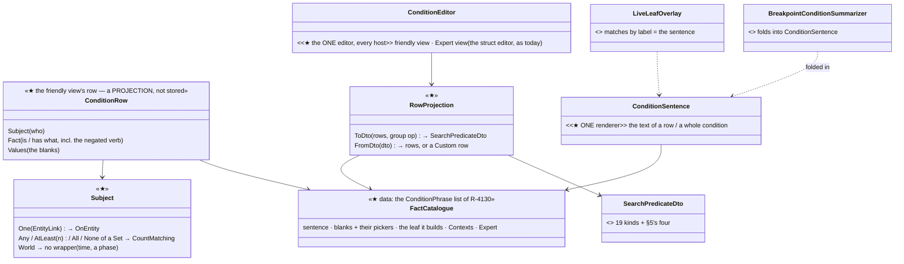
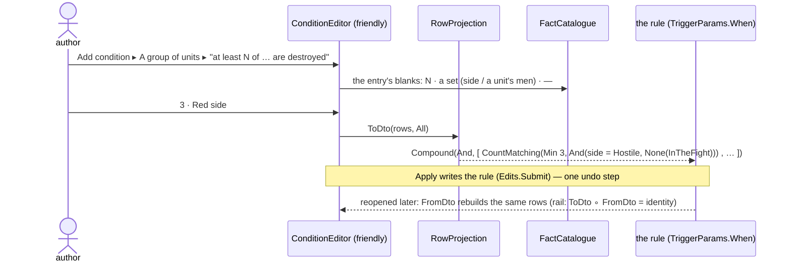
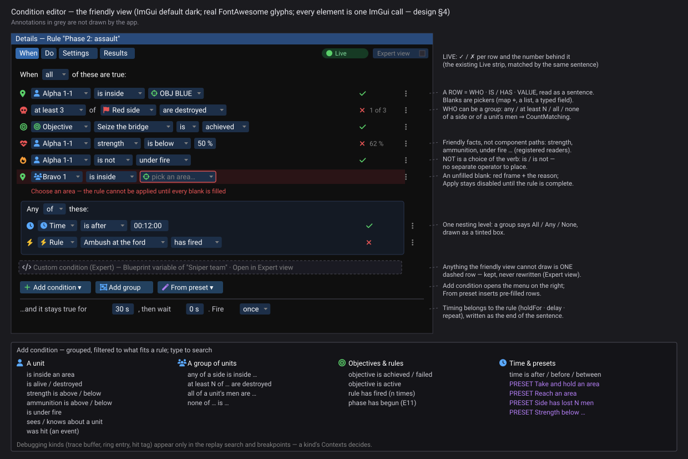
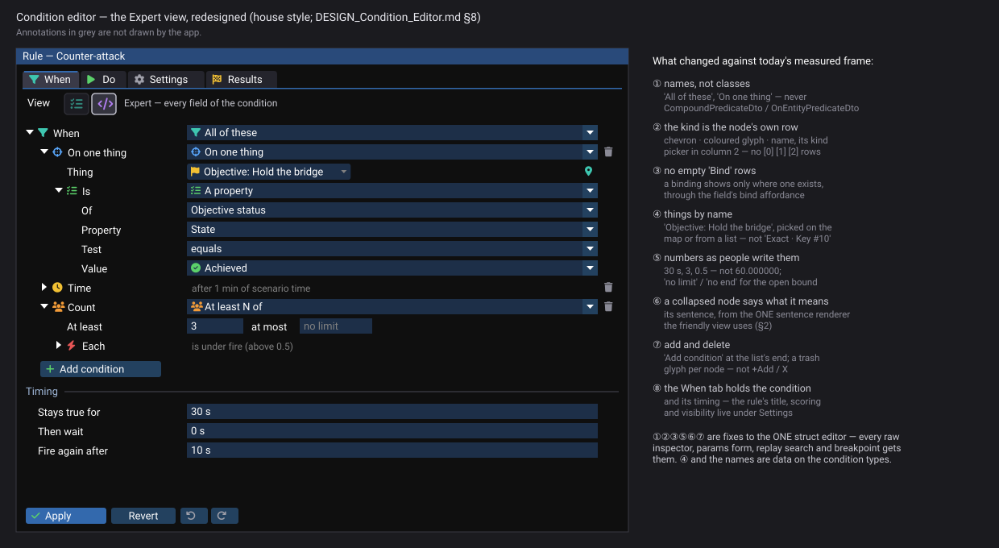

<!--STATUS
state: LIVE
build-state: DESIGN — detailed design under the approved top level (Rule Editor UX §2.3, R-4130); ✅ APPROVED Q-C1…Q-C6 (R-4142)
updated: 2026-11-06 (§8 approved, R-4149; Q-X3 revised by the user: names from a C# attribute, a default humanizer otherwise — §8.4) · 2026-11-06 (§8 the Expert view redesigned from a measured frame of today's editor — user: "the original condition editor … deserves also some review. And visual redesign") · 2026-11-06 (✅ approved — R-4142; row icons removed, icons inside their chips — user) · 2026-11-06 (first version — coordinator; the user: "go to condition editor, this is non trivial to be easy to use")
current-answer: §2 the model · §3 the vocabulary (friendly row ↔ the language) · §4 the visual design · §5 the four language additions · §6 stages · §7 questions · §8 the Expert view redesigned (✅ X1–X4 approved, R-4149; names from attributes + one humanizer, §8.4)
stale-below: nothing
known-rot: none
known-conflict: none
related-designs:
  - DESIGN_Show_On_Map.md — the struct editor (§8) carries the ⌖ for map-meaning fields
  - DESIGN_UI_Conventions.md — §8's tree rows, label-first fields and slate headers are E17's helpers
  - DESIGN_Details_Forms.md — CE-4285: the struct editor §8 improves is also the forms' expert detail
  - DESIGN_Rule_Editor_UX.md — §2.3 OWNS the top-level shape this details (R-4130: one friendly editor + presets, Expert view, Contexts, PropertyNames)
  - DESIGN_Mission_Plan_Editor.md — a task's plain "then" conditions stay its own short list; its Advanced condition opens THIS editor (R-4129 Q3); PhaseBegins is its leaf (§5)
  - ../DESIGN_Scenario_Rules.md — OWNS SearchPredicateDto as the ONE condition language (SR-95), the level compiler (S2-b) and the trigger's holdFor / delay / repeat (§10.11)
  - DESIGN_Details_Forms.md — §6 the visual language (status colours, fidelity §6.6) this editor follows
  - DESIGN_Colour_Icons.md — the coloured glyphs on each row (R-4141)
  - ../designs/breakpoints-1/DESIGN.md — breakpoints use the same language (PredicateBuilderState); the one sentence renderer replaces BreakpointConditionSummarizer
-->

# DESIGN — the condition editor: sentences anyone can read and write

## 0. Why

🔒 *"Pls go to condition editor, this is non trivial to be easy to use"* (user, `2026-11-06`), under R-4130: *"the condition editor needs
refactor, it is very technical now, ok for a debug tool … a combination of more friendly UI and friendly templates as a shortcut"*.

## 1. INVENTORY *(2026-11-06)*

Queries:

- `search_graph ".*(Predicate|Condition)(Dto|Editor|Kind|Evaluator|Compiler|Phrase|Preset|Template|Builder|Model|View|Row|Tree).*" Class`: 38 results.
- grep for the `[JsonDerivedType]` list, `[UtilityInput("…")]`, `IsInTheFight`, `ObjectiveState`, and the editors that draw a `SearchPredicateDto`.

Coverage could not be checked.

| what exists | where | for this design |
|---|---|---|
| **the ONE condition language** — `SearchPredicateDto`, 19 kinds: Compound (And / Or), PropertyMatch (+ Numeric / String values), TransientEvent, Lifecycle, SpatialBounding, Structural, BehaviorParam, TraceBufferScan, BlueprintVariable, ExternalHitTag, BehaviourStep, RingEntry, ValueChange, **OnEntity, ScenarioTime, CountMatching, InputAbove** | `Fdp.Toolkits/ReplayBrowser/Search/SearchPredicateDto.cs:35-55` | the editor edits this — ⛔ never a second language (SR-95) |
| **a trigger evaluates its When on ITSELF** — a positionless rule entity | `TriggerBehavior.cs:284,335` (`TriggerWhen.Get(json)(world, self)`) | ⭐ a bare leaf ("inside an area") means nothing at the top: it must be wrapped — `OnEntity` (one named thing) or `CountMatching` (any / at least N / none of a set). ⭐ **This is THE thing the friendly view hides** |
| **timing lives on the trigger**, not in the condition: `holdFor` · `delay` · `repeat` · `cooldown` · `maxFires` | `TriggerParams` (Scenario Rules S2-c, §10.11) | the sentence's ending: *"…and it stays true for 30 s, then wait 0 s. Fire once"* |
| **friendly facts already registered** — `[UtilityInput]` readers: `HealthFraction`, `AmmoFraction`, `UnderFire`, `HasLineOfSight`, `ThreatInSight`, `SquadStrengthRatio`, … (40+) read by `InputAbove` | `UtilityInputReaderStore` (the one registry, SR-20) | ⭐ *strength*, *ammunition*, *under fire* need no component path |
| **objectives and rules** carry `ObjectiveStatus { State: Pending · Active · Achieved · Failed · Inactive · Skipped; TriggerState; FireCount }` | `ScenarioRules/ObjectiveStatus.cs:10-16` | *"objective X is achieved"*, *"rule Y has fired"* = `OnEntity` + a property match |
| **"in the fight"** — ONE definition: a man by his injury state, a unit by its roster (`CombatEffective.IsInTheFight`) | `Combat/Injury.cs:65`, `Squad/CombatEffective.cs:32` | ⛔ a dead soldier STAYS in the world: `Lifecycle` ("the entity exists") is **not** "destroyed" (§5) |
| **today's editors** | the rule's When: the generic struct editor over `TriggerParams` (`RuleDetails.cs:376`, `BehaviorParamsForm.DrawFields`); the replay search (`ReplaySearchPanel`, a struct-editor session); breakpoints (`PredicateBuilderState`); the brain's Stop-when combos (`BrainStopWhen`) | four ways to edit one language — this design makes ONE |
| **text for a condition** | `BreakpointConditionSummarizer.Summarize` (breakpoints only: *"Compound[And](2): …"*); the Live strip matches leaves by **label** (`LiveLeafOverlay`, `LiveLeaf(Label, Holds, Measured)`) | ⭐ one sentence renderer serves the editor, the rule list, the Live strip and breakpoints |

### 1.1 What the language cannot say today — measured

| a user wants | why it fails | addition (§5) |
|---|---|---|
| *"Alpha 1-1 is **not** under fire"*, *"strength **below** 50 %"* | `LogicalOperator` is `{ And, Or }` only; `InputAbove` only tests above | **negation** |
| *"any of **2nd platoon's men** is inside OBJ"* | no leaf says "this unit or anyone under it" (the objectives do it in C#, S1-d) | **InUnit** |
| *"at least 3 of Red are **destroyed**"* | `Lifecycle` tests existence; a dead man still exists | **InTheFight** |
| *"Phase 2 has begun"* | phases are E11's new state | **PhaseBegins** (E11) |

## 2. The model

*What the picture shows that the prose hid:* the friendly view stores nothing of its own. The DTO stays the only truth. Rows are a
projection, rebuilt from the DTO every time it opens. A shape the catalogue does not recognise becomes one **Custom** row, so nothing is
ever lost or rewritten. The same catalogue entry gives the row its blanks, its sentence and its leaf, so the editor, the rule list, the
Live strip and breakpoints all say the same words.

## 3. The vocabulary — every friendly row and the leaf it builds

| row (as the user reads it) | built as |
|---|---|
| **[unit]** is / is not **inside [area]** | `OnEntity(unit, SpatialBounding(area))` · negated: `None(…)` |
| **[unit]** is / is not **in the fight** · **is destroyed** | `OnEntity(unit, InTheFight)` · destroyed = `None(InTheFight)` |
| **[unit]** **strength** is above / below **[%]** | `OnEntity(unit, InputAbove("HealthFraction", %))` · below = `None(…)` |
| **[unit]** **ammunition** is above / below **[%]** | `InputAbove("AmmoFraction")` |
| **[unit]** is / is not **under fire** | `InputAbove("UnderFire", 0.5)` |
| **[unit]** **side** is **[side]** | `PropertyMatch(EntityInfo.ForceId = side)` |
| **[unit]** **was hit** (an event) | `TransientEvent(DamageAssessedEvent naming it)` |
| **[unit]** **[property]** **[op]** **[value]** | `PropertyMatch` through **PropertyNames** (friendly name → component + path) |
| **any / at least N / all / none** of **[set]** + any unit fact | `CountMatching(Min, Max, And(set, fact))` — all = `Max 0` of the negated fact |
| **[set]** = **[side]** · **[unit]'s men** | `PropertyMatch(ForceId)` · `InUnit(unit)` |
| **objective [X]** is **achieved / failed / active** | `OnEntity(X, PropertyMatch(ObjectiveStatus.State = …))` |
| **rule [X]** **has fired** (n times) | `OnEntity(X, PropertyMatch(ObjectiveStatus.FireCount ≥ n))` |
| **time** is after / before / between **[mm:ss]** | `ScenarioTime(From, To)` |
| **phase [X]** has begun | `PhaseBegins(X)` (E11) |
| **Custom condition (Expert)** | anything else — the Expert view's tree |

**Contexts** (R-4130): a rule and a mission task see only the rows above. The replay search and breakpoints also see the debugging kinds
(TraceBufferScan, RingEntry, ExternalHitTag, BehaviourStep, BlueprintVariable, Structural, BehaviorParam, ValueChange).

**Presets** (shortcuts that insert rows, never a second model): *Take and hold an area* (unit inside area, holdFor) · *Reach an area* ·
*Side has lost N men* (at least N of side are destroyed) · *Strength below …* · *Objective achieved* · *Phase has begun* · *N minutes after
the start*.

## 4. The visual design *(acceptance spec — Details forms §6.6)*

*What the picture shows that the prose hid:* every row has the same three parts in the same order, and the first two are always chips.
The eye therefore reads down a column of WHO and a column of IS/HAS. Live results sit in one right-hand column, and the row menu sits at
one x.

| element | ImGui |
|---|---|
| the rule's tabs (When · Do · Settings · Results) | a real `BeginTabBar` with the shared no-close-box **icon tab** (When `Filter` · Do `Play` · Settings `Gear` · Results `FlagCheckered`; Colour Icons §3.1; CE-4286) — ✏ user: *"is there any reason why the top row buttons … are not a usual tab controls?"* |
| a row | `SameLine` sequence of chips and words — ✏ **no leading icon** (user, `2026-11-06`: *"the skull is not about the rule itself, it is about whether the entity is destroyed … having two icons next to each other … feels visually wrong"*); wraps to the next line when `GetContentRegionAvail` runs out |
| icons | ⭐ **inside the chip they describe** (R-4141 colours): the WHO chip (unit, side, objective, rule, time), the fact chip (skull on *destroyed*, heart on *strength*, flame on *under fire*, bolt on *has fired*), the value chip (crosshair on an area, tick on *achieved*) — never a row-level icon |
| a chip (a blank) | a frame-coloured `Button` sized by `CalcTextSize` + arrow, opening a `BeginPopup` with the list / the map pick / a typed field (`ScalarEditBox`, Details forms D1) |
| a group | All / Any / None as a chip; a tinted `BeginChild` box; one nesting level |
| an unfilled blank | the forms' invalid style: red border + the reason under the row; **Apply** disabled until complete |
| live | `CircleCheck` / `CircleXmark` in Ok / Error + the measured value (`LiveLeaf.Measured`), at one x |
| row menu | `EllipsisVertical` → *Duplicate · Move into a group · Delete · Show in Expert view* |
| the timing line | words + chips for `holdFor`, `delay`, `repeat` — shown only where the host has them (a rule; a mission task has its own) |
| Expert view | a checkbox per panel (D7); shows today's tree for the same DTO |

## 5. The four language additions — small, each in the ONE compiler (both entries, S2-b)

| addition | shape | why this and not another |
|---|---|---|
| **negation** | `LogicalOperator.None` — true when no child holds (so a one-child `None` is NOT) | one enum value covers *is not*, *below*, *all* (= none fail) and *destroyed*; ⛔ a `Not` wrapper kind would be a 20th kind for the same thing |
| **InUnit** `{ Unit: EntityLink, IncludeSelf }` | the entity is the unit or anyone under it down `UnitSubordinate` | the objectives' S1-d walker, lifted so a condition can say it; ⛔ never a second walker |
| **InTheFight** `{}` | `CombatEffective.IsInTheFight` on the entity (a man by injury, a unit by roster) | ⛔ `Lifecycle` = "exists", which a dead man still does |
| **PhaseBegins** `{ Phase }` | E11's phase state | owned by E11; listed here so the catalogue has it |

### 5.1 ⭐ AS-BUILT — C1 *(backend, `2026-11-06`, B-1)*

| addition | where | as built |
|---|---|---|
| `LogicalOperator.None` | `SearchPredicateDto.cs` (appended after `And`, `Or` — stored numbers unchanged) · `PredicateCompiler.CompileCompound` | true when no child holds; demands no component of the entity (`ExtractMandatoryComponents` recurses only into `And`) |
| `InUnitPredicateDto { Unit: EntityLink, IncludeSelf = true }` · `"InUnit"` | `PredicateCompiler.Level.cs` `CompileInUnit` | ⭐ the walk is **`Fdp.Toolkit.Squad.UnitTree`** (`Contains` / `Collect`, 0 B, ≤ `CombatEffective.MaxDepth`) — lifted from `ObjectiveCensus.RosterOf`, which now calls `UnitTree.Collect` (one walker) |
| `InTheFightPredicateDto {}` · `"InTheFight"` | `PredicateCompiler.Compile` | `CombatEffective.IsInTheFight(repo, e)` |
| the readers that assumed two operators | `BreakpointConditionSummarizer` (`NOR`), `DataBreakpointManager` (a one-child `None` remainder is not collapsed to the child), `RuleLeafPlan.LabelOf` (`In <ref>`, `InTheFight`) | `TriggerBehavior`'s wake plan treats `None` like `Or` (earliest change) — correct as is |

Rails: `PredicateCompilerLevelTests.C1_*` (3; red-proved: `None` compiled as `Or` and a non-recursive walk ⇒ all 3 red). PhaseBegins stays E11's.

## 6. Stages

| stage | what | owner | rails |
|---|---|---|---|
| **C1** | the four additions in `SearchPredicateDto` + both compiler entries | backend | each leaf true / false on a crafted world; `None` of one child = not |
| **C2** | `FactCatalogue` (data) + `RowProjection` (`ToDto` / `FromDto`) + `ConditionSentence` (and `BreakpointConditionSummarizer` folded into it) | ui | **round trip**: every catalogue row `FromDto(ToDto(x)) = x`; an unknown DTO ⇒ one Custom row, the DTO unchanged byte for byte |
| **C3** | `ConditionEditor` friendly view + the add menu + presets; the rule's When tab uses it | ui | the mockup's states as frame rails; a side-by-side to the user (§4) |
| **C4** | the timing line on the rule; the Live column from `LiveLeafOverlay` by sentence | ui | the live ✓ / ✗ and measured value per row |
| **C5** | the same editor in the mission task's Advanced condition, the replay search and breakpoints — ⭐ the Replay Browser's data breakpoints included (R-4155) (Contexts) | ui | each host shows only its kinds |

## 7. Questions — ✅ APPROVED (R-4142, user `2026-11-06`: *"Otherwise, very good."* — with the icons moved into the chips)

| # | question | lean | rejected |
|---|---|---|---|
| **Q-C1** | the shape of a row | **WHO · IS/HAS · VALUE**, every blank a chip, the whole row a sentence; ✏ icons only inside the chip they describe, no row icon (user) | a form per kind: the technical tree again |
| **Q-C2** | how "not" is said | **in the verb** (*is / is not*, *above / below*, *achieved / not achieved*), built as `None` | a separate NOT button: users miss it, and it reads backwards |
| **Q-C3** | groups | **one nesting level**, All / Any / None, more only in the Expert view | free nesting: the reason the current editor is hard |
| **Q-C4** | what the friendly view cannot draw | **one dashed Custom row, kept unchanged**, opened in the Expert view | refuse to open, or simplify it: loses the author's work |
| **Q-C5** | the four additions | **all four**, in the one compiler | work around with PropertyMatch on injury enums: brittle, and the replay search would differ |
| **Q-C6** | an incomplete row | **red blank + the reason; Apply disabled** | save it and let it never fire: a silent rule |

## 8. The Expert view, redesigned *(2026-11-06 — ✅ X1–X4 APPROVED, R-4149)*

🔒 *"What about the original condition editor? I think it deserves also some review. And visual redesign. As what was programmed was pretty much
programmer-only style"* (user, `2026-11-06`).

### 8.1 Measured — a real frame of today's rule When tab

📐 Rendered headless (`UiFrameHarness`, a throwaway rail over `RuleDetails` with *All of: objective 10 achieved · after 60 s · at least 3 under
fire*; the frame went to chat, not git). The three hosts (rule When `RuleDetails.cs:376`, replay search `ReplaySearchPanel.cs:211-219`,
breakpoints) all draw it with the ONE struct editor, `ComponentEditDrawer.DrawEditNode`.

| what the frame shows | where it comes from |
|---|---|
| **C# class names** as the kinds: `CompoundPredicateDto`, `OnEntityPredicateDto`, `PropertyMatchDto`, `InputAbovePredicateDto` | the polymorphic combo lists `t.Name` (`ComponentEditDrawer.cs:195-226`) |
| **raw field names**: `ComponentType`, `PropertyPath`, `FromSeconds`, `ToSeconds`, `Min` | `node.Name`; ⚠ `[EditDisplayName]` / `[EditUnit]` / `[EditDoc]` EXIST and the builder copies them into `EditNodeMetadata` (`ReflectionEditDocumentBuilder.cs:454-486`) — ⛔ the drawer never reads `DisplayName`, and no condition type carries one |
| **`[0]` `[1]` `[2]`** element rows, the kind one row lower | a list element is a container row with its index |
| an **empty `▼ Bind` row under every node** (7 in this frame) | every `SearchPredicateDto` is a `BindableNode` (`ParamBinding.cs:90-95`); its `Bind` map is drawn as a container even when null |
| **`60.000000`**, **`1000000000.000000`** for "no end" | the float field's default format; the open bound is a sentinel |
| **`Exact · Key #10`** for "objective Hold the bridge" | the entity-link radio, by id |
| **`+Add`** and **`X`** as small text buttons | `ComponentEditDrawer.cs:169, 176` |
| the rule's **Common / Scored / StartActive** fields above the condition on the When tab | `RuleDetails.cs:374` draws the header on every tab |

### 8.2 The redesign

*Generated by `scripts/gen-condition-expert-mockup.py`. Same condition as §8.1's frame.*

⭐ **Not a second editor** (R-174): the Expert view STAYS the struct editor. Fixes ①②③⑤⑥⑦ go into `ComponentEditDrawer` itself — so the raw
inspector, every params form, the replay search and breakpoints get them too; ④ and the names are DATA on the condition types.

| # | fix | where |
|---|---|---|
| ① | **names**: the drawer reads `[EditDisplayName]` on a field AND on a type; with none, a humanised name (`DeadlineSeconds` → *Deadline* + unit `s`). The 19 kinds get names and coloured glyphs (*All of these*, *On one thing*, *A property*, *Time*, *At least N of* …) from the friendly view's `FactCatalogue` — one table, both views | struct editor (generic) + condition types (data) |
| ② | **the kind is the node's row**: chevron · glyph · name in column 1, the kind picker in column 2 (E17 tree row); no index rows | struct editor |
| ③ | **no empty `Bind` row**: a `BindableNode.Bind` map is not drawn as a field; a binding shows through the field's bind affordance (`ParamBindModel`) | struct editor |
| ④ | **things by name**: an entity link shows a chip with the thing's name and kind glyph, a map-pick button, and the list on click | the entity-link drawer |
| ⑤ | **numbers as written**: shortest form (`60`, `0.5`), `[EditUnit]` suffix; an open bound shows *no limit* / *no end* and stores the sentinel | struct editor + `[EditUnit]` on the types |
| ⑥ | **a collapsed node shows its sentence**, dimmed, in column 2 — from the ONE `ConditionSentence` (§2); other types may supply a summary through the same hook | struct editor (a summary hook) |
| ⑦ | **add and delete**: *Add condition* at the end of a list (named by its element type); a trash glyph per element, at one x | struct editor |
| ⑧ | **the When tab holds the condition and its timing**; title, scoring and visibility move to Settings | `RuleDetails` / `RuleTabs` |

⭐ **AS BUILT — U-7 / U-9** *(ui, `2026-11-06`)*: ①②③⑤⑥⑦ in `ComponentEditDrawer` (`1bd842128`, `52f8bf2d3`): labels via `DisplayNames` (cached),
a kind with `[EditIcon]` drawn as its node's row through `TreeRow` (chevron · glyph · name), the `Bind` map hidden (`HidesChild`), numbers through
`NumberInput` (`%g` + unit; `MaxValue` = *no limit*), *Add <element>* + a trash glyph at one x, collapsed nodes asking `EditSummaries`. The
five kinds the mockup names carry `[EditDisplayName]` + `[EditIcon("kind/…")]`; the rest are humanized (none invented). ⑧: trigger tabs are now
*Overview · When · Do · Settings · Bindings · History* — When = the condition + its timing (the former *Rules* tab's fields), the header
(`Common`) is drawn on Settings only (`RuleTabs`, `RuleDetails`). ⛔ SUPERSEDED: *Overview · When · Rules · Do · …* with the header on every tab.
⏳ Still open in U-7: the §8.1 frame re-measured side-by-side with `condition-expert-visual.svg`; ④ is U-8.

### 8.3 Questions — ✅ approved (R-4149); Q-X3 revised by the user (§8.4)

| # | question | lean | rejected |
|---|---|---|---|
| **Q-X1** | fix the struct editor for everyone, or style only the condition tree | **the struct editor, for everyone** — every raw inspector and params form reads as badly today; one fix, one look | a condition-only tree: a second tree drawer beside the generic one (R-174) |
| **Q-X2** | names when a type has no `[EditDisplayName]` | **humanise the field name** (split PascalCase, drop a unit word into the unit) | show raw names until each type is annotated: hundreds of fields stay programmer-only |
| **Q-X3** ✏ | where a condition kind's name and glyph live | ✏ **REVISED by the user: a C# attribute on the type / enum member, a default humanizer when none** (§8.4); `FactCatalogue` READS the same attribute — no second copy | ~~in `FactCatalogue`~~ (the first lean) — names in a table beside the code drift from it |
| **Q-X4** | the rule header on the When tab | **only on Settings** (and the title on Overview) | keep it on every tab: pushes the condition off the first screen |

**Stages:** **X1** the struct editor fixes ①②③⑤⑥⑦ (ui; rails: the frame of §8.1 again, measured — no class names, no `Bind` rows, one x
for every control, 0 B on a steady frame; the builder compares the frame with the mockup itself, R-4146). **X2** names, glyphs and units on the
condition types via `FactCatalogue` (ui, after C2). **X3** the entity-link chip ④ (ui). **X4** the rule tabs ⑧ (ui).

### 8.4 Display names — a C# attribute first, ONE humanizer otherwise *(user, `2026-11-06`, R-4149)*

🔒 *"The alternative texts for different enums or class names, I think they should come from some kind of C# attribute and using some default
parsers or humanizers. Only if the display name is not explicitly defined by C# attribute."*

| ⭐ the rule | |
|---|---|
| **one resolver** — `DisplayNames.Of(member)` in `StructEdit.Core`, for a field, a property, a type and an enum member | ⛔ no drawer, combo or catalogue spells a name its own way |
| **① `[EditDisplayName("…")]`** — already exists (`EditAttributes.cs:17`) for fields and properties (an enum member is a field); ⭐ **widened to classes and structs** | the condition kinds: `[EditDisplayName("All of these")]` on `CompoundPredicateDto` … |
| **② the humanizer** when there is no attribute: split PascalCase into words, sentence case, drop a type suffix (`Dto`, `PredicateDto`), move a unit word to the unit (`DeadlineSeconds` → *Deadline* · `s`; `EntryOrExit` → *Entry or exit*) | ⭐ one function; ⛔ the local copies fold into it — 📐 `EntityRoleLine.Words` (`EntityRoleLine.cs:73`, *TankGun → Tank gun*) and `AiPrimitiveNaming.DisplayNameFromTickCoreFqn` are two found |
| **the glyph** is an attribute too — `[EditIcon("<key>")]`, a key into Colour Icons' ONE key → (glyph, colour) table | ⛔ never a colour in the attribute — the palette stays one table |
| **cached per member**, built once | 0 B per frame (R-2084) |
| **who reads it**: the struct editor (field labels, enum combos, the kind picker), the friendly view's `FactCatalogue`, the sentence renderer, every form row's label | ⭐ one name per thing, everywhere |

⭐ **AS BUILT — U-6** *(ui, `2026-11-06`)*: `StructEdit.Core/Attributes/DisplayNames.cs` — `Of(MemberInfo)` · `Of(Enum)` · `UnitOf` · `IconOf` ·
`Humanize`; `[EditDisplayName]` widened to class / struct / enum; `[EditIcon(key)]` new; cached per member (rail
`StructEdit.Tests/Foundation/DisplayNamesTests`, 0 B after the first ask). Folded: `EntityRoleLine.Words` now calls `DisplayNames.Humanize`.
⚠ **Deviation:** `AiPrimitiveNaming.DisplayNameFromTickCoreFqn` is NOT folded — it is not a humanizer but the recovery of a blueprint's
AUTHORED name from its generated type (`MoveTo_Bp_1a2b3c4d` → `MoveTo`); humanizing it would rename authored assets. The readers (the struct
editor's labels, combos, kind picker) switch to `DisplayNames` in U-7.
