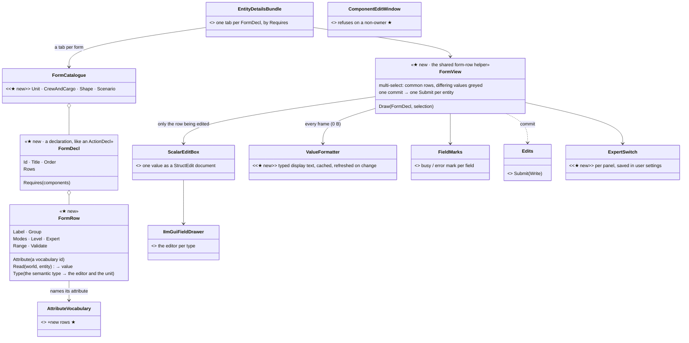
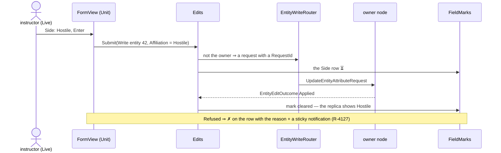
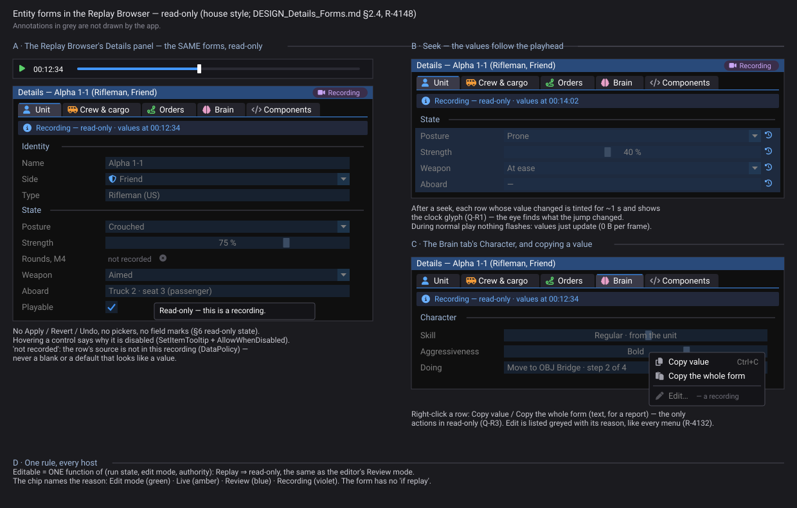
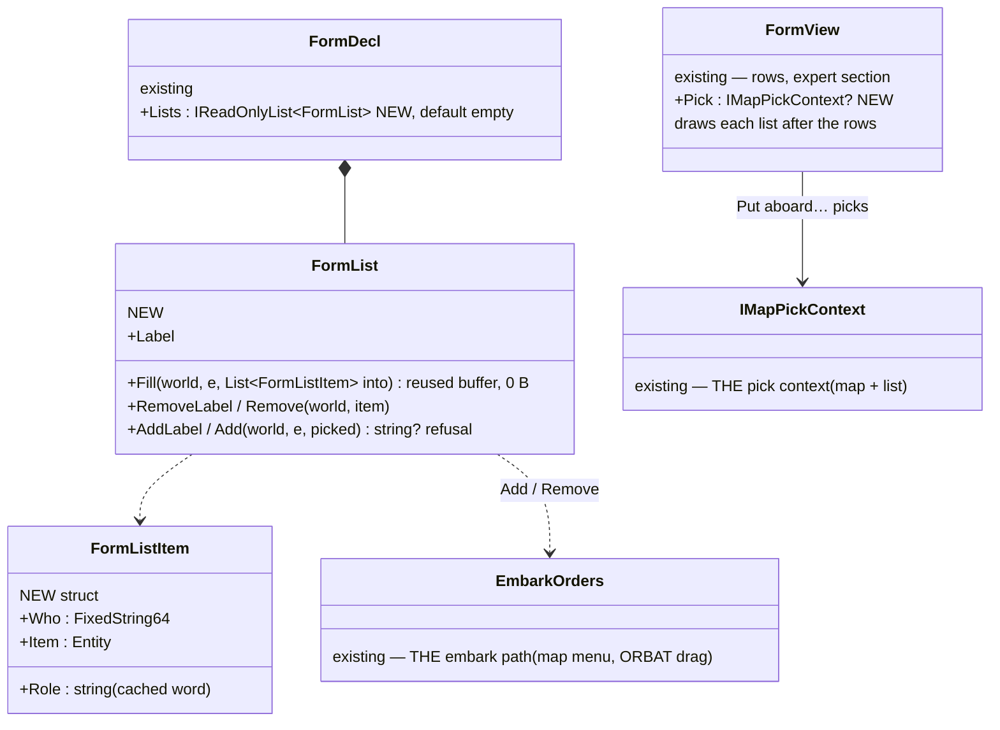
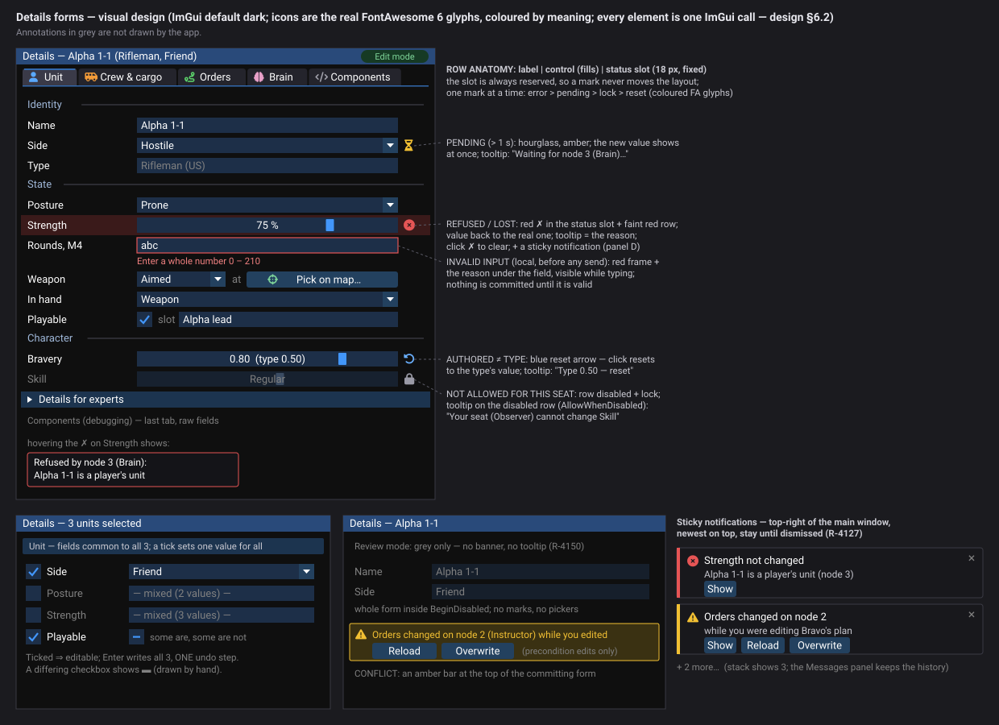

<!--STATUS
state: LIVE
build-state: DESIGN — top-level, ✅ APPROVED Q1–Q8 by the user 2026-11-06 (R-4136); ui builds the forms, backend the attributes (R-4123)
updated: 2026-11-06 (the mockup's context row is the REAL replay transport, out of scope — R-4151; Q-R2 withdrawn) · 2026-11-06 (read-only = grey only: no banner, no tooltip — user, R-4150; §2.4 mockup) · 2026-11-06 (§2.4 the forms in every host, read-only in the replay browser — user, R-4148) · 2026-11-06 (marks are COLOURED FontAwesome glyphs, not Silk — user, R-4139) · 2026-11-06 (§6 approved, R-4138; §6.6 fidelity) · 2026-11-06 (§6 the visual design — every row state, multi-select, read-only, conflict, notifications; ImGui-feasible; for review) · 2026-11-06 (Q7 revised by the user: posture is a Unit form row — StanceIntent saved, seeded at load, set at once while paused) · 2026-11-06 (revised after the user's review: the raw editor is local BY DESIGN — CE-4283 refuted; every open point measured: the leaf editors through ScalarEditBox, ammunition, posture, weather, routes (CE-4284), embarkation; Q5 replaced, Q7–Q8 added) · 2026-11-06 (first version — coordinator; editing-UX design queue item 8: E2, D3 / D7 and the raw inspector fixes)
current-answer: §2 the model (§2.4 every host, read-only in the replay browser — R-4148) · §3 the four forms · §4 stages · §5 questions (approved) · §6 the visual design (approved, R-4138) with §6.6 fidelity
stale-below: nothing
known-rot: none
known-conflict: none
related-designs:
  - DESIGN_Replay_Browser_UX.md — the Replay Browser's layout docks Details right
  - DESIGN_Show_On_Map.md — the ⌖ at the end of every row whose type has a place on the map (read-only rows too)
  - ../designs/replay-browser-2/DESIGN.md — the replay browser; §2.4: it composes this design's EntityDetailsBundle, so the forms show there read-only (R-4148)
  - DESIGN_UI_Conventions.md — takes the LAYOUT half of this design's row helper house-wide (FormGrid, §3); FormView draws its rows through it
  - DESIGN_Initial_State.md — E15 adds the Aboard / Carried by / Carries / Weapon / In hand / Knows about / Damage rows to the Unit form, by the posture rule (Q7)
  - DESIGN_Editing_UX.md — §1.8 / slice E15: the initial state beyond these forms (seats and carry modes, carried weapons, weapon posture, a named point, lying items) — E15 adds rows to these forms
  - DESIGN_Editing_UX.md — the programme: §3.3 the target tab set, D2 (tabs in the shared bundle with Requires), D3 (the Unit form's fields), D7 (expert detail), §3.7 the expected basics
  - DESIGN_Edit_Framework.md — OWNS the write: every form commit is one Edits.Submit(Write …); §2.5 the field-mark hook and the shared form-row helper this design builds
  - DESIGN_Action_Catalogue.md — OWNS Requires / Modes / Level; a form row declares the same three
  - DESIGN_Edit_Mode_Undo.md — one form commit = one undo step (R-4133)
  - DESIGN_New_Scenario_And_Recipe.md — the terrain shown read-only in the Scenario form (R-4135)
  - DESIGN_Map_Interaction.md — the Shape form's geometry is edited on the map; the form holds the rest
  - DESIGN_Seats_And_Hats.md — a row's Level greys it for a seat that may not change it
  - ../DESIGN_Semantic_Value_Types.md — OWNS the typed values (SV-1 time, SV-4 angle) that choose a row's editor and its unit
  - ../blueprints/Architect_Question_59_Attribute_Vocabulary_Single_Source.md — OWNS AttributeVocabulary, "a row HERE FIRST"; every form field is an attribute
  - DESIGN_Colour_Icons.md — E16: coloured FontAwesome glyphs as THE icon style (R-4139); §6's marks are its first users
  - ../blueprints/DESIGN_Variable_Details_And_Editing.md — §1b uses yellow = pending, red = changed this tick; §6 here makes red mean error everywhere (Q-V4)
  - ../DESIGN_Remote_Edit_Outcome.md — the ticket and outcome a form commit carries
  - ../designs/weather/DESIGN_Weather_And_Time.md — §2: weather edits were meant to be attribute requests; the Scenario form's weather rows are those attributes
  - ../DESIGN_Entity_Interactions.md — §7 OWNS EmbarkEntityCommand / EmbarkationSystem, which the Crew & cargo form raises
-->

# DESIGN — the Details forms: Unit, Crew & cargo, Shape, Scenario

## 0. Why, and what the user asked

🔒 *"The raw component editors are more a debugging tool … dedicated forms"* (user, `2026-11-06`, R-4120).
🔒 *"expert detail hidden, not removed"* (R-4121).

Today a user changes side, name, health, ammunition or spawn facing through the raw **Components** tab. It shows engine names, indices
and TKB numbers (programme §1.1). This design gives the common fields forms, and keeps the raw tab as the debugging tool.

🔒 *"Unowned component edit is not replicated. This is what it should be doing, because this is raw component edit. It's not a
user-faced editing mechanism. This is a debug tool. For whatever serious entity editing, we cannot rely on raw component edits.
Basically anything what the user should be able to edit … requires a well-designed form, because it might span across many different
components."* (user, `2026-11-06`) ⇒ a form is THE user-facing editor; one form spans many components, and one attribute's handler may
write several (§3: ammunition writes the mount's `WeaponState`, a different entity per mount). 🔒 *"Please measure whatever you do not
know … we should design with all the available knowledge we have."* — §1.2 is that measurement.

## 1. INVENTORY *(2026-11-06)*

Queries run:

- `search_graph ".*(Form|FieldView|FieldEditor|PropertyGrid|Inspector|DetailsTab|EntityView|TabView)$" Class`: **45**. The forms that exist are `OrderForm`, `BehaviorParamsForm` and `ParamsDefaultsForm` (StructEdit over a DTO); the field editors are StructEdit's plus `PickableLeafFieldEditor`, `MathFieldEditors`, `TypeFieldEditor` and others.
- `".*(IForm|IField|IDetailsTab|IEntityTab|IEntityView|IPropertyEditor|IValueFormatter|ISemantic).*" Interface`: **2** (`IImGuiFieldDrawer`, `IFieldReadWriter`). No form or row abstraction exists.
- `".*Attribute(Registry|Catalog|Interpreter|Map|Table|Translator|Names|Descriptor|Binding|Schema).*" Class`: **5**.
- grep for the component types, `AttributeVocabulary`, `ComponentEditWindow`, `EditRequests`.

Coverage could not be checked (the CLI has no `check_index_coverage`).

| what exists | where | for this design |
|---|---|---|
| **the attribute vocabulary — the ONE list of fields that can be written to any node**: 18 rows (`Name`, `Affiliation`, `Position.X/Y/Z`, `Heading`, `ScenarioStartUtcTicks`, `ScenarioUtcOffsetMinutes`, `Fear`, `FrightFrom.*`, `Rule.*`) | `Replication/Attributes/AttributeVocabulary.cs:45` (Q59: *"adding an attribute means adding a row HERE FIRST"*) | ⭐⭐ a form field that is an attribute gets the remote write, the ticket, the outcome, HTTP `/attribute`, rules and undo **for free**. ⛔ Strength, ammunition, posture, playable, weather are **not** attributes yet |
| **the write** — `EditRequests.Write / WriteJson` → `EntityWriteRouter` (apply here, or ask the owner) | `Replication/Edits/EditRequests.cs:22,37` | the edit framework's `Write` op wraps it (F1) |
| **the field editors** — `IImGuiFieldDrawer` + StructEdit leaf editors (pickable links, angles, quaternion-as-euler, type, utility curve) | `Fdp.Presentation/ImGui/Editing/IImGuiFieldDrawer.cs` | ⭐ a form row draws its value with the SAME drawer StructEdit picks for that type ⇒ a typed value edits the same everywhere |
| **the field-mark hook** — `Func<FieldPath, FieldMark?>` + `FieldMarks.Draw(entity, path)` (approved, not built) | Edit framework §2.5 (R-4127) | *"the new dedicated forms are built from a shared form-row helper that does it once"* — this design IS that helper |
| **the raw Components tab's write** — `ComponentEditWindow.ExecuteOkLogic` → `ls.SetComponent(...)` | `ComponentEditWindow.cs:157-170` | ✅ **local by design** — a debugging tool (user; CE-4283 refuted) |
| **the components** | `EntityInfo` (`Fdp.Core`), `Health`, `WeaponState`, `WeaponAmmo`, `StanceIntent`, `CarrierSeats`, `PassengerBuffer` (`Fdp.Toolkits`), `Playable`, `SpawnArea`, `EditablePolyline`, `RoutePlan` (`Hrot.Core`), `WeatherConditions` | each form row reads one of these |
| **the tabs** — `EntityDetailsBundle` gives every host Components, Summary, Objectives, Brain; the editor adds Scenario, Zones, Macro, Playable, Mission | `EntityDetailsBundle.cs:59-96`, `EditorSubsystem.cs:3295-3370` | D2 (approved): every tab in the shared bundle with `Requires` |

### 1.2 Measured for this revision *(`2026-11-06`)*

| question | measured | consequence |
|---|---|---|
| where ammunition lives | `WeaponAmmo` is a **replicated mirror** (`[DataPolicy(NoScenario)]`, written only by `WeaponAmmoMirrorSystem` on the brain, `WeaponAmmo.cs:12-15`); the real rounds are `WeaponState.Ammo` (saved, `CombatComponents.cs:14`) — mount 0 on the unit, mounts 1–3 on mount child entities (`WeaponMountInfo.MountIndex`, `WeaponAmmoMirrorSystem.cs:37-56`) | the row READS the mirror (works on every station) and WRITES attribute `Ammo.<mount>`, whose handler on the owner writes that mount's `WeaponState.Ammo` (clamped to `MaxAmmo`) — one attribute, two entities. Saved, because `WeaponState` is |
| whether a posture at start can be authored | ✏ **corrected by the user** (*"what about the behavior which is basically idle … a character can be idling standing as well as prone or crouched because he is trying to hide … the first tick of a real behavior will override it, but who cares? Sometimes the idle is the first one"*). 📐 Measured: an idle unit stands because the spawn sets `StanceIntent` = the type's FIRST declared stance (`AnimationTkbTranslator.cs:115-123`) and nothing else writes it until a behaviour calls `StanceRequest.Set`; both `StanceIntent` and `StanceStatus` are `NoScenario` (`StanceComponents.cs:37,57`) — not saved; a saved component overrides the type default at spawn (`NetworkSpawningSystem.cs:201`); the stance transition runs only when time advances (`StanceTransitionSystem`: `[TickMode(WhenTimeAdvances)]`) | ⭐ **a Posture row IS needed** (Q7): `StanceIntent` becomes SAVED; at load the body starts IN the saved stance (status seeded from the intent, `AckVersion = Version` — no stand-up-then-drop animation); in Edit mode (paused) the handler sets intent AND status at once so the map shows it; in Live it is an ordinary `StanceRequest` with its blend. A behaviour overrides it on its first decision, as for any start state |
| how weather is meant to be edited | the weather design: *"UpdateEntityAttributeCommand: a new scenario start time (or a weather edit)"* (`DESIGN_Weather_And_Time.md` §2) — but the vocabulary has no weather rows, so today it writes locally (edit framework §1) | adding the weather attributes IS the designed path |
| how passengers aboard at start are authored | `EmbarkEntityCommand` / `DisembarkEntityCommand`, applied at once by `EmbarkationSystem` on the vehicle's owner — the designed authoring path (`DESIGN_Entity_Interactions.md` §7); saved through `PassengerBufferTranslator` → `InitialPassengersIntent` | Crew & cargo raises the commands (the edit framework's `Command` op); no live interaction needed in Edit mode |
| how a route edit reaches the owner | ⛔ it does not: local `RoutePlan` set + `UpdateEntityCommand`, which the egress forwards only for `EditablePolyline`; the route egress needs authority (`MapRouteEgressTranslator.cs:92`) | **CE-4284** filed; an area's points DO reach the owner (`UpdateEntityDescriptorRequest`) ⇒ the route goes the same way (Q8) |
| `Playable`, `SpawnArea` | `Playable { ForceId Side; FixedString32 SlotName }`, `SpawnArea { ForceId Side; float FacingDeg }`, both saved (`Default`) | four attributes; adding / removing `Playable` is edit framework F3 |
| strength | `Health { float Current; float Max }`, saved | attribute `Health.Current`; the row shows % of `Max` |

### 1.1 Claim table

| claim | code | design basis |
|---|---|---|
| an attribute field writes on any node | ✅ `EntityWriteRouter` (local or a request to the owner) | ✅ Remote_Edit_Outcome, Edit framework F1 |
| a non-attribute field cannot be written remotely today | ✅ the router speaks attribute ids only (`IEntityComponentWriter.Write(entity, attributeId, value)`); the raw window writes locally | ✅ Q59 §7.2 (the vocabulary is the list) |
| a form row can reuse StructEdit's leaf editors | ✅ **measured**: `IImGuiFieldDrawer.DrawInput(ref object, EditNode)` needs a StructEdit node, so not alone — but **`ScalarEditBox<T>`** (`Hrot.Editor.AiShared/Inspector/ScalarEditBox.cs`, built for BP-356 and used by `DefaultValueAuthoring`) wraps ONE value as a bound StructEdit document ⇒ a row is a one-field session and gets every leaf editor and picker | Edit framework §2.5; BP-356 |
| a session draws without allocating per frame | ⛔ **measured FALSE** (throwaway probe, not committed: `ImGuiTestFixture`, 100 steady frames): a frame drawing nothing **0 B**; one `float` through `ComponentEditDrawer` **64 B/frame**; five scalar fields **160 B/frame** — ~24 B per field, one boxed value each. **CE-4285** filed | ⇒ a row must NOT draw through a session every frame: it shows a **cached, typed, formatted value** (refreshed when the component's value changes) and opens its `ScalarEditBox<T>` session **only while that row is being edited** (click or Enter on the row) — the steady frame allocates nothing, whatever CE-4285's fix |
| the attributes needed are cheap to add | ✅ the rule and its rails exist (`TheFourRoutingTablesAgreeTests`); each is one row + a JSON setter + a binary handler | ✅ Q59 |

## 2. The model

### 2.1 The picture

*What the picture shows that the prose hid:* a form owns no write and no editor, and only ONE row at a time pays for an editing session — the
rest show cached text (CE-4285 measured the session at ~24 B per field per frame). Each row names an attribute, and the attribute already
knows how to reach the owner. The row's type picks the editor StructEdit would pick. The only new things are the declarations and the
view that lays them out. The forms are therefore one mechanism across every host, never four hand-drawn panels.

### 2.2 A commit, from a station that does not own the unit

*What the picture shows that the prose hid:* the form never decides "local or remote" and never polls. The same commit works in the
network-less editor (applied at once, one undo step) and on a cluster.

### 2.3 Rules every form follows

| rule | |
|---|---|
| **a field is an attribute** | ⛔ no form writes a component directly. A field without an attribute gets one first (Q59's rule: a vocabulary row + setter + handler, the rails red until all three exist) |
| **when a value commits** | on Enter, on leaving the field, or on picking from a list. ⛔ No commit per keystroke. Typing in one field is one undo step |
| **units and ranges** | from the semantic type (m, °, s, %, a time of day); out of range ⇒ red with the reason, never silently clamped (§3.7) |
| **references** | a unit, area, type or behaviour is picked from the one picker or the map, never typed as a number |
| **modes** | Edit and Live: editable · Review: read-only, every row (the Gate refuses, the view greys) |
| **levels** | a row's `Level` greys it for a seat that may not change it, with the reason (D4, seats and hats) |
| **multi-select** | the rows common to all selected entities; a value that differs shows *mixed*; setting it writes all (one Submit per entity, ONE undo step) |
| **expert detail** | rows flagged `Expert` sit in one *Details for experts* expander at the bottom; the panel's Expert switch opens it by default; saved per panel in the user settings (D7) |
| **hot path** | `FormDecl` and rows are built once; `Draw` allocates nothing in a steady frame (no LINQ, cached labels) — a rail measures it |

### 2.4 Every host — read-only in the replay browser *(user, `2026-11-06`, R-4148)*

🔒 *"the forms and everything about the entity state should work also in the replay browser, in read-only mode, not just in the editor or CGF or
SIM host or usual ECS enabled hosts."*

📐 **Measured — the replay browser already composes the SAME Details bundle:** `ReplayBrowserSubsystem.cs:1026-1036` builds
`EntityDetailsBundle` with `World: () => _activeRepo` (the recording's world) and `RunState: VariableRunState.Replay`. ⇒ ⭐ the forms reach it
**by construction** — they live in that bundle, not in an editor-only window. What must hold:

| ⭐ the rule | |
|---|---|
| **editable = ONE function** of (run state, edit mode, authority): `Replay` ⇒ read-only, like Review | ⛔ no host-specific "if replay" in a form; the same function the Brain view already applies (`EntityBrainView.cs:463-468`) |
| **read-only looks like §6's read-only state**: the form in `BeginDisabled` (grey), no marks, no pickers, no Apply — ✏ **no banner, no tooltip** (R-4150: grey says it; the Recording chip, the time axis and the main bar's clock say where and when) | the values still update as the replay plays and seeks (the form reads the world each frame, 0 B) |
| **a row reads only the world** (components, the attribute vocabulary's READ side) — never a live-only service | ⭐ that is what makes it work on a recording |
| **a row whose source is not in the recording says so**: *"not recorded"*, dimmed | ⛔ never a blank or a default that looks like a value. 📐 Sampled sources all record (`DataPolicy.Default`: `Health`, `PassengerBuffer`, `CombatProficiency`, `CombatTemperament`, `Playable`, `SpawnArea`; `NoScenario` only skips the save: `StanceIntent`, `WeaponPosture`) |
| **the same for everything about entity state** — the Initial-state rows (E15), the Brain tab's Character, the Shape form | the hosts list is the bundle's, not each form's |

*Generated by `scripts/gen-replay-forms-mockup.py` (R-4143); the acceptance spec (R-4138 / R-4146) — ⛔ for the Details panel ONLY. The main-bar transport row above it is the browser's REAL one (`ReplayTimelinePanel.DrawTransport`: history back / forward, rewind, play, speed, step back / forward — measured from a headless frame), drawn for context and **unchanged by this design** (R-4151).*

| element | ImGui |
|---|---|
| the title-bar chip | **Recording** (violet, `Video` glyph) — one chip per reason: Edit mode (green) · Live (amber) · Review (blue) · Recording (violet) |
| ~~the banner~~ | ⛔ **none** (R-4150) — *"no need for the blue banner saying that we are in read-only replaying mode and at what time"* |
| a row | §6's row inside `BeginDisabled`; the label in the disabled text colour; no status slot marks, no pickers, no Apply / Revert / Undo |
| ~~hover~~ | ⛔ **no tooltip** on a control disabled by the run state (R-4150) — ⭐ a row disabled for a reason the screen does NOT show (a seat's rights, §6.2) keeps its reason tooltip |
| not recorded | dim text *"not recorded"* + a dim `CircleXmark`; tooltip names the reason (the component's `DataPolicy`) |
| after a seek | each row whose value changed is tinted (`Info` at low alpha) for ~1 s with a `ClockRotateLeft` glyph in the status slot (Q-R1); normal play does not flash |
| row menu | right-click: *Copy value* (Ctrl+C) · *Copy the whole form* (text) · *Edit…* greyed with *"a recording"* (Q-R3, R-4132's greyed-with-reason) |

| # | question | lean | rejected |
|---|---|---|---|
| **Q-R1** | show what a seek changed | **tint the changed rows ~1 s + a clock glyph**, after a seek only | nothing — after a jump the eye cannot tell what moved; tint during play — the whole form flickers |
| ~~**Q-R2**~~ | ⛔ WITHDRAWN — a wrong premise: there are no separate *initial-state* rows. Every row shows the entity's CURRENT state; in Edit mode (paused before the run) the current state IS the start state and is what gets saved; in a recording it is the state at the playhead (user, `2026-11-06`: *"I thought that the rows are showing the current state and it just happens to be the initial one if the time is at its zero"*) | — | — |
| **Q-R3** ✅ R-4152 | actions in read-only | **Copy value / Copy the whole form**, Edit listed greyed with the reason | no menu — copying a value into a report is the common need |

⭐ **Acceptance:** a frame rail composes the bundle over a recorded world with `RunState.Replay`: every form row drawn, every control disabled,
no banner drawn, zero writes reach any write seam, and a seek changes the shown values.

## 3. The four forms

| form | offered when (`Requires`) | rows (common · ⚙ expert) | attributes to add ★ |
|---|---|---|---|
| **Unit** — replaces Summary and Playable, and the raw trip for the common fields | `EntityInfo` | name / callsign · side · type (read-only, Q4) · **posture** (only the stances the type declares; *"at start"* in Edit) · strength % · rounds per mount (read from the `WeaponAmmo` mirror) · playable + slot · ⚙ entity id, owner node, TKB template, loaded round per mount | ★ `Stance` (Q7), `Health.Current`, `Ammo.<mount>` (→ the mount's `WeaponState.Ammo`), `Playable.Side`, `Playable.SlotName` (+ add / remove `Playable` = edit framework F3) |
| **Crew & cargo** | `CarrierSeats` or `PassengerBuffer` | each seat: role, who sits there, its mounted weapon · *Put aboard…* (pick a unit) · *Take off* | ★ none: `EmbarkEntityCommand` / `DisembarkEntityCommand` (the edit framework's `Command` op), applied at once on the vehicle's owner, in Edit and Live |
| **Shape** | `EditablePolyline`, `RoutePlan`, `SpawnArea` or a weather region | kind · name · point count, length / area (read-only; the geometry is edited on the map, E8) · spawn area: side, facing · weather region: conditions · route: speed per leg · ⚙ the raw points | ★ `SpawnArea.Side`, `SpawnArea.FacingDeg`, the weather fields; a route's legs travel as the whole `RoutePlan` to the owner (CE-4284, Q8) — a list is not a scalar attribute |
| **Scenario** (nothing selected) | the world environment | General: name, description, *Capture picture* · Time: start, offset (attributes exist) · Weather: a form · Terrain: read-only (R-4135) · Parameters · ⚙ subsystem type, schema | ★ the global weather fields; name / description are file header (a document step, undo design §1.1) |

⏸ Not in E2, as the programme lists them: Sides & relations, Traffic, Civilians & crowds, Gameplay (respawn, deploy) and Checks. Each
gets a row in this Scenario form when its own design lands.

### 3.1 The raw Components tab — kept as the debugging tool

| | |
|---|---|
| nested structs expand, inline arrays draw, a typed field uses its formatter | programme §1.1 findings |
| it writes the local copy, on any station — **by design** (user; CE-4283 refuted) | a debugging tool, never the user's way to edit |
| last in the tab order, behind the forms | R-4120 |

## 4. Stages

| stage | what | owner | rails |
|---|---|---|---|
| **D1** | `FormDecl` / `FormRow` / `FormView` / `FormCatalogue`; a row shows a cached, typed, formatted value and opens a one-field `ScalarEditBox<T>` session only while it is edited (CE-4285: a session allocates ~24 B per field per frame); field marks; multi-select; the expert expander and switch | ui | a declared form draws and commits through `Edits.Submit`; mixed values; **0 B per steady frame with the form open and no row in edit** (the probe's shape as a rail) |
| **D2** | the attributes: `Stance` (+ `StanceIntent` saved, the body seeded at load, set at once in a paused world — Q7), `Health.Current`, `Ammo.<mount>`, `Playable.Side` / `SlotName`, `SpawnArea.Side` / `FacingDeg`, the weather fields — each a vocabulary row + setter + handler; and CE-4284 (the route to the owner) | backend | `TheFourRoutingTablesAgreeTests` green; each written from a non-owner reaches the owner (a two-node rail) |
| **D3** | the Unit form (replaces Summary, Playable) | ui | side, name, strength, ammo, posture, playable from the form, in Edit and Live; read-only in Review |
| **D4** | the Scenario form (time, weather, terrain read-only, parameters, capture picture) | ui | weather set in Live reaches every node |
| **D5** | the Shape and Crew & cargo forms | ui | a route's leg speed set on a non-owner reaches the owner; a unit put aboard in Edit mode is aboard after save and reload |
| **D6** | the raw tab fixes | ui | — |

### 4.0 AS-BUILT — D1 *(U-12, ui, `2026-11-07`)*

| piece | where | as built |
|---|---|---|
| `FormDecl` (Id · Title · Order · Requires · Fields) · `FormField` · `FieldKind` | `Fdp.Presentation/ImGui/Forms/FormDecl.cs` | ✏ the design's **FormRow** is named **`FormField`**: D0 already owns `FormRow` (the row DRAWER). A field names its attribute by vocabulary path (`Health.Current`) and reads the world allocation-free (a number, or a `FixedString64`); `ChangeFor` builds the change by the attribute's declared kind; `RangeProblem` refuses with the reason (never clamps); no attribute ⇒ read-only |
| `FormCatalogue` | same | `Register` · `OfferedFor(world, entity, into)` (0 B) · `AttributeOf(path)` — an unknown path THROWS (§2.3: a field without an attribute gets one first) |
| `FormView` | `Fdp.Presentation/ImGui/Forms/FormView.cs` | draws on `FormGrid` through D0's `FormRow`: the value at rest is a CACHED string rebuilt only when the read changes; ⭐ **0 B per steady frame** (rail); multi-select = rows common to all, *mixed* when they differ, a commit = ONE `Submit` per entity; `Edits.Submit(EditOp.Write)` is the one seam (injectable for rails); the outcome marks the row ⏳ / ✗ with the reason; `editable: false` = the whole form disabled, no marks (§2.4); expert rows under *Details for experts*, open by default with the panel's `ExpertOpen` |

⚠ **Deviations:** numbers / text / choices / toggles edit with the native ImGui control (cached format, allocation-free) — ⛔ no `ScalarEditBox` session at all
for a scalar, which removes CE-4285's cost rather than limiting it to one row; a structured field type (a link, an area) is the D3 forms' (U-23). ⏳ Not yet:
the *ExpertOpen* switch saved in user settings (D7), *Copy value* / *Copy the whole form* (§2.4 Q-R3), the after-seek tint (Q-R1), one undo step across a
multi-select commit (each `Submit` is its own journal entry today). Rails: `FormViewTests` (3: common rows + *mixed*; one Submit per entity with the field's
attribute, range, read-only; 0 B steady frame — red-proven).

### 4.0a AS-BUILT — D3, part 1: the Unit form *(U-23, ui, `2026-11-07`)*

`Hrot.Presentation/Forms/HrotForms.cs` declares **Unit** (Requires `EntityInfo`): *Name* (`Name`) · *Side* (`Affiliation`, Blue / Red / Neutral as the
attribute's `FORCE_*` words) · *Posture* (`Stance`, when the unit has `StanceIntent`) · *Strength* (`Health.Current`) · *Playable for* / *Slot*
(`Playable.Side` / `.SlotName`, when playable) · ⚙ *Entity id*, *TKB template* (read-only). ⭐ `EntityDetailsBundle` adds a tab per form in
`FormCatalogue` (`FormDetailsView`, `Hrot.Editor.AiShared/Shell`), so EVERY host that composes the bundle has it — the Replay Browser included —
and `FormDetailsView.Editable(mode, world)` is the ONE §2.4 rule (Replay ⇒ read-only). Rail `TheUnitFormDrawsTests` (a real frame; red-proven).
⚠ **Deviations / still open:** *Summary* and *Playable* tabs stay for now (the Unit form REPLACES them per §3 — a removal is its own step, ⛔ not
folded into this one); not yet on the Unit form: the type's name, rounds per mount (`Ammo.*` with a sub-index), owner node, loaded round. ⏳ Crew & cargo,
Scenario next.
**Part 2 — Shape** *(same day)*: `HrotForms.Shape`, offered for a spawn area OR a weather region (`FormDecl.Offers`, an any-of beside `Requires`): *Spawn
side* (`SpawnArea.Side`), *Facing* (`SpawnArea.FacingDeg`, 0–360 °), and the region's authored weather scalars (temperature, pressure, humidity 0–1,
visibility, precipitation kind + rate, fog top / visibility, edge fade; ⚙ lapse rate). ⏳ Not yet: kind / name / point count / length, a route's legs
(CE-4284), the wind levels and cloud layers (lists, not attributes).
**Part 3 — Scenario** *(same day)*: `HrotForms.Scenario`, a WORLD form (`FormDecl.WorldTarget`): drawn when NOTHING is selected, for the World Environment
(`WeatherField.GlobalOf` — the clock + the global weather): *Start* (read-only, a cached date text), *Clock offset* (`ScenarioUtcOffsetMinutes`), and the
global weather through the SAME rows as a region's (`WeatherRows()` — one set, two forms). ⏳ Not yet: editing the start (a date field kind), name / description
(the file header — a document step), *Capture picture*, Terrain (read-only), Parameters; ⏳ **Crew & cargo** (D4: seats + *Put aboard* / *Take off* — the
edit framework's command op) remains.

**Part 4 — Crew & cargo** *(ui, `2026-11-07`; built as drawn)* — the first form whose rows are a LIST with actions, not attributes.

*What the picture shows that the prose hid:* the form adds NO embark path — *Put aboard…* and *Take off* end in `EmbarkOrders`, the one the
map menu and the ORBAT drag use, so the vehicle's owner answers (refused + why, F4) exactly as there; and the pick is the one `IMapPickContext`.

| decision | lean |
|---|---|
| the seat rows | one per occupied seat: *Driver — Alpha 1-1* · *Take off*; then the free seats as a count (*3 passenger seats free*) — ⛔ no empty rows |
| *Put aboard…* | a map pick (and *List…* where the context lists), any entity; `EmbarkOrders.CanOffer` decides, else the reason under the list |
| the pick context | `EntityDetailsHostServices.Pick` (new, optional) → `FormDetailsView` → `FormView.Pick`; ⛔ a host that has a pick broker must pass it (silent-default rule) |
| run state | Replay ⇒ read-only (the one rule): the buttons are disabled, the rows stay |

**As-built:** `FormList` / `FormListItem` + `FormDecl.Lists` (`Fdp.Presentation/ImGui/Forms/FormDecl.cs`); `FormView.Pick`, `DrawList` (a name cached per
change — 0 B steady), `ListRows` / `ListProblem` probes; `HrotForms.CrewAndCargo` (Requires `PassengerBuffer`, order 20): role from `CarrierSeats.Roles`
(8 undeclared seats ⇒ Passenger), *Take off* = `EmbarkOrders.Disembark`, *Put aboard…* = `EmbarkOrders.CanOffer` then `.Embark`; `EntityDetailsHostServices.Pick`
passed by the editor (its own broker over `_mapPickAdapter`), CGF, SimHost, the Player; the Replay Browser has none (read-only). ⏳ Not yet: the mounted
weapon per station as its own column, the carry mode (carried / dragged). Rail `TheUnitFormDrawsTests.U23_D4_…`.

**Part 5 — retiring Playable; Summary measured** *(ui, `2026-11-07`)* — ✅ Playable folded: `FormField.Apply` (FDP `FormDecl.cs`), the Unit form's *Playable* toggle → `PlayableOps.SetPlayable` (`Hrot.Presentation/Forms`, the ONE op — `EntityPlayableModel.SetPlayable` forwards to it); `EntityPlayableViewDescriptor` is not offered where `HrotForms.Unit` is. Rails `TheUnitFormDrawsTests.U23_P5_…` (red-proved), `ThePlayableViewTests` (updated to the new rule).

| tab | what it has that the Unit form lacks (measured: `EntityPlayableView.cs`, `EntitySummaryView.cs`) | ⭐ step |
|---|---|---|
| **Playable** | the *make playable* toggle — `EntityPlayableModel.SetPlayable` (F3: an owner-side add / remove of `Playable`, then side + slot) | ✅ fold: the Unit form gains a *Playable* toggle row whose write is that ONE op (`FormField.Apply`, a field that writes through a domain op instead of an attribute — the same shape as `FormList.Add`); then the Playable tab is not offered where the Unit form is |
| **Summary** | position, kind, DIS type, *shown as* (a style override), health max; and it is offered for entities with no `EntityInfo` (the Unit form is not) | ✅ **retired into the Unit form (ui, `2026-11-07`)**: expert read-only rows *Position · Kind · DIS type · Shown as* + *Strength* reads `80 / 100` (`FormField.MaxOf`; the write stays `Health.Current`), all through ONE `Hrot.Presentation.Forms.EntityFacts` (the Summary view calls it too — one copy); texts are cached `FixedString64`s, the position rebuilt only after a move > 5 cm ⇒ 0 B on a static unit (rail). The tab is no longer offered where the form is (`&& !HrotForms.Unit.OffersFor`); it stays for an entity with no `EntityInfo`. ⚠ no tooltip with the DIS level names (`FormRow` has none for a text row) — text only |

**Fidelity check vs `details-forms-visual.svg`** *(ui, `2026-11-07`, R-4146 — the builder rendered the rail frames and compared)*: ✅ captioned sections
(*Identity*, *State* — `FormField.Section`, a blue `SeparatorText` flush left), one label column for the fields AND the list rows (`FormList.RowLabels` fold into
`FormDecl.Labels`), ASCII `...` (the font has no `…`). ⚠ **Deviations kept, the closest ImGui shape today:** the mockup's *Weapon [Aimed ▾] at [⌖ Pick on map...]*
is two rows here (*Weapon* + the *Aimed at* list, which also needs *Clear*); *Playable ☑ slot [..]* is three rows (toggle, side, slot); *Type* and *Rounds* rows
not yet (§3 gaps above). Rails render `unit-form.png` / `unit-form-s5.png` / `crew-form.png` under `HROT_RAIL_SHOTS`.

**Part 4 of U-24 — the combined rows *(ui, `2026-11-07`)*:** `details-forms-visual.svg` draws *Weapon* [Aimed ▾] *at* [pick] and *Playable* ☑ *slot* [..] on ONE line. New generic seam on `FormField`: **`Inline`** (+ `InlineCaption`) — the field is drawn on the row of the field BEFORE it, after a small disabled caption (*at*, *slot*); the first control takes 42 % of the control column, the inline one the rest; the label, the mark slot and the refusal belong to the row (the first field's mark, else an inline field's). `FormView` knows no field by label: `IsInlineChild(i)` = `Inline` and the previous field is drawn in the same grid (otherwise the field falls back to a row of its own). New `FieldKind.Pick` (+ `PickApply`): an entity chosen through the form's one pick context, drawn as ONE button — the picked one's name or *Pick on map…* — with *List…* where the context offers a list and *Clear* (the field's `Apply`) while one is set; it replaced the Unit form's *Aimed at* `FormList`. Unit form order: *Weapon* · *Aimed at* (inline) · *In hand* …; *Playable* · *Slot* (inline) · *Playable for*. Rail `TheUnitFormDrawsTests.U24_S5_TheCombinedRows_ShareOneLine_Measured` MEASURES the item rectangles through `FormView.CaptureLayout` / `ItemRects` (same Y, the second to the right of the first, the next field on the next row, one control column), red-proved by `IsInlineChild` returning false; `HROT_RAIL_SHOTS` renders `unit-form-inline.png`.

### 4.1 AS-BUILT — D2 *(B-4, `2026-11-06`)*

| attribute (JSON path) | id | component · handler | applies where | notes / deviations |
|---|---:|---|---|---|
| `Health.Current` | 50 | `Health` · clamp to [0, `Max`] | the node owning `Health` (`dtEntityDamage`) | replicated |
| `Playable.Side` · `Playable.SlotName` | 51 · 52 | `Playable` · force token as `Affiliation` (text or ordinal) · `FixedString32` | the owner | ⚠ `Playable` has **no descriptor** (not replicated): vocabulary `BrainLocal`. A form on a non-owner can write it but not READ it back (D3 reads through the owner or the editor's world) |
| `SpawnArea.Side` · `SpawnArea.FacingDeg` | 53 · 54 | `SpawnArea` | the owner | same: no descriptor, `BrainLocal` |
| `Ammo.<mount>` (`Ammo.*`) | 55 | `WeaponState.Ammo`, clamped to `MaxAmmo` | the owner of the unit's `WeaponState` | **ONE id, the mount is `SubIndex1`** (JSON `{"Ammo":{"2":5}}`; a numeric path segment is the compiler's wildcard, so four ids were never needed). Mount 0 = the unit; mounts 1–3 = the child found by `WeaponMountInfo.MountIndex` + `PartMetadata.ParentEntity` — the **binary** handler reaches it through `BinaryPatchContext.Repo`; the JSON setter (component-only, and a creation request has no children) writes mount 0 only. No such mount ⇒ Refused. `WeaponState` has no descriptor ⇒ `BrainLocal` (the form reads the replicated `WeaponAmmo` mirror) |
| `Stance` | 56 | `StanceIntent`: a `StanceId` as number or name | the owner of `StanceIntent` (`dtStanceIntent`) | **paused world** (`GlobalTime.DeltaTime ≤ 0` — the scheduler's own test for `[TickMode(WhenTimeAdvances)]`): intent AND status at once, acknowledged, `Idle` (status only where this node owns it); **time advancing**: `StanceRequest.Set` with the intent's blend. Refused when the type's TKB `CharacterAnimationDefDto.SupportedStances` omits it (a world with no TKB cannot judge ⇒ any defined stance). `StanceIntent` is now **SAVED** (`DataPolicy.Default`); at spawn `NetworkSpawningSystem` seeds `StanceStatus` from a supplied `StanceIntent` (`FormAttributes.SeedStatus`) — no transition. `StanceStatus` stays `NoScenario` |
| `Weather.GroundTemperatureC` · `LapseRateKPerKm` · `SeaLevelPressureHpa` · `RelativeHumidity` · `VisibilityM` · `FogTopM` · `FogVisibilityM` · `Precipitation` · `PrecipitationMmPerHour` · `FeatherM` | 57–66 | `WeatherConditions` (global weather and a region: one component) | the owner (`dtWeather`) | clamps: humidity 0..1, precipitation kind 0..5, pressure / distances / rates ≥ 0. ⏸ **Not attributes:** the wind levels and cloud layers (lists with counts) — the design decides no list-attribute shape; they stay the raw tab's. `Hrot.Presentation/Weather` has only `ScenarioClockEdit` (already through `Edits.Submit`): **no weather write existed to route**; D4 builds the form on these ids |

⭐ **Shape:** the value logic is `FormAttributes` (clamps, tokens, stance rule), shared by the JSON setters (`AttributeCompilerFactory.Build`) and the binary handlers (`FormAttributeInstaller`). **Moved** into `Fdp.Toolkits` (same namespaces): `Playable`, `SpawnArea` (the vocabulary lives there and `Hrot.Core` sits above it) and `StanceRequest` (the handler calls it).
⭐ **Rails:** `TheFourRoutingTablesAgreeTests` (data rows + owned components) and `TheDescriptorMapIsWiredTests` (pairings for `Health`, `StanceIntent`, `WeatherConditions`); one non-owner → owner rail per attribute in `EditOutcomeOwnerTests` (`D2_*`); `SpawnSystemTests.Spawn_WithASavedStance_StartsTheBodyInIt` and `…RoundTripsThroughTheScenario…`.
⛔ **Not here:** CE-4284 (a route's legs to the owner) — D5.

Order: D1 and D2 in parallel → D3 → D4 → D5 → D6. D1 needs edit framework F1 (`Edits.Submit` + `Write`).

## 5. Questions — ✅ all eight APPROVED (R-4136, user `2026-11-06`: *"Q1-Q8 approved, go on with E15"*)

| # | question | lean | rejected |
|---|---|---|---|
| **Q1** | how a form is defined | **declarations** (`FormDecl` rows naming an attribute, a type, Requires / Modes / Level / Expert) drawn by ONE `FormView` | a hand-drawn ImGui panel per form: four layouts that drift · StructEdit over a per-form DTO: needs a read and write map per DTO anyway, and hides the per-row mode / level / expert |
| **Q2** | what a field writes | **an attribute, always** — missing ones are added to the vocabulary first | a direct component write: lost on a non-owner, no ticket, no rules / HTTP reach |
| **Q3** | when a value commits | **on Enter, on leaving the field, or on a pick** — one undo step per field edit | per keystroke: hundreds of requests and steps · an Apply button per form: one more click on every change |
| **Q4** | changing a unit's type | **read-only in E2**; a later *Replace with…* action (new type, same place, side and name; references re-pointed) gets its own small design | editable in the form: it changes the entity's identity, which a field edit must not do |
| **Q5** | the raw Components tab on a non-owner | ✏ **settled by the user: local by design**, a debugging tool; no change | — |
| **Q6** | what the Unit form replaces | **Summary and Playable** (their content moves into it); Components stays, last | keep Summary beside it: two tabs saying the same |
| **Q7** | posture | ✏ **REVISED after the user's correction: a Posture row on the Unit form.** `StanceIntent` becomes saved; a loaded unit starts in that stance with no transition; in Edit mode the change shows at once (the transition system does not run while paused); in Live it is a `StanceRequest` with the normal blend; the first real behaviour decision overrides it — like any start state | ⛔ first lean *"posture belongs to orders"* — wrong: an idle unit has no behaviour that sets posture (user) · a separate start-posture component: a second record of the same stance |
| **Q8** | a route edited on a non-owner (CE-4284) | **the route travels to the owner as `UpdateEntityDescriptorRequest`, the way an area's points already do** — the edit framework's `Write` of a structured value | a scalar attribute per waypoint: a list is not a scalar, and 64 attributes per route would be the raw editor again |

## 6. The visual design — ✅ Q-V1…Q-V5 APPROVED (R-4138) *(user, `2026-11-06`: "as the forms are quite often used and important UI, we should first create the visual design for them. Including the error/conflict indication (respecting the imgui capabilities)") — for review*

*What the picture shows that the prose hid:* every state lives in ONE fixed slot at the end of the row. A mark therefore never shifts the
layout, and only one mark shows at a time. The expensive states (refused, conflict) also reach the user outside the form, as a sticky
notification, because the form may not be in view.

### 6.1 Measured for this section

| question | measured | consequence |
|---|---|---|
| the app's theme | no global style: no `StyleColors*` call and no style setup outside a few local `PushStyleColor` (`StartSurfaceWindow.cs:152`, `IconButtonChrome.cs:23`) ⇒ **ImGui's default dark** | the mockup uses the default dark colours; the forms add only the four status colours below |
| the fonts | **Roboto Regular** + **FontAwesome 6 solid** merged + DejaVu symbols (`EmbeddedFontResources.cs:13-15`, `IconsFontAwesome6.cs`) | ⛔ **no bold, no italic** — headers are `SeparatorText` at normal weight, set apart by colour |
| the icons | ✏ **user, `2026-11-06`: *"The font awesome glyphs are not bad but they should not be monochrome as this is way more difficult to optically quickly recognize what is what."*** 📐 the UI scales 0.5–3× (DPI × user, `EditorFontService.cs:38-40`) and FontAwesome is re-baked at the scaled size — crisp at any scale; a 16 px bitmap atlas (Silk) is not; and the mode indicator ALREADY draws coloured glyphs (`RunModeChoice.cs:655-680`, `MainToolbarTimeControlSection.ModeGlyph`) | ⭐ every mark is a **FontAwesome glyph drawn in its meaning's colour** (`TextColored` / `PushStyleColor(Text)`): error `CircleXmark` · pending `HourglassHalf` · lock `Lock` · reset `RotateLeft` · warning `TriangleExclamation` · info `CircleInfo` · pick `Crosshairs` — the mockup draws the real glyph outlines from `fa-solid-900.ttf` (`scripts/gen-details-forms-mockup.py`) |
| the API this ImGui.NET has (1.91.6.1, the DLL's exported names) | ✅ `InputTextWithHint`, `SetItemTooltip`, `BeginItemTooltip`, `BeginDisabled` + `ImGuiHoveredFlags.AllowWhenDisabled`, `SeparatorText`, `TableSetBgColor`, `FrameBorderSize` (style var), `PushItemFlag`; ⛔ **no `MixedValue` item flag** | the mixed checkbox is drawn by hand (a bar in the box); every other state is a stock call |
| status colours that exist | `EditorColors { Error, Warning, Info }` — **Blueprints editor only** (`Hrot.Blueprints.Editor/NodeDrawers/EditorColors.cs`); the variable views use **yellow = pending** and **red = changed this tick** (`DESIGN_Variable_Details_And_Editing.md` §1b) | ⭐ lift the palette into `Fdp.Presentation` as the ONE status palette (R-174); ⚠ red must mean ERROR everywhere (Q-V4) |

### 6.2 Each element is one ImGui call

| element | ImGui | rule |
|---|---|---|
| the Details tabs (Unit · Crew & cargo · …) | a real `BeginTabBar` + the shared no-close-box **icon tab** (a coloured glyph before the text, the neutral tab palette — Colour Icons §3.1; CE-4286 makes the helper shared) — ⛔ never a strip of buttons |
| the form | `BeginTable("form", 3)`: label column (fixed, the widest label), control (stretch), **status slot (fixed 18 px)** | the slot is always there |
| a group header | `SeparatorText("State")`, coloured text | no bold available |
| the value at rest | the control drawn from a **cached formatted string** (D1, CE-4285) — `Selectable` look-alike in a frame, or the control itself when it allocates nothing | 0 B per frame |
| a value being edited | the row's one `ScalarEditBox<T>` session (D1) | one row at a time |
| units | inside the control's format (`"%.0f %%"`, `"%.0f m"`) | from the semantic type |
| **invalid input** | `PushStyleVar(FrameBorderSize, 1)` + `PushStyleColor(Border, Error)` around the control; the reason as `TextColored(Error)` UNDER it | visible while typing; nothing commits while invalid |
| **pending** (> 1 s) | `HourglassHalf` in `Pending` in the slot; `SetItemTooltip("Waiting for node 3 (Brain)…")` | the new value shows at once (optimistic) |
| **refused / lost** | `CircleXmark` in `Error` in the slot; `TableSetBgColor(RowBg0, ErrorRowTint)`; tooltip = the reason; clicking it clears the mark | the value returns to the real one; + a notification |
| **not allowed for this seat / level** | `BeginDisabled()` on the row; `Lock` in `Muted` in the slot; tooltip with `AllowWhenDisabled`: *"Your seat (Observer) cannot change Skill"* | never hidden (R-4119: greyed with the reason) |
| **authored ≠ type** (skill, temperament) | `RotateLeft` in `Info` in the slot, a frameless button; tooltip *"Type 0.50 — reset"*; click = the reset attribute | the label shows the type value too |
| **mixed** (multi-select) | an un-ticked `Checkbox` before the label; the control disabled with `InputTextWithHint("", "— mixed (3 values) —")`; a combo's preview the same hint; a checkbox value ⇒ a hand-drawn bar | Eden's rule (programme §3.3): tick ⇒ one value for all, ONE undo step |
| **read-only** (Review, AAR, the Replay Browser) | the whole form in `BeginDisabled()` — grey only; ✏ **no banner, no tooltip** (R-4150: the mode chip, the time axis and the main bar already say it) | no marks, no pickers |
| **conflict** (precondition edits only) | a band at the top of the committing form: `TriangleExclamation` in `Pending`, `Reload` · `Overwrite` buttons | + a notification |
| **expert detail** | `CollapsingHeader("Details for experts")` at the bottom; the panel's Expert switch opens it (D7) | — |
| **a sticky notification** | a stack of small windows pinned top-right of the main viewport (`SetNextWindowPos` + `NoDecoration`, `NoFocusOnAppearing`), each a coloured left bar, the glyph, a title line, a body line, buttons (*Show*, *Reload*, *Overwrite*), × to dismiss; at most 3 shown, *+N more* | stays until dismissed (R-4127); the Messages panel keeps the history |

### 6.3 Colours — the ONE status palette

| token | value (RGB) | used for | never used for |
|---|---|---|---|
| `Error` | 0.90 · 0.33 · 0.33 | refused, lost, invalid input | "changed" (Q-V4) |
| `ErrorRowTint` | Error at 18 % | the refused row's background | — |
| `Pending` | 0.95 · 0.75 · 0.20 | pending, conflict band | warnings that are not about an edit |
| `Info` | 0.42 · 0.69 · 1.00 (ImGui's accent family) | reset-to-type | errors |
| `Muted` | ImGui `TextDisabled` | locked rows, hints, units | — |

⭐ **No state is shown by colour alone** — each has its own icon shape (cross · hourglass · lock · arrow · triangle), so a colour-blind user
reads them too.

### 6.4 Stage

| stage | what | owner | rails |
|---|---|---|---|
| **D0** *(before D1)* | the status palette in `Fdp.Presentation` (Blueprints' `EditorColors` folded into it); a `FormRow` drawing helper with the slot, the marks, the tooltips, the invalid frame, the mixed and disabled states; the notification stack | ui | a frame rail per state (`xvfb-run`): each mark in the slot, the layout identical with and without a mark; 0 B per steady frame |

**D0 AS-BUILT (U-11, `2026-11-06`)** — *prior D0 row above is the plan; this is what shipped.*

| built | where |
|---|---|
| the ONE status palette: values in `NodeEditor.Core.IconPalette` (Error · Pending · **Warning** · Info · Muted; Core cannot reference `Fdp.Presentation`), named façade `Fdp.Presentation.Forms.StatusPalette` (+ `ErrorRowTint`, Error at 18 %) | `FDP/Engine/Fdp.Presentation/ImGui/Forms/StatusPalette.cs` |
| Blueprints' `EditorColors` **folded**: file deleted, its 41 uses in 14 node drawers now read `StatusPalette` (`Warning` became its own token: same amber as Pending, different meaning) | `Hrot.Blueprints.Editor/NodeDrawers/*` |
| `FormRow.Begin(id,label,in FormRowState)` / `End(in state)` → clicked `FormMark` (only ✗ and reset answer a click); `FormRow.Strongest`, `IconKeyOf`; invalid frame + reason under the field; refused row tint; locked = disabled + tooltip; one mark in the 18 px slot (`FormGrid.StatusSlotWidth`) | `.../Forms/FormRow.cs` |
| rail (xvfb): layout identical per state, each mark's colour, invalid frame/reason, refused tint, click behaviour, **0 B steady frame**; red-proved by `IconKeyOf(Refused)` → `"form/pending"` | `Hrot.Presentation.Tests/Panels/FormRowFrameRail.cs` |

⛔ **NOT built in D0 (still open, stay on the D0 list):** the mixed-value tick, the conflict band, the notification stack. 📌 Deviation: the palette lives in Core, not `Fdp.Presentation`, because Core is below it.

### 6.5 Questions — leans for the user

| # | question | lean | rejected |
|---|---|---|---|
| **Q-V1** | where a row's state shows | **one fixed status slot at the end of the row, one mark at a time** (✗ > hourglass > lock > reset) | marks before the label: shifts every label · several marks: unreadable at 18 px |
| **Q-V2** | invalid input | **red frame + the reason under the field, while typing** | a tooltip only: hidden until hovered · a pop-up: blocks |
| **Q-V3** | refused | **✗ in the slot + a faint red row + the reason as a tooltip + a sticky notification**; the value returns to the real one | keep the refused value shown: the form would lie about the world |
| **Q-V4** | red elsewhere | **red means error everywhere**: the variable views' "changed this tick" moves to a short `Info` flash | two meanings for red on one screen |
| **Q-V5** | multi-select | **Eden's tick per row** (programme §3.3, approved), mixed shown as a hint | edit any field directly: one stray keystroke writes every selected unit |

### 6.6 Fidelity — the build must LOOK like the mockup *(user, `2026-11-06`: "I wish the result really looked like that design (nicely aligned edit controls, colored icons etc.) … some explicit requirement for fidelity would be nice")*

⭐ The mockup is an **acceptance spec**, not an illustration (R-4138).

| # | requirement | how it is checked |
|---|---|---|
| ① | the same layout: label column, controls starting at ONE x on every row, one frame height, the status slot at ONE x | a frame rail per state measures the item rectangles (`GetItemRectMin/Max`): every control's left edge equal, every slot equal — ⛔ not by eye |
| ② | the same icons in the same colours: the glyph and colour token §6.2 names, never a monochrome glyph | the rail asserts the glyph and colour drawn per state |
| ③ | the same states: every state in the mockup has a rail that renders it (`xvfb-run`, `HROT_RAIL_SHOTS=<dir>`) | — |
| ④ | ⭐ **the builder checks the side-by-side ITSELF** (R-4146, revising the first wording *"to the user before the slice is called done"*): the real frame of each state next to the mockup, read by the builder, every deviation fixed and re-rendered; the pair goes to the report and the chat as an FYI (never into git) | ⛔ no pause for the user's sign-off; a deviation ImGui cannot draw is built the closest way and the mockup updated to the as-built (obligation ⑤), named in the report — [UI conventions §6.1](DESIGN_UI_Conventions.md) |
