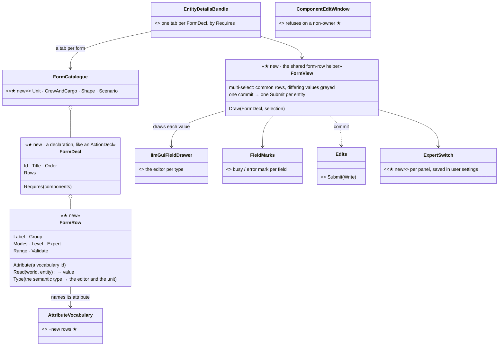
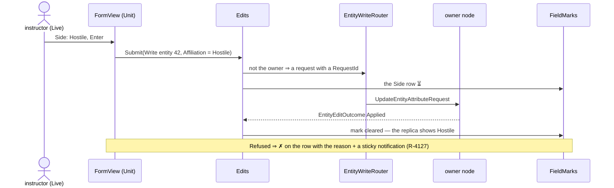

<!--STATUS
state: LIVE
build-state: DESIGN — top-level, for the user's review (R-4122); ui builds the forms, backend the attributes (R-4123)
updated: 2026-11-06 (first version — coordinator; editing-UX design queue item 8: E2, D3 / D7 and the raw inspector fixes)
current-answer: §2 the model · §3 the four forms · §4 stages · §5 questions with leans
stale-below: nothing
known-rot: none
known-conflict: none
related-designs:
  - DESIGN_Editing_UX.md — the programme: §3.3 the target tab set, D2 (tabs in the shared bundle with Requires), D3 (the Unit form's fields), D7 (expert detail), §3.7 the expected basics
  - DESIGN_Edit_Framework.md — OWNS the write: every form commit is one Edits.Submit(Write …); §2.5 the field-mark hook and the shared form-row helper this design builds
  - DESIGN_Action_Catalogue.md — OWNS Requires / Modes / Level; a form row declares the same three
  - DESIGN_Edit_Mode_Undo.md — one form commit = one undo step (R-4133)
  - DESIGN_New_Scenario_And_Recipe.md — the terrain shown read-only in the Scenario form (R-4135)
  - DESIGN_Map_Interaction.md — the Shape form's geometry is edited on the map; the form holds the rest
  - DESIGN_Seats_And_Hats.md — a row's Level greys it for a seat that may not change it
  - ../DESIGN_Semantic_Value_Types.md — OWNS the typed values (SV-1 time, SV-4 angle) that choose a row's editor and its unit
  - ../blueprints/Architect_Question_59_Attribute_Vocabulary_Single_Source.md — OWNS AttributeVocabulary, "a row HERE FIRST"; every form field is an attribute
  - ../DESIGN_Remote_Edit_Outcome.md — the ticket and outcome a form commit carries
-->

# DESIGN — the Details forms: Unit, Crew & cargo, Shape, Scenario

## 0. Why, and what the user asked

🔒 *"The raw component editors are more a debugging tool … dedicated forms"* (user, `2026-11-06`, R-4120).
🔒 *"expert detail hidden, not removed"* (R-4121).

Today a user changes side, name, health, ammunition or spawn facing through the raw **Components** tab. It shows engine names, indices
and TKB numbers (programme §1.1). This design gives the common fields forms, and keeps the raw tab as the debugging tool.

## 1. INVENTORY *(2026-11-06)*

Queries run:

- `search_graph ".*(Form|FieldView|FieldEditor|PropertyGrid|Inspector|DetailsTab|EntityView|TabView)$" Class`: **45**. The forms that exist are `OrderForm`, `BehaviorParamsForm` and `ParamsDefaultsForm` (StructEdit over a DTO); the field editors are StructEdit's plus `PickableLeafFieldEditor`, `MathFieldEditors`, `TypeFieldEditor` and others.
- `".*(IForm|IField|IDetailsTab|IEntityTab|IEntityView|IPropertyEditor|IValueFormatter|ISemantic).*" Interface`: **2** (`IImGuiFieldDrawer`, `IFieldReadWriter`). No form or row abstraction exists.
- `".*Attribute(Registry|Catalog|Interpreter|Map|Table|Translator|Names|Descriptor|Binding|Schema).*" Class`: **5**.
- grep for the component types, `AttributeVocabulary`, `ComponentEditWindow`, `EditRequests`.

Coverage could not be checked (the CLI has no `check_index_coverage`).

| what exists | where | for this design |
|---|---|---|
| **the attribute vocabulary — the ONE list of fields that can be written to any node**: 18 rows (`Name`, `Affiliation`, `Position.X/Y/Z`, `Heading`, `ScenarioStartUtcTicks`, `ScenarioUtcOffsetMinutes`, `Fear`, `FrightFrom.*`, `Rule.*`) | `Replication/Attributes/AttributeVocabulary.cs:45` (Q59: *"adding an attribute means adding a row HERE FIRST"*) | ⭐⭐ a form field that is an attribute gets the remote write, the ticket, the outcome, HTTP `/attribute`, rules and undo **for free**. ⛔ Strength, ammunition, posture, playable, weather are **not** attributes yet |
| **the write** — `EditRequests.Write / WriteJson` → `EntityWriteRouter` (apply here, or ask the owner) | `Replication/Edits/EditRequests.cs:22,37` | the edit framework's `Write` op wraps it (F1) |
| **the field editors** — `IImGuiFieldDrawer` + StructEdit leaf editors (pickable links, angles, quaternion-as-euler, type, utility curve) | `Fdp.Presentation/ImGui/Editing/IImGuiFieldDrawer.cs` | ⭐ a form row draws its value with the SAME drawer StructEdit picks for that type ⇒ a typed value edits the same everywhere |
| **the field-mark hook** — `Func<FieldPath, FieldMark?>` + `FieldMarks.Draw(entity, path)` (approved, not built) | Edit framework §2.5 (R-4127) | *"the new dedicated forms are built from a shared form-row helper that does it once"* — this design IS that helper |
| **the raw Components tab's write** — `ComponentEditWindow.ExecuteOkLogic` → `ls.SetComponent(...)` | `ComponentEditWindow.cs:157-170` | ⛔ **a LOCAL write**: on a station that does not own the entity it writes the replica and is lost — the CE-4274 shape. Filed **CE-4283** |
| **the components** | `EntityInfo` (`Fdp.Core`), `Health`, `WeaponState`, `WeaponAmmo`, `StanceIntent`, `CarrierSeats`, `PassengerBuffer` (`Fdp.Toolkits`), `Playable`, `SpawnArea`, `EditablePolyline`, `RoutePlan` (`Hrot.Core`), `WeatherConditions` | each form row reads one of these |
| **the tabs** — `EntityDetailsBundle` gives every host Components, Summary, Objectives, Brain; the editor adds Scenario, Zones, Macro, Playable, Mission | `EntityDetailsBundle.cs:59-96`, `EditorSubsystem.cs:3295-3370` | D2 (approved): every tab in the shared bundle with `Requires` |

### 1.1 Claim table

| claim | code | design basis |
|---|---|---|
| an attribute field writes on any node | ✅ `EntityWriteRouter` (local or a request to the owner) | ✅ Remote_Edit_Outcome, Edit framework F1 |
| a non-attribute field cannot be written remotely today | ✅ the router speaks attribute ids only (`IEntityComponentWriter.Write(entity, attributeId, value)`); the raw window writes locally | ✅ Q59 §7.2 (the vocabulary is the list) |
| a form row can reuse StructEdit's leaf editors | ⚠ `IImGuiFieldDrawer` is the seam the drawers implement — whether every leaf editor is reachable through it without a StructEdit session is **not measured**; stage D1's first step | Edit framework §2.5 |
| the attributes needed are cheap to add | ✅ the rule and its rails exist (`TheFourRoutingTablesAgreeTests`); each is one row + a JSON setter + a binary handler | ✅ Q59 |

## 2. The model

### 2.1 The picture

*What the picture shows that the prose hid:* a form owns no write and no editor. Each row names an attribute, and the attribute already
knows how to reach the owner. The row's type picks the editor StructEdit would pick. The only new things are the declarations and the
view that lays them out. The forms are therefore one mechanism across every host, never four hand-drawn panels.

### 2.2 A commit, from a station that does not own the unit

*What the picture shows that the prose hid:* the form never decides "local or remote" and never polls. The same commit works in the
network-less editor (applied at once, one undo step) and on a cluster.

### 2.3 Rules every form follows

| rule | |
|---|---|
| **a field is an attribute** | ⛔ no form writes a component directly. A field without an attribute gets one first (Q59's rule: a vocabulary row + setter + handler, the rails red until all three exist) |
| **when a value commits** | on Enter, on leaving the field, or on picking from a list. ⛔ No commit per keystroke. Typing in one field is one undo step |
| **units and ranges** | from the semantic type (m, °, s, %, a time of day); out of range ⇒ red with the reason, never silently clamped (§3.7) |
| **references** | a unit, area, type or behaviour is picked from the one picker or the map, never typed as a number |
| **modes** | Edit and Live: editable · Review: read-only, every row (the Gate refuses, the view greys) |
| **levels** | a row's `Level` greys it for a seat that may not change it, with the reason (D4, seats and hats) |
| **multi-select** | the rows common to all selected entities; a value that differs shows *mixed*; setting it writes all (one Submit per entity, ONE undo step) |
| **expert detail** | rows flagged `Expert` sit in one *Details for experts* expander at the bottom; the panel's Expert switch opens it by default; saved per panel in the user settings (D7) |
| **hot path** | `FormDecl` and rows are built once; `Draw` allocates nothing in a steady frame (no LINQ, cached labels) — a rail measures it |

## 3. The four forms

| form | offered when (`Requires`) | rows (common · ⚙ expert) | attributes to add ★ |
|---|---|---|---|
| **Unit** — replaces Summary and Playable, and the raw trip for the common fields | `EntityInfo` | name / callsign · side · type (read-only, see Q4) · posture at start · strength % · ammunition per weapon · playable + slot · ⚙ entity id, owner node, TKB template | ★ `Health.Current`, `WeaponAmmo.<n>.Rounds`, `StanceIntent` (and it must be SAVED — E2b), `Playable.Side`, `Playable.Slot` (+ the add / remove of `Playable` = edit framework F3) |
| **Crew & cargo** | `CarrierSeats` or `PassengerBuffer` | each seat: who, mounted weapon · passengers · loadout · actions *Embark… / Disembark* (Interact ops) | ★ none for the view; seat changes are interactions (edit framework `Interact`) |
| **Shape** | `EditablePolyline`, `RoutePlan`, `SpawnArea` or a weather region | kind · name · point count, length / area (read-only; the geometry is edited on the map, E8) · spawn area: side, facing · weather region: conditions · route: speed per leg · ⚙ the raw points | ★ `SpawnArea.Side`, `SpawnArea.Facing`, route leg speed, the region's weather fields |
| **Scenario** (nothing selected) | the world environment | General: name, description, *Capture picture* · Time: start, offset (attributes exist) · Weather: a form · Terrain: read-only (R-4135) · Parameters · ⚙ subsystem type, schema | ★ the global weather fields; name / description are file header (a document step, undo design §1.1) |

⏸ Not in E2, as the programme lists them: Sides & relations, Traffic, Civilians & crowds, Gameplay (respawn, deploy) and Checks. Each
gets a row in this Scenario form when its own design lands.

### 3.1 The raw Components tab — kept, fixed, and honest

| fix | why |
|---|---|
| nested structs expand, inline arrays draw, a typed field uses its formatter | programme §1.1 findings |
| on a station that does not own the entity, *Edit* is greyed: *"debugging edits apply only on the owner (node N)"* (**CE-4283**) | today the write lands on the replica and is lost |
| last in the tab order, behind the forms | R-4120: a debugging tool |

## 4. Stages

| stage | what | owner | rails |
|---|---|---|---|
| **D1** | `FormDecl` / `FormRow` / `FormView` / `FormCatalogue`; ① **measure that every leaf editor is reachable through `IImGuiFieldDrawer`**; field marks; multi-select; the expert expander and switch; zero allocation per frame | ui | a declared form draws and commits through `Edits.Submit`; mixed values; 0 bytes per steady frame |
| **D2** | the attributes: `Health.Current`, `WeaponAmmo.<n>.Rounds`, `StanceIntent`, `Playable.Side` / `Slot`, `SpawnArea.Side` / `Facing`, the weather fields — each a vocabulary row + setter + handler | backend | `TheFourRoutingTablesAgreeTests` green; each written from a non-owner reaches the owner (a two-node rail) |
| **D3** | the Unit form (replaces Summary, Playable) | ui | side, name, strength, ammo, posture, playable from the form, in Edit and Live; read-only in Review |
| **D4** | the Scenario form (time, weather, terrain read-only, parameters, capture picture) | ui | weather set in Live reaches every node |
| **D5** | the Shape and Crew & cargo forms | ui | — |
| **D6** | the raw tab fixes + CE-4283 | ui | a non-owner sees the reason, not a lost write |

Order: D1 and D2 in parallel → D3 → D4 → D5 → D6. D1 needs edit framework F1 (`Edits.Submit` + `Write`).

## 5. Questions — leans for the user

| # | question | lean | rejected |
|---|---|---|---|
| **Q1** | how a form is defined | **declarations** (`FormDecl` rows naming an attribute, a type, Requires / Modes / Level / Expert) drawn by ONE `FormView` | a hand-drawn ImGui panel per form: four layouts that drift · StructEdit over a per-form DTO: needs a read and write map per DTO anyway, and hides the per-row mode / level / expert |
| **Q2** | what a field writes | **an attribute, always** — missing ones are added to the vocabulary first | a direct component write: lost on a non-owner, no ticket, no rules / HTTP reach |
| **Q3** | when a value commits | **on Enter, on leaving the field, or on a pick** — one undo step per field edit | per keystroke: hundreds of requests and steps · an Apply button per form: one more click on every change |
| **Q4** | changing a unit's type | **read-only in E2**; a later *Replace with…* action (new type, same place, side and name; references re-pointed) gets its own small design | editable in the form: it changes the entity's identity, which a field edit must not do |
| **Q5** | the raw Components tab on a non-owner | **greyed with the reason (CE-4283)**; it stays a local debugging tool | send whole components to the owner: a new wire request for a debugging tool |
| **Q6** | what the Unit form replaces | **Summary and Playable** (their content moves into it); Components stays, last | keep Summary beside it: two tabs saying the same |
