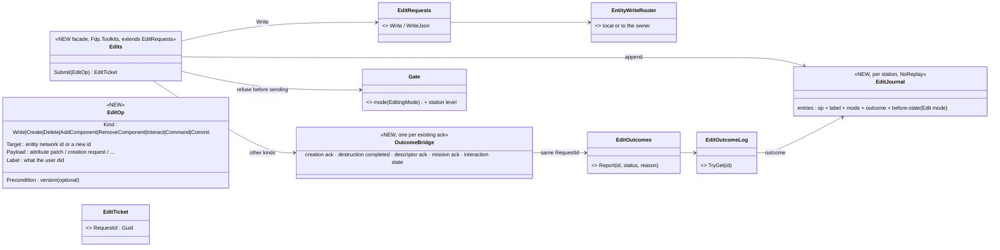
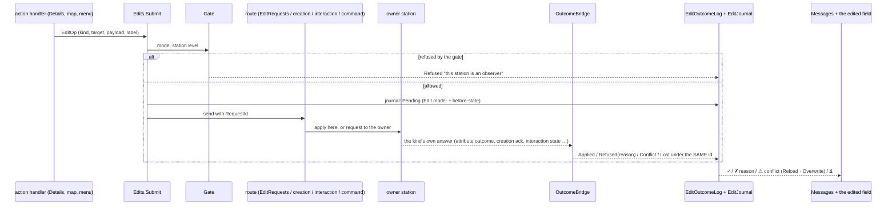
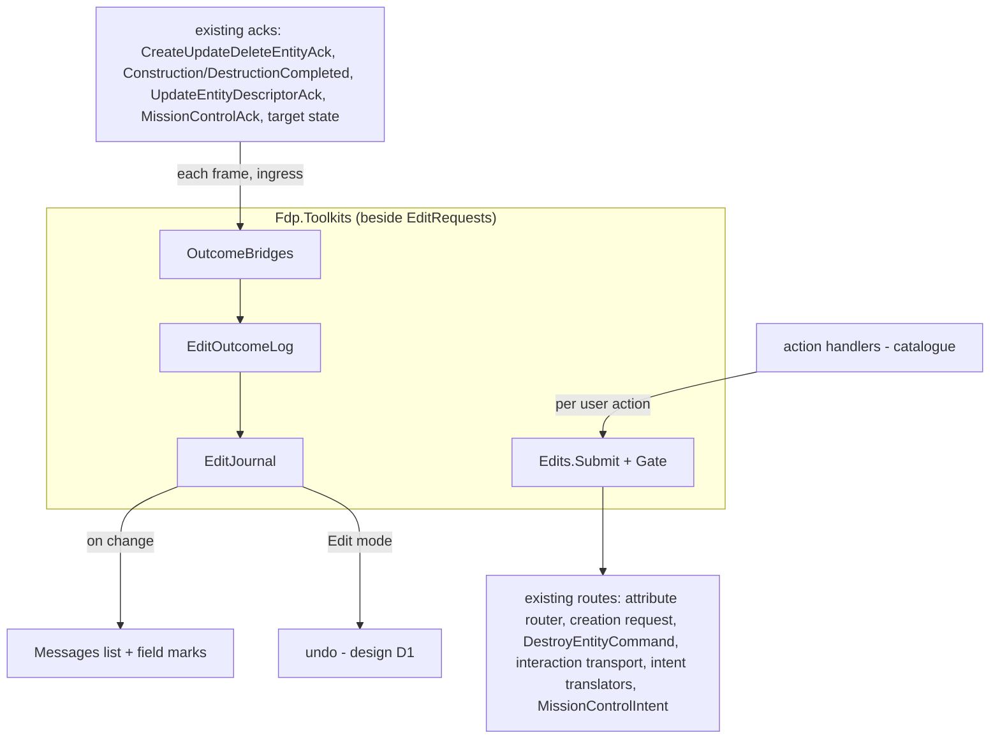

<!--STATUS
state: LIVE
build-state: DESIGN — top-level, for the user's review (R-4122); the building lanes detail it (R-4123)
updated: 2026-11-06 (Q1 and Q2 revised: orders answer acceptance only; interactions send the generic outcome with a request id) · 2026-11-06 (§2.4 the old acknowledgement merged into EntityEditOutcome — R-4126) · 2026-11-06 (first version — coordinator; editing-UX design queue item 2: E0 / D10)
current-answer: §2 the model (diagrams) · §3 each kind of edit, today → in the framework · §4 stages · §5 questions with leans
stale-below: nothing
known-rot: none
known-conflict: none
related-designs:
  - ../DESIGN_Remote_Edit_Outcome.md — the framework this EXTENDS (built 2026-11-04: EntityWriteRouter + EditRequests ticket + EditOutcomeLog for component writes); this design adds the other kinds of edit, the bridges and the journal
  - DESIGN_Editing_UX.md — the programme: D10 (one edit framework), D8 (Messages), D1 (undo, which reads this design's journal), D4 (station levels)
  - DESIGN_Action_Catalogue.md — an action's handler submits its edit here; the catalogue decides what is offered, this design decides what happens to it
  - ../DESIGN_Entity_Creation_Unification.md — OWNS the creation request (§3.4d) and its lifecycle events (§3.4e); its CreateUpdateDeleteEntityAck is MERGED into EntityEditOutcome here (R-4126, supersedes R-2082's "stays")
  - ../DESIGN_Entity_Interactions.md — OWNS embark / possess as interactions answered by the target's own state (a reply topic was rejected, :136); observed here, never replaced
  - ../DESIGN_Entity_Ownership_Transfer.md — OWNS ownership transfer (giver-initiated; the consolidate flow unbuilt)
  - ../DESIGN_Entity_Hierarchy_Views.md — OWNS the ORBAT re-parent (CommanderId) and its refusal pre-check
-->

# DESIGN — one edit framework: every user edit is one request, with one outcome, on every station

## 0. Why

🔒 User, `2026-11-06`: *"Regarding the multi-node editing request/response, this likely needs some unified framework, not ad hoc per edited
feature."* (R-4122). The programme's D10 lean, approved: **extend the framework that exists** ([Remote Edit Outcome](../DESIGN_Remote_Edit_Outcome.md)),
never build a second one.

## 1. INVENTORY *(2026-11-06)*

Queries: `search_graph ".*(Ack|Outcome|Refus|Reject|Result)(Event)?$"` Class (132, has_more), `".*(Request|Command|Intent)(Event)?$"` (144,
has_more), `"EditRequest.*"` (0 — the index is stale; grep: `EditOutcomeLog.Of(` 7 sites); `search_code "new DestroyEntityCommand"` (62),
`"EditRequests.Write"` (2 files). Coverage not checkable.

**What exists (Remote Edit Outcome §5, as built):** `EditRequests.Write / WriteJson` → the write router (apply here, or a request to the
owner carrying `RequestId` + `WantOutcome`) → the owner's `UpdateEntityAttributeRequestSystem` → attribute handlers (a judged-later edit
sets `Deferred` ⇒ Pending) → `EditOutcomes.Report` → `EditOutcomeLog` on every node (egress / ingress `EntityEditOutcome`) →
`GET /edits/{id}`. ⭐ Two callers only: rules (`RuleCommands.cs:33,54`) and HTTP `/attribute`; three readers: `RulesWindow`, `RuleDetails`, `GET /edits`.

**Every other kind of edit has its own path** — §3 has the table. Five defects found (filed): **CE-4274** rename on a non-owner is lost ·
**CE-4275** ORBAT re-parent on a non-owner writes the replica · **CE-4276** delete tears down the local ghost and cannot be correlated ·
**CE-4277** mission commit not routed to the owner · **CE-4278** no UI reads a create / delete outcome.

## 2. The model

### 2.1 Classes

*What the picture shows that prose hid: there is ONE entry point (`Edits.Submit`) and ONE outcome stream (`EditOutcomeLog`) — the
existing acks are not replaced but BRIDGED into that stream under the request's id; the journal is the one place the Messages list and
undo read.*

| status | meaning |
|---|---|
| **Pending** | sent; the owner has not answered, or the owner defers the verdict (a rule) |
| **Applied** | done |
| **Refused** + the whole reason | the owner (or the gate) said no — *"this station is an observer"*, *"unit is a player"*, *"name too long"* |
| **Conflict** *(NEW)* | a precondition failed — *"changed by someone else since you opened it"* — the user picks Reload or Overwrite (replaces the mission panel's "Force Commit" modal) |
| **Lost** *(NEW)* | no answer within the kind's time-out (e.g. an interaction: 5 s) |

### 2.2 One edit, end to end

*What it shows: the user's handler never knows whether the owner is local or remote, or which kind of answer the owner gives — the
bridge makes every answer look the same.*

### 2.3 Where it lives, who calls it

*Who runs each frame: only the bridges, reading acks that are already read today (no new per-frame scan; zero allocation, R-2084).
`Submit` runs per user action. The journal is UI state: not recorded, not on the wire (`NoReplay`).*

### 2.4 One answer message — the old acknowledgement merged in *(user, `2026-11-06`, R-4126, supersedes R-2082's "the existing ack stays")*

🔒 *"We can merge into EntityEditOutcome, no one depend on the CreateUpdateDeleteEntityAck too much."*

| field | `EntityEditOutcome` today | after the merge |
|---|---|---|
| `Guid RequestId` | ✅ | ✅ — the ticket of EVERY kind of edit (create and delete included) |
| `int EntityId` | ✅ | ✅ — for a create, the NEW entity's id (what the old ack carried) |
| `int Status` | 1 Applied · 2 Pending · 3 Refused (`EditStatus`) | + **4 Conflict** · **5 Lost** is local only (a time-out, never sent) |
| `int RespondingNode` | ✅ plain `int` on the wire (SV-3: *"the DDS wire stays plain primitives … the type stops at the topic boundary"*) | ✅ unchanged on the wire; ⭐ the in-engine log record becomes `Fdp.Core.NodeId` (today a plain `int`, Remote Edit Outcome §5) |
| `string Reason` | ✅ ≤ 1000 characters | ✅ |

| retired with `CreateUpdateDeleteEntityAck` | measured | instead |
|---|---|---|
| the message and its old `Hrot.NED.Common.NodeId {AppDomainId, AppInstanceId}` responder | written by `UpdateEntityAttributeRequestSystem.cs:480-491` (when `RequireAck`) and `NedCgfEntityLifecycleAdapters.cs:138` (create / delete); read by `NedCommandGateway`'s `DdsCommandClient<CreateEntityRequest, CreateUpdateDeleteEntityAck>` (`NedCommandGateway.cs:45,62,88`) | every writer reports `EditOutcomes.Report` → `EntityEditOutcome`; the gateway's create client waits for `EntityEditOutcome` under its request id |
| `RequireAck` on the requests | — | `WantOutcome` only |
| the 512-bit applied-components mask (`OpaqueData`) | ⭐ **no production reader** (grep: written only, `UpdateEntityAttributeRequestSystem.cs:277,351,491`) | dropped |
| statuses `0 Success / 1 InProgress / ≥2 error code` | — | Applied / Pending / Refused + the reason TEXT (the error code's name at least) |

⇒ ⭐ this is part of stage **F2** (backend): create and delete answer with `EntityEditOutcome`; the old topic is removed in the same stage, after its two
writers and one reader moved (a rail: no `CreateUpdateDeleteEntityAck` symbol left).

## 3. Each kind of edit — today → in the framework

| kind | today | in the framework | stage |
|---|---|---|---|
| attribute / component write (side, name, weather, clock, drag, rotate, Playable side / slot) | ticket only for rules and HTTP; rename lost on a non-owner (CE-4274); clock sends without an id; weather and Playable write locally | `Write` through `EditRequests` — the outcome already exists | **F1** |
| ORBAT assign | local command, replica written (CE-4275) | `Write` of the existing `CommanderId` attribute | **F1** |
| create (Add Entity, area, route, insert a composition) | creation request + double ack + `EntityConstructionCompleted`, no UI reader (CE-4278) | `Create`; answered by `EntityEditOutcome` (the old ack merged in, §2.4); `EntityConstructionCompleted` stays (a lifecycle event, not an answer); a refusal gets its reason text | **F2** |
| delete | `DestroyEntityCommand`, fresh id per send, ghost teardown (CE-4276) | `Delete` carrying the request id end to end; answered by `EntityEditOutcome` (§2.4) | **F2** |
| add / remove a component (Playable toggle, ORBAT detach) | no request type anywhere | `AddComponent` / `RemoveComponent` — a new owner-side request | **F3** |
| embark, disembark, possess, release | interactions answered by the target's state, no reason; 📐 the payloads carry NO request id today (`InteractionMessages.cs:51-62` — `StationNodeId`, `Mode` only) | ⭐ **revised `2026-11-06` (user: "why not sending the generic edit outcome for them as well?")**: `Interact` — APPEND a `Guid RequestId` to each interaction payload (the wire rule: append only) and the owner's executor reports `EditOutcomes.Report` where it accepts or refuses today (`EmbarkationSystem.cs:85` `Refused++`, `Possession.cs:213`) ⇒ the ONE `EntityEditOutcome` answers, with the reason. ⭐ Not the rejected per-interaction reply topic (`DESIGN_Entity_Interactions.md:136`) — the generic outcome already exists. Lost only if no answer comes | **F4** |
| orders | sender-side `OrderResult` only; on the brain's owner `TacticalIntentResolutionSystem` gates by authority and by ORIGIN RANK (`BehaviorOrigin`: SOP < Superior < Operator — *"a lower origin cannot end a higher one"*), then the order REPLACES the running behaviour (last wins — no queue; the queue is the mission plan); a refusal is only a log line (`TacticalIntentResolutionSystem.cs:139-141`) | ⭐ **revised (user: orders come from many sides; "executing" is not a state of the entity)**: `Command` — the outcome answers **ACCEPTANCE ONLY**: Applied = the brain's owner accepted it and started the behaviour; Refused + reason ("no behaviour for this unit's class", "a higher-ranked order is running", "the unit is dead"). ⛔ It never tracks execution or completion — what the unit is doing now, and who ordered it, is the Brain tab's *Doing* / *Orders* (Brain View) | **F5** |
| mission plan commit | `MissionControlIntent`, local, version check, "Force Commit" (CE-4277) | `Commit` with a version precondition → **Conflict** with Reload / Overwrite; routed to the brain's owner | **F6** |
| the Messages list and field marks (D8) | rules only | read the journal | **F7** |
| ownership transfer | giver-only push, no ack | out of scope until the consolidate flow is designed (its own design owns it) | — |
| scenario parameters | a DOCUMENT edit with its own undo | ⛔ out — not an entity edit (§5 Q4) | — |

## 4. Stages *(top level; backend owns Fdp.Toolkits and the routes, ui the readers)*

| stage | what | proof |
|---|---|---|
| **F1** | `Edits.Submit` + `Gate` + `EditJournal`; every attribute-shaped edit goes through `Write` (fixes CE-4274, CE-4275) | per kind: a non-owner's edit reaches the owner and reports Applied (a two-node rail); a Review-mode or observer edit is Refused with its reason |
| **F2** | `Create` / `Delete` with the request id end to end, answered by `EntityEditOutcome`; `CreateUpdateDeleteEntityAck` retired (§2.4); the log record's responder typed `NodeId` (fixes CE-4276, CE-4278) | a refused placement shows its reason; a delete from a non-owner leaves no ghost torn down early |
| **F3** | `AddComponent` / `RemoveComponent` owner-side | Playable toggle and ORBAT detach from a non-owner |
| **F4** | `Interact`: a `RequestId` appended to the interaction payloads, the owner reports `EntityEditOutcome` | embark refused shows why |
| **F5** | `Command`: the order's request id carried to the brain's owner; `TacticalIntentResolutionSystem` reports accepted / refused with the reason | a lower-ranked order refused with "a higher-ranked order is running" |
| **F6** | `Commit` with `Conflict` (fixes CE-4277); the Force Commit modal goes | two stations editing one plan |
| **F7** | Messages + field marks read the journal | — |

## 5. Questions — leans for the user

| # | question | ⭐ lean | rejected |
|---|---|---|---|
| **Q1** | are orders "edits" in this framework? | **yes, as kind `Command`, answering ACCEPTANCE only** (revised `2026-11-06`): the brain's owner says accepted / refused + why; execution and completion are NOT tracked here (they are the Brain tab's *Doing* / *Orders*) | tracking "is executing / finished" — orders come from many sides, the last accepted one replaces the running behaviour, and a unit may change its mind: not a state the framework can own |
| **Q2** | interactions (embark, possess): how they answer | **revised `2026-11-06`: the generic `EntityEditOutcome`** — a `RequestId` appended to the payloads, the owner reports where it accepts / refuses today; small effort (one field per payload, one report call per site), no new topic | watching the target's state with a time-out — slower, no reason; a per-interaction reply topic — ruled out (`DESIGN_Entity_Interactions.md:136`) |
| **Q3** | conflict UX | **Conflict** status with *Reload* / *Overwrite* in Messages and on the form — no modal | keep "Force Commit (Overwrite)" — engine vocabulary, a modal |
| **Q4** | scenario parameters | **outside** — a document edit with its own undo (already on `EditHistory`) | wrapping a document edit as an entity edit |
| **Q5** | the journal | **per station, UI state, not recorded, not on the wire**; it holds the before-state only in Edit mode (for undo) | recording the journal — the recording already holds the world |
| **Q6** | where `Edits` lives | **Fdp.Toolkits, beside `EditRequests`** (one home for the framework) — backend owns it | Hrot.Presentation — the HTTP API and rules need it too |
