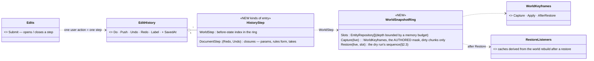
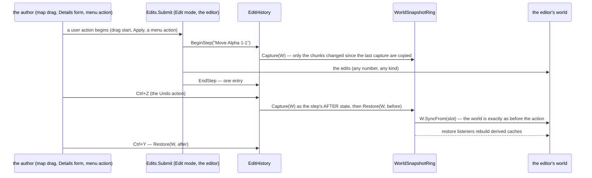

<!--STATUS
state: LIVE
build-state: DESIGN — top-level, ✅ APPROVED Q1–Q7 by the user 2026-11-06 (R-4133); the building lanes detail it (R-4123)
updated: 2026-11-06 (✅ Q1–Q7 approved — R-4133) · 2026-11-06 (§1.1 what a world snapshot misses — authored NoPreview components, singletons, files, version-compare caches, pure UI state; §2.3 the restore = the dry run's sequence, not a raw SyncFrom) · 2026-11-06 (first version — coordinator; editing-UX design queue item 5: D1)
current-answer: §2 the model · §3 stages · §4 questions with leans
stale-below: nothing
known-rot: the node called IG here is the Player node since CE-3371 (backend, 2026-11-06): Hrot.IG → Hrot.Player, IgApplication → PlayerApplication (line numbers cited before the rename may have moved)
known-conflict: R-1047 deferred entity undo because editing is shared with live changes — R-4120 limits undo to Edit mode, which removes that reason; this design is the deferred CE-1462
related-designs:
  - DESIGN_Map_Interaction.md — E8: one finished map edit = one step
  - DESIGN_Editing_UX.md — the programme: D1, R-4120 (undo in Edit mode only)
  - DESIGN_Edit_Framework.md — the journal and the step boundary (one user action = one Submit scope); an undo is itself applied through it
  - ../DESIGN_Rules_View_UI.md — §7.5 / §7.5a OWN the shared EditHistory (CE-4218) and the classified duplicates (CE-4219: the gizmo stacks, the director's)
  - ../DESIGN_Film_Director.md — the take editor's undo (today a GizmoUndoStack) moves onto the one history
  - DESIGN_Seats_And_Hats.md — undo is the Author seat's, in the Edit hat
-->

# DESIGN — undo in Edit mode: one history, world steps by snapshot, in the network-less editor

## 0. Why, and the scope the user set

🔒 User, `2026-11-06`: *"undo in edit mode is also its own design"* (R-4122) · *"if it would complicate stuff much (distributed system editing)
we do not need to force it; but in editor's all-in-one network-less composition it stays pretty useful feature"* · *"meaning the world
snapshotting is not completely out of possibilities if it helps"*.

⭐ **Scope: the editor's all-in-one, network-less composition, in Edit mode** (the authored state before Preview / Live). Elsewhere (a
distributed cluster, Live, Preview) there is no undo: the Undo item is greyed *"undo works in the editor's offline editing"*.

## 1. INVENTORY *(2026-11-06)*

Queries: `search_graph .*(Snapshot|Restore|Checkpoint|DeltaFrame|Keyframe).*` Class (>40, mostly replay / debug), grep `EditHistory`,
`GizmoUndoStack`, `SyncFrom(`.

| what exists | measured |
|---|---|
| **`EditHistory`** — a linear list of named `(Redo, Undo)` closures; THE one editor history (CE-4218) | `Hrot.Presentation/Edits/EditHistory.cs`; users: the Parameters window (`HeaderParamsSchemaSource`), the rule editor (`RuleDetails`), the AI section (`EntityAiDetailsView`), held once by `EditorSubsystem` |
| **`GizmoUndoStack`** (Fdp.Toolkits) — records replayed through an ECS command buffer, depth 50 | users: `DataDrivenGizmoSystem`, IG (`IgApplication.cs:812`, Ctrl+Z / Y on the Player's map), the director's take editor (`TakeEditor.cs:53`, `DirectorTakeSession.cs:38`, "the known wart"); ⚠ NOT wired by `MapInteractionPack` ⇒ no map edit is undoable in the editor |
| a second `GizmoUndoStack` in `GizmoMap.Presentation` | no user; a separate library's public API (CE-4219 ②: classified, not deleted) |
| ⚠ **world snapshot / restore exists** (see §1.1: the right one is `WorldKeyframes`) | `EntityRepository.SyncFrom(source, mask?, includeTransient?, excludeTypes?)` (`EntityRepository.Sync.cs:23`) copies a whole world; per component table **only the chunks whose version changed** (`ComponentTable.SyncFrom` → `SyncDirtyChunks`); the breakpoint manager REWINDS the live editor world with it (`DataBreakpointManager.cs:586-589`: `_liveRepo.SyncFrom(_preTickSnapshot)`) |
| ⭐ managed components are immutable records (the CLAUDE.md rule) | so a snapshot's shallow copy of a managed chunk is CORRECT — an old instance is never mutated under it |

### 1.1 What a world snapshot would MISS — measured *(user, `2026-11-06`: "what about the pure ui state (not in ECS repo), i believe there some cases like that, can you analyze")*

Queries: `search_graph` `Scenario.*(Save|Serializer|Resident)` (17), `.*(Selection|Pin|Camera|Layout|Recent).*State` (10),
`.*(EntityMap|GuidIndex|…|SpatialGrid).*` (18), `.*Undo.*`; grep `ConditionalWeakTable<EntityRepository` (**33 declarations in 30 files**),
`DataPolicy(… NoPreview …)` (24, of which **9 are saved** with the scenario).

| class | what | measured | ⇒ in the undo |
|---|---|---|---|
| **⚠ raw `SyncFrom` is the wrong tool** | its default mask copies only "snapshotable" types and STRIPS the rest from the live entities; it shares managed instances (`ManagedComponentTable.cs:324-327`); it moves `GlobalVersion` and the tick BACK; it never touches singletons, the bus, the lifecycle stream | `EntityRepository.Sync.cs:42, :63, :117-128, :155-156`; the dry run LEFT `SyncFrom` for this reason (`ReferencePreviewHandler.cs:53-55`: `AirPath` mutated) | ⭐ use the EXISTING world-restore sequence instead — §2.3 |
| **(A) authored, saved, but NOT in the copied tables** | **9 saved components marked `NoPreview`** — `RoutePlan`, `ActiveMissionPlan`, `PositionGeodetic`, `ChildMap`, `SimCombatDef`, `TkbCompositionDef` … — and the behaviour slots' sources (`BehaviorStartRecord`, `SopState`) | `RoutePlan.cs:69`, `DomainMissionPlan.cs:46`, `BehaviorStartRecord.cs:28`, `SopState.cs:85` | ⭐ the capture uses an **AUTHORED mask** (every component saved with the scenario, i.e. not `NoScenario`), not the preview mask |
| (A) singletons | the **scenario header** (`ScenarioDescriptionResident`: description, name, args, the macro header — replaced whole by `Stamp`), the terrain name, the terrain objects (door states, `TerrainWorld`) | `ScenarioDescription.cs:16-41, :87, :109`; `TerrainObjectsSection.cs:31-35` | the header's edits are already **document steps** (Parameters window); door edits become a document step on `TerrainWorld`; the terrain name never changes (R-4124) |
| (A) files | `checks.json`, `preview.jpg`, director takes, macro files | `ScenarioChecks.cs:65`; `TakeStore.cs:25`; `MacroLibrary.cs:12` | takes → document steps (U4); writing a file (a preview capture, a macro save) is NOT undone — it says so |
| **(B) beside the world** | the network-id ↔ entity map, the id allocator, the lifecycle queues, `WorldEpoch`, egress dirty marks | `WorldKeyframes.cs:166-176`, `PreviewParticipants.cs:31-82` | restored by the existing sequence (§2.3) |
| (B) caches that compare a VERSION | `PartIndex`, `RuleTree`, `LiveRefScope` (250 ms throttle), the rules reader's scopes (`AuthoredRules.Scopes`) | `PartIndex.cs:58`, `RuleTree.cs:45,63`, `LiveRefScope.cs:56` | ⭐ **a restore never moves the version backwards** — it advances it (and the restored chunks carry the new version), so every version-compare cache sees a change by construction; the ones with a throttle get `Invalidate` |
| (B) per-world logs | `EditOutcomeLog`, `RuleRequestIds`, `ShotLog`, `KillFeed` … (run-time logs) | 33 CWTs | untouched — run-time only, empty in Edit mode; `RuleRequestIds` holds entity handles ⇒ cleared on a restore |
| **(C) pure UI state** | selection (`SelectionStore`, a transient singleton), gizmo pins (`UnitDebugSettings`), the rubber band, RTS mode, the map canvas view, the camera, the window layout, the Details tab, panel filters, picker recents, the active tool / hat | `SelectionStore.cs:16-18`, `UnitDebugSettings.cs:21-22`, `MapUiStates.cs:16-18`, `AssetRecents.cs` | ⭐ **never undone** — the user's ruling: *"selection is … a UI state having nothing to do with simulation and recording"* (`UX_Feature_Selection.md:1902-1905`); after an undo, a selected entity that no longer exists drops out of the selection |

## 2. The model

### 2.1 Classes

*What the picture shows that prose hid: there is still ONE history (the existing `EditHistory`); a world edit's entry does not know how to
invert anything — it only remembers WHICH world state came before it, so EVERY write path is undoable by construction (even one that
bypasses the edit framework), and no per-kind inverse code exists to drift.*

### 2.2 A step, and its undo

*What it shows: a step is bracketed by the user action, not by the write; Undo and Redo are a restore of a captured state — the world is
exactly what it was, entity ids included, so selection and links stay valid.*

| | rule |
|---|---|
| **a step = one user action** | the edit framework opens it when an action begins and closes it when it ends: a drag is one step, a form Apply is one, a multi-select change is one, a composition insert is one; typing in one field coalesces (the same field within ~1 s) |
| **document edits** | the Parameters window, the rule form, the director's takes stay closures (`DocumentStep`) — they are not in the world. The take editor moves OFF `GizmoUndoStack` onto `EditHistory` (CE-4219 ②'s "the one consumer that could move") |
| **memory** | a ring bounded by a budget (lean: 256 MB, depth up to 100); each capture copies only the dirty chunks into a slot; ⚠ to MEASURE in U1 — the size of one capture on the largest showcase scenario |
| **derived caches** | a restore notifies `RestoreListeners` (spatial index, navigation, terrain attachments, the rules reader's index …) — ⚠ to measure in U1 which caches already cope (the breakpoint rewind is the precedent) |
| **lifetime** | the history survives Preview (Stop returns to the authored state — checked: the world equals the last state); cleared when a scenario is opened / created or the station goes Live; **Save marks the clean point** (dirty = the history position ≠ the saved one) |
| **outside the editor's network-less Edit mode** | no world steps; Undo greyed with the reason. ⛔ No inverse-operation machinery for the distributed case (the user: *"we do not need to force it"*) |

### 2.3 The restore — the dry run's sequence, not a raw `SyncFrom` *(revised `2026-11-06`)*

⭐ The project already has ONE way to put a world back: the dry run's exit (`ReferencePreviewHandler.cs:225-233`): **`WorldKeyframes.Apply`**
(no shared managed instances) → **`PreviewStateBracket.Restore()`** (the id allocator, the network-id map, the lifecycle participants —
registered at `EcsHostClusterHandlers.cs:131-139`) → **`AfterRestore.Run`** (map rebuild, `WorldEpoch.Restored`, republish). ⭐ Undo reuses
it, with two differences: the capture mask is the AUTHORED set (§1.1 A), and the version moves FORWARD (§1.1 B). `RestoreListeners` (§2.1)
is `AfterRestore`'s list, extended with the throttled caches' `Invalidate` and the `RuleRequestIds` clear. ⛔ No second restore path (R-174).

## 3. Stages *(ui; backend for the restore listeners in the shared nodes)*

| stage | what |
|---|---|
| **U1** | measure: one AUTHORED-mask capture's size and time on the largest scenario through `WorldKeyframes`; confirm §1.1's list of what the dry run's restore sequence already covers |
| **U2** | `WorldSnapshotRing` + `WorldStep` in `EditHistory`; step brackets from the edit framework (F1) and from the map gizmos' begin / commit; Ctrl+Z / Ctrl+Y as actions (the keymap, design 4b) |
| **U3** | restore listeners for the caches U1 names |
| **U4** | the take editor onto `EditHistory`; `GizmoUndoStack` (Fdp.Toolkits) left with no user — its removal is a separate, later decision |
| **U5** | the dirty flag from the saved point; *Edit ▸ History* (the list of steps, click to go back) |

## 4. Questions — ✅ all seven APPROVED as leaned (R-4133, user `2026-11-06`: *"Q1-Q7 approved, go on with the map interaction design"*)

| # | question | ⭐ lean | rejected |
|---|---|---|---|
| **Q1** | how world edits are undone | **world snapshots** through the dry run's existing capture / restore sequence (`WorldKeyframes` + bracket + `AfterRestore`), with the authored mask and a forward-moving version, in a bounded ring — every write path covered by construction | inverse operations per kind of edit — code per kind, misses bypassing writes, the distributed complexity the user does not want |
| **Q2** | where undo works | **the editor's network-less composition, in Edit mode**; greyed with the reason elsewhere | undo on CGF / a cluster — not forced (user) |
| **Q3** | one history | **`EditHistory` holds both** document steps (closures) and world steps (snapshots), in one order | two histories — two Ctrl+Z meanings |
| **Q4** | step boundaries | **one user action = one step** (opened / closed by the edit framework and the gizmo begin / commit); typing coalesces | a step per write — a drag would be hundreds |
| **Q5** | memory | **a budget (256 MB) with depth up to 100**, measured in U1 | unbounded |
| **Q6** | the gizmo stacks | the director's takes move to `EditHistory`; the IG's map undo goes with the Player seat (no authoring there); the toolkit `GizmoUndoStack` is left unused — deleting it is a later decision | delete now — "unreferenced is not unintentional" |
| **Q7** | lifetime | **survives Preview; cleared on open / new / Live; Save marks the clean point** | cleared on every run |
