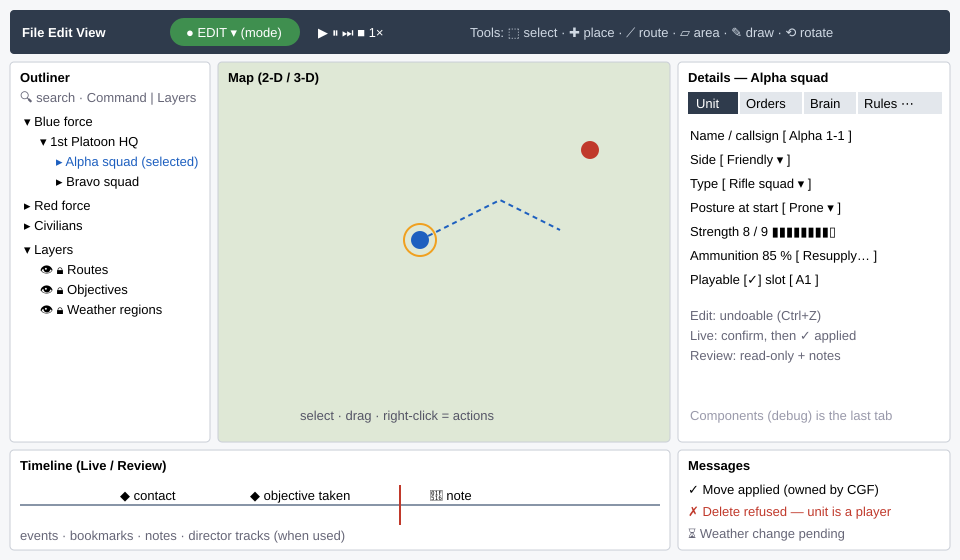
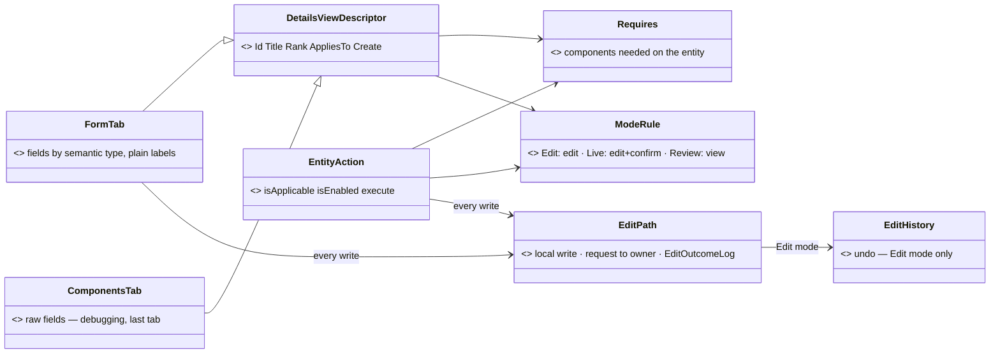

<!--STATUS
state: LIVE
build-state: DESIGN — the programme frame; D2–D9 and D11–D16 (first iteration) approved 2026-11-06; the design queue is §4.5; D1 (undo) and D10 (one edit framework) each get their own design; every slice E0–E7 starts with its own design reviewed by the user (R-4122)
updated: 2026-11-06 (queue 7b E15 written: DESIGN_Initial_State.md) · 2026-11-06 (§1.8 initial state — the user's topics, measured; slice E15, queue 7b) · 2026-11-06 (queue 7 E2 written: DESIGN_Details_Forms.md) · 2026-11-06 (queue 6 E8 approved R-4134; queue 7 E12 written: DESIGN_New_Scenario_And_Recipe.md) · 2026-11-06 (queue 5 undo approved R-4133; queue 6 E8 written: DESIGN_Map_Interaction.md) · 2026-11-06 (queue 3b: E13 the rule editor UX review — user) · 2026-11-06 (D19 the terrain is chosen at creation, never changed — R-4124; E12 in the queue; point ⑩ dropped) · 2026-11-06 (§4.3c D11–D16 approved as a first iteration; top-level designs written here, lanes detail them — R-4123; §4.5 the design queue; §1.4 rows 11–13 from the sweeps) · 2026-11-06 (the user's corrections to §1.5: multi-select exists, centre-handle move exists; §1.7 new topics — hats, mission plan editor, unified menus; §3.12 finish / level / airborne aircraft / gizmo look; D11 revised, D16–D18, E10–E11) · 2026-11-06 (§1.5 map interaction and §1.6 context menus inventoried; §3.12–§3.13 targets; D11–D15; slices E8–E9) · 2026-11-06 (§4.3a the user's verdict: D2–D9 approved, D1 and D10 own designs, design-first per slice — R-4122) · 2026-11-06 (§4 gap map, decisions D1–D9 with leans, slices E1–E7) · 2026-11-06 (§0b the user's review of §2–§3: pickers filtered by applicability, condition templates, expert detail kept, scarce confirmations, editing levels per node — R-4121) · 2026-11-06 (§2 prior art, §3 the target UX: layout wireframe, the tab set, modes, actions, the expected basics) · 2026-11-06 (§0a the user's review of §1: raw editor = debugging tool, semantic types, undo in Edit mode only, dedicated forms, the expected basics — R-4120) · 2026-11-06 (first version: the direction, and the inventory of what a user can edit today — coordinator)
current-answer: §0 the direction (user rulings) · §0a the user's review of §1 · §3 the target UX · §4 the decisions D1–D9 (for approval) and the slices · §1 the inventory (what exists, where it is edited, what is wrong with it; §1.5 map interaction, §1.6 context menus)
stale-below: nothing
known-rot: the node called IG here is the Player node since CE-3371 (backend, 2026-11-06): Hrot.IG → Hrot.Player, IgApplication → PlayerApplication (line numbers cited before the rename may have moved)
known-conflict: AQ26's two-axis resolution lets a HOST supply the isApplicable rule; R-4119 narrows it — for an entity, the rule reads the entity's components (§0)
related-designs:
  - DESIGN_Initial_State.md — design queue 7b (E15): seats and carrying, carried weapons, weapon posture, knows about, the Point type
  - DESIGN_Details_Forms.md — design queue item 8 (E2 / D3, D7): the Unit, Crew & cargo, Shape and Scenario forms; the raw tab fixes
  - DESIGN_New_Scenario_And_Recipe.md — design queue item 7 (E12 / D19): a new scenario blank on a terrain, recipes authored as scenarios
  - DESIGN_Map_Interaction.md — design queue item 6 (E8 / D11, D12, D16): drawing, picking, placing, gizmo looks
  - DESIGN_Edit_Mode_Undo.md — design queue item 5 (D1): undo in Edit mode, by world snapshots, in the network-less editor
  - DESIGN_Input_And_Commands.md — design queue item 4b (E14): one keymap, scoped, every key an action
  - DESIGN_Seats_And_Hats.md — design queue item 4 (E10 / D17 with D4): seats × hats
  - DESIGN_Rule_Editor_UX.md — design queue item 3b (E13): the rule editor UX review
  - DESIGN_Mission_Plan_Editor.md — design queue item 3 (E11 / D18): the mission plan editor
  - DESIGN_Edit_Framework.md — design queue item 2 (E0 / D10): one edit framework across stations
  - DESIGN_Action_Catalogue.md — design queue item 1 (E9 + E1 core): one catalogue of declared actions builds every menu and tab offer
  - ../blueprints/RESUME_Coordinator_Editing_UX.md — the programme's resume doc (where we are, what next)
  - ../CAPABILITIES.md — §14 is the product-facing summary of §1 (what a user can change, per mode)
  - ../blueprints/DESIGN_Details_Panel_View_Switching.md — OWNS the Details panel machinery (DetailsViewRegistry, descriptors, AppliesTo, the offer set); this design owns WHICH tabs, what goes in them, and their UX
  - README.md — the August scenario-authoring UX programme (Path A authoring, Path B runtime intervention, "same panels serve both"); this design widens it to the whole feature set
  - UX_Golden_Path.md — OWNS the walkable acceptance path (A1–A12, B1–B5)
  - Architect_Question_26_Entity_Action_Model.md — OWNS the action registration model (isApplicable / isEnabled / execute)
  - ../blueprints/Architect_Question_108_Run_Mode_Picker.md — OWNS the run modes, the indicator and Run Setup
  - ../DESIGN_Remote_Edit_Outcome.md — OWNS how an edit reaches the owning node and how its outcome is reported
  - ../DESIGN_Entity_Brain_View.md — OWNS the Brain tab
  - ../DESIGN_Rules_View_UI.md — OWNS the rules window and the rule editor
  - ../DESIGN_Director_Timeline_Editor.md — OWNS the shared timeline
  - ../DESIGN_Add_Entity_Picker.md — OWNS placing entities (the gallery)
  - ../DESIGN_Node_Features.md — OWNS per-node switchable features; §3.11's editing levels are one of them
  - ../DESIGN_Scenario_Regression.md — OWNS the one condition model (R-4077) that §3.9's templates compile to
  - ../DESIGN_Semantic_Value_Types.md — OWNS the typed values (SV-1…SV-6) that give a field its editor and display by type
-->

# DESIGN — the editing UX: what a user edits, where, and in which mode

## 0. The direction *(user, `2026-11-06`)*

🔒 *"it's time to take a wider look on what the editing of scenarios and actions during the editing phase as well as during the running
phase should include … the editing features should be available in same way for offline scenario editing and during a real exercise
running, so this should be shared. Although not everything needs to be available in both modes … It needs to be user-friendly and
practical."*

| ruling | what it fixes |
|---|---|
| **R-4118** | the **Details panel** is the one home for the detail of anything selected — its tabs, not standalone panels; the existing tabs are themselves in scope for practicality |
| **R-4119** | editing is gated by the **entity's components**, never by the node: the editor and CGF (and any node with the UI) offer the same editing. Authority to APPLY is separate — the remote-edit path |
| R-4117 | (context) scenario and entity pictures ship in git |

### 0a. The user's review of §1 *(`2026-11-06`)*

🔒 *"The raw component editors are more a debugging tool but still might need improvements (many times nested structures are not expanded,
some stuff line inline arrays nor always shown correctly, entity and other types with custom formateer not always shown rendered with such).
Also semantic types planned item not implemented, while it could greatly improve the editing experience. Regarding undo, this is not
applicable in live mode (or preview), yet worth investigating how to implement it for edit mode (when ediring initial state before we run
preview or live). The most common entity parameters should be likely editable in a dedicated forms on the details tab. It shouldn't be
necessary to go into the raw components editors for those. Little stuff like message boxes, responding to escape, or having a cancel button,
or edit boxes, supported copy and paste, and all these little stuff that are expected by default but not always honored should be taken
into account as they have a great effect on the user experience."* — R-4120.

| point | what it means for this design |
|---|---|
| **the raw component editor is a DEBUGGING tool** — but fix it | it stays (Components tab), it is not the user's editor; its own defects are in scope: nested structs not expanded, inline (fixed) arrays drawn wrong, types with a custom formatter (an entity reference, …) not drawn through it |
| **semantic value types** ([DESIGN_Semantic_Value_Types.md](../DESIGN_Semantic_Value_Types.md), accepted 2026-11-01; SV-2/SV-3 built; **SV-1 `SimInstant`/`SimDuration` CE-4201, SV-4 `Angle` CE-4202, SV-5 `StationId` CE-4203, SV-6 `ExerciseId`/`EpisodeId` CE-4204 not built**) | a typed field gets its editor and display BY ITS TYPE in every editor at once (a time as a time, an angle in degrees, an id as a name with a picker) — the cheapest way to make both the forms and the raw editor readable |
| **undo: Edit mode only** | ⛔ not in Live or Preview (a running world cannot be taken back — R-1047's reason); ⭐ investigate undo of the INITIAL STATE edits (place, move, rotate, delete, ORBAT, forms) before a run — R-1047 / CE-1462 deferred it, this is the question to answer in §4 |
| **dedicated forms on Details tabs** for the most common entity parameters | side, name/callsign, type, health, ammunition, posture, deploy kits, spawn-area side/facing, weather … — never a trip to the raw fields for these |
| **the expected basics** | a checklist every surface meets (§3): Esc closes / cancels, Enter confirms, a Cancel button on every dialog, confirmation for destructive actions, message boxes that say what happened, copy / paste in every edit box, consistent edit boxes (units, ranges, validation) — ⚠ small, but they decide the experience |

### 0b. The user's review of §2–§3 *(`2026-11-06`)*

🔒 *"the behavior pickers and various other pickers might need extending by incremental filter fields and categorized tree views and to
have filters preventing showing stuff which is unapplicable to currently selected entity. This is a generic consideration everywhere"* ·
*"we now have a pretty low level predicate condition editor, ok for technical users, but not always fine for the non technical one."* ·
*"The forms/tabs should support showing also lower level debug data (we should not plainly remove those from all over the UI - we could
hide them to some "expert" ui mode (per panel likely) or to by-default-collapsed expanders."* · *"for live mode edits the confirmation should
be scarce to avoid annoying the user. maybe the editing capabilities should be gated similarly like the other features are, by default ON,
but possible to reduce for a given node depending on what kind user is expected to work with that (god mode vs observer mode and all in
between)."* — R-4121. Folded into §3.7 (pickers), §3.9 (conditions), §3.10 (expert detail), §3.5 and §3.11 (confirmations, editing levels).

The plan: **① inventory** (§1, this version) → **② prior art and the target UX** (§2–§3) → **③ gap map, decisions with leans, handoffs** (§4).
Three modes throughout: **Edit** (offline), **Live** (an exercise running), **Review** (DAR during a run, AAR on a recording, the Replay Browser).

## 1. INVENTORY *(2026-11-06)*

Five read-only sweeps (Details tabs; units and force structure; AI, missions and orders; scenario and world; run, live and review), each
over `docs/` first, then code. Graph queries run (`scripts/cbm.sh search_graph`, label Class): `.*Details.*(Tab|Section|Provider|Contributor|Registry|Host).*`
(9) and Interface (3); `.*Window$` (82); `.*Panel$` (46); `.*Inspector$` (4); `.*(Order|Mission|Behaviour|Behavior|Brain|Utility|Eqs|Blackboard).*(Panel|Window|Tab|Editor|Section|Tool|Inspector).*` (36);
`.*(Route|Area|Zone|Waypoint|PhaseLine|Objective).*(Tool|Gizmo|Editor|Panel|Window|View).*` (22); `.*(Weather|Environment|ScenarioClock|TimeOfDay|Traffic|Sumo|Crowd|Minefield|Obstacle|AirDefen|IndirectFire|Sound).*` (176);
`.*(ForceRelation|Relations|Alliance|Hostility|SideTable|ForceTable|Diplomacy).*` (**0**); `.*(Loadout|Ammo|Crew|Seat|Skill|Injury|Posture|Kit|SpawnArea|Respawn).*(Panel|View|Editor|Window|Section|Drawer)$` (**0**);
`.*(Inject|RunMode|Undo|Replay|Director|Timescale|TimeControl).*` (152). ⚠ The graph index is STALE in places (it lists `ExCon*Window`,
`EditorOrbatPanel`, `EntityPropertyInspector` — files gone); every row below was confirmed by grep. Coverage could not be checked
(`check_index_coverage` is not in the CLI). The per-mode feature matrix is [CAPABILITIES §14](../CAPABILITIES.md); this section keeps what
the design needs.

### 1.1 The Details panel today

Every ECS host composes `EntityDetailsBundle` (`Hrot.Editor.AiShared/Windows/EntityDetailsBundle.cs:59-96`): Editor, CGF, IG, SimHost,
Replay Browser, Stride. It gives every host **Components, Summary, Objectives, Brain** (+ **Event** when the host passes `EventFocus`).
The editor then adds its own tabs (`EditorSubsystem.cs:3295-3370`); AI perspectives add theirs through `PerspectiveWorkspaceRegistrar`.

| tab | offered when | edits | registered by | findings |
|---|---|---|---|---|
| **Scenario** (10) | map background, nothing selected | start time, offset, global weather, scenario parameters | **editor only** | weather drawn by the raw inspector; reachable only by clicking empty map |
| **Zones** | same as Scenario | "load zone" | **editor only** | a second tab for the same selection |
| **Macro** (20) | `MacroInstance` | macro, arguments; read-only without authority | **editor only** | ✅ correct authority check — could live on every host |
| **Components** (30) | one entity **and the host has an inspector** | every raw field (double-click → a pop-up `Edit <Type> [<index>]`) | all hosts | the main editor for side, name, health, ammo, kits, spawn facing — raw engine names, indices, TKB numbers |
| **Objectives** (32) | the entity is a rule's subject | none (link to the rule) | all hosts | links only where the host passed `OpenRule` (Editor, RB) |
| **Brain** (34) | `BehaviorState`, or an embed applies | Settings; embeds: **Assign: task, SOP, ROE** (on the undo list), **Blueprints** | all hosts; **the embeds editor only**; a second Brain tab on the Blueprint perspective | very long; section titles in engine words; two differently-built Brain tabs |
| **Summary** (35) | one entity | read-only | all hosts | fine |
| **Playable** (36) | one entity (**any** entity, not only units) | writes `Playable` directly (`EntityPlayableView.cs:96-104`) | **editor only** | no run-state, replay or authority check; no undo; side offers Friend/Hostile only |
| **Mission** (40) | the **editor's mission service** offers behaviours | the mission plan | **editor only** | host service as the test, not `BehaviorState`; duplicates the standalone Mission window; trigger typed as text; "Force Commit (Overwrite)" shown to the user |
| **Event** (100) | a clicked timeline event | read-only | Editor, RB | missing on CGF, IG, SimHost |
| Node Properties · Blueprint Node · Variables · Blackboard · Graph Signature · HSM Events · Parameter Sync · Decision · Runtime | asset/graph selections in the AI perspectives | graph authoring | per perspective; HSM Events **editor only**; Runtime only where the binder is called (Editor, CGF) | Node Properties and Blueprint Node are parallel; Blackboard offered on every asset; one "Runtime" title for every kind |

### 1.2 Standalone windows that edit a selection

| window | what it edits | verdict for §3 |
|---|---|---|
| Entity Inspector (`FdpEntityInspectorWindow`), Entity Watch (`EntityWatchPanel`), `ComponentEditWindow` | components of the selection, live fields, one component's fields | duplicate the Components tab — keep a list/outliner only; edit inline |
| Mission (`MissionPanel`) | the selection's mission | a tab (duplicate on the editor; the only mission UI on CGF) |
| Waypoint Editor | the selected waypoint | a tab |
| Zone Editor | zone geometry / obstacles | a tab (overlaps Zones) |
| Map Configuration | map / scenario configuration | likely the Scenario tab |
| Rules, Game master | rules, injects | ⚖ stays a window (a list of many rules) — the selected rule's detail belongs in Details |
| ORBAT, Spawner/Add Entity, Director, Preview, Replay Browser windows, AI Watch, Breakpoints | outliner / tool / debugger | stay (not a selection's detail); Replay Browser's tools are spread over several windows |
| Component Diff, DER inspector | a replay entity | candidate Review-mode tabs |
| `UtilityDecisionWindow` | — | dead (constructed only in tests); the Decision tab replaced it |

### 1.3 Gated by node, not by the entity (against R-4119)

1. Playable, Macro, Mission, Scenario, Zones and the Brain embeds (Assign, Blueprints) are added **only by the editor** — a CGF or SimHost user selecting the same entity does not get them.
2. Event and Objectives' links exist only where the host passed an optional service (`EventFocus`, `OpenRule`).
3. Components depends on whether the host has an inspector, not on the entity.
4. Mission asks the editor's mission service, not the entity's `BehaviorState`.
5. HSM Events is editor-only (CGF builds the HSM registrar without it); Runtime panes only where the binder is called.
6. The mission and waypoint editors are tabs on the editor and windows on CGF.
7. The opposite fault: **Playable checks nothing** — offered for any entity, writes during Live and Review, no authority routing.

### 1.4 Cross-cutting findings

| # | finding | evidence |
|---|---|---|
| 1 | **raw component editing is the main editor** for side, name, health, ammunition, deploy kits, spawn-area side and facing, global and regional weather, door states | §1.1 Components row; Weather design E-3 |
| 2 | **little can be undone**: one `EditHistory` covers parameters, rules and the AI section; place, drag, rotate, delete, ORBAT, embark, Playable are not undoable (R-1047 defers entity undo, CE-1462) | `EditHistory.cs:5` |
| 3 | **Live changes are not confirmed** (UXR-72), Delete has no confirmation (UXI-16) | Golden Path B1 |
| 4 | **a change sent to another station is silent** except in the rules window — `EditOutcomeLog` exists, map drag / clock / Details / Delete do not read it | Remote_Edit_Outcome §4–§5 |
| 5 | **engine vocabulary in the UI**: "Assign: task, SOP, ROE", HoldFire / StayOnTask, raw behaviour names in the mission picker, trigger ids (`BehaviorFinished`), `Edit EntityInfo [123]` | AI and units sweeps |
| 6 | **useful actions only over HTTP/MCP**: heal, damage, resupply, possess-by-id, ownership transfer, `/trace/observe`; reserved menu ids Repair / Reinforce / Resupply / Transfer / Teleport have no handler | `GlobalActionIds.cs:28`; `DebugApiRouteDocs.cs` |
| 7 | **no matrix of which action is allowed in which mode** (weather in Live? spawn during DAR? edits in AAR?) | AQ108 §3 allows editing while running, nothing per action |
| 8 | **missing editors**: traffic (file only), scenario description and picture, terrain change, sides and relations, crowd-level settings, scenario checks, utility weights, EQS, phases/phase lines, bookmarks and notes on recordings, copy/paste, multi-edit, empty groups | CAPABILITIES §14 ⏳ rows |
| 9 | **Path B (the live instructor's path) was never walked** | `UX_Golden_Path.md:317-340` |
| 11 | **AI authoring gaps**: `Hrot.Utility.Editor` exists but is not wired (the Decision tab is read-only); EQS templates are C# only; `JoinFormation` is broken (only squad march works); C#-only HSMs (12) do not open in the HSM editor; BTree / HSM node step stays greyed | AI sweep; OVERVIEW §3, §5, §10, §11 |
| 12 | **run and review gaps**: DAR P2 (the review gate stopping modules outside the toggle groups) is STOPPED; "new scenario from a checkpoint" is in AQ108 §3 but no UI was found; the Run Setup choice is not saved between sessions; rule live edit is partial (Scenario Rules §00.11a ② awaits the user) | run sweep; AQ108 §3, §2.18; DAR §12i |
| 13 | **terrain at creation**: the picker R-183 asked for was deleted when recipes took ownership of the terrain (AQ108 §2.15). ✏ **The user, `2026-11-06`:** *"we need a way how to author new scenario recipes, but we never want to allow changing a terrain (this was the reason for removing the picker) - but we still need it for creating new scenario (or its recipe) - so maybe new scenario creation needs a bit different workflow"* ⇒ ⛔ never change the terrain of an existing scenario; ⭐ the terrain is chosen when a NEW scenario or a NEW recipe is created (D19) | scenario sweep |
| 10 | **docs out of step**: Entity Commanding still NOT-BUILT though built; Zones READY-TO-BUILD though the tools exist | AI sweep |

### 1.5 Working on the map — placing, drawing, picking, shapes *(added `2026-11-06`, user: "how entities get placed on the map, how various areas are edited, how points are picked … it deserves a review")*

Queries: `search_graph ".*(Tool|Gizmo)$"` (92), `".*(Tool|Pick|Picker|Placement|Shape|Snap).*"` (339, mostly type pickers), `".*(Snap|Undo|Hint).*"` (90 — no snap class, no tool-hint class; only `GizmoUndoStack`); `search_code "MapKeyboardKey.Escape"` (41). Tools: `ScenarioToolRegistrations.cs:78-133`, armed through `ToolController`; built for every map host by `MapInteractionPack`.

| interaction | today | key findings |
|---|---|---|
| place an entity | `EntityPlacementGizmo`: click per entity, tool stays armed; right-click / Esc ends; ghost + hint | heading always north; level not choosable in 2-D; no snap. ⭐ The only tool with an on-map hint |
| draw area, route, zone, spawn area, weather region | `PointSequenceGizmo`: click adds a point, **right-click finishes**, Esc discards | no remove-last-point (Backspace); under the minimum points finish silently cancels; no hint; Fire Line listed but disabled |
| edit a shape / a route | `VertexEditGizmo`, `RouteWaypointGizmo` + `WaypointEditorPanel` | ✏ **corrected by the user:** the whole shape moves by its centre handle on the map (some shape kinds); insert / delete only in a handle's right-click menu; each drag commits at once; ROUTES1 §11.1 (click-on-segment insert, Delete key, right-click commits, Esc cancels) ≠ the code; handles are 2-D only |
| an area field "Edit on map" | `AreaShapeGizmo`: Enter / on-map Done commits, right-click / Esc cancels | a third finish convention |
| pick a point / an entity for a form or order | `FdpLocationPickerGizmo`, `EntityPickerGizmo` through `CanvasMapPickAdapter`; the form shows "[Picking...]" | ⛔ **no cue on the map** (no cursor change, no text); no Cancel in the form; a second pick silently replaces the first; a rejected entity click gives no feedback |
| pick entities in an area | `ModalBoxSelectionGizmo` — editor only | returns empty, silently, on CGF / IG / SimHost |
| select | click replaces; rubber band replaces; right-click inside keeps | ✏ **corrected by the user:** multi-select EXISTS and is rendered (rubber band) — but **few tools use it**; map Shift / Ctrl clicks are still a TODO (`SelectionInteractionSystem.cs:170`); no cycling through overlapped units |
| drag, rotate | `EntityDragGizmo` (no CGF registration found), `EntityRotatorGizmo` (single commit, live degrees label) | no snap; rotate ends after one commit, Edit Shape stays armed |
| delete | Delete key on the whole selection | no confirmation, no undo |
| active tool | — | no current-tool indicator anywhere; no status-line hints (Tool_Model migration step 5 / UXR-84 open); Esc implemented per gizmo (step 6 open) |
| undo | `GizmoUndoStack` exists — ⚠ **not wired by `MapInteractionPack`** (only IG creates one, `IgApplication.cs:812`; the director keeps its own, `DirectorTakeSession.cs:38`) | three undo mechanisms (`EditHistory`, `GizmoUndoStack`, the director's) — D1's design must make them one |

**Ranked:** ① no undo for any map edit · ② right-click / Esc / Enter mean different things per tool · ③ a pending pick is invisible on the map · ④ no current-tool display or hints · ⑤ multi-select exists but tools rarely use it · ⑥ weak shape and route editing (centre-handle move only on some shapes) · ⑦ no level choice while placing — ⚠ **critical for aircraft: they are created on the ground and crash** (user; likely the CE-4272 A-10C finding) — no heading, no snap · ⑦b the gizmo shapes themselves (the placement ghost is a big sphere) need a 2-D and a 3-D look · ⑧ host differences · ⑨ 3-D gaps (handles, entity picking to re-verify) · ⑩ the shortcut E means two things.

### 1.6 Context menus — what is offered where, in which mode *(added `2026-11-06`, user: "what to show in context menus for various stuff. Including the context menu on the timeline … what makes sense in what mode")*

Queries: `search_graph ".*ContextMenu.*"` (44, some stale ExCon); `search_code "BeginPopupContext"` (48); grep `EntityActionContext` (**0** — the AQ26 action model is not built).

**Six separate mechanisms build menus:** the map entity menu as JSON (`ContextMenuProjectorGizmo.MenuJsonFor`, shared by map, inspector and ORBAT) · the empty-map menu (`CanvasMenuUpdateSystem`) · per-host inspector extras (`LambdaEntityContextMenuHandler` in each subsystem) · the timeline (`TimelinePanel.MenuItems` = mode items + director drafts + track items) · the mode indicator (`RunModeChoice.Moves`) · graph editors (NodeEdit `CanvasRenderer` + host providers). Mode is checked in ONE place: `ReplayState.IsActive`.

| surface | what it offers today | findings |
|---|---|---|
| map, on a unit | orders (one per order kind), Order with options, Designate ▸, Possess, Embark / Disembark, Center, Follow, Select, Properties…, Save selection as macro…, Rotate, Pin gizmos ▸, AI trace ▸ | ~25 rows; no Delete, Rename, Copy, Paste; orders offered in offline Edit (ruling needed); hidden in Review |
| map, on a graphic | Center, Select, Properties…, Edit Shape / Edit Route, Delete, Load zone | ⛔ waypoint, spawn area, weather region fall into the UNIT menu (`ContextMenuProjectorGizmo.cs:225`); Delete / Edit Shape not gated in Review |
| map, empty ground | Add Entity ▸ (greyed in Review), Measurement Tool | no Paste, Center here, Add waypoint here, Select all |
| several selected | menu of the clicked entity only; inspector multi menu is EMPTY (separators + Copy JSON) | AQ26's AND-over-selection not built |
| inspector / Details rows | the unit menu filtered to this host's handlers + "Inspect…" + host extras: Rename (editor), Delete / "Delete entity" (worded per host), Edit overlay (IG), Mark Target… | Rename editor-only; Delete and Rename not gated in Review; double separators |
| ORBAT rows | the unit menu, filtered | editor and CGF only; no ORBAT items (expand, add subordinate) |
| component header | Edit in new window, Copy (JSON) | no Paste, Reset, Remove |
| timeline | DAR from / AAR from / Go live from · Take checkpoint here · Seek / Play from here · previous / next event · Seek to live · zoom / loop range · Copy the time · Draft a shot sequence · rule row: Fire now / Disarm / Re-arm / Reset · director tracks: add / update / delete keys, view changes | a flat list, no separators; the playhead has no menu of its own; run-mode moves duplicated in the mode menu with different words; director-track edits not mode-gated; disabled reasons as "— reason" here, tooltips on the map |
| mode indicator | DAR choices, the moves (Stop preview, End live, Go live from here, Open the recorded version…) | duplicates the timeline's moves |
| graph editors | canvas: Add Node, Paste, Frame All …; node: Copy, Cut, Duplicate, Delete, Breakpoint …; pin / link | placeholders always greyed (Split / Recombine Struct Pin, Watch this Value, Convert to Reroute, Hide Wire); Get / Set / Call / Bind vocabulary |
| rules window | no menu — buttons | the same actions are a menu on the timeline's rule track |
| Add Entity picker row | Copy ID | developer vocabulary |

**Ranked:** ① ⛔ **the map popup shows items that do nothing on this host** — it does not filter by registered handler (`ContextMenuAdapter.cs`), the inspector does (`MapEntityMenuHandler.cs:96`): Rotate, Save as macro, Edit Shape, Delete, Load zone, Measure off the editor · ② edits not gated by mode (Delete, Edit Shape, Rotate, Rename, director keys live in Review; orders live in offline Edit) · ③ no multi-selection menu · ④ Delete / Rename host-gated and worded per host · ⑤ non-unit entities get the unit menu · ⑥ the unit menu is too long · ⑦ "unavailable" shown three ways · ⑧ one action, different words on different surfaces · ⑨ placeholders · ⑩ engine words (Copy ID, Copy to JSON, Inspect…, Pin gizmos); a debug `Console.WriteLine` every frame while the map popup is open (`ContextMenuAdapter.cs:65`); `SharedContextMenuPopulator` has no production caller (ExCon is gone).

### 1.7 Topics the user added after §1.5–§1.6 *(`2026-11-06`)*

| # | topic | the user's words | what it needs |
|---|---|---|---|
| ⑧ | **the "hats" a user wears** — RTS command, FPS / possession, instructor, game master, editor, observer — all combined at once | *"the RTS live mode vs FPS stuff etc it is now all combined together (too many "hats" the single user can wear at once) - also desires a review. Was added wildly during development, now desires re-thinking to match some well thought concept."* | its own inventory and design (D17) — ties to the editing levels (D4) |
| ⑨ | **the mission plan editor** | *"for some users this is the most used tool to define the content of scenario on top of plain placement of entities. Should be practical and nice looking and intuitive. And should work in both edit/live … i think it is very relevant to specify unit-agnostic orders there primarily before specialized behaviors."* | its own design (D18) — today a development / debug UI (`MissionPanel`, §1.1) |
| ⑦ | **menu building unified and shared** | *"menu building should be unified and shared (it was already one of UX designs) - needs design"* | E9's design EXTENDS the existing ones: AQ26 (action model), `UX_Feature_Entity_Action_Vocabulary.md`, `UX_Feature_Cross_Surface_Actions.md`, `UX_Feature_Menu_Follows_Focus.md`, `designs/gizmos-1/canvas-context-menu-design.md` — ⛔ not a sixth mechanism |

### 1.8 Initial state — what an author sets beyond the forms *(user, `2026-11-06`; measured the same day)*

🔒 *"What about placing [a unit] as a passenger in a car or to a driver's seat of a technical or being carried by another soldier. How can
we edit the things that can be mounted on a character? We will also need some kind of a named point entity, and it might be also oriented
point. How can we define initial weapon state, like being aimed or hidden or at ease? How can we edit a freely lying weapon entities or
stones or basically anything the player can pick up … Maybe there is some other … state of a character or entity that we might need to
define as initial state."*

Queries: `search_graph ".*(Seat|Carried|Carry|Stretcher|Casualty|Mounted|Attachment|Holster|Readiness|WeaponPosture|Aim|Slung|LaidDown|Pickup|Pickable|Item|Loose|Inventory|Kit|Prop|Waypoint|NamedPoint|Marker|Anchor|Point)$" Class` (77; no named-point, item or loose-object type);
a sweep of every `[DataPolicy]` declaration over `FDP/Toolkits`, `Fdp.Core`, `Hrot.Core`, `Hrot/Subsystems` for state-like names (23 hits, below); grep and reads as cited. Coverage could not be checked.

| topic | what exists (measured) | saved with the scenario? | gap |
|---|---|---|---|
| **aboard a vehicle, in a given seat** (driver of a technical, gunner, commander) | `EmbarkEntityCommand { Passenger, Vehicle, Role (Passenger · Driver · Gunner · Commander · Station), Mode, Assistant }` (`Behavior/Events/EmbarkEntityCommand.cs:14-32`), applied by `EmbarkationSystem` on the vehicle's owner (Entity Interactions §7) | ✅ the vehicle and the SEAT (`IsEmbarkedTag`, genesis `InitialVehicleIntent.Seat` / `InitialPassengersIntent.Seats`, WS-4) | UI only: Crew & cargo / Unit form (E2) |
| **carried, dragged or on a stretcher by another soldier** | the same command, `Mode = Carried / Dragged / Stretcher`, `Assistant` for the rear handle (team carry §7.5) | ⛔ **NO** — `PassengerBuffer.Modes` and `.Assistant` are `[ScenarioIgnore]`: *"genesis boards seated"* (`InteractionComponents.cs:33-50`) ⇒ a carried casualty reloads SEATED | save the mode and the assistant (backend) |
| **what a person carries** (a rifle in his hands, slung, concealed) | carry stations on a person: `WeaponStation { Hands = drawn, Back = slung, Hidden = concealed }` (`StationWeaponParamsJsonDto.cs`, Civilians §7.13); a portable weapon is its own entity put into a station by the same embark mechanism; built-in mounts can be laid down (`LaidDownWeapons`, saved) | ⚠ the station is a seat ⇒ saved by WS-4's seat — **inferred, not run**: E15's first rail is a save / reload of a slung and a concealed weapon | UI: the Unit form's *Carried* rows |
| **weapon state: at ease / ready / aimed, what is in his hand** | `WeaponPosture { Kind: AtEase · Ready · Aimed, Target, Point, ActiveMount, HeldItem: Weapon · Throwable · Phone · Binoculars }` (`Combat/Components/WeaponPosture.cs`), written ONLY by the weapon brain; its idle branch lowers the weapon after `IdleSeconds` | ⛔ `NoScenario` | the same shape as posture (Details forms Q7): save it, seed it at load, set it at once while paused; the idle branch or the first decision moves it on — as the user ruled for posture: *"who cares"* |
| **a named point, an oriented point** | ⛔ **none**: no point entity type (map graphics: Area, Route, Terrain Zone, Weather Region, Stone Source, Spawn Area, Deploy Role, Fire Line — `PlacementToolRegistry.cs:44-60`); a point lives only inside rule / order parameters (`PointLink`, `PickableGeoPoint`) | — | a new map-graphic type *Point* (name, position, optional heading — the `Heading` attribute exists), placed with the point tool, pickable wherever a point or an entity is asked for |
| **a lying weapon** | a portable weapon (one-man / two-man) is an entity with a body; *Take* / *Drop* by an operator (Entity Control §8m PK-2) | ⚠ as any entity — placeable through Add Entity **if** the type is listed there — **not measured** | E15: list portable weapons under Add Entity ▸ Weapons; *Carried by* on its form |
| **lying stones and rounds** | a lying round is a `LightweightRound` (`NoScenario | NoPreview`), picked up through `RoundPickUp`; the AUTHORED form is a **Stone Source** area (8812): a man inside it picks stones up | ⛔ a single lying round is never saved | keep the Stone Source as the authoring form; a single placed item would need its own saved type — ask only if wanted |
| **other start states found** | saved: `Health`, `PartDamage`, `MobilityKill` (damage), `TargetMemory` (what a unit KNOWS — `tt-convoy-ambush` authors one), formation membership (`FormationController / Follower / Target`, `InFormationTag`), `SimVelocity` (moving at start), `LaidDownWeapons`; ⛔ not saved: `Alerted`, `UnderFire`, `BleedOut`, `Roe`, `SopState`, `FlightState` (airborne — ⚠ matters to E8's airborne placement: a saved aircraft may reload as not airborne; CE-4272's measurement covers it) | — | E15 picks which deserve a row: lean — damage (strength per part), knows about (an enemy picked from the map), alerted, airborne |

⇒ slice **E15 — initial state** (§4.4), its own top-level design, after E2.

## 2. Prior art *(2026-11-06)*

What the products this audience already knows do, and what we take. Sources: the BI wiki on Eden ([Introduction](https://community.bistudio.com/wiki/Eden_Editor:_Introduction),
[Layer](https://community.bistudio.com/wiki/Eden_Editor:_Layer), [Configuring Attributes](https://community.bistudio.com/wiki/Eden_Editor:_Configuring_Attributes),
[Actions](https://community.bistudio.com/wiki/Eden_Editor:_Actions)); the Hoggit wiki on [DCS triggers](https://wiki.hoggitworld.com:443/view/DCS_editor_triggerBasics);
BISim's product pages for [VBS4](https://bisimulations.com/?p=735) (Prepare – Execute – Assess; *"allow administrators to change any aspect of the scenario"*)
— ⚠ VBS4's editor manual is not public, so its run-time details are from product material only; Unreal / Unity from general knowledge.

| product | pattern | ⭐ take / ⛔ skip |
|---|---|---|
| **Arma 3 Eden** | modes per object family (objects, compositions, triggers, waypoints, markers); one **Attributes** window per selection, grouped in sections | ⭐ one detail surface per selection, sections by topic — our Details tabs |
| Eden | **multi-select attributes**: a field whose values differ is disabled; a checkbox re-enables it to apply one value to all | ⭐ take as is — our multi-edit model |
| Eden | **layers**: group, hide, lock against accidental moves | ⭐ take — Outliner ▸ Layers |
| Eden | **compositions** (save a selection, drag it in) | ⭐ already ours (macros) |
| Eden | **editing history** beside undo / redo | ⭐ take for Edit mode |
| Eden | attributes exist only in the editor, not in preview | ⛔ skip — our edits work in Live too (the user's sharing rule) |
| **DCS** | triggers in three columns: type (once / repeat / at start) · conditions (AND / OR) · actions; flags carry state | ⭐ already ours (when → do, with timing); ⭐ take the plain-language condition rows with pickers (unit, zone, %) |
| DCS | groups named by the author drive every trigger | ⭐ names and callsigns are first-class in our forms |
| DCS | conditions polled every second, costly | ⛔ ours are event-driven where possible |
| **VBS4** | Prepare – Execute – Assess; the administrator can change anything during Execute; a separate plan tool draws military symbols on 2-D / 3-D | ⭐ Edit – Live – Review with one surface; ⭐ an instructor's changes are first-class |
| **Unreal / Unity** | Outliner (hierarchy, search) · Details / Inspector (typed fields, custom drawers per type) · viewport gizmos · play-in-editor with live tweaking | ⭐ the layout; ⭐ **custom drawers per TYPE** = our semantic value types; ⭐ play in editor = Preview |
| Unreal / Unity | the inspector shows every serialized field | ⛔ for a training author — that is our debugging Components tab only |
| all of them | Esc cancels, Enter confirms, Ctrl+C / V / Z / Y, Delete asks, F focuses the selection | ⭐ the expected basics (§3.7) |

## 3. The target UX *(2026-11-06 — DESIGN, for review)*

### 3.1 The layout

*What the picture shows that prose hid: everything you can select (a unit in the Outliner, a symbol on the map, an event on the timeline)
lands in ONE Details panel; the mode is a single control at the top; results of edits (applied, refused, pending) have one place to appear.*

| region | role | today |
|---|---|---|
| **toolbar** | the mode indicator (Edit / Preview / Live / Review), transport, the tool palette (select, place, route, area, draw, rotate) | ✅ mode indicator and transport exist; tools are scattered over menus |
| **Outliner** | the ORBAT (command / structure), search, **layers** (show, hide, lock) | 🟡 ORBAT exists; no layers, no search |
| **map** | select, drag, right-click = the actions of what is under the cursor | ✅ |
| **Details** | the tabs of the selection (§3.3) | 🟡 exists, tabs to be reworked |
| **timeline** | events, bookmarks, notes, the director's tracks when in use | ✅ timeline; ⏳ bookmarks, notes |
| **messages** | ⚠ revised (R-4127): failures come as sticky non-modal NOTIFICATIONS at the window's edge; the Messages list is only the browsable history | ⏳ (only the rules window shows outcomes) |

⭐ The same layout on **every station with the UI** — the editor, CGF, the Replay Browser (R-4119); a station that cannot do something
greys it with the reason, it does not lack the panel.

### 3.2 One model: a tab and an action each declare what they need

*What the picture shows: availability is DATA on each tab and action — the components it needs and what it does per mode — so every
station offers the same thing by construction (R-4119), and every write takes ONE path that decides local vs owner, records the outcome,
and is undoable only in Edit mode.* (The descriptor and the action registry exist; `Requires` and `ModeRule` are the new declarations.)

### 3.3 The Details tabs — target set

| tab | offered when the selection has | Edit | Live | Review | contents |
|---|---|:-:|:-:|:-:|---|
| **Unit** *(NEW, a form)* | an entity with identity (`EntityInfo`) | edit | edit | view | name / callsign, side, type (change), symbol, posture at start, strength, ammunition (Resupply…, Heal…, Damage… as Live actions), playable + slot — replaces Summary, Playable and the raw trip for the common fields |
| **Crew & cargo** *(NEW)* | seats or passengers (`CarrierSeats`, `PassengerBuffer`) | edit | edit | view | who sits where, passengers, mounted weapons, loadout |
| **Orders** *(Mission + Waypoint merged)* | a brain (`BehaviorState`) | edit | edit | view | the plan as phases → tasks, each with a plain behaviour name, its form and a trigger picked from a list; the selected waypoint's detail inline |
| **Brain** *(kept, shortened)* | `BehaviorState` | edit | edit | view | Doing · Why · Knows · Character; "Assign: task, SOP, ROE" becomes **Behaviour** with plain names (Hold fire / Return fire / Fire at will) |
| **Rules** *(Objectives widened)* | the subject of a rule, or a rule entity | edit | edit (pending → applied) | view | the selection's rules and objectives; a selected rule's detail opens HERE (the Rules window stays as the list) |
| **Composition** *(Macro)* | `MacroInstance` | edit | – | view | macro, arguments |
| **Shape** *(NEW, areas / routes / zones)* | an area, route or zone entity | edit | edit | view | geometry, kind; spawn area side + facing; a weather region's conditions as a form |
| **Scenario** *(nothing selected)* | the World Environment | edit | edit | view | General (name, description, **capture picture**), Time (clock, offset), Weather (a form), Terrain, **Sides & relations**, Traffic, Civilians & crowds, Gameplay (respawn, deploy), Parameters, Checks |
| **Event** | a timeline event | view | view | view + bookmark / note | the event, links |
| graph tabs | an AI asset or node | edit | edit (hot reload) | view | as today; Node Properties and Blueprint Node unified |
| **Components** *(debugging, last)* | any entity | edit | edit | view | raw fields — fixed: nested structs expand, inline arrays draw, typed fields use their formatter |

⭐ **Multi-select (Eden's rule):** a tab shows the fields common to all; a field whose values differ is greyed, a tick re-enables it to set
one value for all; one commit, one undo step.

### 3.4 The three modes

```mermaid
stateDiagram-v2
  [*] --> EditMode
  EditMode --> Preview : play
  Preview --> EditMode : stop (back to the authored state)
  EditMode --> Live : go live
  Live --> ReviewDuringRun : review (DAR)
  ReviewDuringRun --> Live : back to live
  Live --> AfterAction : stop, keep recording
  AfterAction --> Live : go live from here (branch)
  note right of EditMode : edits = the initial state, undoable, saved
  note right of Live : edits change the running world at once, not undoable, outcome shown
  note right of AfterAction : read-only; bookmarks and notes are the only writes
```

*What the picture shows: what an edit MEANS changes with the state, not the surface — the same tab is a form in Edit, a live change in Live
and a read-out in Review.* (The modes and transitions exist — AQ108; the per-mode meaning of an edit is the new rule.)

### 3.5 What an edit does, per mode

| | Edit (initial state) | Preview | Live | Review |
|---|---|---|---|---|
| applies to | the scenario as authored | a throw-away run | the running exercise | nothing (a recording) |
| saved | yes, on Save | no — Stop returns to the authored state | only as a checkpoint / *save as* | bookmarks and notes only |
| undo | ⭐ **yes — to investigate** (R-4120; R-1047 deferred it) | no | no | – |
| confirm | destructive only (delete, change type) | destructive only | ⭐ **scarce** — only what cannot be taken back AND is not obvious (delete, end exercise, a change to many units); everything else applies at once and shows its outcome (R-4121) | – |
| feedback | immediate | immediate | ✓ / ✗ / ⏳ in Messages and inline on the field | – |

### 3.6 Actions (right-click, tool palette, Details buttons)

One catalogue (AQ26), each entry with **Requires** (components) and **Modes**. The common ones:

| action | requires | Edit | Live | Review |
|---|---|:-:|:-:|:-:|
| place, delete, duplicate, copy / paste | — | ● | ● (delete confirms) | – |
| move, rotate | a position | ● | ● | – |
| change type | a TKB identity | ● | – | – |
| order (move, engage, hold …), possess | a brain / a vehicle | – | ● | – |
| heal, damage, resupply, repair | health / ammunition | ● (as starting state) | ● | – |
| embark, disembark, attach to commander | seats / a command chain | ● | ● | – |
| fire a rule now, disarm, re-arm | a rule | – | ● | – |
| bookmark, note | — | – | ● | ● |
| branch (go live from here) | — | – | – | ● |

### 3.7 The expected basics — a checklist every surface meets *(R-4120)*

| | rule |
|---|---|
| **keys** | Esc cancels the current tool / closes a dialog without applying; Enter confirms; Ctrl+Z / Ctrl+Y (Edit mode); Delete asks; F focuses the camera on the selection; Ctrl+C / Ctrl+V on units and in every edit box |
| **dialogs** | every dialog has Cancel; the default button is safe; a modal never traps (Esc always works) |
| **messages** | a message box says what happened and what to do — never an engine id; non-blocking notices go to Messages |
| **edit boxes** | units shown (m, °, s, %); ranges enforced; invalid input shown red with the reason, not silently clamped; copy / paste work |
| **pickers** | a reference (unit, area, type, behaviour, time) is picked from a list or the map, never typed as a number; every list longer than a screen is the ONE generic picker (§3.8a): type-to-filter, a category tree, and only what applies to the selection |
| **state** | a disabled control says why (tooltip); nothing silently does nothing |
| **words** | plain military / training language; engine names only in the Components tab and debugging windows |

### 3.8 Review mode

Bookmarks and notes on the timeline (designed as TE-4, not built) are the writes of Review; the Replay Browser's separate windows (search,
compare components, federation, export) fold into the same layout — search as an Outliner filter, compare as a Review-mode Details tab,
export in File.

### 3.8a Pickers — one picker, filtered by what applies *(R-4121)*

The generic picker (NodeEdit `PickerWindow`, AQ108 D26) already has **type-to-filter** (`PickerState.SearchText`) and a **category tree**
(`PickerRequest.CategoryRoot`, Tree / Wide / Grid layouts, the thumbnail gallery). ⭐ Two things are missing, everywhere:

| | target |
|---|---|
| **applicability** | a picker request carries the SELECTION; an entry declares what it needs (the same `Requires` as a tab — a behaviour for a man is not offered for a tank; a mounted-gun task only for a unit with a weapon station). Hidden by default, with a "show all (n not applicable)" switch so nothing is mysteriously missing |
| **adoption** | every long list uses it — the behaviour / SOP / task pickers in Brain and Orders, the trigger and action pickers in Rules, type pickers, unit and area references. ⚠ To measure in §4: which of today's lists are still plain combo boxes |

### 3.9 Conditions — plain-language templates over the ONE condition model *(R-4121, R-4077)*

Today's condition editor builds predicates directly (`SearchPredicateDto` / `PredicateCompiler`, R-4077 — one condition model shared by
rules, regression checks and replay search). ⭐ For a non-technical author, **condition templates** sit on top: a sentence with blanks
picked from lists — *"[unit] is inside [area]"*, *"[group] strength below [50] %"*, *"[time] has passed"*, *"[objective] is taken"*
(DCS's rows). A template COMPILES to the same predicate; ⛔ never a second condition model. The predicate editor stays — opened from a
template with "Edit as expression" (the expert view, §3.10). A predicate that matches no template shows in expert form only.

### 3.10 Expert detail — kept, not removed *(R-4121)*

Low-level data (ids, raw fields, owner node, component versions, timings, faults) is **not deleted** from the forms. Two places for it:
| | |
|---|---|
| **a collapsed "Details for experts" expander** at the bottom of a tab | default for a form tab — one click away, out of the way |
| **an Expert switch per panel** (remembered per user) | for a panel whose whole presentation changes — the Brain tab's debug sections, the Rules window's raw predicates, the Outliner showing technical entities (markers, triggers, environment) |

### 3.11 Editing levels per node — a node feature, ON by default *(R-4121)*

What a station may change is switched like any other node capability ([DESIGN_Node_Features.md](../DESIGN_Node_Features.md), R-4108):
default **full**, reducible per node for the person expected to sit there.

| level | may change | typical station |
|---|---|---|
| **full** *(default)* | everything (god mode) | the scenario author, the exercise director |
| **instructor** | orders, injects, rules, weather and time, heal / damage / resupply — not the force structure or types | the instructor station |
| **controller** | orders to its own side's units | a white-cell or side controller |
| **observer** | nothing — view, select, bookmarks and notes | a visitor, a trainee debrief |

⭐ A blocked edit is shown greyed with the reason ("this station is an observer"), never hidden; ⚠ the levels are a first proposal for §4,
the mechanism (a node feature with a config) is the decision.

### 3.12 Working on the map — one set of conventions *(target)*

| convention | rule (every tool, every station, 2-D and 3-D) |
|---|---|
| **finish / cancel** | **Enter = finish** (plus an on-map **✓ Finish** button, as ArcGIS Pro has), **Esc = cancel**, **right-click = the context menu**, which while drawing holds *Finish · Remove last point · Cancel* (ArcGIS Pro's pattern); clicking the first point closes an area. ⛔ **Double-click finish NOT by default** — 📐 ArcGIS Pro offers it but its users report accidental finishes and it has a switch to turn it off ([Esri Community](https://community.esri.com/t5/arcgis-pro-ideas/option-to-turn-off-double-click-to-finish-sketch/idi-p/968865)); QGIS finishes on right-click ([qgis-user](https://lists.osgeo.org/pipermail/qgis-user/2024-December/054999.html)) — conventions differ, so the visible ✓ and Enter are the safe common ground |
| **while drawing** | Backspace removes the last point; a minimum-points hint; too few points ⇒ the tool says so instead of silently cancelling |
| **the active tool is visible** | the toolbar shows which tool is armed; a one-line hint follows the cursor or sits in the status line ("click to place · Shift: rotate · Enter: done · Esc: cancel") |
| **a pending pick is visible on the map** | crosshair cursor, a banner "Pick a point for *Move to*" with a Cancel button, the requesting field highlighted; a second request queues or replaces with a notice; a rejected click flashes the reason |
| **placing** | ⭐ **level choice during placement, best in 3-D**, offered only when there are choices under the cursor (ground, roof, a storey) — ⭐⭐ **an aircraft is placed AIRBORNE by default** (a default altitude and speed, editable), never on the ground where it crashes; heading **optional** at placement (Shift + drag) — after a multi-placement the heading is better set as ONE rotate of the multi-selection (rotate each about its own centre, or the group about its centre); snap toggles (ground, grid, 15°) |
| **gizmo look** | every gizmo (placement ghost, handles, pick cursor, route, area) reviewed for a 2-D look and a 3-D look — ⛔ the placement ghost's big sphere goes; a silhouette or the unit's symbol at its real footprint |
| **shapes and routes** | the centre handle moves the whole shape on EVERY shape kind (today only some); click a segment to insert a point; Delete removes the selected point; ROUTES1 §11.1's specification is the target (code to follow) |
| **selection** | multi-select exists — ⭐ every tool that can act on several (rotate, move, delete, change side, give an order) does so; Shift adds, Ctrl toggles, Shift-drag adds a band; Alt-click cycles through overlapped units |
| **undo** | every map edit is one undo step in Edit mode (D1) |
| **the same on every station** | a tool that cannot run here is greyed with the reason (R-4119) — not missing, not silently empty |

### 3.13 Context menus — one action catalogue, decided by the target and the mode *(target)*

⭐ **One mechanism builds every menu**: the action catalogue (§3.6, AQ26's `RegisterAction(descriptor, isApplicable, isEnabled, execute)`),
with `Requires` (components) and per-mode availability. A surface (map, Outliner, Details, timeline) only says what was clicked; the
catalogue answers what to offer. ⛔ An item with no handler on this station is never shown as clickable.

| rule | |
|---|---|
| **order of groups** | the most likely action first: *Edit* in Edit mode (Rename, Duplicate, Delete …), *Orders* in Live, *Review* actions in Review; *View* (Center, Follow) and *Properties* always; *Debug* (Pin gizmos, AI trace) last, behind Expert (§3.10) |
| **length** | at most ~12 visible rows; longer groups become submenus (Orders ▸ when there are many) |
| **unavailable** | greyed with the reason as a tooltip, everywhere (not "— reason" in the label, not hidden) — hidden only when it can never apply to this kind of target |
| **wording** | one action, one label on every surface (Delete, Rename, Center, Edit shape) |
| **multi-selection** | an item is offered when it applies to all selected (AQ26); acts on all, one undo step |
| **every kind of target has its own menu** | unit · graphic (area, route, zone) · waypoint · spawn area · weather region · empty ground · timeline event · timeline range · playhead · Outliner row · Details field |

**What makes sense in which mode — the target per surface:**

| surface | Edit | Preview | Live | Review (DAR / AAR) |
|---|---|---|---|---|
| unit | Rename, Duplicate, Copy / Paste, Delete, Change type…, Embark, Rotate, Center, Properties | Center, Follow, Properties, Orders | Orders ▸, Possess, Embark, Heal / Resupply ▸, Delete, Center, Follow, Properties | Center, Follow, Properties, Bookmark here, Show trace |
| graphic / waypoint | Edit shape, Rename, Duplicate, Delete, Properties | Center, Properties | Edit shape, Delete, Properties | Center, Properties |
| empty ground | Add ▸ (unit, graphic, composition), Paste, Center here, Measure | Center here, Measure | Add ▸, Paste, Center here, Measure | Center here, Measure, Bookmark here |
| timeline event | Show unit, Properties | Show unit | Show unit, Review from here (DAR) | Seek here, Play from here, Show unit, Bookmark / Note, Draft a shot here |
| timeline range / ruler | — | — | Review from here, Take checkpoint (at the live edge) | Seek, Play from here, Loop / Zoom range, Go live from here (AAR), Copy the time |
| playhead | — | — | Take checkpoint | Bookmark here, Note here, Go live from here |
| rule (row or track) | Edit, Disable, Delete | — | Fire now, Disarm, Re-arm, Reset | Show on map, Show history |

⭐ The run-mode moves live in the mode indicator; the timeline offers only the ones tied to a moment ("from here"), with the same words.

## 4. Gap map, decisions, slices *(2026-11-06 — for the user's approval)*

### 4.1 Measured for the decisions

| question | measured |
|---|---|
| the undo that exists | `EditHistory` (`Hrot.Presentation/Edits/EditHistory.cs`): a linear list of named steps, each a `(Redo, Undo)` pair — used by Parameters, the rule editor and the AI section; nothing else records |
| why entity undo was deferred | R-1047 (`2026-11-05`): *"Editing functions are shared with live exercise changes where no undo possible"* — ⭐ R-4120 removes exactly that reason by limiting undo to Edit mode |
| the one write seam | `EntityWriteRouter.For(repo)` → `IEntityComponentWriter` (`FDP/Toolkits/Fdp.Toolkits/Replication/Attributes/EntityWriteRouter.cs:26-32`): local apply when this node owns the component, a request to the owner otherwise; map drag and rotate use it. ⚠ Not every write does — `EntityPlayableView` writes `GetComponentRW` directly (§1.1) |
| picker adoption | 48 call sites open the generic picker; 43 UI files still use `ImGui.Combo` — mostly short lists (fine), but the long ones (`DirectorWindow` 11, `ClusterScenarioPanel` 7, the `WhenNodeDrawer`, `SopOrderNodeDrawer`, `EntityAiDetailsView`, `WaypointEditorPanel`, `RulesWindow`) are the adoption list |
| per-node switches | `DESIGN_Node_Features.md` — three tiers, a switch plus a config per feature, carried in the recording; the editing level is one more feature |

### 4.2 The gap map

| target (§3) | today | gap |
|---|---|---|
| tabs declare `Requires` + per-mode behaviour; every host offers the same | 7 entity tabs editor-only; tabs keyed on host services (§1.3) | **L** — move the entity tabs into the shared `EntityDetailsBundle`, add the declarations |
| Unit form · Crew & cargo · Shape · Scenario forms | raw Components for the common fields | **L** — forms; posture-at-start needs `StanceIntent` saved (backend) |
| Orders tab (mission + waypoint, phases, pickers) | Mission tab + Mission window + Waypoint window; trigger as text | **M** |
| Messages (✓ ✗ ⏳) + inline field status | only the rules window reads `EditOutcomeLog` | **M** |
| undo in Edit mode | none for entities | **M** — D1 |
| pickers filtered by applicability, long lists on the generic picker | search + category tree exist; no applicability; long combos remain | **M** |
| condition templates | predicate editor only | **M** |
| expert expanders / switch | debug data mixed into forms | **S** per tab |
| editing levels per node | none | **M** |
| the expected basics (Esc, Cancel, confirm, copy / paste, units, reasons) | uneven | **M** — a sweep, then a rail per surface |
| live actions heal / damage / resupply / repair | reserved menu ids, no handler | **M** (backend handlers + ui) |
| Review: bookmarks, notes; Replay Browser windows folded in | back/forward history only; separate windows | **M** |
| raw inspector fixes (nested structs, inline arrays, typed formatters) + semantic types SV-1 / SV-4 / SV-5 / SV-6 | defects; types not built | **M** (ui) + **M** (backend, CE-4201…4204) |
| world editors: traffic, description + picture capture, terrain change, sides and relations, crowd settings | file only / missing | **S–L** each; sides and relations is its own design |

### 4.3 Decisions — leans for approval

| # | decision | ⭐ lean | rejected (one line each) |
|---|---|---|---|
| **D1** | how Edit-mode undo works | **record at the one write seam**: in Edit mode, the writer stores each component's before / after (bytes for unmanaged, the old instance for an immutable managed record), spawn and delete capture the entity; each user action is ONE step in the existing `EditHistory`; outside Edit mode the writer records nothing. Writes that bypass the seam (Playable …) are moved onto it | world snapshots per edit — heavy, and an edit may land on another node · per-editor undo stacks — what R-174 forbids · undo in Preview — R-4120 |
| **D2** | where entity tabs are registered | **all in the shared `EntityDetailsBundle`**, each with `Requires`; host services (event focus, open rule, mission service) become capabilities every host passes or the tab greys | keep per-host registration — R-4119 |
| **D3** | the Unit form's first fields | name / callsign, side (Friend / Hostile / Neutral), type (Edit only), posture at start, strength, ammunition, playable + slot — each through the write seam | a form per component — that is the raw inspector again |
| **D4** | editing levels | a node feature `editing` with a config `{ level: full \| instructor \| controller \| observer }`, **full by default**; a blocked edit greys with the reason | a per-user login role — no users in the engine yet; it can map onto this later |
| **D5** | condition templates | **data** — a small catalogue (~10 to start: inside area, strength below %, time passed, objective state, unit dead, detected by, …), each compiling to `SearchPredicateDto` (R-4077) | templates in C# per rule kind — a second condition model |
| **D6** | picker applicability | `PickerEntry` gains an optional applicability test against the request's selection; hidden by default with "show all (n)" | filter in each caller — N copies |
| **D7** | expert detail | a shared "Details for experts" expander + a per-panel Expert switch saved in the user settings | a global expert mode — the user asked per panel |
| **D8** | Messages | ⚠ **revised `2026-11-06` (R-4127)**: the user does not watch a Messages panel — a refusal / loss / conflict is a **sticky non-modal notification** (stays until dismissed, with *Show*), a ⏳ / ✗ mark on the field through a generic hook; success is silent; the Messages panel stays as the browsable history (a debugging aid). Detail: [DESIGN_Edit_Framework.md](DESIGN_Edit_Framework.md) §2.5 | toasts that fade — unread · a modal per refusal — blocks work · a Messages panel as the signal — nobody looks |
| **D9** | the order | foundation first (D2, D8, the basics sweep), then forms (D3) with semantic types in parallel, then Orders + pickers (D6), then undo (D1), templates (D5), levels (D4) | forms first — they would be built per host and redone |

### 4.3b Decisions for §1.5 / §1.6 *(map interaction, context menus — leans for approval)*

| # | decision | ⭐ lean | rejected |
|---|---|---|---|
| **D11** | one convention for finish / cancel / menus on the map | **Enter or the on-map ✓ finish, Esc cancels, right-click = menu (with Finish / Remove last point / Cancel while drawing)**, everywhere (§3.12); a central Esc → cancel (Tool_Model migration step 6) | double-click finish by default — accidental finishes (ArcGIS users) · per-tool conventions — unlearnable |
| **D12** | how a pending pick shows | crosshair + banner with Cancel + highlighted field; a second request queues | the form-only "[Picking…]" — invisible when scrolled away |
| **D13** | one action catalogue builds every menu | build AQ26's catalogue (designed, never built) with `Requires` and per-mode availability; map, Outliner, Details and timeline menus all read it; items without a handler here are greyed with the reason | patch the six mechanisms one by one — they would keep drifting |
| **D14** | what each surface offers per mode | §3.13's table as the starting set, adjusted in E9's design | — |
| **D16** | level and altitude at placement | choose the level in 3-D when there is a choice; **aircraft placed airborne by default** (altitude + speed in the Unit form); heading optional at placement, group rotate after | ground placement for aircraft — they crash |
| **D17** | the hats (RTS, FPS / possession, instructor, game master, editor, observer) | ⏸ **own inventory + design first** (E10) — a lean comes with it; ties to D4's editing levels | — |
| **D18** | the mission plan editor | ⏸ **own design** (E11). Lean to carry into it: a plan is a sequence (with phases) of **unit-agnostic ORDERS** — move, attack, hold, defend, recon, … resolved per unit class (the existing `OrderKind` + `OrderMenu.OfferedFor`, Orders_Params_Entity_Classes) — and a specialised behaviour is the advanced option; drawn on the map (routes, objectives) and listed in the Orders tab; the same in Edit and Live | behaviours first — only a technical author knows them |
| **D19** | the terrain is chosen at creation, never changed (R-4124) | ⭐ **File ▸ New** offers *From a recipe* (today) **or** *Blank, on a terrain* (pick the terrain, start empty), and **New recipe…** likewise picks a terrain; the terrain of an existing scenario or recipe is shown, never editable — a different terrain means a new scenario (Save as… keeps the units only if a later design adds a move-to-terrain tool, not planned) | a terrain picker on an existing scenario — what the picker's removal was for |
| **D15** | orders in offline Edit | **not offered in Edit** — in Edit a unit's plan is its Orders tab (the mission); map orders are a Live (and Preview) action | offer them in Edit — they act on a world that is not running |

### 4.3a The user's verdict on §4 *(`2026-11-06`)*

🔒 *"looks good. Regarding the multi-node editing request/response, this likely needs some unified framework, not ad hoc per edited feature.
Undo in edit mode is also its own design prior we start implementing anything. this is generic rule, every such change needs its design
with my review."* — R-4122.

| | outcome |
|---|---|
| **D2–D9** | ✅ approved as leaned |
| **D1 (undo)** | ⏸ **its own design**, reviewed by the user before any code — it builds on D10 |
| **D10 (NEW) — one edit framework across nodes** | ⭐ lean: **extend the one that exists, not a new one** — [DESIGN_Remote_Edit_Outcome.md](../DESIGN_Remote_Edit_Outcome.md) (BUILT `2026-11-04`): `EntityWriteRouter` (apply here or ask the owner) + `EditRequests` (a ticket) + `EditOutcomeLog` (applied / refused with the reason / pending). 📐 Measured: only the rules (`RuleCommands.cs:33,54`) and the HTTP API (`DebugApiService.cs:3036`) use the ticket; it covers COMPONENT writes only. ⛔ Not covered: structural edits — spawn, delete, ORBAT re-parent, embark, macro insert, change type — each with its own request and ack today. ⇒ its own design: every user edit, of any kind, is one request through one API with one outcome; the Messages list (D8), the field marks and undo (D1) all read that one stream |
| **every slice** | ⛔ **design first, the user reviews it, then build** — E1…E7 each start with a design document (UML, inventory), not with code; a handoff dispatches the DESIGN step and stops for review |

### 4.3c The user's verdict on D11–D16, and the way of working *(`2026-11-06`)*

🔒 *"D11-D16 ok now, at least as the first iteration (lot's might change as we go through more detailed designs) · i guess we should be
writing and discussing designs, at leas the top level ones. UI and backend could be be adjusting and detailing them as they go during
implementation (which is still far - we need to do lots of designing). pls make sure all is recorded and nothing from that lives just in
this chat"* — R-4123.

| | outcome |
|---|---|
| **D11–D16** | ✅ approved as a FIRST ITERATION — expected to change in the detailed designs |
| **who designs** | ⭐ the **top-level designs** (one per slice E0–E11) are written and discussed HERE, by the coordinator lane with the user; ui and backend **detail and adjust** them during implementation (as-built fold-back, R-129) |
| **when to build** | ⏸ not yet — implementation is far; designing comes first |
| **the user's point ⑩** | dropped — *"forget my empty point 10, was just placeholder for what never came"* |

### 4.5 The design queue *(top-level designs to write, in a proposed order — each reviewed by the user)*

| order | design | why this order |
|---|---|---|
| 1 | **E9 + E1 core — the action catalogue and the tab / action `Requires` + mode model** — ✅ [DESIGN_Action_Catalogue.md](DESIGN_Action_Catalogue.md), Q1–Q5 approved (R-4125) | every menu, tab, tool and the editing levels read it |
| 2 | **E0 — one edit framework across nodes** (extending DESIGN_Remote_Edit_Outcome) — ✅ [DESIGN_Edit_Framework.md](DESIGN_Edit_Framework.md), Q1–Q6 approved as revised (R-4128) | every edit, Messages, and undo read it |
| 3 | **E11 — the mission plan editor** — ✅ [DESIGN_Mission_Plan_Editor.md](DESIGN_Mission_Plan_Editor.md), approved with Q3 / Q4 revised (R-4129) | the user's "most used tool" |
| 3b | ✅ [DESIGN_Rule_Editor_UX.md](DESIGN_Rule_Editor_UX.md), approved with Q3 revised (R-4130) — **E13 — the rule editor UX review** *(user, `2026-11-06`: "rule editor deserves UX review as well - especially if mission editing will be simple so any more advanced stuff ends up in rule editor.")* — inventory of the built rule editor (Rules View §7, RE-1…RE-10, CE-4218 / 4220 / 4222 / 4225) and the rules window, the target: condition templates over the predicate editor (D5 / §3.9), *New rule…* from a task (Mission Plan Editor Q3), rule detail in Details (R-4118), injects in Live | the mission plan editor sends every advanced case here |
| 4 | ✅ [DESIGN_Seats_And_Hats.md](DESIGN_Seats_And_Hats.md), approved (R-4131) — **E10 — the hats** (RTS, FPS / possession, instructor, game master, editor, observer) with D4's editing levels | decides what one person at one station sees |
| 4b | ✅ [DESIGN_Input_And_Commands.md](DESIGN_Input_And_Commands.md), approved as revised (R-4132) — **E14 — input and commands, app-wide** *(user, `2026-11-06`: "the key map to app functions scoped to concrete context should be solved on whole app level … same the unification of how command/actions are registered … no ad hoc direct calls to features")* — ONE keymap with scopes (global · map · active hat · focused window · text field), keys bound to ACTION IDS from the catalogue (design 1), the main menu bar's items too; 📐 today ~62 files read keys directly, `EditorHotkeyDispatcher`, `MenuShortcuts`, the FPS station's keys | every hat, menu and tool reads keys |
| 5 | ✅ [DESIGN_Edit_Mode_Undo.md](DESIGN_Edit_Mode_Undo.md), approved (R-4133) — **D1 — undo in Edit mode** (unifying `EditHistory`, `GizmoUndoStack`, the director's stack) | needs E0 |
| 6 | ✅ [DESIGN_Map_Interaction.md](DESIGN_Map_Interaction.md), approved (R-4134) — **E8 — map interaction** (conventions, picks, placement with level / airborne, gizmo looks) | needs E9 for the right-click menu |
| 7 | ✅ E2 [DESIGN_Details_Forms.md](DESIGN_Details_Forms.md), approved (R-4136) · **E5 condition templates · E7 review · E2b sim / types**; ✅ E12 [DESIGN_New_Scenario_And_Recipe.md](DESIGN_New_Scenario_And_Recipe.md), approved (R-4135) | smaller, mostly independent |
| 7b | ✅ [DESIGN_Initial_State.md](DESIGN_Initial_State.md), approved (R-4137) — **E15 — initial state** (§1.8: seats and carrying, carried weapons, weapon posture, a named / oriented point, lying weapons, other start states) | after E2; reuses its forms |

### 4.4 Slices — proposed handoffs, once D1–D9 are approved

| slice | lane | what | needs |
|---|---|---|---|
| **E1 foundation** | ui | D2 (entity tabs shared, `Requires`, mode behaviour) · D8 Messages · the expected-basics sweep (§3.7) with rails · Playable onto the write seam and gated | — |
| **E2 forms** | ui | Unit, Crew & cargo, Shape, Scenario (weather and clock as forms) · D7 expert expanders · the raw inspector fixes | SV-1 / SV-4 (backend, parallel) |
| **E2b types and sim** | backend | semantic types SV-1, SV-4, SV-5, SV-6 · `StanceIntent` saved (posture at start) · heal / damage / resupply / repair handlers · traffic as an editable entity | — |
| **E3 orders and pickers** | ui | the Orders tab (mission + waypoint merged, phases, trigger pickers, plain behaviour names) · D6 applicability · the long combos onto the picker | E1 |
| **E0 one edit framework** | backend (Fdp.Toolkits owner) | D10 — design first | — |
| **E4 undo** | ui (+ backend for the seam in Fdp.Toolkits) | D1 — its own design | E0, E1 |
| **E5 conditions** | ui | D5 templates in the rule editor — folded into E13's design | — |
| **E13 rule editor UX** | ui | inventory + top-level design first (queue 3b) | — |
| **E15 initial state** | backend (saving) + ui (rows) | §1.8: seats and carry modes saved; weapon posture / held item saved and seeded; a Point map graphic (named, oriented); portable weapons placeable; which other start states get a row — design first | E2 |
| **E6 levels** | backend + ui | D4 | E1 |
| **E8 map interaction** | ui | D11, D12, §3.12 — design first | E1 |
| **E9 context menus** | ui | D13–D15, §3.13 — design first (the action catalogue is the core; it is also E1's tab / action `Requires` model) | E1 |
| **E10 hats** | ui (+ backend) | D17 — inventory + design first | — |
| **E11 mission plan editor** | ui (+ behaviors for order resolution) | D18 — design first; absorbs E3's Orders tab | E9 |
| **E7 review** | ui | bookmarks and notes (TE-4) · the Replay Browser windows folded into the layout | — |
| later, own designs | — | sides and relations · terrain change · crowd-level settings · scenario description / picture capture in the editor · scenario checks editor | — |

