<!--STATUS
state: LIVE
build-state: DESIGN — steps 1–2 written 2026-11-06 (§1 inventory, §2 prior art, §3 target UX, for the user's review); step 3 (the gap map, §4) not written yet
updated: 2026-11-06 (§0b the user's review of §2–§3: pickers filtered by applicability, condition templates, expert detail kept, scarce confirmations, editing levels per node — R-4121) · 2026-11-06 (§2 prior art, §3 the target UX: layout wireframe, the tab set, modes, actions, the expected basics) · 2026-11-06 (§0a the user's review of §1: raw editor = debugging tool, semantic types, undo in Edit mode only, dedicated forms, the expected basics — R-4120) · 2026-11-06 (first version: the direction, and the inventory of what a user can edit today — coordinator)
current-answer: §0 the direction (user rulings) · §0a the user's review of §1 · §3 the target UX (for review) · §1 the inventory (what exists, where it is edited, what is wrong with it)
stale-below: nothing
known-rot: none
known-conflict: AQ26's two-axis resolution lets a HOST supply the isApplicable rule; R-4119 narrows it — for an entity, the rule reads the entity's components (§0)
related-designs:
  - ../CAPABILITIES.md — §14 is the product-facing summary of §1 (what a user can change, per mode)
  - ../blueprints/DESIGN_Details_Panel_View_Switching.md — OWNS the Details panel machinery (DetailsViewRegistry, descriptors, AppliesTo, the offer set); this design owns WHICH tabs, what goes in them, and their UX
  - README.md — the August scenario-authoring UX programme (Path A authoring, Path B runtime intervention, "same panels serve both"); this design widens it to the whole feature set
  - UX_Golden_Path.md — OWNS the walkable acceptance path (A1–A12, B1–B5)
  - Architect_Question_26_Entity_Action_Model.md — OWNS the action registration model (isApplicable / isEnabled / execute)
  - ../blueprints/Architect_Question_108_Run_Mode_Picker.md — OWNS the run modes, the indicator and Run Setup
  - ../DESIGN_Remote_Edit_Outcome.md — OWNS how an edit reaches the owning node and how its outcome is reported
  - ../DESIGN_Entity_Brain_View.md — OWNS the Brain tab
  - ../DESIGN_Rules_View_UI.md — OWNS the rules window and the rule editor
  - ../DESIGN_Director_Timeline_Editor.md — OWNS the shared timeline
  - ../DESIGN_Add_Entity_Picker.md — OWNS placing entities (the gallery)
  - ../DESIGN_Node_Features.md — OWNS per-node switchable features; §3.11's editing levels are one of them
  - ../DESIGN_Scenario_Regression.md — OWNS the one condition model (R-4077) that §3.9's templates compile to
  - ../DESIGN_Semantic_Value_Types.md — OWNS the typed values (SV-1…SV-6) that give a field its editor and display by type
-->

# DESIGN — the editing UX: what a user edits, where, and in which mode

## 0. The direction *(user, `2026-11-06`)*

🔒 *"it's time to take a wider look on what the editing of scenarios and actions during the editing phase as well as during the running
phase should include … the editing features should be available in same way for offline scenario editing and during a real exercise
running, so this should be shared. Although not everything needs to be available in both modes … It needs to be user-friendly and
practical."*

| ruling | what it fixes |
|---|---|
| **R-4118** | the **Details panel** is the one home for the detail of anything selected — its tabs, not standalone panels; the existing tabs are themselves in scope for practicality |
| **R-4119** | editing is gated by the **entity's components**, never by the node: the editor and CGF (and any node with the UI) offer the same editing. Authority to APPLY is separate — the remote-edit path |
| R-4117 | (context) scenario and entity pictures ship in git |

### 0a. The user's review of §1 *(`2026-11-06`)*

🔒 *"The raw component editors are more a debugging tool but still might need improvements (many times nested structures are not expanded,
some stuff line inline arrays nor always shown correctly, entity and other types with custom formateer not always shown rendered with such).
Also semantic types planned item not implemented, while it could greatly improve the editing experience. Regarding undo, this is not
applicable in live mode (or preview), yet worth investigating how to implement it for edit mode (when ediring initial state before we run
preview or live). The most common entity parameters should be likely editable in a dedicated forms on the details tab. It shouldn't be
necessary to go into the raw components editors for those. Little stuff like message boxes, responding to escape, or having a cancel button,
or edit boxes, supported copy and paste, and all these little stuff that are expected by default but not always honored should be taken
into account as they have a great effect on the user experience."* — R-4120.

| point | what it means for this design |
|---|---|
| **the raw component editor is a DEBUGGING tool** — but fix it | it stays (Components tab), it is not the user's editor; its own defects are in scope: nested structs not expanded, inline (fixed) arrays drawn wrong, types with a custom formatter (an entity reference, …) not drawn through it |
| **semantic value types** ([DESIGN_Semantic_Value_Types.md](../DESIGN_Semantic_Value_Types.md), accepted 2026-11-01; SV-2/SV-3 built; **SV-1 `SimInstant`/`SimDuration` CE-4201, SV-4 `Angle` CE-4202, SV-5 `StationId` CE-4203, SV-6 `ExerciseId`/`EpisodeId` CE-4204 not built**) | a typed field gets its editor and display BY ITS TYPE in every editor at once (a time as a time, an angle in degrees, an id as a name with a picker) — the cheapest way to make both the forms and the raw editor readable |
| **undo: Edit mode only** | ⛔ not in Live or Preview (a running world cannot be taken back — R-1047's reason); ⭐ investigate undo of the INITIAL STATE edits (place, move, rotate, delete, ORBAT, forms) before a run — R-1047 / CE-1462 deferred it, this is the question to answer in §4 |
| **dedicated forms on Details tabs** for the most common entity parameters | side, name/callsign, type, health, ammunition, posture, deploy kits, spawn-area side/facing, weather … — never a trip to the raw fields for these |
| **the expected basics** | a checklist every surface meets (§3): Esc closes / cancels, Enter confirms, a Cancel button on every dialog, confirmation for destructive actions, message boxes that say what happened, copy / paste in every edit box, consistent edit boxes (units, ranges, validation) — ⚠ small, but they decide the experience |

### 0b. The user's review of §2–§3 *(`2026-11-06`)*

🔒 *"the behavior pickers and various other pickers might need extending by incremental filter fields and categorized tree views and to
have filters preventing showing stuff which is unapplicable to currently selected entity. This is a generic consideration everywhere"* ·
*"we now have a pretty low level predicate condition editor, ok for technical users, but not always fine for the non technical one."* ·
*"The forms/tabs should support showing also lower level debug data (we should not plainly remove those from all over the UI - we could
hide them to some "expert" ui mode (per panel likely) or to by-default-collapsed expanders."* · *"for live mode edits the confirmation should
be scarce to avoid annoying the user. maybe the editing capabilities should be gated similarly like the other features are, by default ON,
but possible to reduce for a given node depending on what kind user is expected to work with that (god mode vs observer mode and all in
between)."* — R-4121. Folded into §3.7 (pickers), §3.9 (conditions), §3.10 (expert detail), §3.5 and §3.11 (confirmations, editing levels).

The plan: **① inventory** (§1, this version) → **② prior art and the target UX** (§2–§3) → **③ gap map, decisions with leans, handoffs** (§4).
Three modes throughout: **Edit** (offline), **Live** (an exercise running), **Review** (DAR during a run, AAR on a recording, the Replay Browser).

## 1. INVENTORY *(2026-11-06)*

Five read-only sweeps (Details tabs; units and force structure; AI, missions and orders; scenario and world; run, live and review), each
over `docs/` first, then code. Graph queries run (`scripts/cbm.sh search_graph`, label Class): `.*Details.*(Tab|Section|Provider|Contributor|Registry|Host).*`
(9) and Interface (3); `.*Window$` (82); `.*Panel$` (46); `.*Inspector$` (4); `.*(Order|Mission|Behaviour|Behavior|Brain|Utility|Eqs|Blackboard).*(Panel|Window|Tab|Editor|Section|Tool|Inspector).*` (36);
`.*(Route|Area|Zone|Waypoint|PhaseLine|Objective).*(Tool|Gizmo|Editor|Panel|Window|View).*` (22); `.*(Weather|Environment|ScenarioClock|TimeOfDay|Traffic|Sumo|Crowd|Minefield|Obstacle|AirDefen|IndirectFire|Sound).*` (176);
`.*(ForceRelation|Relations|Alliance|Hostility|SideTable|ForceTable|Diplomacy).*` (**0**); `.*(Loadout|Ammo|Crew|Seat|Skill|Injury|Posture|Kit|SpawnArea|Respawn).*(Panel|View|Editor|Window|Section|Drawer)$` (**0**);
`.*(Inject|RunMode|Undo|Replay|Director|Timescale|TimeControl).*` (152). ⚠ The graph index is STALE in places (it lists `ExCon*Window`,
`EditorOrbatPanel`, `EntityPropertyInspector` — files gone); every row below was confirmed by grep. Coverage could not be checked
(`check_index_coverage` is not in the CLI). The per-mode feature matrix is [CAPABILITIES §14](../CAPABILITIES.md); this section keeps what
the design needs.

### 1.1 The Details panel today

Every ECS host composes `EntityDetailsBundle` (`Hrot.Editor.AiShared/Windows/EntityDetailsBundle.cs:59-96`): Editor, CGF, IG, SimHost,
Replay Browser, Stride. It gives every host **Components, Summary, Objectives, Brain** (+ **Event** when the host passes `EventFocus`).
The editor then adds its own tabs (`EditorSubsystem.cs:3295-3370`); AI perspectives add theirs through `PerspectiveWorkspaceRegistrar`.

| tab | offered when | edits | registered by | findings |
|---|---|---|---|---|
| **Scenario** (10) | map background, nothing selected | start time, offset, global weather, scenario parameters | **editor only** | weather drawn by the raw inspector; reachable only by clicking empty map |
| **Zones** | same as Scenario | "load zone" | **editor only** | a second tab for the same selection |
| **Macro** (20) | `MacroInstance` | macro, arguments; read-only without authority | **editor only** | ✅ correct authority check — could live on every host |
| **Components** (30) | one entity **and the host has an inspector** | every raw field (double-click → a pop-up `Edit <Type> [<index>]`) | all hosts | the main editor for side, name, health, ammo, kits, spawn facing — raw engine names, indices, TKB numbers |
| **Objectives** (32) | the entity is a rule's subject | none (link to the rule) | all hosts | links only where the host passed `OpenRule` (Editor, RB) |
| **Brain** (34) | `BehaviorState`, or an embed applies | Settings; embeds: **Assign: task, SOP, ROE** (on the undo list), **Blueprints** | all hosts; **the embeds editor only**; a second Brain tab on the Blueprint perspective | very long; section titles in engine words; two differently-built Brain tabs |
| **Summary** (35) | one entity | read-only | all hosts | fine |
| **Playable** (36) | one entity (**any** entity, not only units) | writes `Playable` directly (`EntityPlayableView.cs:96-104`) | **editor only** | no run-state, replay or authority check; no undo; side offers Friend/Hostile only |
| **Mission** (40) | the **editor's mission service** offers behaviours | the mission plan | **editor only** | host service as the test, not `BehaviorState`; duplicates the standalone Mission window; trigger typed as text; "Force Commit (Overwrite)" shown to the user |
| **Event** (100) | a clicked timeline event | read-only | Editor, RB | missing on CGF, IG, SimHost |
| Node Properties · Blueprint Node · Variables · Blackboard · Graph Signature · HSM Events · Parameter Sync · Decision · Runtime | asset/graph selections in the AI perspectives | graph authoring | per perspective; HSM Events **editor only**; Runtime only where the binder is called (Editor, CGF) | Node Properties and Blueprint Node are parallel; Blackboard offered on every asset; one "Runtime" title for every kind |

### 1.2 Standalone windows that edit a selection

| window | what it edits | verdict for §3 |
|---|---|---|
| Entity Inspector (`FdpEntityInspectorWindow`), Entity Watch (`EntityWatchPanel`), `ComponentEditWindow` | components of the selection, live fields, one component's fields | duplicate the Components tab — keep a list/outliner only; edit inline |
| Mission (`MissionPanel`) | the selection's mission | a tab (duplicate on the editor; the only mission UI on CGF) |
| Waypoint Editor | the selected waypoint | a tab |
| Zone Editor | zone geometry / obstacles | a tab (overlaps Zones) |
| Map Configuration | map / scenario configuration | likely the Scenario tab |
| Rules, Game master | rules, injects | ⚖ stays a window (a list of many rules) — the selected rule's detail belongs in Details |
| ORBAT, Spawner/Add Entity, Director, Preview, Replay Browser windows, AI Watch, Breakpoints | outliner / tool / debugger | stay (not a selection's detail); Replay Browser's tools are spread over several windows |
| Component Diff, DER inspector | a replay entity | candidate Review-mode tabs |
| `UtilityDecisionWindow` | — | dead (constructed only in tests); the Decision tab replaced it |

### 1.3 Gated by node, not by the entity (against R-4119)

1. Playable, Macro, Mission, Scenario, Zones and the Brain embeds (Assign, Blueprints) are added **only by the editor** — a CGF or SimHost user selecting the same entity does not get them.
2. Event and Objectives' links exist only where the host passed an optional service (`EventFocus`, `OpenRule`).
3. Components depends on whether the host has an inspector, not on the entity.
4. Mission asks the editor's mission service, not the entity's `BehaviorState`.
5. HSM Events is editor-only (CGF builds the HSM registrar without it); Runtime panes only where the binder is called.
6. The mission and waypoint editors are tabs on the editor and windows on CGF.
7. The opposite fault: **Playable checks nothing** — offered for any entity, writes during Live and Review, no authority routing.

### 1.4 Cross-cutting findings

| # | finding | evidence |
|---|---|---|
| 1 | **raw component editing is the main editor** for side, name, health, ammunition, deploy kits, spawn-area side and facing, global and regional weather, door states | §1.1 Components row; Weather design E-3 |
| 2 | **little can be undone**: one `EditHistory` covers parameters, rules and the AI section; place, drag, rotate, delete, ORBAT, embark, Playable are not undoable (R-1047 defers entity undo, CE-1462) | `EditHistory.cs:5` |
| 3 | **Live changes are not confirmed** (UXR-72), Delete has no confirmation (UXI-16) | Golden Path B1 |
| 4 | **a change sent to another station is silent** except in the rules window — `EditOutcomeLog` exists, map drag / clock / Details / Delete do not read it | Remote_Edit_Outcome §4–§5 |
| 5 | **engine vocabulary in the UI**: "Assign: task, SOP, ROE", HoldFire / StayOnTask, raw behaviour names in the mission picker, trigger ids (`BehaviorFinished`), `Edit EntityInfo [123]` | AI and units sweeps |
| 6 | **useful actions only over HTTP/MCP**: heal, damage, resupply, possess-by-id, ownership transfer, `/trace/observe`; reserved menu ids Repair / Reinforce / Resupply / Transfer / Teleport have no handler | `GlobalActionIds.cs:28`; `DebugApiRouteDocs.cs` |
| 7 | **no matrix of which action is allowed in which mode** (weather in Live? spawn during DAR? edits in AAR?) | AQ108 §3 allows editing while running, nothing per action |
| 8 | **missing editors**: traffic (file only), scenario description and picture, terrain change, sides and relations, crowd-level settings, scenario checks, utility weights, EQS, phases/phase lines, bookmarks and notes on recordings, copy/paste, multi-edit, empty groups | CAPABILITIES §14 ⏳ rows |
| 9 | **Path B (the live instructor's path) was never walked** | `UX_Golden_Path.md:317-340` |
| 10 | **docs out of step**: Entity Commanding still NOT-BUILT though built; Zones READY-TO-BUILD though the tools exist | AI sweep |

## 2. Prior art *(2026-11-06)*

What the products this audience already knows do, and what we take. Sources: the BI wiki on Eden ([Introduction](https://community.bistudio.com/wiki/Eden_Editor:_Introduction),
[Layer](https://community.bistudio.com/wiki/Eden_Editor:_Layer), [Configuring Attributes](https://community.bistudio.com/wiki/Eden_Editor:_Configuring_Attributes),
[Actions](https://community.bistudio.com/wiki/Eden_Editor:_Actions)); the Hoggit wiki on [DCS triggers](https://wiki.hoggitworld.com:443/view/DCS_editor_triggerBasics);
BISim's product pages for [VBS4](https://bisimulations.com/?p=735) (Prepare – Execute – Assess; *"allow administrators to change any aspect of the scenario"*)
— ⚠ VBS4's editor manual is not public, so its run-time details are from product material only; Unreal / Unity from general knowledge.

| product | pattern | ⭐ take / ⛔ skip |
|---|---|---|
| **Arma 3 Eden** | modes per object family (objects, compositions, triggers, waypoints, markers); one **Attributes** window per selection, grouped in sections | ⭐ one detail surface per selection, sections by topic — our Details tabs |
| Eden | **multi-select attributes**: a field whose values differ is disabled; a checkbox re-enables it to apply one value to all | ⭐ take as is — our multi-edit model |
| Eden | **layers**: group, hide, lock against accidental moves | ⭐ take — Outliner ▸ Layers |
| Eden | **compositions** (save a selection, drag it in) | ⭐ already ours (macros) |
| Eden | **editing history** beside undo / redo | ⭐ take for Edit mode |
| Eden | attributes exist only in the editor, not in preview | ⛔ skip — our edits work in Live too (the user's sharing rule) |
| **DCS** | triggers in three columns: type (once / repeat / at start) · conditions (AND / OR) · actions; flags carry state | ⭐ already ours (when → do, with timing); ⭐ take the plain-language condition rows with pickers (unit, zone, %) |
| DCS | groups named by the author drive every trigger | ⭐ names and callsigns are first-class in our forms |
| DCS | conditions polled every second, costly | ⛔ ours are event-driven where possible |
| **VBS4** | Prepare – Execute – Assess; the administrator can change anything during Execute; a separate plan tool draws military symbols on 2-D / 3-D | ⭐ Edit – Live – Review with one surface; ⭐ an instructor's changes are first-class |
| **Unreal / Unity** | Outliner (hierarchy, search) · Details / Inspector (typed fields, custom drawers per type) · viewport gizmos · play-in-editor with live tweaking | ⭐ the layout; ⭐ **custom drawers per TYPE** = our semantic value types; ⭐ play in editor = Preview |
| Unreal / Unity | the inspector shows every serialized field | ⛔ for a training author — that is our debugging Components tab only |
| all of them | Esc cancels, Enter confirms, Ctrl+C / V / Z / Y, Delete asks, F focuses the selection | ⭐ the expected basics (§3.7) |

## 3. The target UX *(2026-11-06 — DESIGN, for review)*

### 3.1 The layout

*What the picture shows that prose hid: everything you can select (a unit in the Outliner, a symbol on the map, an event on the timeline)
lands in ONE Details panel; the mode is a single control at the top; results of edits (applied, refused, pending) have one place to appear.*

| region | role | today |
|---|---|---|
| **toolbar** | the mode indicator (Edit / Preview / Live / Review), transport, the tool palette (select, place, route, area, draw, rotate) | ✅ mode indicator and transport exist; tools are scattered over menus |
| **Outliner** | the ORBAT (command / structure), search, **layers** (show, hide, lock) | 🟡 ORBAT exists; no layers, no search |
| **map** | select, drag, right-click = the actions of what is under the cursor | ✅ |
| **Details** | the tabs of the selection (§3.3) | 🟡 exists, tabs to be reworked |
| **timeline** | events, bookmarks, notes, the director's tracks when in use | ✅ timeline; ⏳ bookmarks, notes |
| **messages** | one list of what happened to my edits (✓ applied · ✗ refused, why · ⏳ pending) and other notices | ⏳ (only the rules window shows outcomes) |

⭐ The same layout on **every station with the UI** — the editor, CGF, the Replay Browser (R-4119); a station that cannot do something
greys it with the reason, it does not lack the panel.

### 3.2 One model: a tab and an action each declare what they need

*What the picture shows: availability is DATA on each tab and action — the components it needs and what it does per mode — so every
station offers the same thing by construction (R-4119), and every write takes ONE path that decides local vs owner, records the outcome,
and is undoable only in Edit mode.* (The descriptor and the action registry exist; `Requires` and `ModeRule` are the new declarations.)

### 3.3 The Details tabs — target set

| tab | offered when the selection has | Edit | Live | Review | contents |
|---|---|:-:|:-:|:-:|---|
| **Unit** *(NEW, a form)* | an entity with identity (`EntityInfo`) | edit | edit | view | name / callsign, side, type (change), symbol, posture at start, strength, ammunition (Resupply…, Heal…, Damage… as Live actions), playable + slot — replaces Summary, Playable and the raw trip for the common fields |
| **Crew & cargo** *(NEW)* | seats or passengers (`CarrierSeats`, `PassengerBuffer`) | edit | edit | view | who sits where, passengers, mounted weapons, loadout |
| **Orders** *(Mission + Waypoint merged)* | a brain (`BehaviorState`) | edit | edit | view | the plan as phases → tasks, each with a plain behaviour name, its form and a trigger picked from a list; the selected waypoint's detail inline |
| **Brain** *(kept, shortened)* | `BehaviorState` | edit | edit | view | Doing · Why · Knows · Character; "Assign: task, SOP, ROE" becomes **Behaviour** with plain names (Hold fire / Return fire / Fire at will) |
| **Rules** *(Objectives widened)* | the subject of a rule, or a rule entity | edit | edit (pending → applied) | view | the selection's rules and objectives; a selected rule's detail opens HERE (the Rules window stays as the list) |
| **Composition** *(Macro)* | `MacroInstance` | edit | – | view | macro, arguments |
| **Shape** *(NEW, areas / routes / zones)* | an area, route or zone entity | edit | edit | view | geometry, kind; spawn area side + facing; a weather region's conditions as a form |
| **Scenario** *(nothing selected)* | the World Environment | edit | edit | view | General (name, description, **capture picture**), Time (clock, offset), Weather (a form), Terrain, **Sides & relations**, Traffic, Civilians & crowds, Gameplay (respawn, deploy), Parameters, Checks |
| **Event** | a timeline event | view | view | view + bookmark / note | the event, links |
| graph tabs | an AI asset or node | edit | edit (hot reload) | view | as today; Node Properties and Blueprint Node unified |
| **Components** *(debugging, last)* | any entity | edit | edit | view | raw fields — fixed: nested structs expand, inline arrays draw, typed fields use their formatter |

⭐ **Multi-select (Eden's rule):** a tab shows the fields common to all; a field whose values differ is greyed, a tick re-enables it to set
one value for all; one commit, one undo step.

### 3.4 The three modes

```mermaid
stateDiagram-v2
  [*] --> EditMode
  EditMode --> Preview : play
  Preview --> EditMode : stop (back to the authored state)
  EditMode --> Live : go live
  Live --> ReviewDuringRun : review (DAR)
  ReviewDuringRun --> Live : back to live
  Live --> AfterAction : stop, keep recording
  AfterAction --> Live : go live from here (branch)
  note right of EditMode : edits = the initial state, undoable, saved
  note right of Live : edits change the running world at once, not undoable, outcome shown
  note right of AfterAction : read-only; bookmarks and notes are the only writes
```

*What the picture shows: what an edit MEANS changes with the state, not the surface — the same tab is a form in Edit, a live change in Live
and a read-out in Review.* (The modes and transitions exist — AQ108; the per-mode meaning of an edit is the new rule.)

### 3.5 What an edit does, per mode

| | Edit (initial state) | Preview | Live | Review |
|---|---|---|---|---|
| applies to | the scenario as authored | a throw-away run | the running exercise | nothing (a recording) |
| saved | yes, on Save | no — Stop returns to the authored state | only as a checkpoint / *save as* | bookmarks and notes only |
| undo | ⭐ **yes — to investigate** (R-4120; R-1047 deferred it) | no | no | – |
| confirm | destructive only (delete, change type) | destructive only | ⭐ **scarce** — only what cannot be taken back AND is not obvious (delete, end exercise, a change to many units); everything else applies at once and shows its outcome (R-4121) | – |
| feedback | immediate | immediate | ✓ / ✗ / ⏳ in Messages and inline on the field | – |

### 3.6 Actions (right-click, tool palette, Details buttons)

One catalogue (AQ26), each entry with **Requires** (components) and **Modes**. The common ones:

| action | requires | Edit | Live | Review |
|---|---|:-:|:-:|:-:|
| place, delete, duplicate, copy / paste | — | ● | ● (delete confirms) | – |
| move, rotate | a position | ● | ● | – |
| change type | a TKB identity | ● | – | – |
| order (move, engage, hold …), possess | a brain / a vehicle | – | ● | – |
| heal, damage, resupply, repair | health / ammunition | ● (as starting state) | ● | – |
| embark, disembark, attach to commander | seats / a command chain | ● | ● | – |
| fire a rule now, disarm, re-arm | a rule | – | ● | – |
| bookmark, note | — | – | ● | ● |
| branch (go live from here) | — | – | – | ● |

### 3.7 The expected basics — a checklist every surface meets *(R-4120)*

| | rule |
|---|---|
| **keys** | Esc cancels the current tool / closes a dialog without applying; Enter confirms; Ctrl+Z / Ctrl+Y (Edit mode); Delete asks; F focuses the camera on the selection; Ctrl+C / Ctrl+V on units and in every edit box |
| **dialogs** | every dialog has Cancel; the default button is safe; a modal never traps (Esc always works) |
| **messages** | a message box says what happened and what to do — never an engine id; non-blocking notices go to Messages |
| **edit boxes** | units shown (m, °, s, %); ranges enforced; invalid input shown red with the reason, not silently clamped; copy / paste work |
| **pickers** | a reference (unit, area, type, behaviour, time) is picked from a list or the map, never typed as a number; every list longer than a screen is the ONE generic picker (§3.8a): type-to-filter, a category tree, and only what applies to the selection |
| **state** | a disabled control says why (tooltip); nothing silently does nothing |
| **words** | plain military / training language; engine names only in the Components tab and debugging windows |

### 3.8 Review mode

Bookmarks and notes on the timeline (designed as TE-4, not built) are the writes of Review; the Replay Browser's separate windows (search,
compare components, federation, export) fold into the same layout — search as an Outliner filter, compare as a Review-mode Details tab,
export in File.

### 3.8a Pickers — one picker, filtered by what applies *(R-4121)*

The generic picker (NodeEdit `PickerWindow`, AQ108 D26) already has **type-to-filter** (`PickerState.SearchText`) and a **category tree**
(`PickerRequest.CategoryRoot`, Tree / Wide / Grid layouts, the thumbnail gallery). ⭐ Two things are missing, everywhere:

| | target |
|---|---|
| **applicability** | a picker request carries the SELECTION; an entry declares what it needs (the same `Requires` as a tab — a behaviour for a man is not offered for a tank; a mounted-gun task only for a unit with a weapon station). Hidden by default, with a "show all (n not applicable)" switch so nothing is mysteriously missing |
| **adoption** | every long list uses it — the behaviour / SOP / task pickers in Brain and Orders, the trigger and action pickers in Rules, type pickers, unit and area references. ⚠ To measure in §4: which of today's lists are still plain combo boxes |

### 3.9 Conditions — plain-language templates over the ONE condition model *(R-4121, R-4077)*

Today's condition editor builds predicates directly (`SearchPredicateDto` / `PredicateCompiler`, R-4077 — one condition model shared by
rules, regression checks and replay search). ⭐ For a non-technical author, **condition templates** sit on top: a sentence with blanks
picked from lists — *"[unit] is inside [area]"*, *"[group] strength below [50] %"*, *"[time] has passed"*, *"[objective] is taken"*
(DCS's rows). A template COMPILES to the same predicate; ⛔ never a second condition model. The predicate editor stays — opened from a
template with "Edit as expression" (the expert view, §3.10). A predicate that matches no template shows in expert form only.

### 3.10 Expert detail — kept, not removed *(R-4121)*

Low-level data (ids, raw fields, owner node, component versions, timings, faults) is **not deleted** from the forms. Two places for it:
| | |
|---|---|
| **a collapsed "Details for experts" expander** at the bottom of a tab | default for a form tab — one click away, out of the way |
| **an Expert switch per panel** (remembered per user) | for a panel whose whole presentation changes — the Brain tab's debug sections, the Rules window's raw predicates, the Outliner showing technical entities (markers, triggers, environment) |

### 3.11 Editing levels per node — a node feature, ON by default *(R-4121)*

What a station may change is switched like any other node capability ([DESIGN_Node_Features.md](../DESIGN_Node_Features.md), R-4108):
default **full**, reducible per node for the person expected to sit there.

| level | may change | typical station |
|---|---|---|
| **full** *(default)* | everything (god mode) | the scenario author, the exercise director |
| **instructor** | orders, injects, rules, weather and time, heal / damage / resupply — not the force structure or types | the instructor station |
| **controller** | orders to its own side's units | a white-cell or side controller |
| **observer** | nothing — view, select, bookmarks and notes | a visitor, a trainee debrief |

⭐ A blocked edit is shown greyed with the reason ("this station is an observer"), never hidden; ⚠ the levels are a first proposal for §4,
the mechanism (a node feature with a config) is the decision.

## 4. Gap map, decisions, handoffs *(step 3 — not written yet)*
