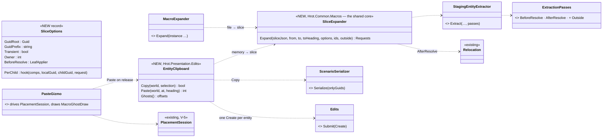
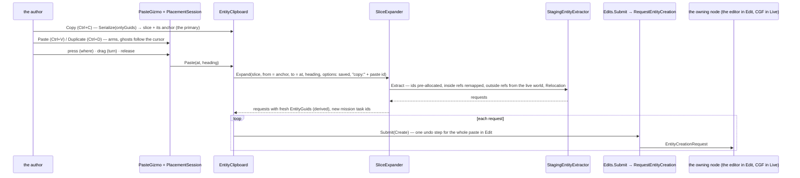
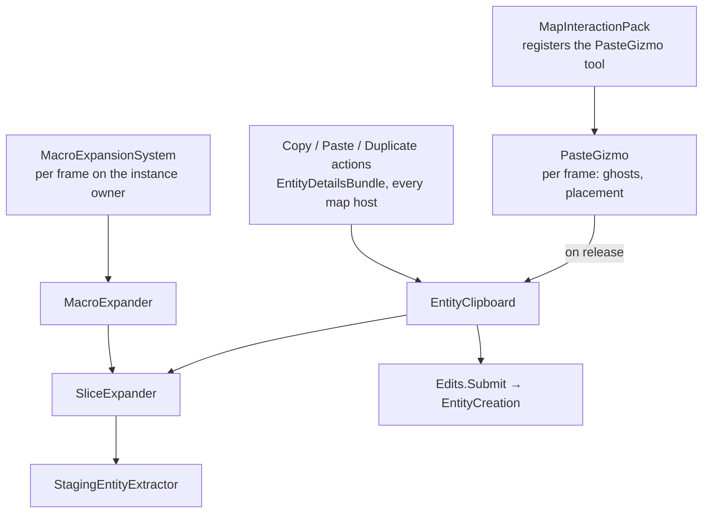

<!--STATUS
state: LIVE
updated: 2026-11-07
build-state: BUILT
current-answer: §2 (the one path) and §3 (placement)
stale-below: nothing
known-rot: none
related-designs:
  - docs/UX/DESIGN_Scenario_Lifecycle_Review.md — owns the finding LC-3 (no copy / paste) and the user rulings; this doc is its build design
  - docs/DESIGN_Scenario_Macros.md — owns the macro expander (§15) whose core this design SHARES (one slice expansion for macros and paste)
  - docs/UX/DESIGN_Map_Interaction.md — owns the placement gesture (§4 D16, PlacementSession) paste reuses
  - docs/DESIGN_Entity_Authoring_Surface.md — owns the one creation tail (R-145) every paste request goes through
  - docs/UX/DESIGN_Edit_Mode_Undo.md — a paste in Edit is one undo step (Edits.Submit brackets it)
  - docs/blueprints/DESIGN_Entity_Reference.md — owns how references are stored (EntityRef = network id, EntityLink = + how it was written)
-->

# Copy, Paste, Duplicate — one path, shared with macro expansion *(A5 / LC-3, ui, `2026-11-07`)*

🔒 **User, verbatim:** *"copying entity can be pretty easily done by saving just that entity into a scenario JSON and then reconstructing"* ·
*"why having two different ways?"* · *"please investigate a multi-select copy with the references … They cannot be just placed at the very same
place as the originals."* · *"Mouse wheel is reserved for map zoom … the same gesture as for placing the entities. … first click places and then
we can drag, which rotates."* · *"Cool if we can refactor to reuse the same code path in both. That's the best outcome."*

## 0. INVENTORY

| query | result |
|---|---|
| grep `CloneEntity\|DuplicateEntit\|CopyEntity\|EntityClipboard` (C#) | **0** — nothing copies an entity |
| graph `search_graph .*Macro.* Class` | stale index (no `SelectionMacro`): grep used — `MacroExpander`, `MacroExpansionSystem`, `MacroInsertion`, `MacroBirth`, `SelectionMacro`, `MacroPreviewGizmo` / `MacroGhostDraw` |
| `IScenarioEntityExtractor` implementations | **1** — `StagingEntityExtractor` (CGF); callers: `ScenarioLoadStep:198/202`, `CgfEpisodeLoadHandler:124`, `MacroExpander:120` |
| `INetworkIdAllocator` implementations | `DdsIdAllocator` (cluster blocks), `BlockIdManager`, `SequentialIdAllocator`, `PlayerSequentialIdAllocator` |

## 1. What exists, measured

| piece | where | what it does for us |
|---|---|---|
| write a selection | `ScenarioSerializer.Serialize(repo, header, onlyGuids)` (`ScenarioSerializer.cs:167`) | the slice; an outside reference is written as that entity's key |
| slice → requests | `StagingEntityExtractor.Extract(…, ids, remapper, ExtractionPasses)` | network ids PRE-ALLOCATED (pass 1, `:285-298`); references inside the slice remapped to them (`BuildRefScope`, `:301`) before anything exists |
| move every position | `Relocation : LeafApplier` (`EntityRefRemap.cs:656`) | transforms, waypoints, areas inside params, turned by a heading — the extractor's `AfterResolve` pass |
| the expander's per-child step | `MacroExpander.Flatten` (`MacroExpander.cs:87-160`) | strip the slice's `EntityGuid`, derive a fresh one, build the `EntityCreationRequest` |
| the one creation tail | `Edits.Submit(EditOp.Create)` → `EntityCreation.RequestEntityCreation` (`ScenarioSpawnAdapter.cs:477-508`, R-145) | Edit and Live alike; journalled; refused in Review; one undo step in Edit |
| the placement gesture | `PlacementSession` (CE-4309) | press = where, drag = heading, release = create |
| the ghosts | `MacroGhostDraw.Draw` | the macro preview's drawing |

⚠ **The gap, measured:** the extractor's reference scope holds ONLY the slice's entities — a reference to one OUTSIDE (a copied squad's
commander) resolves to nothing. The expander resolves outside references for its PARAMETERS only (`ScenarioParams.Prepare(…, outside)`).
⇒ the shared step gains an OUTSIDE scope that the extractor falls back to. ⛔ Macros do NOT pass one (as built): a macro reaches the world outside ONLY through its args (SR-58), so a file reference to it stays refused — the scope is an OPTION of the shared step, Paste passes the live world (`LiveRefScope`).

## 2. The one path

### 2.1 Classes

*What the picture shows that prose hid: macros and paste meet in ONE class — the extract, the relocation, the fresh ids and the request are
written once; each entry point only says where the slice comes from and what differs (transient or saved, a macro origin or none).*

### 2.2 Paste, end to end

*What it shows: the slice is expanded where the author is (the scenario load does the same — ids come from the cluster's allocator, so another
node accepts them), and every entity is created through the one creation tail, so Edit and Live do not differ.*

### 2.3 Modules — who calls what, each frame

*What it shows: nothing new runs per frame except the paste tool while armed; the expansion runs once, on release.*

### 2.4 Rules

| | rule |
|---|---|
| saved, not transient | a pasted entity is an ordinary scenario entity (a macro child is transient, SR-169) |
| fresh identity | `EntityGuid` derived from the paste's id + the copied entity's GUID (`EntityGuidDerivation`, as macro children); mission task ids new (`MissionPlanIds.Renew`, the one routine `OrdersPlanEdits.CopyAsNew` uses) |
| references | inside the slice → the copies (pre-allocated ids); outside → the existing entity (the live world's scope) |
| modes | Edit and Live; not Preview (thrown away on Stop); refused in Review by the gate |
| no `MacroInstance` | paste leaves only the units (a macro instance leaves its marker) |

## 3. Placement *(user, `2026-11-07`)*

| | |
|---|---|
| the gesture | the entity placement's own (`PlacementSession`): PRESS places the anchor (the primary selected entity), DRAG turns the group about it with the ghosts shown, RELEASE creates; a plain click keeps the group's heading |
| ⛔ no wheel | the wheel zooms the map while placing |
| Esc | cancels |
| *Paste here* (map menu) | the anchor is the clicked point, at once |

## 4. Stages

| | |
|---|---|
| ✅ as built `2026-11-07` | **C1** `SliceExpander` (`Hrot.Common/Macros`) carries the extract + relocate + derived GUID + request build; `MacroExpander.Flatten` calls it (its origin, parameter binding and nested flattening as the per-child hook); `ScenarioRefScope.Fallback` + `ExtractionPasses.Outside`. **C2** `EntityClipboard` (`Hrot.Common/Macros` — it needs nothing above `Hrot.Common`) over `MacroExpander.Slices` with `MacroExpansionSystem.IdAllocator`; a command link is carried as the load's own `InitialUnitSubordinateIntent` (an `EntityLink` by GUID), so a copied subordinate's commander lands on the copied HQ's PRE-ALLOCATED id, and a subordinate copied alone keeps the ORIGINAL commander (measured: 2 vs 9001); `ActiveMissionPlan.WithNewTaskIds()` (a new record, CE-4046). Rails: `EntityClipboardTests` 4/4 + the 38 macro rails unchanged |
| ✅ as built `2026-11-07` | **C3** actions *Copy* / *Paste* / *Duplicate* (549–551, Edit group, Edit + Live, units and graphics, `Ctrl+C` / `Ctrl+V` / `Ctrl+D`) — `CopyPasteActions`, built by the map pack beside Add Entity (`EntityAuthoring.CopyPaste`, one clipboard per map, every authoring host); Copy takes the selection when the clicked entity is in it, else the clicked one (the anchor = the clicked one). The paste tool is `PasteGizmo` (`ScenarioSpawnAdapter.ArmPaste`): the ONE `PlacementSession` (+ `Pending` — the pure query the draw and the release share) over the copy's ghosts (`MacroPreview.FromRequests`, the macro preview's own routine; `MacroGhostDraw` turned by the drag); one paste per arming. The map's menu shortcuts read `"Ctrl+X"` (a modified press matches only it) — one key mechanism. ⭐ Hot path, measured: the shared ghost drawing allocated every frame (a boxed `foreach`, a per-frame interpolated line) and **every `FixedString32` / `64` / `128` built anywhere allocated 48 B** (`Encoding.UTF8.GetEncoder()` per construction — every gizmo label every frame); fixed with an index loop, cached lines and `Utf8.FromUtf16` (static) in all four fixed-string types. ⏭ not built: *Paste here* on the empty map's menu; a paste with nothing selected by key (the map's shortcuts resolve through the selected unit's menu) |
| **C1** | `SliceExpander` extracted from `MacroExpander.Flatten`; `ExtractionPasses.Outside`; the macro rails stay green (`MacroExpansion*`, `MacroInsertion*`) |
| **C2** | `EntityClipboard` Copy / Paste over it; rails: one unit, a commander + subordinates (inside refs to the copies), a subordinate alone (outside ref kept), positions relocated + turned, fresh GUIDs, new task ids, not transient |
| **C3** | actions Copy / Paste / Duplicate (Edit + Live) + the paste tool (PlacementSession + ghosts) + *Paste here* |
