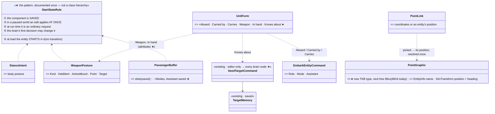
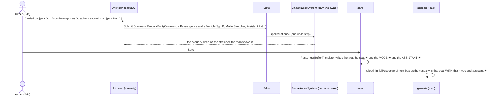
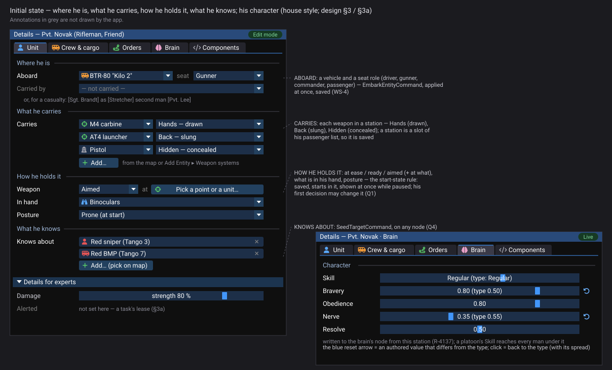

<!--STATUS
state: LIVE
build-state: DESIGN — top-level, ✅ APPROVED Q1–Q9 by the user 2026-11-06 (R-4137); backend saves the state, ui builds the rows (R-4123)
updated: 2026-11-06 (✅ Q1–Q9 approved — R-4137) · 2026-11-06 (§3a the AI character overrides — user: "overriding the AI brain setting like the skill level or aggressivity"; measured; Q8–Q9) · 2026-11-06 (first version — coordinator; editing-UX design queue 7b: E15)
current-answer: §2 the model · §3 the rows · §4 stages · §5 questions with leans
stale-below: nothing
known-rot: none
known-conflict: none
related-designs:
  - DESIGN_Editing_UX.md — §1.8 OWNS the user's topics and the first measurement; slice E15
  - DESIGN_Details_Forms.md — the forms these rows join (R-4136); the start-state pattern was first set there for posture (Q7)
  - DESIGN_Map_Interaction.md — placing; airborne aircraft get their height from placement, not from a row (§1.2 here)
  - DESIGN_Edit_Framework.md — every row commits through Edits.Submit (Write / Command)
  - ../DESIGN_Entity_Interactions.md — §7 OWNS embarkation (EmbarkEntityCommand, EmbarkationSystem) and §7.5 team carry
  - ../DESIGN_Civilians_And_Crowd_Control.md — §7.13 OWNS the carry stations (Hands / Back / Hidden) and HeldItem
  - ../DESIGN_Entity_Control.md — §8m OWNS taking and dropping lying weapons and stones at run time
  - ../DESIGN_Scenario_Rules.md — SR-130 / SR-131 OWN PointLink's "an entity's position, resolved once", which the Point type plugs into
  - ../designs/edit-1/DESIGN.md — SeedTargetCommand (EDIT1-E002) and the retired "Mark Target…" menu
  - ../DESIGN_Entity_Brain_View.md — §12a/§12b OWN the Brain tab's Settings (BV-38…BV-41, CE-1311, R-1036 / R-1037): the temperament and proficiency sliders; Q8 here asks to make them attribute writes
  - ../DESIGN_Temperament_And_Stress.md — OWNS CombatTemperament (TS-1…TS-3: bravery, obedience, nerve, resolve; the type layer and its spread)
  - ../designs/group-maneuvers/DESIGN_Defend_And_Attack_Position.md — §6 DA-1/DA-2 OWN CombatProficiency (authored on the man, on a unit for every man under it, the type default)
  - ../DESIGN_Sensors_And_Doctrine.md — §7.5 OWNS the AI snapshot (task, SOP, ROE saved when an order set them, CE-3042 / R-192)
  - ../DESIGN_Weapon_Layers.md — W-13 OWNS WeaponPosture (the weapon brain writes it)
-->

# DESIGN — initial state: where a unit sits, what it carries, how it holds its weapon, what it knows, and named points

## 0. Why, and what the user asked

🔒 *"What about placing [a unit] as a passenger in a car or to a driver's seat of a technical or being carried by another soldier. How can
we edit the things that can be mounted on a character? We will also need some kind of a named point entity, and it might be also oriented
point. How can we define initial weapon state, like being aimed or hidden or at ease? How can we edit a freely lying weapon entities or
stones or basically anything the player can pick up … Maybe there is some other … state of a character or entity that we might need to
define as initial state."* — and for posture: *"the first tick of a real behavior will override it, but who cares? Sometimes the idle is
the first one."* (user, `2026-11-06`)

## 1. INVENTORY *(2026-11-06)*

Queries:

- `search_graph ".*(Seat|Carried|Carry|Stretcher|Casualty|Mounted|Attachment|Holster|Readiness|WeaponPosture|Aim|Slung|LaidDown|Pickup|Pickable|Item|Loose|Inventory|Kit|Prop|Waypoint|NamedPoint|Marker|Anchor|Point)$" Class`: 77 results, with no point, item or loose-object type.
- A sweep of every `[DataPolicy]` declaration for state-like names: 23 results.
- grep and reads as cited below.

Coverage could not be checked.

| state | mechanism that exists | saved? (measured) | authored today? |
|---|---|---|---|
| **in a vehicle, in a seat** (driver, gunner, commander, passenger) | `EmbarkEntityCommand { Passenger, Vehicle, Role, Mode, Assistant }` (`Behavior/Events/EmbarkEntityCommand.cs:14-32`) → `EmbarkationSystem` on the vehicle's owner | ✅ vehicle and seat: `PassengerBufferTranslator` (`Hrot.EcsNode/Serializers/PassengerBufferTranslator.cs:64-100`), rail `WS4_TheSeats_SurviveASaveAndLoad` | the map menu's Embark, no seat choice |
| **carried / dragged / on a stretcher** | the same command, `Mode = Carried · Dragged · Stretcher`, `Assistant` = the rear handle | ⛔ **no**: `PassengerBuffer.Modes` and `.Assistant` are `[ScenarioIgnore]`, *"genesis boards seated"* (`InteractionComponents.cs:33-50`) | no |
| **what a man carries, and where** | a carried weapon sits in a slot of the MAN'S `PassengerBuffer`; the slot is a carry station: Hands (drawn), Back (slung), Hidden (concealed) (`CarryStations.cs:28-31`); a station takes a weapon, never a man (`Embarkation.cs:150`); `LaidDownWeapons` for built-in mounts | ✅ the slot is saved by the same translator as a seat | only through a behaviour (`StationWeapon`) at run time |
| **weapon posture and what is in his hand** | `WeaponPosture { Kind: AtEase · Ready · Aimed, Target, Point, ActiveMount, HeldItem: Weapon · Throwable · Phone · Binoculars, IdleSeconds }` (`Combat/Components/WeaponPosture.cs`), written only by the weapon brain; its idle branch lowers the weapon after `IdleSeconds` | ⛔ `NoScenario` | no |
| **body posture** | `StanceIntent` | ⛔ `NoScenario` — being fixed by E2 (R-4136, Q7) | no |
| **what a unit knows** | `TargetMemory` (saved, `TargetMemoryTranslator`; `tt-convoy-ambush` authors an empty one); `SeedTargetCommand { Perceiver, Target, ScoreBoost }` (EDIT1-E002) | ✅ | ✅ S3 — applied by `SeedTargetSystem` on the node that owns the perceiver's `TargetMemory` (was ⛔ the editor-only `EditorPerceptionSetupSystem`, retired); its *Mark Target…* menu went with ExCon |
| **alerted** | `Alerted`: up to four leases a TASK renews (AQ104 D, R-2079); brain-local | ⛔ `NoScenario`, by design | — |
| **airborne** | `FlightState { Airborne, VerticalSpeed }`; every flyer is born `Airborne = 1` (`Motion/Flight.cs:86`) | ⛔ `NoScenario` — and not needed: a saved aircraft reloads airborne at its saved height | E8 (placement height) |
| **damage** | `Health` (saved), `PartDamage`, `MobilityKill` (saved) | ✅ | raw editor only |
| **a named / oriented point** | ⛔ no point type (map graphics end at `DeployRole` 8815, `TkbEntityTypes.cs:142`); **`PointLink` already accepts "an entity's position", resolved once when assigned** (`Replication/Links.cs:77-92`, SR-130 / SR-131) | — | no |
| **a lying weapon** | weapon systems 600–608 are separable types *"a host's station, a soldier or the ground holds"* (`NedTkbCatalog.cs`); Add Entity has a **Weapon systems** group (`assets/thumbnails/groups.json:9`) | ✅ as any entity | ✅ placeable today |
| **lying stones and rounds** | a lying round is a `LightweightRound` (`NoScenario \| NoPreview`); the authored form is a **Stone Source** area (8812) | ⛔ a single round never | the Stone Source area |

### 1.1 Claim table

| claim | code | design basis |
|---|---|---|
| a seat and a carry station survive a save | ✅ `PassengerBufferTranslator` + the WS-4 rail; a station IS a slot of that list | ✅ Weapon Systems WS-4, Civilians §7.13 |
| a carry mode does not | ✅ `[ScenarioIgnore]` + the comment *"genesis boards seated"* | ⛔ no design says it must stay unsaved — it was left out when the seat was (the seat was added later, WS-4) |
| a point picked from a Point entity needs no new parameter type | ✅ `PointLink(local, RefSpec)` with an entity spec | ✅ SR-130 / SR-131 |
| knowledge can be seeded on any node | ✅ S3 — `SeedTargetSystem` (the `Interactions` capability) applies it where `HasAuthority<TargetMemory>`; a station that does not own the brain sends it as the `SeedTarget` interaction (was ⛔ editor-only) | R-4119 (gated by the entity, not the node) |

## 2. The model

### 2.1 One pattern for a start state

*What the picture shows that the prose hid:* only three things are new. They are a save flag on two existing components, one new map-graphic
type, and moving one command off the editor. Everything else (seats, stations, carry modes, knowledge, point references) already has a
mechanism; it lacks only the save or the row. The five-step rule is the same one E2 set for posture, so each start state behaves the same.

### 2.2 A casualty carried at start — authored, saved, reloaded

*What the picture shows that the prose hid:* the authoring path exists end to end. The only break is in the save: the mode and the
assistant are dropped, so the reload boards the casualty seated. The fix sits in one translator and one genesis step.

## 3. The rows

| where | row | writes | new |
|---|---|---|---|
| **Unit form** | **Aboard**: [vehicle] · seat [Driver ▾ · Gunner · Commander · Passenger] — or *(none)* | `EmbarkEntityCommand { Role }` / `DisembarkEntityCommand` | — |
| **Unit form** | **Carried by**: [soldier] · as [Carried · Dragged · Stretcher] · second man [soldier] (stretcher only) | `EmbarkEntityCommand { Mode, Assistant }` | ★ saved mode and assistant |
| **Unit form** | **Carries**: one line per carried weapon — [weapon] in [Hands · Back · Hidden]; *Add…* picks a weapon from the map or Add Entity's Weapon systems | `EmbarkEntityCommand` into the station slot (`CarryStations.Hands / Back / Hidden`) | — |
| **Unit form** | **Weapon**: [At ease · Ready · Aimed] · aimed at [a point or a unit, picked] · **In hand**: [Weapon · Throwable · Phone · Binoculars] | attributes `Weapon.Posture`, `Weapon.AimPoint` / `Weapon.AimTarget`, `Weapon.HeldItem` (the brain's owner applies them) | ★ `WeaponPosture` saved (its `Target` through the entity-reference remap) |
| **Unit form** ⚙ | **Knows about**: units picked on the map (*Add…*, multi-select fans out) | `SeedTargetCommand` | ★ applied on every brain node, not only the editor |
| **Unit form** ⚙ | **Damage**: strength per part (vehicles: `PartDamage`), mobility kill | attributes | ★ the attributes |
| **Crew & cargo** (vehicle) | each seat: role, who sits there (*Put aboard…* names the seat) | `EmbarkEntityCommand { Role }` | — |
| **Point** (new type) | name, position, **heading** (optional — *oriented*), on the map with the point tool; listed under *Areas & routes ▸ Point* | `Name`, `Position.*`, `Heading` (existing attributes) | ★ the type |
| every point picker (orders, rules, Go here) | also offers **named points**; picking one stores `PointLink` with the point's reference (resolved once — SR-130) | — | the picker lists Point entities |
| — | **alerted**: not a row — a task's lease (by design); **airborne**: not a row — from placement height (E8); **a single lying stone**: not offered — the Stone Source area is the authored form | — | — |

### 3a. The AI character — skill, bravery and the like *(user, `2026-11-06`: "overriding the AI brain setting like the skill level or aggressivity or something like that")*

Queries: `search_graph ".*(Skill|Aggress|Personality|Temperament|Character|Doctrine|Courage|Morale|Discipline|Experience|Training|Accuracy|Marksman|Traits|Profile|Bravery|Caution|Tuning|Override).*" Class` (65, filtered); grep for the components in the Presentation / Editor / DebugApi trees; reads as cited.

| setting | what exists (measured) | saved? | where a user sets it today |
|---|---|---|---|
| **skill** | `CombatProficiency` 0..1 in THREE layers — `Authored` (on the man), `Unit` (a unit entity's authored value, filled into every man under it by `ProficiencyFillSystem`), `TypeDefault` — each with its own set bit; plus the SIDE's tier amplifier −2…+2 as an overlay (SR-100 / R-4106) (`Behavior/Components/CombatProficiency.cs:9-33`) | ✅ authored layer only (`CombatProficiencyTranslator`) | the Brain tab's **Settings**: a slider with tier ticks and *Reset to type* (`BrainSettings.cs`, CE-1311) |
| **bravery (= aggressiveness), obedience, nerve, resolve** | `CombatTemperament`, the same layering: authored fields + the TYPE's fields with a per-man seeded spread (`Behavior/Components/CombatTemperament.cs:18-37`; TS-1…TS-3) | ✅ authored only (`CombatTemperamentTranslator`: *"a save never freezes today's default into the file"*) | the same Settings section, group *Temperament* |
| **rules of engagement** (weapons control, may reactions pause the task) | `Roe { Fire, Reactions, SetBy }`, changed only by `SetRoeEvent` and gated by origin | ✅ through the AI snapshot when an order set it (CE-3042) | the Brain tab's *Assign: … ROE* embed — editor only (programme §1.1) |
| **standing behaviour (SOP)** | the SOP slot | ✅ the AI snapshot | the same embed — editor only |

**The gap is not the model; it is where the write goes.** ⛔ R-1036: *"the tab is FULL only on the node that runs the brain; its settings
are LOCAL there (never replicated, never sent)"*. So an instructor on a CGF or Player station that does not run that unit's brain cannot
tune it. That conflicts with R-4119 (gated by the entity, not the node) and with R-4136 (every user-facing field is an attribute).

| row | where | writes |
|---|---|---|
| **Skill** (tier slider, *Reset to type*), **Bravery**, **Obedience**, **Nerve**, **Resolve** | Brain tab ▸ **Character** (the target's name for the Settings section, programme §3.3) — and on a **unit** entity (a platoon), the Skill row sets every man under it (the existing `Unit` layer) | ★ attributes `Proficiency`, `Temperament.RiskAcceptance / Obedience / Nerve / Resolve`, and their *reset* (clear the authored bit), applied on the brain's node |
| **Weapons control** (Hold fire · Return fire · Fire at will), **Reactions** | Brain tab ▸ **Behaviour** (programme §3.3: *"Assign: task, SOP, ROE becomes Behaviour with plain names"*) | the existing `SetRoeEvent` (the edit framework's `Command`), at the author's origin |
| **side-wide skill** | the Scenario form ▸ *Sides* (SR-100's tier amplifier) | existing |

### 3b. The graphical design *(R-4143 — the acceptance spec)*

*What the picture shows that the prose hid:* all the start state of one person sits on ONE form, in the order an author thinks: where he is, what he carries, how he holds it, what he knows. His character sits on the Brain tab, where an authored value differs from the type's by one visible arrow. Generated by `scripts/gen-initial-state-mockup.py`.

## 4. Stages

| stage | what | owner | rails |
|---|---|---|---|
| **S1** | save `PassengerBuffer.Modes` and `.Assistant`; genesis boards with them | backend | the WS-4 rail extended: a stretcher casualty and its assistant survive a save and load |
| **S2** | `WeaponPosture` saved and seeded (the E2 Q7 rule); the four `Weapon.*` attributes | backend | *Aimed at a point* and *Phone in hand* survive a reload; set in a paused world, shown at once |
| **S3** | `SeedTargetCommand` applied on every brain node (moved out of `EditorPerceptionSetupSystem`) | backend | seeded from a CGF station, the knowledge lands on the brain's node |
| **S4** | the Point map graphic (next free 88xx) + the point tool + pickers listing it | ui (+ backend for the type id) | a rule's point picked from *LZ Alpha* resolves to its position |
| **S6** | the Character settings become attribute writes (Proficiency, the four temperament fields, and their reset) applied on the brain's node; the Brain tab's Character section offered on every station that may edit the unit (R-4119); Weapons control / Reactions as plain choices through `SetRoeEvent` | backend (attributes) + ui | bravery set from a CGF station that does not run the brain reaches it; *Reset to type* restores the type's value with its spread |
| **S5** | the Unit form rows (Aboard, Carried by, Carries, Weapon, In hand, Knows about, Damage) and the Crew & cargo seat roles | ui | each from the form, Edit and Live, survives save and reload |

### 4.1 ⭐ AS-BUILT — S1, S2, S3 and S6 *(backend, `2026-11-07`, B-5)*

| stage | as built |
|---|---|
| **S1** | `PassengerBufferTranslator` writes each seat's carry mode (`"Modes"`, parallel to `"Seats"`) and the second man (`"Assistant"`, a link like a passenger); `InitialPassengersIntent.Modes` / `.Assistant`; genesis waits for the assistant too and boards through `Embarkation.TryEmbarkAt(…, seat, mode, assistant)` — on a person carrier the saved mode (a stretcher with no living second man ⇒ carried; seated ⇒ carried), on a vehicle always seated. ⚠ `PassengerBuffer.Modes` / `.Assistant` keep `[ScenarioIgnore]`: the translator owns the whole list, the attribute only keeps the generic serializer off the raw handle. An older save (no modes) loads as before |
| **S2** | `WeaponPosture` → `DataPolicy.Default` (saved; `Target` through the serializer's entity links). Attributes **70 `Weapon.Posture`** · **71 `Weapon.AimPoint.*`** (axis = `SubIndex1`) · **72 `Weapon.AimTarget`** (the unit's network id, resolved on the applying node; an unknown id refused; ⚠ a creation request cannot aim at a live unit — the JSON path is consumed and ignored) · **73 `Weapon.HeldItem`** (refused for a thing he does not have, `HeldItems.Has`). The writes go through the one writer: `WeaponPostureOf.Author` / `AuthorAimPoint` / `AuthorAimTarget`, `HeldItems.Set` — ⛔ an authored aim is not a hostile act (only the brain's `Report` commits one). The component is the state, so a paused world shows it at once; the brain's idle branch may lower it (rule ⑤) |
| **S3** | `SeedTargetCommand` gains `IsRemote` and `RequestId` (appended, as F4 did for `EmbarkEntityCommand`). **`SeedTargetSystem`** (`Fdp.Toolkits/Perception/Systems`) is the one applier, in the **`Interactions` capability** (`CoreInfrastructureCapabilities.cs` — every node, beside `EmbarkationSystem`; its own remark says a new interaction kind's owner-side system goes there), gated by `HasAuthority<TargetMemory>(perceiver)`, with the replay early-out; it answers `InteractionOutcomes` — Applied, or Refused *"it is not a unit that remembers targets"* / *"the target is gone, or has no position"*. `EditorPerceptionSetupSystem` and its registration are deleted (the editor tests moved to `SeedTargetSystemTests`). Interaction kind **`SeedTarget = 14`** + `SeedTargetInteractionPayload { ScoreBoost, RequestId }` (appended to the NED IDL) and `InteractionCodecs.SeedTarget` (target = perceiver, actor = the seeded unit, `ownsTarget` = `HasAuthority<TargetMemory>`). `Hrot.Common.Orders.KnowledgeOrders.SeedTarget` is the one way a person seeds (`Edits.Submit(EditOp.Interact …)`), used by both editor menu sites. ⚠ A perceiver that has no `TargetMemory` replica on the asking station is sent anyway and refused by its owner; a purely local one with none is refused at once. |
| **S6** | Attributes **80 `Proficiency`** · **81 `Temperament.RiskAcceptance`** (bravery) · **82 `Temperament.Obedience`** · **83 `Temperament.Nerve`** · **84 `Temperament.Resolve`**, all `Float64` on `CombatProficiency` / `CombatTemperament` (both already replicated, so the brain's node owns them): vocabulary rows, `FormAttributeInstaller` binary handlers, `AttributeCompilerFactory` JSON setters, `TheFourRoutingTablesAgreeTests` (list, all-in-one patch, owned components). **Reset = a NEGATIVE value** (the range is 0..1, so nothing real collides) that clears that field's authored bit — one id per authored fact instead of a second "reset" id per field in four routing tables; the unit then reads its type's value with the spread stamped at creation. The value logic is `FormAttributes.SetProficiency` / `SetTemperament` — ONE copy, called by the JSON setter, the binary handler AND the Brain tab. **The Brain tab's `CombatTemperamentSettings` / `CombatProficiencySettings` now write through `Edits.Submit(EditOp.Write)`** (a unit lacking the component first gets `EditOp.AddComponent`, as the Playable toggle does), so a station that does not run the brain reaches it and the journal answers. ⏭ Not done: *offering the Character section on every station that may edit the unit* (R-4119) and *Weapons control / Reactions as plain choices* (`SetRoeEvent`) — UI, with the lane that owns the Brain tab. |

| **S4** (backend half) | `TkbEntityTypes.Point = 8816` (measured free on all four lanes) + its template "Point" (a `MapGraphicDef`, no body; the name and pose arrive with the creation request). ⏭ ui: the point tool (`PlacementToolRegistry`), the gallery group *Areas & routes ▸ Point*, pickers listing it |

Rails: `PassengerBufferTranslatorTests.S1_*`, `PersonCarrierTests.S1_*`, `WeaponPostureStartStateTests.S2_*`, `TheFourRoutingTablesAgreeTests` (the four rows), `InteractionTransportTests.S3_ASeedAskedAtAStationThatDoesNotOwnTheBrain_IsAppliedByTheOwner_AndAnswered`, `SeedTargetSystemTests`, `CharacterAttributesTests.S6_*`, `EditOutcomeOwnerTests.S6_BraverySetOnANonOwner_ReachesTheOwner_AndAResetClearsIt`, `TheBrainViewTests.CE1311_*`.

### 4.2 ⭐ AS-BUILT — S5, first part *(ui, `2026-11-07`, U-24)*

| row | as built | ⏳ not yet |
|---|---|---|
| **Weapon** | `HrotForms.Unit` choice *At ease · Ready · Aimed* → attribute `Weapon.Posture` (70), read from the saved `WeaponPosture.Kind` | ✅ *Aimed at* a unit: a `FormList` (the target's name; *Aim at…* picks through the one context → `Weapon.AimTarget` 72 with the network id; *Clear* writes 0; aiming at himself refused). ⏳ aiming at a POINT (`Weapon.AimPoint.*`) |
| **In hand** | choice *Nothing · Weapon · Throwable · Phone · Binoculars* → `Weapon.HeldItem` (73; the owner refuses an item he does not have) | — |
| **Aboard** | a `FormList` (the Crew &amp; cargo shape, Details Forms §4.0a part 4): the seat's role + the vehicle; *Take off* / *Board…* → `EmbarkOrders` (the one embark path) | the seat chooser (*Board…* names the seat); **Carried by** / **Carries**, **Knows about**, **Damage**, the Brain tab's **Character** (S6) |

Rail `TheUnitFormDrawsTests.U24_S5_…` (a real frame).

⭐ **S6, the Unit form's Character section *(ui, `2026-11-07`, U-24)*:** five number rows under a *Character* caption — **Skill** (`Proficiency`, 80) · **Bravery** (`Temperament.RiskAcceptance`, 81) · **Obedience** (82) · **Nerve** (83) · **Resolve** (84) — each a 0..1 **slider** reading the EFFECTIVE value (`ProficiencyOf` / `TemperamentOf`). Skill is a number slider, not the mockup's tier word (the optional part). New generic seam on `FormField`: `TypeValue` (the type's value, null when nothing is authored over it) + `ResetValue` (−1, the Character attributes' "back to the type"). When an authored value differs from the type's the row shows `0.80  (type 0.50)` and the blue reset arrow in the status slot (`FormMark.DiffersFromType`, tooltip *type 0.5 — reset*); a click commits `ResetValue` through `ChangeFor` (never range-checked). Strings cached per change (0 B steady). ⏳ not yet: *Weapons control / Reactions* as plain choices (`SetRoeEvent`); the Character section on the Brain tab is still the old surface. Rail `TheUnitFormDrawsTests.U24_S6_…` (a real frame, red-proven).

### 4.3 ⭐ AS-BUILT — S4, the ui half: the Point on the map *(ui, `2026-11-07`, U-25)*

| piece | as built | ⏳ not yet |
|---|---|---|
| the gallery | `PlacementToolRegistry.Graphics` lists **Point** (8816, the point tool); `assets/thumbnails/groups.json` puts the point-tool graphics (Point, Deploy Role) under *Areas &amp; routes* (Deploy Role was in *Other* — the gallery had no group for a point graphic) | — |
| on the map | `NamedPointGizmo` (`Hrot.Presentation/ScenarioEditor/Gizmos`): a diamond, the name (cached per change — 0 B steady), a heading tick when ORIENTED (a rotation other than the identity — ⚠ there is no "oriented" flag; the identity reads as "no heading"), and the shared pick box (select / menu) — the `[GizmoProjector]` pattern of `TacticalAreaGizmo`, so every map host draws it | the name and heading in the Details (the Shape form) |
| pickers | — | ⏳ **every point picker offering named points** (a location pick that snaps to a Point ⇒ `PointLink` with the point's reference, SR-130) — the acceptance *"a rule's point picked from LZ Alpha resolves"* is NOT met yet |

Rails `NamedPointGizmoTests` (red-proved), `EntityTypeCatalogTests` (the golden gains 8816; the group assertion moved).

## 5. Questions — ✅ all nine APPROVED (R-4137, user `2026-11-06`: *"Approved."*)

| # | question | lean | rejected |
|---|---|---|---|
| **Q1** | one rule for every start state | **the five-step rule of §2.1** (saved · start in it · at once while paused · a request at run time · the brain may change it), as set for posture | a "start" copy of each component: two records of one state |
| **Q2** | carry mode and assistant | **save them** (S1) | keep them unsaved: a carried casualty reloads seated |
| **Q3** | weapon posture and held item | **save them**; aimed at a point or a unit | leave to behaviours: an idle unit could never start aimed or holding binoculars |
| **Q4** | "knows about" | **a Unit form row through the existing `SeedTargetCommand`, applied on every brain node** | a TargetMemory editor: its scores and freshness are engine detail |
| **Q5** | the named point | **a new map-graphic type *Point* (name, position, optional heading), referenced through the existing `PointLink` entity form** | a point list in the scenario header: not on the map, not pickable |
| **Q6** | alerted, airborne, single stones | **no rows**: alerted is a task's lease, airborne comes from placement height, stones come from a Stone Source | rows for each: state the engine owns elsewhere |
| **Q8** | who may tune a unit's character | **any station whose seat and level allow it** — the Character settings become attribute writes applied on the brain's node. ⚠ This **narrows R-1036's "settings are LOCAL there"**: the debugging half of the Brain tab (running behaviours, variables) stays full only on the brain's node, as R-1036 says; the Character settings travel | keep R-1036 as is: an instructor cannot make a unit braver or worse unless his station happens to run that brain |
| **Q9** | skill for a whole unit | **yes, through the existing `Unit` layer**: Skill set on a platoon reaches every man under it unless a man has his own; temperament stays per man (its type spread already varies the men) | a unit layer for temperament too: not asked, and the spread already does it |
| **Q7** | where these rows live | **the Unit form** (the person's view: where he is, what he carries, how he holds it) **and Crew & cargo** (the vehicle's view of the same seats) | a separate "Start state" tab: the same fields in two places |
