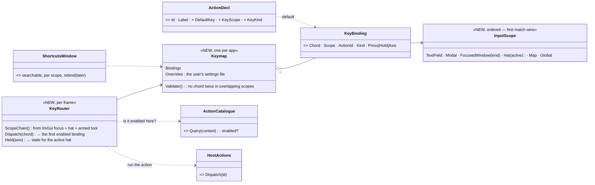
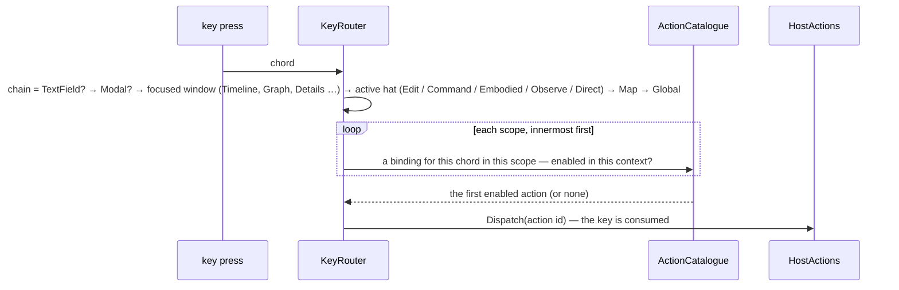

<!--STATUS
state: LIVE
build-state: DESIGN — top-level, for the user's review (R-4122); the building lanes detail it (R-4123)
updated: 2026-11-06 (first version — coordinator; editing-UX design queue item 4b: E14)
current-answer: §2 the model · §3 stages · §4 questions with leans
stale-below: nothing
known-rot: none
known-conflict: UX_Feature_Tool_Model.md:302 "No keyboard shortcut activates any tool" — kept for TOOLS armed by a key? §4 Q5 decides (lean: a key may run the ACTION that arms a tool)
related-designs:
  - DESIGN_Action_Catalogue.md — every key binds to an ACTION ID from the catalogue; the action declares its default key and scope (design 1, R-4125)
  - DESIGN_Seats_And_Hats.md — each hat is a keymap scope; Esc = one level out (R-4131 Q6)
  - DESIGN_Editing_UX.md — the programme: E14; §3.7 the expected basics (Esc, Enter, Ctrl+Z, copy / paste, Delete asks)
  - UX_Feature_Menu_Follows_Focus.md — OWNS the main menu bar (GlobalMenuRegistry, MenuBinding per perspective); its items bind action ids here
  - UX_Feature_Tool_Model.md — OWNS tools (ToolDescriptor, ToolController); central Escape (migration step 6) is built here
  - ../DESIGN_Entity_Control.md — §13.6 MenuShortcuts (CE-1076), §8b–§8r the FPS keys — both move into the keymap
  - ../DESIGN_Director_Timeline_Editor.md — the timeline keymap ("panel focused only, never stolen from the map") is one scope here
-->

# DESIGN — input and commands: one keymap, scoped, every key an action

## 0. Why

🔒 User, `2026-11-06`: *"the key map to app functions scoped to concrete context should be solved on whole app level i guess, no idea how it
is now. same the unification of how command/actions are registered (this probably already exists as one of UX designs) and no ad hoc direct
calls to features etc to make the internal architecture clear."*

## 1. INVENTORY *(2026-11-06)*

Queries: `search_graph .*(Hotkey|Shortcut|Keymap|KeyBinding|Keybind).*` Class (**6**: `EditorHotkeyDispatcher`, NodeEdit `HotkeyDispatcher`,
`KeyBinding`, `MapShortcutKeyEvent`, `MenuShortcuts`, `MenuShortcutKeyLayer`); grep `IsKey*(` (**43 files**: 24 ImGui, 13 raylib; **0** use
ImGui's own `Shortcut()` / key routing, available in our ImGui.NET **1.91.6.1**). Prior art: VS Code (keybindings with *when* contexts, one
JSON, a searchable shortcuts editor) · Unreal (UI commands bound in command lists per context) · Blender (a keymap per editor area).

| finding | evidence |
|---|---|
| **~12 separate key mechanisms**, each with its own scope rule: shell hotkeys, graph-canvas hotkeys, NodeEdit canvas raw keys, the map's key queue, map-menu letters (`MenuShortcuts`), gizmo raw keys (12 gizmos handle Esc themselves), the RTS tool, the FPS station (raw raylib), the command wheel, the free-fly camera, the timeline panel, IG pan / zoom / undo, debug F-keys, panel-local Enter / Esc / Ctrl+Z | inventory table, file:line per mechanism |
| **focus does not separate the map from panels** — the map gets keys whenever the MOUSE is over it (`MapCanvas.cs:206`); ImGui keyboard nav is never enabled ⇒ a focused panel does not take keys away | **CE-4282** |
| **conflicts at the same moment**: A / S / E free-fly vs Attack / Strike / Edit (**CE-4281**, verified) · Space timeline vs map Select · Esc fires in several places (graph canvases are not focus-gated) · F3 / F8 / F9 debug vs graph editor · Delete reached by two graph paths | CE-4281, CE-4282 |
| **no rebinding, no persistence**; display and binding share a source only for `IEditorCommands` (`DefaultKey`) and the map menu (`Shortcut` text); FPS / timeline / IG / audio keys are shown nowhere; map order letters are auto-derived from the name (silent collisions) | `ContextMenuProjectorGizmo.cs:149` |
| **commands**: `GlobalActionRegistry` (56 int ids) · `GlobalMenuRegistry.RegisterItem(path, closure)` (9 production calls, all closures) · `RegisterContributor` (ids, 4) · `IEditorCommands` (string ids, the graph editors) · tools (no key) · a dead `RegisterShortcut` seam · direct calls from UI (`() => timelinePanel.RequestLoadFdp()`, `() => newAssetLauncher.OpenMacro()`, `_gizmoUndoStack.Undo()` from a key …) | inventory §5 |

## 2. The model

### 2.1 Classes

*What the picture shows that prose hid: a key never calls code — it names an ACTION; the action is the same one a menu item, a button or
the HTTP API runs; and WHICH binding wins is decided in ONE place from an ordered scope chain, not by twelve mechanisms each asking a
different question.*

### 2.2 The scope chain — who gets a key

*What it shows: typing in a text field never triggers a command; a focused panel owns its keys and the map gets nothing; on the map the
ACTIVE HAT's keys come before the map's general ones — so free-fly (Observe) A / S / E can never fire Attack / Strike / Edit.*

| | rule |
|---|---|
| **focus is ImGui's, one truth** | a focused ImGui window gets its scope; **clicking the map takes focus to the map** (ImGui window focus cleared) — ⛔ no longer "the mouse is over it" (CE-4282) |
| **held inputs are not commands** | W A S D, Shift sprint, Ctrl crouch, T wheel, RMB look: bindings of kind **Hold / Axis**, READ by the active hat each frame (rebindable and shown like the rest), never dispatched as actions |
| **ImGui's own routing** | panel and global scopes use ImGui 1.91's key routing (`Shortcut()` with route flags) underneath — ⛔ no second focus arbitration of our own |
| **Esc — central** | one chain: text field cancels → modal closes → the armed tool cancels → the hat steps out → nothing (Tool Model step 6; seats-and-hats Q6). Gizmos stop handling Esc themselves |
| **declared, checked, shown** | an action declares its default key and scope (design 1); the keymap REFUSES at start-up a chord bound twice in overlapping scopes (a rail); menus, tooltips and a **Keyboard shortcuts** window (searchable, per scope, F1) show the SAME binding ⛔ no auto-derived letters |
| **rebinding** | the user's overrides in a settings file (per user); a rebind UI in the shortcuts window later |
| **debug keys** | F-keys of the audio / performance overlays are actions in the Global scope, behind Expert — ⛔ never raw reads |

### 2.3 Commands — every entry point names an action

| entry point today | target |
|---|---|
| `GlobalActionRegistry` int ids (map, inspector, ORBAT) | ✅ already actions — the keymap binds them |
| `IEditorCommands` string ids (graph editors) | declared as actions scoped to the graph perspective (the catalogue's perspective condition, AQ26 D) — one registry |
| `GlobalMenuRegistry.RegisterItem(path, closure)` | the main bar item names an action id; the closure becomes the action's binding on that host ⛔ no closure-only menu items |
| buttons / toolbar calling a subsystem method | the button runs an action id |
| keys calling methods (`_gizmoUndoStack.Undo()`, `cursor.TogglePlay()`, `ToggleMessageLog()`) | key → action id |
| `IShellCommandRegistrar.RegisterShortcut` (no caller) | deleted |

## 3. Stages *(ui owns it; each stage keeps today's keys working unless it says otherwise)*

| stage | what |
|---|---|
| **K1** | `Keymap` + `KeyBinding` + `KeyRouter` + the scope chain; focus = ImGui focus, click-to-focus the map (fixes CE-4282); the graph canvases gated by focus |
| **K2** | the map: hat scopes before the map scope; the map menu letters declared on the actions (fixes CE-4281); `MenuShortcuts` becomes the router's map scope |
| **K3** | central Esc (Tool Model step 6); gizmos stop reading Esc |
| **K4** | the FPS station, the timeline, IG pan / zoom / undo, debug F-keys onto bindings (Hold / Axis kinds for the held ones) |
| **K5** | `IEditorCommands` and `RegisterItem` closures as actions; buttons and keys call action ids; the dead seam deleted |
| **K6** | the Keyboard shortcuts window; user overrides in a settings file; rebind UI later |

## 4. Questions — leans for the user

| # | question | ⭐ lean | rejected |
|---|---|---|---|
| **Q1** | one keymap, keys → action ids | **yes**: an action declares its default key and scope; the keymap holds bindings and the user's overrides | per-feature key handling — today's twelve mechanisms |
| **Q2** | the scope order | **TextField → Modal → focused window → active hat → Map → Global**, first enabled match wins | a flat global table — the same letter cannot mean two things in two contexts |
| **Q3** | focus | **ImGui's focus is the one truth; clicking the map focuses it** | mouse-over gives the map the keys — today's leak |
| **Q4** | held keys (WASD, sprint, wheel) | **Hold / Axis bindings read by the active hat**, rebindable and shown, not actions | making movement keys actions |
| **Q5** | a key that arms a tool | **allowed** — the key runs the ACTION that arms the tool (supersedes "no keyboard shortcut activates any tool") | keep tools key-less — R (rotate) already arms a tool through the menu letter |
| **Q6** | rebinding | **settings file now, rebind UI later**; conflicts refused at start-up | rebind UI first |
| **Q7** | ImGui key routing | **use ImGui 1.91's `Shortcut()` routing for panel and global scopes** underneath our router | our own focus arbitration beside ImGui's |
