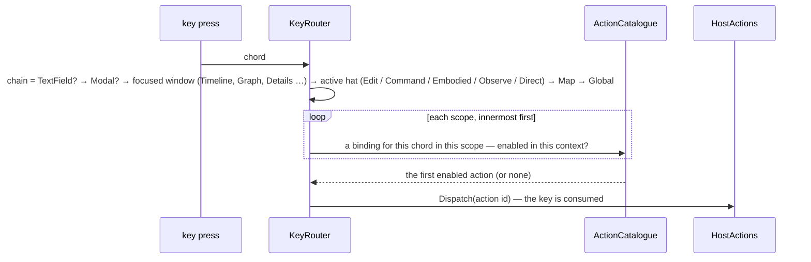
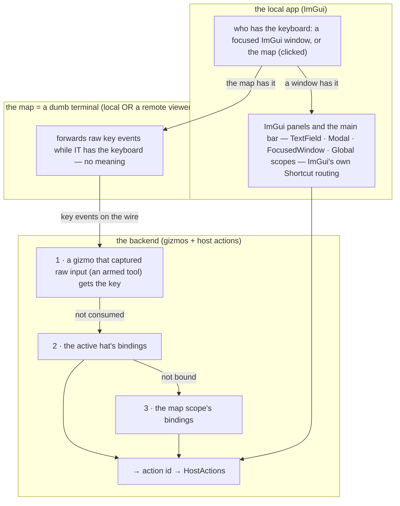
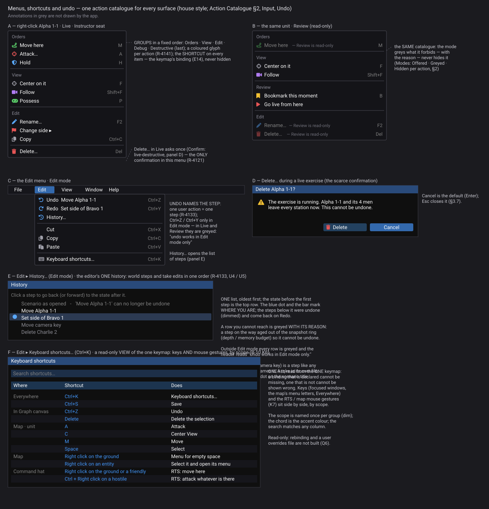
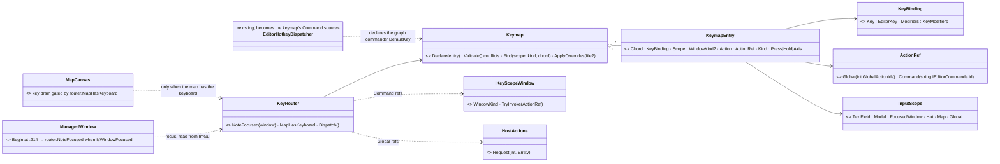
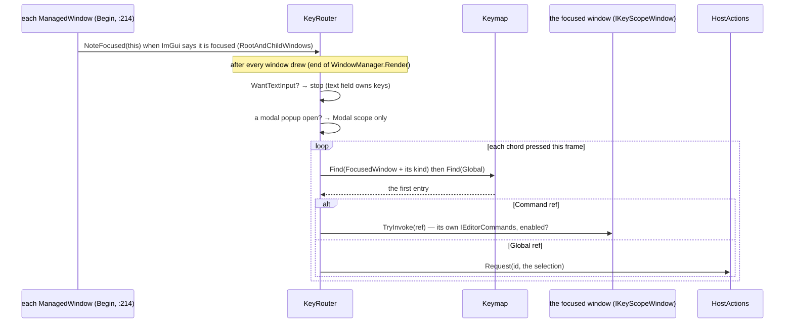
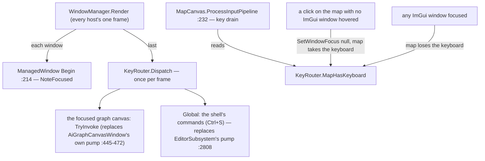

<!--STATUS
state: LIVE
build-state: DESIGN — top-level; §5 the BUILD design for K1 (ui, 2026-11-07, READY-TO-BUILD); ✅ approved by the user 2026-11-06 with the dumb-terminal split and hard-coded defaults (R-4132); the building lanes detail it (R-4123)
updated: 2026-11-06 (§2.4 the map is a dumb terminal: map keys resolved on the backend, ImGui routing for the ImGui side only; hard-coded defaults complete, the overrides file optional — R-4132) · 2026-11-06 (first version — coordinator; editing-UX design queue item 4b: E14)
current-answer: §2 the model · §3 stages · §4 questions with leans · §5 the K1 build design (homes, the chord, the id, the per-frame call)
stale-below: nothing
known-rot: the node called IG here is the Player node since CE-3371 (backend, 2026-11-06): Hrot.IG → Hrot.Player, IgApplication → PlayerApplication (line numbers cited before the rename may have moved)
known-conflict: UX_Feature_Tool_Model.md:302 "No keyboard shortcut activates any tool" — kept for TOOLS armed by a key? §4 Q5 decides (lean: a key may run the ACTION that arms a tool)
related-designs:
  - DESIGN_Map_Interaction.md — E8: the drawing keys (Enter finish, Backspace, PgUp / PgDn level) as the armed tool's own keys on the backend
  - ../designs/gizmos-1/gizmo-input-focus-design.md — OWNS the dumb terminal (raw events, backend focus); the map scopes of the keymap are resolved on its backend side
  - DESIGN_Action_Catalogue.md — every key binds to an ACTION ID from the catalogue; the action declares its default key and scope (design 1, R-4125)
  - DESIGN_Seats_And_Hats.md — each hat is a keymap scope; Esc = one level out (R-4131 Q6)
  - DESIGN_Editing_UX.md — the programme: E14; §3.7 the expected basics (Esc, Enter, Ctrl+Z, copy / paste, Delete asks)
  - UX_Feature_Menu_Follows_Focus.md — OWNS the main menu bar (GlobalMenuRegistry, MenuBinding per perspective); its items bind action ids here
  - UX_Feature_Tool_Model.md — OWNS tools (ToolDescriptor, ToolController); central Escape (migration step 6) is built here
  - ../DESIGN_Entity_Control.md — §13.6 MenuShortcuts (CE-1076), §8b–§8r the FPS keys — both move into the keymap
  - ../DESIGN_Director_Timeline_Editor.md — the timeline keymap ("panel focused only, never stolen from the map") is one scope here
-->

# DESIGN — input and commands: one keymap, scoped, every key an action

## 0. Why

🔒 User, `2026-11-06`: *"the key map to app functions scoped to concrete context should be solved on whole app level i guess, no idea how it
is now. same the unification of how command/actions are registered (this probably already exists as one of UX designs) and no ad hoc direct
calls to features etc to make the internal architecture clear."*

## 1. INVENTORY *(2026-11-06)*

Queries: `search_graph .*(Hotkey|Shortcut|Keymap|KeyBinding|Keybind).*` Class (**6**: `EditorHotkeyDispatcher`, NodeEdit `HotkeyDispatcher`,
`KeyBinding`, `MapShortcutKeyEvent`, `MenuShortcuts`, `MenuShortcutKeyLayer`); grep `IsKey*(` (**43 files**: 24 ImGui, 13 raylib; **0** use
ImGui's own `Shortcut()` / key routing, available in our ImGui.NET **1.91.6.1**). Prior art: VS Code (keybindings with *when* contexts, one
JSON, a searchable shortcuts editor) · Unreal (UI commands bound in command lists per context) · Blender (a keymap per editor area).

| finding | evidence |
|---|---|
| **~12 separate key mechanisms**, each with its own scope rule: shell hotkeys, graph-canvas hotkeys, NodeEdit canvas raw keys, the map's key queue, map-menu letters (`MenuShortcuts`), gizmo raw keys (12 gizmos handle Esc themselves), the RTS tool, the FPS station (raw raylib), the command wheel, the free-fly camera, the timeline panel, IG pan / zoom / undo, debug F-keys, panel-local Enter / Esc / Ctrl+Z | inventory table, file:line per mechanism |
| **focus does not separate the map from panels** — the map gets keys whenever the MOUSE is over it (`MapCanvas.cs:206`); ImGui keyboard nav is never enabled ⇒ a focused panel does not take keys away | **CE-4282** |
| **conflicts at the same moment**: A / S / E free-fly vs Attack / Strike / Edit (**CE-4281**, verified) · Space timeline vs map Select · Esc fires in several places (graph canvases are not focus-gated) · F3 / F8 / F9 debug vs graph editor · Delete reached by two graph paths | CE-4281, CE-4282 |
| **no rebinding, no persistence**; display and binding share a source only for `IEditorCommands` (`DefaultKey`) and the map menu (`Shortcut` text); FPS / timeline / IG / audio keys are shown nowhere; map order letters are auto-derived from the name (silent collisions) | `ContextMenuProjectorGizmo.cs:149` |
| **commands**: `GlobalActionRegistry` (56 int ids) · `GlobalMenuRegistry.RegisterItem(path, closure)` (9 production calls, all closures) · `RegisterContributor` (ids, 4) · `IEditorCommands` (string ids, the graph editors) · tools (no key) · a dead `RegisterShortcut` seam · direct calls from UI (`() => timelinePanel.RequestLoadFdp()`, `() => newAssetLauncher.OpenMacro()`, `_gizmoUndoStack.Undo()` from a key …) | inventory §5 |

## 2. The model

### 2.1 Classes

*What the picture shows that prose hid: a key never calls code — it names an ACTION; the action is the same one a menu item, a button or
the HTTP API runs; and WHICH binding wins is decided in ONE place from an ordered scope chain, not by twelve mechanisms each asking a
different question.*

### 2.2 The scope chain — who gets a key

*What it shows: typing in a text field never triggers a command; a focused panel owns its keys and the map gets nothing; on the map the
ACTIVE HAT's keys come before the map's general ones — so free-fly (Observe) A / S / E can never fire Attack / Strike / Edit.*

| | rule |
|---|---|
| **focus is ImGui's, one truth** | a focused ImGui window gets its scope; **clicking the map takes focus to the map** (ImGui window focus cleared) — ⛔ no longer "the mouse is over it" (CE-4282) |
| **held inputs are not commands** | W A S D, Shift sprint, Ctrl crouch, T wheel, RMB look: bindings of kind **Hold / Axis**, READ by the active hat each frame (rebindable and shown like the rest), never dispatched as actions |
| **ImGui's own routing** | panel and global scopes use ImGui 1.91's key routing (`Shortcut()` with route flags) underneath — ⛔ no second focus arbitration of our own |
| **Esc — central** | one chain: text field cancels → modal closes → the armed tool cancels → the hat steps out → nothing (Tool Model step 6; seats-and-hats Q6) — split between the local app and the backend, §2.4 |
| **declared, checked, shown** | an action declares its default key and scope (design 1); the keymap REFUSES at start-up a chord bound twice in overlapping scopes (a rail); menus, tooltips and a **Keyboard shortcuts** window (searchable, per scope, F1) show the SAME binding ⛔ no auto-derived letters |
| **defaults and rebinding** | ⭐ **the hard-coded defaults declared on the actions are the keymap** — the app works fully with NO settings file (user, `2026-11-06`: *"settings file presence should not be necessary, the app must work well with hard coded defaults"*); an OPTIONAL per-user overrides file, applied on top when present; a rebind UI later |
| **debug keys** | F-keys of the audio / performance overlays are actions in the Global scope, behind Expert — ⛔ never raw reads |

### 2.3 Commands — every entry point names an action

| entry point today | target |
|---|---|
| `GlobalActionRegistry` int ids (map, inspector, ORBAT) | ✅ already actions — the keymap binds them |
| `IEditorCommands` string ids (graph editors) | declared as actions scoped to the graph perspective (the catalogue's perspective condition, AQ26 D) — one registry |
| `GlobalMenuRegistry.RegisterItem(path, closure)` | the main bar item names an action id; the closure becomes the action's binding on that host ⛔ no closure-only menu items |
| buttons / toolbar calling a subsystem method | the button runs an action id |
| keys calling methods (`_gizmoUndoStack.Undo()`, `cursor.TogglePlay()`, `ToggleMessageLog()`) | key → action id |
| `IShellCommandRegistrar.RegisterShortcut` (no caller) | deleted |

### 2.4 The map is a dumb terminal — two key worlds, one keymap *(user, `2026-11-06`)*

🔒 *"from gizmo perspective the keys are provided by "remote dumb terminal" (like in remote viewer app) and our map just happens to be an
"remote dumb terminal" for gizmos - not sure how well that play with imgui shortcuts"* — ⭐ it does not, and must not: the gizmo design
(`designs/gizmos-1/gizmo-input-focus-design.md`) rules a **stateless dumb terminal** that *"blindly reflects hardware events declared by data
on the wire"*, with every meaning and the focus on the BACKEND (it names the terminal's hard-coded `Escape == Cancel` as the defect).

*What the picture shows that prose hid: ONE keymap (one declaration per action, one settings source), but it is RESOLVED in two places —
the local app resolves the ImGui scopes with ImGui's routing; the map scopes are resolved on the BACKEND from the raw events any terminal
forwards, so a remote viewer gets exactly the same map keys as the local map, and the terminal stays dumb.*

| | rule |
|---|---|
| **the terminal's only job** | forward raw key events while it holds the keyboard (the local app: the map was clicked and no ImGui window is focused; a remote viewer: its window is focused) — ⛔ no binding, no meaning, no Esc |
| **the backend resolves map keys** | 1 · a gizmo that captured raw input (the existing `InputCaptureBinding`, an armed tool) — the tool interprets its own keys, Esc included (cancel → the tool controller pops it) · 2 · the active hat's bindings · 3 · the map scope's bindings → an action id |
| **central Esc, correctly split** | panels / modals: the local app (ImGui); on the map: the backend's chain (the armed tool's gizmo cancels → the hat steps out). ⛔ The earlier wording "gizmos stop handling Esc themselves" is SUPERSEDED: a gizmo keeps receiving Esc as a raw event — what is centralised is that Esc on the map always reaches ONE resolver on the backend, never the terminal |
| **ImGui `Shortcut()` routing** | only for the ImGui side (Q7) |

### 2.9 The graphical design *(R-4143)* — shortcuts as the user sees them: on every menu item (the keymap's binding)

*What the picture shows that the prose hid:* one catalogue makes every menu look and behave the same. Groups sit in a fixed order, every item shows its shortcut, a forbidden item is greyed with its reason, and confirmation is so rare that the one dialog is easy to read. Generated by `scripts/gen-menus-mockup.py`.

## 3. Stages *(ui owns it; each stage keeps today's keys working unless it says otherwise)*

| stage | what |
|---|---|
| **K1** | `Keymap` + `KeyBinding` + `KeyRouter` + the scope chain; focus = ImGui focus, click-to-focus the map (fixes CE-4282); the graph canvases gated by focus |
| **K2** | the map: hat scopes before the map scope; the map menu letters declared on the actions (fixes CE-4281); `MenuShortcuts` becomes the router's map scope |
| **K3** | central Esc (Tool Model step 6); gizmos stop reading Esc |
| **K4** | the FPS station, the timeline, IG pan / zoom / undo, debug F-keys onto bindings (Hold / Axis kinds for the held ones) |
| **K5** | `IEditorCommands` and `RegisterItem` closures as actions; buttons and keys call action ids; the dead seam deleted |
| **K6** | the Keyboard shortcuts window; user overrides in a settings file; rebind UI later |

## 4. Questions — ✅ approved as revised *(🔒 user, `2026-11-06`: "otherwise it looks good")*

| # | question | ⭐ lean | rejected |
|---|---|---|---|
| **Q1** | one keymap, keys → action ids | **yes**: an action declares its default key and scope; the keymap holds bindings and the user's overrides | per-feature key handling — today's twelve mechanisms |
| **Q2** | the scope order | **TextField → Modal → focused window → active hat → Map → Global**, first enabled match wins | a flat global table — the same letter cannot mean two things in two contexts |
| **Q3** | focus | **ImGui's focus is the one truth on the local app; clicking the map focuses it** — then the map (a dumb terminal, local or remote) forwards raw keys and the BACKEND resolves them (§2.4) | mouse-over gives the map the keys — today's leak; ImGui shortcuts for map keys — breaks the dumb terminal and remote viewers |
| **Q4** | held keys (WASD, sprint, wheel) | **Hold / Axis bindings read by the active hat**, rebindable and shown, not actions | making movement keys actions |
| **Q5** | a key that arms a tool | **allowed** — the key runs the ACTION that arms the tool (supersedes "no keyboard shortcut activates any tool") | keep tools key-less — R (rotate) already arms a tool through the menu letter |
| **Q6** | rebinding | **hard-coded defaults are complete; an optional overrides file**, a rebind UI later; conflicts refused at start-up | a settings file required |
| **Q7** | ImGui key routing | **ImGui 1.91's `Shortcut()` routing for the ImGui side only** (panels, modals, the main bar, global); the map's keys are resolved on the backend from terminal events | one router for both — the terminal would have to know ImGui |

## 5. ⭐ The K1 build design *(ui, `2026-11-07`; `build-state: READY-TO-BUILD` for K1 — K2/K3/K5/K6 detailed when reached)*

INVENTORY: the worker's [`INVENTORY_Input_Keys.md`](INVENTORY_Input_Keys.md) (`ui@66bf0989e`: 207 key readers / 45 files, 41 Esc readers, 4
command registries in 3 id spaces, 5–6 key enums) + `scripts/cbm.sh search_graph .*(Hotkey|Shortcut|Keymap|KeyBinding|KeyRouter|InputScope|KeyChord|ActionDecl|ActionCatalogue).*`
(⇒ `EditorHotkeyDispatcher` (AiShared), NodeEdit's demo `HotkeyDispatcher`, `MapShortcutKeyEvent`, `MenuShortcuts`; ⛔ no Keymap / KeyRouter /
ActionDecl / ActionCatalogue; coverage could not be checked). Measured homes: `KeyBinding(EditorKey, KeyModifiers)` is a record in
`NodeEditor.Core` (`IEditorCommands.cs:46`), which pulls ImGui.NET; `EditorKey` / `KeyModifiers` live in **`NodeEditor.Primitives`** (net8.0,
**no references** — a leaf); `Hrot.Common` references `Fdp.Toolkits`, not NodeEdit; `Fdp.Presentation` references `Fdp.Toolkits` and
`NodeEditor.Core`; every managed window opens in ONE place, `ManagedWindow.cs:214` (`Gui.Begin`); `HostActions.Request(int, Entity)` publishes
`GlobalActionRequestedEvent` (`HostActions.cs:30`).

*What the picture shows that the prose hid: one chord type already exists and only has to move one assembly down to be reachable from the
action declarations (Hrot.Common) and the map's backend resolver; the keymap holds BOTH id spaces honestly until K5 folds the graph commands
into the catalogue — no sixth key enum, no premature id migration.*

*What it shows: ONE resolver per frame, after all windows drew; focus is read from ImGui (the one truth, Q3); a graph canvas only gets its
keys while focused — the CE-4282 Esc / Delete / Ctrl+Z firing in every drawn canvas ends here.*

*What it shows: who calls the router each frame (only the window manager, on every host by construction) and the one place the map's key
drain asks for the keyboard — the "mouse over an ImGui window" gate stays for the MOUSE only.*

| decision | why |
|---|---|
| ① the chord is NodeEdit's `KeyBinding(EditorKey, KeyModifiers)`, MOVED from `NodeEditor.Core` to the leaf `NodeEditor.Primitives`, namespace unchanged | reachable from `Fdp.Toolkits` / `Hrot.Common` without ImGui; zero call-site churn (project references are transitive); ⛔ no sixth key enum. `MapKeyboardKey` / Raylib keys map onto `EditorKey` at their adapters (`ImGuiInputSource.cs:194` already maps `EditorKey` ↔ `ImGuiKey`) |
| ② the keymap entry names the design's binding `KeymapEntry` | NodeEdit already owns the name `KeyBinding` for the chord |
| ③ `ActionRef` = `Global(int)` or `Command(string)` | the two id spaces exist today; B-11's catalogue owns the id unification (K5) — K1 binds both, honestly |
| ④ core types in `Fdp.Toolkits.Input`; the router in `Fdp.Presentation` | `Hrot.Common` (action declarations, K2's backend map scope) and `Fdp.Presentation` (ImGui) both reference `Fdp.Toolkits` |
| ⑤ focus read in ONE place: `ManagedWindow` after `Gui.Begin` (`:214`) asks ImGui `IsWindowFocused(RootAndChildWindows)` and notes itself | ⚠ **deviation from Q7's lean** ("ImGui `Shortcut()` routing underneath"): `Shortcut()` must be called inside each window's Begin/End, which would scatter the keymap lookup into every window; reading ImGui's focus once per window keeps ImGui the one truth AND one resolver. Same outcome Q7 wanted (no second focus arbitration) |
| ⑥ map focus = a click on the map with no ImGui window hovered → `ImGui.SetWindowFocus(null)` and `MapHasKeyboard = true`; any focused window clears it | the inventory's finding G1: "the map has the keyboard" does not exist today |
| ⑦ the Global scope keeps today's shell keys working (Ctrl+S regardless of focus — rail `SaveCommandsTests.Hotkey_CtrlS_InvokesSave_RegardlessOfFocusedWindow`) | K1 keeps every key working |

*Rejected:* **a new chord struct** — a sixth key type beside five · **string-only ids now** — B-11's call, not K1's · **ImGui `Shortcut()` per
window** — ⑤ · **the router inside `Hrot.Presentation`** — the window manager (FDP) could not call it, so a host could lack it.

**K1 acceptance (rails):** ① a text field focused ⇒ no keymap action fires · ② two graph canvases drawn, one focused ⇒ Ctrl+Z / Delete / Esc
reach ONLY the focused one (CE-4282) · ③ a focused panel ⇒ the map's key drain gets nothing; a click on the map ⇒ it gets the keys · ④ Ctrl+S
fires from any focus (the existing rail stays green) · ⑤ `Keymap.Validate` refuses the same chord twice in overlapping scopes · ⑥ every graph
command's `DefaultKey` appears in the keymap (one declaration source).
