<!--STATUS
state: LIVE
build-state: DESIGN — top-level, ✅ APPROVED Q1–Q8 by the user 2026-11-06 (R-4134); the building lane (ui, backend for the gizmo side) details it (R-4123)
updated: 2026-11-08 (P6 as-built — behaviors) · 2026-11-08 (P2 as-built — behaviors) · 2026-11-07 (P1 as-built — behaviors) · 2026-11-06 (✅ Q1–Q8 approved — R-4134) · 2026-11-06 (first version — coordinator; editing-UX design queue item 6: E8, D11 / D12 / D16)
current-answer: §2 the model · §3 stages · §4 questions with leans
stale-below: nothing
known-rot: the node called IG here is the Player node since CE-3371 (backend, 2026-11-06): Hrot.IG → Hrot.Player, IgApplication → PlayerApplication (line numbers cited before the rename may have moved)
known-conflict: ROUTES1-DESIGN.md §11.1 says right-click COMMITS a route edit — ⭐ OVERRULED AND BUILT (P2, 2026-11-08): D11 made right-click the menu and Enter / ✓ / the menu's Finish the commit, and `RouteWaypointGizmo` no longer commits on a right-release; ROUTES1 §11.1 stays the spec for everything else (click a segment inserts, Delete removes — P6)
related-designs:
  - docs/UX/DESIGN_Entity_Copy_Paste.md — paste placement reuses PlacementSession (press, drag turns, release)
  - DESIGN_Show_On_Map.md — the map previews drawn from forms (a local debug-primitive buffer), not edited
  - DESIGN_Editing_UX.md — the programme: §1.5 the inventory, §3.12 the target, D11 / D12 / D16 (approved as a first iteration)
  - UX_Feature_Tool_Model.md — OWNS the tool (ToolDescriptor, ToolController, the modal stack, PushModal, PickerToolHost); this design adds a hint and a toolbar reader to it (its Migration step 5) and leaves Esc to the input design (its step 6)
  - DESIGN_Input_And_Commands.md — OWNS the keys: the map is a dumb terminal, the backend resolves map keys (capturing gizmo → hat → map scope), central Esc
  - DESIGN_Action_Catalogue.md — OWNS every menu; the drawing menu (Finish · Remove last point · Cancel) is three catalogue actions whose target is the armed tool
  - DESIGN_Edit_Framework.md — every finished map edit is ONE Edits.Submit (Create / Write); placement becomes a Create op
  - DESIGN_Edit_Mode_Undo.md — one finished map edit = one undo step (R-4133); GizmoUndoStack stays unused
  - DESIGN_Seats_And_Hats.md — the map tools belong to the Edit hat (and the Instructor's Live placement); a hat that cannot use a tool greys it
  - UX_Feature_Selection.md · UX_Feature_Multi_Select.md — OWN selection; the multi-select design's open half (map Shift / Ctrl, fan-out) is built by stage P5 here
  - ../designs/routes-1/ROUTES1-DESIGN.md — §11.1 the route edit spec (segment insert, Delete)
  - ../DESIGN_Add_Entity_Picker.md — OWNS the picker and PlacementToolRegistry (which tool a type arms); this design owns how the armed tool behaves
  - ../designs/air-attack/DESIGN_Air_Operations.md — OWNS FixedWingModel and the aircraft's cruise / route height that airborne placement uses
  - ../designs/gizmos-1/gizmo-input-focus-design.md — OWNS the dumb terminal and backend focus
  - ../DESIGN_Map_Rendering_And_Interaction.md — the AS-IS map composition (MapInteractionPack builds the tools on every host)
-->

# DESIGN — working on the map: one convention for drawing, picking and placing

## 0. Why, and what the user asked

The user asked (`2026-11-06`) to review *"how entities get placed on the map, how various areas are edited, how points are picked …
it deserves a review"*. Then they corrected the inventory: multi-select exists, and the centre handle moves a shape. They added:

- aircraft must be placed in the air;
- double-click is not the default finish;
- the gizmo shapes themselves need a review.

D11, D12 and D16 were approved as a first iteration (`DESIGN_Editing_UX.md` §4.3c). This design turns them into a model.

## 1. INVENTORY *(2026-11-06)*

Queries run (graph through `scripts/cbm.sh`, then grep):

- `search_graph ".*Gizmo$" Class`: **89** (≈ 60 production).
- `".*(Tool|ToolController|ToolRegistr|ToolModel|ArmedTool).*" Class`: **65**.
- `".*(Pick|Placement|Snap|Hint|Banner|Crosshair|Cursor|Interaction).*" Interface`: **12**. No snap and no hint type exists.
- `".*(StatusBar|StatusLine|ToolHint|Hint|Banner|DrawingSession|PointSequence|VertexEdit|AreaShape|ShapeEdit|Polyline).*" Class`: no shared drawing core, but a status bar exists.
- `".*(Aircraft|FixedWing|Airborne|Flight|Aero).*" Class`.
- grep for `SpawnHeight`, `AboveLevel`, `SurfacesAt`, `GizmoUndoStack`.

Coverage could not be checked (the CLI has no `check_index_coverage`).

| what exists | where | for this design |
|---|---|---|
| **the tool model** (built, UXI-07 steps 1–3b, 4b): `ToolDescriptor(Id, Label, Modality, Arbiter, ShowOnToolbar, ToggleOnReactivate)`, `ToolController` (`Activate`, `PushModal`, `Cancel`, `CancelArmedOn`, `NotifyToolEnded`, `ActiveModal`, `ActiveModalChanged`) on all five hosts through `MapInteractionPack` | `Tools/ToolDescriptor.cs:67`, `Tools/ToolController.cs:30-282` | ⭐ the home for *"which tool is armed"*. ⛔ `ShowOnToolbar` is read by **0** consumers (CE-259m, step 5 open) ⇒ no tool display anywhere |
| **picks** — `PickerToolHost`, the ONE picker protocol (`PushModal`, so a pick suspends a half-drawn route and resumes it) | `Tools/PickerToolHost.cs:36` | ⭐ the one place a pick banner belongs. ⚠ one picker per tool id: a second pick replaces the first |
| **placing** — `EntityPlacementGizmo` sends `SpawnEntityCommand` with `SpawnHeight`: `OnGround`, or `OnLevel(LevelOf(click))` for a 3-D click on a roof | `Gizmos/EntityPlacementGizmo.cs:260-282` | ⭐ `SpawnHeightMode.AboveLevel` (level + sent Z) **already exists** (`SpawnHeight.cs:14`) and nothing on the editor side uses it ⇒ airborne placement needs no wire change. Heading is always north (`:63`). The hint *"click: place · right-click/Esc: done"* (`:66`) is the only on-map hint |
| **levels** — `IWorldQuery.SurfacesAt(x, y, out ground)`, `ResolveLevel`, `Levels.LevelOf` | `World/IWorldQuery.cs:61-67`, `World/Levels.cs:14` | ⭐ the list of levels under the cursor already exists ⇒ the level choice in 2-D reads it |
| **aircraft** — `SimVehicleDef.Mobility = TerrainMobility.Air` (helicopters and fixed-wing); `FixedWingModel` flies at cruise, routes 300 m over the ground (the A-10C: cruise 150 m/s) | `Tkb/SimVehicleDef.cs:8,66`; Air Operations §6a | ⭐ "is this an aircraft" and "how high" are TKB data already |
| **drawing** — `PointSequenceGizmo` (right-click finishes), `AreaShapeGizmo` (Enter / Done commits, right-click cancels), `VertexEditGizmo`, `RouteWaypointGizmo` (+ `WaypointEditorPanel`) | `Fdp.Presentation/Vis2D/Gizmos/`, `ScenarioEditor/Gizmos/` | ⛔ **four gizmos, three finish conventions, no shared code**; each reads Esc itself |
| **status bar** — `StatusBarManager.RegisterSection(id, order, render)`; sections exist for the cursor, time and messages | `ImGui/WindowManager/StatusBarManager.cs:66` | ⭐ a tool section is one more registration |
| **selection** — `ISelectionState` with Add / Remove / SetMultiple / Clear (UXI-11 built); map Shift / Ctrl still TODO | `ISelectionState.cs:54-69`, `SelectionInteractionSystem.cs:170` | multi-select design's open half |
| **move / rotate** — `EntityDragGizmo`, `EntityRotatorGizmo`: one entity each | `Gizmos/EntityDragGizmo.cs`, `EntityRotatorGizmo.cs` | ⛔ neither acts on a multi-selection |
| **undo** — `GizmoUndoStack` not wired by `MapInteractionPack` | §1.5 of the programme | undo design R-4133: map edits go to the one `EditHistory` |

### 1.1 Claim table

| claim the design rests on | code (how it is) | design basis (how it was meant) |
|---|---|---|
| a tool knows it is armed, on every host | ✅ `ToolController.ActiveModal`, built by `MapInteractionPack` for five hosts | ✅ Tool Model §4.7c |
| nothing displays the armed tool | ✅ `ShowOnToolbar` read by 0 (Map Rendering §4.2, measured `2026-09-19`) | ✅ Tool Model Migration step 5 (open) |
| a pick can interrupt a drawing and give it back | ✅ `PickerToolHost` → `PushModal` | ✅ Q27-F |
| airborne spawn needs no wire change | ✅ `SpawnHeightMode.AboveLevel` on `SpawnEntityCommand` and the DDS message (`GenericMessages.cs:197`) | ✅ CE-1017 S2 (D6b) |
| a fixed-wing placed in the air flies on at cruise | ✅ **MEASURED `2026-11-07` (behaviors, CE-4272, P3 step ①):** an A-10C (TKB 405) spawned through `POST /entities/spawn` at z = 300 on `test-move` (`--mode all`, live) holds **300 m at 150 m/s with full health for 30 s** (x 72 → 4638 m). ⇒ the motion model is fine; airborne placement IS the fix | ✅ Air Ops §6a |
| the centre handle moves a whole shape only on some shapes | ⚠ from the user's correction; the measured split: an `EditablePolyline` stores points relative to its entity (ROUTES1 §11), so dragging the entity moves the shape; a `RoutePlan` stores absolute waypoints, so it does not | ROUTES1 §11 |
| the map's keys are resolved on the backend | ✅ the input design §2.4 (approved R-4132) | ✅ gizmo-input-focus-design |

## 2. The model

### 2.1 The picture

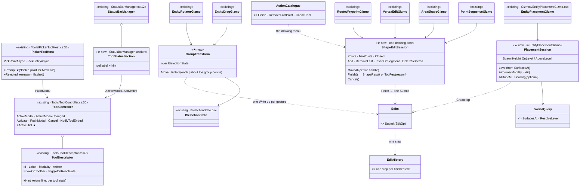

*What the picture shows that the prose hid:* the four drawing gizmos point at **one** session. The finish / cancel convention therefore
lives in one class. Everything new is a member of something that exists (`Hint` on the descriptor, `Prompt` on the picker host) or one
small class (`ShapeEditSession`, `PlacementSession`, `GroupTransform`). None of it is a second tool system.

### 2.2 Draw an area — the convention end to end

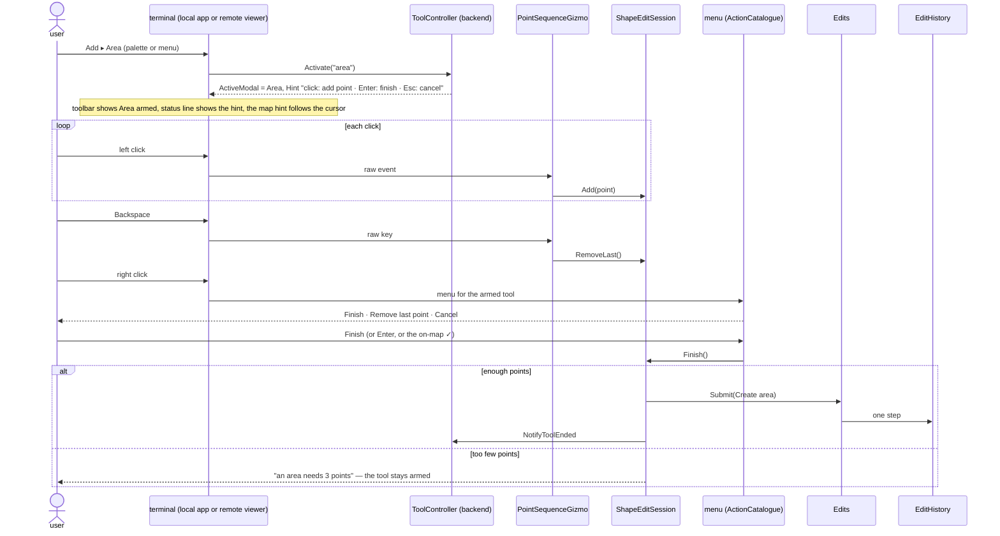

*What the picture shows that the prose hid:* right-click no longer finishes or cancels anything. It opens the menu. Finish has three
doors (Enter, the ✓, the menu item) and all three reach the same `Finish()`. Too few points no longer cancels silently.

### 2.3 Pick a point for a form — the pick is visible

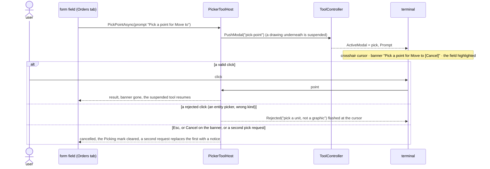

*What the picture shows that the prose hid:* the banner is drawn from the controller's state on the terminal. A remote viewer gets it
as well as the local app, and no form has to remember to draw it.

### 2.4 Who runs what

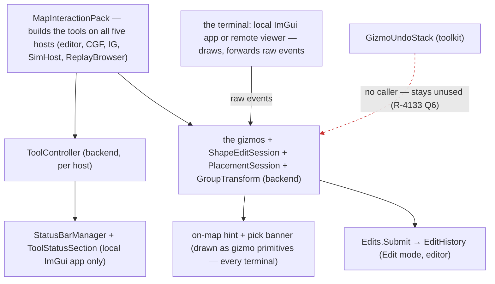

*What the picture shows that the prose hid:* the hint and the banner must be **gizmo primitives**, not ImGui. A remote viewer has no
ImGui status bar, and the map is a dumb terminal (R-4132). The status bar section is an extra for the local app. The red edge is the
toolkit undo stack, which nothing calls and which this design does not revive.

### 2.5 The rules, in one table

| topic | rule | why |
|---|---|---|
| **finish / cancel** (D11) | Enter, the on-map ✓, or the menu's *Finish* = finish · Esc = cancel (through the input design's central Esc) · right-click = the menu · clicking the first point closes an area · ⛔ no double-click finish by default | ArcGIS users report accidental double-click finishes; QGIS finishes on right-click. The visible ✓ plus Enter is the common ground (programme §3.12) |
| **while drawing** | Backspace = remove last point · too few points ⇒ the tool says why and stays armed · the hint names the minimum | silent cancels lose work |
| **editing a shape or route** | the centre handle moves the WHOLE shape on every kind (a route too: all waypoints move) · click a segment = insert · Delete = remove the selected point · each finished drag = one edit, one undo step | ROUTES1 §11.1 except its right-click commit (D11 wins, see known-conflict) |
| **the armed tool is visible** | the toolbar marks it (reads `ActiveModal`, Tool Model step 5) · the status line shows label and hint · a short hint follows the cursor | today nothing shows it |
| **a pending pick is visible** (D12) | crosshair + banner with Cancel + the field highlighted · a rejected click flashes the reason · a second request replaces the first with a notice | today invisible when the form is scrolled away |
| **placing — level** (D16) | in 3-D the click IS the level (built, CE-1033) · in 2-D, when `SurfacesAt` has more than one surface under the cursor, the hint shows *"level 0 of 3 · PgUp / PgDn"* and the ghost shows the chosen level | one key pair, shown only when there is a choice |
| **placing — aircraft** (D16) | a type with `Mobility = Air` is placed **airborne by default**: `SpawnHeight.AboveLevel` with the type's route height (300 m for the A-10C), at cruise; a helicopter the same with its hover height; Shift places it on the ground (a parked aircraft) | aircraft placed on the ground crash (CE-4272) |
| **placing — heading** | optional: press and drag sets the heading of that unit; after a multi-placement, ONE rotate of the multi-selection (each about its own centre, or the group about its centre, toggled in the hint) | user, §3.12 |
| **snap** | off by default; the hint offers toggles: ground (always on for ground units), grid, 15° rotation | — |
| **multi-select** | Shift adds · Ctrl toggles · Shift-drag adds a band · Alt-click cycles overlapped units · move, rotate, delete, change side, give an order act on the whole selection | the multi-select design's open half |
| **the gizmo look** | every gizmo is reviewed for a 2-D look and a 3-D look (§2.6) | user |
| **every station** | a tool that cannot run here is greyed with the reason (R-4119) — never missing, never silently empty (e.g. box select on CGF today) | R-4119 |

### 2.6 The gizmo look — a review list, decided per gizmo in the lane

| gizmo | today | target |
|---|---|---|
| placement ghost | a translucent sphere sized in world metres (`EntityPlacementGizmo.cs:43,153`) | the unit's map symbol (2-D) and a footprint silhouette at its real size (3-D); an aircraft ghost drawn at its altitude with a drop line to the ground |
| drawing points and lines | per gizmo | one style for all four: points as small squares, the next segment dashed to the cursor, the closing segment dashed |
| vertex / waypoint handles | 2-D only | the same handles in 3-D on the surface (programme §1.5 ⑨) |
| pick cursor | none | a crosshair, and the banner |
| rotate | live degrees label | kept; a ring around the group for a group rotate |

⛔ The lane proposes the looks with images in the chat (no screenshots in git). The user approves them before they are built.

⭐ **PROPOSED (behaviors, `2026-11-08`) — awaiting the user's approval, nothing built.** Six rows, each *today · 2-D · 3-D*:
① placement ghost = the unit's footprint (the renderer's L × W rule, `EntityFootprint`) with a heading notch; an aircraft at its altitude with a drop line ·
② one drawing style in the kind's colour (area teal, route green), small squares, the next segment dashed, the closing segment dotted, the first point white ·
③ one handle look for every editor (white square outlined in the kind's colour · hovered filled · grabbed amber, since red means an error · the centre is a diamond with the move glyph · a dashed `+` on a hovered segment), the same handles in 3-D on the surface with a stem under a raised point ·
④ the OS crosshair cursor while a pick is pending; the banner with a real Cancel button ·
⑤ the rotate ring kept, plus a swept wedge, a knob and `+35°` ·
⑥ one backdrop behind every screen-space gizmo text; the gizmo font loaded with `·` `°` `—` `×` (today it is loaded ASCII-only: `LoadFontFromMemory(…, null, 0)` in `RaylibPresentationShell.LoadGizmoFont` and `PlayerApplication.LoadAndRegisterGizmoFont` — two copies); the tick box becomes a **Done** button, since Roboto has no `✓`.

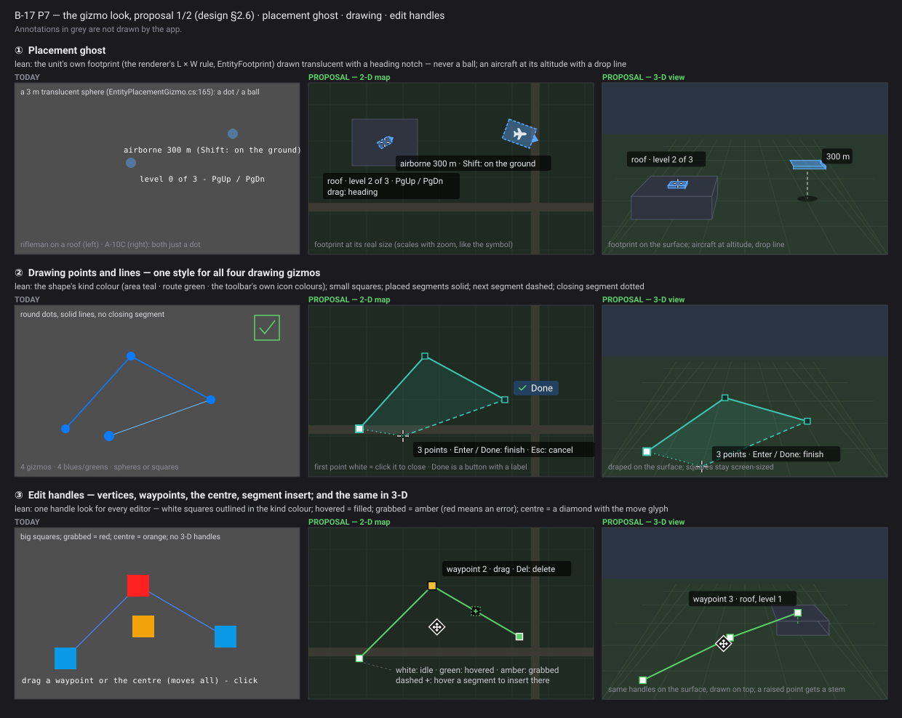
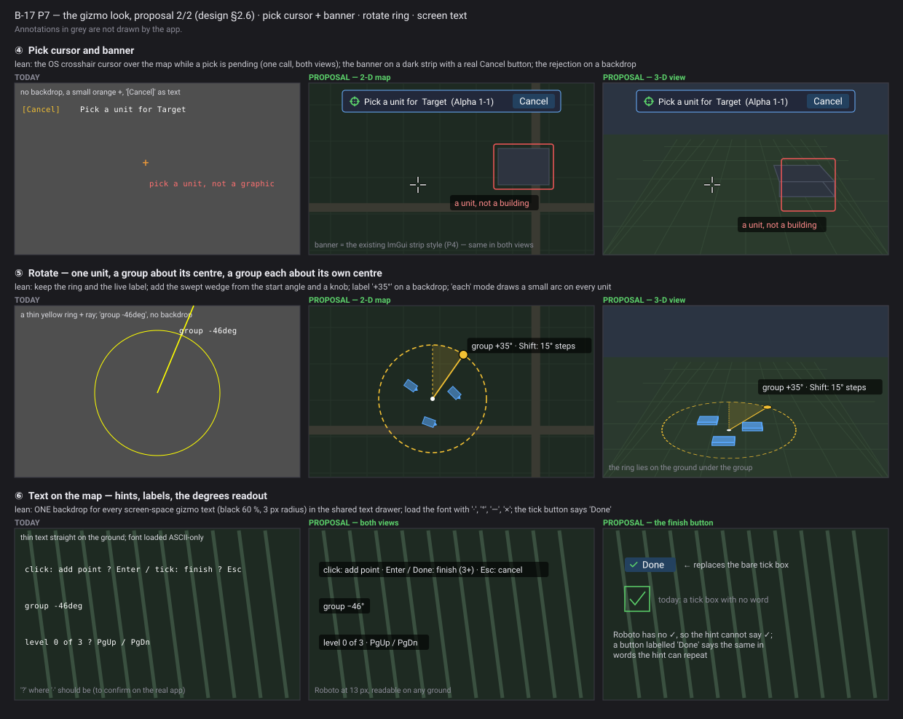

*Generated by `scripts/gen-map-gizmo-look-proposal.py` (python3.13, over `mockup_kit`).*

### 2.7 The graphical design *(R-4143 — the acceptance spec)*

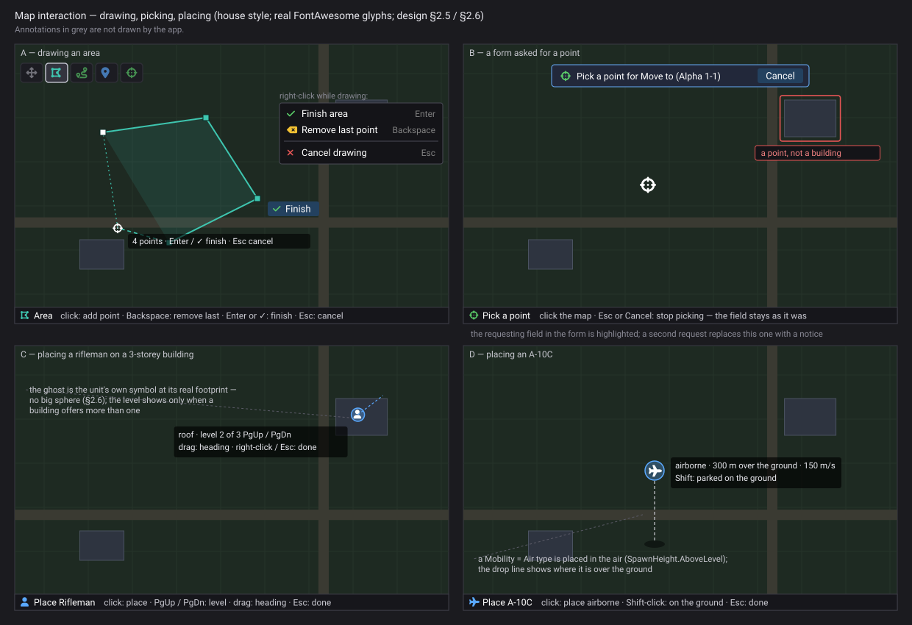

*What the picture shows that the prose hid:* every armed tool says the same three things in the same places. It names itself in the status line, the hint by the cursor says what the next click does, and right-click offers the same Finish · Remove last point · Cancel. A pending pick and a rejected click are visible on the map itself, not only in the form that asked. Generated by `scripts/gen-map-interaction-mockup.py`.

## 3. Stages

| stage | what | owner | rails |
|---|---|---|---|
| **P1** | the armed tool is visible: `ToolDescriptor.Hint`, `ToolController.ActiveHint`, the toolbar reads `ActiveModal` (Tool Model step 5, CE-259m), `ToolStatusSection`, the on-map hint as gizmo primitives | ui | the toolbar marks the tool on every host; the hint is drawn on a remote terminal |
| **P2** | ✅ BUILT (behaviors, 2026-11-08 — *AS-BUILT — P2* below) `ShapeEditSession`; the four drawing gizmos move onto it; the D11 convention; the drawing menu as three catalogue actions | ui (+ backend for the gizmo side) | each gizmo: Enter / ✓ / menu finish, Esc cancels, Backspace, too-few points keeps the tool |
| **P3** | placement: ① **measure CE-4272 first** (does an A-10C spawned at 300 m fly on?); ② `PlacementSession` — airborne by `Mobility`, 2-D level choice from `SurfacesAt`, optional heading drag; ③ Create through `Edits.Submit` | ui + backend (CE-4272) | an A-10C placed on the map is airborne at cruise; a click on a 3-storey house offers 3 levels |
| **P4** | ✅ BUILT (behaviors, 2026-11-08 — *AS-BUILT — P4* below) the pick banner, rejection flash, replace notice in `PickerToolHost` | ui | a pick is visible with the form scrolled away; Cancel on the banner clears the field |
| **P5** | ✅ BUILT (behaviors, 2026-11-08 — *AS-BUILT — P5* below) multi-select modifiers (Shift / Ctrl / Shift-drag / Alt-click); `GroupTransform` for move and rotate | ui | rotate 5 placed units about each centre and about the group centre: one undo step |
| **P6** | ✅ BUILT (behaviors, 2026-11-08 — *AS-BUILT — P6* below) shapes and routes: the centre handle on every kind (routes included), segment insert, Delete | ui | ROUTES1 §11.1 rails, minus the right-click commit |
| **P7** | ✅ BUILT (behaviors, 2026-11-08 — *⭐ P7 — the build* below) the gizmo look review (§2.6), approved by the user before it is built | ui | the frame rails under `xvfb-run` |

Order: P1 → P2 → P3 (P3's measurement can start at once) → P4 → P5 → P6 → P7. P2 depends on the action catalogue's first stage (A1),

### ⭐ AS-BUILT — P3 *(behaviors, `2026-11-07`, CE-4309)*

| step | as built |
|---|---|
| ① CE-4272 | ✅ **measured live** (`--mode all`, `test-move`): an A-10C spawned at z = 300 holds 300 m at 150 m/s, full health, for 30 s ⇒ the aircraft is fine; the crash was the GROUND start. §1.1's claim row updated |
| ② `PlacementSession` | `Hrot.Presentation/ScenarioEditor/Gizmos/PlacementSession.cs` — PURE, fed by `EntityPlacementGizmo`. ⭐ **deviation:** "flies" is read from the TKB **flight descriptor** (`FlightParamsDto.HoverHeightM`: 300 m fixed-wing, 30 m helicopter), not `SimVehicleDef.Mobility` — the descriptor carries the height the design wants, and every flying type has one (the type that has no flight descriptor cannot fly in the sim either). Airborne = `AboveLevel(level)` + that height; **Shift** = on the ground. 2-D level: `SurfacesAt` under the cursor; PgUp / PgDn (raylib 266 / 267 — the map streams every key press to a raw-input tool) step it; the hint *"level 0 of 3 · PgUp / PgDn"* / *"airborne 300 m (Shift: on the ground)"* is rebuilt only when a choice moves (0 B steady). A 3-D click keeps its own level (CE-1033). Heading: press, drag ≥ 3 m, release ⇒ placed at the press point facing the drag; a click faces north |
| ③ Create through `Edits.Submit` | ✅ already built by backend's F2: `ScenarioSpawnAdapter.Request` submits `EditOp.Create` ("Place an entity") |

Rails: `EntityPlacementGizmoTests.CE4309_*` (airborne + Shift, the level choice on a 3-storey stack, the heading drag).

### ⭐ AS-BUILT — U-8 / U-9 *(ui, `2026-11-08`, CE-4339 · CE-4340)* — the heading drag is drawn; the 3-D hover is the entity's own box

| what | as built |
|---|---|
| ⭐ **U-8 (CE-4339) — the direction line.** The press-and-drag of the placement gesture (the entity placement tool AND Paste, ONE `PlacementSession`) now draws `PlacementDirectionLine`: while the left button is DOWN and dragged past the 3 m threshold, an amber line from the placement centre (the press point) toward the cursor, with a two-stroke arrow head, in 2-D and 3-D; the entity placement tool's ghost now stands at the PRESS point during the drag (where the entity will land), not under the cursor | `Hrot.Presentation/ScenarioEditor/Gizmos/PlacementDirectionLine.cs` (the one drawer) · called by `EntityPlacementGizmo.UpdateAndDraw` and `PasteGizmo.UpdateAndDraw` · rails `EntityPlacementGizmoTests.U8_…` · `EntityClipboardTests.U8_…` (Paste's suite, 0 B steady) · `PlacementDirectionFrameRail` (the real tool through the real 3-D gizmo layer, amber pixels along the screen line press → cursor, none with the button up) |
| ⭐ **U-9 (CE-4340) — the hover volume.** 📐 **MEASURED before** (`HoverPickVolumeTests`, the real camera pick + the real `EntityBoxPicker` + the entity's real pick box): `DebugGizmoLayer.PickEntity` (the hover / pick-tool hit-test) read its zoom off the 3-D camera's hidden **2-D `InnerCamera`** and tested the **2-D footprint box** (no `VehicleParams` ⇒ the 5 m default symbol ⇒ 3 m half) plus 5 px of slack taken at THAT zoom — so a 0.5 m rifleman answered the hover from **5.4 m (inner zoom 3) · 9–9.5 m (zoom 1) · 23 m (zoom 0.3)** away = **13–202 screen pixels** (his drawn half-width 0.7–11 px). That is the "~15 m". ⭐ **Now** in 3-D `PickEntity` answers the camera's own pick — the entity the cursor's RAY hit (`MapCamera3D.LastPick`, kind Entity), i.e. its DRAWN box plus `EntityBoxPicker.MarginPixels` (6 px, a screen margin taken at the box's depth, so a far tiny man stays hoverable) — and nothing else | `FDP/Engine/Fdp.Presentation/Vis2D/Layers/DebugGizmoLayer.cs` (`PickEntity`) · `EntityBoxPicker` (`metresPerPixelAt`, wired by `MapInteractionPack`) · rails `HoverPickVolumeTests.U9_…` (5 camera distance × inner-zoom cells: reach ≤ drawn box + 6 px and ≥ his own pixels). ⚠ **Not changed (a follow-up):** a CLICK-select in 3-D still hit-tests the 2-D footprint boxes (`DebugGizmoLayer.HandleInput` press path) — the report was the hover |

### ⭐ AS-BUILT — P1 *(behaviors, `2026-11-07`, B-17)* — the armed tool is visible

INVENTORY: `scripts/cbm.sh search_graph name_pattern=".*(StatusBar|Hint|Toolbar).*"` + grep `ShowOnToolbar` / `ActiveModalChanged` ⇒ `ShowOnToolbar`
read by nothing, one toolbar (`EditorToolbarPanel`, four tool buttons reading no state — CE-259m), the status-bar section pattern
(`MapCursorStatusBarSection`, registered by five hosts), the world-scoped UI states (`MapUiStates`), the placement gizmo's own cursor hint (P3).

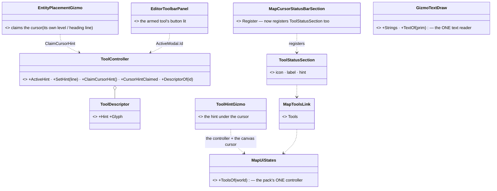
*What the picture shows: the words live once (the descriptor, or the gizmo's own line through `SetHint`), and the three surfaces (status line,
cursor, toolbar) read the one controller; the status line rides on the cursor section, so no host can lack it.*

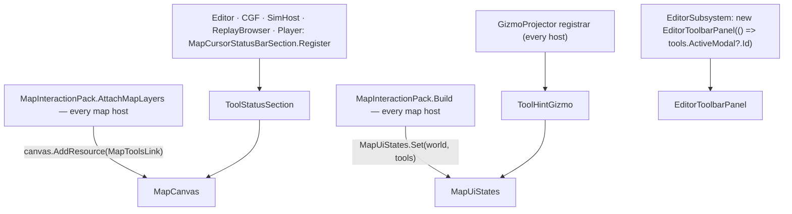
*Who reaches it: all three hooks are in shared composition (the pack, the attach, the cursor section, the projector registrar); only the
toolbar is the editor's own (the one tool toolbar there is).*

| decision | why |
|---|---|
| the hint is the descriptor's line; a gizmo that knows more states it with `SetHint`; arming another tool clears it | one answer, never stale for the next tool |
| ONE line at the cursor: a gizmo that draws its own there (placement) calls `ClaimCursorHint` and the generic one stays away | the mockup shows one hint by the cursor |
| hints describe TODAY's gestures (the drawing tools still finish on right-click) | P2 moves finish to Enter / ✓ / the menu and updates the words with it |
| ⭐ found and fixed: gizmo text over 31 characters was cut on every map — `GizmoTextDraw.TextOf` resolves the interned string (the layer sets `Strings` to its buffer's map before it draws) | the P1 fidelity frame showed the hint cut; the P3 placement hint was cut the same way |
| ⚠ deviation: the cursor hint has no dark backdrop (gizmo text has none) | readable on the map's grey; a backdrop is P7's look review |
| ⚠ the cursor is the LOCAL canvas's; a remote viewer gets the status line, not the cursor hint, until its cursor reaches the backend | the remote cursor is not on the backend today |
| ⚠ the remote viewer's own renderer (GizmoMap's layer) does not set `GizmoTextDraw.Strings` yet | local hosts all go through the FDP layer, which does |

Rails: `TheArmedToolIsVisibleTests` (Presentation.Tests) — every map tool has a hint and an icon; one active hint, cleared with the tool
(red-proved: the pack not sharing its controller ⇒ the cursor-hint and status rails red); the cursor hint as gizmo text at the cursor (not for
Select, not when claimed); the status line registered by the cursor section; a long gizmo text read whole; `P1_TheArmedTool_OnARealFrame`
(`armed-tool.png` — the teal icon, name and hint in the status line, the hint under the cursor).
because the drawing menu reads it.

### ⭐ AS-BUILT — P2 *(behaviors, `2026-11-08`, B-17)* — ONE drawing core; right-click is the menu

INVENTORY: `scripts/cbm.sh search_graph name_pattern=".*Vertex.*"` (class) ⇒ **three**: the PRODUCTION `Hrot.Presentation/ScenarioEditor/Gizmos/VertexEditGizmo.cs`
(an `EditablePolyline`'s vertices; armed by the *Edit Shape* tool through `DataDrivenGizmoSystem`) and its test, and the GizmoMap **example**
(`FDP/ExtDeps/GizmoMap/GizmoMap.Example/…/VertexEditGizmo.cs`, untouched — nothing in production uses it) + grep `PointSequenceGizmo` / `AreaShapeGizmo` /
`RouteWaypointGizmo` ⇒ the four production drawing gizmos are `PointSequenceGizmo` (drawn areas + routes), `AreaShapeGizmo` (circle / rectangle shapes),
`VertexEditGizmo` and `RouteWaypointGizmo`. Graph coverage could not be checked (no `check_index_coverage` over the CLI).

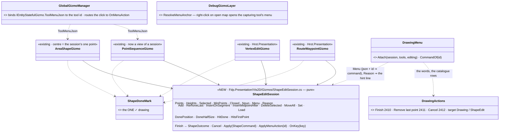
*What the picture shows: four gizmos, one convention. Each keeps its drawing and its result (a point array, an `AreaLink`, a written-back polyline or
route); every finish door and every cancel door ends in the session. The words (catalogue) and the commands (session) meet only in `DrawingMenu`.*

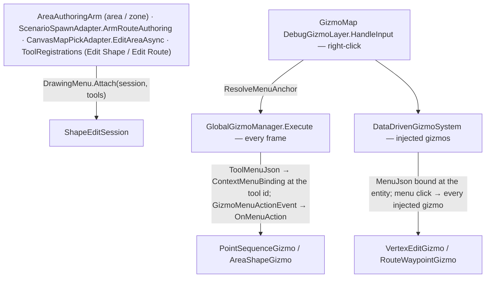
*Who reaches it: the menu opens from the layer's right-click on open map while a tool holds exclusive input (the layer used to suppress that click); the click comes
back as the ordinary `GizmoMenuActionEvent`, anchored at the tool id (global tools) or the entity (the editors).*

| decision | why |
|---|---|
| ONE session type for all four; `PointSequenceGizmo` is built `(onFinish, onRemove, minPoints, closed, noun, onCancelled)` | the finish / cancel / too-few rules exist once. `AreaShapeGizmo` has no point list: its CENTRE is the session's one point (`MinPoints` 1; the centre handle is `MoveAll`; Backspace un-places) |
| **right-click does nothing in any gizmo** | D11. `PointSequenceGizmo` finished on the press, `AreaShapeGizmo` cancelled, `VertexEdit` / `RouteWaypoint` wrote back and exited on the release — three meanings, now none |
| too few ⇒ `TooFew`, stays armed, `Session.Reason` ("an area needs 3 points (2 so far)") replaces the tool's hint (`ToolController.SetHint`) until the next click | silent cancels lost work. `AreaAuthoringArm`'s old *"too short ⇒ onCancel, then the gizmo removed itself"* is gone (its `OnCancelled` now means Esc / Cancel) |
| clicking the first point closes a CLOSED shape only once it has its minimum | with fewer, a click near the first point is just another point (a roof area drawn with 1 m between points still works) |
| the drawing menu = three catalogue actions, ids **2410 Finish · 2411 Remove last point · 2412 Cancel** (behaviors' block 2400–2499; W-3 used 2401–2408, W-1 2409), new `ActionTarget.Drawing` (armed tool) / `ShapeEdit` (the editors: Finish · Cancel only), new first group `ActionGroup.Tool` | one declaration, one wording (`DrawingActions`); a Tool group so no unit / graphic menu moves (the entity goldens are byte-identical) |
| the editors keep their own rows (*Insert point after* / *Delete point*, ids 1 / 2) ahead of the shared Finish · Cancel | `DrawingActions.JsonWith` composes it once |
| `IEntityStatefulGizmo.ToolMenuJson` (default null) — `GlobalGizmoManager` binds it to the tool id and routes the click | a tool gizmo does not know its id; the arbiter does. Anchored routing: a menu click reaches only the gizmo whose id it names |
| `DebugGizmoLayer.ResolveMenuAnchor` (GizmoMap) | an exclusive tool made a right-click on open map open nothing; now it opens the tool's own menu when it bound one |
| the on-map ✓ is `ShapeDoneMark`, drawn by all four (sized from the shape, as `AreaShapeHandles` sized it) | one drawing; `PointSequenceGizmo` / the editors hit-test it with `Session.HitDone` (a left click, delivered raw — the terminal sends them while the tool holds exclusive input) |
| hints: `DrawingMenu.AreaHint` / `RouteHint` = the session's `KeysHint` — *"click: add point · Enter / ✓: finish (3+) · Backspace: undo point · Esc: cancel"*; Edit Shape / Edit Route: *"drag a vertex · Enter / ✓: done · right-click: menu · Esc: undo the drag and stop"* | the words come from the session, so descriptor and gizmo say one thing |
| one finish = ONE edit, as before | a drawn area / route: `onFinish` → `ScenarioSpawnAdapter.Request` → one `Edits.Submit(Create)`; an area shape: the form's own edit; the editors: the one write-back + `UpdateEntityCommand` they always did |
| ⛔ SUPERSEDED by *AS-BUILT — P6* below (the centre handle, click-a-segment insert and the Delete key are built). ⚠ The remote viewer's own layer does not yet open the tool menu (its renderer is not the FDP layer) | stage P6 owns the editing handles |
| ⚠ `Backspace` (259) reaches a gizmo only as the layer's typed-key stream delivers it (the same path as every key); added `MapKeyboardKey.Backspace` to the contract | verified on the session and gizmo level, not with a live key |

Rails: `ShapeEditSessionTests` (Fdp.Presentation.Tests — the convention itself); `AreaShapeGizmoTests` `D11_*`; `AreaAuthoringArmTests` `P2_*` (the area / route gizmo through the arm:
the three finish doors, Esc / menu cancel, Backspace, right-click ends nothing and the menu rows are bound, first-point close, too-few + hint); `VertexEditGizmoTests` / `RouteWaypointGizmoTests`
`P2_*`; `GlobalGizmoManagerTests.B17P2_*` (menu bound to the tool id, click anchored); `DebugGizmoLayerGizmoTests.B17P2_*` (`ResolveMenuAnchor`); `TheMenusAreGoldenTests`
`P2_TheDrawingMenu_IsTheGolden_InEveryMode` (new `Goldens/menus.drawing.golden.txt`; the entity goldens did not move); `TheArmedToolIsVisibleTests.P2_AnAreaBeingDrawn_OnARealFrame_ShowsTheTickAndTheHint`
(`drawing-area.png` under `HROT_RAIL_SHOTS`, never committed). Existing rails that finished by right-click (`AreaAuthoringArmTests`, Editor `AdapterTests` ×2) now finish by Enter.

### ⭐ AS-BUILT — P4 *(behaviors, `2026-11-08`, B-17)* — the pending pick is visible

INVENTORY: grep `PickPointAsync` ⇒ **0** (the name in the brief; the picks are `PickLocalAsync` / `PickLocationAsync` / `PickEntityAsync` / `PickAreaEntitiesAsync` on `IMapPickService`, run by `PickerToolHost.RunPickAsync` / `PushPicker`);
callers of the asking field: `MapPickBroker.RequestEntityPick` / `RequestLocationPick` (every form, by JSON path) and `MenuOrders` (order / embark / designate picks). The pickers already drew a crosshair (`FdpLocationPickerGizmo`, `EntityPickerGizmo` — CE-1065 / CE-1337), so the cursor was not new work.

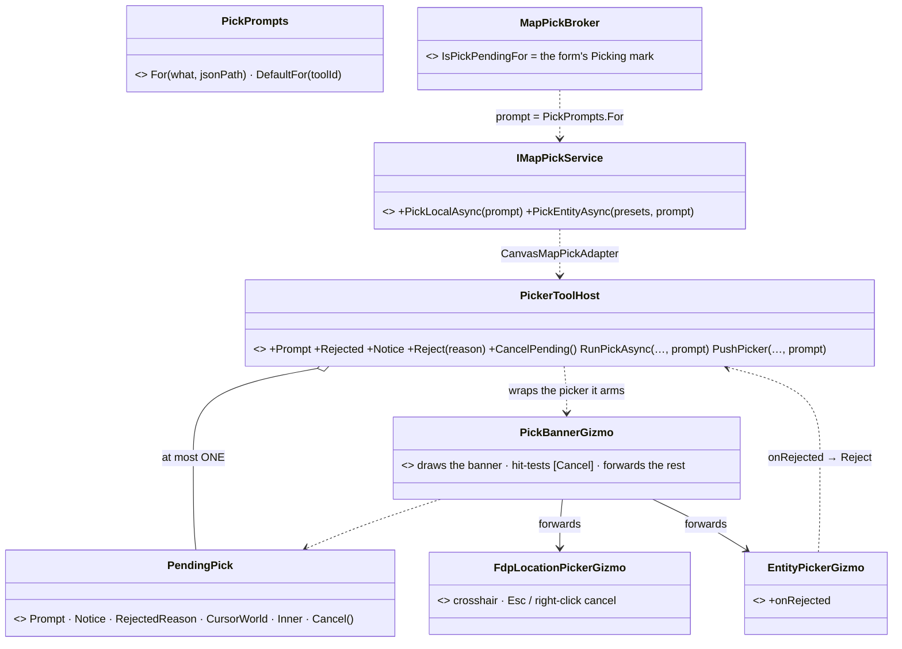
*What the picture shows: the banner is a decorator on the picker the host already arms, so it is drawn by every host that picks and by every terminal (gizmo primitives, no ImGui); the asking field gets its words in through the service's new overloads, and its Picking mark is the task the picker completes — so Cancel needs no form code.*

| decision | why |
|---|---|
| **Cancel = the picker's own Esc** (`PendingPick.Cancel` sends `Escape` to the inner gizmo, then `Remove`, then completes the caller's await as cancelled) | every picker already ends itself and completes its caller on Esc; the form's Picking mark (`IsPickPendingFor`) is a poll on that task, so it clears at once. No per-kind cancel code, no form involvement ⇒ **a form cannot be unreachable** |
| the banner is `[Cancel]` (amber) + the prompt (white), SCREEN-SPACE gizmo text at the map's top-left (x 16 / 100, y 12 px); a notice line under it; the refusal in red at the cursor | only text can be drawn in screen space (the builder has no screen-space line / box), so the button is the bracketed word; its hit area is a fixed pixel box on the canvas's mouse position (`PickerToolHost.mouseScreen`, given by `CanvasMapPickAdapter`). A host that gives no mouse still shows the banner; Esc cancels |
| ⚠ deviation from the mockup: no backdrop panel behind the banner and no button box | same as P1's cursor hint — a backdrop is P7's look review |
| `Prompt` words: the form's field (`"Orders[0].MoveTo"` ⇒ *"Pick a point for Move to"*), `MenuOrders` its order's `PickField`, else the tool's default (*"Pick a point on the map"*) | `IMapPickService` gained default-method overloads (`PickLocalAsync(prompt)`, `PickEntityAsync(presets, prompt)`) that delegate to the old ones, so no other implementer changed |
| a refused click: `EntityPickerGizmo.onRejected` (a click on an entity the filter excludes) ⇒ *"pick a unit, not a graphic"* (no identity) or *"that is the wrong kind here"*; an ORBAT row offered to `TryOfferEntity` and refused ⇒ *"that is not a valid pick here"*; flashed 1.5 s, the pick stays | a click on empty map does nothing and says nothing (as before) |
| ⭐ a second PROMPTED pick request **replaces** the first (cancelled through its own Esc, its await completes cancelled) and the new banner says *"replaced: Pick a point for …"* for 3 s; a pick with no prompt (the area-shape editor) neither replaces nor is replaced | the old behaviour left the first picker suspended under the second, and a form waiting on it forever. ⛔ SUPERSEDES the stacking of two different picks: `NoPickOrASuspendedPick_RefusesAnOffer` now buries the entity pick under a non-pick modal instead of a location pick |
| the tool under the pick still suspends once and resumes after any end of the pick (click, Esc, Cancel, replacement) | unchanged `PushModal` / `Remove` |
| ⚠ not done: the form field's own highlight beyond the existing Picking mark (it already shows while the task is pending — nothing added); the 3-D map's renderer may not draw screen-space gizmo text (the banner is on the 2-D map and the local FDP layer; a remote viewer's own renderer does not yet set `GizmoTextDraw.Strings`, as P1 noted) | |

Rails: `PickerToolHostTests` `P4_*` (the prompt reaches the banner primitives; the field words; Cancel on the banner cancels and the tool underneath resumes; a click off the banner still picks and Esc cancels; a rejected click flashes and the pick stays; a refused offer flashes; a second request replaces the first with a notice; Cancel clears the broker's Picking mark); `TheArmedToolIsVisibleTests.P4_APendingPick_OnARealFrame_ShowsTheBannerTheCrosshairAndTheFlash` (`pending-pick.png` under `HROT_RAIL_SHOTS`, never committed).

### ⭐ AS-BUILT — P5 *(behaviors, `2026-11-08`, B-17 — ui's files)* — multi-select modifiers and `GroupTransform`

INVENTORY: `scripts/cbm.sh search_graph name_pattern=".*Selection.*"` (class / interface) and grep `SelectionChangeRequest` ⇒ ONE request type (`Fdp.Toolkit.Vis2D.Abstractions.SelectionChangeRequest`, modes Replace / Add / Remove / Clear — **Add and Remove already existed**, only the factories were missing),
ONE writer (`SelectionRequestSystem`), ONE map-click system (`SelectionInteractionSystem`); the modifier masks already reached it (`ModifiersOf`); the RTS scope already declared Shift = add (`RtsSelectAdd`, in front of the map scope).
Entity menu: Delete and every order are `ActionExecution.PerEntity` / read the selection already (A4, R-4162) and the Delete key deletes every selected unit — nothing to change. ⚠ **There is no "change side" row in the entity menu** (grep `ChangeSide` / `SetSide` ⇒ only `PlayableOps` / the DebugApi) — that sub-item is not built (nothing to widen). Graph coverage could not be checked (no `check_index_coverage` over the CLI).

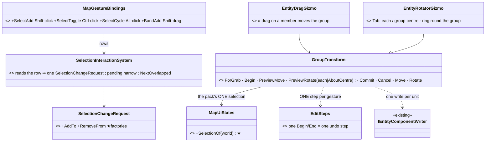
*What the picture shows: the modifier rows live in the keymap (the system resolves a row, never a key); the drag and rotate gizmos share ONE `GroupTransform`, which finds the pack's one selection from the world (no gizmo builds its own — `OnlyTheSharedPackConstructsTheSelection`) and brackets the whole gesture as one step.*

| decision | why |
|---|---|
| four new map-scope rows: **Shift+click `map.select.add` · Ctrl+click `map.select.toggle` · Alt+click `map.select.cycle` · Shift+drag-from-ground `map.band.add`** | `Keymap.TryFindGesture` takes the row naming most modifiers, so a plain click keeps `map.select`; the RTS scope keeps its own rows in front. A Shift-drag that goes nowhere neither adds nor clears |
| **Alt-click cycles the units whose own pick area (`EntityFootprint.InteractionRadiusMetres`, the select / drag query) contains the point**, in entity-index order; the first Alt-click gives the picked unit, each next one the next, wrapping | the terminal's pick names ONE unit, so the overlap set comes from the world; the reference is the unit the last Alt-click chose (a request is served a frame later), else the primary selection |
| ⭐ **a plain press on a member of a multi-selection narrows at the RELEASE, and only if nothing was dragged** (`_pendingNarrow`) | "drag on any selected unit moves them ALL" needs the selection whole during the press; the old immediate narrow collapsed it first. A click is unchanged for the operator (`LeftClickingAnEntityInsideTheSelection_StillNarrowsTheSelectionToIt` now releases) |
| `GroupTransform.ForGrab(repo, selection, writer, grabbed)` is null unless the grabbed unit is one of ≥ 2 selected transformable units; **`Begin` takes the "before" (`EditSteps.Begin`), previews write the local components from the ORIGINALS (idempotent), `Commit` writes one `IEntityComponentWriter.Write` per unit inside the same step, `Cancel` restores the originals and records nothing** | ONE edit = ONE undo step, never N; a unit the router refuses is put back |
| Move writes `Position.X/Y` per unit; Rotate Each writes `Heading` only (compass degrees, as the rotator always did); Rotate AboutCentre writes `Position.X/Y` + `Heading`. Angles are math yaw radians (CCW); the angle of a rotate gesture is `yaw(cursor from the pivot) − the grabbed unit's yaw` | each unit's heading +θ; the group swings rigidly round the **centroid of the units** |
| the mode toggle is **Tab**, named in the hint (*"drag: rotate · Tab: each / group centre (now: each) · right-click or Esc: cancel"*, stated each frame through `ToolController.SetHint`); a ring round the group (radius = farthest unit + 3 m) is drawn in group mode, the arrow runs from the pivot, the label says *group / each ±N deg* | ⚠ deviation from the brief's "R": **R is the Rotate tool's own shortcut** — pressing it would re-arm (reset) this gizmo. `Tab` already exists in `MapKeyboardKey` |
| the selection reaches the gizmos through **`MapUiStates.SelectionOf(world)`**, registered by `MapInteractionPack` | `OnlyTheSharedPackConstructsTheSelection` forbids a second `EcsSelectionState`; no host wiring, so no host can forget it (none registered ⇒ the single-unit gesture, as before) |
| ⭐ **CE-4342 (ui, `2026-11-09`) — the user's *"dragging one of several selected moves only that one"*: measured, the shared path WORKS end to end** — rail `RtsCommandToolTests.CE4342_DraggingOneOfThreeSelected_MovesAllThree_ThroughTheMapsBus` builds the pack with the drag gizmo registered as every host does, lets the lifecycle's `ConstructionOrder` create the gizmo instances, selects three, sends the terminal's press · started · drags · commit on the interaction bus: all three move by the delta, the fourth stays, the selection stays whole, ONE undo step that restores all three. 📐 The report (`1b7c20f9b`, 19:50) was recorded on a tree that did NOT contain P5 (`f13a5469d`, 18:47, not an ancestor) ⇒ most likely an older build. ⚠ Not reproduced with the editor's `EntityWriteRouter` (the rail passes no writer; `GroupTransform.Commit` writes per unit through it and puts a refused unit back) | a rail that drives the pack, not the class — `DataDrivenGizmoSystem.HasActiveGizmo(e)` (a probe) shows the instance exists |
| ⚠ not done / not verified live: the rotator toggles on `Tab` as the layer's typed-key stream delivers it (verified on the gizmo level, not with a live key); no live preview of the rotate (the arrow and ring only, as the single rotate); the 3-D map has no group ring (the rotate gizmo draws on the 2-D map) | |

Rails: `GroupTransformTests` (Presentation.Tests/Edits) — drag moves 3 of the selected by the same delta and only them · cancel puts all back · writer gets one write per unit · rotate 5 **each** (headings +θ, positions unchanged) and **about the group centre** (rigid swing about the centroid, headings +θ), each **one undo step** that restores all 5 · single unit = the ordinary rotate · the hint names Tab · the pack registers the one selection · frame `P5_AGroupRotate_OnARealFrame_ShowsTheRingRoundTheGroup` (`group-rotate.png` under `HROT_RAIL_SHOTS`, never committed; the ring present in group mode, absent in each mode); `SelectionInteractionSystemTests` `B17P5_*` (Shift adds · Ctrl toggles · Shift-band adds, plain band replaces · an empty Shift-drag clears nothing · Alt-click cycles 3 overlapped and wraps · narrow-at-release / drag keeps the selection).

### ⭐ AS-BUILT — P6 *(behaviors, `2026-11-08`, B-17 — ui's files: the two editors, `SelectionInteractionSystem`, `MapInteractionPack`, `DrawingMenu`, `ScenarioToolRegistrations`)* — the editing handles

INVENTORY: `scripts/cbm.sh search_graph name_pattern=".*(Vertex|Waypoint|ShapeEdit|PointSequence|AreaShape).*"` (class) ⇒ the editors are `VertexEditGizmo` (a drawn area / zone's `EditablePolyline`) and `RouteWaypointGizmo` (a `RoutePlan`); `AreaShapeGizmo`'s circle / rectangle already had their ONE centre handle in P2 (the centre IS the shape's point); `PointSequenceGizmo` is the drawing tool, not an editor. Delete key: `SelectionInteractionSystem` destroyed the SELECTED entities on every Delete release — the editors' target is usually that selected entity. Graph coverage could not be checked (no `check_index_coverage` over the CLI).

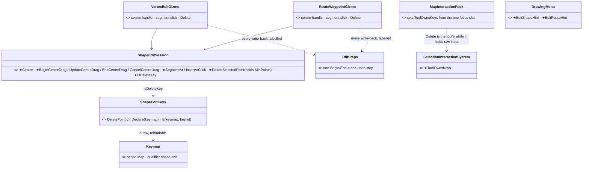
*What the picture shows: the new behaviour lives in the ONE session (centre drag, segment hit-test, the minimum-held delete); the editors only keep their parallel data (a route's speeds and heights) and bracket each write-back as one step. Delete is a keymap row asked through the session — and the selection system stands down on it while an editor holds the keyboard, or it would also destroy the selected route.*

| decision | why |
|---|---|
| **centre handle** = a Box2D at the mean of the points, `SubElementId = ShapeEditSession.CentreHandleId` (65535; vertex `i` is `i + 1`), amber; its drag is `BeginCentreDrag` / `UpdateCentreDrag` (always from the originals, so idempotent) / `EndCentreDrag` (true only when something moved — a click on it is no edit); a route's waypoints keep speed and height (only X / Y shift) | ONE gesture for every kind: area / zone / polyline (`VertexEditGizmo`), route (`RouteWaypointGizmo`), circle / rectangle (`AreaShapeGizmo`, P2) |
| **click a segment** inserts a point (the click projected ONTO the segment; a route's new waypoint takes the height along the leg and the leg's speed), selected. `SegmentAt` excludes a click within `HandleClearRadius` (extent / 25, 3…20 m) of a vertex or the centre, and the ✓ is checked first; `SegmentHitRadius` = extent / 30, 1.5…15 m. A closed shape's closing segment counts, a route's does not exist | the world-unit tolerance (the gizmos know no zoom) mirrors the first-point / ✓ radii P2 already sized from the shape |
| **Delete** = `ShapeEditSession.IsDeleteKey` ⇒ the ROW `shape.delete.point` (scope Map, qualifier `shape-edit`, default chord Delete, label *Delete the selected point*) of the process keymap — never a key compared in a gizmo; a rebind moves it. It acts on the **release** (the map's key poll guarantees a release for Delete; one press deletes one point) | the P5 pattern: gestures / keys are rows. Enter / Esc / Backspace stay the session's own (P2) |
| Delete (and the menu's *Delete point*) **holds the minimum**: area / zone 3, route 2 — nothing removed, nothing recorded, `Session.Reason` ("an area needs 3 points - the last ones stay") on the tool's hint line via `MapUiStates.ToolsOf(world).SetHint`, cleared when a handle is touched again | P2's TooFew pattern |
| ⭐ every write-back is ONE bracketed edit (`EditSteps.Begin/End`, labels *Move point · Move shape · Move route · Move waypoint · Insert point · Delete waypoint …* — distinct, so two quick different edits do not coalesce); the preview stays in memory (the "before" is the world as it still is); a write-back that changes nothing (a click that selects, Enter with no change) records NOTHING | "each finished drag = one edit, one undo step". ⚠ before P6 the editors recorded no undo step at all |
| ⭐ **cross-cutting:** `SelectionInteractionSystem.ToolOwnsKeys` (set by `MapInteractionPack` to *"the focus slot holds a gizmo that wants raw input"*) — while true, the Delete release does not destroy the selected entities | the editors' target is usually the selected entity: without it Delete removed the point AND deleted the route |
| the Edit Shape / Edit Route hints: `DrawingMenu.EditShapeHint` / `EditRouteHint` — *"drag a vertex or the centre (moves all) · click a segment: add · Del: delete · Enter / ✓: done · right-click: menu · Esc: undo the drag and stop"* | the status line fits it at 800 px; ⛔ the right-click COMMIT of ROUTES1 §11.1 stays overruled (D11) |
| ⚠ not verified live: `Delete` as the live key stream delivers it (verified on the gizmo + session level and through the keymap row); no 3-D editing handles (the editors draw on the 2-D map, as before — P7 reviews the looks) | |

Rails: `ShapeEditSessionTests` `P6_*` (centre drag from the originals / cancel / no-move · `SegmentAt` finds the segment, not a vertex or the centre, closing segment, route · `DeleteSelectedPoint` holds the minimum · **Delete is a keymap row, a rebind moves it**); `VertexEditGizmoTests` / `RouteWaypointGizmoTests` `P6_*` (the centre handle drawn at the mean · centre drag moves every point and is ONE undo step with undo / redo · Esc cancels clean, a click on the handle is no edit · a segment click inserts between the right two (route: height along the leg) as one step, a vertex / centre / open-ground click inserts nothing · Delete removes the selected one as one step, the press is ignored · Delete at the minimum refuses with the reason on the tool's hint, then a touch clears it); `SelectionInteractionSystemTests.B17P6_*` (Delete destroys nothing while a tool holds the keyboard); `TheArmedToolIsVisibleTests.P6_TheEditToolsHints_…` + frame `P6_ARouteBeingEdited_OnARealFrame_…` (`editing-route.png` under `HROT_RAIL_SHOTS`, never committed: waypoints, the selected one red, the amber centre handle, the ✓, the hint). Red-proofs: a write-back per drag update ⇒ the centre-drag one-step rails (vertex and route) red · the minimum check dropped ⇒ the Delete-at-the-minimum rails red · `ToolOwnsKeys` ignored ⇒ `B17P6_*` red · the keymap lookup replaced by a key compare ⇒ `P6_Delete_IsAKeymapRow…` red.

### ⭐ P7 — the build *(behaviors, `2026-11-08`, B-17 — approved by the user: "Approved build.it")* — `build-state: BUILT` (P7-A `732c0b061`, P7-B `05dc20dc9`, P7-C `a55826a9a`)

INVENTORY *(measured before drawing)*: `search_graph name_pattern=".*(Symbol|Footprint|Silhouette).*" label=Class` ⇒ `EntityFootprint` (Fdp.Toolkits,
the 2-D symbol's L × W rule) + the placement ghost's own box (`EntityPlacementGizmo.DrawGhostBox`, sized by `EntityBodyLayer3D.Resolve`, U-8);
grep `backdrop` ⇒ none (`PickBanner.cs:45` names the gap); the gizmo font is loaded twice, ASCII-only (`RaylibPresentationShell.LoadGizmoFont`,
`PlayerApplication.LoadAndRegisterGizmoFont`); the four drawing gizmos + two editors draw points in four styles; the rotate label is `EntityRotatorGizmo.cs:109,125`.
⭐ **3-D (subagent sweep):** the 3-D view has NO hit test of its own — it turns the mouse ray into a ground point and runs the 2-D test there
(GizmoMap `DebugGizmoLayer.cs:137-215`), as `DESIGN_Map_3D_Mode.md:571` designs; an unanchored `Box2D` is DRAPED (`GizmoRenderer3D.cs:219-255`,
constant pixel size). ⇒ the 3-D handles already exist and are pickable; P7 gives them the look and a stem under a raised point. ⛔ No 3-D picker is built.
Graph coverage could not be checked (no `check_index_coverage` over the CLI).

```mermaid
classDiagram
  class GizmoTextStyle {
    <<NEW enum · GizmoMap.Contracts>>
    Plain = 0 · Backdrop = 1 · Button = 2
  }
  class DebugPrimitive {
    <<EXISTING · 64 B wire layout unchanged>>
    +TextStyle  (offset 14, Text only — aliases SizeMode, which Text never reads)
  }
  class GizmoTextDraw {
    <<EXISTING · the ONE text drawer, 2-D map + 3-D labels>>
    +DrawScreen(p, at, colour) draws the backdrop / button box first
  }
  class GizmoFont {
    <<NEW · GizmoMap.Presentation>>
    +Load() ASCII + · ° — – × …  (both hosts call it)
  }
  class GizmoEditStyle {
    <<NEW · Fdp.Presentation/Vis2D/Gizmos — the ONE look>>
    +KindColour(ShapeKind) area teal · route green
    +Point(draw, at, kind, first)
    +Handle(draw, at, kind, state, id) idle · grabbed (amber)
    +Centre(draw, at, id) diamond
    +Segment(draw, a, b, kind, Placed|Next|Closing)
    +Stem(draw, at, height)
  }
  class ShapeDoneMark { <<EXISTING>> +Draw ⇒ a "Done" button }
  class PointSequenceGizmo { <<EXISTING>> }
  class AreaShapeGizmo { <<EXISTING>> }
  class VertexEditGizmo { <<EXISTING>> }
  class RouteWaypointGizmo { <<EXISTING>> }
  class EntityPlacementGizmo { <<EXISTING>> ghost = footprint, no sphere }
  class EntityRotatorGizmo { <<EXISTING>> ring + wedge + knob }
  class PickBannerGizmo { <<EXISTING>> Button / Backdrop text, crosshair }
  DebugPrimitive --> GizmoTextStyle
  GizmoTextDraw --> GizmoTextStyle : reads
  GizmoTextDraw --> GizmoFont : font
  PointSequenceGizmo --> GizmoEditStyle
  AreaShapeGizmo --> GizmoEditStyle
  VertexEditGizmo --> GizmoEditStyle
  RouteWaypointGizmo --> GizmoEditStyle
  PointSequenceGizmo --> ShapeDoneMark
  AreaShapeGizmo --> ShapeDoneMark
  EntityPlacementGizmo --> GizmoTextStyle : hint text
  EntityRotatorGizmo --> GizmoTextStyle : label
  PickBannerGizmo --> GizmoTextStyle : banner
```

*What the picture shows that the prose hid:* the look has exactly two homes — the TEXT look in `GizmoTextDraw` (one drawer for the 2-D map and
the 3-D overlay, so both views agree by construction) and the SHAPE look in `GizmoEditStyle` (six gizmos call it; none keeps its own colours).

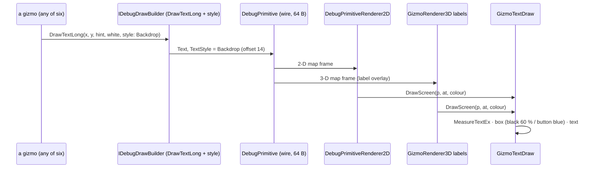

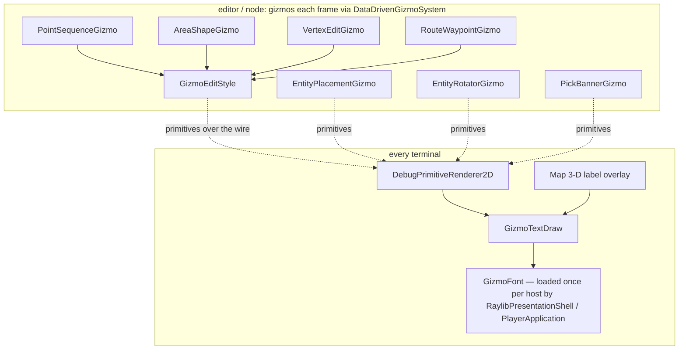

*What the module picture shows:* the gizmos run where the edit runs and only EMIT primitives; every terminal draws them. ⇒ the crosshair while a
pick is pending is drawn as primitives at the cursor (seen on a remote terminal too, §2.4), ⛔ not the OS cursor the proposal sheet named — the
OS cursor would be set by the process that runs the gizmo, which is not always the one the user looks at.

| row | as it will be built | the rail |
|---|---|---|
| ⑥ text | `GizmoTextStyle` at offset 14; `DrawText`/`DrawTextLong` take `style` (default `Plain`, so every other text is unchanged); `GizmoTextDraw` draws the box; `GizmoFont.Load` shared by both hosts; every hint, label and readout of the six gizmos + the P1 on-map hint pass `Backdrop` | a text with `Backdrop` round-trips the wire; the frame rail shows the box |
| ⑥ Done | `ShapeDoneMark` draws a button (filled box + tick + "Done"); `HitDone` takes its rectangle; hints say "Enter / Done" | the existing Done-click rails, on the new rectangle |
| ④ pick | the banner: prompt `Backdrop`, Cancel `Button`; a crosshair at the cursor while a pick is pending (two pixel bars + outline) | P4 rails + a crosshair frame rail |
| ⑤ rotate | amber dashed ring; the swept wedge (≤ 24 triangles); a knob; `+35°` `Backdrop`; ⛔ the per-frame `$"…deg"` string goes (cached per whole degree, 0 B steady) | the P5 rails + a 0 B steady-frame rail |
| ② drawing | `GizmoEditStyle` in four gizmos: kind colour, small squares, first point white, next dashed, closing dotted | a frame rail per gizmo |
| ③ handles | idle white + kind outline; grabbed amber; centre diamond; a point with a height gets a stem; ⚠ no hover state (the editors are not told where the cursor is when no button is down) — the sheet's "hovered" and the dashed `+` wait for that | P6 rails |
| ① ghost | no sphere; 2-D: a translucent footprint (the 2-D symbol's own L × W, `EntityFootprint`'s rule read from the TKB type) with a heading notch; 3-D: the U-8 wire box kept; an aircraft adds a drop line and a ground ring | P3 rails + a frame rail |

**AS-BUILT — P7-A** *(behaviors, `2026-11-08`, rows ⑥ ④ ⑤; ② ③ ① are P7-B)*

| row | as built | deviation / file |
|---|---|---|
| ⑥a text | `GizmoTextStyle {Plain, Backdrop, Button}` at `DebugPrimitive.TextStyle` (offset 14, aliases `SizeMode`; layout still 64 B). `DrawText`/`DrawTextLong`/`MakeText` take a trailing `style` on BOTH builder interfaces and every implementation. `GizmoTextDraw.DrawStyled` is the ONE drawer (box, then text): `DrawScreen` (2-D screen text, 3-D label overlay, entity cards) and the 2-D renderer's world-anchored text (inside the camera, counter-scaled, N-up mirror too) both call it. Backdrop = black α155, padding 6 × 3 px, 3 px radius; Button = `0x23415F` + 1 px `0x3369AD`. Passing `Backdrop`: the tool hint (`ToolHintGizmo`), the placement name and hints, `PasteGizmo`, the rotate label, the pick banner. ⚠ Measured before building: no Text producer sets `SizeMode`; the NED ingress keeps offset 14 for Text (it strips only offsets 8/12 of interactive Box2D/Sphere) | the four drawing gizmos and the two editors draw NO text of their own (their hint is `ToolHintGizmo`'s), so the list in the build row reduces to the five above. `DebugPrimitive.cs` · `GizmoTextDraw.cs:33-70` · `DebugPrimitiveRenderer2D.cs` (Text case) · `Fdp.Diagnostics.Contracts/TypeForwards.cs` (alias) |
| ⑥b font | `Fdp.Presentation.Fonts.GizmoFont.Load()` — Roboto 32 px, bilinear, codepoints 32–126 + `· ° — – × …` (checked against the TTF's cmap; the arrows and ✓ are NOT in Roboto, so they are not listed); registers `TextFont`; both hosts call it | ⚠ lives in `Fdp.Presentation` (`ImGui/Fonts/GizmoFont.cs`), NOT `GizmoMap.Presentation` as the brief said: the TTF resource is Fdp.Presentation's and GizmoMap cannot reference it. The third host named by the graph (`IgApplication`) does not exist in the tree; `grep "TextFont ="` finds only the two loaders |
| ⑥c Done | `ShapeDoneMark` draws a button: a world-metre Box2D `3.2 d × 1.1 d` half extents (fill `0x23415F`, 1 px border), a green tick at its left, the word "Done" (plain white). `ShapeDoneMark.Hit/HalfWidth/HalfHeight/Offset` are the ONE rectangle: `ShapeEditSession.HitDone` and `AreaShapeHandles.HitDone` call it; `DonePosition` moved right (`4.4 d`) so the button's left edge clears the shape's corner. Hints say "Enter / Done: finish" (`ShapeEditSession.KeysHint`, `DrawingMenu`); `ToolHintGizmo`'s ✓→"tick" mapping is gone | ⚠ the box is in WORLD metres (as briefed) while the word is a 13 px screen text, so at a very low zoom the word overflows a small box; the sheet's constant-pixel button would need a screen-pixel hit area, which the world-space `HitDone` cannot take |
| ④ pick | prompt / notice / refusal `Backdrop`; `Cancel` (no brackets) `Button` at the banner's left; `PickerToolHost.CancelBox*Px` is the ONE hit definition (`CancelLeftPx − PadX` … word width 45 px `+ PadX`); a crosshair of two ScreenPixels Box2D bars (18 × 2 px, white, dark 1 px outline) at `PendingPick.CursorWorld` (which `OnMouseEvent` now updates too) — ⭐ **P7-B: only for a picker that draws no aiming cross of its own** (`PickBannerGizmo`: skipped when the wrapped gizmo is `FdpLocationPickerGizmo` / `EntityPickerGizmo`, whose own tuned cross — CE-1065 / CE-1337 — stays the ONE cross; the area / bounds pickers get the banner's). ⛔ SUPERSEDED: the first P7-A build drew both. `PickBanner.cs:45`'s "no backdrop" gap note is replaced | the OS cursor is not used (module diagram above). `CancelTextWidthPx = 45` is a measured constant (Roboto advances at 13 px + 1 px spacing), not a runtime `MeasureTextEx` — the hit area is a few px generous |
| ⑤ rotate | both modes: amber (`0xF2C033`) DASHED ring (group-centre mode: the group's radius; each mode: 6 m round the grabbed unit), a fan of ≤ 24 translucent (α40) triangles from the start angle to now, a dashed start ray and a solid current ray, a 5 px knob where the current ray meets the ring, a 3 px white pivot dot, the label `group +35°` / `each +35°` on a backdrop; one unit keeps its line and says `46°`. The label string is cached per whole degree and mode (`LabelFor`); the group hint is two constants — a steady frame allocates 0 B | ⛔ no "Shift: 15° steps": the rotator has no Shift snapping (grep). The sheet's small ring on EVERY unit in each mode is not drawn (optional in the brief). 🔴 **Found while rendering it: a "dashed" `Sphere` ring was always SOLID** (`DebugPrimitiveRenderer2D`: 2 chords per metre, each drawn through `DrawStyledLine` whose 8-unit dash is longer than every chord) — fixed with `DrawStyledRing` (dash pattern round the circumference, in screen pixels); it also gives `FireMissionOverlayGizmo` / `MapPreview` the dashed circle they asked for. ⚠ The 3-D renderer draws a sphere ring solid whatever its style (`GizmoRenderer3D.DrawSphere` ignores `LineStyle`) — the 3-D dashed ring is P7-B's. `EntityRotatorGizmo.cs:100-170` |

**AS-BUILT — P7-B** *(behaviors, `2026-11-08`, rows ② ③ ① + the P7-A carry-overs)*

| row | as built | deviation / file |
|---|---|---|
| ② ③ the look | `GizmoEditStyle` (Fdp.Presentation, `Vis2D/Gizmos/GizmoEditStyle.cs`, static, 0 B): `Point` (screen-pixel squares: 8 px, the first 10 px WHITE), `Segment` (placed solid 2 px · next dashed 1.6 px · closing dotted 1.2 px), `Handle` (idle white + kind outline, grabbed amber + black outline), `Centre` (a diamond: a box turned 45°, dark fill, white outline), `Stem` (a dashed drop line to z = 0 + a dot), `FillConvex` (a triangle fan, α30, **only for a convex area**). Area teal `0x3EC6B0`, route green `0x5BD06A`, grabbed amber `0xF2C033`. `PointSequenceGizmo` (areas + routes drawn), `AreaShapeGizmo`, `VertexEditGizmo`, `RouteWaypointGizmo` draw ONLY through it; their private blues / reds / oranges and the round spheres are deleted. `RouteWaypointGizmo` stems a raised waypoint | ⚠ **pick size ≠ drawn size, and the pick test reads the DRAWN extents** (`DebugGizmoLayer.cs:636-661`: half-extent + 5 px). Today's handles were 8 px half-extent boxes; the sheet's is ~9 px across. ⇒ a handle is TWO primitives: an invisible (alpha 0) Box2D of the old 8 px half-extent carrying `BoxAnchorId` / `SubElementId` (the hit area is unchanged) and the small drawn square with no ids (never picked). `AreaShapeGizmo` hit-tests itself, so it uses `HandleSquare` / `CentreMark` (no pick box). ⛔ **No hover state**: the editors DO receive the cursor on a plain move (`GizmoMap DebugGizmoLayer.cs:321`, an exclusive anchor streams `DragUpdate`), but a "hovered" test needs the handle's size in WORLD units = pixels ÷ zoom, which a gizmo does not know; the sheet's hovered fill and the dashed `+` at a segment midpoint wait for the zoom to reach the editors. The Done button's draped 3-D look (a world-metre box) is P7-A's and looks tall in a perspective frame |
| ① ghost | no sphere. `EntityPlacementGizmo.DrawFootprint`: a world-metre Box2D (α100 fill in the side colour, dashed 1.6 px outline) turned to the pending heading (north until a drag), dims from `EntityFootprint.Dimensions(TkbTemplate)` — the NEW overload that reads `VehicleKinematicsTkbTranslator.BuildVehicleParams(VehicleParametersDto)` (class preset overridden by the template), so ghost, drawn symbol and pick area share ONE rule (no vehicle descriptor ⇒ the 5 × 2.5 m fallback) — and a filled notch triangle just beyond the front edge. The U-8 wire box is kept (3-D look). An aircraft: the wire box lifted by its altitude, a dashed drop line to the ground under it and a ground ring (a z = 0 outline `Sphere`, draped in 3-D) the size of the footprint. Label and hints Backdrop (P7-A). `PlacementDirectionLine` restyled IN PLACE (amber `0xF2C033`, dashed 1.6 px) — still the one drawer | the footprint and the wire box are both drawn (the wire box's size comes from `EntityBodyLayer3D.Resolve`, not from the vehicle descriptor, so in 2-D the two outlines differ for a type whose descriptor says otherwise — they collapse onto each other only when both rules agree). The label and look are cached once (`EnsureType`) — a steady ghost frame allocates 0 B (a `ReadOnlySpan<int> = stackalloc int[]{…}` in the old wire-box code allocated 64 B per frame; removed) |
| P7-C ① one outline per view | the U-8 wire box is emitted with `PipelineTarget.Viewport3D` only (the 2-D renderer skips a primitive without Map2D, `DebugPrimitiveRenderer2D.cs:119`; the 3-D triage accepts Map2D \| Viewport3D) and is turned to the SAME heading as the footprint (its X runs along the heading); the footprint (Map2D) draws in both views | `EntityPlacementGizmo.DrawGhostBox` |
| P7-C ⑥c Done in 3-D | ⛔ SUPERSEDES the P7-A "world-metre box in both views": the box + tick + plain word are `Map2D \| FlatOnly` (a 3-D pass never draws FlatOnly) and the 3-D view gets ONE constant-pixel `Button`-style "Done" text (`Viewport3D`) at the anchor. **Which fallback:** no zoom reaches a raw-input gizmo (`GizmoMouseEvent` carries only `WorldPos` and crosses the wire; adding the zoom is a wire-record change, not a small seam) ⇒ the click stays tested in world metres around `DonePosition`, so in 3-D the drawn pixel button and the click rectangle share the anchor but not the size | `ShapeDoneMark.Draw` |
| P7-A carry-over: one cross | see ④ above | `PickBannerGizmo.UpdateAndDraw` |
| P7-A carry-over: 3-D dashed ring | the rotate ring is drawn at z = 0 (on the ground under the pivot): `GizmoRenderer3D.DrawSphere` drapes a z = 0 ring and emits it through `EmitClosed` → `EmitPath`, which already dashes by the pixel rule with `MaxDashesPerPath`; ⛔ only a sphere WITH height went to `_sink.Sphere`, which ignores the style — that is what the ring used to be (the unit's z) | rail `Map3DGizmoTests.P7_ADashedGroundRing…` (drawn length ≈ half the circumference) |
| P7-A carry-over: CE1227 | `Map3DFrameRail.CE1227_V_DemoCity_TheTerrainIsARetainedLayer_UnderTheGizmos` is **RED AT BASE `1b5dec57c`** (clean worktree, identical numbers: 14283 of 18949 agree) ⇒ not P7's; filed as `CE-2427` in the tracker | |

## 4. Questions — ✅ all eight APPROVED as leaned (R-4134, user `2026-11-06`: *"Okay, accept it."*)

| # | question | lean | rejected |
|---|---|---|---|
| **Q1** | one drawing core | **`ShapeEditSession`**, shared by the four drawing gizmos — the D11 convention lives in one class | fix each gizmo: the four would drift again |
| **Q2** | where the hint and pick banner are drawn | **as gizmo primitives on the map** (every terminal, remote too) **plus** a status-bar section in the local app | ImGui only: a remote viewer would see nothing |
| **Q3** | airborne placement | **`Mobility = Air` ⇒ airborne by default** (`AboveLevel`, the type's route / hover height, at cruise); Shift places it parked on the ground; **CE-4272 measured first** | ground by default: the aircraft crashes |
| **Q4** | level choice in 2-D | **PgUp / PgDn, shown in the hint only when `SurfacesAt` has more than one surface**; in 3-D the click decides | a level dropdown: clutter for the 99 % case |
| **Q5** | heading at placement | **optional press-and-drag** per unit; after a multi-placement, one group rotate (each centre, or the group centre) | a heading prompt per unit: slow |
| **Q6** | right-click on a route edit | **the menu** (D11); Enter / ✓ commits — ROUTES1 §11.1's right-click commit is superseded | keep ROUTES1's right-click commit: a fourth convention |
| **Q7** | the centre handle on routes | **yes: dragging it moves every waypoint** (one edit) | only polyline shapes: routes would be the exception users trip on |
| **Q8** | the gizmo look | **reviewed per gizmo with images in the chat, approved by you before it is built** (§2.6) | the lane picks the looks unreviewed |
