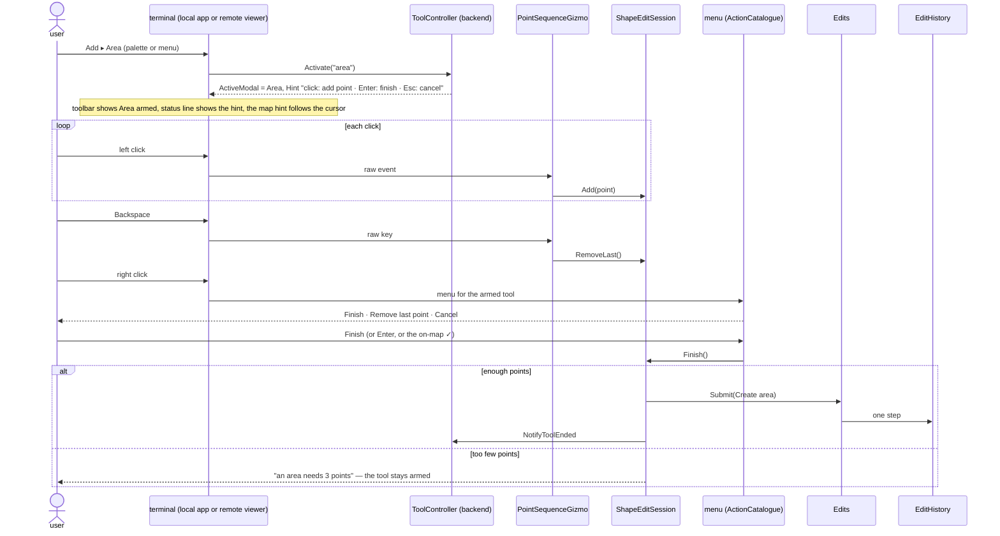
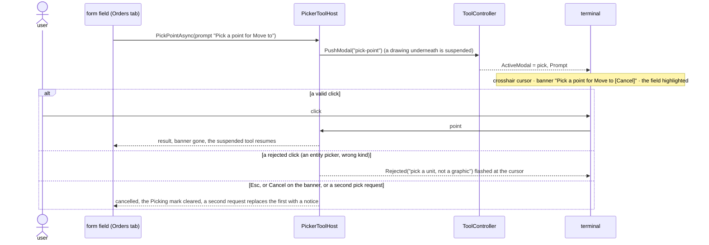
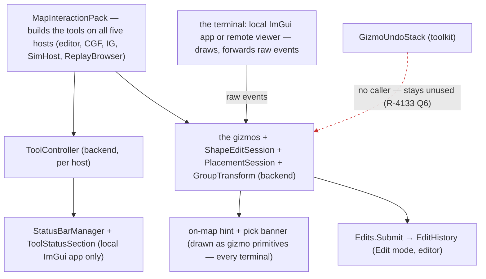

<!--STATUS
state: LIVE
build-state: DESIGN — top-level, ✅ APPROVED Q1–Q8 by the user 2026-11-06 (R-4134); the building lane (ui, backend for the gizmo side) details it (R-4123)
updated: 2026-11-06 (✅ Q1–Q8 approved — R-4134) · 2026-11-06 (first version — coordinator; editing-UX design queue item 6: E8, D11 / D12 / D16)
current-answer: §2 the model · §3 stages · §4 questions with leans
stale-below: nothing
known-rot: none
known-conflict: ROUTES1-DESIGN.md §11.1 says right-click COMMITS a route edit — D11 (approved, first iteration) makes right-click the menu and Enter / ✓ the commit; this design follows D11 and ROUTES1 §11.1 stays the spec for everything else (click a segment inserts, Delete removes)
related-designs:
  - DESIGN_Editing_UX.md — the programme: §1.5 the inventory, §3.12 the target, D11 / D12 / D16 (approved as a first iteration)
  - UX_Feature_Tool_Model.md — OWNS the tool (ToolDescriptor, ToolController, the modal stack, PushModal, PickerToolHost); this design adds a hint and a toolbar reader to it (its Migration step 5) and leaves Esc to the input design (its step 6)
  - DESIGN_Input_And_Commands.md — OWNS the keys: the map is a dumb terminal, the backend resolves map keys (capturing gizmo → hat → map scope), central Esc
  - DESIGN_Action_Catalogue.md — OWNS every menu; the drawing menu (Finish · Remove last point · Cancel) is three catalogue actions whose target is the armed tool
  - DESIGN_Edit_Framework.md — every finished map edit is ONE Edits.Submit (Create / Write); placement becomes a Create op
  - DESIGN_Edit_Mode_Undo.md — one finished map edit = one undo step (R-4133); GizmoUndoStack stays unused
  - DESIGN_Seats_And_Hats.md — the map tools belong to the Edit hat (and the Instructor's Live placement); a hat that cannot use a tool greys it
  - UX_Feature_Selection.md · UX_Feature_Multi_Select.md — OWN selection; the multi-select design's open half (map Shift / Ctrl, fan-out) is built by stage P5 here
  - ../designs/routes-1/ROUTES1-DESIGN.md — §11.1 the route edit spec (segment insert, Delete)
  - ../DESIGN_Add_Entity_Picker.md — OWNS the picker and PlacementToolRegistry (which tool a type arms); this design owns how the armed tool behaves
  - ../designs/air-attack/DESIGN_Air_Operations.md — OWNS FixedWingModel and the aircraft's cruise / route height that airborne placement uses
  - ../designs/gizmos-1/gizmo-input-focus-design.md — OWNS the dumb terminal and backend focus
  - ../DESIGN_Map_Rendering_And_Interaction.md — the AS-IS map composition (MapInteractionPack builds the tools on every host)
-->

# DESIGN — working on the map: one convention for drawing, picking and placing

## 0. Why, and what the user asked

The user asked (`2026-11-06`) to review *"how entities get placed on the map, how various areas are edited, how points are picked …
it deserves a review"*. Then they corrected the inventory: multi-select exists, and the centre handle moves a shape. They added:

- aircraft must be placed in the air;
- double-click is not the default finish;
- the gizmo shapes themselves need a review.

D11, D12 and D16 were approved as a first iteration (`DESIGN_Editing_UX.md` §4.3c). This design turns them into a model.

## 1. INVENTORY *(2026-11-06)*

Queries run (graph through `scripts/cbm.sh`, then grep):

- `search_graph ".*Gizmo$" Class`: **89** (≈ 60 production).
- `".*(Tool|ToolController|ToolRegistr|ToolModel|ArmedTool).*" Class`: **65**.
- `".*(Pick|Placement|Snap|Hint|Banner|Crosshair|Cursor|Interaction).*" Interface`: **12**. No snap and no hint type exists.
- `".*(StatusBar|StatusLine|ToolHint|Hint|Banner|DrawingSession|PointSequence|VertexEdit|AreaShape|ShapeEdit|Polyline).*" Class`: no shared drawing core, but a status bar exists.
- `".*(Aircraft|FixedWing|Airborne|Flight|Aero).*" Class`.
- grep for `SpawnHeight`, `AboveLevel`, `SurfacesAt`, `GizmoUndoStack`.

Coverage could not be checked (the CLI has no `check_index_coverage`).

| what exists | where | for this design |
|---|---|---|
| **the tool model** (built, UXI-07 steps 1–3b, 4b): `ToolDescriptor(Id, Label, Modality, Arbiter, ShowOnToolbar, ToggleOnReactivate)`, `ToolController` (`Activate`, `PushModal`, `Cancel`, `CancelArmedOn`, `NotifyToolEnded`, `ActiveModal`, `ActiveModalChanged`) on all five hosts through `MapInteractionPack` | `Tools/ToolDescriptor.cs:67`, `Tools/ToolController.cs:30-282` | ⭐ the home for *"which tool is armed"*. ⛔ `ShowOnToolbar` is read by **0** consumers (CE-259m, step 5 open) ⇒ no tool display anywhere |
| **picks** — `PickerToolHost`, the ONE picker protocol (`PushModal`, so a pick suspends a half-drawn route and resumes it) | `Tools/PickerToolHost.cs:36` | ⭐ the one place a pick banner belongs. ⚠ one picker per tool id: a second pick replaces the first |
| **placing** — `EntityPlacementGizmo` sends `SpawnEntityCommand` with `SpawnHeight`: `OnGround`, or `OnLevel(LevelOf(click))` for a 3-D click on a roof | `Gizmos/EntityPlacementGizmo.cs:260-282` | ⭐ `SpawnHeightMode.AboveLevel` (level + sent Z) **already exists** (`SpawnHeight.cs:14`) and nothing on the editor side uses it ⇒ airborne placement needs no wire change. Heading is always north (`:63`). The hint *"click: place · right-click/Esc: done"* (`:66`) is the only on-map hint |
| **levels** — `IWorldQuery.SurfacesAt(x, y, out ground)`, `ResolveLevel`, `Levels.LevelOf` | `World/IWorldQuery.cs:61-67`, `World/Levels.cs:14` | ⭐ the list of levels under the cursor already exists ⇒ the level choice in 2-D reads it |
| **aircraft** — `SimVehicleDef.Mobility = TerrainMobility.Air` (helicopters and fixed-wing); `FixedWingModel` flies at cruise, routes 300 m over the ground (the A-10C: cruise 150 m/s) | `Tkb/SimVehicleDef.cs:8,66`; Air Operations §6a | ⭐ "is this an aircraft" and "how high" are TKB data already |
| **drawing** — `PointSequenceGizmo` (right-click finishes), `AreaShapeGizmo` (Enter / Done commits, right-click cancels), `VertexEditGizmo`, `RouteWaypointGizmo` (+ `WaypointEditorPanel`) | `Fdp.Presentation/Vis2D/Gizmos/`, `ScenarioEditor/Gizmos/` | ⛔ **four gizmos, three finish conventions, no shared code**; each reads Esc itself |
| **status bar** — `StatusBarManager.RegisterSection(id, order, render)`; sections exist for the cursor, time and messages | `ImGui/WindowManager/StatusBarManager.cs:66` | ⭐ a tool section is one more registration |
| **selection** — `ISelectionState` with Add / Remove / SetMultiple / Clear (UXI-11 built); map Shift / Ctrl still TODO | `ISelectionState.cs:54-69`, `SelectionInteractionSystem.cs:170` | multi-select design's open half |
| **move / rotate** — `EntityDragGizmo`, `EntityRotatorGizmo`: one entity each | `Gizmos/EntityDragGizmo.cs`, `EntityRotatorGizmo.cs` | ⛔ neither acts on a multi-selection |
| **undo** — `GizmoUndoStack` not wired by `MapInteractionPack` | §1.5 of the programme | undo design R-4133: map edits go to the one `EditHistory` |

### 1.1 Claim table

| claim the design rests on | code (how it is) | design basis (how it was meant) |
|---|---|---|
| a tool knows it is armed, on every host | ✅ `ToolController.ActiveModal`, built by `MapInteractionPack` for five hosts | ✅ Tool Model §4.7c |
| nothing displays the armed tool | ✅ `ShowOnToolbar` read by 0 (Map Rendering §4.2, measured `2026-09-19`) | ✅ Tool Model Migration step 5 (open) |
| a pick can interrupt a drawing and give it back | ✅ `PickerToolHost` → `PushModal` | ✅ Q27-F |
| airborne spawn needs no wire change | ✅ `SpawnHeightMode.AboveLevel` on `SpawnEntityCommand` and the DDS message (`GenericMessages.cs:197`) | ✅ CE-1017 S2 (D6b) |
| a fixed-wing placed in the air flies on at cruise | ⚠ **assumed from the design**, not run: `FixedWingModel` "overflies, never stops" (Air Ops §6a) | ✅ Air Ops §6a. ⛔ **CE-4272 must measure it** (stage P3's first step) — if a plane spawned in the air also falls, the fix is in the motion model, not here |
| the centre handle moves a whole shape only on some shapes | ⚠ from the user's correction; the measured split: an `EditablePolyline` stores points relative to its entity (ROUTES1 §11), so dragging the entity moves the shape; a `RoutePlan` stores absolute waypoints, so it does not | ROUTES1 §11 |
| the map's keys are resolved on the backend | ✅ the input design §2.4 (approved R-4132) | ✅ gizmo-input-focus-design |

## 2. The model

### 2.1 The picture

*What the picture shows that the prose hid:* the four drawing gizmos point at **one** session. The finish / cancel convention therefore
lives in one class. Everything new is a member of something that exists (`Hint` on the descriptor, `Prompt` on the picker host) or one
small class (`ShapeEditSession`, `PlacementSession`, `GroupTransform`). None of it is a second tool system.

### 2.2 Draw an area — the convention end to end

*What the picture shows that the prose hid:* right-click no longer finishes or cancels anything. It opens the menu. Finish has three
doors (Enter, the ✓, the menu item) and all three reach the same `Finish()`. Too few points no longer cancels silently.

### 2.3 Pick a point for a form — the pick is visible

*What the picture shows that the prose hid:* the banner is drawn from the controller's state on the terminal. A remote viewer gets it
as well as the local app, and no form has to remember to draw it.

### 2.4 Who runs what

*What the picture shows that the prose hid:* the hint and the banner must be **gizmo primitives**, not ImGui. A remote viewer has no
ImGui status bar, and the map is a dumb terminal (R-4132). The status bar section is an extra for the local app. The red edge is the
toolkit undo stack, which nothing calls and which this design does not revive.

### 2.5 The rules, in one table

| topic | rule | why |
|---|---|---|
| **finish / cancel** (D11) | Enter, the on-map ✓, or the menu's *Finish* = finish · Esc = cancel (through the input design's central Esc) · right-click = the menu · clicking the first point closes an area · ⛔ no double-click finish by default | ArcGIS users report accidental double-click finishes; QGIS finishes on right-click. The visible ✓ plus Enter is the common ground (programme §3.12) |
| **while drawing** | Backspace = remove last point · too few points ⇒ the tool says why and stays armed · the hint names the minimum | silent cancels lose work |
| **editing a shape or route** | the centre handle moves the WHOLE shape on every kind (a route too: all waypoints move) · click a segment = insert · Delete = remove the selected point · each finished drag = one edit, one undo step | ROUTES1 §11.1 except its right-click commit (D11 wins, see known-conflict) |
| **the armed tool is visible** | the toolbar marks it (reads `ActiveModal`, Tool Model step 5) · the status line shows label and hint · a short hint follows the cursor | today nothing shows it |
| **a pending pick is visible** (D12) | crosshair + banner with Cancel + the field highlighted · a rejected click flashes the reason · a second request replaces the first with a notice | today invisible when the form is scrolled away |
| **placing — level** (D16) | in 3-D the click IS the level (built, CE-1033) · in 2-D, when `SurfacesAt` has more than one surface under the cursor, the hint shows *"level 0 of 3 · PgUp / PgDn"* and the ghost shows the chosen level | one key pair, shown only when there is a choice |
| **placing — aircraft** (D16) | a type with `Mobility = Air` is placed **airborne by default**: `SpawnHeight.AboveLevel` with the type's route height (300 m for the A-10C), at cruise; a helicopter the same with its hover height; Shift places it on the ground (a parked aircraft) | aircraft placed on the ground crash (CE-4272) |
| **placing — heading** | optional: press and drag sets the heading of that unit; after a multi-placement, ONE rotate of the multi-selection (each about its own centre, or the group about its centre, toggled in the hint) | user, §3.12 |
| **snap** | off by default; the hint offers toggles: ground (always on for ground units), grid, 15° rotation | — |
| **multi-select** | Shift adds · Ctrl toggles · Shift-drag adds a band · Alt-click cycles overlapped units · move, rotate, delete, change side, give an order act on the whole selection | the multi-select design's open half |
| **the gizmo look** | every gizmo is reviewed for a 2-D look and a 3-D look (§2.6) | user |
| **every station** | a tool that cannot run here is greyed with the reason (R-4119) — never missing, never silently empty (e.g. box select on CGF today) | R-4119 |

### 2.6 The gizmo look — a review list, decided per gizmo in the lane

| gizmo | today | target |
|---|---|---|
| placement ghost | a translucent sphere sized in world metres (`EntityPlacementGizmo.cs:43,153`) | the unit's map symbol (2-D) and a footprint silhouette at its real size (3-D); an aircraft ghost drawn at its altitude with a drop line to the ground |
| drawing points and lines | per gizmo | one style for all four: points as small squares, the next segment dashed to the cursor, the closing segment dashed |
| vertex / waypoint handles | 2-D only | the same handles in 3-D on the surface (programme §1.5 ⑨) |
| pick cursor | none | a crosshair, and the banner |
| rotate | live degrees label | kept; a ring around the group for a group rotate |

⛔ The lane proposes the looks with images in the chat (no screenshots in git). The user approves them before they are built.

## 3. Stages

| stage | what | owner | rails |
|---|---|---|---|
| **P1** | the armed tool is visible: `ToolDescriptor.Hint`, `ToolController.ActiveHint`, the toolbar reads `ActiveModal` (Tool Model step 5, CE-259m), `ToolStatusSection`, the on-map hint as gizmo primitives | ui | the toolbar marks the tool on every host; the hint is drawn on a remote terminal |
| **P2** | `ShapeEditSession`; the four drawing gizmos move onto it; the D11 convention; the drawing menu as three catalogue actions | ui (+ backend for the gizmo side) | each gizmo: Enter / ✓ / menu finish, Esc cancels, Backspace, too-few points keeps the tool |
| **P3** | placement: ① **measure CE-4272 first** (does an A-10C spawned at 300 m fly on?); ② `PlacementSession` — airborne by `Mobility`, 2-D level choice from `SurfacesAt`, optional heading drag; ③ Create through `Edits.Submit` | ui + backend (CE-4272) | an A-10C placed on the map is airborne at cruise; a click on a 3-storey house offers 3 levels |
| **P4** | the pick banner, rejection flash, replace notice in `PickerToolHost` | ui | a pick is visible with the form scrolled away; Cancel on the banner clears the field |
| **P5** | multi-select modifiers (Shift / Ctrl / Shift-drag / Alt-click); `GroupTransform` for move and rotate | ui | rotate 5 placed units about each centre and about the group centre: one undo step |
| **P6** | shapes and routes: the centre handle on every kind (routes included), segment insert, Delete | ui | ROUTES1 §11.1 rails, minus the right-click commit |
| **P7** | the gizmo look review (§2.6), approved by the user before it is built | ui | the frame rails under `xvfb-run` |

Order: P1 → P2 → P3 (P3's measurement can start at once) → P4 → P5 → P6 → P7. P2 depends on the action catalogue's first stage (A1),
because the drawing menu reads it.

## 4. Questions — ✅ all eight APPROVED as leaned (R-4134, user `2026-11-06`: *"Okay, accept it."*)

| # | question | lean | rejected |
|---|---|---|---|
| **Q1** | one drawing core | **`ShapeEditSession`**, shared by the four drawing gizmos — the D11 convention lives in one class | fix each gizmo: the four would drift again |
| **Q2** | where the hint and pick banner are drawn | **as gizmo primitives on the map** (every terminal, remote too) **plus** a status-bar section in the local app | ImGui only: a remote viewer would see nothing |
| **Q3** | airborne placement | **`Mobility = Air` ⇒ airborne by default** (`AboveLevel`, the type's route / hover height, at cruise); Shift places it parked on the ground; **CE-4272 measured first** | ground by default: the aircraft crashes |
| **Q4** | level choice in 2-D | **PgUp / PgDn, shown in the hint only when `SurfacesAt` has more than one surface**; in 3-D the click decides | a level dropdown: clutter for the 99 % case |
| **Q5** | heading at placement | **optional press-and-drag** per unit; after a multi-placement, one group rotate (each centre, or the group centre) | a heading prompt per unit: slow |
| **Q6** | right-click on a route edit | **the menu** (D11); Enter / ✓ commits — ROUTES1 §11.1's right-click commit is superseded | keep ROUTES1's right-click commit: a fourth convention |
| **Q7** | the centre handle on routes | **yes: dragging it moves every waypoint** (one edit) | only polyline shapes: routes would be the exception users trip on |
| **Q8** | the gizmo look | **reviewed per gizmo with images in the chat, approved by you before it is built** (§2.6) | the lane picks the looks unreviewed |
