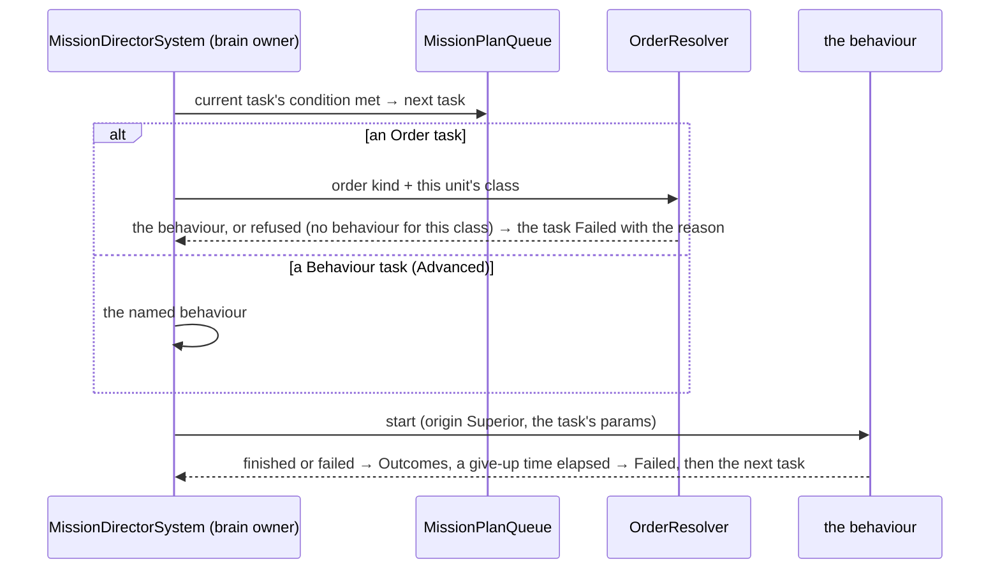
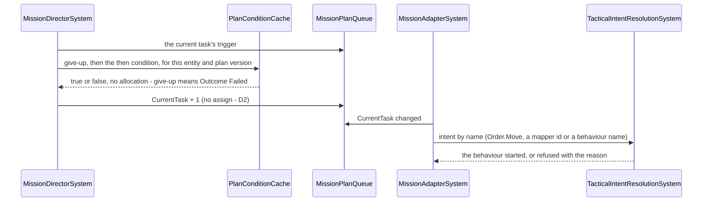
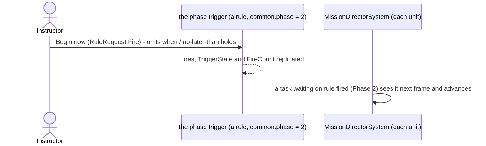
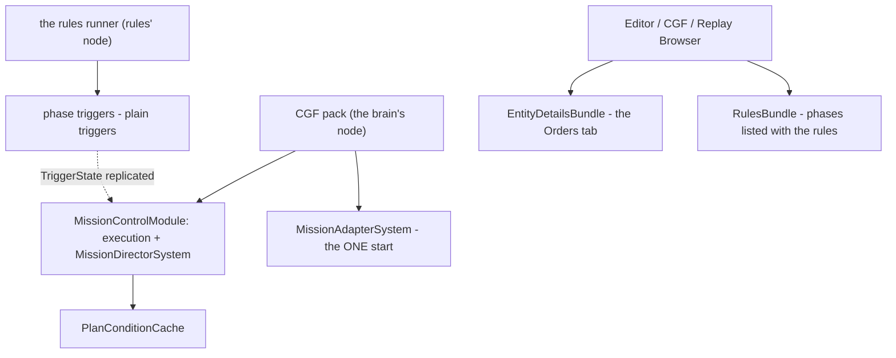

<!--STATUS
state: LIVE
build-state: DESIGN — §5 ✅ D1–D9 (D3 / D4 as revised) + §5.7 APPROVED 2026-11-07 (R-4160); the remaining detail in §5.8 · top level: ✅ Q1, Q2, Q5, Q6, Q7 approved and Q3, Q4 revised by the user 2026-11-06 (R-4129); the building lanes detail it (R-4123)
updated: 2026-11-07 (E4 / E5 revised by the user: ONE Tasks lane for all units; the WHO chip defaults to 'this unit'; §5.9 the sequencing rule, measured) · 2026-11-07 (§5.8 the remaining detail E1–E8 — E1: a Live edit restarts the plan today) · 2026-11-07 (§5.7 entity references: the GUID / @Key rule exists (S9′); two load-path gaps G1, G2 named) · 2026-11-07 (§5.7 storage and compatibility, measured; one unmeasured gate for M5) · 2026-11-07 (D3 / D4 revised by the user's question: every then / give-up is ONE shared condition; old trigger types translated on compile) · 2026-11-07 (§5 detailed design: D1–D9, classes, sequences, module map, the then-picker table, mission-plan-detail-visual.svg) · 2026-11-07 (§1: orders and plan tasks already share one intent channel; M1's engine part is small — measured) · 2026-11-06 (Q3 expert conditions + the rule editor one click from a task; Q4 phases begin on events, time only a no-later-than — R-4129) · 2026-11-06 (first version — coordinator; editing-UX design queue item 3: E11 / D18)
current-answer: ⭐ §5 the detailed design (measured; D1–D9 for the user) · §2 the target (wireframe + model) · §3 stages (lanes superseded by §5.5) · §4 questions
stale-below: nothing
known-rot: §3 M5's "a task-owned rule evaluated by the rules runner" is SUPERSEDED by §5 D3 (one Condition trigger, the one compiler); §2.2's PhaseBegins leaf and OperationPhase class by §5 D5 / D6 (a phase IS a trigger)
known-conflict: the code calls a plan's task slot a "phase" (MissionPlanQueue.Phases); this design uses "phase" for the MILITARY phase of an operation (§2.4) — Q6 renames the code's word
related-designs:
  - ../DESIGN_Scenario_Entity_Keys.md — OWNS S9′ / S10: a reference in a file is the target's GUID or @Key; §5.7 G1 / G2 close the plan's two load-path gaps
  - ../DESIGN_Readable_Scenario_Json.md — the task params and its then / give-up conditions written as JSON objects on disk, not escaped strings
  - DESIGN_Condition_Editor.md — the editor a task's Advanced condition opens; PhaseBegins is listed there as this design's leaf
  - DESIGN_Rule_Editor_UX.md — where a task's advanced condition goes (New rule… from the task) and the Begin phase action
  - DESIGN_Editing_UX.md — the programme: D18 (the mission plan editor, unit-agnostic orders first), E11, the Orders tab (§3.3)
  - DESIGN_Edit_Framework.md — a plan edit is a Commit with a version precondition (Conflict → Reload / Overwrite); stage F6
  - DESIGN_Action_Catalogue.md — "Add task ▸" on the map and the order items are declared actions
  - ../DESIGN_Orders_Params_Entity_Classes.md — OWNS the order kinds (Order.<Kind>), their DTOs, resolution by the receiver's class (R-273), OrderMenu.OfferedFor
  - ../DESIGN_Entity_Control.md — OWNS immediate orders from the map (OrderForm, RTS, the wheel)
  - ../DESIGN_Scenario_Rules.md — OWNS triggers and objectives; SR-90 (the mission plan stays the end-user surface), the rejected U5 (plan as a shared step engine)
  - ../DESIGN_Director_Timeline_Editor.md — OWNS the Timeline; its "Tasks" group (TL-5, R-4076) is this editor's overview
  - ../UX/Architect_Question_29_Entity_Commanding.md — §H a group is ordered through its commander; §0 append / insert are dead
-->

# DESIGN — the mission plan editor: a unit's plan as orders, on the map, the same in Edit and Live

## 0. Why

🔒 User, `2026-11-06`: *"There is a mission plan editor existing now, but in ugly and development/debug only version for now. it needs
redesigning, for some users this is the most used tool to define the content of scenario on top of plain placement of entities. Should be
practical and nice looking and intuitive. And should work in both edit/live, as everything else. not sure how to integrate order into that,
i think it is very relevant to specify unit-agnostic orders there primarily before specialized behaviors."* (D18)

## 1. INVENTORY *(2026-11-06)*

Queries: `search_graph` Class `.*Mission.*` (113), `.*Order.*` (107), `.*(Play|Maneuver)$` (37), `.*Formation.*` (22); grep for the rest.
Prior art: Arma 3 Eden — typed waypoints per group (Move, Seek and Destroy, Hold, Guard, Get in…), released by triggers / synchronisation
([BI wiki](https://community.bistudio.com/wiki/Eden_Editor:_Waypoint)); Command: Modern Operations — missions (patrol, strike…) on areas,
units assigned ([Matrix](https://command.matrixgames.com/?p=3653)); DCS — waypoints with actions; military practice — phases, phase lines,
a synchronisation matrix.

| what exists | measured |
|---|---|
| **the plan** | `ActiveMissionPlan` (managed record, saved + recorded: tasks = behaviour name + params JSON + ONE trigger) and `MissionPlanQueue` (unmanaged, runs it: `Phases[8]`, current, outcomes Done / Failed, `Halted`, `Version`) — `DomainMissionPlan.cs:22-55`, `MissionComponents.cs:139-178`. ⚠ max **8** tasks, a longer plan is cut with a warning |
| **advance triggers** | five: `TimerElapsed`, `BehaviorFinished`, `UnderAttack`, `HealthCritical`, `ReachedDestination` (obsolete = BehaviorFinished); exactly one per task; ⛔ none can name another unit (`MissionTriggerHelper.cs:15-49`) |
| **running it** | `MissionControlExecutionSystem` (replace with a version check; jump; abort; append / insert DEAD) → `MissionDirectorSystem` advances (origin Superior) → CGF `MissionAdapterSystem` → the intent path; an immediate order with `ClearsPriorIntent` DISCARDS the plan (rulings 50, 52); a loaded scenario restarts every plan at task 0 |
| **orders** | five kinds — Move, Attack, Hold, Strike, ObserveFire — each a unit-agnostic DTO resolved BY THE RECEIVER'S CLASS (`OrderResolver`, R-273); `OrderMenu.OfferedFor(dis)` offers only what the class can do. ⚠ **No editor puts an order into a plan**, and a task named `Order.Move` would resolve to behaviour id 0 (`MissionControlExecutionSystem.cs:~347-366`) — latent |
| ✏ **orders and plan tasks share ONE channel** *(measured `2026-11-07`, corrects the row above)* | a plan task already reaches the unit as a tactical intent whose id is the task's name (`MissionAdapterSystem.cs:110-117`, origin Superior); an immediate order is the same intent with the id `Order.<Kind>` (`OrderAttribute.IntentPrefix`, `OrderAttribute.cs:31`); `TacticalIntentResolutionSystem.cs:135-150` sends `Order.*` to `OrderResolver` (`<Class><Kind>` by the receiver's class) and any other id straight to the behaviour registry. ⇒ a task named `Order.Move` would ALREADY be resolved correctly; ⚠ **but a task is STARTED TWICE**: on an advance the director publishes `AssignBehaviorHashEvent` with the queue's stored id (`MissionDirectorSystem.cs:~218-224`), and the adapter then publishes the intent by name (`MissionAdapterSystem.cs:110-117`) — for an `Order.*` task the stored id is 0 (`MissionControlExecutionSystem.ResolveBehaviorId`, `:386-403`), so the director first starts Idle, then the adapter the resolved behaviour (§5 D2). `BehaviorFinished` fires on any finish of that entity (`MissionDirectorSystem.cs:200`). No behaviour name starts with `Order.` ⇒ the two names never collide; existing behaviour tasks are untouched |
| **groups** | a plan goes on a commander (a body-less unit entity); a squad / platoon is ordered through its commander (AQ29 §H); drills are behaviours of the commander |
| **editing today** | `MissionPanel` (761 lines) — behaviour names not order kinds, the obsolete trigger offered, a raw-text trigger parameter, "+ Add Trigger" though only one is allowed, Force Commit, one unit at a time, nothing on the map; a second instance in the Details tab on a different selection model; HTTP `add_mission_task` rewrites the whole plan |
| **across units** | only scenario rules: a trigger's *when* → `MissionCommand` jumps another unit's plan (SR-90). No phases, phase lines or timing; U5 ("the plan as a shared step engine") REJECTED in Scenario Rules |

## 2. The target

### 2.1 What the user sees

*What the picture shows that prose hid: the plan is drawn ON the map (numbered task markers, the route, the objective, the phase line) and
listed in the Orders tab as plain sentences — "Move to grid 3412, then when there"; the Timeline's Tasks group lines up every unit's tasks
by phase — the synchronisation matrix without a new window.*

| | rule |
|---|---|
| **a task is an ORDER first** | *+ Add task* offers the order kinds THIS unit's class can carry out (`OrderMenu.OfferedFor`): Move, Hold, Attack, Defend, Recon … each with its form (the order DTO, map picks for places and targets). *Advanced: run a specific behaviour…* stays for the technical author |
| **edited on the map** | selecting a unit draws its plan; right-click on the ground → *Add task ▸ Move here · Hold here · Attack…*; drag a numbered marker to move that task's place; the list and the map are one model |
| **"then" in plain words** | *when there · when done · after 5 min · when under fire · when strength below 50 % · when Phase 2 begins · when Bravo 1-2 finishes task 3* — each a picker, never typed text; plus an optional *give up after …* |
| ⭐ **"then" for experts** *(user, `2026-11-06`)* | **Advanced condition…** opens the predicate editor (the ONE condition model, R-4077 — the same one the rules use); **When a rule fires…** picks a rule, or **New rule…** opens the rule editor (built: Rules View §7, RE-1…RE-10) prefilled with this unit as the subject, and links back to the task. ⭐ ONE evaluator: a task's expert condition is held by a rule the task owns (the rules runner evaluates it and releases the task) — the plan's director only waits for the release |
| **one plan per unit, groups through the commander** | as ruled (AQ29 §H); selecting a platoon shows its commander's plan |
| **the same in Edit and Live** | Edit changes the authored plan (undoable, D1); Live sends a Commit to the brain's owner (the edit framework: Conflict → Reload / Overwrite); Live adds *Jump to task* and *Stop plan*, and shows progress (✓ done · ▶ now · planned) |
| **immediate orders in Live** | a map order still REPLACES the plan (rulings 50, 52) — the menu item says so (*Move here — replaces the plan*); a second item *Add to the plan* appends instead |

### 2.2 The model — what changes

```mermaid
classDiagram
  direction LR
  class ActiveMissionPlan { <<existing, saved + recorded>> Tasks }
  class PlanTask {
    <<existing DomainMissionTask, extended>>
    Kind : Order|Behaviour  NEW
    Order : order kind + DTO  NEW
    BehaviorName + Params : existing (Advanced)
    Then : AdvanceCondition  (was one trigger)
    GiveUpAfter : duration  NEW
  }
  class AdvanceCondition {
    <<existing 4 + NEW>>
    WhenDone · After · UnderFire · StrengthBelow
    PhaseBegins(phase)  NEW
    UnitFinishedTask(unit, n)  NEW
    RuleFired(rule)  NEW
  }
  class OperationPhase {
    <<NEW, scenario-level>>
    Name · Order
    Begins : on a condition (a rule) | by the instructor | no later than H+mm
  }
  class MissionPlanQueue { <<existing, runs it>> Tasks[16] NEW size · Current · Outcomes · Version }
  class OrderResolver { <<existing>> order kind + unit class → behaviour }
  class MissionDirectorSystem { <<existing>> advances; evaluates AdvanceCondition }
  ActiveMissionPlan "1" o-- "*" PlanTask
  PlanTask --> AdvanceCondition
  AdvanceCondition ..> OperationPhase : PhaseBegins
  MissionPlanQueue <.. ActiveMissionPlan : built from
  MissionDirectorSystem --> MissionPlanQueue
  MissionDirectorSystem ..> OrderResolver : an Order task, at its start
```

*What it shows: nothing is rebuilt — the plan, the queue and the director stay; a task gains an ORDER form resolved by the existing
resolver when the task starts (fixing the latent id-0), conditions gain three kinds that look at OTHER things (a phase, another unit's
progress, the clock), and phases are a new, small scenario-level list.* ⚠ U5 stays rejected: phases are not a step engine — they are named
moments that tasks wait for.

### 2.3 A task starting

*What it shows: an order in a plan resolves at the moment the task STARTS, on the brain's owner, by the same resolver as an immediate
order — so the plan stays unit-agnostic and a re-classed unit still works.*

### 2.4 Phases and timing across units

| | rule |
|---|---|
| **an operation phase** | a named moment in the scenario — *Phase 1 Approach, Phase 2 Assault* — that begins ⭐ **on an event first** (*"time is simple but often unpredictable, time-anchoring is simple but many times wrong"* — user): a condition (*OBJ BLUE taken · all of 1st Platoon across PL RED · Bravo reports ready*) evaluated by the rules, or **by the instructor** (Live: *Begin Phase 2*); a time is only an optional **no later than** (H+mm) safety net, never the default |
| **tasks wait for it** | *then: when Phase 2 begins* — the director checks the phase list (replicated scenario state) |
| **another unit's progress** | *when Bravo 1-2 finishes task 3* — reads that unit's replicated progress (`MissionPlanQueue` outcomes are already re-sent on change, CE-483 W2) |
| **H-hour** | the scenario's start time (the scenario clock) is H; a time appears only as a phase's *no later than* and as *after N min* inside one task — ⛔ never as the way a plan is synchronised |
| **the overview** | the Timeline's *Tasks* group (designed, TL-5): one lane per unit, its tasks as bars, phases as columns — the synchronisation matrix |
| **phase lines** | a phase line is a map graphic (a route-like line); a condition *when across PL RED* is a later addition |

## 3. Stages *(top level; ui owns the editor, behaviors / backend the plan engine)*

| stage | what | lane |
|---|---|---|
| **M1** | Order tasks: `PlanTask.Kind = Order`, the order DTO in the task, resolved at task start (fixes the latent id-0); the editor offers order kinds first | behaviors + ui |
| **M2** | the Orders tab rebuilt from shared form rows: plain-sentence tasks, condition pickers, *give up after*, progress, Jump / Stop; the obsolete trigger and "+ Add Trigger" go; the Mission window and the second panel instance go (one surface, the Details tab) | ui |
| **M3** | the plan on the map: markers, route, drag, right-click *Add task ▸* (declared actions, Action Catalogue) | ui |
| **M4** | Live: Commit through the edit framework (Conflict → Reload / Overwrite, F6); *Add to the plan* beside the replacing order | ui + backend |
| **M5** | conditions across units: `UnitFinishedTask`; `RuleFired` + *Advanced condition* (a task-owned rule evaluated by the rules runner); *New rule…* from the task; queue size 16 | behaviors + ui |
| **M6** | operation phases (scenario list, begun on a condition or by the instructor, an optional no-later-than) + `PhaseBegins` + the Timeline's Tasks group as the matrix | behaviors + ui |

## 4. Questions — ✅ approved; Q3 and Q4 as revised by the user *(🔒 `2026-11-06`: "others ok")*

| # | question | ⭐ lean | rejected |
|---|---|---|---|
| **Q1** | what a task is | **an order first** (the kinds this unit's class can do), a specific behaviour as *Advanced* | behaviours first — only a technical author knows them |
| **Q2** | where it is edited | **the Orders tab in Details + the map** (one model); the Mission window and the second panel instance go | a separate plan window — R-4118 |
| **Q3** | the advance condition | ✏ **revised by the user:** plain-language conditions by default (+ an optional give-up time) **and** an expert path — *Advanced condition…* (the predicate editor) and *When a rule fires… / New rule…* (the built rule editor, one click from the task); one evaluator — the rules runner — through a task-owned rule | the director evaluating predicates itself — a second evaluator (R-4077) |
| **Q4** | phases | ✏ **revised by the user:** named scenario-level moments begun **on an event (a condition / rule) or by the instructor** — a time only as an optional *no later than*; the Timeline's Tasks group is the matrix; ⛔ not a step engine (U5 stays rejected) | time-anchored phases — *"simple but many times wrong"* |
| **Q5** | the plan length | **16 tasks** (the unmanaged queue doubles; still allocation-free) | unlimited — a managed list per frame; 8 — too short for a real plan |
| **Q6** | vocabulary | user words: **plan · task · order · phase**; ⭐ rename the code's `MissionPlanQueue.Phases` → `Tasks` (a Roslyn rename) so "phase" means the military phase only | keep the code's "phase" for task slots — two meanings of one word |
| **Q7** | an immediate order in Live | **still replaces the plan** (rulings 50, 52), the menu says so, and *Add to the plan* is offered beside it | silently replacing |

## 5. Detailed design *(2026-11-07 — measured; ✅ D1–D9 and §5.7 approved, R-4160)*

⭐ Written so a lane can build it unattended (R-4156). Every load-bearing fact below was measured on `coordinator` at `ae4b72f0`+.

### 5.1 Measured for this pass

| fact | where | ⇒ |
|---|---|---|
| 33 of 127 scenarios carry a plan, on 44 units; at most **6** tasks; triggers used: `BehaviorFinished` (80), `TimerElapsed` (17); every task names a behaviour; none starts with `Order.` | `scenarios/*/scenario.json` (`MissionPlan.PlanData.tasks[].behaviorName / triggers[]`) | every change below is additive for them |
| a plan task and an immediate order travel the SAME way: a tactical intent, the order's id `Order.<Kind>` | `MissionAdapterSystem.cs:110-117` · `OrderAttribute.cs:31` · `TacticalIntentResolutionSystem.cs:135-150` | an order task needs no new channel |
| ⚠ a task is **started twice**: the director by stored id, the adapter by name; an `Order.*` task's stored id is 0 | `MissionDirectorSystem.cs:~218-224` · `MissionControlExecutionSystem.cs:371, 386-403` | D2 |
| the director and the adapter run on the SAME host: `MissionControlModule` (director + execution) and `MissionAdapterSystem`, both composed by the CGF pack | `CgfLogicPack.cs:154` · `MissionControlModule.cs:49` | one start path is safe |
| the director's built-in triggers: `TimerElapsed`, `UnderAttack`, `HealthCritical` (a fraction), `BehaviorFinished` (`ReachedDestination` obsolete); ONE per task | `MissionComponents.cs:11-30`, `MissionDirectorSystem.cs:150-205` | *under fire* and *strength below* already exist |
| the ONE condition compiler: `PredicateCompiler.CompileLevelPredicate(dto)` → `Func<EntityRepository, Entity, bool>` | `ReplayBrowser/Search/PredicateCompiler.cs:42` (same assembly as the director) | D3 needs no new evaluator |
| a rule can be **fired** on request (`RuleRequest.Fire`), its state is replicated (`ObjectiveStatus.TriggerState`, `FireCount`) | `RuleControl.cs:7` · `ObjectiveStatus.cs` | D5: a phase can BE a trigger |
| a task's outcome per slot is replicated (`MissionPlanQueue.Outcomes`, CE-483) | `MissionComponents.cs:164-193` | D6 |
| the queue is an unmanaged `[InlineArray(8)]`, `[DataPolicy(NoScenario)]` — rebuilt from the saved plan on load | `MissionComponents.cs:112, 138-143` | D7 changes no scenario |

### 5.2 Decisions — leans for the user

| # | decision | ⭐ lean | rejected — one line |
|---|---|---|---|
| **D1** | how an order task is stored | the existing `behaviorName` = `Order.<Kind>`, the order DTO as `behaviorParams` — the file format does not change | a new `Kind` field: a format change for a fact the name already says |
| **D2** | how a task starts | **ONE path**: the director only ADVANCES the queue; the adapter starts every task by name through the intent (orders, mappers and plain names alike) | keep both: an order task starts Idle for a frame, and every task is assigned twice |
| **D3** ✏ | the "then" | ✏ **revised (user, `2026-11-07`: "why not using shared condition always?")** — **always ONE shared condition** (the condition language, R-4077): the plain picker writes standard conditions — *when done* = `TransientEvent BehaviorFinishedEvent` on this unit · *after N min* = `PropertyMatch MissionPlanQueue.TaskElapsedSeconds ≥ N` · *under fire* = `InputAbove UnderFire` · *strength below X %* = `None(InputAbove HealthFraction X)` (B-1) — and *Advanced condition…* the full editor. Compiled once per plan version on the brain's node, evaluated each frame without allocation; the director's own trigger switch goes. ⭐ The 97 old entries (`BehaviorFinished`, `TimerElapsed`) are TRANSLATED to those conditions when a plan is compiled — files load unchanged and are written in the new form on the next save | ~~built-in triggers + a `Condition` kind~~ (the first lean): two evaluators and two vocabularies for one idea (R-174) · a hidden task-owned rule entity: a second runtime object per task |
| **D4** ✏ | *give up after* | a SECOND shared condition on the task (the picker offers *after N min* by default): *then* ends the task Done, *give up* ends it Failed; the director checks give-up first | a separate time-only field: a second shape for what a condition already says |
| **D5** | what an operation phase is | ⭐ **a trigger rule marked as a phase** (`common.phase` = its order, 1, 2, …): it *begins* = it fires; its *when* is the begin condition, *no later than* = `when OR ScenarioTime ≥ T`; the instructor's *Begin now* = `RuleRequest.Fire`; it is listed, edited and shown by the rules UI that exists | a separate phase list + its own evaluator + a *Begin phase* action: a second store and a second "when" engine for what a trigger already is |
| **D6** | *when Phase 2 begins* / *when Bravo 1-2 finishes task 3* | *phase begins* = the existing *"rule X has fired"* condition on that phase's trigger (no new leaf); **one new leaf `TaskFinished { Unit, Task }`** reads the unit's replicated `Outcomes` | `PhaseBegins` as its own leaf: redundant once a phase is a trigger |
| **D7** | the queue | 8 → **16** slots; the Roslyn renames `MissionPhase` → `MissionTaskSlot`, `Phases` → `Tasks`, `PhaseCount` → `TaskCount`, `CurrentPhase` → `CurrentTask`, `MaxPhases` → `MaxTasks`, `PhaseElapsedSeconds` → `TaskElapsedSeconds` (Q6) | renaming only `Phases`: "phase" would still mean a task slot in five other names |
| **D8** | where the plan is edited | the **Orders** tab of Details (`EntityDetailsBundle`) from forms and the condition editor; `MissionPanel` (766 lines), `MissionPanelWindow` and its second instance retired — their parts routed (Jump / Stop, progress, Commit) | keep the window beside the tab: two surfaces (R-4118) |
| **D9** | an edit's path | Edit mode: the authored plan changes with ONE undo step per user action (`EditHistory`, R-4133); Live: a **Commit** with the plan's version through `Edits.Submit` (built, B-6) — *Conflict → Reload / Overwrite* wired in the Orders tab; *Add to the plan* builds plan + 1 task and commits (append mode stays dead) | a live append command: the dead `append` path revived |

### 5.3 The classes

*What the picture shows that prose hid: the saved plan does not change shape — every then / give-up is a condition riding in the existing triggers list (old types translated on compile); everything new
at runtime is either a renamed field, a cache of compiled predicates, or one new leaf; the phase never appears as a class because it is a
trigger (D5).*

### 5.4 Sequences

*Called each frame: the director and the adapter by the CGF pack's module host; the phases by the rules runner; the Orders tab and the phase
rows by each host's bundles. The dashed edge is replication, not a call — the director never reaches into the rules runner.*

### 5.5 Stages, refined *(supersede §3's lane column — roles are not honoured, user `2026-11-07`)*

| # | what | acceptance |
|---|---|---|
| **M1** | D1 + D2: `Order.*` accepted without the warning; **G1** (an order task's params resolved on load); the director advances only, the adapter starts every task; D3's translation of the old trigger types into conditions (the director's trigger switch replaced by `PlanConditionCache`) | a plan of `Order.Move` → `Order.Hold` runs on a tank and on a rifleman (each its own class behaviour); no Idle frame between tasks; the 33 scenarios' plan suites unchanged |
| **M1b** | D7: 16 slots + the Roslyn renames | builds; the plan suites unchanged |
| **M2** | D8: the Orders tab — task rows as sentences, the order form (`OrderMenu.OfferedFor`), the *then* picker (§5.6), *give up after* (D4), progress, Jump / Stop; `MissionPanel` retired | side-by-side with `mission-plan-editor.svg` + `mission-plan-detail-visual.svg` |
| **M3** | the plan on the map: a numbered marker at each task's first place field (`MapPreviews` shapes by semantic type), the route, drag a marker = edit that field, right-click *Add task ▸* (catalogue actions) | ⏳ action catalogue (B-11) |
| **M4** | D9 + **E1** (progress carried over by task id) + E7: Live Commit, Conflict → Reload / Overwrite, *Add to the plan* | a two-station conflict rail; an edit of task 4 while task 2 runs leaves task 2 running |
| **M5** | D6: the `TaskFinished` leaf; **G2** (the conditions' references resolved on load); *Advanced condition…*, *When a rule fires…*, *New rule…* in the picker | a unit waits on another's task 3; 0 B per steady frame |
| **M6** | D5: phases — `common.phase` on a trigger, the Rules window's *Phases* group, *Begin now* in Live, *when Phase N begins* in the picker; the Timeline's **Tasks** group (one lane per unit, its tasks as bars, phase triggers' fire times as columns) | a phase begun by the instructor releases two units' waiting tasks |

### 5.6 The *then* picker — the plain list and what each stores

| the user picks | stored as |
|---|---|
| *when done* · *when there* | `TransientEvent BehaviorFinishedEvent` on this unit |
| *after N min* | `PropertyMatch MissionPlanQueue.TaskElapsedSeconds ≥ N·60` |
| *when under fire* | `InputAbove UnderFire` |
| *when strength below X %* | `None(InputAbove HealthFraction X)` |
| *when Phase N begins* | *rule fired* on that phase's trigger (`OnEntity` + `ObjectiveStatus.FireCount > 0`) |
| *when <unit> finishes task N* | `TaskFinished { Unit, Task }` |
| *when a rule fires…* | *rule fired* |
| *Advanced condition…* | any condition from the condition editor |
| *give up after N min* (optional, beside any of the above) | a second condition, the GiveUp slot (default *after N min*) |

⭐ Stored as `{type: "Then" | "GiveUp", params: <condition JSON>}` in the existing triggers list — §5.7.

⭐ Every row is ONE shared condition (D3); the picker is a list of presets over the condition language, like the condition editor's.

*Generated by `scripts/gen-mission-plan-detail-mockup.py`; the acceptance spec for the picker, the give-up row, the phase rows and the Tasks
group only.*

### 5.7 Storage and compatibility *(measured `2026-11-07`, the user: "I don't think this can be compatible with the current storage")*

| | today | ⇒ |
|---|---|---|
| the scenario file | `"triggers": [ { "type": "BehaviorFinished", "params": "" } ]` | two free strings per entry |
| the wire | `MissionTrigger { string Type; string Params /* JSON */ }` (`MissionDescriptors.cs:28-31`, `[DdsManaged]`) | the same two strings, unbounded |
| the parse | `MissionTriggerHelper.cs:15-45` switches the type over 5 names; an unknown type throws, and **more than one entry throws** ("a phase holds ONE trigger") | the only place the format is enforced |

⭐ ✏ **On disk readable (`DESIGN_Readable_Scenario_Json.md`):** the `params` string is written as the JSON object it holds. **The new entries use the same two fields:** `{ "type": "Then", "params": "<condition JSON>" }` and an optional `{ "type": "GiveUp", "params": "<condition JSON>" }`
— the condition JSON-in-a-string like `behaviorParams` already is. The meaning is in the TYPE, never the position.

| direction | result |
|---|---|
| existing scenarios → new build | ✅ the five old names are read and translated to conditions at compile; files untouched |
| saved by the new build | the new form, written only when that plan is edited or the scenario saved |
| new file → an older build | ⛔ "unknown trigger type" — a newer file, expected |
| the wire | ✅ the same two strings; a cluster runs one build |

⭐ **Entity references — never a network id in the file** *(measured `2026-11-07`; the user: "it cannot be saved to scenario as such. It needs
to be converted to something permanent like scenario GUID or the ref key")*. The rule EXISTS and is built — [`DESIGN_Scenario_Entity_Keys.md`](../DESIGN_Scenario_Entity_Keys.md)
S9′ / S10: an authored reference is an `EntityLink` whose FILE form is the target's **GUID** (`Exact`) or an **`@Key`**; the editor's pick writes
the GUID (`ReferenceLeafDrawers.PickToLink`, `:47-49`, F3); at load `RefResolve` turns it into the new network id and refuses a bare legacy id
(`EntityRefRemap.cs:432-433, 607`). ⛔ **Two gaps on the plan's load path** (`StagingEntityExtractor.cs:454-466`):

| gap | measured | fix (in M1 / M5) |
|---|---|---|
| **G1** an `Order.*` task's params are never resolved | the pass looks the contract up BY BEHAVIOUR NAME (`ScenarioBehaviorRemapper.ContractOf`, `:100-110`) — `Order.Move` is not a behaviour ⇒ no contract ⇒ the JSON passes unchanged ⇒ a target saved as a GUID resolves to nobody | `ContractOf` also answers an `Order.<Kind>` with that order's DTO type (the `[Order]` registry) — one lookup, both kinds |
| **G2** a task's trigger params are never walked | the pass walks `task.BehaviorParams` only; the `triggers[].params` (today plain numbers) are not touched | the same pass walks each `Then` / `GiveUp` entry with the contract `SearchPredicateDto` (`EntityRefRemap.WalkJson`, `RefResolve`) — the walker already handles the polymorphic tree |

⭐ **The rail, first in M1 / M5:** a plan whose ORDER targets a unit and whose *then* names ANOTHER unit and a phase trigger is saved, loaded into a
fresh world (new network ids) and still points at the same three entities — and the file holds their GUIDs, never a number.

### 5.8 The remaining detail — E1–E8, leans for the user *(measured `2026-11-07`)*

| # | point | measured | ⭐ lean | rejected — one line |
|---|---|---|---|---|
| **E1** ⚠ | **a Live edit restarts the plan from task 1** | a replace rebuilds the queue with `CurrentPhase = 0` and fresh outcomes (`MissionControlExecutionSystem.cs:346-348`); the tasks carry stable `TaskId`s and the plan its `TaskOrder` | **carry progress over BY TASK ID**: a task already Done keeps Done; the RUNNING task, if still in the plan and unchanged, keeps running (no restart, its elapsed time kept); if its content changed it restarts; if it was removed, the plan goes on with the next task after the last one done | restart from 1 (today): fixing a typo in task 4 sends a platoon back to its start line |
| **E2** | where a task sits on the map (M3) | every order DTO's place is a semantic field: `MoveOrder.Location` (`PointLink`), `AttackOrder.Target` (`EntityLink`), Strike / ObserveFire `Location` + `Target` (`OrderDtos.cs:19-158`) | the task's marker = its FIRST place field (a point, else an entity's position, else an area's centre) via `MapPreviews` (show on map); a task with no place (*Hold*) sits at the previous task's place; the route joins the markers in order; dragging a marker writes that field | an `[TaskPlace]` attribute on each DTO: the semantic type already says it |
| **E3** | marking a trigger as a phase (D5) | a rule's authored block is `ObjectiveCommon` (`"common": {...}`, `ObjectiveRules.cs:21-45`) | a new field `"phase": n` (0 = not a phase, 1, 2, … = its order) in `ObjectiveCommon` (+ its unmanaged twin); the Rules window lists phase triggers under *Phases*, sorted | the existing `group` text: free text cannot order phases |
| **E4** ✏ | the Timeline's *Tasks* group | `MissionPlanQueue` is recorded (`NoScenario`, not `NoReplay`); lanes are registered by the toolkit that owns the data (R-4078); the timeline's events already filter by entity (`GET /timeline/events?entity=`) | ✏ **revised (user: "a task line for every single entity? What if there are thousands?")** — **ONE *Tasks* lane for all units**: a marker where a task STARTED, ended Done, ended Failed (by colour), each naming its unit and task; it follows the timeline's entity filter like every lane. ⭐ The selected unit (or the selection) additionally shows its tasks as BARS (start → end) in one row under the lane; the phase triggers' fire times as columns across. In Edit mode: nothing (no times yet) | ~~one lane per unit~~ (the first lean): does not scale to hundreds of plans · a separate matrix window |
| **E5** ✏ | whom a task's condition is about | the plan runs on the unit's own entity | the condition editor gets a **Mission task** context whose WHO chip **defaults to *this unit*** (*this entity* when it is not a unit) — ⛔ never an empty field; it is a real choice the author can change to another unit, a rule or a phase; stored as a condition with no `OnEntity` wrapper (it runs on the unit) | an empty WHO meaning "this": the user cannot see it · wrapping every condition in `OnEntity(this unit)` |
| **E6** | a platoon or squad selected | a group is ordered through its commander (AQ29 §H) | the Orders tab and the map show and edit the **commander's** plan; the men's own slots are not plans | a plan per man of a group: AQ29 §H |
| **E7** | *Add to the plan* (a map order in Live) | append is dead in the executor (§1) | the editor builds plan + 1 task at the END and commits it (D9); a finished plan makes the new task current | insert after the current task: an ordering choice nobody asked for |
| **E8** | the HTTP `add_mission_task` | it rewrites the whole plan (§1) | it goes through the same model (append, with the version) | its own path: a third way to edit a plan |

### 5.9 How a plan runs — the sequencing rule *(measured `2026-11-07`; the user: "Is the first item always started immediately, or is it gated by some triggers?")*

| | today (measured) | ⭐ the design |
|---|---|---|
| **the first task** | starts AT ONCE when the plan is set (load or commit): the adapter starts the current task whenever it changes (`MissionAdapterSystem.cs:68-117`) | the same — ⭐ to make a unit WAIT before its first task, the first task is a *Hold* whose *then* is the wait (*Hold here, then when Phase 1 begins*) — ⛔ no separate "plan start" gate |
| **what a task's condition means** | it is the task's **EXIT** condition: when it holds, the plan moves to the next task (`MissionDirectorSystem.cs:120-205`) — so it is also the next task's start gate | the same — the sentence reads *"<task>, **then** <condition>"* |
| **a task with NO condition** | holds **forever** (`(TimerElapsed, ∞)`, `MissionTriggerHelper.cs:17-20`) — even after its behaviour finished | ⭐ a new task's *then* **defaults to *when done***; the picker has no empty choice; *"hold until told"* is an explicit choice (*never — until the plan is changed*) |
| **the last task** | its condition ends the plan; the unit's slot is cleared | the same |
| **a behaviour that fails** | the outcome is Failed; the plan still waits for the condition; a FAULT halts the plan (`:132-138`) | the same, plus *give up* (D4) |
