<!--STATUS
state: LIVE
build-state: BUILDING — M1 runtime BUILT (P-2, CE-4298; §5.10 as-built) · ✅ E1–E9 + §5.9 approved 2026-11-07 (R-4161); dispatched in HANDOFF_Coordinator_To_Lanes_Mission_Plan.md (CE-4298…CE-4304) · §5 ✅ D1–D9 (D3 / D4 as revised) + §5.7 APPROVED 2026-11-07 (R-4160); the remaining detail in §5.8 · top level: ✅ Q1, Q2, Q5, Q6, Q7 approved and Q3, Q4 revised by the user 2026-11-06 (R-4129); the building lanes detail it (R-4123)
updated: 2026-11-07 (E9: the Wait task — a plan that waits before its first task) · 2026-11-07 (E4 / E5 revised by the user: ONE Tasks lane for all units; the WHO chip defaults to 'this unit'; §5.9 the sequencing rule, measured) · 2026-11-07 (§5.8 the remaining detail E1–E8 — E1: a Live edit restarts the plan today) · 2026-11-07 (§5.7 entity references: the GUID / @Key rule exists (S9′); two load-path gaps G1, G2 named) · 2026-11-07 (§5.7 storage and compatibility, measured; one unmeasured gate for M5) · 2026-11-07 (D3 / D4 revised by the user's question: every then / give-up is ONE shared condition; old trigger types translated on compile) · 2026-11-07 (§5 detailed design: D1–D9, classes, sequences, module map, the then-picker table, mission-plan-detail-visual.svg) · 2026-11-07 (§1: orders and plan tasks already share one intent channel; M1's engine part is small — measured) · 2026-11-06 (Q3 expert conditions + the rule editor one click from a task; Q4 phases begin on events, time only a no-later-than — R-4129) · 2026-11-06 (first version — coordinator; editing-UX design queue item 3: E11 / D18)
current-answer: ⭐ §5.10 the M1 runtime AS BUILT (read with §5) · §5 the detailed design (measured; D1–D9 for the user) · §2 the target (wireframe + model) · §3 stages (lanes superseded by §5.5) · §4 questions
stale-below: nothing
known-rot: §3 M5's "a task-owned rule evaluated by the rules runner" is SUPERSEDED by §5 D3 (one Condition trigger, the one compiler); §2.2's PhaseBegins leaf and OperationPhase class by §5 D5 / D6 (a phase IS a trigger)
known-conflict: the code calls a plan's task slot a "phase" (MissionPlanQueue.Phases); this design uses "phase" for the MILITARY phase of an operation (§2.4) — Q6 renames the code's word
related-designs:
  - ../DESIGN_Scenario_Entity_Keys.md — OWNS S9′ / S10: a reference in a file is the target's GUID or @Key; §5.7 G1 / G2 close the plan's two load-path gaps
  - ../DESIGN_Readable_Scenario_Json.md — the task params and its then / give-up conditions written as JSON objects on disk, not escaped strings
  - DESIGN_Condition_Editor.md — the editor a task's Advanced condition opens; PhaseBegins is listed there as this design's leaf
  - DESIGN_Rule_Editor_UX.md — where a task's advanced condition goes (New rule… from the task) and the Begin phase action
  - DESIGN_Editing_UX.md — the programme: D18 (the mission plan editor, unit-agnostic orders first), E11, the Orders tab (§3.3)
  - DESIGN_Edit_Framework.md — a plan edit is a Commit with a version precondition (Conflict → Reload / Overwrite); stage F6
  - DESIGN_Action_Catalogue.md — "Add task ▸" on the map and the order items are declared actions
  - ../DESIGN_Orders_Params_Entity_Classes.md — OWNS the order kinds (Order.<Kind>), their DTOs, resolution by the receiver's class (R-273), OrderMenu.OfferedFor
  - ../DESIGN_Entity_Control.md — OWNS immediate orders from the map (OrderForm, RTS, the wheel)
  - ../DESIGN_Scenario_Rules.md — OWNS triggers and objectives; SR-90 (the mission plan stays the end-user surface), the rejected U5 (plan as a shared step engine)
  - ../DESIGN_Director_Timeline_Editor.md — OWNS the Timeline; its "Tasks" group (TL-5, R-4076) is this editor's overview
  - ../UX/Architect_Question_29_Entity_Commanding.md — §H a group is ordered through its commander; §0 append / insert are dead
-->

# DESIGN — the mission plan editor: a unit's plan as orders, on the map, the same in Edit and Live

## 0. Why

🔒 User, `2026-11-06`: *"There is a mission plan editor existing now, but in ugly and development/debug only version for now. it needs
redesigning, for some users this is the most used tool to define the content of scenario on top of plain placement of entities. Should be
practical and nice looking and intuitive. And should work in both edit/live, as everything else. not sure how to integrate order into that,
i think it is very relevant to specify unit-agnostic orders there primarily before specialized behaviors."* (D18)

## 1. INVENTORY *(2026-11-06)*

Queries: `search_graph` Class `.*Mission.*` (113), `.*Order.*` (107), `.*(Play|Maneuver)$` (37), `.*Formation.*` (22); grep for the rest.
Prior art: Arma 3 Eden — typed waypoints per group (Move, Seek and Destroy, Hold, Guard, Get in…), released by triggers / synchronisation
([BI wiki](https://community.bistudio.com/wiki/Eden_Editor:_Waypoint)); Command: Modern Operations — missions (patrol, strike…) on areas,
units assigned ([Matrix](https://command.matrixgames.com/?p=3653)); DCS — waypoints with actions; military practice — phases, phase lines,
a synchronisation matrix.

| what exists | measured |
|---|---|
| **the plan** | `ActiveMissionPlan` (managed record, saved + recorded: tasks = behaviour name + params JSON + ONE trigger) and `MissionPlanQueue` (unmanaged, runs it: `Phases[8]`, current, outcomes Done / Failed, `Halted`, `Version`) — `DomainMissionPlan.cs:22-55`, `MissionComponents.cs:139-178`. ⚠ max **8** tasks, a longer plan is cut with a warning |
| **advance triggers** | five: `TimerElapsed`, `BehaviorFinished`, `UnderAttack`, `HealthCritical`, `ReachedDestination` (obsolete = BehaviorFinished); exactly one per task; ⛔ none can name another unit (`MissionTriggerHelper.cs:15-49`) |
| **running it** | `MissionControlExecutionSystem` (replace with a version check; jump; abort; append / insert DEAD) → `MissionDirectorSystem` advances (origin Superior) → CGF `MissionAdapterSystem` → the intent path; an immediate order with `ClearsPriorIntent` DISCARDS the plan (rulings 50, 52); a loaded scenario restarts every plan at task 0 |
| **orders** | five kinds — Move, Attack, Hold, Strike, ObserveFire — each a unit-agnostic DTO resolved BY THE RECEIVER'S CLASS (`OrderResolver`, R-273); `OrderMenu.OfferedFor(dis)` offers only what the class can do. ⚠ **No editor puts an order into a plan**, and a task named `Order.Move` would resolve to behaviour id 0 (`MissionControlExecutionSystem.cs:~347-366`) — latent |
| ✏ **orders and plan tasks share ONE channel** *(measured `2026-11-07`, corrects the row above)* | a plan task already reaches the unit as a tactical intent whose id is the task's name (`MissionAdapterSystem.cs:110-117`, origin Superior); an immediate order is the same intent with the id `Order.<Kind>` (`OrderAttribute.IntentPrefix`, `OrderAttribute.cs:31`); `TacticalIntentResolutionSystem.cs:135-150` sends `Order.*` to `OrderResolver` (`<Class><Kind>` by the receiver's class) and any other id straight to the behaviour registry. ⇒ a task named `Order.Move` would ALREADY be resolved correctly; ⚠ **but a task is STARTED TWICE**: on an advance the director publishes `AssignBehaviorHashEvent` with the queue's stored id (`MissionDirectorSystem.cs:~218-224`), and the adapter then publishes the intent by name (`MissionAdapterSystem.cs:110-117`) — for an `Order.*` task the stored id is 0 (`MissionControlExecutionSystem.ResolveBehaviorId`, `:386-403`), so the director first starts Idle, then the adapter the resolved behaviour (§5 D2). `BehaviorFinished` fires on any finish of that entity (`MissionDirectorSystem.cs:200`). No behaviour name starts with `Order.` ⇒ the two names never collide; existing behaviour tasks are untouched |
| **groups** | a plan goes on a commander (a body-less unit entity); a squad / platoon is ordered through its commander (AQ29 §H); drills are behaviours of the commander |
| **editing today** | `MissionPanel` (761 lines) — behaviour names not order kinds, the obsolete trigger offered, a raw-text trigger parameter, "+ Add Trigger" though only one is allowed, Force Commit, one unit at a time, nothing on the map; a second instance in the Details tab on a different selection model; HTTP `add_mission_task` rewrites the whole plan |
| **across units** | only scenario rules: a trigger's *when* → `MissionCommand` jumps another unit's plan (SR-90). No phases, phase lines or timing; U5 ("the plan as a shared step engine") REJECTED in Scenario Rules |

## 2. The target

### 2.1 What the user sees

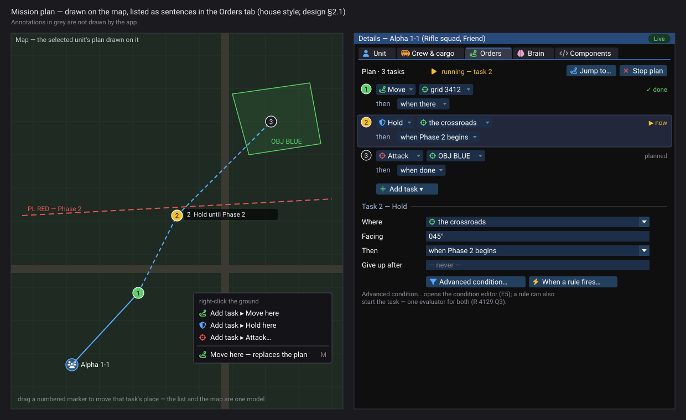

*What the picture shows that prose hid: the plan is drawn ON the map (numbered task markers, the route, the objective, the phase line) and
listed in the Orders tab as plain sentences — "Move to grid 3412, then when there"; the Timeline's Tasks group lines up every unit's tasks
by phase — the synchronisation matrix without a new window.*

| | rule |
|---|---|
| **a task is an ORDER first** | *+ Add task* offers the order kinds THIS unit's class can carry out (`OrderMenu.OfferedFor`): Move, Hold, Attack, Defend, Recon … each with its form (the order DTO, map picks for places and targets). *Advanced: run a specific behaviour…* stays for the technical author |
| **edited on the map** | selecting a unit draws its plan; right-click on the ground → *Add task ▸ Move here · Hold here · Attack…*; drag a numbered marker to move that task's place; the list and the map are one model |
| **"then" in plain words** | *when there · when done · after 5 min · when under fire · when strength below 50 % · when Phase 2 begins · when Bravo 1-2 finishes task 3* — each a picker, never typed text; plus an optional *give up after …* |
| ⭐ **"then" for experts** *(user, `2026-11-06`)* | **Advanced condition…** opens the predicate editor (the ONE condition model, R-4077 — the same one the rules use); **When a rule fires…** picks a rule, or **New rule…** opens the rule editor (built: Rules View §7, RE-1…RE-10) prefilled with this unit as the subject, and links back to the task. ⭐ ONE evaluator: a task's expert condition is held by a rule the task owns (the rules runner evaluates it and releases the task) — the plan's director only waits for the release |
| **one plan per unit, groups through the commander** | as ruled (AQ29 §H); selecting a platoon shows its commander's plan |
| **the same in Edit and Live** | Edit changes the authored plan (undoable, D1); Live sends a Commit to the brain's owner (the edit framework: Conflict → Reload / Overwrite); Live adds *Jump to task* and *Stop plan*, and shows progress (✓ done · ▶ now · planned) |
| **immediate orders in Live** | a map order still REPLACES the plan (rulings 50, 52) — the menu item says so (*Move here — replaces the plan*); a second item *Add to the plan* appends instead |

### 2.2 The model — what changes

*What it shows: nothing is rebuilt — the plan, the queue and the director stay; a task gains an ORDER form resolved by the existing
resolver when the task starts (fixing the latent id-0), conditions gain three kinds that look at OTHER things (a phase, another unit's
progress, the clock), and phases are a new, small scenario-level list.* ⚠ U5 stays rejected: phases are not a step engine — they are named
moments that tasks wait for.

### 2.3 A task starting

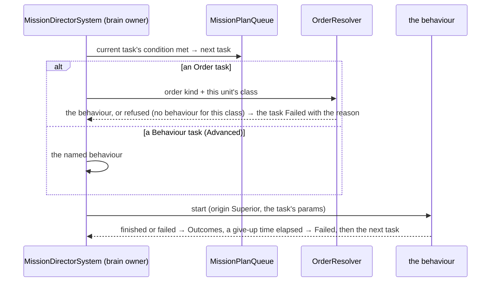
*What it shows: an order in a plan resolves at the moment the task STARTS, on the brain's owner, by the same resolver as an immediate
order — so the plan stays unit-agnostic and a re-classed unit still works.*

### 2.4 Phases and timing across units

| | rule |
|---|---|
| **an operation phase** | a named moment in the scenario — *Phase 1 Approach, Phase 2 Assault* — that begins ⭐ **on an event first** (*"time is simple but often unpredictable, time-anchoring is simple but many times wrong"* — user): a condition (*OBJ BLUE taken · all of 1st Platoon across PL RED · Bravo reports ready*) evaluated by the rules, or **by the instructor** (Live: *Begin Phase 2*); a time is only an optional **no later than** (H+mm) safety net, never the default |
| **tasks wait for it** | *then: when Phase 2 begins* — the director checks the phase list (replicated scenario state) |
| **another unit's progress** | *when Bravo 1-2 finishes task 3* — reads that unit's replicated progress (`MissionPlanQueue` outcomes are already re-sent on change, CE-483 W2) |
| **H-hour** | the scenario's start time (the scenario clock) is H; a time appears only as a phase's *no later than* and as *after N min* inside one task — ⛔ never as the way a plan is synchronised |
| **the overview** | the Timeline's *Tasks* group (designed, TL-5): one lane per unit, its tasks as bars, phases as columns — the synchronisation matrix |
| **phase lines** | a phase line is a map graphic (a route-like line); a condition *when across PL RED* is a later addition |

## 3. Stages *(top level; ui owns the editor, behaviors / backend the plan engine)*

| stage | what | lane |
|---|---|---|
| **M1** | Order tasks: `PlanTask.Kind = Order`, the order DTO in the task, resolved at task start (fixes the latent id-0); the editor offers order kinds first | behaviors + ui |
| **M2** | the Orders tab rebuilt from shared form rows: plain-sentence tasks, condition pickers, *give up after*, progress, Jump / Stop; the obsolete trigger and "+ Add Trigger" go; the Mission window and the second panel instance go (one surface, the Details tab) | ui |
| **M3** | the plan on the map: markers, route, drag, right-click *Add task ▸* (declared actions, Action Catalogue) | ui |
| **M4** | Live: Commit through the edit framework (Conflict → Reload / Overwrite, F6); *Add to the plan* beside the replacing order | ui + backend |
| **M5** | conditions across units: `UnitFinishedTask`; `RuleFired` + *Advanced condition* (a task-owned rule evaluated by the rules runner); *New rule…* from the task; queue size 16 | behaviors + ui |
| **M6** | operation phases (scenario list, begun on a condition or by the instructor, an optional no-later-than) + `PhaseBegins` + the Timeline's Tasks group as the matrix | behaviors + ui |

## 4. Questions — ✅ approved; Q3 and Q4 as revised by the user *(🔒 `2026-11-06`: "others ok")*

| # | question | ⭐ lean | rejected |
|---|---|---|---|
| **Q1** | what a task is | **an order first** (the kinds this unit's class can do), a specific behaviour as *Advanced* | behaviours first — only a technical author knows them |
| **Q2** | where it is edited | **the Orders tab in Details + the map** (one model); the Mission window and the second panel instance go | a separate plan window — R-4118 |
| **Q3** | the advance condition | ✏ **revised by the user:** plain-language conditions by default (+ an optional give-up time) **and** an expert path — *Advanced condition…* (the predicate editor) and *When a rule fires… / New rule…* (the built rule editor, one click from the task); one evaluator — the rules runner — through a task-owned rule | the director evaluating predicates itself — a second evaluator (R-4077) |
| **Q4** | phases | ✏ **revised by the user:** named scenario-level moments begun **on an event (a condition / rule) or by the instructor** — a time only as an optional *no later than*; the Timeline's Tasks group is the matrix; ⛔ not a step engine (U5 stays rejected) | time-anchored phases — *"simple but many times wrong"* |
| **Q5** | the plan length | **16 tasks** (the unmanaged queue doubles; still allocation-free) | unlimited — a managed list per frame; 8 — too short for a real plan |
| **Q6** | vocabulary | user words: **plan · task · order · phase**; ⭐ rename the code's `MissionPlanQueue.Phases` → `Tasks` (a Roslyn rename) so "phase" means the military phase only | keep the code's "phase" for task slots — two meanings of one word |
| **Q7** | an immediate order in Live | **still replaces the plan** (rulings 50, 52), the menu says so, and *Add to the plan* is offered beside it | silently replacing |

## 5. Detailed design *(2026-11-07 — measured; ✅ D1–D9 and §5.7 approved, R-4160)*

⭐ Written so a lane can build it unattended (R-4156). Every load-bearing fact below was measured on `coordinator` at `ae4b72f0`+.

### 5.1 Measured for this pass

| fact | where | ⇒ |
|---|---|---|
| 33 of 127 scenarios carry a plan, on 44 units; at most **6** tasks; triggers used: `BehaviorFinished` (80), `TimerElapsed` (17); every task names a behaviour; none starts with `Order.` | `scenarios/*/scenario.json` (`MissionPlan.PlanData.tasks[].behaviorName / triggers[]`) | every change below is additive for them |
| a plan task and an immediate order travel the SAME way: a tactical intent, the order's id `Order.<Kind>` | `MissionAdapterSystem.cs:110-117` · `OrderAttribute.cs:31` · `TacticalIntentResolutionSystem.cs:135-150` | an order task needs no new channel |
| ⚠ a task is **started twice**: the director by stored id, the adapter by name; an `Order.*` task's stored id is 0 | `MissionDirectorSystem.cs:~218-224` · `MissionControlExecutionSystem.cs:371, 386-403` | D2 |
| the director and the adapter run on the SAME host: `MissionControlModule` (director + execution) and `MissionAdapterSystem`, both composed by the CGF pack | `CgfLogicPack.cs:154` · `MissionControlModule.cs:49` | one start path is safe |
| the director's built-in triggers: `TimerElapsed`, `UnderAttack`, `HealthCritical` (a fraction), `BehaviorFinished` (`ReachedDestination` obsolete); ONE per task | `MissionComponents.cs:11-30`, `MissionDirectorSystem.cs:150-205` | *under fire* and *strength below* already exist |
| the ONE condition compiler: `PredicateCompiler.CompileLevelPredicate(dto)` → `Func<EntityRepository, Entity, bool>` | `ReplayBrowser/Search/PredicateCompiler.cs:42` (same assembly as the director) | D3 needs no new evaluator |
| a rule can be **fired** on request (`RuleRequest.Fire`), its state is replicated (`ObjectiveStatus.TriggerState`, `FireCount`) | `RuleControl.cs:7` · `ObjectiveStatus.cs` | D5: a phase can BE a trigger |
| a task's outcome per slot is replicated (`MissionPlanQueue.Outcomes`, CE-483) | `MissionComponents.cs:164-193` | D6 |
| the queue is an unmanaged `[InlineArray(8)]`, `[DataPolicy(NoScenario)]` — rebuilt from the saved plan on load | `MissionComponents.cs:112, 138-143` | D7 changes no scenario |

### 5.2 Decisions — leans for the user

| # | decision | ⭐ lean | rejected — one line |
|---|---|---|---|
| **D1** | how an order task is stored | the existing `behaviorName` = `Order.<Kind>`, the order DTO as `behaviorParams` — the file format does not change | a new `Kind` field: a format change for a fact the name already says |
| **D2** | how a task starts | **ONE path**: the director only ADVANCES the queue; the adapter starts every task by name through the intent (orders, mappers and plain names alike) | keep both: an order task starts Idle for a frame, and every task is assigned twice |
| **D3** ✏ | the "then" | ✏ **revised (user, `2026-11-07`: "why not using shared condition always?")** — **always ONE shared condition** (the condition language, R-4077): the plain picker writes standard conditions — *when done* = `TransientEvent BehaviorFinishedEvent` on this unit · *after N min* = `PropertyMatch MissionPlanQueue.TaskElapsedSeconds ≥ N` · *under fire* = `InputAbove UnderFire` · *strength below X %* = `None(InputAbove HealthFraction X)` (B-1) — and *Advanced condition…* the full editor. Compiled once per plan version on the brain's node, evaluated each frame without allocation; the director's own trigger switch goes. ⭐ The 97 old entries (`BehaviorFinished`, `TimerElapsed`) are TRANSLATED to those conditions when a plan is compiled — files load unchanged and are written in the new form on the next save | ~~built-in triggers + a `Condition` kind~~ (the first lean): two evaluators and two vocabularies for one idea (R-174) · a hidden task-owned rule entity: a second runtime object per task |
| **D4** ✏ | *give up after* | a SECOND shared condition on the task (the picker offers *after N min* by default): *then* ends the task Done, *give up* ends it Failed; the director checks give-up first | a separate time-only field: a second shape for what a condition already says |
| **D5** | what an operation phase is | ⭐ **a trigger rule marked as a phase** (`common.phase` = its order, 1, 2, …): it *begins* = it fires; its *when* is the begin condition, *no later than* = `when OR ScenarioTime ≥ T`; the instructor's *Begin now* = `RuleRequest.Fire`; it is listed, edited and shown by the rules UI that exists | a separate phase list + its own evaluator + a *Begin phase* action: a second store and a second "when" engine for what a trigger already is |
| **D6** | *when Phase 2 begins* / *when Bravo 1-2 finishes task 3* | *phase begins* = the existing *"rule X has fired"* condition on that phase's trigger (no new leaf); **one new leaf `TaskFinished { Unit, Task }`** reads the unit's replicated `Outcomes` | `PhaseBegins` as its own leaf: redundant once a phase is a trigger |
| **D7** | the queue | 8 → **16** slots; the Roslyn renames `MissionPhase` → `MissionTaskSlot`, `Phases` → `Tasks`, `PhaseCount` → `TaskCount`, `CurrentPhase` → `CurrentTask`, `MaxPhases` → `MaxTasks`, `PhaseElapsedSeconds` → `TaskElapsedSeconds` (Q6) | renaming only `Phases`: "phase" would still mean a task slot in five other names |
| **D8** | where the plan is edited | the **Orders** tab of Details (`EntityDetailsBundle`) from forms and the condition editor; `MissionPanel` (766 lines), `MissionPanelWindow` and its second instance retired — their parts routed (Jump / Stop, progress, Commit) | keep the window beside the tab: two surfaces (R-4118) |
| **D9** | an edit's path | Edit mode: the authored plan changes with ONE undo step per user action (`EditHistory`, R-4133); Live: a **Commit** with the plan's version through `Edits.Submit` (built, B-6) — *Conflict → Reload / Overwrite* wired in the Orders tab; *Add to the plan* builds plan + 1 task and commits (append mode stays dead) | a live append command: the dead `append` path revived |

### 5.3 The classes

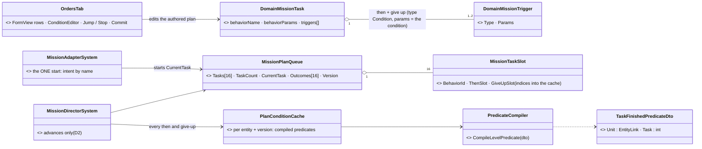

*What the picture shows that prose hid: the saved plan does not change shape — every then / give-up is a condition riding in the existing triggers list (old types translated on compile); everything new
at runtime is either a renamed field, a cache of compiled predicates, or one new leaf; the phase never appears as a class because it is a
trigger (D5).*

### 5.4 Sequences

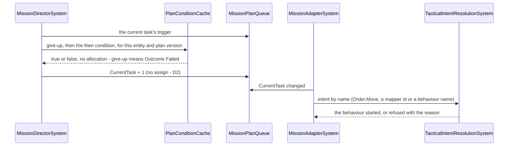

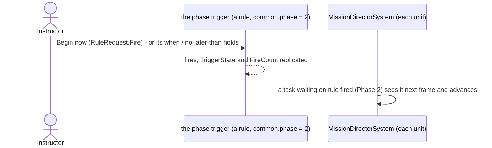

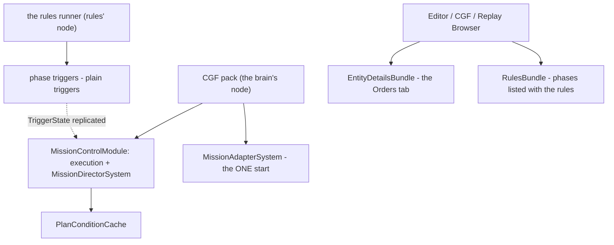

*Called each frame: the director and the adapter by the CGF pack's module host; the phases by the rules runner; the Orders tab and the phase
rows by each host's bundles. The dashed edge is replication, not a call — the director never reaches into the rules runner.*

### 5.5 Stages, refined *(supersede §3's lane column — roles are not honoured, user `2026-11-07`)*

| # | what | acceptance |
|---|---|---|
| **M1** | D1 + D2: `Order.*` accepted without the warning; **G1** (an order task's params resolved on load); the director advances only, the adapter starts every task; D3's translation of the old trigger types into conditions (the director's trigger switch replaced by `PlanConditionCache`) | a plan of `Order.Move` → `Order.Hold` runs on a tank and on a rifleman (each its own class behaviour); no Idle frame between tasks; the 33 scenarios' plan suites unchanged |
| **M1b** | D7: 16 slots + the Roslyn renames | builds; the plan suites unchanged |
| **M2** | D8 + **E9 (the Wait task)**: the Orders tab — task rows as sentences, the order form (`OrderMenu.OfferedFor`), the *then* picker (§5.6), *give up after* (D4), progress, Jump / Stop; `MissionPanel` retired | side-by-side with `mission-plan-editor.svg` + `mission-plan-detail-visual.svg` |
| **M3** | the plan on the map: a numbered marker at each task's first place field (`MapPreviews` shapes by semantic type), the route, drag a marker = edit that field, right-click *Add task ▸* (catalogue actions) | ⏳ action catalogue (B-11) |
| **M4** | D9 + **E1** (progress carried over by task id) + E7: Live Commit, Conflict → Reload / Overwrite, *Add to the plan* | a two-station conflict rail; an edit of task 4 while task 2 runs leaves task 2 running |
| **M5** | D6: the `TaskFinished` leaf; **G2** (the conditions' references resolved on load); *Advanced condition…*, *When a rule fires…*, *New rule…* in the picker | a unit waits on another's task 3; 0 B per steady frame |
| **M6** | D5: phases — `common.phase` on a trigger, the Rules window's *Phases* group, *Begin now* in Live, *when Phase N begins* in the picker; the Timeline's **Tasks** group (one lane per unit, its tasks as bars, phase triggers' fire times as columns) | a phase begun by the instructor releases two units' waiting tasks |

### 5.6 The *then* picker — the plain list and what each stores

| the user picks | stored as |
|---|---|
| *when done* · *when there* | `TransientEvent BehaviorFinishedEvent` on this unit |
| *after N min* | `PropertyMatch MissionPlanQueue.TaskElapsedSeconds ≥ N·60` |
| *when under fire* | `InputAbove UnderFire` |
| *when strength below X %* | `None(InputAbove HealthFraction X)` |
| *when Phase N begins* | *rule fired* on that phase's trigger (`OnEntity` + `ObjectiveStatus.FireCount > 0`) |
| *when <unit> finishes task N* | `TaskFinished { Unit, Task }` |
| *when a rule fires…* | *rule fired* |
| *Advanced condition…* | any condition from the condition editor |
| *give up after N min* (optional, beside any of the above) | a second condition, the GiveUp slot (default *after N min*) |

⭐ Stored as `{type: "Then" | "GiveUp", params: <condition JSON>}` in the existing triggers list — §5.7.

⭐ Every row is ONE shared condition (D3); the picker is a list of presets over the condition language, like the condition editor's.

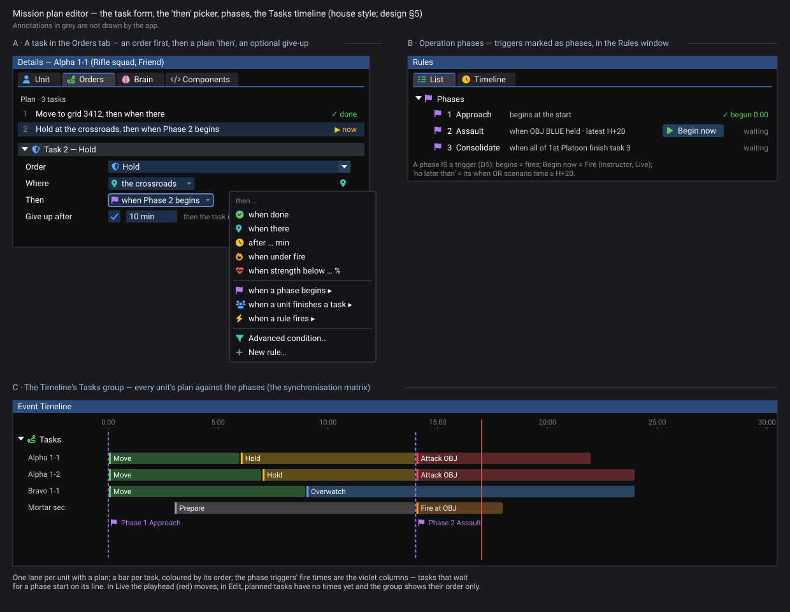

*Generated by `scripts/gen-mission-plan-detail-mockup.py`; the acceptance spec for the picker, the give-up row, the phase rows and the Tasks
group only.*

### 5.7 Storage and compatibility *(measured `2026-11-07`, the user: "I don't think this can be compatible with the current storage")*

| | today | ⇒ |
|---|---|---|
| the scenario file | `"triggers": [ { "type": "BehaviorFinished", "params": "" } ]` | two free strings per entry |
| the wire | `MissionTrigger { string Type; string Params /* JSON */ }` (`MissionDescriptors.cs:28-31`, `[DdsManaged]`) | the same two strings, unbounded |
| the parse | `MissionTriggerHelper.cs:15-45` switches the type over 5 names; an unknown type throws, and **more than one entry throws** ("a phase holds ONE trigger") | the only place the format is enforced |

⭐ ✏ **On disk readable (`DESIGN_Readable_Scenario_Json.md`):** the `params` string is written as the JSON object it holds. **The new entries use the same two fields:** `{ "type": "Then", "params": "<condition JSON>" }` and an optional `{ "type": "GiveUp", "params": "<condition JSON>" }`
— the condition JSON-in-a-string like `behaviorParams` already is. The meaning is in the TYPE, never the position.

| direction | result |
|---|---|
| existing scenarios → new build | ✅ the five old names are read and translated to conditions at compile; files untouched |
| saved by the new build | the new form, written only when that plan is edited or the scenario saved |
| new file → an older build | ⛔ "unknown trigger type" — a newer file, expected |
| the wire | ✅ the same two strings; a cluster runs one build |

⭐ **Entity references — never a network id in the file** *(measured `2026-11-07`; the user: "it cannot be saved to scenario as such. It needs
to be converted to something permanent like scenario GUID or the ref key")*. The rule EXISTS and is built — [`DESIGN_Scenario_Entity_Keys.md`](../DESIGN_Scenario_Entity_Keys.md)
S9′ / S10: an authored reference is an `EntityLink` whose FILE form is the target's **GUID** (`Exact`) or an **`@Key`**; the editor's pick writes
the GUID (`ReferenceLeafDrawers.PickToLink`, `:47-49`, F3); at load `RefResolve` turns it into the new network id and refuses a bare legacy id
(`EntityRefRemap.cs:432-433, 607`). ⛔ **Two gaps on the plan's load path** (`StagingEntityExtractor.cs:454-466`):

| gap | measured | fix (in M1 / M5) |
|---|---|---|
| **G1** an `Order.*` task's params are never resolved | the pass looks the contract up BY BEHAVIOUR NAME (`ScenarioBehaviorRemapper.ContractOf`, `:100-110`) — `Order.Move` is not a behaviour ⇒ no contract ⇒ the JSON passes unchanged ⇒ a target saved as a GUID resolves to nobody | `ContractOf` also answers an `Order.<Kind>` with that order's DTO type (the `[Order]` registry) — one lookup, both kinds |
| **G2** a task's trigger params are never walked | the pass walks `task.BehaviorParams` only; the `triggers[].params` (today plain numbers) are not touched | the same pass walks each `Then` / `GiveUp` entry with the contract `SearchPredicateDto` (`EntityRefRemap.WalkJson`, `RefResolve`) — the walker already handles the polymorphic tree |

⭐ **The rail, first in M1 / M5:** a plan whose ORDER targets a unit and whose *then* names ANOTHER unit and a phase trigger is saved, loaded into a
fresh world (new network ids) and still points at the same three entities — and the file holds their GUIDs, never a number.

### 5.8 The remaining detail — E1–E8 *(measured `2026-11-07`)* — ✅ E1–E9 approved (R-4161, user `2026-11-07`: *"Approved"*), with §5.9

| # | point | measured | ⭐ lean | rejected — one line |
|---|---|---|---|---|
| **E1** ⚠ | **a Live edit restarts the plan from task 1** | a replace rebuilds the queue with `CurrentPhase = 0` and fresh outcomes (`MissionControlExecutionSystem.cs:346-348`); the tasks carry stable `TaskId`s and the plan its `TaskOrder` | **carry progress over BY TASK ID**: a task already Done keeps Done; the RUNNING task, if still in the plan and unchanged, keeps running (no restart, its elapsed time kept); if its content changed it restarts; if it was removed, the plan goes on with the next task after the last one done | restart from 1 (today): fixing a typo in task 4 sends a platoon back to its start line |
| **E2** | where a task sits on the map (M3) | every order DTO's place is a semantic field: `MoveOrder.Location` (`PointLink`), `AttackOrder.Target` (`EntityLink`), Strike / ObserveFire `Location` + `Target` (`OrderDtos.cs:19-158`) | the task's marker = its FIRST place field (a point, else an entity's position, else an area's centre) via `MapPreviews` (show on map); a task with no place (*Hold*) sits at the previous task's place; the route joins the markers in order; dragging a marker writes that field | an `[TaskPlace]` attribute on each DTO: the semantic type already says it |
| **E3** | marking a trigger as a phase (D5) | a rule's authored block is `ObjectiveCommon` (`"common": {...}`, `ObjectiveRules.cs:21-45`) | a new field `"phase": n` (0 = not a phase, 1, 2, … = its order) in `ObjectiveCommon` (+ its unmanaged twin); the Rules window lists phase triggers under *Phases*, sorted | the existing `group` text: free text cannot order phases |
| **E4** ✏ | the Timeline's *Tasks* group | `MissionPlanQueue` is recorded (`NoScenario`, not `NoReplay`); lanes are registered by the toolkit that owns the data (R-4078); the timeline's events already filter by entity (`GET /timeline/events?entity=`) | ✏ **revised (user: "a task line for every single entity? What if there are thousands?")** — **ONE *Tasks* lane for all units**: a marker where a task STARTED, ended Done, ended Failed (by colour), each naming its unit and task; it follows the timeline's entity filter like every lane. ⭐ The selected unit (or the selection) additionally shows its tasks as BARS (start → end) in one row under the lane; the phase triggers' fire times as columns across. In Edit mode: nothing (no times yet) | ~~one lane per unit~~ (the first lean): does not scale to hundreds of plans · a separate matrix window |
| **E5** ✏ | whom a task's condition is about | the plan runs on the unit's own entity | the condition editor gets a **Mission task** context whose WHO chip **defaults to *this unit*** (*this entity* when it is not a unit) — ⛔ never an empty field; it is a real choice the author can change to another unit, a rule or a phase; stored as a condition with no `OnEntity` wrapper (it runs on the unit) | an empty WHO meaning "this": the user cannot see it · wrapping every condition in `OnEntity(this unit)` |
| **E6** | a platoon or squad selected | a group is ordered through its commander (AQ29 §H) | the Orders tab and the map show and edit the **commander's** plan; the men's own slots are not plans | a plan per man of a group: AQ29 §H |
| **E7** | *Add to the plan* (a map order in Live) | append is dead in the executor (§1) | the editor builds plan + 1 task at the END and commits it (D9); a finished plan makes the new task current | insert after the current task: an ordering choice nobody asked for |
| **E8** | the HTTP `add_mission_task` | it rewrites the whole plan (§1) | it goes through the same model (append, with the version) | its own path: a third way to edit a plan |

### 5.9 How a plan runs — the sequencing rule *(measured `2026-11-07`; the user: "Is the first item always started immediately, or is it gated by some triggers?")*

| | today (measured) | ⭐ the design |
|---|---|---|
| **the first task** | starts AT ONCE when the plan is set (load or commit): the adapter starts the current task whenever it changes (`MissionAdapterSystem.cs:68-117`) | the same — ⭐ a plan that must not start at once BEGINS WITH A **WAIT** task (E9): *"Wait, then when Phase 1 begins"* |
| **what a task's condition means** | it is the task's **EXIT** condition: when it holds, the plan moves to the next task (`MissionDirectorSystem.cs:120-205`) — so it is also the next task's start gate | the same — the sentence reads *"<task>, **then** <condition>"* |
| **a task with NO condition** | the RUNTIME holds it **forever** (`(TimerElapsed, ∞)`, `Hrot.Core/Mission/MissionTriggerHelper.cs`, pinned by `EntityMissionIngressTranslatorTests…NoTriggerHoldsForever`) — even after its behaviour finished. ⚠ But **no saved plan has one**: 97 tasks in `scenarios/*`, 0 without a trigger, because every AUTHORING path writes `BehaviorFinished` itself — three copies of one default (`MissionPanel.cs:240`, `DebugApiService.Missions.cs:198`, `NedSimHostMissionSender.cs:53`) ⇒ every existing plan already runs one by one | ⭐⭐ **NO condition = *when done*, decided ONCE at the runtime** (the user: *"I would expect that they are executed one by one"*): `ResolveTrigger(empty)` ⇒ `BehaviorFinished`; the three editor defaults are deleted (one owner). A plan of bare tasks therefore runs one after another and the first starts at once. *"Hold until told"* stays an explicit choice (*never — until the plan is changed*), stored as a condition that never holds, never as an empty one. ⚠ The `…NoTriggerHoldsForever` rail flips with it; no saved file changes meaning (none has an empty list) |
| **the last task** | its condition ends the plan; the unit's slot is cleared | the same |
| **a behaviour that fails** | the outcome is Failed; the plan still waits for the condition; a FAULT halts the plan (`:132-138`) | the same, plus *give up* (D4) |

#### E9 — the **Wait** task *(the user: "How could we write a plan where the first task doesn't start immediately but waits for a trigger? It's kind of a valid plan, isn't it?")*

| | |
|---|---|
| **what it is** | a task with NO order and NO behaviour (`behaviorName` empty) and a *then* — *"Wait, then when Phase 1 begins"*; allowed first, or anywhere in the plan |
| **what the unit does meanwhile** | ⭐ **its own standing behaviour (its SOP)** — the plan gives it nothing to do: at the start nothing has been ordered; mid-plan the plan's previous behaviour is CLEARED (origin Superior) so the SOP takes over again |
| **measured** | a task with an empty name already exists in the data: the adapter starts nothing for it (`MissionAdapterSystem.cs:109`), the executor stores id 0 (`MissionControlExecutionSystem.cs:388-389`); today the director then assigns behaviour 0 (Idle) on the advance — gone with D2 (one start path) |
| **storage** | none new — the existing task shape with an empty name; old files unchanged |
| **in the editor** | *+ Add task* offers **Wait** first; its row reads *"Wait — until <condition>"*; the *then* is required — a Wait has no behaviour to finish, so an empty one (= *when done*) would end at once; the editor refuses it and the load warns, naming the task |
| **rejected** | a *Hold* as the first task (the earlier lean): it ORDERS the unit to hold, replacing what it would otherwise do · a separate plan-level "start when": a second gate shape for what a task already is |

### 5.10 M1 runtime — AS BUILT *(2026-11-07, backend, P-2 / CE-4298)* — matches §5.3 / §5.4 with four deviations, each argued

| part | where |
|---|---|
| **§5.9** no condition = *when done*, decided ONCE | `MissionTriggerHelper.ResolveTrigger` (empty ⇒ `BehaviorFinished`); the three editor defaults (`MissionPanel`, the debug API, `NedSimHostMissionSender`) write nothing; the rail flipped to `…NoTriggerMeansWhenDone` |
| **D1** `Order.<Kind>` accepted | `MissionControlExecutionSystem.ResolveBehaviorId` — a declared order's stored id is 0 without the warning (an undeclared one still warns, now naming it) |
| **D2** ONE start path | `MissionTaskStart.ByName` (beside `ActiveMissionPlan`) — the ONE answer both read: a task of a NAMED plan is started by the adapter, by name; the director only advances it (no `AssignBehaviorHashEvent`, no second clear) |
| **E9** the Wait task | `MissionAdapterSystem` — an empty name starts nothing; mid-plan it clears the plan's behaviour (Superior) so the SOP takes over; at the plan's start nothing is cleared |
| **G1** an order task's params resolved on load | `CgfBehaviorSetup.CreateBehaviorRemapper` registers every order's DTO under `Order.<Kind>` (`ScenarioBehaviorRemapper.Register(id, Type)`) — the one remapper factory, so every host has it |
| **D3 / D4** then and give-up are conditions | `PlanConditionCache` (new, beside the director): per entity and slot, compiled once from a `Then` / `GiveUp` entry (`ConditionCache.Get`) or from the old type (`PlanConditionCache.Translate`); the director asks give-up first (⇒ Failed), then *then*. Entry types `Then` / `GiveUp` accepted by `ResolveTrigger` (one then, at most one give-up, each a parseable condition; the slot kind `MissionTrigger.Condition`) |
| **D6** the `TaskFinished` leaf | `TaskFinishedPredicateDto { Unit, Task }` + its compiler arm (no Unit = the asked entity; Task 0 = its current task) — built here because *when done* needs it (deviation ①) |
| the ONE compiled-condition cache | `Fdp.Toolkit.ReplayBrowser.Search.ConditionCache` — moved down from `Hrot.AI.Behaviors.TriggerWhen`, which now delegates (a rule's `when` and a task's *then* share one compiler and one cache) |
| rails | `MissionAdapterSystemTests.CE4298_*` (three bare tasks one by one, each started once by name; a Wait-first plan; then + give-up; 0 B per steady frame) · `CgfBehaviorSetupTests.CE4298_AnOrderTasksParams_…` · `EntityMissionIngressTranslatorTests` (flipped) |

| deviation | why |
|---|---|
| ① *when done* = **`TaskFinished` (this unit, its current task)**, not `TransientEvent BehaviorFinishedEvent` (§5.2 D3, §5.6) | the director ignores a REACTION's or a POSSESSION's end (`BehaviorOriginRank.Pauses`, CE-2078 / CE-3172) — a plain event match would advance the plan when a reaction ends. The director records the TASK's outcome before it asks, so the leaf is the old trigger exactly, and allocation-free |
| ② the old `UnderAttack` is translated to **`TargetMemory.Count > 0`**, not `InputAbove UnderFire` | a translation keeps an old file's MEANING: `UnderAttack` was "knows an enemy" (`TargetMemory`), not "under fire". The picker's *under fire* preset (§5.6) stays `InputAbove UnderFire` for new plans. (No scenario uses `UnderAttack`.) |
| ③ the old `HealthCritical X` is **`Health.Max > 0` AND NOT `HealthFraction > X`** | the old trigger never fired without a `Health`; `None(InputAbove …)` alone would fire at once there. `PlanConditionCache` registers the standard inputs once so a node with no utility system still reads `HealthFraction` |
| ④ a RAW queue (no `ActiveMissionPlan` beside it — the FDP examples, hand-built queues) is still started by the director by its stored id | it has no name to start by, and no adapter runs there (the examples compose the director alone). `MissionTaskStart.ByName` makes the two paths DISJOINT by construction, so no task is ever started twice |

⏳ Not in M1: the load warning for a Wait with no *then* (the editor refuses it, P-7); E1 progress carry-over (P-4).

**M1b (P-3, CE-4299) as built:** D7 exactly — 16 slots (`MissionPlanQueue.MaxTasks`, the one size the two inline buffers read); the six Roslyn renames (the names above in §5.10 are now `TaskElapsedSeconds`, `CurrentTask`, …). One consequence found: `MissionProgressWire.ProgressOf` packed 8 outcomes × 8 bits into a `ulong` — now 2 bits each.

**M4 runtime (P-4, CE-4300) as built:** E1 exactly as §5.8 says, in `MissionControlExecutionSystem.CarryProgress` (by `TaskId`; "unchanged" = same name, params and condition entries). ⭐ One thing E1 needed that §5.8 did not name: the ADAPTER decided "already started" by the slot INDEX, so a task kept running but moved by an insert would have been restarted; it now keys on the task (id, name, params — the index only for an id-less task). E7 and E8 need no code of their own: both commit plan + 1 with the version, and E1 keeps the progress. D9's version precondition was already there (B-6); the two-station rail pins it.

**M5 runtime (P-5, CE-4301) as built:** D6's leaf was built in P-2 (§5.10). G2 as §5.7 says — each `Then` / `GiveUp` entry walked with the contract `SearchPredicateDto` (`ScenarioBehaviorRemapper.ResolveConditionJson`). ⚠ §5.7's premise *"the walker already handles the polymorphic tree"* was only HALF true: members typed as a polymorphic node were dispatched (SR-164), but a polymorphic ROOT was planned as its abstract base and walked nothing — fixed in `EntityRefRemap.WalkJson` (one place, every caller).

**M6 runtime (P-6, CE-4302) as built:** E3 exactly — `common.phase` (byte, 0 = none) on `ObjectiveCommon` + `ObjectiveCommonBlock`, projected by `ObjectiveRules.Display` onto `ObjectiveStatus.Phase` and replicated (`EntityObjectiveStatus.Phase`). *Begin now* needs no new code (`RuleRequest.Fire` through `RuleCommands.Control`, origin Instructor). *when Phase N begins* = `PlanConditionCache.PhaseBegins(trigger)` — the §5.6 row, as a preset beside the others.

### 5.11 P-7 (M2 + M4 UI) — the build plan *(ui, `2026-11-07`; claimed in `STATUS_Editing_UX_Build_Ui.md`)*

INVENTORY (graph `search_graph .*(OrdersTab|MissionPanel|MissionPlan).*` Class + grep `new MissionPanel`): no Orders tab exists; **three**
`MissionPanel` instances (710 lines, `Hrot.Presentation/Panels/MissionPanel.cs`) — the editor's Mission window (`EditorSubsystem.cs:1866`,
registered `:4931`), the editor-only Details view **Mission** (`ScenarioMissionView`, `details.mission`, `EditorSubsystem.cs:3250`) and CGF's
Mission window (`CgfSubsystem.cs:1102`, `:1327`). They all read and write through ONE facade, `IMissionEditorService`
(`GetMissionSnapshot` · `CommitMissionAsync(plan, baseVersion)` · `SendControlCommandAsync(Jump / Abort)` · `GetAvailableBehaviorChoices`),
implemented by `ScenarioMissionService` — ⇒ the tab reuses it; nothing new on the write path.

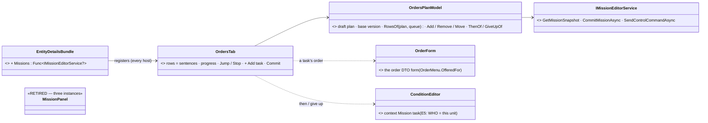
*What it shows: one tab on the ONE Details bundle replaces three panels on two hosts, and it writes through the facade they already share —
so P-7 adds a surface and deletes three, without a new write path.*

| slice | what | acceptance |
|---|---|---|
| **7a** | `OrdersPlanModel` (headless) + `OrdersTab` READ: one row per task as a sentence (*"Move to Bridge, then when there"*, a Wait reads *"Wait — until …"*), the running task marked from `MissionPlanQueue` (`CurrentTask`, `Outcomes`), Jump / Stop; offered when ONE selected unit has a plan or can take one (E6: a group shows its commander's) | the model's rows rail; the tab registered on Editor, CGF (the bundle's forwarding rail) |
| **7b** | EDIT: *+ Add task* (Wait first, E9; orders from `OrderMenu.OfferedFor`; behaviours), the order form, the *then* picker §5.6 (presets → `{type: Then, params}`), *give up after* (D4), remove / reorder; a Wait with no *then* refused; nothing written for *when done* (P-2) | the stored JSON per preset (§5.6 table) rail; side-by-side with `mission-plan-editor.svg` + `mission-plan-detail-visual.svg` |
| **7c** | D9: Edit mode = one `EditHistory` step per action; Live = **Commit** with the base version, Conflict → *Reload* / *Overwrite*; `TaskId` kept across edits (P-4) | the two-station conflict rail; an edit of task 4 while task 2 runs leaves task 2 running |
| **7d** | retire the three `MissionPanel` instances (+ `MissionPanelWindow`, `ScenarioMissionView`); re-home `MissionPanelTests` / `MissionPanelRegistryTests` claims onto the model | the window-set rail per host (Mission window gone, Orders tab present) |

**7c as built (ui, `2026-11-07`):** ⭐ **Edit mode — one undo step per Apply, BY CONSTRUCTION:** the commit is an `EditOp.Commit` through `Edits.Submit`
(`ScenarioMissionService.cs:185`), which B-14 brackets (rail `WorldUndoTests.P7c_ACommitIsAnUndoStep_AnOrderIsNot`). **Live — Conflict → Reload /
Overwrite:** `MissionCommitResult.Conflict` (set from the ack's `VersionConflictCode` and from a network outcome `EditStatus.Conflict`); the Orders tab
keeps the draft and offers *Reload* (drop it, re-read) / *Overwrite* (re-send over the CURRENT version). ⛔ Two defects found and fixed on the way:
(1) the facade's snapshot reported a CONSTANT version 0 — a base of 0 is "no precondition", so a conflict could never happen; it now reads
`MissionControlExecutionSystem.VersionOf` (the one definition); (2) the snapshot mapped every task's triggers to an EMPTY list — the Orders tab
showed every task as *when done* and an Apply WIPED the *then* / *give up* conditions. ⚠ Not closed in ui: the version is not on the wire, so a
REPLICA (the editor in Live over CGF's units) still sends base 0 — asked of backend in `NOTE_Ui_To_Backend_Mission_Plan_Version_On_The_Wire.md`.
Rails: `EditorMissionServiceTests.P7c_*` (2), `TheOrdersTabEditsTests.P7c_AConflict_*`, both red-proved.

**7d as built (ui, `2026-11-07`) — DONE (the two stopped claims were built the same day, below):** ⭐ **Deleted:** `ScenarioMissionView` (`details.mission`), `MissionPanelWindow`, the ids
`ScenarioPanelWindowIds.EditorMission` / `CgfMission`, `PanelIds.Mission`, and every host construction — `EditorSubsystem` (the window, the Scenario Details
view, the per-frame `SelectedEntityId` sync, the `NetworkIdOf` helper) and `CgfSubsystem` (its panel + window). The `ui-baseline-editor` / `-all`
`registered-windows.json` goldens lose `editor_mission` / `cgf_mission` (a deliberate one-line recapture each). **Acceptance rail:**
`TheScenarioWindowsAreSharedTests.NoHostRegistersAMissionWindow_AndEveryHostHandsTheOrdersTabItsMissionFacade` (both hosts) +
`TheEditorsDetailsCatalogue_HasTheOrdersTab_AndNoMissionTab`, red-proved by a compiling mutation. **Where each claim went:**
offering rules (brain-only → orderable-or-has-a-plan, no service, none/two entities, rank, the network id not the index) ⇒ `TheOrdersTabEditsTests.P7d_*`;
task-state colour ⇒ `TheOrdersTabTests.U3_EachTaskStateHasItsColour…`; the task's form from the host's lookup ⇒ `P7d_ATasksFormComesFromTheHostsLookup…`;
consume-once / location / no-frame-service pick ⇒ `TheMapPickBrokerConsumesAPickOnceTests` (on the broker itself); `BehaviorParamsFormTests` now builds its form directly.
**Dropped:** "two view instances do not share a panel" and "C010 MissionPanel is in `Hrot.Presentation`" (no subject left); the two dump rails
(`EditorMissionWindowDumpsItsPlan`, `ScenarioMissionViewDumpsItsPanel`) — ⚠ the Orders tab has **no `PanelSnapshot` dump of its plan** (only `LastRows`), so the
plan's rows are not observable over the debug API any more; and the real-frame glyph-pixel rail (the tab colours the task number, no glyph, and has no frame rail).
⭐ **The two capabilities the panel had, now on the Orders tab — `MissionPanel` (+ its `PanelConstants` block) and `MissionPanelRegistryTests` DELETED:**
(1) **per-task pick scope** — `OrdersTab.PickFor(taskId, then)` gives each task's form `ScopedMapPickContext(pick, "$.tasks[<task id>]")` and its *then* condition
`…".then"`, cached per task (no allocation per frame). ⭐ Deviation, argued: keyed by the task's **id**, not its index (the panel's `$.tasks[i]`), so a pending pick follows its task through ↑ ↓.
(2) **the CE-1059 entity LIST** — both hosts' Details brokers (`EditorSubsystem` `_formsPick`, CGF `cgfPickBroker`) get `EntityListSource.Opener`. Rails:
`TheOrdersTabEditsTests.P7d_EachTasksPickIsScopedToThatTask_TheEntityListReachesIt_TheScopeIsCached` (re-homes P4 + CE-1059) and
`TheScenarioWindowsAreSharedTests.EveryParamsFormHostPassesTheEntityList` (Editor 2, CGF 1). The task-sentence inputs (*then* preset, *min*, *%*, *give up after*) are
named in `LabelFirstFormsFrameRail` as inline-in-a-sentence, the `ConditionEditor` family.
⛔ **HISTORY:** 7d first stopped here with both capabilities missing (two user-visible regressions against the retired window).

**7a + 7b as built (ui, `2026-11-07`):** `Hrot.Editor.AiShared.Shell` — `OrdersPlanModel` (rows as sentences, the queue's states), `OrdersPlanEdits`
(new Wait / order / behaviour, the *then* presets, give up, move, `RefusalOf`, `Copy`) and `OrdersTab` (`details.orders`; a draft per unit,
↑ ↓ ✕, *+ Add task* — Wait first, then `OrderMenu.OfferedFor(dis)`, then the facade's behaviours — Apply = the whole plan with its base version
through `IMissionEditorService.CommitMissionAsync`, settled on the UI thread; Revert; Jump / Stop when nothing is pending). Offered to a unit with
a plan or one that can be ordered. ⭐ Two measured deviations, both argued:

| | as built | why |
|---|---|---|
| ① | *after N* is a NEW catalogue fact **`task-time`** (`FactCatalogue`, Mission context only, world-only) whose leaf is byte-identical to `PlanConditionCache.Translate(TimerElapsed, N)` (railed) | one vocabulary: the condition editor, the summary and the picker read it; the runtime's translation and the authored preset are one condition |
| ② | the presets are read back by `FactCatalogue.Recognise` on the leaf (a one-child `None` = negated), NOT `RowProjection.FromDto` | `FromDto` reads an UNWRAPPED leaf as a row only for a world fact; a task's facts (*under fire*, *strength*) are about the unit itself, stored unwrapped (E5) — so they would read back as Custom |

✅ **7b rest (ui, `2026-11-07`):** a task's own FIELDS through the ONE params form (`BehaviorParamsEditor` + `BehaviorParamsForm.DrawFields`, the
host's map pick) — an order's type is its DTO from the ONE order registry (`OrderMenu.TryGetByName`, the lookup G1 resolves by), a behaviour's the
host's `ParamsTypeOf` (new `EntityDetailsHostServices.ParamsTypeOf`, passed by Editor and CGF over their registries); *Advanced condition…* = the
ONE `ConditionEditor` in the Mission context, opened on the task's current condition (`OrdersPlanEdits.ConditionOf`).

### 5.12 P-8 (M3 + M5 / M6 UI) — as built *(behaviors, `2026-11-07`, W-1 of `HANDOFF_Coordinator_To_Behaviors_Taken_From_Ui.md`; built in slices)*

INVENTORY: `scripts/cbm.sh search_graph .*(Phase|RulesWindow|RulesModel).*` Class + grep `Status.Phase` ⇒ the phase reached the UI in ONE place
(`RulesWindow.OpenGallery`'s next-number count) — and ⚠ measured broken there: `AuthoredRules.Parse` built the authored status WITHOUT `phase`,
so before a run every rule read phase 0 (the gallery always offered *Phase 1*; `RunToChoices` listed no phase from Edit).

**8a — the Rules window's Phases group, *Begin now* (mockup B) — BUILT:**

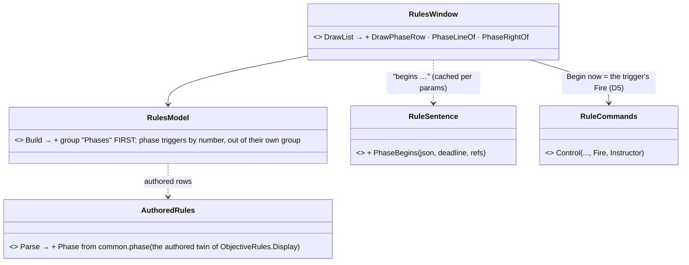
*What the picture shows: no phase store — a phase is a trigger (D5); the group is a VIEW of the rules model, so the List and the Timeline
views agree, and Begin now is the instructor's existing Fire.*

| decision | why |
|---|---|
| the Phases group leads whatever the grouping (Macro / Subject / Side) | the operation's order is read first (mockup B); a phase is shown once — it leaves its own group |
| right side: nothing before a run · *begun m:ss* (green) once it fired · *▶ Begin now* + *waiting* otherwise; greyed with `RuleCommands.DisabledReason` | D5: *Begin now* IS the trigger's Fire (`RuleOrigin.Instructor`); the mockup's columns |
| *"begins at the start"* for `ScenarioTime ≥ 0`, else *"begins when …"* (the ONE condition sentence) + *" · latest m:ss"* (`deadlineSeconds`) | E3: the phase's no-later-than is the rule's deadline |
| ⚠ deviations | ▶ in *Begin now* is white, not green (ImGui buttons draw one text colour); the mockup's *latest H+20* reads *latest 20:00* (the window's one clock format) |

Rails: `RulesModelTests.W1_*` (the group first by number, authored too — red-proved by dropping the authored projection; the right side; the words) ·
`RulesWindowFrameRail.W1_ThePhasesGroup_OnARealFrame` (`rules-phases.png`). ⏳ next: the plan on the map (8d, M3 / E2).

**8b — the *then* picker's phase, rule and unit entries, *New rule…* — BUILT:**

| the picker shows | stored (§5.6) | read back |
|---|---|---|
| *when a phase begins* + which phase | `OrdersPlanEdits.ThenRuleFires(link)` = `PlanConditionCache.PhaseBegins` — the trigger fired | `ThenPreset.RuleFires` + `TargetOf` — shown as a phase when the target's `phase` > 0 |
| *when a rule fires* + which rule | the same shape (a phase IS a trigger, D5) | the same |
| *when a unit finishes a task* + unit + task N | `ThenUnitFinishes(unit, N)` = `TaskFinished { Unit, Task }` (1-based) | `ThenPreset.UnitFinishesTask` + N + `TargetOf` |
| *New rule…* | nothing (the *then* is unchanged) | asks the host's `AddRuleAboutUnit` (the Rules gallery about this unit, CE-4308) — the author then picks it under *when a rule fires* |

| decision | why |
|---|---|
| one stored shape for *phase begins* and *rule fires*; the picker tells them apart by the target's `phase` | D5: a phase IS a trigger — ⛔ no second condition type |
| the choices (triggers via `RulesReader` — authored ones too; units with a `MissionPlanQueue`) read at most once a second | the Orders tab draws every frame (R-2084) |
| `OrdersTab` takes the host's actions (`EntityDetailsBundle` passes `host.Host`) | the silent-default rule — the bundle held them; `OrdersTabDescriptor.For(…, host)` forwards, railed on the constructed tab |
| ⚠ deviation from mockup A | the picker is ui's P-7 combo (no ▸ submenus, no coloured glyphs): 8b adds its entries there with a second chooser beside it. The popup form is P-7's fidelity, ui's |

Rails: `TheOrdersTabTests.P8b_*` (read back as themselves with the target — red-proved by dropping the target read; the phases first, authored too;
the descriptor forwards the host).

**8c — the ONE Tasks lane (E4) — BUILT (data 8c, drawing 8c-2):**

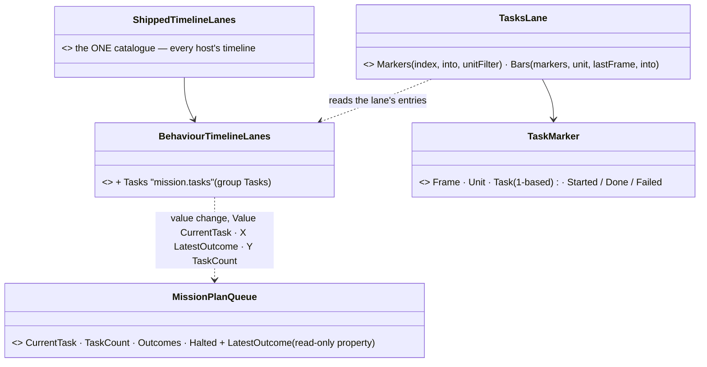
*What the picture shows: no new store and nothing on the wire — the lane is a value-change projection of the recorded queue (R-4078: the
toolkit that owns the data registers it), so the live timeline, a recording and a replica read one history; a thousand units are ONE lane
because every marker carries its unit.*

| decision | why |
|---|---|
| `LatestOutcome` a read-only PROPERTY (the task before `CurrentTask`, or the current one when halted) | the projection reads properties; ⛔ no stored field, no translator change (replicas already get `Outcomes`) |
| one entry per plan move; the reader expands a jump of several tasks into Done markers and the latest's own outcome | a value-change lane sees states, not events |
| a new plan (task back to 1 or a new count) and a halt read as Started / Failed once | E1 / CE-483 |
| ⛔ SUPERSEDED (8c-2 built): *"8c-2 needs a per-lane renderer seam"* — the rows are TRACKS instead (below); the lane itself is `Hidden` (indexed, not drawn as plain dots) | the panel already draws coloured items per track; a lane renderer would have been a second drawing path |

**8c-2 — the rows on the Event Timeline (mockup C) — BUILT:** `TasksTimelineTracks` (Hrot.Presentation/Orders) gives the panel three rows —
*Tasks* (a collapsible header), *all units* (a key per start / Done / Failed in blue / green / red, labelled *"Alpha 1-1 · task 2 Failed"*, a click
selects that unit) and the SELECTED unit's bars (*"Alpha 1-1 ▸"*: each task from start to end, green Done · red Failed · amber running). The
panel takes them through `TimelinePanel.AddTracks` — ⭐ a second track owner beside the director's `Tracks` (one reused buffer, 0 B a steady
frame). Composed on the editor and the Replay Browser where each builds its Event Timeline (`TasksTracks`, over the same shown source and the
host's ONE selection). Items are rebuilt only when the index grows or the selection changes.

| ⚠ deviation from mockup C | why |
|---|---|
| the markers are the panel's coloured diamonds, not ▶ / ✓ / ✕ glyphs | a track item draws a diamond or a bar; the colour carries the kind (the mockup's colours) |
| no phase columns across the rows | the panel has no full-height column for a track; the phases are already the Rules window's Phases group and the rules lanes — ⏳ a column seam if wanted |

Rails: `TheTasksTimelineTracksTests` (Presentation.Tests — the rows, colours, labels and bars, red-proved by the Failed colour mapped to Done; a
thousand units one row, built once; a real frame beside another owner's tracks — `tasks-timeline.png`).

Rails: `TheTasksLaneTests.P8c_*` (Fdp.Toolkits.Tests — a plan's starts and ends with how each ended, red-proved by `LatestOutcome` reading the
current task; a halt and a new plan; a thousand units, one lane, the unit filter) · `TimelineIndexTests.CE3330_Node_TheShippedCatalog…` (19 lanes).

**8d-1 — the plan ON THE MAP, read-only (M3 / E2) — BUILT into the ONE plan drawing; 8d-2 (drag a marker = edit its field) BUILT below; right-click *Add task ▸* ⏳ (needs the catalogue's `Ground` target, Action Catalogue A5):**

INVENTORY (re-run after a first cut): `scripts/cbm.sh search_graph name_pattern=".*Mission.*(Gizmo|Overlay|Layer|Presentation).*"` ⇒
**`MissionPresentationGizmo`** (GZ058, a `[GizmoProjector]` in the Path family since CE-3123 — every map host, its own Paths checkbox, which
units by the family policy) already drew a unit's plan as lines — ⚠ to a behaviour's `"target"` key ONLY, so an `Order.*` task (its place is
`Location`) drew nothing. ⛔ SUPERSEDED: a first cut added a second drawing (`MissionPlanOverlayGizmo`, registered by hand beside the fire-mission
overlay) — deleted the same day: two drawings of one plan (ruling 9).

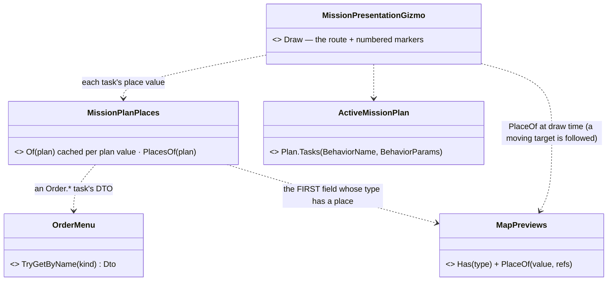
*What the picture shows: no new "task place" field (E2's rejected `[TaskPlace]`) and no second drawing — the order's DTO type says which fields
are places, the one show-on-map table resolves them, and the plan's one gizmo draws them on every map host through its family membership.*

| decision | why |
|---|---|
| a task's place: its order DTO's FIRST place field (declaration order), else a legacy behaviour's `"target"`, else the previous task's place | E2; the `"target"` read is the gizmo's old behaviour, kept |
| the route from the unit, solid to task 1 then dashed, in the unit's side colour; numbered markers done green / running amber / planned grey (`MissionPlanQueue.CurrentTask`); a placeless task adds no zero-length line | mockup `mission-plan-editor.svg`; ⛔ SUPERSEDED: the orange → blue gradient lines |
| which units: the Path family's policy (selected / pinned / all) | CE-3123 — ⛔ no selection check of its own |
| `MapPreviews.PlaceOf` extracted from `MapPreviews.Draw` | ONE resolution of "where is this value" |
| ⚠ deviation: the number sits just BELOW its marker | map text anchors at its top-left (no centring); the show-on-map labels sit the same way |
| ✅ 8d-2 drag (below) · ⏳ *Add task ▸* | the drag commits through `IMissionEditorService.CommitMissionAsync` (P-7 7c — one undo step in Edit, conflict-checked in Live); *Add task ▸* waits for A5 |

Rails: `MenuOrdersTests.P8d_TheSelectedUnitsPlan_IsNumberedMarkersAndItsRoute` (places, Hold at the previous place — red-proved by placing it at the
unit; two lines, three markers) · `MissionPlanOverlayFrameRail.P8d_ThePlanOnARealMapFrame` (`mission-plan-map.png` — the amber and green markers on a
real 2-D frame) · `DebugTraceGizmoTests.CE1203_TheMissionLines_AreOnThePathsLayer` (unchanged, green).

**8d-2 — drag a task's marker = edit its place (E2) — BUILT:**

INVENTORY: `scripts/cbm.sh search_graph name_pattern=".*(Waypoint|Vertex|Route).*Gizmo.*"` ⇒ `RouteWaypointGizmo`, `VertexEditGizmo` — the
exclusive-focus draggable-handle pattern, armed by `ScenarioToolRegistrations.ToggleEntityGizmo<T>` (the one toggle, the onRemove pair, the
netId-anchor guard); `grep CommitMissionAsync` ⇒ one production caller, the Orders tab (P-7) — the map commits through the same facade.

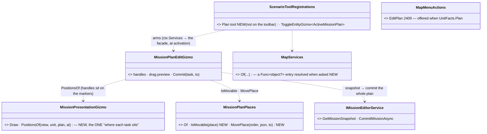
*What the picture shows: no second drawing (the edit gizmo draws handles and the drag's preview only), no second "where is task N" (one
`PositionsOf`), no second first-place rule (`MovePlace` and `Of` share `FirstPlaceMember`), no second commit path (the Orders tab's facade).*

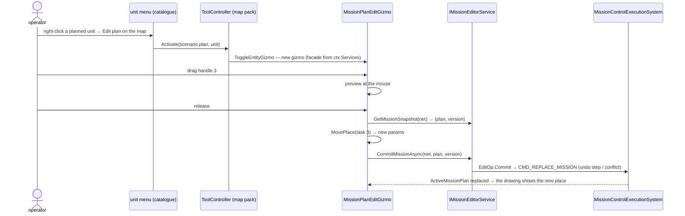

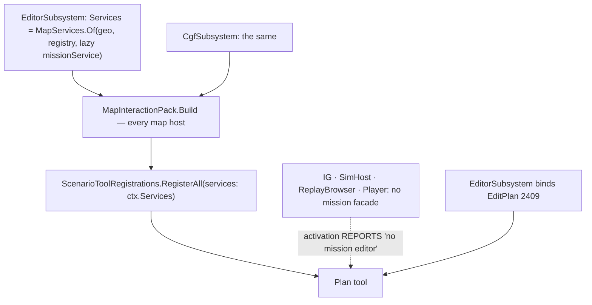
*Who reaches it: every host registers the tool (the no-whitelist ruling); the editor and CGF hold the facade (built AFTER the map — hence
the lazy `Func<object?>` entry); the menu action is bound by the editor (CGF shows it greyed — not bound there, like Edit Route).*

| decision | why |
|---|---|
| a handle only on a task whose first place is a POINT (`PointLink`) | an entity target is where the entity is; an area is reshaped by its own editor |
| the drag writes coordinates (a named point's binding is replaced), the field's own height kept | a drag is a place on the map, not a reference |
| the whole plan committed at the snapshot's version | P-7 7c: one undo step in Edit, a CONFLICT in Live when it moved |
| the moved marker stays where it was dropped until the plan value changes or the commit settles | no jump back while the commit is in flight |
| ⚠ deviation from the mockup (*"drag a numbered marker"* with no mode): the drag needs **Edit plan on the map** (the Plan tool), like Edit Route | an always-on handle would win the hit-test over the unit and the map's selection drag (§4.7g.1 — handles beat entity boxes only for an ACTIVE tool) |
| *Add task ▸* not built | the ground menu is still `CanvasMenuUpdateSystem`; the catalogue's `Ground` target is A5 (ui), and a menu click carries no world point yet ⇒ ⛔ a second ground menu would be the duplicate A5 removes |

Rails: `MenuOrdersTests.P8d2_EditPlanOnTheMap_IsOfferedOnAPlannedUnit_AndArmsThePlanTool` (offered only with a plan; a host with no facade
REPORTS; with one the tool arms — red-proved by the pack not forwarding `ctx.Services`) · `MenuOrdersTests.P8d2_DraggingATasksMarker_MovesItsPlace_AndCommitsThePlan`
(handles on the point tasks only, at the markers; the drag rewrites task 3's `Location`, task 1 untouched, the snapshot's version sent; the Hold
has no handle; right-click ends it) · `MissionPlanOverlayFrameRail.P8d_ThePlanOnARealMapFrame` (+ `mission-plan-drag.png` — the dragged marker
amber where the mouse is).
