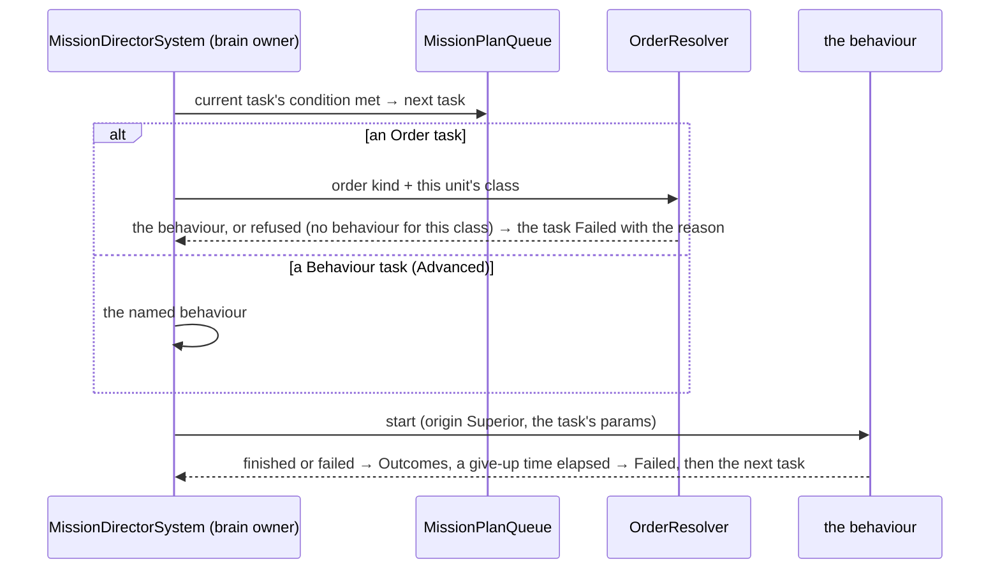

<!--STATUS
state: LIVE
build-state: DESIGN — top-level; ✅ Q1, Q2, Q5, Q6, Q7 approved and Q3, Q4 revised by the user 2026-11-06 (R-4129); the building lanes detail it (R-4123)
updated: 2026-11-06 (Q3 expert conditions + the rule editor one click from a task; Q4 phases begin on events, time only a no-later-than — R-4129) · 2026-11-06 (first version — coordinator; editing-UX design queue item 3: E11 / D18)
current-answer: §2 the target (wireframe + model) · §3 stages · §4 questions with leans
stale-below: nothing
known-rot: none
known-conflict: the code calls a plan's task slot a "phase" (MissionPlanQueue.Phases); this design uses "phase" for the MILITARY phase of an operation (§2.4) — Q6 renames the code's word
related-designs:
  - DESIGN_Editing_UX.md — the programme: D18 (the mission plan editor, unit-agnostic orders first), E11, the Orders tab (§3.3)
  - DESIGN_Edit_Framework.md — a plan edit is a Commit with a version precondition (Conflict → Reload / Overwrite); stage F6
  - DESIGN_Action_Catalogue.md — "Add task ▸" on the map and the order items are declared actions
  - ../DESIGN_Orders_Params_Entity_Classes.md — OWNS the order kinds (Order.<Kind>), their DTOs, resolution by the receiver's class (R-273), OrderMenu.OfferedFor
  - ../DESIGN_Entity_Control.md — OWNS immediate orders from the map (OrderForm, RTS, the wheel)
  - ../DESIGN_Scenario_Rules.md — OWNS triggers and objectives; SR-90 (the mission plan stays the end-user surface), the rejected U5 (plan as a shared step engine)
  - ../DESIGN_Director_Timeline_Editor.md — OWNS the Timeline; its "Tasks" group (TL-5, R-4076) is this editor's overview
  - ../UX/Architect_Question_29_Entity_Commanding.md — §H a group is ordered through its commander; §0 append / insert are dead
-->

# DESIGN — the mission plan editor: a unit's plan as orders, on the map, the same in Edit and Live

## 0. Why

🔒 User, `2026-11-06`: *"There is a mission plan editor existing now, but in ugly and development/debug only version for now. it needs
redesigning, for some users this is the most used tool to define the content of scenario on top of plain placement of entities. Should be
practical and nice looking and intuitive. And should work in both edit/live, as everything else. not sure how to integrate order into that,
i think it is very relevant to specify unit-agnostic orders there primarily before specialized behaviors."* (D18)

## 1. INVENTORY *(2026-11-06)*

Queries: `search_graph` Class `.*Mission.*` (113), `.*Order.*` (107), `.*(Play|Maneuver)$` (37), `.*Formation.*` (22); grep for the rest.
Prior art: Arma 3 Eden — typed waypoints per group (Move, Seek and Destroy, Hold, Guard, Get in…), released by triggers / synchronisation
([BI wiki](https://community.bistudio.com/wiki/Eden_Editor:_Waypoint)); Command: Modern Operations — missions (patrol, strike…) on areas,
units assigned ([Matrix](https://command.matrixgames.com/?p=3653)); DCS — waypoints with actions; military practice — phases, phase lines,
a synchronisation matrix.

| what exists | measured |
|---|---|
| **the plan** | `ActiveMissionPlan` (managed record, saved + recorded: tasks = behaviour name + params JSON + ONE trigger) and `MissionPlanQueue` (unmanaged, runs it: `Phases[8]`, current, outcomes Done / Failed, `Halted`, `Version`) — `DomainMissionPlan.cs:22-55`, `MissionComponents.cs:139-178`. ⚠ max **8** tasks, a longer plan is cut with a warning |
| **advance triggers** | five: `TimerElapsed`, `BehaviorFinished`, `UnderAttack`, `HealthCritical`, `ReachedDestination` (obsolete = BehaviorFinished); exactly one per task; ⛔ none can name another unit (`MissionTriggerHelper.cs:15-49`) |
| **running it** | `MissionControlExecutionSystem` (replace with a version check; jump; abort; append / insert DEAD) → `MissionDirectorSystem` advances (origin Superior) → CGF `MissionAdapterSystem` → the intent path; an immediate order with `ClearsPriorIntent` DISCARDS the plan (rulings 50, 52); a loaded scenario restarts every plan at task 0 |
| **orders** | five kinds — Move, Attack, Hold, Strike, ObserveFire — each a unit-agnostic DTO resolved BY THE RECEIVER'S CLASS (`OrderResolver`, R-273); `OrderMenu.OfferedFor(dis)` offers only what the class can do. ⚠ **No editor puts an order into a plan**, and a task named `Order.Move` would resolve to behaviour id 0 (`MissionControlExecutionSystem.cs:~347-366`) — latent |
| **groups** | a plan goes on a commander (a body-less unit entity); a squad / platoon is ordered through its commander (AQ29 §H); drills are behaviours of the commander |
| **editing today** | `MissionPanel` (761 lines) — behaviour names not order kinds, the obsolete trigger offered, a raw-text trigger parameter, "+ Add Trigger" though only one is allowed, Force Commit, one unit at a time, nothing on the map; a second instance in the Details tab on a different selection model; HTTP `add_mission_task` rewrites the whole plan |
| **across units** | only scenario rules: a trigger's *when* → `MissionCommand` jumps another unit's plan (SR-90). No phases, phase lines or timing; U5 ("the plan as a shared step engine") REJECTED in Scenario Rules |

## 2. The target

### 2.1 What the user sees

*What the picture shows that prose hid: the plan is drawn ON the map (numbered task markers, the route, the objective, the phase line) and
listed in the Orders tab as plain sentences — "Move to grid 3412, then when there"; the Timeline's Tasks group lines up every unit's tasks
by phase — the synchronisation matrix without a new window.*

| | rule |
|---|---|
| **a task is an ORDER first** | *+ Add task* offers the order kinds THIS unit's class can carry out (`OrderMenu.OfferedFor`): Move, Hold, Attack, Defend, Recon … each with its form (the order DTO, map picks for places and targets). *Advanced: run a specific behaviour…* stays for the technical author |
| **edited on the map** | selecting a unit draws its plan; right-click on the ground → *Add task ▸ Move here · Hold here · Attack…*; drag a numbered marker to move that task's place; the list and the map are one model |
| **"then" in plain words** | *when there · when done · after 5 min · when under fire · when strength below 50 % · when Phase 2 begins · when Bravo 1-2 finishes task 3* — each a picker, never typed text; plus an optional *give up after …* |
| ⭐ **"then" for experts** *(user, `2026-11-06`)* | **Advanced condition…** opens the predicate editor (the ONE condition model, R-4077 — the same one the rules use); **When a rule fires…** picks a rule, or **New rule…** opens the rule editor (built: Rules View §7, RE-1…RE-10) prefilled with this unit as the subject, and links back to the task. ⭐ ONE evaluator: a task's expert condition is held by a rule the task owns (the rules runner evaluates it and releases the task) — the plan's director only waits for the release |
| **one plan per unit, groups through the commander** | as ruled (AQ29 §H); selecting a platoon shows its commander's plan |
| **the same in Edit and Live** | Edit changes the authored plan (undoable, D1); Live sends a Commit to the brain's owner (the edit framework: Conflict → Reload / Overwrite); Live adds *Jump to task* and *Stop plan*, and shows progress (✓ done · ▶ now · planned) |
| **immediate orders in Live** | a map order still REPLACES the plan (rulings 50, 52) — the menu item says so (*Move here — replaces the plan*); a second item *Add to the plan* appends instead |

### 2.2 The model — what changes

```mermaid
classDiagram
  direction LR
  class ActiveMissionPlan { <<existing, saved + recorded>> Tasks }
  class PlanTask {
    <<existing DomainMissionTask, extended>>
    Kind : Order|Behaviour  NEW
    Order : order kind + DTO  NEW
    BehaviorName + Params : existing (Advanced)
    Then : AdvanceCondition  (was one trigger)
    GiveUpAfter : duration  NEW
  }
  class AdvanceCondition {
    <<existing 4 + NEW>>
    WhenDone · After · UnderFire · StrengthBelow
    PhaseBegins(phase)  NEW
    UnitFinishedTask(unit, n)  NEW
    RuleFired(rule)  NEW
  }
  class OperationPhase {
    <<NEW, scenario-level>>
    Name · Order
    Begins : on a condition (a rule) | by the instructor | no later than H+mm
  }
  class MissionPlanQueue { <<existing, runs it>> Tasks[16] NEW size · Current · Outcomes · Version }
  class OrderResolver { <<existing>> order kind + unit class → behaviour }
  class MissionDirectorSystem { <<existing>> advances; evaluates AdvanceCondition }
  ActiveMissionPlan "1" o-- "*" PlanTask
  PlanTask --> AdvanceCondition
  AdvanceCondition ..> OperationPhase : PhaseBegins
  MissionPlanQueue <.. ActiveMissionPlan : built from
  MissionDirectorSystem --> MissionPlanQueue
  MissionDirectorSystem ..> OrderResolver : an Order task, at its start
```

*What it shows: nothing is rebuilt — the plan, the queue and the director stay; a task gains an ORDER form resolved by the existing
resolver when the task starts (fixing the latent id-0), conditions gain three kinds that look at OTHER things (a phase, another unit's
progress, the clock), and phases are a new, small scenario-level list.* ⚠ U5 stays rejected: phases are not a step engine — they are named
moments that tasks wait for.

### 2.3 A task starting

*What it shows: an order in a plan resolves at the moment the task STARTS, on the brain's owner, by the same resolver as an immediate
order — so the plan stays unit-agnostic and a re-classed unit still works.*

### 2.4 Phases and timing across units

| | rule |
|---|---|
| **an operation phase** | a named moment in the scenario — *Phase 1 Approach, Phase 2 Assault* — that begins ⭐ **on an event first** (*"time is simple but often unpredictable, time-anchoring is simple but many times wrong"* — user): a condition (*OBJ BLUE taken · all of 1st Platoon across PL RED · Bravo reports ready*) evaluated by the rules, or **by the instructor** (Live: *Begin Phase 2*); a time is only an optional **no later than** (H+mm) safety net, never the default |
| **tasks wait for it** | *then: when Phase 2 begins* — the director checks the phase list (replicated scenario state) |
| **another unit's progress** | *when Bravo 1-2 finishes task 3* — reads that unit's replicated progress (`MissionPlanQueue` outcomes are already re-sent on change, CE-483 W2) |
| **H-hour** | the scenario's start time (the scenario clock) is H; a time appears only as a phase's *no later than* and as *after N min* inside one task — ⛔ never as the way a plan is synchronised |
| **the overview** | the Timeline's *Tasks* group (designed, TL-5): one lane per unit, its tasks as bars, phases as columns — the synchronisation matrix |
| **phase lines** | a phase line is a map graphic (a route-like line); a condition *when across PL RED* is a later addition |

## 3. Stages *(top level; ui owns the editor, behaviors / backend the plan engine)*

| stage | what | lane |
|---|---|---|
| **M1** | Order tasks: `PlanTask.Kind = Order`, the order DTO in the task, resolved at task start (fixes the latent id-0); the editor offers order kinds first | behaviors + ui |
| **M2** | the Orders tab rebuilt from shared form rows: plain-sentence tasks, condition pickers, *give up after*, progress, Jump / Stop; the obsolete trigger and "+ Add Trigger" go; the Mission window and the second panel instance go (one surface, the Details tab) | ui |
| **M3** | the plan on the map: markers, route, drag, right-click *Add task ▸* (declared actions, Action Catalogue) | ui |
| **M4** | Live: Commit through the edit framework (Conflict → Reload / Overwrite, F6); *Add to the plan* beside the replacing order | ui + backend |
| **M5** | conditions across units: `UnitFinishedTask`; `RuleFired` + *Advanced condition* (a task-owned rule evaluated by the rules runner); *New rule…* from the task; queue size 16 | behaviors + ui |
| **M6** | operation phases (scenario list, begun on a condition or by the instructor, an optional no-later-than) + `PhaseBegins` + the Timeline's Tasks group as the matrix | behaviors + ui |

## 4. Questions — ✅ approved; Q3 and Q4 as revised by the user *(🔒 `2026-11-06`: "others ok")*

| # | question | ⭐ lean | rejected |
|---|---|---|---|
| **Q1** | what a task is | **an order first** (the kinds this unit's class can do), a specific behaviour as *Advanced* | behaviours first — only a technical author knows them |
| **Q2** | where it is edited | **the Orders tab in Details + the map** (one model); the Mission window and the second panel instance go | a separate plan window — R-4118 |
| **Q3** | the advance condition | ✏ **revised by the user:** plain-language conditions by default (+ an optional give-up time) **and** an expert path — *Advanced condition…* (the predicate editor) and *When a rule fires… / New rule…* (the built rule editor, one click from the task); one evaluator — the rules runner — through a task-owned rule | the director evaluating predicates itself — a second evaluator (R-4077) |
| **Q4** | phases | ✏ **revised by the user:** named scenario-level moments begun **on an event (a condition / rule) or by the instructor** — a time only as an optional *no later than*; the Timeline's Tasks group is the matrix; ⛔ not a step engine (U5 stays rejected) | time-anchored phases — *"simple but many times wrong"* |
| **Q5** | the plan length | **16 tasks** (the unmanaged queue doubles; still allocation-free) | unlimited — a managed list per frame; 8 — too short for a real plan |
| **Q6** | vocabulary | user words: **plan · task · order · phase**; ⭐ rename the code's `MissionPlanQueue.Phases` → `Tasks` (a Roslyn rename) so "phase" means the military phase only | keep the code's "phase" for task slots — two meanings of one word |
| **Q7** | an immediate order in Live | **still replaces the plan** (rulings 50, 52), the menu says so, and *Add to the plan* is offered beside it | silently replacing |
