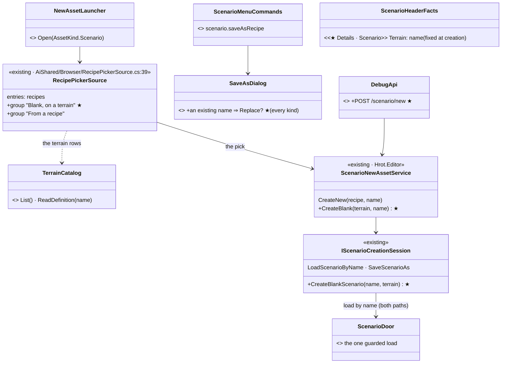
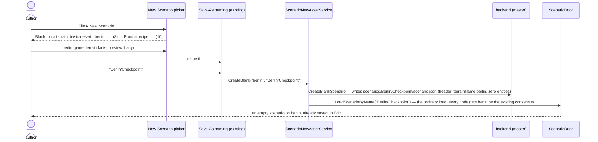
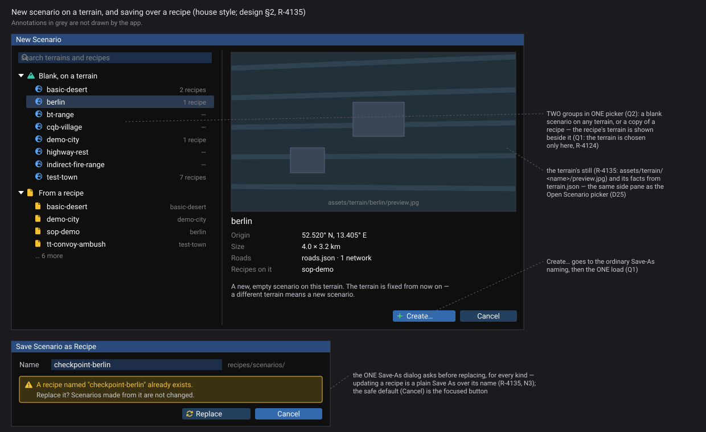
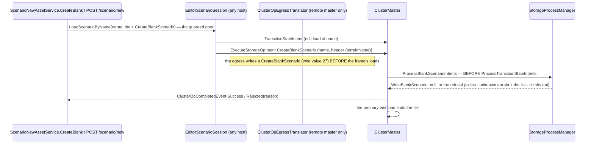

<!--STATUS
state: LIVE
build-state: DESIGN — top-level, ✅ APPROVED by the user 2026-11-06 with Q4 revised and Q5 yes (R-4135); the building lanes (ui for the picker, backend for the blank create) detail it (R-4123)
updated: 2026-11-06 (✅ approved — R-4135: Q4 revised = updating a recipe is a plain Save As over its name, the ONE Save-As dialog offers Replace for every kind; Q5 = terrain thumbnails in git) · 2026-11-06 (first version — coordinator; editing-UX design queue item 7: E12 / D19)
current-answer: §2 the model · §3 stages · §4 questions with leans
stale-below: nothing
known-rot: none
known-conflict: none — ScenarioNewAssetService's H3 remark was revised with N2 (2026-11-07, §3.1)
related-designs:
  - DESIGN_UI_Conventions.md — the tree in §2.5's mockup is the model the user chose for every tree (chevron · icon · label)
  - DESIGN_Details_Forms.md — E2: the Scenario form shows the terrain read-only
  - DESIGN_Editing_UX.md — the programme: D19 (the terrain is chosen at creation, never changed — R-4124), §1.4 row 13
  - ../blueprints/Architect_Question_108_Run_Mode_Picker.md — OWNS the File menu (§2.15), New from a recipe (§2.17, CE-4140), Save Scenario as Recipe (§2.15b B2c), the wide picker and its side pane (D25, §2.18) and the scenario door every load goes through
  - ../DESIGN_Terrain_World.md — OWNS TerrainCatalog (W12) and "save stamps the resident terrain" (W14); its §7.3 picker (W13) is SUPERSEDED and stays so — this design picks a terrain only for a NEW scenario
  - ../designs/main-toolbar-1/DESIGN.md — §10 the one asset browser the New picker is a source of
  - ../DESIGN_Add_Entity_Picker.md — §2j the scenario preview.jpg (R-4117), shown in the picker pane
  - DESIGN_Seats_And_Hats.md — New Scenario is the Author seat's
-->

# DESIGN — a new scenario on a terrain, and authoring recipes

## 0. Why, and what the user asked

🔒 *"we need a way how to author new scenario recipes, but we never want to allow changing a terrain (this was the reason for removing the
picker) - but we still need it for creating new scenario (or its recipe) - so maybe new scenario creation needs a bit different workflow"*
(user, `2026-11-06`, R-4124).

Today a new scenario can only start from a recipe, so it can only be on a terrain some recipe already uses. Four of the eight terrains
(`bt-range`, `cqb-village`, `highway-rest`, `indirect-fire-range`) have no recipe, so no scenario can be started on them.

## 1. INVENTORY *(2026-11-06)*

Queries run:

- `search_graph ".*Terrain(Catalog|Registry|List|Picker|Source|Library|Index|Discovery|Root|Names|Store).*" Class`: **6**. Only `TerrainCatalog` is live; `TerrainPickerLauncher` (+ tests) is a stale graph entry, since the file is deleted (`ls`: absent).
- `search_graph ".*(Recipe|NewAsset|NewScenario|ScenarioNew).*" Class`: **33**.
- grep for `TerrainCatalog`, `saveAsRecipe`, `/scenario/new`, `IScenarioCreationSession`.
- `ls assets/terrain` (8) and `recipes/scenarios` (10).

Coverage could not be checked (the CLI has no `check_index_coverage`).

| what exists | where | for this design |
|---|---|---|
| **New Scenario = New from a recipe** — `NewAssetLauncher` + `RecipePickerSource` (one picker), then the host's Save-As naming, then `ScenarioNewAssetService.CreateNew`: load the recipe by name, `SaveScenarioAs(<name>)` | AQ108 §2.17; `Hrot.Editor/ScenarioNewAssetService.cs` | ⭐ the flow to extend. Its class comment (H3) says no blank exists **because a blank cannot acquire a terrain** |
| **the terrain list** — `TerrainCatalog.List()`: every folder holding a `terrain.json`, over node staging → NAS → shipped | `Fdp.Toolkits/Terrain/TerrainCatalog.cs:94` | ⭐ its doc still says *"what the editor's terrain picker lists"*; since the picker was deleted it has **no caller** |
| **a header-only scenario loads** — `recipes/scenarios/basic-desert` is exactly that (header, terrain, zero entities) and is today's "empty" start | `recipes/scenarios/basic-desert/scenario.json` | ⭐ proof that a blank needs nothing new on the load side |
| **Save Scenario as Recipe…** — `scenario.saveAsRecipe` = a full save under `recipes/scenarios/<name>`, which New lists live; never overwrites (*name (2)*) | AQ108 §2.15b B2c; `ScenarioMenuCommands.cs:63,258` | ⭐ recipe authoring is ALREADY built — what is missing is starting on a terrain no recipe has, and updating a recipe |
| **the picker pane** — D25's wide picker shows `preview`, `header.description`, `terrainName`, entity count | AQ108 §2.18 (`ScenarioPaneFacts`) | ⭐ the same pane describes a terrain row |
| **the terrain is stamped at save from the RESIDENT terrain** | Terrain World W14 | ⭐ so a scenario's terrain can only come from what was loaded — which is why the picker's removal fixed "changing a terrain" |
| **hosts** — CGF and the Orchestrator host pass `openNewScenario: null` ⇒ *New Scenario* greyed with a reason | AQ108 §2.17 | unchanged |
| **HTTP** — no `/scenario/new` route | grep, 0 hits | the AI debug API cannot create a scenario |

### 1.1 Claim table

| claim | code | design basis |
|---|---|---|
| nothing changes a terrain after creation, and this design keeps it so | ✅ W14 (stamp from resident), the picker deleted (AQ108 §2.15 row 7) | ✅ R-3073, R-4124 |
| a blank needs only a header-only file with the terrain named | ✅ `basic-desert` loads with zero entities (its own judge text) | ✅ AQ108 §2.17 (a recipe is loaded by name, the new scenario saved under the typed name) |
| the terrain list exists | ✅ `TerrainCatalog.List()` | ✅ W12 |
| where the master writes a new scenario folder | ⛔ **not measured** — the blank's file must be written where the load resolves names (in the editor's all-in-one, one process). Stage N2's first step | AQ108 §2.17: *"resolved by the master"* |

## 2. The model

### 2.1 The picture

*What the picture shows that the prose hid:* a blank and a recipe end in the **same door**. The blank only differs in what file exists
before the load: a header naming the terrain instead of a copied recipe. There is no terrain picker on a loaded scenario, no second
load path, and no second picker window.

### 2.2 New Scenario, blank on a terrain

*What the picture shows that the prose hid:* the scenario exists on disk before it loads. The existing save stamp (W14) and the terrain
consensus never meet a terrain that did not come from a load.

### 2.3 Recipes — authored as scenarios

| need | how | built? |
|---|---|---|
| a new recipe on any terrain | New ▸ Blank, on a terrain → author it → **File ▸ Save Scenario as Recipe…** | the second half is built (B2c) |
| a new recipe from another recipe | New ▸ From a recipe → change it → Save Scenario as Recipe… | built |
| **update an existing recipe** | ✏ **user, `2026-11-06`:** *"Isn't updating a recipe always just saving the currently loaded asset under a given name, which could be the recipe folders and a recipe name? Do we need update recipe, menu item, or option at all?"* ⇒ **no recipe-specific option**: Save Scenario as Recipe… (or Save As… into the recipes folder) under the existing name. 📐 Today the ONE Save-As dialog **refuses** an existing name (`SaveAsDialog.cs:187`) and the recipe save forks *name (2)* ⇒ ★ the dialog offers **Replace?** (one confirmation) for **every kind**, not only recipes | ★ the Replace confirmation in the one dialog |
| the recipe's terrain | always the scenario's, which was fixed at creation | built (W14) |

⛔ No separate *New Recipe…* item. A recipe is a scenario saved into the recipes folder. A second creation flow for the same content
would be a duplicate (R-174).

### 2.4 The terrain is shown, never editable

| where | what |
|---|---|
| the scenario's Details (header facts) | *Terrain: berlin* — read-only, tooltip *"chosen when the scenario was created; a different terrain means a new scenario"* |
| the Open / New picker pane | the terrain name (built, `ScenarioPaneFacts`) |
| the window title | *Checkpoint — berlin* |

### 2.5 The graphical design *(R-4143 — the acceptance spec)*

*What the picture shows that the prose hid:* the terrain is chosen in exactly one place, the New Scenario picker, and the picker already shows which recipes use each terrain, so a blank start and a recipe start sit side by side. Generated by `scripts/gen-new-scenario-mockup.py`.

## 3. Stages

| stage | what | owner | rails |
|---|---|---|---|
| **N1** | the New picker gains the group *Blank, on a terrain* from `TerrainCatalog.List()`; the pane shows the terrain's facts (name, origin, road networks from `terrain.json`) | ui | the picker lists all 8 terrains and the 10 recipes, live (a terrain folder added appears on the next open) |
| **N2** | `CreateBlankScenario(name, terrain)`: ① **measure where the master writes a new scenario folder**; ② write the header-only file; ③ the ordinary load by name. `ScenarioNewAssetService`'s H3 comment updated | backend | a blank on `highway-rest` loads with zero entities, saves, and reopens on `highway-rest`; an unknown terrain name is refused with the reason |
| **N3** | the ONE `SaveAsDialog`: an existing name ⇒ *Replace?* (one confirmation) for every kind; the recipe save stops forking *name (2)* | ui | a scenario, a BTree and a recipe each replaced after one confirmation; a new name never asks |
| **N4** | the terrain read-only in Details and the title | ui | — |
| **N5** | `POST /scenario/new {name, recipe | terrain}` on the same service | backend | the AI debug API creates both kinds |
| **N6** | terrain thumbnails: `assets/terrain/<name>/preview.jpg` (small JPEG, like the scenario stills, R-4135 extends R-4117), captured by `scripts/thumbnails.py`; the New picker's terrain rows show it | ui | every terrain folder has its still; the pane shows it |

### 3.1 ⭐ AS-BUILT — N2 and N5 *(backend, `2026-11-07`, B-8)*

**① Measured — where the master writes a scenario folder:** `StorageProcessManager` (Hrot.Orchestrator, master only) merges every save into
`ContentLayout.ResolveScenarioDirectory(nasBasePath, name)/scenario.json` (`MergeScenarioSlices`), and every load resolves the name through the
same resolver. ⇒ the blank is written there, by the master, through the storage-op door a save uses.

*What the picture shows that the prose hid:* the create and the load go out in ONE frame and in either publication order; the master's bus is
read without consuming, so a pre-pass runs the create before the loads by construction — no waiting on the create's answer in the editor.

| piece | as built |
|---|---|
| the op | `StorageOpType.CreateBlankScenario` · `ClusterOpType.CreateBlankScenario = 27` in BOTH enums (R-42) · payload `SaveScenarioRequestJson` (name + header `{terrainName}`) |
| the writer | `StorageProcessManager.WriteBlankScenario(name, terrain)` — the `basic-desert` shape (`$meta`, header `subsystemType`/`schemaVersion`/`terrainName`, `entities: []`); the terrain must be in `TerrainCatalog.ForNode(null, nas)` (the catalog the master reads a load's origin from); never overwrites. Wired by `OrchestratorCore` (`ClusterMaster.BlankScenarioWriter`, like `ExerciseDeleter`) |
| the editor | `ScenarioNewAssetService.CreateBlank(terrain, name, relPath)` — the open goes through the guarded door; ⛔ a cancelled open creates nothing. H3's comment revised (no blank RECIPE still). The picker (N1, B-9) calls it |
| N5 | `POST /scenario/new {name, terrain}` sends the create, waits for its answer (409 with the master's reason), then the ordinary edit load; `{name, recipe}` is the New-Asset path (`POST /assets {kind: Scenario}`) — one creator each |
| ⚠ deviation | the classDiagram's `IScenarioCreationSession.CreateBlankScenario` exists, but ⛔ there is no `CreateBlankScenario(name, terrain)` that LOADS: create and load are two calls joined by the door's `then`, so the door's guard (unsaved edits, a run) runs before anything is written |

| N1 (B-9) | `NewAssetLauncher` (the ONE picker, CE-4140) gains the terrains (`TerrainCatalog.ForNode(null, the shared NAS root).List()`, LIVE per open — the catalog the master's create checks) and `showNewBlankDialog`: *File ▸ New Scenario…* lists `Blank, on a terrain` (rows tagged `BlankTerrainChoice`) above `From a recipe`; a terrain's pick → the editor's `ShowNewBlankDialog` (the same Save-As naming) → `ScenarioNewAssetService.CreateBlank`. The general *New Asset* picker has no terrain rows. ⏭ the pane's terrain facts (origin, size, roads, recipes on it) and the still (N6) |

Rails: `ClusterMasterNewScenarioTests` (order in one frame, refusals, the wire op, the file), `ScenarioNewBlankTests`, `NewAssetLauncherTests.N1_*`.

## 4. Questions — ✅ APPROVED (R-4135; Q4 revised, Q5 yes; user `2026-11-06`: *"otherwise accepted"*)

| # | question | lean | rejected |
|---|---|---|---|
| **Q1** | how a blank gets its terrain | **the backend writes a header-only `scenario.json` naming the terrain, then the ordinary load** — one load path, every node gets the terrain by the existing consensus | load the terrain into the open world and save (the old W13 picker): a terrain change outside a load, which is what R-3073 removed |
| **Q2** | one picker or two | **one New Scenario picker with two groups**: *Blank, on a terrain* and *From a recipe* | a separate New on Terrain item: a second entry point for one action |
| **Q3** | a New Recipe item | **none**: a recipe is a scenario saved with *Save Scenario as Recipe…* | its own creation flow: duplicates New Scenario |
| **Q4** | updating a recipe | ✏ **REVISED by the user:** a plain Save As over the recipe's name — the one Save-As dialog offers *Replace?* for every kind | a recipe-specific *Replace recipe* option — unnecessary (user) · never overwrite (today) — every edit forks *name (2)* |
| **Q5** | terrain previews in the picker | ✅ **yes** (user: *"Terrain thumbnails is for sure another good and desired exception from the no pictures in Git rule"*) — `assets/terrain/<name>/preview.jpg`, small JPEG, by the thumbnail script (N6) | text only |
| **Q6** | the HTTP route | **yes, `POST /scenario/new`**, through the same service, so the AI debug API can create both kinds | none: tests and agents could not create a scenario |
