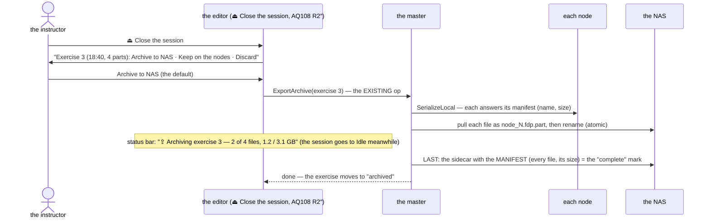
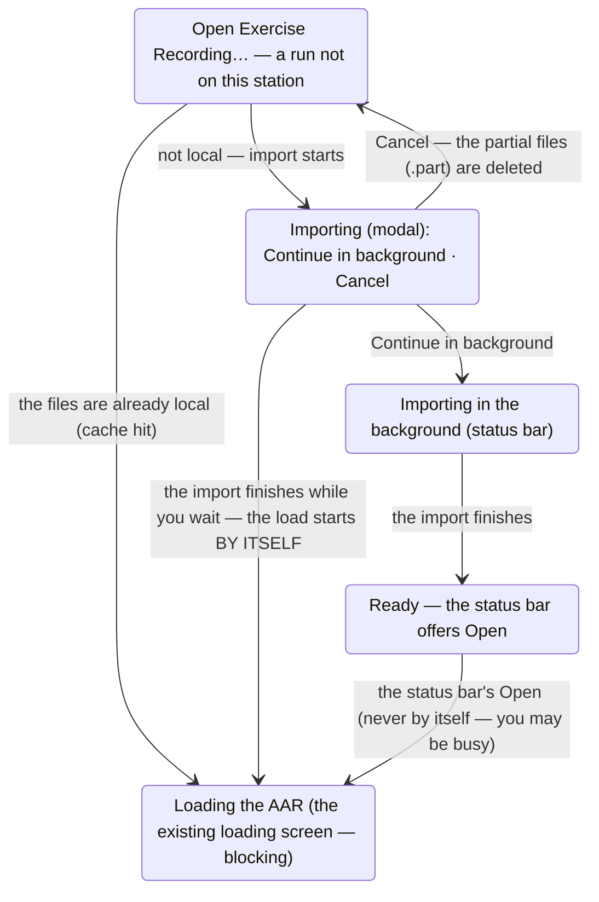

<!--STATUS
state: LIVE
build-state: READY-TO-BUILD — Q1–Q4 answered by the user (R-4171, 2026-11-08); §5 opening an archived run = always IMPORT
updated: 2026-11-08 (first version — the user: "I think we might be missing some recording collection step at the end of the live exercise")
current-answer: §1 measured · §2 the gaps · §3 the proposal (P5 where you resume) · §4 decisions · ⭐ §5 opening from the NAS — always import · §5a wait or background · §6 the local cache
stale-below: nothing
known-rot: none
known-conflict: none
related-designs:
  - ../designs/mgmt-1/DESIGN.md — OWNS the archive export / import (§13, the storage gateway pattern, ExportArchive = 6, ImportArchive = 7)
  - ../blueprints/Architect_Question_108_Run_Mode_Picker.md — §0 R2″ (Live ends in two steps — ⏏ Close the session asks here), D15 (discard), CE-4100 (ask to keep recordings)
  - DESIGN_Scenario_Lifecycle_Review.md — LC-19 (the recording picker), LC-21 (recordings out of TEMP)
  - DESIGN_Review_Perspective.md — a participant group opens merged: it needs every node's file in ONE place
  - ../DESIGN_Distributed_Scenario_Persistence.md — the same pull pattern for scenario saves
-->

# DESIGN — collecting a live exercise's recordings: archive, keep or discard at the end

## 0. Why

🔒 User, `2026-11-08`: *"Could you please check how the recording files, once they are produced by the nodes, how they get transferred to a shared
NAS location? … I think we might be missing some recording collection step at the end of the live exercise … sometimes the exercise is recorded just
to be sure, but at the end the instructor decides that there is no point in keeping those recordings … we should start some background operation
across the cluster that copies the recordings produced on the NAS, and making sure that this operation is shown somehow, maybe in the status bar, so
the user doesn't accidentally close the whole application … If that happens, how do we find out that on the NAS there is inconsistent state?"*

## 1. Measured *(`2026-11-08`, grep + read)*

| fact | where |
|---|---|
| each node records its OWN `.fdp` into its staging: `{root}/nodes/node-N/exercises/<id>/` | `OrchestrationConstants.cs:13, 37` |
| the master keeps an **UNARCHIVED ledger** of every live run (memory + a ledger file), created on each `OperatingLive` entry | `AssetInventoryProcessManager.cs` (`_unarchivedLedger`; AQ108 :1676) |
| **archiving EXISTS**: `ExportArchive` — the master fans out `SerializeLocal`, each node answers with its file manifest (`ReferenceArchiveHandler`), the master PULLS the files over SMB to `{NAS}/exercises/<id>/node_N.fdp` (`StorageGatewayModule.PullToNasAsync`), then writes the sidecar (`Orchestrator.json`) and the scenario copy and drops the ledger entry | `ReferenceArchiveHandler.cs:24-31` · `StorageProcessManager.cs:110-160` · `AssetInventoryProcessManager.cs:163-178` · mgmt-1 §13 |
| ⛔ **nothing triggers it at the end of a run** — only the orchestrator panel's *Export to NAS ▶* (`ClusterScenarioPanel.cs:1042`) and HTTP (`DebugApiService.Master.cs:441`) | grep `StorageOpType.Export` |
| ⭐ the editor's *Open Exercise Recording…* lists the **UNARCHIVED** exercises (the ledger + the run in progress) — recordings still ON THE NODES, replayed by each node from its own staging; the ARCHIVED ones on the NAS are NOT listed there (replaying them needs `ImportArchive`, which exists — a prefetch NAS → nodes — but the picker does not offer it) | `EditorSubsystem.cs:4213` (`UiCache.AvailableExercises`) · `AssetInventoryProcessManager.cs:181-210` · `StorageProcessManager.cs:71-75` |
| keep / discard exists as an option: *Keep this recording?* when the cluster's *ask to keep recordings* is on (CE-4100); **Discard** deletes the ledger entry, the scenario copy and the exercise's staging directories (`ExerciseRetention.Delete`); **Keep** leaves it unarchived on the nodes | `ClusterTimeTransportAdapter.cs:275` · `AssetInventoryProcessManager.cs:216-232` · `ClusterMaster.RunSettings.cs:171-188` |
| a pull copies each file with `File.Copy` to its FINAL name; a CANCELLED pull deletes its in-flight files; a partial failure answers *Rejected* and KEEPS the ledger entry | `StorageGatewayModule.cs:201-245` · `StorageProcessManager.cs:150-160` |
| ⚠ the NAS scan counts a folder as **ARCHIVED when it holds ANY `.fdp`** (the sidecar optional) | `StorageGatewayModule.ScanNasExercises`, `:794-805` |
| ⚠ the "unarchived" list = the ledger MINUS the archived ids | `AssetInventoryProcessManager.cs:192-194` |
| the archive's progress is visible only as the orchestrator panel's op state; nothing guards closing the app during a pull | — |

## 2. The gaps

| # | gap | consequence |
|---|---|---|
| **G1** | no collection step at the end of a run — an archive happens only if someone presses *Export to NAS* in the orchestrator panel | recordings pile up on the nodes; a node machine cleaned or replaced takes its part with it |
| **G2** | archived exercises are not in the editor's picker | an archived run cannot be reopened from the editor; and the all-in-one editor / Replay Browser can open a participant GROUP only when every node's file is reachable — which is what the NAS is for |
| **G3** | ⚠ **a half-copied exercise looks ARCHIVED**: one `.fdp` on the NAS is enough for the scan, and then the exercise disappears from the "unarchived" list — so it can no longer be exported again from the UI | an interrupted archive silently loses the re-try |
| **G4** | a process that DIES mid-copy (the app closed, a crash) leaves a truncated `.fdp` under its final name; only a CANCEL cleans up | a corrupt file that looks whole |
| **G5** | no progress, no close guard | the user closes the app mid-copy (the user's case) |
| **G6** | keep / discard is an optional question at ■, and *Keep* means "on the nodes" — there is no "archive" answer | the decision the instructor actually makes (archive or throw away) has no button |

## 3. The proposal

*What it shows: the collection is the EXISTING `ExportArchive`, triggered by the instructor's answer at the end; completeness is a manifest
written LAST, so anything without it is visibly incomplete.*

| # | ⭐ proposal | fixes |
|---|---|---|
| **P1** | **the end asks about the recording**: ⏏ *Close the live session?* (AQ108 R2″) becomes *"Close the session — Exercise 3 (18:40, 4 parts): **Archive to NAS** · Keep on the nodes · Discard"*; it replaces the optional *Keep this recording?* | G1, G6 |
| **P2** | **the archive runs in the background on the master** (the existing op); the **status bar** shows it — *"⇪ Archiving exercise 3 — 2 of 4 files, 1.2 / 3.1 GB"*, a click opens the details; the session may go to Idle meanwhile (a new briefing can start — the pull reads finished files) | G5 |
| **P3** | **closing the app during an archive asks**: *"Exercise 3 is still being archived (2 of 4 files). Wait · Close anyway — the exercise stays on the nodes and the archive resumes next time"* — the editor's existing exit prompt gains this line | G5 |
| **P4** | **complete = a manifest written LAST**: the sidecar lists every file with its size; files land as `*.fdp.part` and are renamed when whole; the NAS scan counts an exercise ARCHIVED only when the manifest is present AND every listed file matches — otherwise it is **INCOMPLETE** | G3, G4 |
| **P5** | **an incomplete archive RESUMES — where** (the user: *"Where can we select the option to continue?"*): ① **by itself** — the master re-tries every incomplete archive whose exercise its ledger still holds, at start-up and whenever the missing node comes back (the files are still on the nodes: they are deleted only after a VERIFIED archive, Q2); ② **the status bar** says it while it waits: *"⚠ Exercise 3 archive incomplete — waiting for node-3 (2 of 4 files)"*, a click opens the details with *Resume now*; ③ **the recording picker's row**: *"⚠ incomplete — 3 of 4 files · Resume archive"*; ④ **the orchestrator panel**'s archive list, the same action. ⭐ It re-runs the SAME pull — it already skips a file of the same size and time | G3 |
| **P6** | **the picker lists both**: *on the nodes* and *archived*; opening an archived one in a cluster runs the EXISTING `ImportArchive` first (a prefetch, with the same status-bar progress); the all-in-one editor and the Replay Browser open the NAS files directly (a participant group, merged — Review perspective) | G2 |

## 4. Decisions — ✅ the user, `2026-11-08` (R-4171)

| # | | |
|---|---|---|
| **Q1** | the default answer at the end | ✅ **Archive to NAS** — 🔒 *"Yes, the default answer is to archive to NAS."* |
| ~~Q2~~ | ~~after a VERIFIED archive, delete the nodes' local copies~~ (🔒 *"once archived securely, we delete the on-the-node recordings"*) | ⛔ SUPERSEDED by Q2′ (R-4172) |
| **Q2′** | the local copies after a verified archive | ✅ **kept as a CACHE: the newest N stay, older ones go — and only an ARCHIVED one is ever removed** (§6) — 🔒 *"Maybe my previous lean to delete the recordings immediately from local storage is not a good idea unless there is not enough space. I think the older recordings might be deleted only, but a few of recent ones, they should stay."* |
| **Q3** | a run not recorded | ✅ no question — 🔒 *"if we are not recording, we cannot ask if we want to archive. So, no question if no recording."* HTTP passes the answer |
| **Q4** | the all-in-one editor | ✅ the same — 🔒 *"the all-in-one editor is no difference. It also copies to NAS."* |

## 5. ⭐ Opening a run from the NAS — ALWAYS IMPORT *(the user's question, measured `2026-11-08`)*

🔒 User: *"how can we open the recordings from the NAS? … direct access … or … importing the recordings from the archive to the local storage …
The direct remote access has one drawback, which is the Windows licensing for file share clients … maybe none of these consideration is actually
valid because when we start the AAR, we might always want to import the files from the NAS"*

| measured | where |
|---|---|
| the platform ALREADY forbids nodes to touch the NAS: a Windows client OS accepts **~20 inbound SMB connections**, so ONE storage gateway (with the master) does every NAS read and write over its own OUTBOUND connection — the *SMB Pull Gateway* pattern | [mgmt-1 §12.4](../designs/mgmt-1/DESIGN.md) (*"~20 on client SKUs causes cascading connection failures"*), `:2371` |
| the import exists: `ImportArchive` → the gateway reads `{NAS}/exercises/<id>/node_N.fdp` and PUSHES each node its own file into its staging (`PrefetchArchiveAsync`) | `StorageGatewayModule.cs:701-725` · `StorageProcessManager.cs:71-75` |

⭐ **Decision (lean, matching the user's last thought): every opener IMPORTS first, never reads the NAS directly.**

| why | |
|---|---|
| the connection limit | nodes never connect to the NAS — a plain Windows PC can be the NAS (no Samba, no server licence needed); only the gateway's ONE connection |
| replay needs fast random access | seeking reads keyframes all over the file — local disk, not a share |
| it already exists | `ImportArchive`; the picker just has to call it (G2) |
| the run stays reviewable if the NAS goes away mid-session | the files are local |

| who opens | the import |
|---|---|
| a cluster's AAR | the gateway pushes each node ITS file (existing) — progress in the status bar (*"⇩ Importing exercise 3 — 2 of 4 files"*), then the AAR starts |
| the all-in-one editor (a participant group) | the gateway (in-process) copies ALL the files to the local staging, then the merged Review opens them |
| the standalone Replay Browser | the same: a local copy, then open |
| ⭐ a run already local and matching the manifest | no copy — the import is skipped |
| the local copy afterwards | a CACHE (§6): the newest stay, so a recent run opens with NO import |

### 5a. ⭐ The import never blocks the station — wait, or let it run in the background *(the user, `2026-11-08`)*

🔒 *"the user is allowed to put this import to the background, and it's indicated on the status bar, or he can decide to wait, and once the files have been imported, then the actual loading happens automatically"*

*What it shows: the long part (the copy) is optional to wait for; the short part (the load) always shows the existing blocking loading screen,
and it starts by itself only when you chose to wait.*

| rule | |
|---|---|
| **the import dialog** | *"Importing exercise 3 from the NAS — 2 of 4 files, 1.2 / 3.1 GB · ~40 s"* · **Continue in background** · **Cancel**; while it shows, the station is NOT frozen — the dialog is the progress, the rest of the UI stays usable (only another AAR open is refused, said) |
| **in the background** | the status bar: *"⇩ Importing exercise 3 — 2 of 4 files"*; when done *"✓ Exercise 3 ready — Open"*; ⛔ never switches mode by itself — the user may be editing |
| **the load** | the EXISTING loading screen (blocking, as today) |
| **closing the app during an import** | the close guard (P3) names it; closing CANCELS the import (no partial file stays: `.part`), nothing on the NAS is touched |

## 6. ⭐ The local cache — the newest stay, never an un-archived one *(R-4172)*

| rule | |
|---|---|
| ⛔ **an UN-archived recording is never removed automatically** | it is the only copy (the operator's Keep / Discard decides) |
| ⭐ **an ARCHIVED recording's local copy is a cache** | the newest **N** stay (default 5 — `FDP_KEEP_EXERCISES` / `--keep-exercises`, the existing `ExerciseRetention`), older ones are removed |
| **space** | when a disk's free space drops below a threshold (default 10 %), the OLDEST archived copies go first until it is above — never an un-archived one |
| **when** | after each archive completes and at start-up (the existing retention pass) |
| **an import** | lands in the same cache — a run opened once stays local while it is among the newest |

⚠ This keeps the platform's rule *"recordings are user data — operator-triggered deletion only"* (`ExerciseRetention.cs:13-16`, file-sync design): what
is removed is always a COPY whose record is on the NAS.

⛔ **Rejected:** direct reads from the NAS share — the ~20-connection limit on a Windows NAS and slow seeking; auto-detecting how many nodes will
connect — unnecessary once nothing but the gateway connects.

---
_coordinator lane, 2026-11-08_
