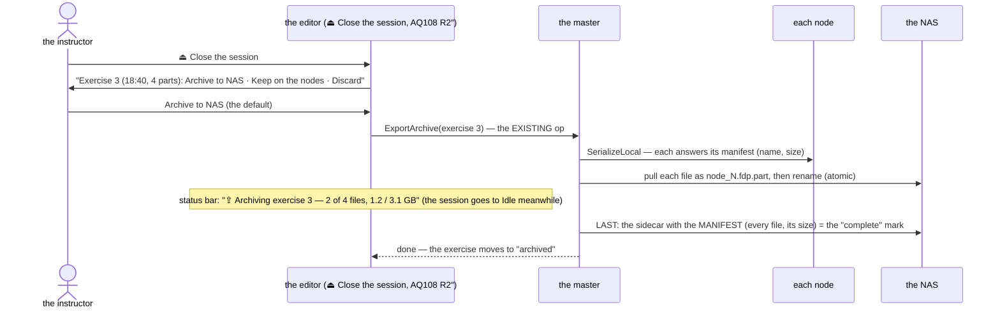

<!--STATUS
state: LIVE
build-state: DESIGN — measured, a proposal for the user (Q1–Q4)
updated: 2026-11-08 (first version — the user: "I think we might be missing some recording collection step at the end of the live exercise")
current-answer: §1 measured · §2 the gaps · §3 the proposal · §4 questions
stale-below: nothing
known-rot: none
known-conflict: none
related-designs:
  - ../designs/mgmt-1/DESIGN.md — OWNS the archive export / import (§13, the storage gateway pattern, ExportArchive = 6, ImportArchive = 7)
  - ../blueprints/Architect_Question_108_Run_Mode_Picker.md — §0 R2″ (Live ends in two steps — ⏏ Close the session asks here), D15 (discard), CE-4100 (ask to keep recordings)
  - DESIGN_Scenario_Lifecycle_Review.md — LC-19 (the recording picker), LC-21 (recordings out of TEMP)
  - DESIGN_Review_Perspective.md — a participant group opens merged: it needs every node's file in ONE place
  - ../DESIGN_Distributed_Scenario_Persistence.md — the same pull pattern for scenario saves
-->

# DESIGN — collecting a live exercise's recordings: archive, keep or discard at the end

## 0. Why

🔒 User, `2026-11-08`: *"Could you please check how the recording files, once they are produced by the nodes, how they get transferred to a shared
NAS location? … I think we might be missing some recording collection step at the end of the live exercise … sometimes the exercise is recorded just
to be sure, but at the end the instructor decides that there is no point in keeping those recordings … we should start some background operation
across the cluster that copies the recordings produced on the NAS, and making sure that this operation is shown somehow, maybe in the status bar, so
the user doesn't accidentally close the whole application … If that happens, how do we find out that on the NAS there is inconsistent state?"*

## 1. Measured *(`2026-11-08`, grep + read)*

| fact | where |
|---|---|
| each node records its OWN `.fdp` into its staging: `{root}/nodes/node-N/exercises/<id>/` | `OrchestrationConstants.cs:13, 37` |
| the master keeps an **UNARCHIVED ledger** of every live run (memory + a ledger file), created on each `OperatingLive` entry | `AssetInventoryProcessManager.cs` (`_unarchivedLedger`; AQ108 :1676) |
| **archiving EXISTS**: `ExportArchive` — the master fans out `SerializeLocal`, each node answers with its file manifest (`ReferenceArchiveHandler`), the master PULLS the files over SMB to `{NAS}/exercises/<id>/node_N.fdp` (`StorageGatewayModule.PullToNasAsync`), then writes the sidecar (`Orchestrator.json`) and the scenario copy and drops the ledger entry | `ReferenceArchiveHandler.cs:24-31` · `StorageProcessManager.cs:110-160` · `AssetInventoryProcessManager.cs:163-178` · mgmt-1 §13 |
| ⛔ **nothing triggers it at the end of a run** — only the orchestrator panel's *Export to NAS ▶* (`ClusterScenarioPanel.cs:1042`) and HTTP (`DebugApiService.Master.cs:441`) | grep `StorageOpType.Export` |
| ⭐ the editor's *Open Exercise Recording…* lists the **UNARCHIVED** exercises (the ledger + the run in progress) — recordings still ON THE NODES, replayed by each node from its own staging; the ARCHIVED ones on the NAS are NOT listed there (replaying them needs `ImportArchive`, which exists — a prefetch NAS → nodes — but the picker does not offer it) | `EditorSubsystem.cs:4213` (`UiCache.AvailableExercises`) · `AssetInventoryProcessManager.cs:181-210` · `StorageProcessManager.cs:71-75` |
| keep / discard exists as an option: *Keep this recording?* when the cluster's *ask to keep recordings* is on (CE-4100); **Discard** deletes the ledger entry, the scenario copy and the exercise's staging directories (`ExerciseRetention.Delete`); **Keep** leaves it unarchived on the nodes | `ClusterTimeTransportAdapter.cs:275` · `AssetInventoryProcessManager.cs:216-232` · `ClusterMaster.RunSettings.cs:171-188` |
| a pull copies each file with `File.Copy` to its FINAL name; a CANCELLED pull deletes its in-flight files; a partial failure answers *Rejected* and KEEPS the ledger entry | `StorageGatewayModule.cs:201-245` · `StorageProcessManager.cs:150-160` |
| ⚠ the NAS scan counts a folder as **ARCHIVED when it holds ANY `.fdp`** (the sidecar optional) | `StorageGatewayModule.ScanNasExercises`, `:794-805` |
| ⚠ the "unarchived" list = the ledger MINUS the archived ids | `AssetInventoryProcessManager.cs:192-194` |
| the archive's progress is visible only as the orchestrator panel's op state; nothing guards closing the app during a pull | — |

## 2. The gaps

| # | gap | consequence |
|---|---|---|
| **G1** | no collection step at the end of a run — an archive happens only if someone presses *Export to NAS* in the orchestrator panel | recordings pile up on the nodes; a node machine cleaned or replaced takes its part with it |
| **G2** | archived exercises are not in the editor's picker | an archived run cannot be reopened from the editor; and the all-in-one editor / Replay Browser can open a participant GROUP only when every node's file is reachable — which is what the NAS is for |
| **G3** | ⚠ **a half-copied exercise looks ARCHIVED**: one `.fdp` on the NAS is enough for the scan, and then the exercise disappears from the "unarchived" list — so it can no longer be exported again from the UI | an interrupted archive silently loses the re-try |
| **G4** | a process that DIES mid-copy (the app closed, a crash) leaves a truncated `.fdp` under its final name; only a CANCEL cleans up | a corrupt file that looks whole |
| **G5** | no progress, no close guard | the user closes the app mid-copy (the user's case) |
| **G6** | keep / discard is an optional question at ■, and *Keep* means "on the nodes" — there is no "archive" answer | the decision the instructor actually makes (archive or throw away) has no button |

## 3. The proposal

*What it shows: the collection is the EXISTING `ExportArchive`, triggered by the instructor's answer at the end; completeness is a manifest
written LAST, so anything without it is visibly incomplete.*

| # | ⭐ proposal | fixes |
|---|---|---|
| **P1** | **the end asks about the recording**: ⏏ *Close the live session?* (AQ108 R2″) becomes *"Close the session — Exercise 3 (18:40, 4 parts): **Archive to NAS** · Keep on the nodes · Discard"*; it replaces the optional *Keep this recording?* | G1, G6 |
| **P2** | **the archive runs in the background on the master** (the existing op); the **status bar** shows it — *"⇪ Archiving exercise 3 — 2 of 4 files, 1.2 / 3.1 GB"*, a click opens the details; the session may go to Idle meanwhile (a new briefing can start — the pull reads finished files) | G5 |
| **P3** | **closing the app during an archive asks**: *"Exercise 3 is still being archived (2 of 4 files). Wait · Close anyway — the exercise stays on the nodes and the archive resumes next time"* — the editor's existing exit prompt gains this line | G5 |
| **P4** | **complete = a manifest written LAST**: the sidecar lists every file with its size; files land as `*.fdp.part` and are renamed when whole; the NAS scan counts an exercise ARCHIVED only when the manifest is present AND every listed file matches — otherwise it is **INCOMPLETE** | G3, G4 |
| **P5** | **an incomplete archive is visible and resumable**: the picker and the orchestrator panel show *"⚠ incomplete — 3 of 4 files"*; *Resume archive* re-runs the pull (it already skips a file of the same size and time); the master re-tries an incomplete archive it finds at start-up for an exercise its ledger still holds | G3 |
| **P6** | **the picker lists both**: *on the nodes* and *archived*; opening an archived one in a cluster runs the EXISTING `ImportArchive` first (a prefetch, with the same status-bar progress); the all-in-one editor and the Replay Browser open the NAS files directly (a participant group, merged — Review perspective) | G2 |

## 4. Questions — leans for the user

| # | question | ⭐ lean | rejected — one line |
|---|---|---|---|
| **Q1** | the default answer at the end | **Archive to NAS** | Keep on the nodes: recordings pile up and die with a node's disk |
| **Q2** | after a COMPLETE archive, delete the nodes' local copies? | **yes, once the manifest verifies** — the NAS copy is the record; retention (`--keep-exercises`) no longer has to guess | keep both: the nodes fill up |
| **Q3** | a run with *record* off, or automation (HTTP) | **no question** — HTTP passes the answer (`archive` / `keep` / `discard`); an unrecorded run has nothing to ask | always ask: blocks unattended runs |
| **Q4** | the all-in-one editor (one node, its staging is local) | **the same three answers** — *Archive* copies its one file to the NAS so other stations and the Replay Browser can open it | no archive in the all-in-one: its runs stay invisible to everyone else |

---
_coordinator lane, 2026-11-08_
