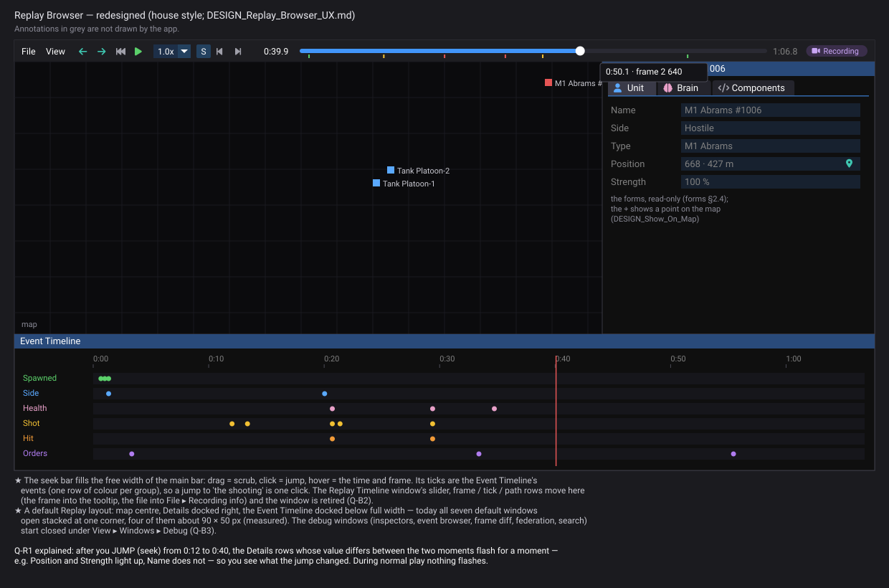

<!--STATUS
state: LIVE
build-state: DESIGN — Q-B1 (no ticks), Q-B2, Q-B5 decided (R-4155), Q-B4 (R-4156); Q-B3, Q-B6 open; the user: "we might need to return to the design later"
updated: 2026-11-06 (the user's answers: no ticks on the seek bar, the Replay Timeline window retired, the main bars stay per host; the browser's data breakpoints use the shared condition editor; the seek-diff window is label-first — R-4155) · 2026-11-06 (first version — the user: "take a look at all replay browsers forms and panels … I didn't understand the replay timeline panel at all … the big long slider … in the main menu bar … should be there, serving for seeking")
current-answer: §1 what is there (measured on a real recording) · §2 the redesign · §3 questions
stale-below: nothing
known-rot: none
known-conflict: ../DESIGN_Replay_Time_Axis_And_Review.md §9c ("the Replay Browser keeps its own controls … slider, step, play, rate") — this design moves the slider to the MAIN BAR (user, R-4153) and retires the Replay Timeline window; §9c's axis icon and the shared timeline panel stand
related-designs:
  - DESIGN_Review_Perspective.md — the Replay Browser's analysis windows as ONE bundle the editor composes in AAR (CE-3419); answers Q-B3 / Q-B6 as leans
  - ../DESIGN_Replay_Time_Axis_And_Review.md — OWNS the time model, the mode indicator (§9a) and the timeline panel's zoom / pan / menus (§9b, §10); this design changes only where the Replay Browser's seek lives
  - ../designs/replay-browser-2/DESIGN.md — the Replay Browser itself (selection history, sandbox, panels as built)
  - ../DESIGN_Director_Timeline_Editor.md — OWNS the Event Timeline panel and its lanes index (TL-4, §9)
  - ../DESIGN_Replay_Browser_Debug_Http.md — the browser's HTTP surface; every move here keeps its route
  - UX_Feature_Layout_Defaults.md — the layout defaults this design gives the Replay perspective
  - DESIGN_Details_Forms.md — §2.4 the entity forms read-only here
  - DESIGN_Show_On_Map.md — the ⌖ on every map-meaning field, used here too
  - DESIGN_UI_Conventions.md — the trees, label-first forms and headers apply to every window here
  - DESIGN_Condition_Editor.md — §8: the Replay Search's condition tree is the struct editor CE-4288 fixes
-->

> ⛔ **HISTORY note (R-4223, CE-4528, `2026-11-14`)** — the Node MCP server (`tools/ai-debug-mcp`: its tool catalog, generated `SKILL.md`, skill parts and generators) named in this document is **removed**. The debug API is plain HTTP and describes itself: `GET /help` (or `Hrot.ClusterRunner --help-api` before anything is started) and `GET /capabilities` — [`DESIGN_Debug_Api_Http_Only.md`](../DESIGN_Debug_Api_Http_Only.md). Every mention of the server, its tools or its generated files below is HISTORY; tool names map to routes in `GET /help`.


# DESIGN — the Replay Browser: one seek bar on the main bar, a usable default layout



*Generated by `scripts/gen-replay-browser-mockup.py` (R-4143); the acceptance spec for the main bar's seek bar and the default layout ONLY —
the transport buttons left of it are the browser's real ones, unchanged (R-4151).*

## 0. Why

🔒 *"Could you please take a look at all replay browsers forms and panels, because I think they need review and better visual design. For
example, I didn't understand the replay timeline panel at all. I thought there is a normal timeline. And by the way, the big long slider which
you had in your first mock-up in the main menu bar, that was not a bad idea at all. I think it should be there, serving for seeking."*
(user, `2026-11-06`)

## 1. What is there — measured *(2026-11-06)*

📐 A 60 s `hill-attack` run recorded (`--mode all`, 4 node files), loaded in `--mode replaybrowser` under Xvfb, every window opened one at a
time and screen-captured (frames sent in chat, not git). Window set: `ReplayBrowserSubsystem.cs:932-1036` (14 windows) — matches the pinned
`ui-baseline-replaybrowser` golden plus the windows added since.

| # | finding | where |
|---|---|---|
| **B1** | ⛔ **no time on the main bar** — only transport buttons (history ← →, rewind, play, rate, S/W, step ◀ ▶); the time and the seek live in a separate window | `ReplayTimelinePanel.DrawTransport` (`:194-352`) |
| **B2** | ⛔ **the Replay Timeline window is not a timeline**: *"Frame: 2103 \| Wall Ticks: 639295995934853590 \| Wall Time: 40.602s \| Sim Time: 39.997s"*, a frame slider, an empty *"Tick: - \| SimFrame: - …"* row and the file path | `ReplayTimelinePanel.DrawContent` (`:144-166`) |
| **B3** | ✅ the **Event Timeline** IS the "normal" timeline (ruler, lanes, playhead) — ⛔ but it opens at about **90 × 50 px**, and its lanes looked empty at 0:40 while `GET /timeline/lanes` reported **9 Spawned, 7 Side, 6 Health** events; the *State* group (Side, Health) is not among the drawn groups | `EventTimelineWindow`; `/timeline/lanes` — ✅ CE-4290 root-caused `2026-11-07`: no first size ⇒ ImGui auto-fitted the window to 107 × 48 px on a fresh layout, clipping every lane row; now `FirstSize` 1100 × 320 (`FirstUseEver`) — rail `EventTimelineFirstSizeRail` |
| **B4** | ⛔ **seven windows open by default, stacked at one corner** (Replay Timeline, Event Timeline, Frame Diff, Replay Search, Entity Inspector, Event Browser, Federation); four of them (Event Timeline, Director, Details, Entity Inspector) open at about 90 × 50 px | the window manager's first-use placement; no Replay layout |
| **B5** | *End exercise* shown, greyed, in **Rules** and **Mission summary** on a recording — nothing can ever enable it here; Mission summary says *"Running · 0:39"* | `InstructorEndControl.Draw` (`:43-50`, "draws the button (always)") |
| **B6** | **Federation**: per-node offset spinners *"Node 1 offset 0 − +"* by node number | `FederationPanel` — an expert tool |
| **B7** | **Replay Search** is the raw struct editor (class names, an empty `Bind` row) | fixed by CE-4288 (condition editor §8) |
| **B8** | **Details** on a recording: Summary + Components; the Components list is ~30 headers in one blue (green where this node held authority) | E17 slate headers + CE-4288 |

## 2. The redesign

| ⭐ change | detail |
|---|---|
| **① a seek bar on the main bar** (R-4153) | after the transport buttons, filling the free width: the current time, the bar, the end time; drag = scrub, click = jump, hover = *"0:50.1 · frame 2 640"*; ✏ **no ticks** — the events are in the Event Timeline (user, R-4155). On the active axis (S / W — §9a of the time axis) |
| **② the Replay Timeline window retired — its parts routed, nothing lost** | the slider → ①; frame / wall / sim time → ①'s tooltip; the empty meta row → the Frame Diff (it is per-frame debug); the file path → *File ▸ Recording info* (a dialog: files per node, length, exercise id). ⭐ *"no rush removals"*: every piece has a new home |
| **③ a default Replay layout** | map centre, **Details docked right**, **Event Timeline docked below at full width**; everything else closed. A first open never shows a 90 × 50 px window |
| **④ debug windows grouped** | Entity Inspector, Wire Entity Inspector, Event Browser, Frame Diff, Federation, Replay Search under *View ▸ Windows ▸ Debug* |
| **⑤ no live-only actions on a recording** | *End exercise* is not drawn when the host is a recording (Q-B4 ✅ R-4156); Mission summary shows *"at 0:39 of 1:06"* |
| **⑦ the browser's data breakpoints** | their condition is edited with the ONE condition editor (Condition editor §8 / C5) — the same one as rules, missions and the replay search (user, R-4155) |
| **⑧ the seek-diff window** (*Frame Diff Viewer*: what changed between two frames) | label-first like every form (E17 §3, user, R-4155) |
| **⑥ the shared conventions** | E17 (trees, label-first, slate headers), the read-only forms (R-4148, R-4150), ⌖ show on map (`DESIGN_Show_On_Map.md`) |

```mermaid
classDiagram
  class MainToolbarManager { <<existing>> RegisterEntry(id, sortOrder, height, draw) }
  class ReplayTimelinePanel { <<existing>> DrawTransport() · DrawContent() ⛔ retired }
  class ReplaySeekBar { <<★ new · Fdp.Presentation>> Draw(width) · drag / click / hover }
  class FederatedReplayManager { <<existing>> SeekAll · the playhead }
  MainToolbarManager --> ReplayTimelinePanel : ReplayTransport entry
  ReplayTimelinePanel --> ReplaySeekBar : draws after the buttons
  ReplaySeekBar --> FederatedReplayManager : seek (the same call the slider made)
  ```

*What the picture shows: the seek bar is drawn INSIDE the existing transport entry and calls the same seek the retired slider called — no
second seek path (R-174).*

```mermaid
sequenceDiagram
  actor U as User
  participant B as ReplaySeekBar
  participant M as FederatedReplayManager
  U->>B: drag the knob to 0:50
  B->>M: seek(0:50 on the active axis), each frame while dragging
  M-->>B: the playhead (next frame)
  U->>B: release
```

| stage | what | owner | acceptance |
|---|---|---|---|
| **B-1** | ① the seek bar in the transport entry; ② the window's parts routed (tooltip, *Recording info*, Frame Diff) and the window removed | ui | the mockup's main bar, built and compared by the builder (R-4146); the HTTP routes unchanged |
| **B-2** | ③ the Replay default layout; ④ the Debug group | ui | a first launch shows map + Details + Event Timeline, nothing at 90 × 50 |
| **B-3** | ⑤ live-only actions hidden on a recording | ui | Rules / Mission summary on a recording: no *End exercise* |
| **B-4** | CE-4290: the Event Timeline's lanes vs the index | ui | the measured counts drawn |

### 2a ⭐ AS-BUILT — ⑤ Q-B4 *(backend, `2026-11-07`, B-7)*

| | as built |
|---|---|
| *End exercise* | `InstructorEndControl.ShowsARecording` (the WORLD's `ReplayState.IsActive` — so the Replay Browser AND an AAR in the editor agree, by construction); `Draw` draws nothing then — ⛔ not greyed. Both windows that hold the control (Rules toolbar, Mission summary) inherit it |
| Mission summary | on a recording the toolbar reads `MissionSummaryWindow.RecordingPosition(extent, now)` from the window's own timeline cursor — *"at 0:39 of 1:06"* (h:mm:ss past an hour) — instead of the phase |
| ① the seek bar | `ReplayTimelinePanel.DrawTransport` draws it after the transport (the ONE drawer, CE-4261): the current time · a bar filling the free width (drag = scrub, click = jump; ⛔ no ticks) · the end time; hover = *"0:50.1 · frame 2 640"*. Times on the ACTIVE axis: `SimAtWall` (the host's `ReplayTimeMap.SimAt`) while the axis is S, else the recording's wall clock; labels cached per frame / axis (0 B steady). Rails `ReplayBrowserSubsystemTests.RBUX1_*` (a real frame under xvfb: the bar fills the main bar, the playhead at the frame; red-proved) |
| ✅ **② AS BUILT** (B-7 part 3, backend, `2026-11-07`) — the Replay Timeline window retired, its parts routed | **`rb_timeline` is unregistered.** The seek bar's **current-time label** has the tooltip *"frame 2 103 · wall 40.602 s · sim 39.997 s"* (`ReplayTimelinePanel.DetailText`, cached per frame/wall/sim ⇒ 0 B steady; the times come from `FrameTimes`, the one function the panel snapshot uses too). The empty *Tick · SimFrame · SimTime · FrameType · CompressedSize* meta row is the top row of the **Frame Diff** window (`ComponentDiffPanel.DrawMetaRow`, still a placeholder). The file path is **File ▸ Recording info** (`RecordingInfoWindow`, id `rb_recording_info`, closed by default): the exercise id, and per node the file, frame count and length. ⭐ That dialog also carries the retired window's **panel snapshot** (kind `replay-timeline`, the same `ReplayTimelinePanelViewModel`: frame, wall ticks, wall / sim time, path), published every frame **open or closed** — an agent reading panels loses nothing; the view-model code stayed in `ReplayTimelinePanel.BuildViewModel`, moved nowhere twice. The **"group rejected" modal** that only the retired window drew is now drawn with the transport (`DrawLoadGroupError` in `DrawTransport`). The panel stays: the transport's and the export window's one drawer; its `DrawContent` and rows 2-5 are gone. Rails: `RecordingInfoWindowDumpsItsFrameStateTests` (the dialog lists the files / length / exercise of a REAL two-node recording; the tooltip text; the snapshot closed), `ReplayBrowserSubsystemTests` (the registered set: `rb_timeline` gone, `rb_recording_info` in), the `ui-baseline-replaybrowser` golden. No HTTP route or MCP tool named the window (grep of `tools/ai-debug-mcp`, `Hrot/`, `FDP/`: none) — no catalog change. |

Rails: `RunnableRulesTests.QB4_*`.

## 3. Questions — leans

| # | question | lean | rejected |
|---|---|---|---|
| **Q-B1** ✏ R-4155 | the seek bar's ticks | ✏ **none** — *"No ticks on a seekbar, they are in timeline, This is enough."* (user) | ~~the events as ticks~~ (my lean) |
| **Q-B2** ✅ R-4155 | the Replay Timeline window | **retire it, route its parts** (§2 ②) | keep it beside the seek bar: two seek controls for one playhead |
| **Q-B3** | the default windows | **map + Details + Event Timeline**; the rest closed, debug ones grouped | today's seven stacked |
| **Q-B4** ✅ R-4156 | *End exercise* on a recording | **not drawn** — it is not unavailable now, it does not exist here (unlike a seat's missing right, R-4132) | greyed (today): a control nothing can ever enable |
| **Q-B5** ✅ R-4155 | the editor's / CGF's main bar | **unchanged** in this design; a seek bar there belongs to the review (time axis §9a/§9b, a live run seeks only by entering a review) | the same bar everywhere now: a live run has no "end" to scrub to |
| **Q-B6** | the Federation window's per-node offsets | **keep, as a debug window**; rows named by node role (*CGF · SimHost*) not number | remove: it repairs clock skew between node files |

### As built — LC-19 / CE-4323 *(backend, 2026-11-07)*

*File ▸ Open Exercise Recording…* in the Replay Browser is the editor's `RecordingPickerLauncher` (one class, every host), fed by the browser's disk inventory (`ExercisesOnDisk`, the list `GET /exercises` serves) and ending in the browser's ONE opener (`ReplayBrowserControl.Open`). *Load .fdp…* stays for files outside the inventory. 📄 `DESIGN_Scenario_Lifecycle_Review.md` LC-19.
