<!--STATUS
state: LIVE
build-state: READY-TO-BUILD — the fourth pass (§0a, §3, §3a, §4 V1–V7) approved by the user 2026-11-08; §6 the better merge recorded complete and UNSCHEDULED
updated: 2026-11-08 (FOURTH pass — one AAR, the source decided by the files, one AAR transport, the perspective = layout only, the source in the status bar; the empty-world bug) · 2026-11-08 (third pass — the user: the perspective is for the ALL-IN-ONE editor and the standalone Replay Browser, never a cluster AAR (a debrief); merged by default when the files hold several participants; DAR unrelated; the merge measured — §2.2) · 2026-11-08 (second pass — Federation as the SOURCE of the editor's one world) · 2026-11-08 (first version — CE-3419)
current-answer: ⭐ §0a the idea on one page (fourth pass) · §3 decisions D1–D11 · §3a entering and leaving · §1 measured · §2 how Federation and the merge work · §3 the design · §4 stages · §5 decisions · ⭐ §6 a better merge — the full idea, measured, unscheduled (I1–I9, Q9–Q14, appendices §6.8 / §6.9)
stale-below: nothing
known-rot: ⛔ first pass: "Federation does not fit the editor" / "standalone only" — WITHDRAWN (§2.4) · ⛔ second pass: the "this station's part" source during a CLUSTER AAR, G2 (read-only), Q5 (DAR), Q6 (per-station switch in a cluster) — WITHDRAWN by the user (§2.4) · the first pass cited R-4010 for "each node replays its own recording" — wrong id; the rule is W5 in DESIGN_Replay_Time_Axis_And_Review
known-conflict: none
related-designs:
  - DESIGN_Replay_Browser_UX.md — OWNS the standalone Replay Browser's UX; its Q-B3 (default layout) and Q-B6 (Federation) are answered here (§5)
  - ../designs/replay-browser-frankenstein/DESIGN.md — OWNS Federation and the merged view (§7 the synthesis); §2.2 here measures what it keeps and loses
  - ../DESIGN_Replay_Time_Axis_And_Review.md — OWNS DAR / AAR in a cluster (a debrief, W5: each node replays its own recording) — NOT this perspective's case
  - ../blueprints/Architect_Question_108_Run_Mode_Picker.md — §0 the run controls (AAR = the blue ▶ state), unchanged here
  - DESIGN_Rules_Bundle.md — the precedent: one bundle of windows every host composes (CE-4292)
  - DESIGN_Condition_Editor.md — §C5: the data breakpoints are ONE panel for the editor and the Replay Browser already
-->

# DESIGN — the Review perspective: recording ANALYSIS in the all-in-one editor and the Replay Browser

*Generated by `scripts/gen-review-perspective-mockup.py`. Scope: the Review LAYOUT, the ONE AAR transport (D8), the Source switch and the status bar's
source segment (D9), the ways in (§3a); the indicator / ▶ / Save of AQ108 §0, the rules bundle, Details and the Event Timeline are context, unchanged.*

## 0. Why

🔒 User, `2026-11-08`: *"the Replay Browser could be a perspective of the editor"* (CE-3419) → *"the usual recording is made of multiple parts,
each one generated by a single node like CGF or SimHost … the federation mode is something extremely important, because it combines the worlds
from multiple participants into a single one that can be analyzed"* → *"the editor is an all-in-one application which is having its own internal
cluster … there are no real other nodes … The AAR in a real cluster mode is usually not a replay analysis session. It is serving for the
debriefing for the trainees. So likely the replay browser mode or perspective makes sense mainly in the all-in-one editor or in a standalone
replay browser node."*

## 0a. ⭐ The idea on one page *(fourth pass, `2026-11-08` — the user: "Yes, rewrite the design to this idea. We need some indication that we are actually running in merged federate view, I guess. Maybe the status bar is a good place.")*

| | |
|---|---|
| **one run mode** | **AAR** — nothing new to arm (AQ108 §0). ⛔ The Review perspective does NOT change how AAR works |
| **what fills the world — decided by the FILES you open** | **this node's part** (the all-in-one editor's own run, or a cluster station's own part): today's AAR, each node replaying its own file (W5) · **a participant group with no part of this node** (a real cluster's run opened in the all-in-one editor): the editor fills its ONE world from ALL the files — **Merged** by default, or one participant's part (the Source switch). ⚠ Today that case opens an EMPTY world (§1) — this fixes it |
| **one AAR transport** | the union of today's two: the indicator · ▶ ⏸ ■ · rate · axis — **plus** the Replay Browser's history ◀ ▶ · step ◀ ▶ with hold-to-scrub · the seek bar — ONE drawer, both hosts. Merged: ▶ greyed (step / scrub only, §2.2) |
| **you always know the source** | the **status bar** says it: *"⧉ Merged · 4 participants — step / scrub"* or *"Part: CGF-1"*; nothing extra for an ordinary AAR. A click opens the Source switch |
| **the Review perspective = LAYOUT ONLY** | it docks Search, Frame diff, Breakpoints; Scenario does not. Switching changes the windows, never the replay, the source or the transport |
| **when the layout switches by itself** | entering an AAR in the all-in-one editor (every AAR there is analysis) and opening a participant group; a cluster station's AAR (the trainees' debrief) keeps its layout |
| **reused, not rebuilt** | ONE `ReviewBundle` of windows (both hosts); the Replay Browser's `FederatedReplayManager` + today's merge behind ONE `ReviewSource`; the RB's transport drawer as THE AAR transport |
| **not here** | the better merge (§6 — recorded, unscheduled) |

## 1. Measured *(2026-11-08)*

**INVENTORY.** `scripts/cbm.sh search_graph .*(Replay|Recording|Federat|Perspective).* Class` → **174** (has_more; the windows that matter read with
grep) · grep `RegisterWindow(` in `Hrot.ReplayBrowser` → **6** · the panels' constructors · `TransientMasterBuilder`, `ScenarioSerializer`,
`FdpAutoSerializer` read whole. ⚠ coverage unchecked (`check_index_coverage` is not in the CLI).

| the Replay Browser's window | today | in the editor today |
|---|---|---|
| Rules · Mission summary · debriefs · Inspector · Event browser · Details · Event Timeline + Tasks lanes · Data breakpoints · Director | ✅ ONE shared bundle / panel each | ✅ the same |
| **Frame diff** (+ ◀ ▶ next change) | `ComponentDiffPanel`, host-fed; the next change by `EntityChangeFinder` over the FILE | ⛔ no window (the finder already runs in the editor's HTTP API) |
| **Replay search** | `ReplaySearchPanel` over `IRecordingSearchService.ExecuteSearch(fdpPath, …)` — a throwaway reader | ⛔ no window (the service already runs in the editor's HTTP API) |
| Recording info · JSON export | over the RB's transport | ⛔ none |
| **Federation** — the per-node worlds, offsets, the merged view | `FederatedReplayManager`, `FederationPanel`, `TransientMasterBuilder` | ⛔ none |
| what is SHOWN | ONE world, `_activeRepo`, rebound to a node's sandbox or the merged master (`RebindActiveRepo`, `ReplayBrowserSubsystem.cs:598, 632, 638`) | ONE world — the editor node's |
| ⚠ **the editor opening a MULTI-NODE exercise today** | — | the editor's AAR fills its world ONLY from this node's own recording (`EcsRecordReplayController.PrepareReplayAsync`, `:376-398`); a node with no file of that exercise becomes a **listener** (`"NO recording — listener"`, `:398`) that waits for other nodes to replay over the wire — in the ALL-IN-ONE editor there are none ⇒ **the world stays EMPTY**, said only in the log *(measured `2026-11-08`)* |
| the transports | the RB's ONE transport drawer: history ◀ ▶ (waypoints) · rewind · play / pause · rate · axis S/W · step ◀ ▶ with hold-to-scrub · the seek bar (`ReplayTimelinePanel.DrawTransport`) | the editor's AAR: the indicator · ▶ ⏸ ■ · rate · axis · step FORWARD only (`MainToolbarTimeControlSection`, `OnStep`); seeking via the timeline — ⛔ no step back, no history, no seek bar |
| how a recorded frame enters a world | — | `PlaybackSystem.ApplyFrame(repo, reader)` (`Fdp.Core/FlightRecorder/PlaybackSystem.cs:31`) — any repository |

## 2. How Federation and the merge work

### 2.1 Federation

Every participant node records its OWN world into its own `.fdp`. Federation opens all the files of one exercise: each into its own HIDDEN sandbox
world (`ReplayBrowserContext`), aligned on one wall-clock tick with a per-node offset, all seeked together. It SHOWS one world: a chosen node's,
or the merged one.

### 2.2 ⭐ The merge, measured — **yes, it is JSON, and it ends as real components in one real world**

`TransientMasterBuilder.Build` (`Fdp.Toolkits/ReplayBrowser/Federation/TransientMasterBuilder.cs`), step by step:

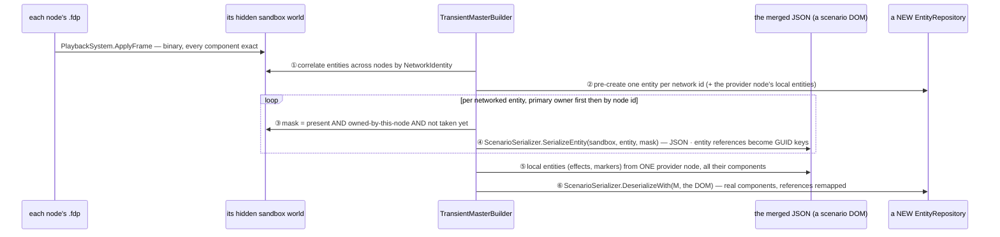
*What it shows that prose hid: the frames go BINARY into each node's world; only the step BETWEEN those worlds and the merged one is JSON — the
SCENARIO serializer, built to save scenarios, reused to copy a component subset across worlds.*

| what the JSON step keeps | what it may lose — ⚠ the finding |
|---|---|
| ✅ every **unmanaged** (struct) component of the extracted mask — `FdpAutoSerializer` compiles a field-by-field copy for every snapshotable VALUE type (`FdpAutoSerializer.cs:93-96`) | ⛔ **managed** (class / record) components are NOT auto-serialized (`type.IsValueType` only, `:96`) — they survive ONLY through a scenario TRANSLATOR (27 of them), and a translator writes what a SCENARIO keeps (authored data), not necessarily the runtime state a recording holds |
| ✅ entity references across nodes (remapped through GUID keys) | ⚠ a translator that projects (e.g. a brain snapshot as `{Name, Params, Origin}`) brings back its projection, not the exact runtime object |
| ✅ ownership: each component from the node that owned it | ⚠ cost: a full JSON round-trip of the world per step — hundreds of ms; Play off, step / scrub only (the RB's own rule) |

⇒ **M1 (measure before V6 ships):** list the managed components that are RECORDED (in a node's `.fdp`) and have NO translator, or a translator that
drops runtime fields — those are what the merged view silently lacks. A rail: for each node, its owned components in the merged world equal its own
sandbox's, field by field.

### 2.3 Where it applies — the user's ruling

| host | the recordings it opens | the source | the layout |
|---|---|---|---|
| **all-in-one editor** (one node, an internal orchestrator — no real other nodes) | ① its OWN runs (one file) · ② a REAL cluster's runs (several participant files) | ① this node's part · ② **the group, Merged** by default | Review, automatically |
| **standalone Replay Browser** | any files | one file, or the group (Merged / a part) | Review — its only layout (Q3) |
| **a cluster station's AAR** (the trainees' debrief) | — | its own part (W5), as today | unchanged — no automatic switch |
| **DAR** | — | — | ⛔ unrelated — a training review during the run |

### 2.4 ⛔ Withdrawn *(kept for the record)*

~~First pass: Federation does not fit the editor~~ · ~~second pass: a "this station's part" source during a cluster AAR, Q6, G2~~ — 🔒 *"during the AAR
we are not writing anything anywhere"* · ~~G1 component ids~~ · ~~Q5 DAR~~ · ⛔ **third pass: *"the perspective switch enters Review and the Source
switch lives in it"* — SUPERSEDED by the fourth pass**: 🔒 the user asked *"Is it really just one single mode? … if we never switch to it and we open
the replay, it will be behaving exactly like the current usual AAR is?"* — ⭐ the answer is now YES for an own-part AAR, and the SOURCE and the
TRANSPORT no longer depend on the layout at all.

## 3. The design *(fourth pass)*

| ⭐ decision | |
|---|---|
| **D1 — ONE run mode, AAR**; the perspective is a LAYOUT only (Scenario · Review), switchable at any time in AAR | ⛔ rejected: tying the transport or the merge to the layout — switching back mid-review would have no meaning |
| **D2 — ONE `ReviewBundle`** (Frame diff, Replay search, Recording info, JSON export), composed by the editor AND the Replay Browser; its windows can be opened in ANY layout (Window menu); Review only docks them | the RulesBundle precedent; the RB's hand-written registrations deleted |
| **D3 — the host gives the bundle ONE world and the recording's files**: `World`, `RecordingFiles`, `CurrentFrame`, `Seek(frame)`, `Selection` | — |
| **D4 — the analysis reads the FILES** in throwaway readers, never the shown world | as the editor's HTTP API already does |
| **D5 — search hits and breakpoint stops become Event Timeline lanes**; a click seeks | — |
| **D6 — the SOURCE follows the files**: a recording with this node's part ⇒ today's AAR (W5); a participant GROUP with no part of this node ⇒ `ReviewSource` fills the ONE world from the RB's `FederatedReplayManager` (hidden sandboxes): **Merged** by default (Q7), or one node's part. The internal orchestrator's seek drives it — ONE clock, the one node | ⭐ fixes today's EMPTY world (§1); one world shown, the parts hidden — the RB's own shape |
| **D7 — the merged world is DESERIALIZED STRAIGHT INTO the editor's world** (cleared first), as a scenario load fills it | one conversion, not two |
| **D8 — ONE AAR transport**: the RB's transport drawer (`ReplayTimelinePanel.DrawTransport`: history ◀ ▶ · step ◀ ▶ with hold-to-scrub · rate · axis · the seek bar) becomes THE replay segment of the editor's time controls too, beside AQ108 §0's indicator · ▶ ⏸ ■ · Save slot; it drives a transport seam — the cluster's seek in the editor, the RB's manager in the RB | ⛔ two transports (two pictures of one tool); in a cluster AAR step back = a cluster seek to the previous frame |
| **D9 — the STATUS BAR says the source**: Merged ⇒ *"⧉ Merged · 4 participants (CGF ×2, SimHost, Player) — step / scrub"* (teal); a part ⇒ *"Part: CGF-1"*; an ordinary AAR ⇒ nothing extra; a click opens the Source switch | 🔒 the user: *"Maybe the status bar is a good place."* The toolbar keeps a compact Source combo only while a GROUP is open |
| **D10 — the layout switches BY ITSELF** when an AAR starts in the all-in-one editor or a group opens; back to the previous layout on leaving AAR; a cluster station's AAR never switches | — |
| **D11 — the standalone Replay Browser composes the same bundle, the same Federation pieces, the same transport drawer and the same LAYOUT** (Q-B3) — its own main menu bar stays (R-4155 B5) | one tool, two hosts |

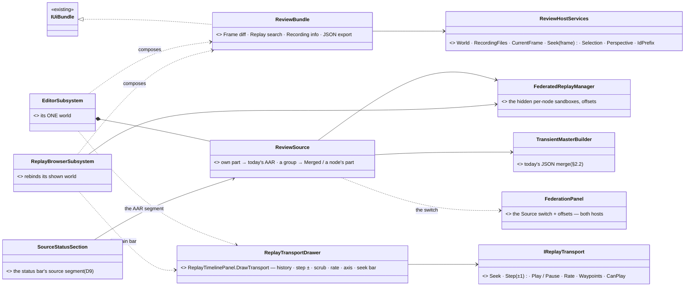
*What the picture shows: three independent pieces — the WINDOWS (one bundle), the TRANSPORT (one drawer over one seam) and the SOURCE (one feed);
the perspective touches only where the windows dock.*

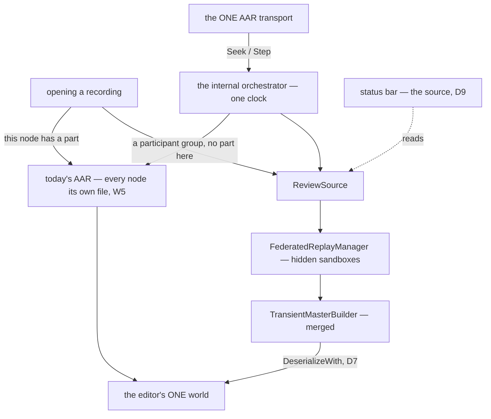
*Who calls it: the transport asks the orchestrator, the orchestrator seeks the one node, the node's source answers — the same path whatever the
layout. A merged step costs a JSON round-trip, so ▶ is greyed there.*

### 3a. ⭐ Entering and leaving *(fourth pass)*

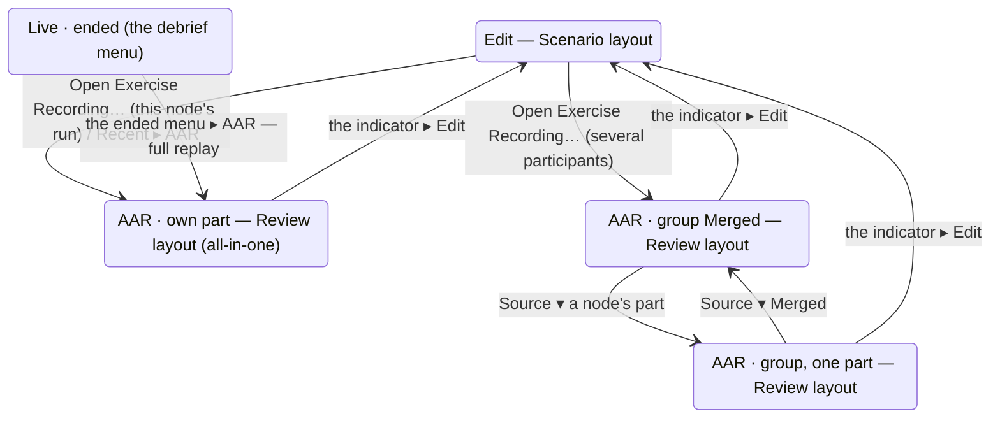
*What it shows: every box is AAR (one mode); the boxes differ by SOURCE, which the files decide. The layout is a side property: Review by itself on
entering, any layout by hand, the previous one back on leaving.*

| ⭐ rule | |
|---|---|
| **the picker says what you will get** | each exercise row: *"Night attack · 18:40 · 4 participants — opens MERGED"* or *"Bridgehead · this editor's run"* |
| **switch the layout to Scenario mid-AAR** | the replay, the source, the merge, the status bar and the transport stay exactly as they were; the analysis windows close from the dock (Window menu reopens them) |
| **switch the layout to Review in an ordinary AAR** | the same AAR, the analysis windows docked; search and diff read this node's file |
| **never use Review** | exactly today's AAR — plus the richer transport and the fixed group opening, which do not depend on the layout |
| **a cluster station's AAR** | no automatic layout switch; no Source combo (the station has only its own part) |

## 4. Stages

| # | what | acceptance |
|---|---|---|
| **V1** | `ReviewBundle` + `ReviewHostServices`; the RB composes it (its four registrations deleted) | the RB's window-set golden unchanged; its frame rails green |
| **V2** ✅ | the editor composes it (own-part AAR): Frame diff and Replay search, openable in any layout *(built — see AS BUILT — V2)* | a search hit seeks and selects; 0 B per steady frame |
| **V3** ✅ | **the ONE AAR transport** (D8): `IReplayTransport` + the RB's drawer as the editor's AAR segment — history, step ± with scrub, the seek bar; the RB unchanged in look | side by side with the mockup's toolbar; step back in the editor = a cluster seek; 0 B steady *(built — see AS BUILT — V3)* |
| **V4** ✅ | the Review LAYOUT and its automatic switch (D10), the same layout as the RB's default | side by side with `review-perspective-visual.svg` (R-4146) *(built — see AS BUILT — V4)* |
| **V5** | ✅ M1 measured (§6.2, §6.8) | done `2026-11-08` |
| **V6** ✅ | **`ReviewSource`** (D6, D7): a group opens Merged (default) or a part; the picker's rows; **the status bar's source segment** (D9) | the EMPTY-world bug gone: a 4-file exercise opens merged in the all-in-one editor; a CGF-only behaviour state readable in Details; a part plays; Merged steps *(built — see AS BUILT — V6)* |
| **V7** ✅ | search hits and breakpoint stops as Event Timeline ROWS *(not lanes — query results and session events are not recorded events)* | a click seeks *(built — see AS BUILT — V7)* |

### AS BUILT — V1 *(behaviors, `2026-11-08`)*

`ReviewBundle` + `ReviewHostServices` live in `Hrot/Editor/Hrot.Editor.AiShared/Review/ReviewBundle.cs` (beside `Rules/RulesBundle`, same shape: windows built in the constructor, `IUiBundle.RegisterInto` registers them, `Name = "review"`).

| what | as built |
|---|---|
| windows | Frame diff `<prefix>diff`, Replay search `<prefix>search`, Recording info `rb_recording_info`, JSON export `rb_json_export` — the last two keep their FIXED ids (the window classes own them, unchanged); the window classes are untouched |
| `ReviewHostServices` | D3's members + what the four windows need TODAY: `Perspective`, `IdPrefix`, `Colour`, and the three host-fed panels (`DiffPanel`, `SearchPanel`, `TimelinePanel`). **V1 reads only those six.** ⏭ **V2's members** (optional, null today): `World`, `RecordingFiles`, `CurrentFrame`, `Seek`, `Selection` — the editor builds its own diff / search panels from them |
| Replay Browser | `RegisterWindowsCore` composes the bundle at the top (`UiBundleHost.Compose`); its four hand `RegisterWindow` calls are deleted; File ▸ Recording info / JSON Export… hang on `review.RecordingInfo` / `review.JsonExport` |
| deviation | the design's V1 acceptance says the RB's window-set golden is *unchanged*; the golden (`ReplayBrowserSubsystemTests.RegisterWindowsCore_RegistersSixWindows_…`) had gone stale-red at HEAD (the rules bundle's four windows and `rb_json_export` were missing from its list; it also tripped on the shell's own `shell_keyboard_shortcuts`). It was re-baselined to HEAD's measured 14-window set FIRST, then the refactor proved against it — set identical before / after |
| rails | `TheReviewBundleTests` (AiShared.Tests): exactly the four windows, prefix and perspective applied; red-proof: `ReplaySearch` not registered ⇒ red. The RB's window-set golden red-proved the same way |

### AS BUILT — V2 *(behaviors, `2026-11-08`)*

The editor composes the V1 bundle over its own-part AAR. ⭐ **One seek, one reader, one selection** — nothing new beside what the debug API already held.

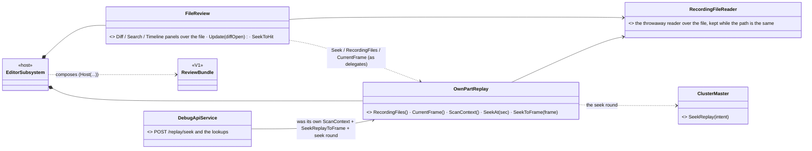
*What the picture shows: the seek the API held alone is now `OwnPartReplay`, which both the API and the review windows call; the windows' panels read the file through the same reader.*

| what | as built |
|---|---|
| the seek | `OwnPartReplay` (`Hrot/Subsystems/Hrot.Editor/Review/OwnPartReplay.cs`) is the ONE access: `SeekToFrame(frame)` (frame → moment through the file's index and the replay's zero) and `SeekAt(sec, sim?)` (the master's `SeekReplay` intent). **Extracted from `DebugApiService`** (its `ScanContext`, `SeekReplayToFrame` and the seek round of `SeekReplayTo`, `PositionOf` ← `ReplayPositionOrNull`); the API now delegates, so `POST /replay/seek` and a click run the same code. The existing `TheClusterControlRoutesTests` seek rails are the regression gate |
| the reader | `RecordingFileReader` (AiShared) — replaces the API's `_scanned` pair; shared by the API, the search and the diff |
| `FileReview` (AiShared) | builds the editor's Frame-diff and Replay-search panels from D3's members: **search** reads the file (`CurrentFilePath` follows `RecordingFiles`), a **hit** = `Seek(frame)` + select its unit (reader entity → network id; retried every frame until the world holds the unit, ≤ 600 frames); **diff** = the selected unit at the shown frame vs the frame before, both dumped from the file (D4), refreshed when (file, frame, unit) moves, at most every 200 ms and only while the window is open; the diff's seek-to-change buttons run `EntityChangeFinder` off-thread and seek on the next `Update`. `ReviewSearchServices.BuildEditService()` is the ONE search edit service (the Replay Browser's inline copy now calls it) |
| the editor | composes the bundle right after the rules bundle (before the headless guard): ids `editor_review_diff` / `editor_review_search` + the fixed `rb_recording_info` / `rb_json_export`, perspective `Scenario`, **closed until opened** (Window menu lists them in every layout — Review only docks them, V4). `FileReview.Update` is a window-manager frame overlay. Outside AAR (no replayed file) the diff and search panels draw *"Open an exercise recording (AAR) to search / diff."* (`UnavailableReason`, new on both panels) |
| 0 B | `ComponentDiffPanel` allocated per steady frame (row labels interpolated each frame; interface `foreach` boxed the enumerator) — labels cached per diff, loops indexed ⇒ diff, search and `Update` measured **0 B** with a unit selected and with none, in AAR and outside it |
| deviation | **Recording info / JSON export** are manager-bound panels (the Replay Browser's federation); the editor has no federation in an own-part AAR, so they open and say *"No recording loaded"* until V6's `ReviewSource` fills them *(V6 did — see AS BUILT — V6)*. No File-menu items for them in the editor yet |
| rails | `TheFileReviewTests` (AiShared.Tests: outside-AAR message, hit seeks + selects with retry, diff reads the file, 0 B), `TheEditorComposesTheReviewBundleTests` (Editor.Tests: the four windows, closed, "say so" outside AAR; a hit goes through `OwnPartReplay`'s seek with the frame's moment and selects the unit). Red-proofs: hit not seeking ⇒ red; an allocation in `Update` ⇒ red |

### AS BUILT — V3 *(behaviors, `2026-11-08`)*

The transport's ONE drawer moved out of `ReplayTimelinePanel` and calls only a seam; the Replay Browser and the editor's AAR segment are two profiles of it.

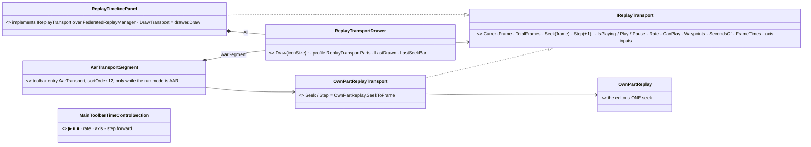
*What the picture shows: one drawer, two implementations of the seam, two profiles — and the editor's segment sits BESIDE ui's time control (its own toolbar entry), never inside it.*

| what | as built |
|---|---|
| the seam | `IReplayTransport` (`FDP/Engine/Fdp.Presentation/ImGui/Panels/ReplayBrowser/IReplayTransport.cs`): the design's `Seek · Step(±1) · Play / Pause · Rate · Waypoints · CanPlay` plus what the drawer read from the manager before — `HasRecording`, `CurrentFrame`, `TotalFrames`, `PlayDisabledReason` (the Merged View text), `SecondsOf` / `FrameTimes` (the seek bar's labels and tooltip) and the axis inputs (`HasAxisToggle` · `AxisIsSim` · `HasSimAxis` · `SimAxisActive` · `ToggleAxis`). `Waypoints` is the existing `PlaybackHistoryTracker` |
| the drawer | `ReplayTransportDrawer` (same folder) = the panel's `DrawRow1_Transport` + `DrawSeekBar` moved whole and made to call ONLY the seam; hold-to-scrub, the rate combo, the seek bar's per-frame label cache are unchanged. `ReplayTimelinePanel.DrawTransport` = `drawer.Draw`; the panel implements the seam (explicitly) over its manager — the Replay Browser's behaviour is today's. Widget ids keep the `rb` prefix |
| profiles | `ReplayTransportParts` flags: the Replay Browser `All`; the editor's segment `AarSegment` = `History \| StepBack \| SeekBar`. `LastDrawn` reports what a draw really drew (the rails read it) |
| history | ⭐ the DRAWER records a waypoint on every JUMP through the seam (rewind; the START of a seek-bar scrub — current frame, then the target), so ◀ returns to where the scrub began; steps and hold-to-scrub are not jumps. **Deviation from "the RB unchanged":** the Replay Browser's seek bar and rewind now also push waypoints (before, only selection / search jumps did) — one drawer, one behaviour |
| the editor | `OwnPartReplayTransport` (`Hrot/Subsystems/Hrot.Editor/Review/`): frame = `OwnPartReplay.CurrentFrame()`, `Seek` = `OwnPartReplay.SeekToFrame` (a cluster seek), **`Step(-1)` = a seek to the previous frame**; play / pause / rate delegate to the toolbar's facade (the segment does not draw them); the sim seconds in the tooltip come from the replay position (NaN ⇒ omitted: `DetailText` skips it). `AarTransportSegment` registers the entry `AarTransport` (sortOrder 12: after the time control 0–9 and its separator 10, before Problems 15 and the perspective group 20–29), draws nothing unless `RunModeChoice.Shown == AAR`, bar capped at 360 px. `EditorSubsystem` composes it beside the review bundle. ⛔ `MainToolbarTimeControlSection` is not touched — no duplicate had to be accepted, so no request note to ui |
| 0 B | the segment measured **0 B** per steady frame (in AAR and hidden) |
| rails | `TheAarTransportSegmentTests` (Hrot.Editor.Tests: step back = a cluster seek to current-1; the editor registers `AarTransport` with the AAR profile; draws only history · step back · the seek bar and nothing outside AAR; a click on the bar is a waypoint and ◀ seeks back; 0 B). The Replay Browser's `RBUX1_*` / `CE4261_*` frame rails run through the drawer unchanged (RBUX1 also asserts the full profile). Red-proofs: segment profile `All` (a duplicate ▶) ⇒ 2 red; `Step` not seeking ⇒ red |

### AS BUILT — V4 *(behaviors, `2026-11-08`)*

A perspective is a window TAG and the dock tree is ONE ini keyed by window id — so there was no per-perspective layout to edit. ⭐ The Review layout is a **dock preset as data** (`ReviewLayout`, one definition) that both hosts give their own ids, laid out with Dear ImGui's DockBuilder on the dockspace's CENTRAL node (the map's empty hole), so it never disturbs what is docked around it.

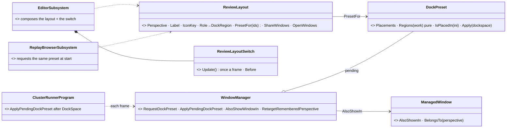
*What the picture shows: one layout definition, one applier, two hosts — and the switch is a separate small machine that only calls `TrySwitchPerspective`.*

| what | as built |
|---|---|
| the layout | `ReviewLayout` (`Hrot.Editor.AiShared/Review/ReviewLayout.cs`): roles → regions as the mockup draws them — **Mission summary** left · **Details** right-top · **Frame diff · Search · Breakpoints** tabbed right-lower · **Event Timeline** across the bottom · the **map** keeps the middle. `DockPreset.Regions` is the pure geometry (a rail asserts the tiling); `Apply` splits the central node (bottom → left → right → right-lower) and docks `###id` into each. Measured under xvfb: docked windows land within 16 px of the computed regions and the map's hole keeps the centre |
| owned / shared windows | the bundle (`editor_review_diff` / `_search`, `rb_recording_info`, `rb_json_export`) is owned by perspective `Review` (was `Scenario`). Details (`scenario_details`), the Mission summary, the data breakpoints (`editor_bp_manager`) and the Event Timeline stay the Scenario layout's windows and are **shared, not copied**: new `ManagedWindow.AlsoShownIn` / `BelongsTo` (+ `WindowManager.AlsoShowWindowIn`), the visibility gate and `EntityDetailsBundle.ActiveDetails` use it. The Windows menu still groups a window under its owner only, so the bundle stays listed — and openable by hand (pinned) — in every layout (D2) |
| icon / label | `PerspectiveIconKeys.Table` += `("Review", "asset/recording")`; the label is the name (pass-through, as Scenario) |
| first entry | the first time Review comes up in a session its windows open and `RequestDockPreset` is made; `Program.cs` calls `ApplyPendingDockPreset(mainDockId)` right after `DockSpace(...)`. **A saved arrangement wins**: if the ini (`SaveIniSettingsToMemory`) already docks any preset window, the request is dropped (`DockPreset.IsPlacedIn`) |
| D10 the switch | `ReviewLayoutSwitch.Update()` (a frame overlay): AAR **and** all-in-one ⇒ remember the current layout, switch to Review; AAR over ⇒ back to the remembered one (a manual switch mid-AAR is respected, leaving still restores the PRE-AAR one). Start refusing (cluster Idle) ⇒ retried next frame; an AAR that closes into Idle ⇒ `RetargetRememberedPerspective` makes Start restore the pre-AAR layout, not Review. **All-in-one** = `_networkFactory is OfflineNetworkFactory` (the editor is a one-node cluster, ruling 66 — the same predicate that enables turbo step); a node with a real network never switches |
| the Replay Browser | `RegisterWindowsCore` requests the same preset over `rb_mission_summary` / `rb_details` / `rb_diff` / `rb_search` / `rb_event_timeline` (no data-breakpoints window there ⇒ that role is absent). Its perspective stays `ReplayBrowser` (its only layout, Q3) |
| map menus | the editor's map menus are registered for `Review` too (`editor/map-menus-review`), so the map's right-click menu is the same in the layout |
| deviation / caveat | a window has ONE dock slot across layouts, so the shared Details / Event Timeline are re-docked into Review's regions on first entry and stay there when you go back to Scenario. Windows drawn BEFORE the preset is applied keep their old size at first (the shared ones); the Review-only windows have never been drawn, so they take the computed size |
| rails | `TheReviewLayoutTests` (Editor.Tests): all-in-one AAR ⇒ Review and back · a station never · manual switch mid-AAR then leave ⇒ pre-AAR · Start refusal retried / Idle-close retarget · the switch touches no replay state (master, position, selection) · mockup regions + tiling · editor composition (owned/shared windows, icon, hand-open pinned, first-entry preset, saved layout wins) · frame under `xvfb-run -a` (`HROT_RAIL_SHOTS`, ⛔ not in git). RB: `V4_TheDefaultLayout_IsTheReviewLayout_TheSamePresetTheEditorUses`. Red-proofs: the `allInOne` guard dropped ⇒ station rail red; the restore dropped ⇒ leave rails red |

### AS BUILT — V6 *(behaviors, `2026-11-08`)*

A participant GROUP with no part of this node now fills the editor's ONE world — Merged, or one part — instead of opening empty.

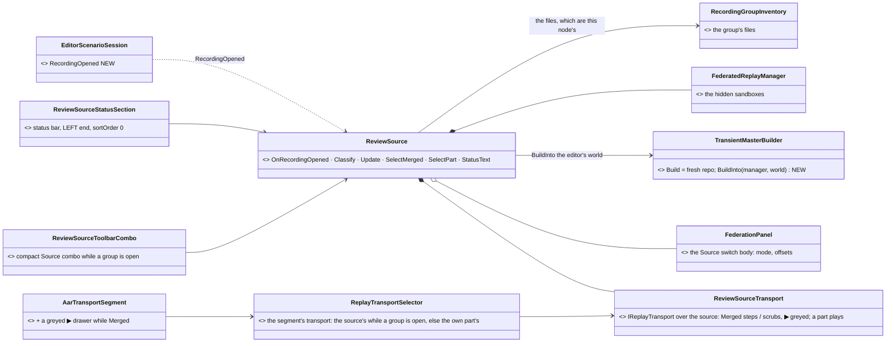
*What the picture shows: nothing new sits between the cluster and the world — the source is one more listener on the session's open, and the world is filled by the Replay Browser's own merge.*

| what | as built |
|---|---|
| S1 — the files | `RecordingGroupInventory.Scan(stagingRoot)` (the Replay Browser's own group loader) gives an exercise's participant files; each sidecar's `NodeId` says which node. **This node has a part** ⇔ `OrchestrationConstants.GetExerciseRecordingFilePath(<its staging root>, id, <its node id>)` exists — the very file `PrepareReplayAsync` would replay |
| the ONE branch | `EditorScenarioSession.RecordingOpened` (raised in `IRunScenarioControl.OpenRecording`, after the replay intent): every route that opens a recording ends there. **Deviation from the handoff:** it is NOT in `ScenarioDoor.OpenRecording` (ui's / backend's, untouched) — the raw verb is below the door and the run choice both. `ReviewSource.OnRecordingOpened`: a part of this node ⇒ today's AAR, nothing else happens; a group with none ⇒ pending until the replay is up. Note `docs/blueprints/batches/NOTE_Behaviors_To_Ui_Backend_Review_Source.md` |
| S3 — the listener | the cluster still enters AAR (the master plans it); this node's replay module is an idle LISTENER that cleared the world ONCE on entry (`PlaybackTickSystem.Listen`: `if (State == Listening) return`), and nothing of the replay writes it after. The source fills only when `ReplayState.IsActive && !IsRestoring` (the node listens) ⇒ **no branch in the recorder was needed**; `EcsRecordReplayController` / `ReplayModule` are untouched |
| S2 — Merged | `TransientMasterBuilder.BuildInto(manager, world)` = `Build`'s merge into a world the caller owns (`Build` is now `new repo` + prime + `BuildInto`). The editor's world is cleared first by `ScenarioFileService.NewScenario` (reset observers, `SoftClear`, epoch — the boundary a scenario load starts from) and filled by the merge's own `ScenarioSerializer.DeserializeWith` — ⛔ no second load path. The selection is re-landed by network id after every refill. Every `FederatedReplayManager.OnTimeChanged` (seek, step, offset) refills |
| a part | `SelectPart(node)`: a `PlaybackController` over THAT node's file applies its frames to the editor's world (binary — every component exact, managed ones too; the merge's JSON gap, §2.2, does not apply). It plays while the toolbar's ▶ plays, at its rate (`Update(dt)` follows the facade, as an own-part AAR follows the cluster clock); a step back is a keyframe seek |
| the transport | `ReviewSourceTransport : IReplayTransport` — Merged: frames are the primary participant's, `Seek` = `manager.SetBaseWallTicks`, `Step` = `StepForwardAll` / `StepBackwardAll`, `CanPlay` false with `MergedPlayReason`; a part: its own frames. `ReplayTransportSelector` picks the source's transport while a group is open, the own part's otherwise — the V3 segment, unchanged except a second drawer (`AarSegment | PlayPause`) that shows the greyed ▶ in Merged |
| status bar | `ReviewSourceStatusSection`, sortOrder **0** (the left end `StationSeatStatusBarSection` left free): Merged ⇒ *"Merged · 4 participants (Node 2, Node 3, Node 4, Node 5) — step / scrub"* in teal; a part ⇒ *"Part: Node 2"*; an ordinary AAR ⇒ nothing; pending / failed say so. A click opens the Source switch: the participants over the Replay Browser's own `FederationPanel` body. `ReviewSourceToolbarCombo` (toolbar sortOrder 13) only while a group is open |
| picker | `RecordingPickerLauncher(sourceNotes:)`: the rows read *"… · 4 participants — opens MERGED"* / *"… · this editor's run"*, notes scanned once when the picker opens |
| review windows | Recording info / JSON export read the group's manager (`TimelinePanel.SetManager`), the search / diff read the primary participant's file (a part's own), and a hit seeks through the source's transport |
| D10 | a group open counts as an AAR entry (`inAar` of the layout switch and the segment `|| reviewSource.IsOpen`); in practice the cluster is in AAR as well |
| deviations | the **⧉** glyph and the role names (*CGF ×2, SimHost, Player*): the UI font has no ⧉ and a sidecar carries no node role — the text says *Merged* and *Node N* (`nodeName` is a seam for a host that knows roles). The toolbar's own ▶ (`MainToolbarTimeControlSection`, ui's) is not greyed in Merged: the segment draws its own greyed ▶ with the reason (smallest seam for greying THE ▶ is in the NOTE) |
| rails | `TheReviewSourceTests` (Editor.Tests, 13): a 4-file group opens MERGED in a world that held nothing, entity count = the merge's · a component only CGF's files hold is in it · this node's part ⇒ the source stays out · the picker's notes · `SelectPart` fills from one part and plays · Merged steps ±1 / scrubs, ▶ greyed with the reason · the selection follows · each status text · a load failure is stated · the review windows' files · the editor composes it (status at the left, combo, selector) · the frame under `xvfb-run -a` (`HROT_RAIL_SHOTS`). `V6_BuildInto_…` (Fdp.Toolkits.Tests) · `V6_ARowSaysWhatYouGet_…` (the picker). Red-proofs: `OnRecordingOpened` never taking a group (the empty world returns) ⇒ 10 red; `CanPlay` true ⇒ the ▶ rail red |

### AS BUILT — V7 *(behaviors, `2026-11-08`)*

The Event Timeline gets two review rows. ⛔ **Not lanes** (an `IndexedLaneDefinition` is READ from a recording; hits are a query's result and stops are session events) — the Tasks rows' precedent: `ITimelineTrack` through `TimelinePanel.AddTracks`.

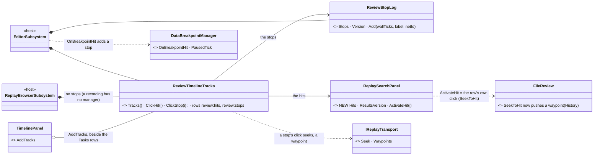
*What the picture shows: ONE class both hosts compose; the hit path is the grid's own click path, not a second one; only the editor has a stop log, because only it has a breakpoint manager.*

| what | as built |
|---|---|
| the rows | `ReviewTimelineTracks` (`Hrot/Editor/Hrot.Editor.AiShared/Review/`): **Search hits** (a Pinned-diamond marker per hit at its frame — sim seconds through the index's `FrameSim` — labelled *entity · what matched*) and **Breakpoint stops** (a marker per stop, labelled *unit · breakpoint · condition sentence · behaviour step*). A row with no markers is not in the list. At most 5 000 hit markers; the row's status then says *first N of M* |
| the hits | `ReplaySearchPanel` gained `Hits` (a cached snapshot of the grid's rows — lifecycle hits by start frame), `ResultsVersion` (moves when a search starts, lands or fails) and `ActivateHit(i)` = a click on that grid row. ⭐ Rebuilt only when the version moves — no per-frame recompute |
| a click on a hit | `ActivateHit` ⇒ the host's ONE hit path, unchanged: the editor's `FileReview.SeekToHit` (the host's seek, then select by network id with the V2 retry), the Replay Browser's `matchIntent` (waypoints + manager seek + selection history). **Editor addition:** `SeekToHit` now pushes a history waypoint (where you were, then where you went) through `ReviewFileServices.History` = the transport's `Waypoints` — the drawer's own `RecordJump` shape, so ◀ walks a hit like a seek-bar jump |
| the stops | the editor's `EditorSubsystem` hangs `ReviewStopLog.Add(manager.PausedTick, …)` on `DataBreakpointManager.OnBreakpointHit`. **Measured:** the manager has no replay awareness (no guard in `DataBreakpointSystem` / `OnHit`); a stop knows its moment as `PausedTick` = `GlobalTime.TotalWallTicks`, the very stamp `LiveTimelineSource.Step` gives the index's frames, so the frame is `index.FrameAt(PausedTick)` — placeable on a live index and on a replayed one. The Replay Browser has no `DataBreakpointManager` ⇒ its host passes no stop log ⇒ no stops row there |
| a click on a stop | seeks through `IReplayTransport` when a recording is loaded (a waypoint, then `Seek(frame)`), then selects the stop's unit by network id; with no recording (a live run) it only selects |
| composition | the editor composes it with the review bundle — before the headless guard, so it is railed — over `_node.ShownTimeline`; the Replay Browser beside its Tasks rows over its recording's index. `TimelinePanel.AddTracks` for both |
| 0 B | `Tracks()` compares four values (index, search version, stop version, scan progress while the index is incomplete) and returns the same list; 1 000 steady calls allocate 0 B |
| deviations | the hit label's entity is the reader handle the results grid shows (`index:generation`), not the unit's name — a name needs the file read at every hit's frame (a reader seek per marker); the grid shows the same |
| rails | `TheReviewTimelineTracksTests` (AiShared.Tests, 5): N hits ⇒ N markers at their frames, none ⇒ no row · a hit's click seeks the host with the frame, is a waypoint and selects · the stops row grows on a hit, placed by wall ticks, a click seeks through the transport and selects · a steady frame rebuilds nothing, 0 B · the frame under `xvfb-run -a` (`HROT_RAIL_SHOTS`, both colours drawn). `V7_TheEditorComposesTheReviewRows_…` (Editor.Tests: a manager hit adds a stop at its frame; the row reaches the panel) · `V7_TheReplayBrowser_ComposesTheReviewRows_…` (ReplayBrowser.Tests). Red-proofs: a stop's click not seeking ⇒ red; `Tracks()` rebuilding every call ⇒ the 0 B rail red |

## 5. Decisions

| # | | |
|---|---|---|
| **Q1′** | the layout switches by itself on an all-in-one AAR and a group; a cluster station's AAR never | ✅ (fourth pass, the user: *"Yes, rewrite the design to this idea"*) |
| **Q2** | the standalone Replay Browser stays | ✅ |
| **Q3** (= RB Q-B3) | one layout, shared | ✅ |
| **Q4′** (= RB Q-B6) | Federation in the editor, as the source of its one world | ✅ |
| **Q7** | multi-participant files open Merged by default | ✅ |
| **Q15** | ONE AAR transport (the union), the source said in the status bar | ✅ (fourth pass) |
| ~~Q5 · Q6~~ | DAR · per-station switching in a cluster | ⛔ withdrawn |
| **Q8** ⏳ *(answered by §6 I1 if adopted)* | the merge's managed-component gap (§2.2) | ⭐ lean: today's JSON merge for V6; §6 decides later |

## 6. ⭐ A better merge — the full idea *(coordinator, `2026-11-08`; ⭐ SCHEDULED `2026-11-09` to behaviors — [HANDOFF_Coordinator_To_Behaviors_Next_2](../blueprints/batches/HANDOFF_Coordinator_To_Behaviors_Next_2.md) G-7, CE-4354 — gated on the user's Q9–Q14)*

🔒 User: *"If you see something that can be improved on the federation mode, how to do the merging … don't hesitate to come up with ideas. What
exists now is not carved in stone."* → *"We are not going to implement it right now … record it as a full idea with everything. Do the measurement
before."* ⭐ **No slicing, no priorities here** — §6.4 lists every part; §6.7 the questions. ⭐ The ideas apply to the ONE merge both hosts use
(`Fdp.Toolkits/ReplayBrowser/Federation`) — the standalone Replay Browser and the editor's `ReviewSource` alike.

### 6.1 What today's merge is *(§2.2, measured)*

N hidden sandboxes filled BINARY from each node's `.fdp` → per networked entity, each node's owned, not-yet-taken components serialized to JSON by
the SCENARIO serializer → one DOM → deserialized into a NEW repository every step. Correct for unmanaged components; ⛔ managed ones only through a
translator; ⛔ a whole-world JSON round-trip per step (no Play); ⛔ a new repository per step (entity handles change).

### 6.2 The measurements *(`2026-11-08`)*

| # | question | result | how |
|---|---|---|---|
| **M1** | which RECORDED managed components does today's merge lose (no scenario translator)? | **62 managed component types, 41 recorded, 30 with NO translator** — among them brain / order state: `BehaviorStartRecord`, `SopStartRecord`, `PausedTask`, `SubordinateOrders`, `PendingUnitCommand`, `SensorCapability`, `SensorConfigPayload`, `AirPath`, `ActionArgs`, `DescriptorOwnership`, `MapSymbolOverride`; the rest are per-node services / caches that should NOT merge anyway (`TerrainWorld`, `TrafficNetCache`, `NetworkEntityMap`, `EgressPublicationState` …) — full table §6.8 | `scripts/probe-recorded-components.py` (source parse of every `[ComponentId]` type) + grep of the 28 `IEntityScenarioTranslator` files |
| **M2** | which recorded components hold a RAW `Entity` (a node-local handle that must be remapped across worlds)? | **30 types, 28 recorded** — weapons (`AmmoLoadout`, `WeaponTask`, `WeaponPosture`), munitions (`BallisticProjectile`, `GuidedRound`, `HeldFuze`, `Decoy`), hierarchy (`HierarchyNode`, `VisHierarchyNode`, `UnitRoster`, `ChildMap`), carriage (`IsEmbarkedTag`, `PassengerBuffer`, `Custody`, `IsAssistingTag`), AI (`EqsSensor`, `LookState`, `SquadLeadership`, `SubordinateOrders`, `Utterance`, `ActionStatus`, `RecentDetonations`), routes (`PersonalRouteRef`), effects (`EffectAnchor`, `Descent`), parts (`PartMetadata`); plus node-local indices that must NOT merge (`SpatialGridData`, `NetworkEntityMap`, `ZoneEnvironmentData`) — full table §6.9 | the same probe (direct fields and one level of nested structs) |
| **M3** | is the OWNER (the authority mask the merge selects by) reliably in the recording? | ⚠ **NOT always.** `AuthorityMask` lives in the entity's cold metadata (`EntityMetadataCold.cs:17`); the recorder writes a cold chunk only when the chunk had a STRUCTURAL change (`RecorderSystem.cs:191-196`, debt **D004**), and `SetAuthority` changes the mask WITHOUT stamping one (`EntityRepository.cs:1281, 1304`) ⇒ after an ownership HANDOVER the recording can carry the old owner until the next keyframe — today's merge and any merge built on the mask inherit it. ✅ **FIXED at the recorder's input, `CE-4327` (`2026-11-08`, backend):** `SetAuthority` (both overloads) stamps the entity's `LastChangeTick` when the bit actually changes (`EntityRepository.StampAuthorityChange`) ⇒ the recorder writes its index chunks (hot + cold) in that frame's delta and a replay holds the NEW owner from the handover frame (rail `RecorderDeltaLogicTests.CE4327_AnAuthorityHandover_IsInTheDelta_AndReplaysWithTheNewOwner`). ⚠ It does NOT bump `StructuralChanges` (not a shape change). ⚠ Remainder of D004: a DIRECT cold-metadata write that bypasses every setter is still not captured (`Delta_ColdOnlyDirectMutation_KnownLimitation_NotCaptured`); recordings made before the fix keep the gap. The ownership COMPONENTS (`NetworkAuthority`, `DescriptorOwnership`) are ordinary recorded components | read |
| **M4** | can a merge know what CHANGED since its last step? | ✅ every chunk a frame restores is stamped with the frame's tick: `repo.SetGlobalVersion(tick)` then `table.SetChunk(chunk, data, repo.GlobalVersion)` (`PlaybackSystem.cs:35, 411`); `GetChunkVersion(chunk)` on both table kinds (`NativeChunkTable.cs:86`, `ManagedComponentTable.cs:258`) | read |
| **M5** | is it safe to SHARE a managed component object between a sandbox and the merged world? | ✅ playback restores managed chunks from BYTES through a per-type restorer (`PlaybackSystem.cs:17-18`) ⇒ fresh objects per applied chunk — a sandbox never mutates an object the merged world holds; and managed components are immutable, replaced whole (CLAUDE.md, user `2026-11-02`) | read |
| **M6** | can the participants be aligned without manual offsets? | ✅ every frame's index carries the recorded SIM time (format v7, `AsyncRecorder.StampIndex`, `AsyncRecorder.cs:199, 277-324`); `ReplayTimeMap.FromRecording` maps wall ↔ sim per file (`ReplayTimeMap.cs:68`); the cluster's sim time is one clock. Today `FederatedReplayManager` seeks by `BaseWallTicks` + per-node offsets (`:38-41, 126-168`) | read |

### 6.3 The idea, in one picture

*What the picture shows: the JSON step is replaced by a direct copy into ONE persistent target; ownership becomes its own piece (so M3's gap is
fixed in one place); the old builder stays only as a test oracle.*

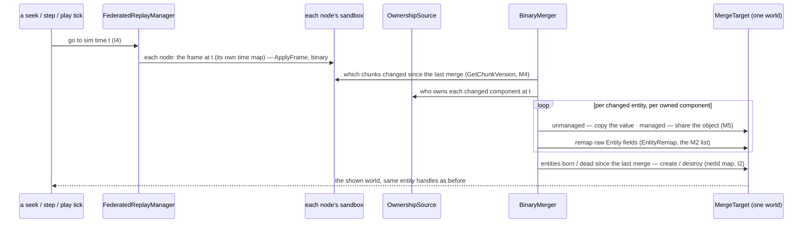
*What it shows: a step costs the CHANGED components only — a seek backwards (a keyframe restore) changes everything and is a full pass, still with
no JSON.*

### 6.4 Every part of the idea

| # | part | what it fixes | ⚠ risk / what it needs |
|---|---|---|---|
| **I1** | **binary copy** of each owned component from its owner's sandbox — unmanaged by value, managed by reference (M5) — into the target's OWN entities (not a chunk merge, §6.10) | the M1 gap disappears: no translator in the path, every recorded component kept exactly | the M2 remap list must be complete (incl. inline arrays — D03); reuse the auto-serializer's per-type field knowledge for the remap, not a second walker; keep the paradox rule (§6.10) |
| **I2** | **one persistent target world** with a netId → entity map; entities created on first sight, destroyed when gone from every node | stable handles: selection, Details, the frame diff, timeline references survive a step; the editor's one world is the target directly (D8) | an entity that changes owner keeps its target entity (the map is by network id) |
| **I3** | **incremental**: copy only chunks whose version changed since the last merge (M4) | the merged view can **PLAY** | measure the per-frame cost on the largest exercise; 0 B steady (R-2084) — the remap and the copy must not allocate |
| **I4** | **align by recorded sim time** (M6) **plus a per-node offset for the network latency between nodes, applied the SAME to sim time and wall time** (✏ R-4181 — SUPERSEDES "offsets only as an expert override") | no manual offsets in the normal case | a node that recorded no sim time (older format) falls back to wall ticks + offsets |
| **I5** | **the views lens**: for the selected entity, each replicated component's value at the OWNER and at every node holding a replica; a timeline lane marks frames where a replica differs beyond ε (`ComponentDiffService`) | what each node BELIEVED — the desync analysis Federation exists for | a Details section + one lane |
| **I6** | **federated search**: the search per participant file, each hit kept only for components that node owned at that frame, unioned by network id | search works in Merged (disabled there today) | ownership per frame needs I8 to be reliable |
| **I7** | **local entities from EVERY node**, tagged by node, with a per-node filter | effects from SimHost and markers from CGF both visible (today one "provider" node) | entities with no network id cannot correlate — each stays its node's |
| **I8** | **ownership from the recorded ownership COMPONENTS** (`NetworkAuthority.PrimaryOwnerId`, `DescriptorOwnership` per descriptor), the cold mask as a cross-check; and fix **D004** at the recorder (write a cold chunk when its version moved, as the debt note proposes) — ✅ the D004 half BUILT as `CE-4327` by the setter stamping the change instead (the cold table has no per-chunk version a `ref` write moves; see M3); the ownership-components half is still the merge's to build | M3: after a handover the merge picks the right owner | D004 is a recorder change — every recording benefits; older recordings keep the gap |
| **I9** | **an exclusion list of node-LOCAL components** that must never merge (spatial grids, network maps, caches, terrain services — the M1 / M2 tables mark them) | no node's private index or cache leaks into the merged world | the list must be maintained — a `[DataPolicy]` flag (e.g. `NodeLocal`) is the durable form |

### 6.5 What it changes, and what it supersedes

| | |
|---|---|
| code | `Fdp.Toolkits/ReplayBrowser/Federation`: `FederatedReplayManager` (sim-time seek), NEW `BinaryMerger` / `MergeTarget` / `OwnershipSource` / `EntityRemap`; `TransientMasterBuilder` kept as the oracle; the RB's `RebindActiveRepo` on every step goes (the target is persistent); the recorder (D004) |
| designs | [replay-browser-frankenstein](../designs/replay-browser-frankenstein/DESIGN.md) §7.4–§7.5 (the JSON DOM) and §9 (merged view = no Play) would be SUPERSEDED where adopted; §7.3's rule (owned AND not already taken, primary owner first) is KEPT — I8 only changes where "owned" is read |
| this design | §3 D8 (deserialize into the editor's world) becomes "the editor's world IS the merge target"; §5 Q8 is answered by I1 |

### 6.6 How it would be proven

| proof | |
|---|---|
| **oracle rail** | for each fixture exercise, every UNMANAGED component of the binary merge equals the JSON merge's (today's builder) — any difference is a bug in one of them |
| **owner rail** | per node: in the merged world, every component that node owned equals that node's own sandbox, field by field (managed included) |
| **remap rail** | every `Entity` field in the merged world resolves to a merged entity (the M2 list, plus the probe re-run as a rail so a new type cannot slip in) |
| **handover rail** | a recorded ownership handover: the merged world takes the component from the NEW owner from the handover frame on (I8 / D004) |
| **play rail** | 0 B per steady merged frame; the per-frame cost on the largest exercise, measured and written here |

### 6.7 Open questions — leans, no scheduling

| # | question | ⭐ lean |
|---|---|---|
| **Q9** ✅ R-4181 | adopt the binary merge (I1, I2, I9) in place of the JSON step | **yes** — it removes the M1 gap by construction and makes I3 possible |
| **Q10** ✅ R-4181 | merged PLAY (I3) | **yes**, once measured against R-2084 |
| **Q11** ✏ R-4181 | sim-time alignment (I4), offsets kept as override | ✏ **align by recorded sim time AND apply a per-node OFFSET — the network latency between nodes — the SAME offset to sim time and to wall time** (user: *"offset is needed because of network latency between node, applied same to sim time as well as wall time"*); ~~offsets only as an expert override~~ |
| **Q12** ✅ R-4181 | ownership from the recorded components + fix D004 at the recorder (I8) | **yes** — the recorder fix helps every recording, not only this view |
| **Q13** ✅ R-4181 | the views lens (I5), federated search (I6), local entities from every node (I7) | **yes** — they are what makes Federation an analysis tool |
| **Q14** ✅ R-4181 | a `NodeLocal` data policy for components that must never merge (I9) | **yes** — a flag beats a hand-kept list |

### 6.11 ⭐ Closed for the build *(`2026-11-09` — everything G-7 needs, so the lane builds without a question)*

🔒 User: *"I need the behavior to work without questions, if there is anything still open lets finish the design here first."*

| measured | where |
|---|---|
| the per-node offsets today are MANUAL (`SetNodeOffset`, default 0) | `FederatedReplayManager.cs:41-174` |
| every slave MEASURES its round trip to the master during Live (NTP-style, smoothed), but it is NOT recorded (`TimeSyncOffsetCalculatedEvent` is NoReplay) | `SlaveSyncController.cs:231-262` · `TimeBusEvents.cs:70-78` |
| a numeric ε already exists for "this value changed" | `ComponentDiffService` (ε 0.001, rail DIF-T04) |

| # | decision | ⭐ lean | rejected — one line |
|---|---|---|---|
| **M-1** | where the latency offset (R-4181) comes from | **recorded**: each node writes its measured one-way latency to the master (half the smoothed round trip) into its recording metadata; the merge applies it by default; *Offsets…* (the Federation window, debug — rows named by role, Q-B6) shows it and overrides it; the master's own node is 0; a recording without it = 0 + manual | manual only (today): nobody knows the number · estimated from the data: guesswork |
| **M-2** | one value or a curve | **one value per node per recording** (the median over the run) | a time-varying curve: no measured need |
| **M-3** | the sign | **decided by a rail, not here**: a cause on one node (a shot) precedes its effect on another (the hit) in the merged timeline | — |
| **M-4** | "differs" (I5) | the **existing** `ComponentDiffService` ε — ONE implementation | a second tolerance |
| **M-5** | the views lens UI (I5) | **Details ▸ a component ▸ *By node***: the owner (crown) and each replica, amber where it differs; **one timeline lane *Replica differs · <unit>*** for the selected unit, click = seek (mockup ① ②) | a separate window |
| **M-6** | local entities (I7) | from every node, tagged *"local to <node>"* in Details; **the Source menu's *Local entities shown from* checkboxes** (mockup ③), default: every node's on | one "provider" node (today) |
| **M-7** | ▶ in Merged (I3) | **S4 enables it** (0 B steady, R-2084); until S4 lands ui's A-9 greys it with the reason — S4 removes that reason (the same gate, no second rule) | — |
| **M-8** | an entity whose owner changes (I2, I8) | the merged entity KEEPS its identity (network id); its components switch source at the handover frame | a new entity per owner |
| **M-9** | where it runs | the all-in-one editor and the standalone Replay Browser (D2); ⛔ not a cluster AAR | — |

#### 6.11a ✅ DECIDED `2026-11-09` (R-4183) — alignment and offsets

✅ **The user: *"Please let the offset just as a manual slider for this time, no auto detection."*** ⇒ **A1** stands (align by the recorded
frame-locked WALL ticks; sim time is a display axis). **The per-node offset is a MANUAL slider** (the Federation window, *Offsets…*), default 0,
applied to that node's wall stamps for alignment — the original design's intent. ⛔ No auto-detection this time: A2, A2a and A3 below are
SUPERSEDED (kept as the record of what was measured); M-1, M-2, M-3 above are SUPERSEDED. The views lens (M-5) compares values at the same aligned
frame. The sync's own precision is filed (CE-4355). The table below is the HISTORY of this decision.

🔒 User: *"Why aligning merged data by sim time and not wall time? What if something changes while sim paused? … I'm still trying to find out a
practical reason for the time offsets. Does the original design says anything about it?"*

| measured | where |
|---|---|
| ⛔ sim time is NOT a unique key: the recorder keeps writing while sim time is paused (edits, graphics, objective marks) — many frames share one sim time | mgmt-1 §8.12 "Always Recording" |
| ⭐ every frame is stamped with the CLUSTER's frame-locked wall clock (`GlobalTime.TotalWallTicks`, which the slaves follow), not a local clock | `AsyncRecorder.cs:158, :223, :323` · R-4012 (a replay covers by `WallClockTicks`) · the cluster replay seeks by wall ticks (`ClusterMaster.RelativeTicksForSim`) |
| the half round trip is NOT the replication path (it lacks the owner's send phase and up to one receiver tick) | `SlaveTimeSyncTranslator.cs:108-127` (t1 / t4 on the main thread, the master's hold subtracted) |
| ⭐ the ORIGINAL intent of the offsets: *"optional interactively adjustable time offset for different node's recordings to compensate for slight time shift between nodes"* (the user, the frankenstein talk) — the residual CLOCK shift, not replication latency | `.dev/_DONE/replay-browser-frankenstein/merged-view.md:37, :122` |

| # | ✏ lean | rejected — one line |
|---|---|---|
| **A1** | **align the merge by the recorded frame-locked WALL ticks, each node's corrected by its estimated clock offset (A2)** (pauses included); sim time is a display axis only | by sim time: ambiguous through every pause |
| **A2** ✏ | ⭐ **the per-node CLOCK offset is real and is ESTIMATED from the recording** (the user: *"the wall clock time is synced, but that syncing can have some offset"* — measured: the sync contract allows **80 ms** spread across nodes in continuous mode, ~5 frames, `SimTimeSyncIntegrationTests.cs:35-37`; its offset is NTP-style with t4 taken at the frame's ingress poll). **Estimate, NTP-style, from replicated changes in BOTH directions** between a node and the master's node: lag A→B = latency + e, lag B→A = latency − e ⇒ **e = (lag A→B − lag B→A) / 2**, using A3's change matching on every replicated component with enough changes. **e is applied to that node's wall stamps for ALIGNMENT** (it corrects the stamp, it does not delay the data — so "no latency offset on owned data" still holds); the Federation window shows e with its evidence and overrides it; no evidence ⇒ 0 + manual | a fixed 0: up to ~5 frames of cross-node causality can invert · half the round trip: the wrong path |
| **A2a** ✏ | ⭐ **the evidence for Brain ↔ Muscle** (the user: *"we mostly need to measure the time offset between brain and muscle"*) — measured, both recorded (`DataPolicy.Default`) on both nodes and written RAW at the receiver's ingress: **Muscle → Brain: `SimVelocity`** (the Muscle owns the motion; the Brain's ingress sets the received linear velocity, `GeoSpatialIngressTranslator.cs:96-100`; the owner sends on a velocity change, `GeoSpatialEgressTranslator.cs:182-192`) · **Brain → Muscle: `NavigationIntent`** (the Brain owns it; the Muscle's ingress writes it as received, `NavigationIntentIngressTranslator.cs:85`). ⛔ NOT `SimTransform`: the Brain's dead reckoning blends the replica's position toward a projection every frame (`DeadReckoningSyncSystem.cs:115-131`), so its value is not the owner's · ⛔ NOT `NetworkTransform` / `NetworkVelocity`: `NoReplay`, not in the recording. Precision ≈ half a frame (each sample is frame-quantised); the median over every moving unit's changes. Assumes the latency is the same both ways (the NTP assumption). ⚠ not measured: the codec's velocity rounding (match within ε) and how many changes a typical exercise gives | positions: dead reckoning biases them · one direction only: cannot separate latency from clock error |
| **A3** | **replication LAG is a separate, measured number, used only by the views lens** (I5): *Measure lag* on the selected replicated component — over a window, every change of the replica is matched to the owner's matching earlier change; lag = the median gap. Works for a component sent only on change or by heartbeat (only changes count); too few changes ⇒ *"not enough changes to measure"*. The lens then compares the replica with the owner one lag earlier ⇒ *late* (matches after the lag) vs *wrong* (never matches) | half the round trip: wrong path · positions only: a component the user selected is the better evidence |
| **A4** | the M-4 ε and the M-5 / M-6 UI stand; the lens shows *"lag 37 ms (measured on Position, 212 changes)"* beside *By node* | — |

⭐ Mockup: [`better-merge-visual.svg`](better-merge-visual.svg) (`scripts/gen-better-merge-mockup.py`) — the acceptance spec for M-5, M-6, M-7 (R-4138).

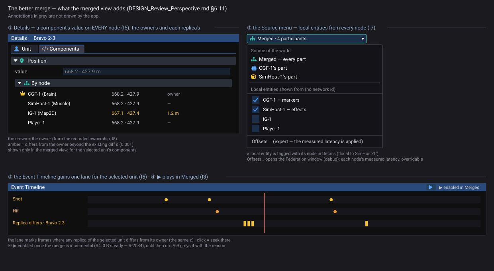

### 6.12 ⭐ The build — modules, classes, stages *(behaviors, `2026-11-09`, G-7 / CE-4354 — `build-state: BUILDING`)*

INVENTORY *(measured)*: `search_graph name_pattern=".*(Federat|TransientMaster|ReviewSource|MergedView|Sandbox).*" label=Class` ⇒ the merge is
ONE class, `TransientMasterBuilder` (`Build` = a new repo; `BuildInto` = into a given one), called by TWO hosts each step:
`ReplayBrowserSubsystem.BuildAndBindTransientMaster` (`:617-641`, a NEW repository + `RebindActiveRepo` every step) and
`ReviewSource.RefillMerged` (`Hrot.Editor/Review/ReviewSource.cs:309-322`, `_clearWorld()` then `BuildInto` the editor's own world every step).
`search_graph ".*(EntityField|Remap|EntityRefWalk|FieldLayout|EntityOffsets).*"` ⇒ `EntityRefRemap` walks NETWORK-id references
(`EntityRef` / `EntityLink`), not raw `Entity`; the raw-`Entity` field knowledge per type is in `FdpAutoSerializer` (scalar fields `:417`,
`[InlineArray]` of `Entity` `:101, :460` — CE-467). Seek alignment today: `FederatedReplayManager` by `BaseWallTicks` + manual per-node offsets
(`SetNodeOffset`, `:38-174`) — ⭐ already what R-4183 / §6.11a decided; S3 adds only the slider. Graph coverage could not be checked.

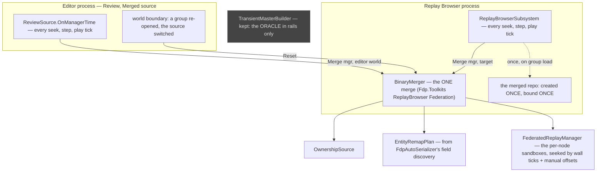

*What the module picture shows: the two hosts call ONE `BinaryMerger.Merge(manager, target)` from the place they call `TransientMasterBuilder`
today; the target is PERSISTENT on both (the Replay Browser binds its repo once; the editor stops clearing its world per step) and only a world
boundary resets the merger's maps. `TransientMasterBuilder` leaves the hosts and lives on as the oracle the rails compare against (grey).*

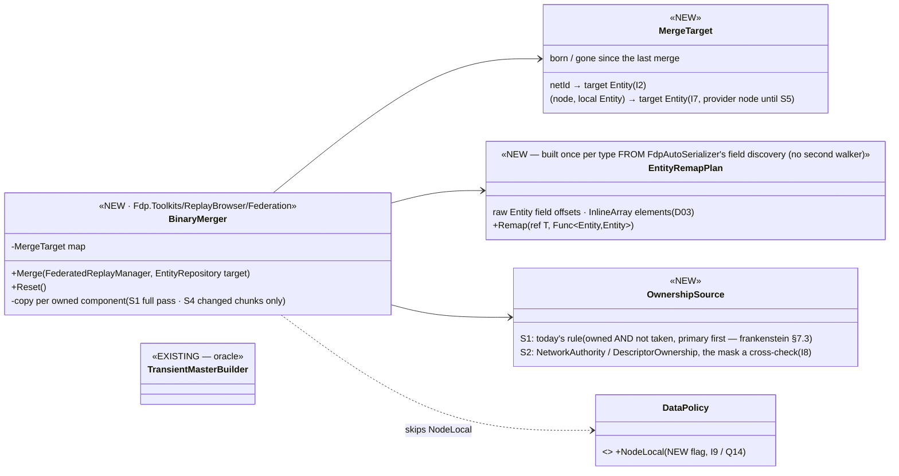

| stage | builds | the proof (§6.6) |
|---|---|---|
| **S1** | I1 binary copy (unmanaged by value; managed by reference, or a NEW instance when the type holds a raw `Entity` — immutable records, CLAUDE.md) · I2 one persistent target + `MergeTarget` · I9 `DataPolicy.NodeLocal` on the M1 / M2 node-local types, skipped · both hosts switched to `BinaryMerger` (full pass per step) · `TransientMasterBuilder` kept | the **oracle** rail (every unmanaged component equals the JSON merge's), the **owner** rail, the **remap** rail (+ the M2 probe as a rail) |
| **S2** | I8 `OwnershipSource` from the recorded ownership components | the **handover** rail (CE-4327 recordings) |
| **S3** | the *Offsets…* slider in the Federation window (`SetNodeOffset`, default 0, per node, applied to that node's wall stamps) | a rail: an offset moves that node's frame choice |
| **S4** | I3 incremental (only chunks whose version moved, M4) ⇒ ▶ in Merged (ui's A-9 reason removed) | the **play** rail: 0 B per steady merged frame (R-2084), the cost on the largest exercise written here |
| **S5** | I5 the views lens (Details *By node*, the *Replica differs* lane, `ComponentDiffService` ε) · I6 federated search · I7 local entities from every node (the Source menu's checkboxes) | the mockup's states side by side (R-4146) |

⛔ §6.10 holds in every stage: never a raw chunk / `EntityIndex` copy (indices are node-local) — every copy goes entity by entity into the
target's own entities; correctness over speed.

### 6.8 Appendix — M1: every recorded managed component and its scenario translator

| component | kind | data policy | translator | file |
|---|---|---|---|---|
| `ActionArgs` | record | NoScenario | ⛔ none | `FDP/Toolkits/Fdp.Toolkits/ScenarioRules/Actions/ActionComponents.cs` |
| `ActiveMissionPlan` | record | NoPreview | MissionPlanTranslator.cs | `FDP/Toolkits/Fdp.Toolkits/Behavior/Components/DomainMissionPlan.cs` |
| `AirPath` | record | NoPreview | NoScenario | ⛔ none | `FDP/Toolkits/Fdp.Toolkits/Motion/AirRoute.cs` |
| `BehaviorStartRecord` | record | NoPreview | NoScenario | ⛔ none | `FDP/Toolkits/Fdp.Toolkits/Behavior/Components/BehaviorStartRecord.cs` |
| `BinaryGhostStore` | record | NoPreview | ⛔ none | `FDP/Toolkits/Fdp.Toolkits/Replication/Components/BinaryGhostStore.cs` |
| `BpManagedCollectionDemo` | record | NoPreview | ⛔ none | `Hrot/Subsystems/Hrot.AI.Behaviors/Components/BpManagedCollectionDemo.cs` |
| `CanvasContextMenuState` | class | — | ⛔ none | `Hrot/Engine/Hrot.Core/Components/Map/CanvasContextMenuState.cs` |
| `ChildMap` | record | NoPreview | ⛔ none | `FDP/Toolkits/Fdp.Toolkits/Replication/Components/ChildMap.cs` |
| `DescriptorOwnership` | record | NoScenario | ⛔ none | `FDP/Toolkits/Fdp.Toolkits/Replication/Components/DescriptorOwnership.cs` |
| `EditablePolyline` | record | — | EditablePolylineTranslator.cs, RoutePlanTranslator.cs | `Hrot/Engine/Hrot.Core/Components/Map/EditablePolyline.cs` |
| `EgressPublicationState` | class | — | ⛔ none | `FDP/Toolkits/Fdp.Toolkits/Replication/Utilities/SmartEgressUtil.cs` |
| `InitialBlueprintsIntent` | class | — | BlueprintStateTranslator.cs | `Hrot/Engine/Hrot.Core/Scenario/Genesis/GenesisIntentComponents.cs` |
| `InitialHierarchyIntent` | class | — | VisHierarchyNodeTranslator.cs | `Hrot/Engine/Hrot.Core/Scenario/Genesis/GenesisIntentComponents.cs` |
| `InitialPassengersIntent` | class | — | PassengerBufferTranslator.cs | `Hrot/Engine/Hrot.Core/Scenario/Genesis/GenesisIntentComponents.cs` |
| `InitialRouteIntent` | class | — | PersonalRouteRefTranslator.cs | `Hrot/Engine/Hrot.Core/Scenario/Genesis/GenesisIntentComponents.cs` |
| `InitialTargetsIntent` | class | — | TargetMemoryTranslator.cs | `Hrot/Engine/Hrot.Core/Scenario/Genesis/GenesisIntentComponents.cs` |
| `InitialUnitSubordinateIntent` | class | — | UnitSubordinateTranslator.cs | `Hrot/Engine/Hrot.Core/Scenario/Genesis/GenesisIntentComponents.cs` |
| `InitialVehicleIntent` | class | — | IsEmbarkedTagTranslator.cs | `Hrot/Engine/Hrot.Core/Scenario/Genesis/GenesisIntentComponents.cs` |
| `MacroInstance` | record | Default | MacroInstanceTranslator.cs, VariantForms.cs | `FDP/Toolkits/Fdp.Toolkits/Scenario/Macros/MacroTypes.cs` |
| `MapSymbolOverride` | record | NoScenario | ⛔ none | `Hrot/Engine/Hrot.Core/Components/Map/MapSymbolOverride.cs` |
| `NetworkAckPeerSet` | record | NoPreview | ⛔ none | `FDP/Toolkits/Fdp.Toolkits/Replication/Components/NetworkComponents.cs` |
| `NetworkEntityMap` | class | — | ⛔ none | `FDP/Toolkits/Fdp.Toolkits/Replication/Services/NetworkEntityMap.cs` |
| `PausedTask` | record | NoPreview | NoScenario | ⛔ none | `FDP/Toolkits/Fdp.Toolkits/Behavior/Components/PausedTask.cs` |
| `PendingAuthorityGrants` | record | NoPreview | ⛔ none | `FDP/Toolkits/Fdp.Toolkits/Replication/Components/PendingAuthorityGrants.cs` |
| `PendingUnitCommand` | record | — | ⛔ none | `FDP/Toolkits/Fdp.Toolkits/Behavior/Components/PendingUnitCommand.cs` |
| `Program` | class | — | ⛔ none | `FDP/Engine/Fdp.Core.Benchmarks/QueryDeltaBenchmarks.cs` |
| `RoutePlan` | record | NoPreview | RoutePlanTranslator.cs | `Hrot/Engine/Hrot.Core/Components/Map/RoutePlan.cs` |
| `ScenarioDescriptionResident` | class | — | ⛔ none | `FDP/Toolkits/Fdp.Toolkits/Scenario/ScenarioDescription.cs` |
| `SensorCapability` | record | NoScenario | ⛔ none | `FDP/Toolkits/Fdp.Toolkits/Perception/Components/SensorComponents.cs` |
| `SensorConfigPayload` | record | NoPreview | NoScenario | ⛔ none | `FDP/Toolkits/Fdp.Toolkits/Perception/Components/SensorComponents.cs` |
| `SimCombatDef` | record | NoPreview | ⛔ none | `Hrot/Engine/Hrot.Core/MapDefinitions/Tkb/SimCombatDef.cs` |
| `SopStartRecord` | record | NoPreview | NoScenario | ⛔ none | `FDP/Toolkits/Fdp.Toolkits/Behavior/Components/SopState.cs` |
| `SubordinateOrders` | record | NoPreview | NoScenario | ⛔ none | `FDP/Toolkits/Fdp.Toolkits/Behavior/Components/SubordinateOrders.cs` |
| `TerrainDefinition` | class | — | ⛔ none | `FDP/Toolkits/Fdp.Toolkits/Terrain/TerrainDefinition.cs` |
| `TerrainObjectKey` | record | NoScenario | ⛔ none | `FDP/Toolkits/Fdp.Toolkits/Terrain/TerrainObjects.cs` |
| `TerrainWorld` | class | — | ⛔ none | `FDP/Toolkits/Fdp.Toolkits/Terrain/TerrainWorld.cs` |
| `TkbCompositionDef` | record | NoPreview | ⛔ none | `Hrot/Engine/Hrot.Core/MapDefinitions/Tkb/TkbCompositionDef.cs` |
| `TrafficFrame` | class | — | ⛔ none | `Hrot/Engine/Hrot.Traffic/TrafficFrame.cs` |
| `TrafficNetCache` | class | — | ⛔ none | `Hrot/Engine/Hrot.Traffic/TrafficNetCache.cs` |
| `WorldSurveyAnswer` | class | — | ⛔ none | `FDP/Toolkits/Fdp.Toolkits/Perception/Survey/WorldSurveyModel.cs` |
| `WorldSurveyRequest` | record | — | ⛔ none | `FDP/Toolkits/Fdp.Toolkits/Perception/Survey/WorldSurveyModel.cs` |

### 6.9 Appendix — M2: every component with a raw `Entity` field

| component | kind | data policy | recorded | the field | file |
|---|---|---|---|---|---|
| `ActionStatus` | struct | NoScenario | recorded | `ActionStatus→ActionStatusRow.Entity` | `FDP/Toolkits/Fdp.Toolkits/Behavior/Diagnostics/ActionStatus.cs` |
| `AmmoLoadout` | struct | Default | recorded | `AmmoLoadout.Entity` | `FDP/Toolkits/Fdp.Toolkits/Combat/Components/AmmoLoadout.cs` |
| `BallisticProjectile` | struct | Default | recorded | `BallisticProjectile.Entity` | `FDP/Toolkits/Fdp.Toolkits/Combat/Components/CombatComponents.cs` |
| `ChildMap` | record | NoPreview | recorded | `ChildMap.IReadOnlyDictionary<int, Entity>` | `FDP/Toolkits/Fdp.Toolkits/Replication/Components/ChildMap.cs` |
| `Custody` | struct | NoScenario | recorded | `Custody.Entity` | `FDP/Toolkits/Fdp.Toolkits/Civilians/Custody.cs` |
| `Decoy` | struct | NoScenario | recorded | `Decoy.Entity` | `FDP/Toolkits/Fdp.Toolkits/Combat/Components/AirDefenceComponents.cs` |
| `Descent` | struct | NoScenario | recorded | `Descent.Entity` | `FDP/Toolkits/Fdp.Toolkits/Motion/Descent.cs` |
| `EffectAnchor` | struct | NoScenario | NoPreview | recorded | `EffectAnchor.Entity` | `Hrot/Engine/Hrot.Core/Components/Map/EffectComponents.cs` |
| `EqsSensor` | struct | Default | recorded | `EqsSensor.Entity` | `FDP/Toolkits/Fdp.Toolkits/Spatial/Eqs/EqsComponents.cs` |
| `GuidedRound` | struct | NoScenario | recorded | `GuidedRound.Entity` | `FDP/Toolkits/Fdp.Toolkits/Combat/Components/GuidedRound.cs` |
| `HeldFuze` | struct | NoScenario | recorded | `HeldFuze.Entity` | `FDP/Toolkits/Fdp.Toolkits/Combat/RoundPickUp.cs` |
| `HierarchyNode` | struct | Default | recorded | `HierarchyNode.Entity` | `FDP/Engine/Fdp.Core/HierarchyNode.cs` |
| `IsAssistingTag` | struct | Fdp.Core.NoScenario | recorded | `IsAssistingTag.Entity` | `FDP/Toolkits/Fdp.Toolkits/Behavior/Components/InteractionComponents.cs` |
| `IsEmbarkedTag` | struct | Default | recorded | `IsEmbarkedTag.Entity` | `FDP/Toolkits/Fdp.Toolkits/Behavior/Components/InteractionComponents.cs` |
| `LookState` | struct | NoScenario | recorded | `LookState.Entity` | `FDP/Toolkits/Fdp.Toolkits/Perception/Look/LookState.cs` |
| `NetworkEntityMap` | class | — | recorded | `NetworkEntityMap.ConcurrentDictionary<int, Entity>` | `FDP/Toolkits/Fdp.Toolkits/Replication/Services/NetworkEntityMap.cs` |
| `PartMetadata` | struct | Default | recorded | `PartMetadata.Entity` | `FDP/Toolkits/Fdp.Toolkits/Replication/Components/PartMetadata.cs` |
| `PassengerBuffer` | struct | Default | recorded | `public Entity` | `FDP/Toolkits/Fdp.Toolkits/Behavior/Components/InteractionComponents.cs` |
| `PersonalRouteRef` | struct | Default | recorded | `PersonalRouteRef.Entity` | `Hrot/Engine/Hrot.Core/Components/Map/PersonalRouteRef.cs` |
| `RecentDetonations` | struct | NoScenario | recorded | `RecentDetonations→RecentBurstSlots→RecentBurst.Entity` | `FDP/Toolkits/Fdp.Toolkits/Combat/RecentDetonations.cs` |
| `SpatialGridData` | struct | — | recorded | `SpatialGridData→SpatialHashGrid.NativeArray<Entity>` | `FDP/Toolkits/Fdp.Toolkits/CarKinem/Spatial/SpatialGridData.cs` |
| `SquadDrillTrace` | class | Transient | not recorded | `SquadDrillTrace.Entity` | `FDP/Toolkits/Fdp.Toolkits/Squad/State/SquadDrillTrace.cs` |
| `SquadLeadership` | struct | NoScenario | recorded | `SquadLeadership.Entity` | `FDP/Toolkits/Fdp.Toolkits/Squad/SquadLeadership.cs` |
| `SubordinateOrders` | record | NoPreview | NoScenario | recorded | `SubordinateOrders.Entity` | `FDP/Toolkits/Fdp.Toolkits/Behavior/Components/SubordinateOrders.cs` |
| `UnitRoster` | struct | — | recorded | `UnitRoster.Entity` | `FDP/Engine/Fdp.Core/CommandHierarchy/UnitRoster.cs` |
| `Utterance` | struct | NoScenario | recorded | `Utterance.Entity` | `FDP/Toolkits/Fdp.Toolkits/Civilians/Speech.cs` |
| `VisHierarchyNode` | struct | Default | recorded | `VisHierarchyNode.Entity` | `FDP/Engine/Fdp.Presentation/Vis2D/Components/HierarchyComponents.cs` |
| `WeaponPosture` | struct | Default | recorded | `WeaponPosture.Entity` | `FDP/Toolkits/Fdp.Toolkits/Combat/Components/WeaponPosture.cs` |
| `WeaponTask` | struct | Default | recorded | `WeaponTask.Entity` | `FDP/Toolkits/Fdp.Toolkits/Combat/Components/WeaponTask.cs` |
| `ZoneEnvironmentData` | struct | — | recorded | `ZoneEnvironmentData→TerrainQueryRequest.Entity` | `FDP/Toolkits/Fdp.Toolkits/CarKinem/ZoneEnvironmentData.cs` |

⚠ Both appendices come from a SOURCE parse (`scripts/probe-recorded-components.py`), not reflection: "recorded" = no `NoReplay` / `Transient`
policy; a component registered without `[ComponentId]`, or an `Entity` nested deeper than one struct, is missed — re-run the probe (and confirm by
reflection) before building.

### 6.10 Why JSON was chosen back then — and what the binary idea must not lose *(read `2026-11-08`)*

🔒 User: *"I'm wondering why the JSON-based merging was selected back then … Might be interesting to find out if we are not missing something important."*
Sources: the design talk `.dev/_DONE/replay-browser-frankenstein/merged-view.md` (the spec + the NotebookLM review) · its `DESIGN.md` · `DEBT-TRACKER.md`.

| the reason, as recorded | where | does it still hold for I1? |
|---|---|---|
| **a RAW-MEMORY merge corrupts the world**: `.fdp` stores whole 64 KB chunks and `EntityIndex` arrays whose `Entity.Index` is node-local (*"index 42 on the Brain might be a tank; on the Muscle a tree"*) — merging chunks breaks the free list and the layout | `merged-view.md:27`, review `:124-130` | ✅ still true — and **I1 is NOT a chunk merge**: it creates its own entities in the target and copies component VALUES per entity, so the layout is the target's own |
| **REUSE the remap that exists**: the scenario serializer already routes every `Entity` handle through `IGuidResolver` (the machinery scenario loading uses) — *"we are reusing it, not building it"* | `merged-view.md:79-84` | ⚠ **this is I1's real cost**: a binary copy needs its OWN remap of the M2 fields (28 types) — the reason JSON was the cheaper build. Look first for a way to reuse the auto-serializer's compiled per-type knowledge of where the `Entity` fields are, rather than writing a second walker (the shared-and-unified rule) |
| **correctness over speed — the user rejected a fast path**: a "Tier 1" inspector-level federation (read each owner's slice in place, no copy) was proposed and refused: *"I do not want any tier 1 … I need "correct" merged view, not fast but broken one"* — it could not make cross-node references valid, so gizmos and hierarchy tools would read garbage | review `:134-212` | ✅ **I1 keeps the rule** — every reference is remapped into ONE concrete repository; I1 changes only HOW the values get there. The oracle and remap rails (§6.6) are what prove it stays "correct" |
| slow was ACCEPTED, not wanted — *"step-by-step offline analysis, not 60 Hz playback"* | `merged-view.md:82` | I3 removes a cost that was only tolerated |

**What the record shows was NOT considered — the things this idea adds:**

| | |
|---|---|
| **managed components** | never discussed: the design assumed *"existing translator + auto-serializer code paths"* cover every component (`DESIGN.md:342`). M1 shows 30 recorded managed types with no translator — an oversight, not a decision |
| **the owner source** | the SPEC said authority is read from `NetworkAuthority` and `DescriptorOwnership` per component (`merged-view.md:77`, review `:206, 243`); the built design switched to the cold `AuthorityMask` as *"the existing field"* (`DESIGN.md` §7.3) — which is where M3's stale owner after a handover comes from. ⭐ I8 RETURNS to the spec's source |
| **entity handles inside inline arrays** | the batch's own debt D03: the test for an inline-array `Entity` handle through the JSON path was never written — unverified even today; the I1 remap must cover it AND the oracle rail must include such a type |

**What must be carried into I1 unchanged:** the paradox rule — a reference whose target does not exist in the merged world becomes `Entity.Null`
AND is flagged (design §7.6) — the remap must not throw, and must not hide it.

---
_coordinator lane, 2026-11-08_
