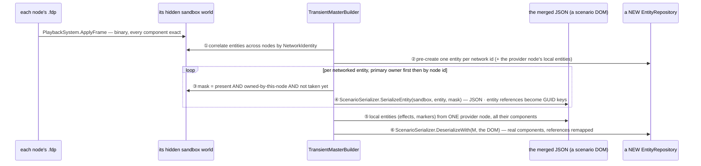
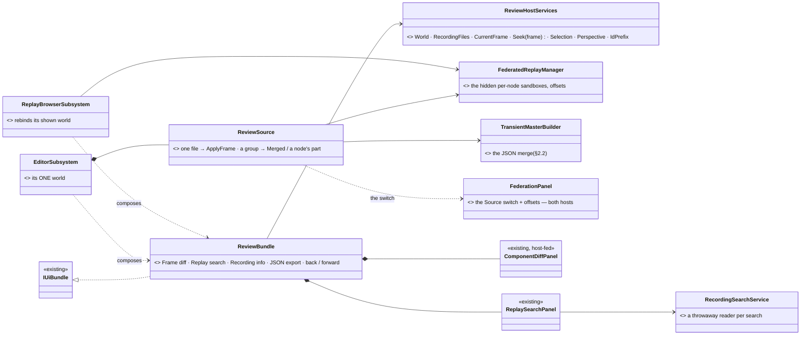
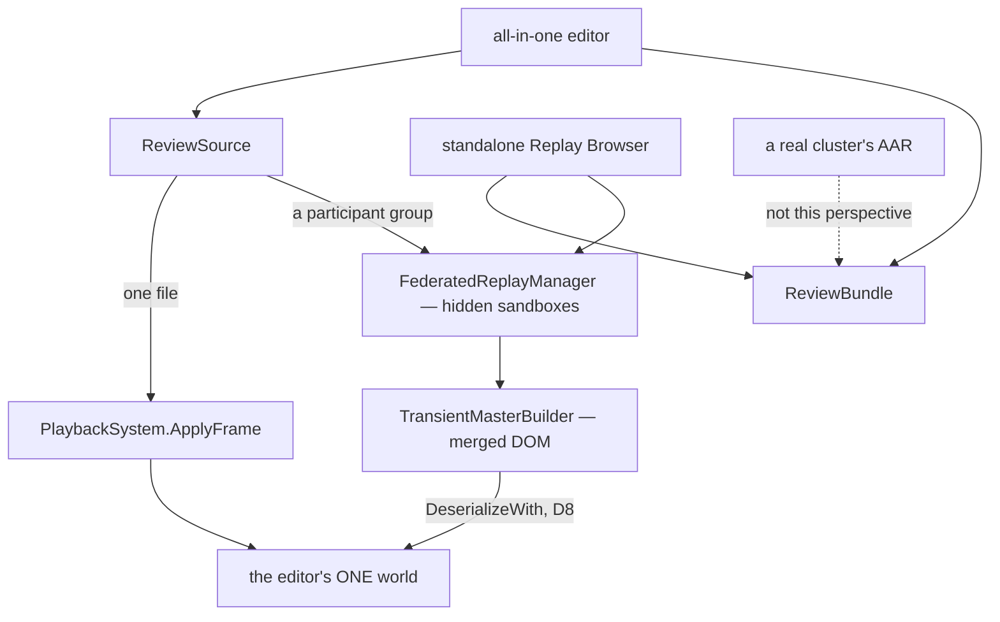

<!--STATUS
state: LIVE
build-state: DESIGN — first iteration; the user's answers folded in (2026-11-08); open: M1 (measure) and Q8 (the merge's managed-component gap)
updated: 2026-11-08 (third pass — the user: the perspective is for the ALL-IN-ONE editor and the standalone Replay Browser, never a cluster AAR (a debrief); merged by default when the files hold several participants; DAR unrelated; the merge measured — §2.2) · 2026-11-08 (second pass — Federation as the SOURCE of the editor's one world) · 2026-11-08 (first version — CE-3419)
current-answer: §1 measured · §2 how Federation and the merge work · §3 the design · §4 stages · §5 decisions and the one open question
stale-below: nothing
known-rot: ⛔ first pass: "Federation does not fit the editor" / "standalone only" — WITHDRAWN (§2.4) · ⛔ second pass: the "this station's part" source during a CLUSTER AAR, G2 (read-only), Q5 (DAR), Q6 (per-station switch in a cluster) — WITHDRAWN by the user (§2.4) · the first pass cited R-4010 for "each node replays its own recording" — wrong id; the rule is W5 in DESIGN_Replay_Time_Axis_And_Review
known-conflict: none
related-designs:
  - DESIGN_Replay_Browser_UX.md — OWNS the standalone Replay Browser's UX; its Q-B3 (default layout) and Q-B6 (Federation) are answered here (§5)
  - ../designs/replay-browser-frankenstein/DESIGN.md — OWNS Federation and the merged view (§7 the synthesis); §2.2 here measures what it keeps and loses
  - ../DESIGN_Replay_Time_Axis_And_Review.md — OWNS DAR / AAR in a cluster (a debrief, W5: each node replays its own recording) — NOT this perspective's case
  - ../blueprints/Architect_Question_108_Run_Mode_Picker.md — §0 the run controls (AAR = the blue ▶ state), unchanged here
  - DESIGN_Rules_Bundle.md — the precedent: one bundle of windows every host composes (CE-4292)
  - DESIGN_Condition_Editor.md — §C5: the data breakpoints are ONE panel for the editor and the Replay Browser already
-->

# DESIGN — the Review perspective: recording ANALYSIS in the all-in-one editor and the Replay Browser

*Generated by `scripts/gen-review-perspective-mockup.py`. Scope: the perspective's layout, the Source switch and the windows it adds; the run
controls (AQ108 §0), the rules bundle, Details and the Event Timeline are context, unchanged.*

## 0. Why

🔒 User, `2026-11-08`: *"the Replay Browser could be a perspective of the editor"* (CE-3419) → *"the usual recording is made of multiple parts,
each one generated by a single node like CGF or SimHost … the federation mode is something extremely important, because it combines the worlds
from multiple participants into a single one that can be analyzed"* → *"the editor is an all-in-one application which is having its own internal
cluster … there are no real other nodes … The AAR in a real cluster mode is usually not a replay analysis session. It is serving for the
debriefing for the trainees. So likely the replay browser mode or perspective makes sense mainly in the all-in-one editor or in a standalone
replay browser node."*

## 1. Measured *(2026-11-08)*

**INVENTORY.** `scripts/cbm.sh search_graph .*(Replay|Recording|Federat|Perspective).* Class` → **174** (has_more; the windows that matter read with
grep) · grep `RegisterWindow(` in `Hrot.ReplayBrowser` → **6** · the panels' constructors · `TransientMasterBuilder`, `ScenarioSerializer`,
`FdpAutoSerializer` read whole. ⚠ coverage unchecked (`check_index_coverage` is not in the CLI).

| the Replay Browser's window | today | in the editor today |
|---|---|---|
| Rules · Mission summary · debriefs · Inspector · Event browser · Details · Event Timeline + Tasks lanes · Data breakpoints · Director | ✅ ONE shared bundle / panel each | ✅ the same |
| **Frame diff** (+ ◀ ▶ next change) | `ComponentDiffPanel`, host-fed; the next change by `EntityChangeFinder` over the FILE | ⛔ no window (the finder already runs in the editor's HTTP API) |
| **Replay search** | `ReplaySearchPanel` over `IRecordingSearchService.ExecuteSearch(fdpPath, …)` — a throwaway reader | ⛔ no window (the service already runs in the editor's HTTP API) |
| Recording info · JSON export | over the RB's transport | ⛔ none |
| **Federation** — the per-node worlds, offsets, the merged view | `FederatedReplayManager`, `FederationPanel`, `TransientMasterBuilder` | ⛔ none |
| what is SHOWN | ONE world, `_activeRepo`, rebound to a node's sandbox or the merged master (`RebindActiveRepo`, `ReplayBrowserSubsystem.cs:598, 632, 638`) | ONE world — the editor node's |
| how a recorded frame enters a world | — | `PlaybackSystem.ApplyFrame(repo, reader)` (`Fdp.Core/FlightRecorder/PlaybackSystem.cs:31`) — any repository |

## 2. How Federation and the merge work

### 2.1 Federation

Every participant node records its OWN world into its own `.fdp`. Federation opens all the files of one exercise: each into its own HIDDEN sandbox
world (`ReplayBrowserContext`), aligned on one wall-clock tick with a per-node offset, all seeked together. It SHOWS one world: a chosen node's,
or the merged one.

### 2.2 ⭐ The merge, measured — **yes, it is JSON, and it ends as real components in one real world**

`TransientMasterBuilder.Build` (`Fdp.Toolkits/ReplayBrowser/Federation/TransientMasterBuilder.cs`), step by step:

*What it shows that prose hid: the frames go BINARY into each node's world; only the step BETWEEN those worlds and the merged one is JSON — the
SCENARIO serializer, built to save scenarios, reused to copy a component subset across worlds.*

| what the JSON step keeps | what it may lose — ⚠ the finding |
|---|---|
| ✅ every **unmanaged** (struct) component of the extracted mask — `FdpAutoSerializer` compiles a field-by-field copy for every snapshotable VALUE type (`FdpAutoSerializer.cs:93-96`) | ⛔ **managed** (class / record) components are NOT auto-serialized (`type.IsValueType` only, `:96`) — they survive ONLY through a scenario TRANSLATOR (27 of them), and a translator writes what a SCENARIO keeps (authored data), not necessarily the runtime state a recording holds |
| ✅ entity references across nodes (remapped through GUID keys) | ⚠ a translator that projects (e.g. a brain snapshot as `{Name, Params, Origin}`) brings back its projection, not the exact runtime object |
| ✅ ownership: each component from the node that owned it | ⚠ cost: a full JSON round-trip of the world per step — hundreds of ms; Play off, step / scrub only (the RB's own rule) |

⇒ **M1 (measure before V6 ships):** list the managed components that are RECORDED (in a node's `.fdp`) and have NO translator, or a translator that
drops runtime fields — those are what the merged view silently lacks. A rail: for each node, its owned components in the merged world equal its own
sandbox's, field by field.

### 2.3 Where the perspective applies — the user's ruling

| host | its recordings | Review perspective |
|---|---|---|
| **all-in-one editor** (one node, an internal orchestrator — no real other nodes) | ① its OWN runs: ONE file holding everything (brain and muscle in one world) · ② a REAL cluster's runs opened from disk: several participant files (CGF, SimHost …) | ✅ — ① plain playback of the one file; ② **Federation, merged by default** |
| **standalone Replay Browser** | any files | ✅ — the same perspective and layout |
| **a real cluster's AAR** | each node replays its own part (W5) | ⛔ NOT this perspective — it is the trainees' debrief, no frame analysis |
| **DAR** | — | ⛔ unrelated — a training review during the run |

### 2.4 ⛔ Withdrawn by the user *(kept for the record)*

~~First pass: Federation does not fit the editor~~ (the RB shows one world, and analysis needs the parts) · ~~second pass: a "this station's part"
source during a cluster AAR, Q6 per-station switching, G2 "read-only and quiet"~~ — 🔒 *"during the AAR we are not writing anything anywhere"* ·
~~G1 component ids~~ — 🔒 *"the editor have to know all the component IDs"* (only a component removed since an old recording is unknown — the
serializer's `UnknownComponentPolicy` reports it) · ~~Q5 DAR~~ — unrelated.

## 3. The design

| ⭐ decision | |
|---|---|
| **D1 — Review is a PERSPECTIVE** (a window layout), entered on opening a recording for analysis in the editor, left when it is closed | the run mode stays AQ108 §0's |
| **D2 — ONE `ReviewBundle`** (Frame diff, Replay search, Recording info, JSON export, ◀ ▶ navigation), composed by the editor AND the Replay Browser | the RulesBundle precedent; the RB's hand-written registrations deleted |
| **D3 — the host gives the bundle ONE world and the recording**: `World`, `RecordingFiles`, `CurrentFrame`, `Seek(frame)`, `Selection` | the editor: its world; the RB: the shown world |
| **D4 — the analysis reads the FILES** in throwaway readers, never the shown world | as the editor's HTTP API already does |
| **D5 — search hits and breakpoint stops become Event Timeline lanes**; a click seeks | — |
| **D6 — the editor's ONE world has a SOURCE**: a single file (its own run) plays straight into it (`ApplyFrame`); a participant GROUP goes through the same `FederatedReplayManager` the RB uses (hidden sandboxes) and the shown world is filled from **Merged** (default) or **one node's part** | ⭐ one world shown, the parts hidden — the RB's own shape; the internal orchestrator seeks the one node, the source answers |
| **D7 — the default follows the FILES** (the user): several participant files ⇒ **Merged**; one file ⇒ that file | — |
| **D8 — the merged world is DESERIALIZED STRAIGHT INTO the editor's world** (cleared first) — the way a scenario load fills it — instead of a second repository + a copy | one conversion, not two; the RB keeps its rebind |
| **D9 — the standalone Replay Browser composes the same bundle, the same Federation pieces and the same LAYOUT** (Q-B3) | one tool, two hosts |

*What the picture shows: one bundle of windows for both hosts; in the editor ONE `ReviewSource` decides what fills the one world — a file played
straight in, or a group merged through the RB's own pieces.*

*Who calls it: the internal orchestrator's seek (or a step) asks `ReviewSource` once per move; a merged step costs a JSON round-trip, so the
merged source steps / scrubs only. The dotted edge: a real cluster's AAR is the debrief, never this perspective.*

## 4. Stages

| # | what | acceptance |
|---|---|---|
| **V1** | `ReviewBundle` + `ReviewHostServices`; the RB composes it (its four registrations deleted) | the RB's window-set golden unchanged; its frame rails green |
| **V2** | the editor composes it — its own run's file: Frame diff and Replay search | a search hit seeks and selects; 0 B per steady frame |
| **V3** | the Review perspective (layout of the mockup), the same layout as the RB's default | side by side with `review-perspective-visual.svg` (R-4146) |
| **V4** | search hits and breakpoint stops as Event Timeline lanes | a click seeks |
| **V5** | **M1** measured (§2.2) — the recorded managed components the merge loses | a list in this design; the round-trip rail per node |
| **V6** | `ReviewSource` in the editor: a participant group → Merged (default, D7) or a node's part (the Source switch, D6), deserialized into the one world (D8) | a CGF-only behaviour state readable in Details on Merged; a node's part plays; Merged steps |

## 5. Decisions — the user's answers, and the one open question

| # | | |
|---|---|---|
| **Q1** | switch to Review when a recording opens for analysis | ✅ (lean, not objected to) |
| **Q2** | the standalone Replay Browser stays | ✅ |
| **Q3** (= RB Q-B3) | one layout, shared | ✅ 🔒 *"the standalone replay browser layout is probably okay to be shared with the editor's replay browser perspective"* |
| **Q4′** (= RB Q-B6) | Federation in the editor, as the source of its one world | ✅ |
| **Q7** | the default | ✅ 🔒 *"If there are multiple participants that produced their own [.fdp] file … we by default open in merged mode"* |
| ~~Q5 · Q6~~ | DAR · per-station switching in a cluster | ⛔ withdrawn (§2.4) |
| **Q8** ⏳ | **the merge's managed-component gap (§2.2)** — keep the JSON merge for the first iteration and FILL the gap found by M1 (a translator, or a recording-exact copy for those types), or replace the step between the sandboxes and the merged world by a BINARY component copy with a reference remap | ⭐ **lean: keep the JSON merge now, measure M1, then decide** — it is built, tested and correct for unmanaged state; a binary merge is a second implementation to justify with M1's numbers. ⛔ rejected: building the binary merge before knowing what is lost |

---
_coordinator lane, 2026-11-08_
