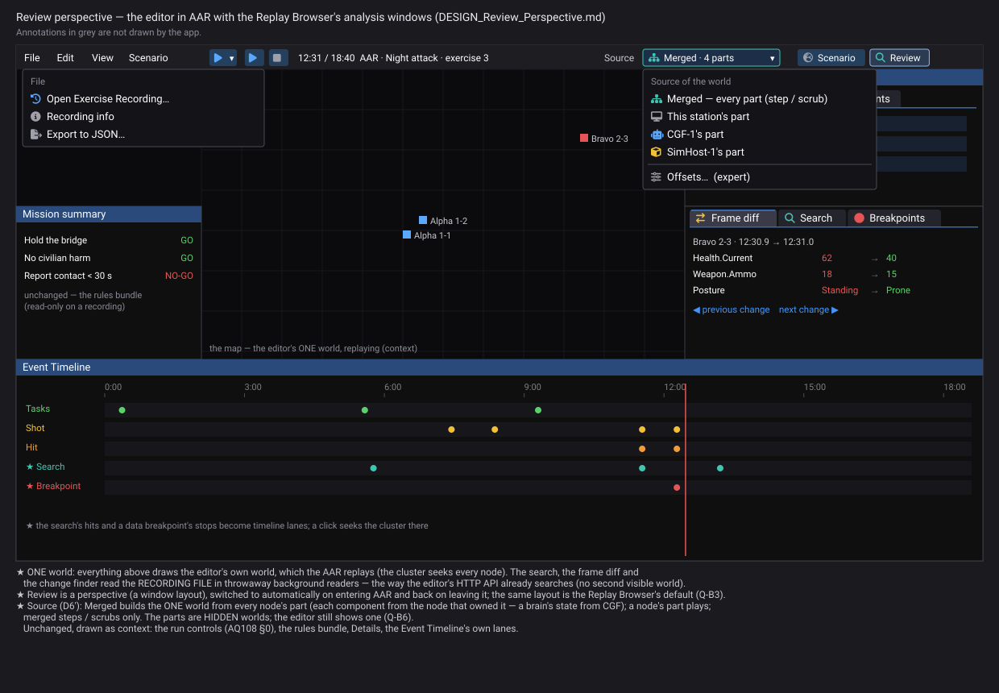
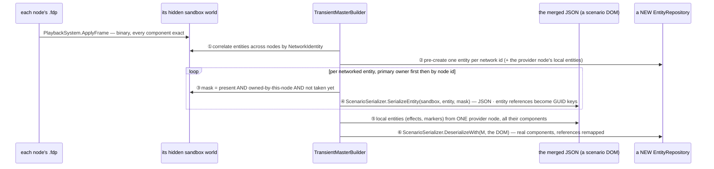
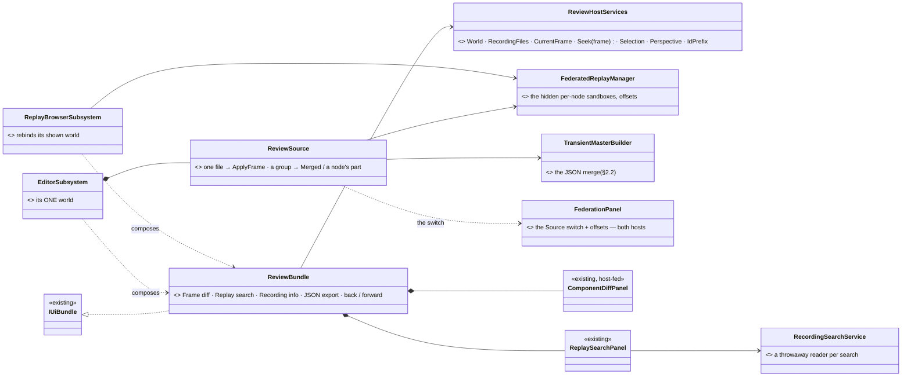
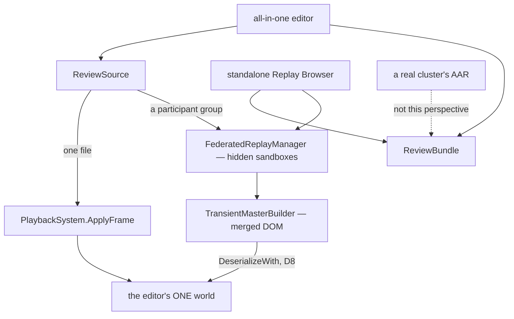
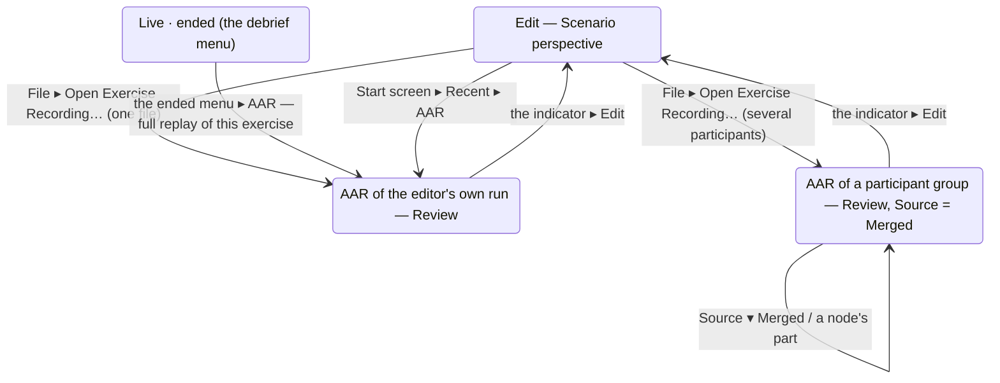
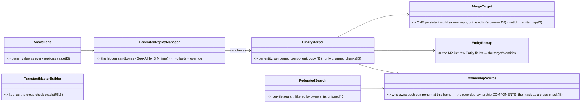
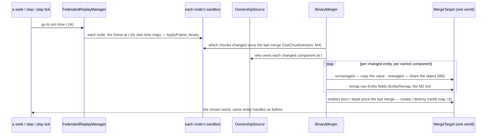

<!--STATUS
state: LIVE
build-state: DESIGN — the perspective's first iteration (§3–§5) + a better merge recorded complete and UNSCHEDULED (§6: M1–M6 measured, I1–I9, Q9–Q14)
updated: 2026-11-08 (third pass — the user: the perspective is for the ALL-IN-ONE editor and the standalone Replay Browser, never a cluster AAR (a debrief); merged by default when the files hold several participants; DAR unrelated; the merge measured — §2.2) · 2026-11-08 (second pass — Federation as the SOURCE of the editor's one world) · 2026-11-08 (first version — CE-3419)
current-answer: ⭐ §0a the idea on one page · §3a entering and leaving · §1 measured · §2 how Federation and the merge work · §3 the design · §4 stages · §5 decisions · ⭐ §6 a better merge — the full idea, measured, unscheduled (I1–I9, Q9–Q14, appendices §6.8 / §6.9)
stale-below: nothing
known-rot: ⛔ first pass: "Federation does not fit the editor" / "standalone only" — WITHDRAWN (§2.4) · ⛔ second pass: the "this station's part" source during a CLUSTER AAR, G2 (read-only), Q5 (DAR), Q6 (per-station switch in a cluster) — WITHDRAWN by the user (§2.4) · the first pass cited R-4010 for "each node replays its own recording" — wrong id; the rule is W5 in DESIGN_Replay_Time_Axis_And_Review
known-conflict: none
related-designs:
  - DESIGN_Replay_Browser_UX.md — OWNS the standalone Replay Browser's UX; its Q-B3 (default layout) and Q-B6 (Federation) are answered here (§5)
  - ../designs/replay-browser-frankenstein/DESIGN.md — OWNS Federation and the merged view (§7 the synthesis); §2.2 here measures what it keeps and loses
  - ../DESIGN_Replay_Time_Axis_And_Review.md — OWNS DAR / AAR in a cluster (a debrief, W5: each node replays its own recording) — NOT this perspective's case
  - ../blueprints/Architect_Question_108_Run_Mode_Picker.md — §0 the run controls (AAR = the blue ▶ state), unchanged here
  - DESIGN_Rules_Bundle.md — the precedent: one bundle of windows every host composes (CE-4292)
  - DESIGN_Condition_Editor.md — §C5: the data breakpoints are ONE panel for the editor and the Replay Browser already
-->

# DESIGN — the Review perspective: recording ANALYSIS in the all-in-one editor and the Replay Browser

*Generated by `scripts/gen-review-perspective-mockup.py`. Scope: the perspective's layout, the Source switch and the windows it adds; the run
controls (AQ108 §0), the rules bundle, Details and the Event Timeline are context, unchanged.*

## 0. Why

🔒 User, `2026-11-08`: *"the Replay Browser could be a perspective of the editor"* (CE-3419) → *"the usual recording is made of multiple parts,
each one generated by a single node like CGF or SimHost … the federation mode is something extremely important, because it combines the worlds
from multiple participants into a single one that can be analyzed"* → *"the editor is an all-in-one application which is having its own internal
cluster … there are no real other nodes … The AAR in a real cluster mode is usually not a replay analysis session. It is serving for the
debriefing for the trainees. So likely the replay browser mode or perspective makes sense mainly in the all-in-one editor or in a standalone
replay browser node."*

## 0a. ⭐ The idea on one page *(2026-11-08)*

| | |
|---|---|
| **what** | the editor gets a **Review** perspective — the Replay Browser's analysis tools (search, frame diff, recording info, JSON export, ◀ ▶ navigation, search hits and breakpoint stops as timeline lanes) on the editor's ONE world; the standalone Replay Browser keeps working and shows the SAME windows in the SAME layout |
| **where** | the **all-in-one editor** (one node, its internal orchestrator) and the **standalone Replay Browser**. ⛔ NOT a real cluster's AAR — that is the trainees' debrief (W5: every node replays its own part) |
| **what fills the one world** | a **single recording** (the all-in-one editor's own run) plays straight in · a **participant group** (a real cluster's run: CGF, SimHost … each its own file) goes through the Replay Browser's Federation pieces and is shown **Merged** by default (each component from the node that owned it) or as one node's part — the Source switch |
| **how a single piece is reused** | ONE `ReviewBundle` of windows both hosts compose (the RulesBundle precedent); the editor adds ONE `ReviewSource` over the existing `FederatedReplayManager` + merge |
| **when you are in it** | §3a — opening a recording for analysis switches to Review; going back to Edit switches back; the perspective button works by hand |
| **what it is not** | not a new run mode (the indicator still says AAR, AQ108 §0); not a second visible world; not the better merge (§6 — recorded, unscheduled) |

## 1. Measured *(2026-11-08)*

**INVENTORY.** `scripts/cbm.sh search_graph .*(Replay|Recording|Federat|Perspective).* Class` → **174** (has_more; the windows that matter read with
grep) · grep `RegisterWindow(` in `Hrot.ReplayBrowser` → **6** · the panels' constructors · `TransientMasterBuilder`, `ScenarioSerializer`,
`FdpAutoSerializer` read whole. ⚠ coverage unchecked (`check_index_coverage` is not in the CLI).

| the Replay Browser's window | today | in the editor today |
|---|---|---|
| Rules · Mission summary · debriefs · Inspector · Event browser · Details · Event Timeline + Tasks lanes · Data breakpoints · Director | ✅ ONE shared bundle / panel each | ✅ the same |
| **Frame diff** (+ ◀ ▶ next change) | `ComponentDiffPanel`, host-fed; the next change by `EntityChangeFinder` over the FILE | ⛔ no window (the finder already runs in the editor's HTTP API) |
| **Replay search** | `ReplaySearchPanel` over `IRecordingSearchService.ExecuteSearch(fdpPath, …)` — a throwaway reader | ⛔ no window (the service already runs in the editor's HTTP API) |
| Recording info · JSON export | over the RB's transport | ⛔ none |
| **Federation** — the per-node worlds, offsets, the merged view | `FederatedReplayManager`, `FederationPanel`, `TransientMasterBuilder` | ⛔ none |
| what is SHOWN | ONE world, `_activeRepo`, rebound to a node's sandbox or the merged master (`RebindActiveRepo`, `ReplayBrowserSubsystem.cs:598, 632, 638`) | ONE world — the editor node's |
| ⚠ **the editor opening a MULTI-NODE exercise today** | — | the editor's AAR fills its world ONLY from this node's own recording (`EcsRecordReplayController.PrepareReplayAsync`, `:376-398`); a node with no file of that exercise becomes a **listener** (`"NO recording — listener"`, `:398`) that waits for other nodes to replay over the wire — in the ALL-IN-ONE editor there are none ⇒ **the world stays EMPTY**, said only in the log *(measured `2026-11-08`)* |
| the transports | the RB's ONE transport drawer: history ◀ ▶ (waypoints) · rewind · play / pause · rate · axis S/W · step ◀ ▶ with hold-to-scrub · the seek bar (`ReplayTimelinePanel.DrawTransport`) | the editor's AAR: the indicator · ▶ ⏸ ■ · rate · axis · step FORWARD only (`MainToolbarTimeControlSection`, `OnStep`); seeking via the timeline — ⛔ no step back, no history, no seek bar |
| how a recorded frame enters a world | — | `PlaybackSystem.ApplyFrame(repo, reader)` (`Fdp.Core/FlightRecorder/PlaybackSystem.cs:31`) — any repository |

## 2. How Federation and the merge work

### 2.1 Federation

Every participant node records its OWN world into its own `.fdp`. Federation opens all the files of one exercise: each into its own HIDDEN sandbox
world (`ReplayBrowserContext`), aligned on one wall-clock tick with a per-node offset, all seeked together. It SHOWS one world: a chosen node's,
or the merged one.

### 2.2 ⭐ The merge, measured — **yes, it is JSON, and it ends as real components in one real world**

`TransientMasterBuilder.Build` (`Fdp.Toolkits/ReplayBrowser/Federation/TransientMasterBuilder.cs`), step by step:

*What it shows that prose hid: the frames go BINARY into each node's world; only the step BETWEEN those worlds and the merged one is JSON — the
SCENARIO serializer, built to save scenarios, reused to copy a component subset across worlds.*

| what the JSON step keeps | what it may lose — ⚠ the finding |
|---|---|
| ✅ every **unmanaged** (struct) component of the extracted mask — `FdpAutoSerializer` compiles a field-by-field copy for every snapshotable VALUE type (`FdpAutoSerializer.cs:93-96`) | ⛔ **managed** (class / record) components are NOT auto-serialized (`type.IsValueType` only, `:96`) — they survive ONLY through a scenario TRANSLATOR (27 of them), and a translator writes what a SCENARIO keeps (authored data), not necessarily the runtime state a recording holds |
| ✅ entity references across nodes (remapped through GUID keys) | ⚠ a translator that projects (e.g. a brain snapshot as `{Name, Params, Origin}`) brings back its projection, not the exact runtime object |
| ✅ ownership: each component from the node that owned it | ⚠ cost: a full JSON round-trip of the world per step — hundreds of ms; Play off, step / scrub only (the RB's own rule) |

⇒ **M1 (measure before V6 ships):** list the managed components that are RECORDED (in a node's `.fdp`) and have NO translator, or a translator that
drops runtime fields — those are what the merged view silently lacks. A rail: for each node, its owned components in the merged world equal its own
sandbox's, field by field.

### 2.3 Where the perspective applies — the user's ruling

| host | its recordings | Review perspective |
|---|---|---|
| **all-in-one editor** (one node, an internal orchestrator — no real other nodes) | ① its OWN runs: ONE file holding everything (brain and muscle in one world) · ② a REAL cluster's runs opened from disk: several participant files (CGF, SimHost …) | ✅ — ① plain playback of the one file; ② **Federation, merged by default** |
| **standalone Replay Browser** | any files | ✅ — the same perspective and layout |
| **a real cluster's AAR** | each node replays its own part (W5) | ⛔ NOT this perspective — it is the trainees' debrief, no frame analysis |
| **DAR** | — | ⛔ unrelated — a training review during the run |

### 2.4 ⛔ Withdrawn by the user *(kept for the record)*

~~First pass: Federation does not fit the editor~~ (the RB shows one world, and analysis needs the parts) · ~~second pass: a "this station's part"
source during a cluster AAR, Q6 per-station switching, G2 "read-only and quiet"~~ — 🔒 *"during the AAR we are not writing anything anywhere"* ·
~~G1 component ids~~ — 🔒 *"the editor have to know all the component IDs"* (only a component removed since an old recording is unknown — the
serializer's `UnknownComponentPolicy` reports it) · ~~Q5 DAR~~ — unrelated.

## 3. The design

| ⭐ decision | |
|---|---|
| **D1 — Review is a PERSPECTIVE** (a window layout), entered on opening a recording for analysis in the editor, left on leaving AAR — §3a | the run mode stays AQ108 §0's |
| **D2 — ONE `ReviewBundle`** (Frame diff, Replay search, Recording info, JSON export, ◀ ▶ navigation), composed by the editor AND the Replay Browser | the RulesBundle precedent; the RB's hand-written registrations deleted |
| **D3 — the host gives the bundle ONE world and the recording**: `World`, `RecordingFiles`, `CurrentFrame`, `Seek(frame)`, `Selection` | the editor: its world; the RB: the shown world |
| **D4 — the analysis reads the FILES** in throwaway readers, never the shown world | as the editor's HTTP API already does |
| **D5 — search hits and breakpoint stops become Event Timeline lanes**; a click seeks | — |
| **D6 — the editor's ONE world has a SOURCE**: a single file (its own run) plays straight into it (`ApplyFrame`); a participant GROUP goes through the same `FederatedReplayManager` the RB uses (hidden sandboxes) and the shown world is filled from **Merged** (default) or **one node's part** | ⭐ one world shown, the parts hidden — the RB's own shape; the internal orchestrator seeks the one node, the source answers |
| **D7 — the default follows the FILES** (the user): several participant files ⇒ **Merged**; one file ⇒ that file | — |
| **D8 — the merged world is DESERIALIZED STRAIGHT INTO the editor's world** (cleared first) — the way a scenario load fills it — instead of a second repository + a copy | one conversion, not two; the RB keeps its rebind |
| **D9 — the standalone Replay Browser composes the same bundle, the same Federation pieces and the same LAYOUT** (Q-B3) | one tool, two hosts |

*What the picture shows: one bundle of windows for both hosts; in the editor ONE `ReviewSource` decides what fills the one world — a file played
straight in, or a group merged through the RB's own pieces.*

*Who calls it: the internal orchestrator's seek (or a step) asks `ReviewSource` once per move; a merged step costs a JSON round-trip, so the
merged source steps / scrubs only. The dotted edge: a real cluster's AAR is the debrief, never this perspective.*

### 3a. ⭐ When you are in Review — entering and leaving *(2026-11-08)*

*What it shows: Review is entered by OPENING a recording for analysis and left by leaving AAR — the perspective follows the run mode in the
all-in-one editor; nothing new to arm.*

| ⭐ rule | |
|---|---|
| **enter** — the editor switches to the Review perspective when it opens a recording for ANALYSIS: *File ▸ Open Exercise Recording…*, *Start screen ▸ Recent ▸ AAR*, the ended menu's *AAR — full replay of this exercise* | in the all-in-one editor every AAR is analysis |
| **the picker says what you will get** | each exercise row shows its participants: *"Night attack · 18:40 · 4 participants — opens merged"* or *"… · this editor's run"* (`RecordingGroupInventory` already groups the node files by exercise) |
| **leave** — the indicator ▸ Edit (AQ108 §0, asks nothing: a recording has nothing unsaved) returns to the Scenario perspective | the layout you had before Review comes back |
| **by hand** — the perspective button (Scenario · Review) changes only the LAYOUT, never the mode | Review with no recording open shows *"Open a recording…"* |
| **a real cluster's AAR** (the editor as one station of a cluster) | ⛔ no automatic switch; the Source switch is not shown (the station has only its own part) |
| **the standalone Replay Browser** | always in Review — its default and only layout (Q3) |

## 4. Stages

| # | what | acceptance |
|---|---|---|
| **V1** | `ReviewBundle` + `ReviewHostServices`; the RB composes it (its four registrations deleted) | the RB's window-set golden unchanged; its frame rails green |
| **V2** | the editor composes it — its own run's file: Frame diff and Replay search | a search hit seeks and selects; 0 B per steady frame |
| **V3** | the Review perspective (layout of the mockup), the same layout as the RB's default | side by side with `review-perspective-visual.svg` (R-4146) |
| **V4** | search hits and breakpoint stops as Event Timeline lanes | a click seeks |
| **V5** | ✅ M1 measured (§6.2, §6.8) — 30 recorded managed components without a translator | done `2026-11-08` |
| **V6** | `ReviewSource` in the editor: a participant group → Merged (default, D7) or a node's part (the Source switch, D6), deserialized into the one world (D8) | a CGF-only behaviour state readable in Details on Merged; a node's part plays; Merged steps |

## 5. Decisions — the user's answers, and the one open question

| # | | |
|---|---|---|
| **Q1** | switch to Review when a recording opens for analysis | ✅ (lean, not objected to) |
| **Q2** | the standalone Replay Browser stays | ✅ |
| **Q3** (= RB Q-B3) | one layout, shared | ✅ 🔒 *"the standalone replay browser layout is probably okay to be shared with the editor's replay browser perspective"* |
| **Q4′** (= RB Q-B6) | Federation in the editor, as the source of its one world | ✅ |
| **Q7** | the default | ✅ 🔒 *"If there are multiple participants that produced their own [.fdp] file … we by default open in merged mode"* |
| ~~Q5 · Q6~~ | DAR · per-station switching in a cluster | ⛔ withdrawn (§2.4) |
| **Q8** ⏳ *(answered by §6 I1 if adopted — the binary merge has no translator in the path)* | **the merge's managed-component gap (§2.2)** — keep the JSON merge for the first iteration and FILL the gap found by M1 (a translator, or a recording-exact copy for those types), or replace the step between the sandboxes and the merged world by a BINARY component copy with a reference remap | ⭐ **lean: keep the JSON merge now, measure M1, then decide** — it is built, tested and correct for unmanaged state; a binary merge is a second implementation to justify with M1's numbers. ⛔ rejected: building the binary merge before knowing what is lost |

## 6. ⭐ A better merge — the full idea *(coordinator, `2026-11-08`, NOT scheduled — recorded complete so it can be evaluated or built at any time)*

🔒 User: *"If you see something that can be improved on the federation mode, how to do the merging … don't hesitate to come up with ideas. What
exists now is not carved in stone."* → *"We are not going to implement it right now … record it as a full idea with everything. Do the measurement
before."* ⭐ **No slicing, no priorities here** — §6.4 lists every part; §6.7 the questions. ⭐ The ideas apply to the ONE merge both hosts use
(`Fdp.Toolkits/ReplayBrowser/Federation`) — the standalone Replay Browser and the editor's `ReviewSource` alike.

### 6.1 What today's merge is *(§2.2, measured)*

N hidden sandboxes filled BINARY from each node's `.fdp` → per networked entity, each node's owned, not-yet-taken components serialized to JSON by
the SCENARIO serializer → one DOM → deserialized into a NEW repository every step. Correct for unmanaged components; ⛔ managed ones only through a
translator; ⛔ a whole-world JSON round-trip per step (no Play); ⛔ a new repository per step (entity handles change).

### 6.2 The measurements *(`2026-11-08`)*

| # | question | result | how |
|---|---|---|---|
| **M1** | which RECORDED managed components does today's merge lose (no scenario translator)? | **62 managed component types, 41 recorded, 30 with NO translator** — among them brain / order state: `BehaviorStartRecord`, `SopStartRecord`, `PausedTask`, `SubordinateOrders`, `PendingUnitCommand`, `SensorCapability`, `SensorConfigPayload`, `AirPath`, `ActionArgs`, `DescriptorOwnership`, `MapSymbolOverride`; the rest are per-node services / caches that should NOT merge anyway (`TerrainWorld`, `TrafficNetCache`, `NetworkEntityMap`, `EgressPublicationState` …) — full table §6.8 | `scripts/probe-recorded-components.py` (source parse of every `[ComponentId]` type) + grep of the 28 `IEntityScenarioTranslator` files |
| **M2** | which recorded components hold a RAW `Entity` (a node-local handle that must be remapped across worlds)? | **30 types, 28 recorded** — weapons (`AmmoLoadout`, `WeaponTask`, `WeaponPosture`), munitions (`BallisticProjectile`, `GuidedRound`, `HeldFuze`, `Decoy`), hierarchy (`HierarchyNode`, `VisHierarchyNode`, `UnitRoster`, `ChildMap`), carriage (`IsEmbarkedTag`, `PassengerBuffer`, `Custody`, `IsAssistingTag`), AI (`EqsSensor`, `LookState`, `SquadLeadership`, `SubordinateOrders`, `Utterance`, `ActionStatus`, `RecentDetonations`), routes (`PersonalRouteRef`), effects (`EffectAnchor`, `Descent`), parts (`PartMetadata`); plus node-local indices that must NOT merge (`SpatialGridData`, `NetworkEntityMap`, `ZoneEnvironmentData`) — full table §6.9 | the same probe (direct fields and one level of nested structs) |
| **M3** | is the OWNER (the authority mask the merge selects by) reliably in the recording? | ⚠ **NOT always.** `AuthorityMask` lives in the entity's cold metadata (`EntityMetadataCold.cs:17`); the recorder writes a cold chunk only when the chunk had a STRUCTURAL change (`RecorderSystem.cs:191-196`, debt **D004**), and `SetAuthority` changes the mask WITHOUT stamping one (`EntityRepository.cs:1281, 1304`) ⇒ after an ownership HANDOVER the recording can carry the old owner until the next keyframe — today's merge and any merge built on the mask inherit it. ✅ **FIXED at the recorder's input, `CE-4327` (`2026-11-08`, backend):** `SetAuthority` (both overloads) stamps the entity's `LastChangeTick` when the bit actually changes (`EntityRepository.StampAuthorityChange`) ⇒ the recorder writes its index chunks (hot + cold) in that frame's delta and a replay holds the NEW owner from the handover frame (rail `RecorderDeltaLogicTests.CE4327_AnAuthorityHandover_IsInTheDelta_AndReplaysWithTheNewOwner`). ⚠ It does NOT bump `StructuralChanges` (not a shape change). ⚠ Remainder of D004: a DIRECT cold-metadata write that bypasses every setter is still not captured (`Delta_ColdOnlyDirectMutation_KnownLimitation_NotCaptured`); recordings made before the fix keep the gap. The ownership COMPONENTS (`NetworkAuthority`, `DescriptorOwnership`) are ordinary recorded components | read |
| **M4** | can a merge know what CHANGED since its last step? | ✅ every chunk a frame restores is stamped with the frame's tick: `repo.SetGlobalVersion(tick)` then `table.SetChunk(chunk, data, repo.GlobalVersion)` (`PlaybackSystem.cs:35, 411`); `GetChunkVersion(chunk)` on both table kinds (`NativeChunkTable.cs:86`, `ManagedComponentTable.cs:258`) | read |
| **M5** | is it safe to SHARE a managed component object between a sandbox and the merged world? | ✅ playback restores managed chunks from BYTES through a per-type restorer (`PlaybackSystem.cs:17-18`) ⇒ fresh objects per applied chunk — a sandbox never mutates an object the merged world holds; and managed components are immutable, replaced whole (CLAUDE.md, user `2026-11-02`) | read |
| **M6** | can the participants be aligned without manual offsets? | ✅ every frame's index carries the recorded SIM time (format v7, `AsyncRecorder.StampIndex`, `AsyncRecorder.cs:199, 277-324`); `ReplayTimeMap.FromRecording` maps wall ↔ sim per file (`ReplayTimeMap.cs:68`); the cluster's sim time is one clock. Today `FederatedReplayManager` seeks by `BaseWallTicks` + per-node offsets (`:38-41, 126-168`) | read |

### 6.3 The idea, in one picture

*What the picture shows: the JSON step is replaced by a direct copy into ONE persistent target; ownership becomes its own piece (so M3's gap is
fixed in one place); the old builder stays only as a test oracle.*

*What it shows: a step costs the CHANGED components only — a seek backwards (a keyframe restore) changes everything and is a full pass, still with
no JSON.*

### 6.4 Every part of the idea

| # | part | what it fixes | ⚠ risk / what it needs |
|---|---|---|---|
| **I1** | **binary copy** of each owned component from its owner's sandbox — unmanaged by value, managed by reference (M5) — into the target's OWN entities (not a chunk merge, §6.10) | the M1 gap disappears: no translator in the path, every recorded component kept exactly | the M2 remap list must be complete (incl. inline arrays — D03); reuse the auto-serializer's per-type field knowledge for the remap, not a second walker; keep the paradox rule (§6.10) |
| **I2** | **one persistent target world** with a netId → entity map; entities created on first sight, destroyed when gone from every node | stable handles: selection, Details, the frame diff, timeline references survive a step; the editor's one world is the target directly (D8) | an entity that changes owner keeps its target entity (the map is by network id) |
| **I3** | **incremental**: copy only chunks whose version changed since the last merge (M4) | the merged view can **PLAY** | measure the per-frame cost on the largest exercise; 0 B steady (R-2084) — the remap and the copy must not allocate |
| **I4** | **align by recorded sim time** (M6); the per-node offsets stay as an expert override | no manual offsets in the normal case | a node that recorded no sim time (older format) falls back to wall ticks + offsets |
| **I5** | **the views lens**: for the selected entity, each replicated component's value at the OWNER and at every node holding a replica; a timeline lane marks frames where a replica differs beyond ε (`ComponentDiffService`) | what each node BELIEVED — the desync analysis Federation exists for | a Details section + one lane |
| **I6** | **federated search**: the search per participant file, each hit kept only for components that node owned at that frame, unioned by network id | search works in Merged (disabled there today) | ownership per frame needs I8 to be reliable |
| **I7** | **local entities from EVERY node**, tagged by node, with a per-node filter | effects from SimHost and markers from CGF both visible (today one "provider" node) | entities with no network id cannot correlate — each stays its node's |
| **I8** | **ownership from the recorded ownership COMPONENTS** (`NetworkAuthority.PrimaryOwnerId`, `DescriptorOwnership` per descriptor), the cold mask as a cross-check; and fix **D004** at the recorder (write a cold chunk when its version moved, as the debt note proposes) — ✅ the D004 half BUILT as `CE-4327` by the setter stamping the change instead (the cold table has no per-chunk version a `ref` write moves; see M3); the ownership-components half is still the merge's to build | M3: after a handover the merge picks the right owner | D004 is a recorder change — every recording benefits; older recordings keep the gap |
| **I9** | **an exclusion list of node-LOCAL components** that must never merge (spatial grids, network maps, caches, terrain services — the M1 / M2 tables mark them) | no node's private index or cache leaks into the merged world | the list must be maintained — a `[DataPolicy]` flag (e.g. `NodeLocal`) is the durable form |

### 6.5 What it changes, and what it supersedes

| | |
|---|---|
| code | `Fdp.Toolkits/ReplayBrowser/Federation`: `FederatedReplayManager` (sim-time seek), NEW `BinaryMerger` / `MergeTarget` / `OwnershipSource` / `EntityRemap`; `TransientMasterBuilder` kept as the oracle; the RB's `RebindActiveRepo` on every step goes (the target is persistent); the recorder (D004) |
| designs | [replay-browser-frankenstein](../designs/replay-browser-frankenstein/DESIGN.md) §7.4–§7.5 (the JSON DOM) and §9 (merged view = no Play) would be SUPERSEDED where adopted; §7.3's rule (owned AND not already taken, primary owner first) is KEPT — I8 only changes where "owned" is read |
| this design | §3 D8 (deserialize into the editor's world) becomes "the editor's world IS the merge target"; §5 Q8 is answered by I1 |

### 6.6 How it would be proven

| proof | |
|---|---|
| **oracle rail** | for each fixture exercise, every UNMANAGED component of the binary merge equals the JSON merge's (today's builder) — any difference is a bug in one of them |
| **owner rail** | per node: in the merged world, every component that node owned equals that node's own sandbox, field by field (managed included) |
| **remap rail** | every `Entity` field in the merged world resolves to a merged entity (the M2 list, plus the probe re-run as a rail so a new type cannot slip in) |
| **handover rail** | a recorded ownership handover: the merged world takes the component from the NEW owner from the handover frame on (I8 / D004) |
| **play rail** | 0 B per steady merged frame; the per-frame cost on the largest exercise, measured and written here |

### 6.7 Open questions — leans, no scheduling

| # | question | ⭐ lean |
|---|---|---|
| **Q9** | adopt the binary merge (I1, I2, I9) in place of the JSON step | **yes** — it removes the M1 gap by construction and makes I3 possible |
| **Q10** | merged PLAY (I3) | **yes**, once measured against R-2084 |
| **Q11** | sim-time alignment (I4), offsets kept as override | **yes** |
| **Q12** | ownership from the recorded components + fix D004 at the recorder (I8) | **yes** — the recorder fix helps every recording, not only this view |
| **Q13** | the views lens (I5), federated search (I6), local entities from every node (I7) | **yes** — they are what makes Federation an analysis tool |
| **Q14** | a `NodeLocal` data policy for components that must never merge (I9) | **yes** — a flag beats a hand-kept list |

### 6.8 Appendix — M1: every recorded managed component and its scenario translator

| component | kind | data policy | translator | file |
|---|---|---|---|---|
| `ActionArgs` | record | NoScenario | ⛔ none | `FDP/Toolkits/Fdp.Toolkits/ScenarioRules/Actions/ActionComponents.cs` |
| `ActiveMissionPlan` | record | NoPreview | MissionPlanTranslator.cs | `FDP/Toolkits/Fdp.Toolkits/Behavior/Components/DomainMissionPlan.cs` |
| `AirPath` | record | NoPreview | NoScenario | ⛔ none | `FDP/Toolkits/Fdp.Toolkits/Motion/AirRoute.cs` |
| `BehaviorStartRecord` | record | NoPreview | NoScenario | ⛔ none | `FDP/Toolkits/Fdp.Toolkits/Behavior/Components/BehaviorStartRecord.cs` |
| `BinaryGhostStore` | record | NoPreview | ⛔ none | `FDP/Toolkits/Fdp.Toolkits/Replication/Components/BinaryGhostStore.cs` |
| `BpManagedCollectionDemo` | record | NoPreview | ⛔ none | `Hrot/Subsystems/Hrot.AI.Behaviors/Components/BpManagedCollectionDemo.cs` |
| `CanvasContextMenuState` | class | — | ⛔ none | `Hrot/Engine/Hrot.Core/Components/Map/CanvasContextMenuState.cs` |
| `ChildMap` | record | NoPreview | ⛔ none | `FDP/Toolkits/Fdp.Toolkits/Replication/Components/ChildMap.cs` |
| `DescriptorOwnership` | record | NoScenario | ⛔ none | `FDP/Toolkits/Fdp.Toolkits/Replication/Components/DescriptorOwnership.cs` |
| `EditablePolyline` | record | — | EditablePolylineTranslator.cs, RoutePlanTranslator.cs | `Hrot/Engine/Hrot.Core/Components/Map/EditablePolyline.cs` |
| `EgressPublicationState` | class | — | ⛔ none | `FDP/Toolkits/Fdp.Toolkits/Replication/Utilities/SmartEgressUtil.cs` |
| `InitialBlueprintsIntent` | class | — | BlueprintStateTranslator.cs | `Hrot/Engine/Hrot.Core/Scenario/Genesis/GenesisIntentComponents.cs` |
| `InitialHierarchyIntent` | class | — | VisHierarchyNodeTranslator.cs | `Hrot/Engine/Hrot.Core/Scenario/Genesis/GenesisIntentComponents.cs` |
| `InitialPassengersIntent` | class | — | PassengerBufferTranslator.cs | `Hrot/Engine/Hrot.Core/Scenario/Genesis/GenesisIntentComponents.cs` |
| `InitialRouteIntent` | class | — | PersonalRouteRefTranslator.cs | `Hrot/Engine/Hrot.Core/Scenario/Genesis/GenesisIntentComponents.cs` |
| `InitialTargetsIntent` | class | — | TargetMemoryTranslator.cs | `Hrot/Engine/Hrot.Core/Scenario/Genesis/GenesisIntentComponents.cs` |
| `InitialUnitSubordinateIntent` | class | — | UnitSubordinateTranslator.cs | `Hrot/Engine/Hrot.Core/Scenario/Genesis/GenesisIntentComponents.cs` |
| `InitialVehicleIntent` | class | — | IsEmbarkedTagTranslator.cs | `Hrot/Engine/Hrot.Core/Scenario/Genesis/GenesisIntentComponents.cs` |
| `MacroInstance` | record | Default | MacroInstanceTranslator.cs, VariantForms.cs | `FDP/Toolkits/Fdp.Toolkits/Scenario/Macros/MacroTypes.cs` |
| `MapSymbolOverride` | record | NoScenario | ⛔ none | `Hrot/Engine/Hrot.Core/Components/Map/MapSymbolOverride.cs` |
| `NetworkAckPeerSet` | record | NoPreview | ⛔ none | `FDP/Toolkits/Fdp.Toolkits/Replication/Components/NetworkComponents.cs` |
| `NetworkEntityMap` | class | — | ⛔ none | `FDP/Toolkits/Fdp.Toolkits/Replication/Services/NetworkEntityMap.cs` |
| `PausedTask` | record | NoPreview | NoScenario | ⛔ none | `FDP/Toolkits/Fdp.Toolkits/Behavior/Components/PausedTask.cs` |
| `PendingAuthorityGrants` | record | NoPreview | ⛔ none | `FDP/Toolkits/Fdp.Toolkits/Replication/Components/PendingAuthorityGrants.cs` |
| `PendingUnitCommand` | record | — | ⛔ none | `FDP/Toolkits/Fdp.Toolkits/Behavior/Components/PendingUnitCommand.cs` |
| `Program` | class | — | ⛔ none | `FDP/Engine/Fdp.Core.Benchmarks/QueryDeltaBenchmarks.cs` |
| `RoutePlan` | record | NoPreview | RoutePlanTranslator.cs | `Hrot/Engine/Hrot.Core/Components/Map/RoutePlan.cs` |
| `ScenarioDescriptionResident` | class | — | ⛔ none | `FDP/Toolkits/Fdp.Toolkits/Scenario/ScenarioDescription.cs` |
| `SensorCapability` | record | NoScenario | ⛔ none | `FDP/Toolkits/Fdp.Toolkits/Perception/Components/SensorComponents.cs` |
| `SensorConfigPayload` | record | NoPreview | NoScenario | ⛔ none | `FDP/Toolkits/Fdp.Toolkits/Perception/Components/SensorComponents.cs` |
| `SimCombatDef` | record | NoPreview | ⛔ none | `Hrot/Engine/Hrot.Core/MapDefinitions/Tkb/SimCombatDef.cs` |
| `SopStartRecord` | record | NoPreview | NoScenario | ⛔ none | `FDP/Toolkits/Fdp.Toolkits/Behavior/Components/SopState.cs` |
| `SubordinateOrders` | record | NoPreview | NoScenario | ⛔ none | `FDP/Toolkits/Fdp.Toolkits/Behavior/Components/SubordinateOrders.cs` |
| `TerrainDefinition` | class | — | ⛔ none | `FDP/Toolkits/Fdp.Toolkits/Terrain/TerrainDefinition.cs` |
| `TerrainObjectKey` | record | NoScenario | ⛔ none | `FDP/Toolkits/Fdp.Toolkits/Terrain/TerrainObjects.cs` |
| `TerrainWorld` | class | — | ⛔ none | `FDP/Toolkits/Fdp.Toolkits/Terrain/TerrainWorld.cs` |
| `TkbCompositionDef` | record | NoPreview | ⛔ none | `Hrot/Engine/Hrot.Core/MapDefinitions/Tkb/TkbCompositionDef.cs` |
| `TrafficFrame` | class | — | ⛔ none | `Hrot/Engine/Hrot.Traffic/TrafficFrame.cs` |
| `TrafficNetCache` | class | — | ⛔ none | `Hrot/Engine/Hrot.Traffic/TrafficNetCache.cs` |
| `WorldSurveyAnswer` | class | — | ⛔ none | `FDP/Toolkits/Fdp.Toolkits/Perception/Survey/WorldSurveyModel.cs` |
| `WorldSurveyRequest` | record | — | ⛔ none | `FDP/Toolkits/Fdp.Toolkits/Perception/Survey/WorldSurveyModel.cs` |

### 6.9 Appendix — M2: every component with a raw `Entity` field

| component | kind | data policy | recorded | the field | file |
|---|---|---|---|---|---|
| `ActionStatus` | struct | NoScenario | recorded | `ActionStatus→ActionStatusRow.Entity` | `FDP/Toolkits/Fdp.Toolkits/Behavior/Diagnostics/ActionStatus.cs` |
| `AmmoLoadout` | struct | Default | recorded | `AmmoLoadout.Entity` | `FDP/Toolkits/Fdp.Toolkits/Combat/Components/AmmoLoadout.cs` |
| `BallisticProjectile` | struct | Default | recorded | `BallisticProjectile.Entity` | `FDP/Toolkits/Fdp.Toolkits/Combat/Components/CombatComponents.cs` |
| `ChildMap` | record | NoPreview | recorded | `ChildMap.IReadOnlyDictionary<int, Entity>` | `FDP/Toolkits/Fdp.Toolkits/Replication/Components/ChildMap.cs` |
| `Custody` | struct | NoScenario | recorded | `Custody.Entity` | `FDP/Toolkits/Fdp.Toolkits/Civilians/Custody.cs` |
| `Decoy` | struct | NoScenario | recorded | `Decoy.Entity` | `FDP/Toolkits/Fdp.Toolkits/Combat/Components/AirDefenceComponents.cs` |
| `Descent` | struct | NoScenario | recorded | `Descent.Entity` | `FDP/Toolkits/Fdp.Toolkits/Motion/Descent.cs` |
| `EffectAnchor` | struct | NoScenario | NoPreview | recorded | `EffectAnchor.Entity` | `Hrot/Engine/Hrot.Core/Components/Map/EffectComponents.cs` |
| `EqsSensor` | struct | Default | recorded | `EqsSensor.Entity` | `FDP/Toolkits/Fdp.Toolkits/Spatial/Eqs/EqsComponents.cs` |
| `GuidedRound` | struct | NoScenario | recorded | `GuidedRound.Entity` | `FDP/Toolkits/Fdp.Toolkits/Combat/Components/GuidedRound.cs` |
| `HeldFuze` | struct | NoScenario | recorded | `HeldFuze.Entity` | `FDP/Toolkits/Fdp.Toolkits/Combat/RoundPickUp.cs` |
| `HierarchyNode` | struct | Default | recorded | `HierarchyNode.Entity` | `FDP/Engine/Fdp.Core/HierarchyNode.cs` |
| `IsAssistingTag` | struct | Fdp.Core.NoScenario | recorded | `IsAssistingTag.Entity` | `FDP/Toolkits/Fdp.Toolkits/Behavior/Components/InteractionComponents.cs` |
| `IsEmbarkedTag` | struct | Default | recorded | `IsEmbarkedTag.Entity` | `FDP/Toolkits/Fdp.Toolkits/Behavior/Components/InteractionComponents.cs` |
| `LookState` | struct | NoScenario | recorded | `LookState.Entity` | `FDP/Toolkits/Fdp.Toolkits/Perception/Look/LookState.cs` |
| `NetworkEntityMap` | class | — | recorded | `NetworkEntityMap.ConcurrentDictionary<int, Entity>` | `FDP/Toolkits/Fdp.Toolkits/Replication/Services/NetworkEntityMap.cs` |
| `PartMetadata` | struct | Default | recorded | `PartMetadata.Entity` | `FDP/Toolkits/Fdp.Toolkits/Replication/Components/PartMetadata.cs` |
| `PassengerBuffer` | struct | Default | recorded | `public Entity` | `FDP/Toolkits/Fdp.Toolkits/Behavior/Components/InteractionComponents.cs` |
| `PersonalRouteRef` | struct | Default | recorded | `PersonalRouteRef.Entity` | `Hrot/Engine/Hrot.Core/Components/Map/PersonalRouteRef.cs` |
| `RecentDetonations` | struct | NoScenario | recorded | `RecentDetonations→RecentBurstSlots→RecentBurst.Entity` | `FDP/Toolkits/Fdp.Toolkits/Combat/RecentDetonations.cs` |
| `SpatialGridData` | struct | — | recorded | `SpatialGridData→SpatialHashGrid.NativeArray<Entity>` | `FDP/Toolkits/Fdp.Toolkits/CarKinem/Spatial/SpatialGridData.cs` |
| `SquadDrillTrace` | class | Transient | not recorded | `SquadDrillTrace.Entity` | `FDP/Toolkits/Fdp.Toolkits/Squad/State/SquadDrillTrace.cs` |
| `SquadLeadership` | struct | NoScenario | recorded | `SquadLeadership.Entity` | `FDP/Toolkits/Fdp.Toolkits/Squad/SquadLeadership.cs` |
| `SubordinateOrders` | record | NoPreview | NoScenario | recorded | `SubordinateOrders.Entity` | `FDP/Toolkits/Fdp.Toolkits/Behavior/Components/SubordinateOrders.cs` |
| `UnitRoster` | struct | — | recorded | `UnitRoster.Entity` | `FDP/Engine/Fdp.Core/CommandHierarchy/UnitRoster.cs` |
| `Utterance` | struct | NoScenario | recorded | `Utterance.Entity` | `FDP/Toolkits/Fdp.Toolkits/Civilians/Speech.cs` |
| `VisHierarchyNode` | struct | Default | recorded | `VisHierarchyNode.Entity` | `FDP/Engine/Fdp.Presentation/Vis2D/Components/HierarchyComponents.cs` |
| `WeaponPosture` | struct | Default | recorded | `WeaponPosture.Entity` | `FDP/Toolkits/Fdp.Toolkits/Combat/Components/WeaponPosture.cs` |
| `WeaponTask` | struct | Default | recorded | `WeaponTask.Entity` | `FDP/Toolkits/Fdp.Toolkits/Combat/Components/WeaponTask.cs` |
| `ZoneEnvironmentData` | struct | — | recorded | `ZoneEnvironmentData→TerrainQueryRequest.Entity` | `FDP/Toolkits/Fdp.Toolkits/CarKinem/ZoneEnvironmentData.cs` |

⚠ Both appendices come from a SOURCE parse (`scripts/probe-recorded-components.py`), not reflection: "recorded" = no `NoReplay` / `Transient`
policy; a component registered without `[ComponentId]`, or an `Entity` nested deeper than one struct, is missed — re-run the probe (and confirm by
reflection) before building.

### 6.10 Why JSON was chosen back then — and what the binary idea must not lose *(read `2026-11-08`)*

🔒 User: *"I'm wondering why the JSON-based merging was selected back then … Might be interesting to find out if we are not missing something important."*
Sources: the design talk `.dev/_DONE/replay-browser-frankenstein/merged-view.md` (the spec + the NotebookLM review) · its `DESIGN.md` · `DEBT-TRACKER.md`.

| the reason, as recorded | where | does it still hold for I1? |
|---|---|---|
| **a RAW-MEMORY merge corrupts the world**: `.fdp` stores whole 64 KB chunks and `EntityIndex` arrays whose `Entity.Index` is node-local (*"index 42 on the Brain might be a tank; on the Muscle a tree"*) — merging chunks breaks the free list and the layout | `merged-view.md:27`, review `:124-130` | ✅ still true — and **I1 is NOT a chunk merge**: it creates its own entities in the target and copies component VALUES per entity, so the layout is the target's own |
| **REUSE the remap that exists**: the scenario serializer already routes every `Entity` handle through `IGuidResolver` (the machinery scenario loading uses) — *"we are reusing it, not building it"* | `merged-view.md:79-84` | ⚠ **this is I1's real cost**: a binary copy needs its OWN remap of the M2 fields (28 types) — the reason JSON was the cheaper build. Look first for a way to reuse the auto-serializer's compiled per-type knowledge of where the `Entity` fields are, rather than writing a second walker (the shared-and-unified rule) |
| **correctness over speed — the user rejected a fast path**: a "Tier 1" inspector-level federation (read each owner's slice in place, no copy) was proposed and refused: *"I do not want any tier 1 … I need "correct" merged view, not fast but broken one"* — it could not make cross-node references valid, so gizmos and hierarchy tools would read garbage | review `:134-212` | ✅ **I1 keeps the rule** — every reference is remapped into ONE concrete repository; I1 changes only HOW the values get there. The oracle and remap rails (§6.6) are what prove it stays "correct" |
| slow was ACCEPTED, not wanted — *"step-by-step offline analysis, not 60 Hz playback"* | `merged-view.md:82` | I3 removes a cost that was only tolerated |

**What the record shows was NOT considered — the things this idea adds:**

| | |
|---|---|
| **managed components** | never discussed: the design assumed *"existing translator + auto-serializer code paths"* cover every component (`DESIGN.md:342`). M1 shows 30 recorded managed types with no translator — an oversight, not a decision |
| **the owner source** | the SPEC said authority is read from `NetworkAuthority` and `DescriptorOwnership` per component (`merged-view.md:77`, review `:206, 243`); the built design switched to the cold `AuthorityMask` as *"the existing field"* (`DESIGN.md` §7.3) — which is where M3's stale owner after a handover comes from. ⭐ I8 RETURNS to the spec's source |
| **entity handles inside inline arrays** | the batch's own debt D03: the test for an inline-array `Entity` handle through the JSON path was never written — unverified even today; the I1 remap must cover it AND the oracle rail must include such a type |

**What must be carried into I1 unchanged:** the paradox rule — a reference whose target does not exist in the merged world becomes `Entity.Null`
AND is flagged (design §7.6) — the remap must not throw, and must not hide it.

---
_coordinator lane, 2026-11-08_
