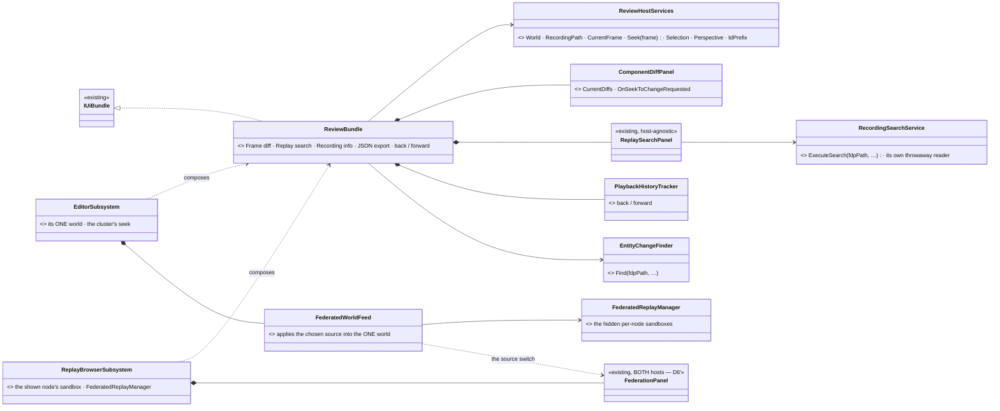
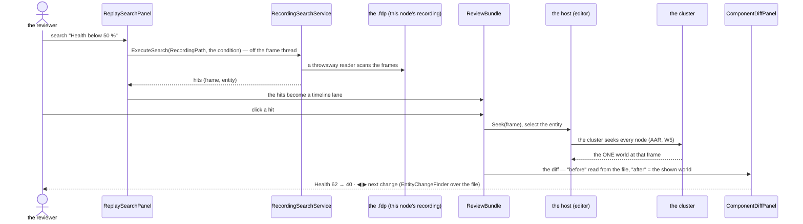
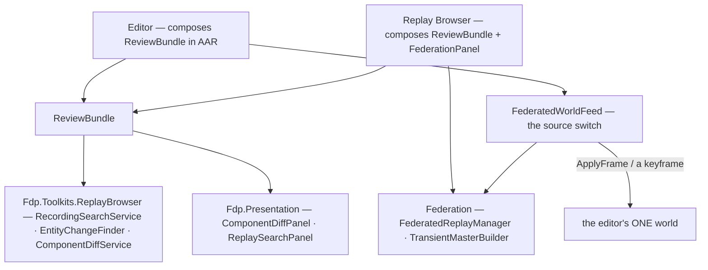

<!--STATUS
state: LIVE
build-state: DESIGN — first iteration, for the user (Q1–Q3, Q4′, Q5–Q7 with leans; V6's gates G1–G3 measure first)
updated: 2026-11-08 (§2 / §3 REVISED by the user's correction: Federation belongs in the editor as the SOURCE of its one world — §2.3, D6′, D7, V6, Q4′, Q6, Q7) · 2026-11-08 (first version — CE-3419; the user: "Yes, measure it, write a design for the first iteration")
current-answer: §1 measured · §2 Federation explained · §3 the design · §4 stages · §5 questions
stale-below: nothing
known-rot: ⛔ the first version's §2 verdict *"Federation does not fit the editor"* and D6 / Q4 *"standalone only"* are SUPERSEDED by §2.3, D6′, Q4′ (kept below, struck) · the first version cited R-4010 for "each node replays its own recording" — wrong id; the ruling is W5 in DESIGN_Replay_Time_Axis_And_Review
known-conflict: none
related-designs:
  - DESIGN_Replay_Browser_UX.md — OWNS the standalone Replay Browser's UX; its open Q-B3 (default layout) and Q-B6 (Federation) are answered by §5 Q3 / Q4 here
  - ../designs/replay-browser-frankenstein/DESIGN.md — OWNS Federation and the merged view (§7 the synthesis); §2 here explains it, nothing changes it
  - ../DESIGN_Replay_Time_Axis_And_Review.md — OWNS DAR / AAR and each node replaying its own recording (R-4010) — the ONE world this perspective draws
  - ../blueprints/Architect_Question_108_Run_Mode_Picker.md — §0 the run controls (AAR = the blue ▶ state), unchanged here
  - DESIGN_Rules_Bundle.md — the precedent: one bundle of windows every host composes (CE-4292)
  - DESIGN_Condition_Editor.md — §C5: the data breakpoints are ONE panel for the editor and the Replay Browser already
-->

# DESIGN — the Review perspective: the Replay Browser's analysis inside the editor's AAR

*Generated by `scripts/gen-review-perspective-mockup.py`. Scope: the perspective's layout, its switch and the windows it adds; the run controls
(AQ108 §0), the rules bundle, Details and the Event Timeline are context, unchanged.*

## 0. Why

🔒 User, `2026-11-08`: *"the Replay Browser could be a perspective of the editor — an alternative to the AAR mode, easier to reach"* (CE-3419) ·
*"Does it fit the mechanism inside the editor, meaning a single world? Or would we end up with two different worlds in the editor?"* ·
*"Yes, measure it, write a design for the first iteration, and please explain how the federation works now in the replay browser. And how comes
they fit the replay browser but not the editor."*

## 1. Measured *(2026-11-08)*

**INVENTORY.** `scripts/cbm.sh search_graph .*(Replay|Recording|Federat|Perspective).* Class` → **174** (has_more; the set was read with grep for
the windows that matter) · grep `RegisterWindow(` in `Hrot.ReplayBrowser` → **6** sites · grep the panels' constructors. ⚠ coverage unchecked
(`check_index_coverage` is not in the CLI).

| the Replay Browser's window | how it is composed today | in the editor today |
|---|---|---|
| Rules · Mission summary · Trainee debrief · Game summary | ✅ `RulesBundle` (CE-4292) | ✅ the same bundle |
| Entity inspector · Event browser | ✅ `DiagnosticsWindowsBundle` | ✅ the same bundle |
| Details | ✅ `EntityDetailsBundle` | ✅ the same bundle |
| Event Timeline + the Tasks lanes | ✅ `EventTimelineWindow`, `TasksTimelineTracks` | ✅ the same classes |
| Data breakpoints | ✅ ONE `DataBreakpointManagerPanel` (Condition editor §C5) | ✅ the same panel |
| Director | ✅ the director pack | ✅ the same pack |
| **Frame diff** (*what changed* + ◀ ▶ next change) | `ComponentDiffPanel` is fed by the host (`CurrentDiffs`, `OnSeekToChangeRequested`); the RB computes the diff from ITS playback (`ReplayBrowserSubsystem.cs:1318`) and the next change with `EntityChangeFinder` (`:1140`) | ⛔ no window — but `EntityChangeFinder` already runs in the editor (`DebugApiService.ReplaySeek.cs:117`) |
| **Replay search** | `ReplaySearchPanel(editService, IRecordingSearchService, onSeek, onSelect, onMatch, …)` — host-agnostic; the service takes an `.fdp` PATH and scans it in a THROWAWAY `PlaybackController` + `EntityRepository` (`RecordingSearchService.cs:94-95`) | ⛔ no window — but the editor's HTTP API already builds the same service (`DebugApiService.Brain.cs:302`) |
| Recording info · JSON export | over `ReplayTimelinePanel` (RB's transport) | ⛔ none |
| Transport + seek bar | `ReplayTimelinePanel(FederatedReplayManager, …)` — RB's own clock | the cluster's transport (AQ108 §0) — ⛔ not moved: a different clock owner |
| **Federation** | `FederationPanel(FederatedReplayManager)` | ⛔ — §2.3: it becomes the SOURCE of the editor's one world |
| the editor's own recording path | — | ✅ `RecordReplayController.ActiveRecordingModule.FilePath` (`EditorSubsystem.cs:1572`) |

⇒ ⭐ **Of the Replay Browser's windows, only four are missing from the editor** — Frame diff, Replay search, Recording info, JSON export — and
the two that matter compute from the RECORDING FILE in background readers the editor already uses. **None needs a second visible world.**

## 2. How Federation works — and why it fits the Replay Browser but not the editor

**What it does** (its owning design: [replay-browser-frankenstein](../designs/replay-browser-frankenstein/DESIGN.md)). Every node of a cluster
records its OWN view of the exercise into its own `.fdp` file. Federation opens all of them together:

| step | what | where |
|---|---|---|
| ① load a group | every node's file of ONE exercise (same `ExerciseId`, distinct `NodeId`); each gets its own sandbox world (`ReplayBrowserContext`: its own `EntityRepository`, bus, playback) | `FederatedReplayManager.LoadGroup` |
| ② align | one base wall-clock tick + a per-node offset (to correct a node whose clock was off); a seek seeks EVERY node's world | `SetBaseWallTicks`, `SetNodeOffset`, the Federation window |
| ③ **Single-node view** | pick ONE node — the screen shows that node's world: *what node 3 believed* | `ViewMode.SingleNode` |
| ④ **Merged view** ("Frankenstein") | builds a brand-new world from all of them: for each networked entity, each component is taken from the node that OWNED it (primary owner first, then by node id; never a component another node already claimed); local-only entities (effects, markers) come from one chosen node | `TransientMasterBuilder.Build` — design §7.3 / §7.8 |
| ⑤ paradoxes | a reference that resolves to nothing in the merged world is flagged — a recorded desync or a wrong offset | design §7.6 |

⚠ The merged world is rebuilt **by a JSON round-trip on every seek, step, offset or provider change** — hundreds of milliseconds or more; *Play* and
*Search* are disabled in it. Its design says so: *"an offline post-mortem diagnostic … explicitly exempt from the 60 Hz / zero-allocation frame
budget."*

### 2.1 ⛔ SUPERSEDED — the first version's verdict *(kept for the record)*

~~*"Federation needs N visible worlds; the editor has one; so Federation stays in the standalone Replay Browser."*~~ ⛔ **Two premises were
wrong**, found by the user's correction and then measured:

| premise | measured | |
|---|---|---|
| ~~the Replay Browser SHOWS N worlds~~ | it SHOWS exactly ONE — `_activeRepo`, rebound to a node's sandbox or to the merged master (`RebindActiveRepo`, `ReplayBrowserSubsystem.cs:598, 632, 638`); the N per-node worlds are HIDDEN sandboxes | ⇒ Federation = N hidden worlds + ONE shown — the same shape as the search's throwaway readers |
| ~~the editor's own recording is a fine view of the exercise~~ | 🔒 the user: *"the usual recording is made of multiple parts, each one generated by a single node like CGF or SimHost"* — the editor's file holds only what the editor RECEIVED (replicas); a brain's state, sensors, behaviour trees live ONLY in the CGF / SimHost files; and a cluster run without an editor has NO editor file at all | ⇒ for ANALYSIS the merged world (each component from the node that OWNED it, local brain state included) is the one that matters |

### 2.2 What still holds

The merged world is rebuilt by a JSON round-trip on every seek (hundreds of ms) — it cannot PLAY at 60 Hz, only step / scrub (as in the Replay
Browser). The offsets panel is an expert control.

### 2.3 ⭐ Federation in the editor — as the SOURCE of its ONE world *(user, `2026-11-08`)*

🔒 User: *take a closer look at the federation view in the editor, because the usual recording is made of multiple parts, each one generated by a single node like CGF or SimHost … the federation mode is something extremely important, because it combines the worlds from multiple participants into a single one that can be analyzed.*

⭐ **The editor keeps ONE world; Federation decides what FILLS it.** The editor's AAR already fills its world by applying recorded frames:
`PlaybackSystem.ApplyFrame(repo, reader)` (`Fdp.Core/FlightRecorder/PlaybackSystem.cs:31`) applies a frame into ANY repository — the cluster's
AAR uses it on the editor's own file. ⇒ the same call can apply **another node's part**, and a captured keyframe of the **merged master**
(`WorldKeyframes`) can be applied the same way. Nothing else in the editor sees a second world: the map, selection, Details, the gate and the
rules windows keep binding to the one world they already bind to.

| source of the editor's world | how it is filled | play |
|---|---|---|
| **this station's part** (today's AAR) | the cluster's AAR — the editor's own file (W5) | ✅ |
| **one node's part** (CGF, SimHost …) | that node's frames, `ApplyFrame` into the one world | ✅ (frame by frame) |
| **merged** (every node's owned components) | `TransientMasterBuilder` over the hidden per-node sandboxes → a keyframe → applied into the one world | ⛔ step / scrub only (the rebuild cost) |

⚠ **Measure first** (gates for V6): **G1** — a frame from a CGF / SimHost file applied into the EDITOR's world: are the component ids the same
(they are declared per type, `[ComponentId]`, so they should be) and what does `ApplyChunkData` do with a type the editor never registered?
**G2** — while the source is not the editor's own part, the editor's world must stay in the replay state (read-only gate, no simulation systems
writing) — confirm `ReplayState` holds when the frames come from another file. **G3** — the per-frame cost of `ApplyFrame` for one node's part
during Play (R-2084: 0 B steady — it must not capture / allocate per frame).

## 3. The design — first iteration

| ⭐ decision | |
|---|---|
| **D1 — Review is a PERSPECTIVE** (a window layout), not a mode: the editor switches to it on entering AAR and back to the authoring layout on leaving | the run mode stays AQ108 §0's; the perspective is only which windows show and where. The perspective switch (`WindowManager.SwitchPerspective`) stays reachable by hand |
| **D2 — ONE `ReviewBundle`** (`IUiBundle`): Frame diff, Replay search, Recording info, JSON export, the navigation history (◀ ▶ back / forward) — composed by the EDITOR and by the REPLAY BROWSER | the RulesBundle precedent: one implementation, two hosts; the RB's hand-written registration of these four windows is deleted |
| **D3 — the host gives the bundle ONE world and ONE recording**: `World` (what is shown), `RecordingPath` (this node's `.fdp`), `CurrentFrame`, `Seek(frame)`, `Selection` | the editor: its world + `ActiveRecordingModule.FilePath` + the cluster's seek; the RB: the shown node's sandbox + its file + `FederatedReplayManager` seeks |
| **D4 — the analysis reads the FILE, never the shown world** | the search (`RecordingSearchService`), the next-change finder (`EntityChangeFinder`) and the diff's *before* frame each open a throwaway reader — off the frame thread, as the editor's HTTP API already does |
| **D5 — search hits and breakpoint stops become Event Timeline LANES** | a click seeks — in the editor that is the cluster's seek (every node), so a jump is a cluster round-trip, not a local one |
| ~~D6 — Federation stays in the standalone Replay Browser~~ ⛔ SUPERSEDED by D6′ | — |
| **D6′ — Federation is in the editor as a SOURCE switch** (§2.3): *This station · Node ▸ CGF / SimHost / … · Merged* on the Review perspective, the offsets in its expert section; the SAME `FederatedReplayManager` + `TransientMasterBuilder` (Fdp.Toolkits, headless) and the SAME `FederationPanel` | ⭐ one world shown, the parts hidden — exactly the Replay Browser's shape |
| **D7 — opening an exercise's FILES in the editor** (*File ▸ Open Exercise Recording…* on a group, or a run with no editor part) **loads its parts into the hidden manager and defaults to MERGED** | the editor's own part, when it exists, stays one choice of the switch |
| **D8 — the standalone Replay Browser stays** for offline use with no editor install / no cluster; it composes the same ReviewBundle and the same Federation pieces | one implementation, two hosts |

*What the picture shows: the four missing windows move into ONE bundle that both hosts compose; Federation's hidden worlds sit behind ONE feed
that fills the editor's one world — no host binds a second shown world.*

*What it shows: the only thing that changes the visible world is the host's seek; the search and the diff never touch it.*

*Who calls each frame: the window manager draws the bundle's windows on both hosts; the searches and finders run on a user action, off the frame;
the feed applies a frame when the source's time moves (a seek, a step, play) — never a second world bound to the map.*

## 4. Stages

| # | what | acceptance |
|---|---|---|
| **V1** | `ReviewBundle` + `ReviewHostServices`; the RB composes it (its four hand-written registrations deleted) | the RB's window-set golden unchanged; its frame rails green |
| **V2** | the editor composes it in AAR — Frame diff and Replay search over its own recording | a search hit seeks the cluster and selects the entity; the diff shows what changed; 0 B per steady frame (R-2084) |
| **V3** | the Review perspective: entered on AAR, left on leaving AAR; the layout of the mockup | side by side with `review-perspective-visual.svg` (R-4146) |
| **V4** | search hits and breakpoint stops as Event Timeline lanes | a click seeks |
| **V5** | ⛔ withdrawn (D6 superseded) — the editor holds Federation itself | — |
| **V6** | ⭐ **the source switch** — G1–G3 measured first; `FederatedWorldFeed`: this station · a node's part · merged; the offsets as an expert section; D7's default | a SimHost-only behaviour state readable in the editor's Details on the merged source; a node's part plays; merged steps; 0 B per steady frame |

## 5. Questions — leans for the user

| # | question | ⭐ lean | rejected — one line |
|---|---|---|---|
| **Q1** | switch to Review automatically on entering AAR? | **yes**, and back on leaving; the perspective switch stays by hand too | by hand only: the reviewer would rebuild the layout every time |
| **Q2** | the standalone Replay Browser | **stays** — Federation, offline files, no cluster | retire it: loses cross-node comparison and offline forensics |
| **Q3** (= Replay Browser Q-B3) | the default layout | **the Review perspective's layout, the same in both hosts** | per-host layouts: two pictures of one tool |
| ~~Q4~~ | ⛔ superseded by Q4′ | — | — |
| **Q4′** (= Replay Browser Q-B6) | Federation | **in the editor, as the source of its one world (D6′)**; the same in the Replay Browser | standalone only: the analysis the user needs lives in the multi-part merge |
| **Q6** | during a CLUSTER AAR, does the source switch change only this station? | **yes** — the other nodes and Player stations keep replaying their own parts (W5); the switch is a viewing choice of the editor | switching every node: Players would see a world they never had |
| **Q7** | the default source when an exercise opens in the editor | **merged when it has parts the editor did not record (or no editor part); else this station** | always this station: an editor-less run would open empty |
| **Q5** | DAR | **not in this iteration** — the recording is still being written during DAR; revisit once V2 runs | now: a search over a file the recorder still writes |

---
_coordinator lane, 2026-11-08_
