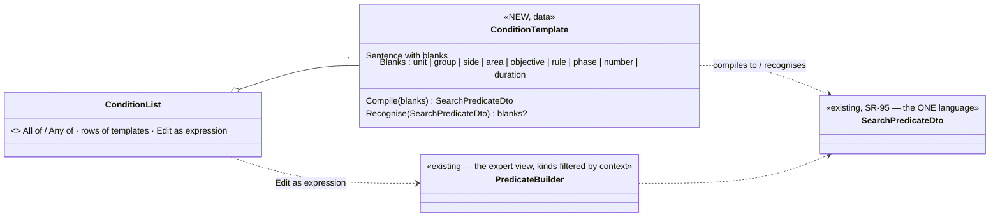

<!--STATUS
state: LIVE
build-state: DESIGN — top-level UX review, for the user's review (R-4122); the building lanes detail it (R-4123)
updated: 2026-11-06 (first version — coordinator; editing-UX design queue item 3b: E13)
current-answer: §1 what is built and what is wrong with it · §2 the target · §3 stages · §4 questions with leans
stale-below: nothing
known-rot: none
known-conflict: DESIGN_Rules_View_UI.md RV-6 puts the selected rule's detail in the Rules window's right pane; R-4118 (2026-11-06) says a selection's detail lives in the Details panel — §2.2 resolves it
related-designs:
  - ../DESIGN_Rules_View_UI.md — OWNS the built rules view and rule editor (RV-1…RV-9, RE-1…RE-10, the game-master palette GM-1…GM-5); this review builds ON it, changing the presentation, not the model
  - ../DESIGN_Scenario_Rules.md — OWNS the rule model (triggers, objectives, measures, the action catalogue), SR-95 (one condition language), SR-109 (live edits this run only)
  - DESIGN_Editing_UX.md — the programme: §3.9 / D5 condition templates (folded in here), R-4118 (Details is the one home), R-4119 (every host), R-4121 (expert detail hidden, not removed)
  - DESIGN_Mission_Plan_Editor.md — Q3: a task's advanced condition is a rule, "New rule…" one click from the task; Q4: phases begin on events ⇒ a "Begin phase" action here
  - DESIGN_Action_Catalogue.md — "Add rule about this unit…" and the rule row menus are declared actions
  - DESIGN_Edit_Framework.md — a rule edit is a Write (the rule's params) with the existing outcome; live = this run only
-->

# DESIGN — the rule editor, reviewed for the non-technical author

## 0. Why

🔒 User, `2026-11-06`: *"we now have a pretty low level predicate condition editor, ok for technical users, but not always fine for the non
technical one."* · *"If we stay with simple cases (which are desired - users are not technical) there needs to be a good rule editor (with
ability of complex conditions) which is easily accessible from the missions."* · *"rule editor deserves UX review as well - especially if
mission editing will be simple so any more advanced stuff ends up in rule editor."*

## 1. What is built — and what is wrong with it for a non-technical author *(read: DESIGN_Rules_View_UI.md end to end, 2026-11-06)*

Queries: the design's own INVENTORY rows (graph + grep, 2026-11-02 / 11-03); grep `JsonDerivedType` in `SearchPredicateDto.cs` (19 condition
kinds); grep `new RulesWindow` (2 hosts: `EditorSubsystem.cs:4985`, `ReplayBrowserSubsystem.cs:956`); `search_graph` for the rules classes
returned nothing usable (stale index). Coverage not checkable.

| built (✅ as-built sections of Rules View UI) | for the non-technical author |
|---|---|
| **Window ▸ Rules** — a TIMELINE of rows (objectives, measures, triggers) as a tree; group by macro / subject / side; side filter; search; *Follow now*; arrows *waits on → starts*; *Coming up* | ✅ excellent for watching a run and for review ⚠ but it is the ONLY view: authoring a list of rules on a timeline before anything has happened is odd (the design's *List* / *Graph* views — "later" — never came) |
| **the rule's detail** in the window's right pane: trigger tabs *Overview · When · Rules · Do · Bindings · History*, objective tabs *Status · Settings · Results · History*; one params form; Apply / Revert / Undo / Redo | ✅ one form, one undo ⚠ not in Details (R-4118) — a rule selected elsewhere (the Objectives tab, a mission task) jumps to another window; tabs are a button strip |
| **When** — the condition as the raw `SearchPredicateDto` tree: a type combo of **19 kinds** (`Compound · PropertyMatch · Numeric · String · TransientEvent · Lifecycle · SpatialBounding · Structural · BehaviorParam · TraceBufferScan · BlueprintVariable · ExternalHitTag · BehaviourStep · RingEntry · ValueChange · OnEntity · ScenarioTime · CountMatching · InputAbove`); a property match asks for a component TYPE, a property PATH, an operator and a value | ⛔ **the core problem.** It is the replay search's language, shared on purpose (SR-95, one condition language) — right underneath, wrong on top. Several kinds are search / debugging internals no rule author needs (`TraceBufferScan`, `RingEntry`, `ExternalHitTag`, `BlueprintVariable`, `BehaviourStep`, `InputAbove`). "Alpha is inside OBJ BLUE" means building `OnEntity → SpatialBounding` by hand |
| **Rules** tab — hold for, delay, cooldown, repeat, max fires, *fire if true when armed*, *while true* | ⚠ engine words (*fire if true when armed*); defaults are fine but the meaning is not obvious |
| **Do** — a step list, *+ Add step* from the action catalogue (Order, MissionCommand, Message, SetObjectiveActive, EndExercise, InsertMacro, SetSkillAmplifier, SetReporting), each step's args as a form; who-received-what lines under a Message | ✅ typed, checked forms ⚠ action names are identifiers (`MissionCommand`, `SetReporting`); *Order* takes a behaviour, not an order kind |
| **+ Add** — Trigger + 20 objective / measure kinds by behaviour name (`HoldArea`, `Count`, `HitRatio`, `ReportLatency`, `TimeTo`, `Sample`, `SelectionMean` …) | ⚠ engine names; objectives and scoring measures mixed in one menu |
| **drag to connect** — drop a row on a trigger ⇒ *when that one is achieved / fired* is ANDed in | ✅ a good, visual shortcut |
| **live** — edits apply this run only, the owner's whole refusal shown; control buttons *Fire now · Disarm · Re-arm · Reset · Activate · Deactivate*, disabled with their reason | ✅ |
| **Game master** window (run any action by hand as a one-shot trigger; skill per side) · the instructor's **End** · **Mission summary** · the **Objectives** Details tab on a unit | ✅ |
| **hosts** | ⛔ the Rules window exists on the editor and the Replay Browser only — not on CGF (R-4119) |
| **typing** | ⛔ CE-4245: in the one-step form a string field loses focus after each key (found in the game-master palette; shared with the Do tab's form) |

## 2. The target

### 2.1 Two views of the same rows

| view | for | what it shows |
|---|---|---|
| ⭐ **List** *(NEW, the authoring default in Edit mode)* | writing and reading rules | one line per rule as a sentence — *"**When** Alpha 1-1 is inside OBJ BLUE **for** 30 s → **Begin** Phase 2, **Message** Blue: 'Phase 2'"* · objectives as *"**Take and hold** OBJ BLUE with 4 men for 5 min — required"*; grouped as today (macro / subject / side), searchable, the same tree |
| **Timeline** *(built, the default in Live and Review)* | watching and reviewing | unchanged — the row states, arrows, *Coming up* |

### 2.2 The detail is in Details (R-4118)

Selecting a rule — in the List, on the Timeline, from a unit's Objectives tab, from a mission task — shows its tabs **in the Details panel**
(the same `RuleDetails` content, re-hosted as Details tabs offered for a rule entity). The Rules window keeps the list / timeline, the
toolbar (*+ New rule*, group by, side, search) and the instructor's *End*. ⛔ No second copy of the form.

### 2.3 Conditions people can write — templates over the one condition language

*What the picture shows that prose hid: nothing new is evaluated — a template is a sentence that COMPILES to the existing predicate and
RECOGNISES it back, so a rule written as a sentence and one written as an expression are the same rule; the expression editor stays for
experts and for anything no template recognises.*

| | rule |
|---|---|
| **the first templates** | *[unit / group] is inside [area] (for [duration])* · *[unit / group] reaches [area]* · *[objective] is achieved / failed* · *[rule] has fired* · *[unit / group] strength below [n] %* · *[unit] is destroyed* · *[side] has lost [n] men* · *[unit / side] detects [enemy unit / any enemy]* · *Phase [P] has begun* · *[duration] after [phase / rule / start]* · *the instructor says so* (a manual trigger) |
| **combining** | **All of / Any of** a list of template rows (Gmail-filter style); nesting one level (*All of: …, Any of: …*); deeper ⇒ *Edit as expression* |
| **experts** | *Edit as expression* opens today's builder; ⭐ its kind list is FILTERED to what a rule can use — the search / debugging internals (`TraceBufferScan`, `RingEntry`, `ExternalHitTag`, `BlueprintVariable`, `BehaviourStep`, `InputAbove`) only behind the panel's Expert switch (R-4121) |
| **a condition no template recognises** | shown as *Custom condition* (one line, the expression in the tooltip) with *Edit as expression* — never lost, never rewritten |
| **the live check** | the existing *Live strip* (leaf values) reads ✓ / ✗ per template row |

### 2.4 Actions people can read — the same idea for *do*

| today | target |
|---|---|
| `Message` | **Send a message** *[text]* to *[side / unit / player / instructor]* |
| `Order` (a behaviour) | **Order** *[unit]* to *[order kind]* … — the ORDER kinds, as in the mission plan (unit-agnostic); a behaviour only under Advanced |
| `MissionCommand` | **Jump** *[unit]*'s plan to task *[n]* · **Stop** *[unit]*'s plan |
| `SetObjectiveActive` | **Activate / Deactivate** *[objective]* |
| `InsertMacro` | **Bring in** *[composition]* at *[place]* |
| `EndExercise` | **End the exercise** |
| `SetSkillAmplifier` | **Set the skill** of *[side]* to *[−2 … +2]* |
| `SetReporting` | **Set reporting** of *[unit]* … *(Expert)* |
| ⭐ NEW | **Begin phase** *[P]* (Mission Plan Editor Q4: phases begin on events) |

### 2.5 Reachable from where the author is

| from | entry |
|---|---|
| a mission task's *then* | **When a rule fires… / New rule…** — opens the new rule in Details, the unit as its subject, linked back (Mission Plan Editor Q3) |
| a unit (map, Outliner) | right-click **Add rule about this unit…** → the template gallery with the unit filled in |
| an area | right-click **When someone enters this area…** |
| the timeline (Live / Review) | right-click a moment **Add rule at this moment…** |
| the Rules window | **+ New rule** → the **gallery** (below) |

**The gallery** (as the Add Entity picker): *Objectives* (Take and hold an area · Reach an area · Destroy · Protect · Survive), *Phases and
timing* (Begin phase when … · End the exercise when …), *Reinforcements* (Bring in … when …), *Messages* (Brief Blue when …), *Scoring*
(measures — hit ratio, report latency … — a separate group, for exercise designers). Each opens pre-filled in Details.

### 2.6 Where it runs

| | rule |
|---|---|
| **every host with the UI** | the Rules window, its List and the Details tabs on the editor, **CGF**, the Replay Browser (read-only on a recording) — R-4119 |
| **the expected basics** | CE-4245 (focus lost while typing) fixed before anything else; Esc / Cancel / undo as everywhere (Editing UX §3.7) |

## 3. Stages *(top level; ui owns the editor, behaviors the condition / action vocabulary where it touches the runtime)*

| stage | what |
|---|---|
| **RX1** | the basics: CE-4245; the Rules window on CGF |
| **RX2** | the rule detail as Details tabs (R-4118); the Rules window = list / timeline + toolbar |
| **RX3** | the List view (sentences for conditions, actions and objectives) |
| **RX4** | condition templates (data: compile + recognise) + All of / Any of + *Edit as expression*; the kind filter behind Expert |
| **RX5** | actions as sentences; *Order* by order kind; *Begin phase* (with Mission Plan M6) |
| **RX6** | entry points from tasks, units, areas, the timeline; the gallery |

## 4. Questions — leans for the user

| # | question | ⭐ lean | rejected |
|---|---|---|---|
| **Q1** | the authoring view | a **List of sentences** as the Edit-mode default, the built Timeline the default in Live / Review | the timeline only — authoring before anything happens on a time axis |
| **Q2** | where a rule's detail lives | **the Details panel** (R-4118), the Rules window keeps list / timeline / toolbar | the window's right pane — a second detail surface |
| **Q3** | conditions | **templates as data** that compile to and recognise the ONE language (SR-95), **All of / Any of**, *Edit as expression* for experts, internal kinds behind Expert | a second, simplified condition model — two languages; raw expression only — the user's complaint |
| **Q4** | actions | **sentences**; *Order* by **order kind**; a new **Begin phase** | keep identifiers |
| **Q5** | entry points | from a mission task, a unit, an area, the timeline, and a **gallery** of common rules | only Window ▸ Rules — "easily accessible from the missions" |
| **Q6** | scoring measures | a **separate gallery group** for exercise designers; kept out of the authoring list by default (a filter) | mixed with objectives — today's *+ Add* menu |
| **Q7** | hosts | **every host with the UI**, CGF included (R-4119) | editor only |
