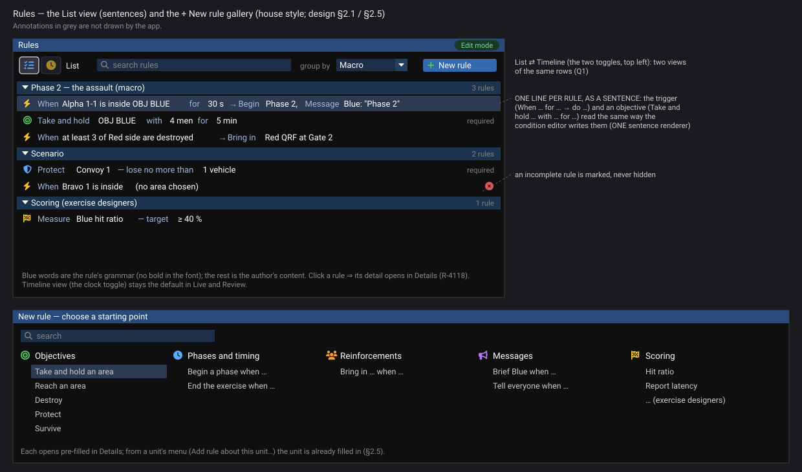
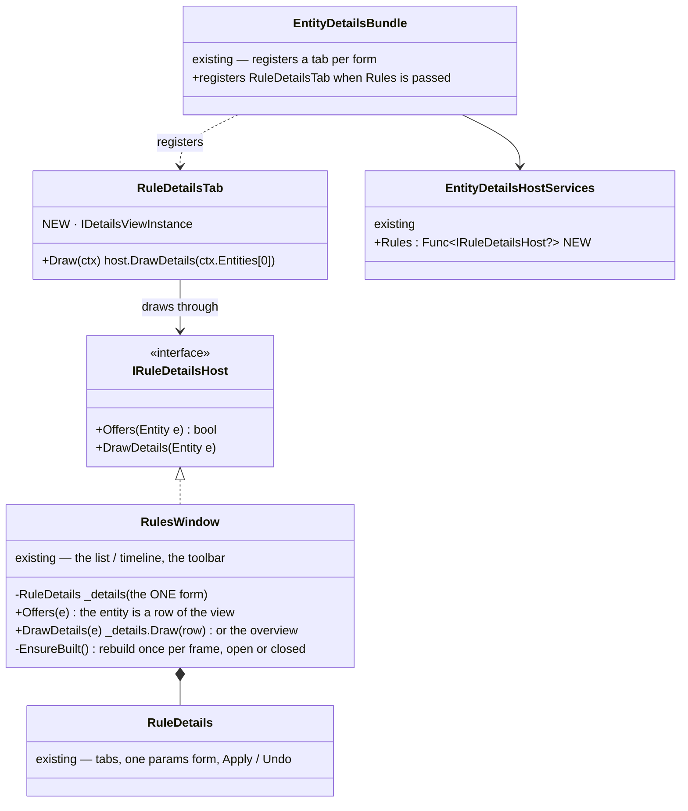
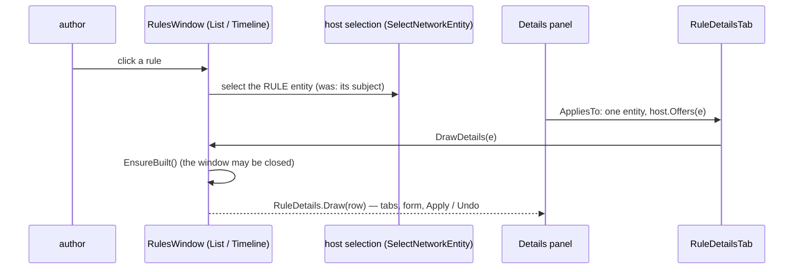

<!--STATUS
state: LIVE
build-state: DESIGN — top-level; ✅ approved by the user 2026-11-06 with Q3 revised (the condition editor refactor — R-4130); the building lanes detail it (R-4123)
updated: 2026-11-06 (§2.3 revised: the condition editor refactored — phrase metadata, a friendly view, expert toggle, presets as shortcuts — R-4130) · 2026-11-06 (first version — coordinator; editing-UX design queue item 3b: E13)
current-answer: §1 what is built and what is wrong with it · §2 the target · §3 stages · §4 questions with leans
stale-below: nothing
known-rot: none
known-conflict: DESIGN_Rules_View_UI.md RV-6 puts the selected rule's detail in the Rules window's right pane; R-4118 (2026-11-06) says a selection's detail lives in the Details panel — §2.2 resolves it
related-designs:
  - DESIGN_Rules_Bundle.md — every host composes the rules windows as ONE bundle; editing decided by the seat (CE-4292)
  - DESIGN_Condition_Editor.md — the DETAILED design of §2.3: rows as WHO · IS/HAS · VALUE, the projection to SearchPredicateDto, the four language additions, the mockup
  - ../DESIGN_Rules_View_UI.md — OWNS the built rules view and rule editor (RV-1…RV-9, RE-1…RE-10, the game-master palette GM-1…GM-5); this review builds ON it, changing the presentation, not the model
  - ../DESIGN_Scenario_Rules.md — OWNS the rule model (triggers, objectives, measures, the action catalogue), SR-95 (one condition language), SR-109 (live edits this run only)
  - DESIGN_Editing_UX.md — the programme: §3.9 / D5 condition templates (folded in here), R-4118 (Details is the one home), R-4119 (every host), R-4121 (expert detail hidden, not removed)
  - DESIGN_Mission_Plan_Editor.md — Q3: a task's advanced condition is a rule, "New rule…" one click from the task; Q4: phases begin on events ⇒ a "Begin phase" action here
  - DESIGN_Action_Catalogue.md — "Add rule about this unit…" and the rule row menus are declared actions
  - DESIGN_Edit_Framework.md — a rule edit is a Write (the rule's params) with the existing outcome; live = this run only
-->

# DESIGN — the rule editor, reviewed for the non-technical author

## 0. Why

🔒 User, `2026-11-06`: *"we now have a pretty low level predicate condition editor, ok for technical users, but not always fine for the non
technical one."* · *"If we stay with simple cases (which are desired - users are not technical) there needs to be a good rule editor (with
ability of complex conditions) which is easily accessible from the missions."* · *"rule editor deserves UX review as well - especially if
mission editing will be simple so any more advanced stuff ends up in rule editor."*

## 1. What is built — and what is wrong with it for a non-technical author *(read: DESIGN_Rules_View_UI.md end to end, 2026-11-06)*

Queries: the design's own INVENTORY rows (graph + grep, 2026-11-02 / 11-03); grep `JsonDerivedType` in `SearchPredicateDto.cs` (19 condition
kinds); grep `new RulesWindow` (2 hosts: `EditorSubsystem.cs:4985`, `ReplayBrowserSubsystem.cs:956`); `search_graph` for the rules classes
returned nothing usable (stale index). Coverage not checkable.

| built (✅ as-built sections of Rules View UI) | for the non-technical author |
|---|---|
| **Window ▸ Rules** — a TIMELINE of rows (objectives, measures, triggers) as a tree; group by macro / subject / side; side filter; search; *Follow now*; arrows *waits on → starts*; *Coming up* | ✅ excellent for watching a run and for review ⚠ but it is the ONLY view: authoring a list of rules on a timeline before anything has happened is odd (the design's *List* / *Graph* views — "later" — never came) |
| **the rule's detail** in the window's right pane: trigger tabs *Overview · When · Rules · Do · Bindings · History*, objective tabs *Status · Settings · Results · History*; one params form; Apply / Revert / Undo / Redo | ✅ one form, one undo ⚠ not in Details (R-4118) — a rule selected elsewhere (the Objectives tab, a mission task) jumps to another window; tabs are a button strip |
| **When** — the condition as the raw `SearchPredicateDto` tree: a type combo of **19 kinds** (`Compound · PropertyMatch · Numeric · String · TransientEvent · Lifecycle · SpatialBounding · Structural · BehaviorParam · TraceBufferScan · BlueprintVariable · ExternalHitTag · BehaviourStep · RingEntry · ValueChange · OnEntity · ScenarioTime · CountMatching · InputAbove`); a property match asks for a component TYPE, a property PATH, an operator and a value | ⛔ **the core problem.** It is the replay search's language, shared on purpose (SR-95, one condition language) — right underneath, wrong on top. Several kinds are search / debugging internals no rule author needs (`TraceBufferScan`, `RingEntry`, `ExternalHitTag`, `BlueprintVariable`, `BehaviourStep`, `InputAbove`). "Alpha is inside OBJ BLUE" means building `OnEntity → SpatialBounding` by hand |
| **Rules** tab — hold for, delay, cooldown, repeat, max fires, *fire if true when armed*, *while true* | ⚠ engine words (*fire if true when armed*); defaults are fine but the meaning is not obvious |
| **Do** — a step list, *+ Add step* from the action catalogue (Order, MissionCommand, Message, SetObjectiveActive, EndExercise, InsertMacro, SetSkillAmplifier, SetReporting), each step's args as a form; who-received-what lines under a Message | ✅ typed, checked forms ⚠ action names are identifiers (`MissionCommand`, `SetReporting`); *Order* takes a behaviour, not an order kind |
| **+ Add** — Trigger + 20 objective / measure kinds by behaviour name (`HoldArea`, `Count`, `HitRatio`, `ReportLatency`, `TimeTo`, `Sample`, `SelectionMean` …) | ⚠ engine names; objectives and scoring measures mixed in one menu |
| **drag to connect** — drop a row on a trigger ⇒ *when that one is achieved / fired* is ANDed in | ✅ a good, visual shortcut |
| **live** — edits apply this run only, the owner's whole refusal shown; control buttons *Fire now · Disarm · Re-arm · Reset · Activate · Deactivate*, disabled with their reason | ✅ |
| **Game master** window (run any action by hand as a one-shot trigger; skill per side) · the instructor's **End** · **Mission summary** · the **Objectives** Details tab on a unit | ✅ |
| **hosts** | ⛔ the Rules window exists on the editor and the Replay Browser only — not on CGF (R-4119) |
| **typing** | ⛔ CE-4245: in the one-step form a string field loses focus after each key (found in the game-master palette; shared with the Do tab's form) |

## 2. The target

### 2.1 Two views of the same rows

| view | for | what it shows |
|---|---|---|
| ⭐ **List** *(NEW, the authoring default in Edit mode)* | writing and reading rules | one line per rule as a sentence — *"**When** Alpha 1-1 is inside OBJ BLUE **for** 30 s → **Begin** Phase 2, **Message** Blue: 'Phase 2'"* · objectives as *"**Take and hold** OBJ BLUE with 4 men for 5 min — required"*; grouped as today (macro / subject / side), searchable, the same tree |
| **Timeline** *(built, the default in Live and Review)* | watching and reviewing | unchanged — the row states, arrows, *Coming up* |

#### 2.1.1 As-built — RX3, the List view *(ui, 2026-11-07)*

| piece | where | what |
|---|---|---|
| the line | `Hrot.Presentation/Rules/RuleSentence.cs` — `Of(kind, json, title, required, refs)` | a trigger: *When {condition} [for N s] → {acts}*; the condition's words are `ConditionSentence.Of`'s — the ONE renderer the condition editor uses, so list and editor say the same. An objective: *{kind, humanized}: {title} [— required]*. No condition / no step ⇒ *(no condition yet)* / *(nothing to do yet)* and **Incomplete** |
| the one params reader | `RuleSentence.ParamsOf(world, entity)` | the rule's `BehaviorStartRecord` — `RuleDetails.ParamsOf` routes through it (one reader) |
| the view | `RulesWindow.DrawList` + the toolbar's List / Timeline glyph toggles | the same groups and tree depth as the Timeline; an incomplete rule carries the `form/warning` mark with its reason; a click selects as on the Timeline. ⭐ Default: **List when every row is authored** (edit mode), Timeline once a row is live or recorded; the person's pick sticks |
| hot path | the sentence is cached per rule against its params string's reference; index loops | ✅ **0 B on a steady frame (CE-1465, built):** `Rebuild` runs only when its key changes (world · table versions · entity count · `now` · toolbar choices · selection · blocked reason · history index · sent-message count); a live run changes `now` every frame and still rebuilds per frame. Rail `RulesWindowFrameRail.U18_…` |

⭐ **List view fidelity (R-4138/R-4146, built):** the frame matches `rule-list-visual.svg` on its six points — Font Awesome arrow (the font has no U+2192; `ListRows` text keeps `→`) · coloured kind glyph first (bolt amber · bullseye green · flag amber · dot) · groups as the shared `SectionHeader` with the count muted on the right · *required* muted on the right · the red ✖ on the right (tooltip kept) · grammar words blue (`RuleSentence.Parts` segments), content white. Deviations: the kind glyph is the role's (trigger / objective / measure), so a *Protect* objective shows the bullseye, not the mockup's shield; no word gaps around `for 30 s`. Rail `U18_TheListFrame_MatchesTheMockup_…` (red-proven); the frame itself is rendered with `HROT_RAIL_SHOTS`, never committed.
| rail | `RulesWindowFrameRail.U18_InEditMode_TheListReadsOneSentencePerRule_AndTheTimelineIsAToggleAway` | the default, the lines, the incomplete mark, the toggle |

⚠ Not yet: objectives in their richer words (*Take and hold OBJ BLUE with 4 men for 5 min*) — today the kind's humanized name and the title; the sentence for each objective kind belongs with its params form (RX4's gallery names). Actions read as their humanized act names (*Message*, *Begin phase*), not yet with their arguments.

### 2.1a The graphical design *(R-4143 — the acceptance spec)*

*What the picture shows that the prose hid:* the list and the condition editor speak the same sentences, because ONE renderer writes both. An incomplete rule stays in the list, marked. Generated by `scripts/gen-rule-list-mockup.py`.

### 2.2 The detail is in Details (R-4118)

Selecting a rule — in the List, on the Timeline, from a unit's Objectives tab, from a mission task — shows its tabs **in the Details panel**
(the same `RuleDetails` content, re-hosted as Details tabs offered for a rule entity). The Rules window keeps the list / timeline, the
toolbar (*+ New rule*, group by, side, search) and the instructor's *End*. ⛔ No second copy of the form.

#### 2.2.1 RX2 — the detail in Details *(ui, 2026-11-07; built as drawn)*

*What the picture shows that the prose hid:* the Details tab owns NO form — it draws through the window's one `RuleDetails`, so editor,
CGF and Replay Browser cannot get different rule details by construction; the window's right pane goes away (⛔ two copies).

| decision | lean | why |
|---|---|---|
| a pick selects the **rule** entity, not its subject | ✅ (§2.2 as approved) | the Details panel shows what is selected; the subject stays one click away (*Show on map*, the Overview's subject line) |
| the window's right pane | removed when the host passes `Rules` (every host with the window does) | ⛔ two copies of the form |
| rank | 33 — just above the forms (34) | a rule has no other form |

**As-built:** `IRuleDetailsHost` (`Hrot.Presentation/Rules`) implemented by `RulesWindow` (`Offers` · `DrawDetails` · `AttachToDetailsPanel`;
`EnsureBuilt` rebuilds once per ImGui frame, so the tab works with the window closed); `RuleDetailsTab` + `RuleDetailsTabDescriptor`
(`Hrot.Editor.AiShared/Shell`, id `details.rule`, rank 33); `EntityDetailsHostServices.Rules` — passed by the editor, CGF and the Replay Browser (every
host with the window). ⚠ Attachment happens on the panel's first `AppliesTo` (idempotent); a window never asked keeps its own pane (the rails' hosts).
⚠ A rule hidden by the window's filter (side / search / subtree) is not offered — the tab reads the window's view. Rails:
`TheRuleDetailsTabTests` (AiShared) · `RulesWindowFrameRail.U18_…` (attached ⇒ a pick selects the rule).

### 2.3 The condition editor, refactored — one friendly editor, templates as shortcuts *(revised `2026-11-06`)*

🔒 User: *"i think the condition editor needs refactor, it is very technical now, ok for a debug tool. if made more friendly, we will not need
to be so afraid to offer at other places. that might be what you call Condition Templates? or maybe the condition editor simply needs
different simpler UI to express the same things? Or a combination of more friendly UI and friendly templates as a shortcut?"* — R-4130:
**the combination.**

```mermaid
classDiagram
  direction LR
  class SearchPredicateDto { <<existing, SR-95 — the ONE language>> 19 kinds }
  class ConditionPhrase {
    <<NEW, metadata on each predicate kind>>
    Sentence : "[unit] is inside [area]"
    Pickers : which fields pick (map, list, semantic type)
    Expert : fields and whole kinds shown only in the Expert view
    Contexts : rule · task · replay search · breakpoint
  }
  class ConditionEditor {
    <<REFACTORED, the ONE editor, every host>>
    Friendly view : sentence rows, All of / Any of
    Expert view : today's tree
  }
  class ConditionPreset { <<NEW, data — the shortcuts>> name · rows pre-filled }
  class PropertyNames { <<NEW>> friendly names for component properties (strength, speed, ammunition …) }
  SearchPredicateDto ..> ConditionPhrase : each kind described by
  ConditionEditor ..> ConditionPhrase : draws rows from
  ConditionEditor ..> SearchPredicateDto : edits
  ConditionPreset ..> ConditionEditor : inserts rows
  ConditionPhrase ..> PropertyNames : a property match
```

*What the picture shows that prose hid: friendliness is METADATA on the language, not a second language and not a fixed set of templates —
so EVERY kind is drawn as a sentence, the same editor serves rules, mission tasks, the replay search and breakpoints, and the presets are
only shortcuts that fill its rows.*

| | rule |
|---|---|
| **the friendly view** | every condition is a sentence row drawn from its kind's `ConditionPhrase`: *[Alpha 1-1] is inside [OBJ BLUE] for [30 s]* · *[Alpha 1-1]'s [strength] [is below] [50 %]* · *[OBJ BLUE] is [achieved]* · *[Phase 2] has begun*; blanks are pickers (the map, a list, a semantic-type field — R-4120); rows combine as **All of / Any of**, one nesting level |
| **a property match, made human** | *[unit]'s [property] [operator] [value]* — the property chosen from **friendly names** (strength, speed, ammunition, posture …) instead of a component type + path; the raw path only in the Expert view |
| **the expert view** | a toggle on the editor (per panel, R-4121): today's tree, every kind and field; a condition the friendly view cannot draw opens there, shown in the friendly view as one *Custom condition* row — never lost, never rewritten |
| **context filters the kinds** | a kind's `Contexts` says where it makes sense: a rule or a task never offers `TraceBufferScan` / `RingEntry` / `ExternalHitTag` (debugging); the replay search and breakpoints do |
| **presets — the shortcuts** | *Take and hold an area · Reach an area · Strength below · Side has lost n men · Objective achieved · Phase has begun · n minutes after …* — each inserts pre-filled rows; ⛔ not a second model, not required |
| **one editor everywhere** | the rule's *When*, a mission task's *Advanced condition*, the replay search, breakpoints — ⭐ the friendly view makes it safe to offer in more places (the user's point) |
| **live** | the Live strip's ✓ / ✗ per row |

### 2.4 Actions people can read — the same idea for *do*

| today | target |
|---|---|
| `Message` | **Send a message** *[text]* to *[side / unit / player / instructor]* |
| `Order` (a behaviour) | **Order** *[unit]* to *[order kind]* … — the ORDER kinds, as in the mission plan (unit-agnostic); a behaviour only under Advanced |
| `MissionCommand` | **Jump** *[unit]*'s plan to task *[n]* · **Stop** *[unit]*'s plan |
| `SetObjectiveActive` | **Activate / Deactivate** *[objective]* |
| `InsertMacro` | **Bring in** *[composition]* at *[place]* |
| `EndExercise` | **End the exercise** |
| `SetSkillAmplifier` | **Set the skill** of *[side]* to *[−2 … +2]* |
| `SetReporting` | **Set reporting** of *[unit]* … *(Expert)* |
| ⭐ NEW | **Begin phase** *[P]* (Mission Plan Editor Q4: phases begin on events) |

**As-built — RX5** *(behaviors, `2026-11-07`, CE-4307)*: ⭐ ONE step renderer, `ActionSentence.Parts` (`Hrot.Presentation/Rules`), called by the List
line (`RuleSentence`) and by the Do tab's row headings (`ActionListFieldDrawer`, built once per row — 0 B on a steady frame), so the two say the same.
It hydrates the step's args into the catalogue entry's own `ParamsType` and reads fields by NAME (the presentation never references the verbs'
assembly); names come from the one `LiveRefScope` the List uses (`AuthoredRules.ScopeOf`). The words follow the mockup (*Message Blue: "Phase 2"* ·
*Bring in red-qrf at @Drop* · *Order Alpha 1-1 to Move* · *End the exercise — Friend wins* · *Take 1 from …* · *Activate …* · *Jump / Stop …'s plan* ·
*Set the skill of …*); an act it does not know reads as its humanised name. ⭐ **Order by order kind:** the `Order` step's `behavior` may be
`Order.<kind>` — the Do tab offers the kinds from `OrderMenu.Orders` (the ONE list the mission plan uses) in an *order* combo above the form, the
behaviour name stays writable in the form (Advanced); at run time the verb resolves the kind by the target's class (`OrderResolver`, the receiver's
own answer), sends the intent `Order.<kind>` as before and waits for the behaviour that class resolves to; a kind no class fulfils fails at once
with the resolver's reason. ⏭ **Begin phase — SKIPPED:** it needs backend's P-6 phase field (CE-4302), not in yet. ⚠ *Message* uses the short form
of the mockup (*Message Blue: …*), not the table's *Send a message … to …* — the mockup is the acceptance spec (R-4165).
Rails: `RuleEditorR5bTests.ADoStep_ReadsAsASentence_…`, `TheListLine_SaysWhatEachStepDoes`, `AnOrderStep_IsSetByOrderKind_…`; `RulesWindowFrameRail` (the List line, the Do rows).

### 2.5 Reachable from where the author is

| from | entry |
|---|---|
| a mission task's *then* | **When a rule fires… / New rule…** — opens the new rule in Details, the unit as its subject, linked back (Mission Plan Editor Q3) |
| a unit (map, Outliner) | right-click **Add rule about this unit…** → the template gallery with the unit filled in |
| an area | right-click **When someone enters this area…** |
| the timeline (Live / Review) | right-click a moment **Add rule at this moment…** |
| the Rules window | **+ New rule** → the **gallery** (below) |

**The gallery** (as the Add Entity picker): *Objectives* (Take and hold an area · Reach an area · Destroy · Protect · Survive), *Phases and
timing* (Begin phase when … · End the exercise when …), *Reinforcements* (Bring in … when …), *Messages* (Brief Blue when …), *Scoring*
(measures — hit ratio, report latency … — a separate group, for exercise designers). Each opens pre-filled in Details.

### 2.6 Where it runs

| | rule |
|---|---|
| **every host with the UI** | the Rules window, its List and the Details tabs on the editor, **CGF**, the Replay Browser (read-only on a recording) — R-4119 |
| **the expected basics** | CE-4245 (focus lost while typing) fixed before anything else; Esc / Cancel / undo as everywhere (Editing UX §3.7) |

**As-built — RX1** *(ui, 2026-11-07)*: Window ▸ Rules on **CGF** — `CgfSubsystem.RegisterWindows` registers the same `RulesWindow` (`cgf_rules`) over
`HrotNodeContext.World` / `ShownTimeline` (the editor's source), driven by the operator toolbar's `ClusterTimeTransportAdapter`; a pick selects through
`SelectionChangeRequest.ReplaceWith` (the one request seam), *Show on map* publishes `CenterOnEntityCommand`; CGF now passes `OpenRule` and
`SelectNetworkEntity` to its Details bundle (the silent-default rule — it holds both). ⚠ CGF has no `RuleEditorServices` yet ⇒ it reads and controls rules
(*Fire now · Disarm …*), live edits stay on the editor. CE-4245 was refuted on verification (no focus loss). Rail: `TheRunChoiceIsOnEveryHostTests` (CGF windowed).
⭐ **SUPERSEDED by CE-4292** (`DESIGN_Rules_Bundle.md` §5, `2026-11-07`): every host now composes the ONE `RulesBundle`; CGF gets the rule editor services
(its seat, Instructor, may edit) and the Game master, Mission summary, Trainee debrief and Game summary windows — the *"live edits stay on the editor"* above is history.
⭐ Three hosts still construct the window each in their own lines — a shared factory is the next step if a fourth host appears.

## 3. Stages *(top level; ui owns the editor, behaviors the condition / action vocabulary where it touches the runtime)*

| stage | what |
|---|---|
| **RX1** | the basics: CE-4245; the Rules window on CGF |
| **RX2** | the rule detail as Details tabs (R-4118); the Rules window = list / timeline + toolbar |
| **RX3** | the List view (sentences for conditions, actions and objectives) |
| **RX4** | the condition editor refactor: `ConditionPhrase` metadata on every kind, friendly property names, the sentence-row view with All of / Any of, the Expert view toggle, context filtering, presets; adopted by the replay search and breakpoints too |
| **RX5** | actions as sentences; *Order* by order kind; *Begin phase* (with Mission Plan M6) |
| **RX6** | entry points from tasks, units, areas, the timeline; the gallery |

## 4. Questions — ✅ approved; Q3 as revised *(🔒 user, `2026-11-06`: "otherwise agreed")*

| # | question | ⭐ lean | rejected |
|---|---|---|---|
| **Q1** | the authoring view | a **List of sentences** as the Edit-mode default, the built Timeline the default in Live / Review | the timeline only — authoring before anything happens on a time axis |
| **Q2** | where a rule's detail lives | **the Details panel** (R-4118), the Rules window keeps list / timeline / toolbar | the window's right pane — a second detail surface |
| **Q3** | conditions | ✏ **revised by the user (R-4130):** REFACTOR the one condition editor — a friendly sentence-row view drawn from phrase metadata on every kind (+ friendly property names), the Expert view as a toggle, kinds filtered by context, presets as shortcuts; the same editor in rules, tasks, replay search and breakpoints | a fixed set of templates as the only friendly path — anything else stays technical; a second, simplified condition model — two languages |
| **Q4** | actions | **sentences**; *Order* by **order kind**; a new **Begin phase** | keep identifiers |
| **Q5** | entry points | from a mission task, a unit, an area, the timeline, and a **gallery** of common rules | only Window ▸ Rules — "easily accessible from the missions" |
| **Q6** | scoring measures | a **separate gallery group** for exercise designers; kept out of the authoring list by default (a filter) | mixed with objectives — today's *+ Add* menu |
| **Q7** | hosts | **every host with the UI**, CGF included (R-4119) | editor only |
