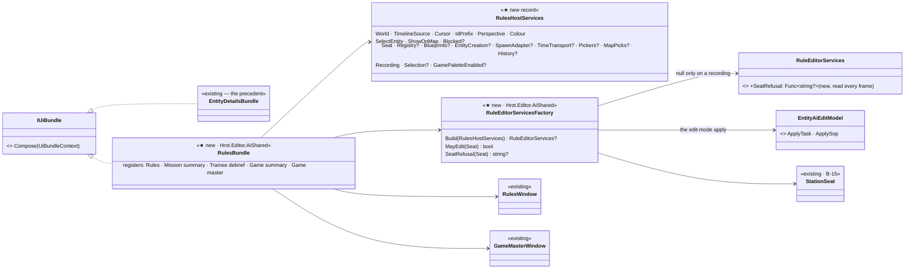
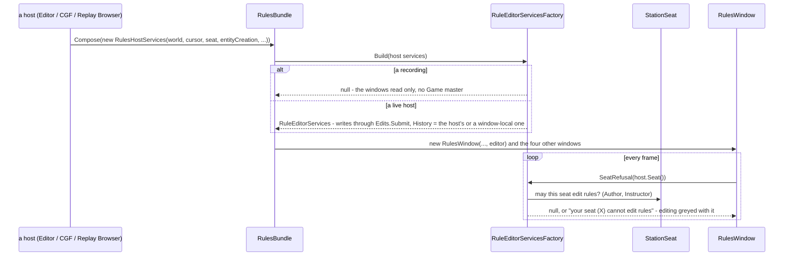
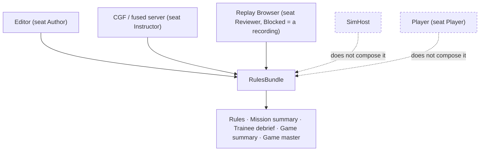

<!--STATUS
state: LIVE
build-state: BUILT — R1–R4 (§5 as-built)
updated: 2026-11-07 (R1–R3 as-built folded in, §5; first version — the user: "How can be something built just for an editor when the bootstrap is unified and shared and features are available everywhere by role and suppressed just by feature settings or role settings?" — CE-4292)
current-answer: §1 what is there · §2 the design (diagrams, as-built) · §3 rules · §4 stages · §5 as-built and deviations
stale-below: nothing
known-rot: none (the first version's "the factory returns null for a seat that may not edit" is SUPERSEDED by §5 ①)
known-conflict: none
related-designs:
  - DESIGN_Rule_Editor_UX.md — OWNS what the rule editor shows (RX1–RX6, the List view, the Details tabs); this design only makes every host compose it the same way
  - DESIGN_Seats_And_Hats.md — H5 OWNS "the Instructor seat's windows on the fused server and CGF (rules, game master, End)"; this is how H5 is built
  - DESIGN_Edit_Framework.md — OWNS the one write path (`Edits.Submit`, R-4128) the shared factory's writes go through
  - DESIGN_Edit_Mode_Undo.md — Q2 (R-4133): undo only in the editor's Edit mode — so the history is passed only where Edit mode exists
  - ../DESIGN_Subsystem_Composition_Unification.md — §5b OWNS `IUiBundle` (windows, panels, menus, toolbar entries — never a module or translator)
  - ../DESIGN_Rules_View_UI.md — the Rules window as first built (R2 / R5a / R5b), whose three compositions this replaces
-->

# DESIGN — the rules windows as ONE bundle every host composes; editing decided by the seat, not the host

## 0. Why

🔒 *"How can be something built just for an editor when the bootstrap is unified and shared and features are available everywhere by role and
suppressed just by feature settings or role settings?"* (user, `2026-11-07`) — the ui lane had reported CGF cannot edit rules because *"the
editor's composition is editor-specific"*. Measured: that is a missing unification, not a necessity (CE-4292).

## 1. What is there *(graph + grep, `2026-11-07`)*

Queries: `search_graph ".*(Bundle|Rule(s)?(Window|Details|Editor|Services|Commands|Bundle)).*" Class` (bundles: `EntityDetailsBundle`,
`DiagnosticsWindowsBundle`, `ShellCommandCoreBundle`, `AiEditorAdapterBundle`; no rules bundle) · grep for each rules-family window's
construction and for `RuleEditorServices` / `EntityAiEditModel`. ⚠ Coverage could not be checked.

| what | where | ⇒ |
|---|---|---|
| `RulesWindow` built by hand **three times** | `EditorSubsystem.cs:5004` · `CgfSubsystem.cs:1350` · `ReplayBrowserSubsystem.cs:961` | the composition is duplicated (R-174) |
| Mission summary, Trainee debrief, Game summary built in **Editor and Replay Browser** only; Game master in **Editor** only | the same subsystems | CGF / the fused server lack the instructor's windows (H5) |
| `RuleEditorServices` (the editing half) built only by the private `EditorSubsystem.BuildRuleEditorServices()` | `:293-322` (+ `BuildMacroPreviewServices :328`, `BuildRuleLiveServices :360`) | CGF passes none ⇒ read + control only |
| its edit-mode apply `EntityAiEditModel.ApplyTask` lives in the **editor subsystem's own assembly** | `Hrot.Editor/Scenario/EntityAiDetailsView.cs:28, :188-207` | CGF does not reference it — ⭐ the one real obstacle, and it is a file location |
| the other pieces are already shared | `AiFacetEditService` (`Hrot.Editor.AiShared`), `BrainSnapshot`, `EditHistory` (`Hrot.Presentation.Edits`), `MapPickBroker`, the pickers | nothing else is editor-only |
| the shared shape to copy | `EntityDetailsBundle : IUiBundle` + `EntityDetailsHostServices`, composed by Editor, CGF, Replay Browser, SimHost, Player (`UiBundleHost.Compose`) | ⭐ the precedent |
| the seat | `station.seat` (`StationSeat.Of(features)`, B-15 built): editor = Author, fused server = Instructor, Player = Player, Replay Browser = Reviewer | who may edit is a SEAT fact, not a host fact |

## 2. The design

*What the picture shows that the prose hid: the only thing standing between CGF and rule editing is ONE class's file location
(`EntityAiEditModel`); everything else the editor uses is already shared — so the fix is a move plus a bundle, not new machinery.*

*Called each frame by the window manager like every bundle's windows; SimHost and the Player compose no rules windows (no seat that runs an
exercise sits there) — the dashed edges are deliberate, not a gap.*

## 3. Rules

| ⭐ rule | basis |
|---|---|
| **one composition**: the three hand-written `RulesWindow` sites and the Editor / Replay Browser summary windows go into `RulesBundle`; ids stay (`<prefix>rules`, …) | R-174 · Subsystem composition §5b |
| **who may edit = the seat** (Author, Instructor edit; everyone else reads and, where today, controls) — ⛔ no `if editor` anywhere | R-4131 (seats) · H5 |
| **writes through the one path** (`Edits.Submit`, B-2) — the live edit and the edit-mode apply both | R-4128 |
| **undo only where Edit mode exists**: the host passes its `EditHistory` (the editor); others pass none ⇒ no undo entries, the menu greyed with the reason | R-4133 Q2 · R-4119 |
| **a capability the host has, it passes** (entity creation, macro expander, time transport, pickers, map picks) — a forwarding rail per dependency, asserted on the constructed window | the silent-default rule (CLAUDE.md) |
| **a capability the host lacks** ⇒ that action greyed with its reason (*"this host cannot expand macros"*), never hidden | R-4119 |
| **a recording** ⇒ `Blocked = "a recording is read-only"` and no editor services; *End exercise* not drawn (R-4156) | R-4148 |
| no new look: the windows are the ones the rule editor designs already draw (`rule-list-visual.svg`) | R-4151 — this changes composition only |

## 4. Stages

| # | what | acceptance |
|---|---|---|
| **R1** ✅ | move `EntityAiEditModel` (+ its `EntityAiDetailsView` if it must travel with it) to `Hrot.Editor.AiShared`; the editor's AI section unchanged | the AI section's own suite green; nothing else moved |
| **R2** ✅ | `RulesHostServices` + `RuleEditorServicesFactory` (the body of `BuildRuleEditorServices` / `BuildMacroPreviewServices` / `BuildRuleLiveServices`, host pieces passed in, seat-gated) | a rail per seat: Author / Instructor edit, Reviewer / Player / Observer / Side controller get the seat refusal (§5 ①) — `TheRulesBundleTests` |
| **R3** ✅ | `RulesBundle` registering the five windows; Editor, CGF and the Replay Browser compose it; the hand-written sites deleted | the window-set golden per host: Editor and Replay Browser unchanged; CGF gains Mission summary, Trainee debrief, Game summary, Game master (H5) |
| **R4** ✅ (§5 ⑦) | a CGF live edit end to end | from CGF's Rules window a rule's param changed live reaches the owner and the journal says Applied (`RuleEditorR5bTests` + one cluster rail); a forwarding rail per dependency on CGF |

## 5. As-built (R1–R3, `2026-11-07`) and the deviations

| # | as built | why it differs from §2's first version |
|---|---|---|
| ① | ⭐ the factory gives **every live host** services; **the seat is read every frame** through `RuleEditorServices.SeatRefusal` and greys editing with *"your seat (X) cannot edit rules"* (`RuleDetails.ReadOnlyReason`, after `Blocked`) | ⛔ a compose-time gate is wrong twice: a host composes its windows **before its node exists** (`_node?.Features` is null ⇒ `StationSeat.Of` answers Author), and a seat can change while live. Greyed with its reason, never hidden (R-4119). *Superseded: "null when the seat may not edit"* |
| ② | **null services only on a recording** (`RulesHostServices.Recording`) — and then no Game master | a recording is read-only by construction (R-4148) |
| ③ | a host with no Edit mode gets a **window-local** `EditHistory` (CGF); the editor passes its ONE `EditHistory` | the window's undo entries need a home; they never reach a shell undo menu that does not exist (R-4133 Q2) |
| ④ | Game master only where the host can create entities (`EntityCreation` passed) and is live | its one-shot actions create a transient trigger entity |
| ⑤ | the editor composes the bundle **before its headless guard** (`EditorSubsystem.RegisterWindows`, as the breakpoint manager) | so a headless editor has its rules windows too and the composition is railed (`TheRunChoiceIsOnEveryHostTests`) |
| ⑥ | `EntityAiEditModel` moved file-only (`Hrot.Editor.AiShared/Scenario/`), its namespace kept; `Hrot.Editor.AiShared` gained a reference to `Hrot.AI.Behaviors` (no cycle) | a move, not a rename |

| ⑦ | **R4 as built**: on the constructed CGF, a running trigger in CGF's world is editable from CGF's own Rules window and Apply sends the edit through the ONE write path (`RuleCommands.Edit` → `EditRequests` → the router) — the window reads *"sent - waiting for the owner"* | ⚠ the owner half — `RuleEditSystem` (which `CgfLogicPack` registers) applying it and journalling Applied — is railed where it runs, `ScenarioRulesTests.LiveEdit` (SimHost.Tests), and the content (complete params, Operator) is `RuleEditorR5bTests`'; ⛔ not one process: a composed-but-not-running CGF runs no frame |

Rails: `TheRulesBundleTests` (the seat theory; recording / live / no-creation) · `TheRunChoiceIsOnEveryHostTests` (Editor: five ids + its ONE history
forwarded; CGF: the four new windows + a forwarding row per capability — picks, pickers, entity creation, Game master).
