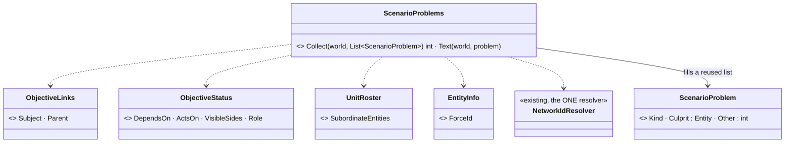
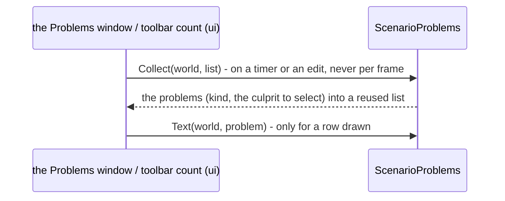

<!--STATUS
state: LIVE
build-state: READY-TO-BUILD — ✅ Q1–Q13 APPROVED (R-4166; Q9 revised); dispatched in HANDOFF_Coordinator_To_Lanes_Lifecycle_Fixes.md
updated: 2026-11-07 (first version — the user: "revise the whole process of creation a scenario … focus on the accessibility of user interface, on the practical stuff")
current-answer: §2 the walkthrough (findings by step) · §3 the leans needing the user
stale-below: nothing
known-rot: none
known-conflict: AQ108 D20 ("no dirty indicator", on purpose) vs DESIGN_Edit_Mode_Undo U5 (a dirty flag) — LC-12 · R-4162 ("Save in Preview takes a checkpoint") vs a Preview is never recorded — LC-8
related-designs:
  - docs/UX/DESIGN_Entity_Copy_Paste.md — the build design of LC-3 (Copy / Paste / Duplicate over the shared slice expansion)
  - DESIGN_Editing_UX.md — the programme this walks through end to end
  - DESIGN_New_Scenario_And_Recipe.md · ../DESIGN_Add_Entity_Picker.md · DESIGN_Map_Interaction.md — steps 1–2
  - DESIGN_Mission_Plan_Editor.md · DESIGN_Rule_Editor_UX.md · DESIGN_Initial_State.md · DESIGN_Details_Forms.md — steps 3–5
  - DESIGN_Edit_Mode_Undo.md · DESIGN_Edit_Framework.md · DESIGN_Action_Catalogue.md — steps 6–8
  - ../DESIGN_Replay_Time_Axis_And_Review.md — OWNS DAR / AAR (steps 9–12)
  - DESIGN_Seats_And_Hats.md — the window layout per seat (LC-15)
  - DESIGN_Replay_Browser_UX.md — LC-19
-->

# DESIGN — the scenario lifecycle, walked end to end for usability

## 0. Why

🔒 *"revise the whole process of creation a scenario, meaning starting from the empty scenario, then placing some entities, defining their
mission plans, defining the rules and objectives, setting initial conditions … saving … previewing it, going back, changing something, another
preview, then saving the final one, switching to live and running this live, doing DAR, back to live, end live, do AAR … focus on the
accessibility of user interface, on the practical stuff, if what we designed is actually practical and easy and intuitive to use."* (user, `2026-11-07`)

## 1. INVENTORY — how this was measured

Three read-only sweeps (authoring · rules / save / preview · live / DAR / AAR) over the designs above and the code, by grep and
`scripts/cbm.sh search_code` (the index answered for one sweep and was stale for another — those findings are grep-only). The surprising
claims were re-checked by hand: no entity copy / duplicate in code; `EntityAuthoring.cs:81` passes no name generator; `InstructorEnd.cs:16, :39`
disables *End* without an `instructor-end` rule; `RunNoteStatusBarSection.cs:23` vs `RunModeChoice.cs:370`. ⚠ Nothing was run (the MCP was
down); window layouts on screen are NOT verified.

Status column: **built** · **queued** (designed and in a running handoff) · **designed** (not dispatched) · **none** (no design).

## 2. The walkthrough

### 2.1 Start an empty scenario — mostly good

| # | finding | status | ⭐ lean |
|---|---|---|---|
| LC-1 | *New ▸ Blank, on a terrain* asks the name first, writes the file, fits the map to the terrain (`EditorSubsystem.cs:4051`, `TerrainFramingLayer`). ⚠ Then an empty map and an empty ORBAT with no hint what to do next | built | an empty-scenario hint on the map: *"Right-click the map ▸ Add Entity, or press A"* — gone after the first entity |

### 2.2 Place the force

| # | finding | status | ⭐ lean |
|---|---|---|---|
| LC-2 | ⭐ **every placed unit gets its type's name** — the placement takes a name generator, production passes none (`EntityAuthoring.cs:81`) ⇒ ten "Rifle squad"s; the ORBAT filter, conditions and `@Key` references become ambiguous | none | **numbered names by type and side** (*Rifle squad 1, 2 …*), unique in the scenario; renaming stays the Unit form's Name row |
| LC-3 | ⭐ **no Copy / Paste / Duplicate of an entity** (grep: none); the only substitute is *Save selection as macro* | ⏸ **ui, `2026-11-07` — design leaned, measured, awaiting a nod** (A5). ⭐ ONE path, every mode (user: *"why having two different ways?"*): **Copy** = `ScenarioSerializer.Serialize(…, onlyGuids)` in memory (`ScenarioSerializer.cs:167`; an outside reference is written as that entity's key). **Paste** = the MACRO EXPANDER's own route minus the file: `IScenarioEntityExtractor.Extract` (`MacroExpander.cs:120`) turns the slice into ordinary `EntityCreationRequest`s with the network ids PRE-ALLOCATED, so a reference BETWEEN copies (commander, embark, a plan's target) is remapped to the copy's new id before anything exists — multi-select by construction; a `Relocation` pass (`EntityRefRemap.cs:656`) moves EVERY positional leaf (transforms, waypoints, areas inside params) from the copy's anchor to the placed one, turned by the heading; each copy gets a fresh `EntityGuid` derived from the paste's id (as `EntityGuidDerivation` does for macro children), new mission task ids, and is NOT transient (saved with the scenario, unlike a macro child); each request goes through `Edits.Submit(EditOp.Create)` → `EntityCreation.RequestEntityCreation`, the tail every placement uses (R-145, `ScenarioSpawnAdapter.cs:477-508`) — so Edit and Live alike, one undo step in Edit (B-14), refused in Review by the gate. **Placement** — never on the originals: *Paste* / *Duplicate* (Ctrl+V / Ctrl+D) ARM a placement tool whose ghosts are the macro preview's own drawing (`MacroGhostDraw`): the group follows the cursor keeping its layout (anchor = the primary selected entity); ⭐ the SAME gesture as placing an entity (user, `2026-11-07`: *"Mouse wheel is reserved for map zoom … the same gesture as for placing the entities"*) — the one `PlacementSession` (V-5, CE-4309): PRESS places the anchor, DRAG turns the group about it with the ghosts still shown, RELEASE creates; a plain click keeps the group's own heading (⚠ a single entity's click faces north, CE-1017 — a pasted group keeps its layout instead); ⛔ no wheel (map zoom stays available while placing); Esc cancels; *Paste here* from the map menu places at the clicked point at once. ⛔ To measure while building: (a) how the extractor treats a reference to an entity OUTSIDE the slice (the expander resolves outside refs only for params) — it must resolve to the existing entity, never refuse; (b) whether the editor's own `INetworkIdAllocator` hands out ids a Live owner accepts as `PreAllocatedNetworkId` |
| LC-4 | side is chosen before placing (*Add Entity ▸ Friendly / Hostile / Neutral*) and changeable after — good. Repeat placement stays armed — good. ⚠ every unit faces north | built · heading drag queued (P3, behaviors) | — |
| LC-5 | ⭐ **the ORBAT cannot be built from loose units**: no *New group / HQ*, no commander field; groups come only from composite types. Dropping a unit on a NON-unit row silently means *embark* (`SharedOrbatPanel.cs:142-240`) | none (CAPABILITIES §14.2 ⏳) | ORBAT menu *New group here* (an empty HQ of a chosen echelon), a *Commander* row on the Unit form, and the drop says what it will do before release (*"Attach to 1st Platoon"* / *"Board Truck 2"*) |

### 2.3 Mission plans, rules, objectives, start state

| # | finding | status | ⭐ lean |
|---|---|---|---|
| LC-6 | ⭐ **a plan per unit, by hand** — no copy of a plan to other units, no apply-to-selection; only the group's commander plan (E6) | ✅ **built (L-14, CE-4314)**: *Copy plan* / *Paste plan* in the unit menu's Orders group (Edit and Live, orderable units), handled by `EntityDetailsBundle.RegisterPlanClipboard` over one `PlanClipboard` per host (every host with the mission facade, by construction); a paste on a unit inside the selection pastes onto the whole selection, else onto that unit; each gets `OrdersPlanEdits.CopyAsNew` (new task ids, all planned, the active task mapped) through `CommitMissionAsync` at its own base version. ⏳ the multi-selection Orders tab (*"3 units — same plan"*) not built | *Copy plan* / *Paste plan* as catalogue actions (onto a multi-selection: each gets its own copy); the Orders tab on a multi-selection shows *"3 units — same plan"* or *"different plans"* |
| LC-7 | creating an objective = *Rules ▸ + Add* → a flat menu of ENGINE names (Trigger, HoldArea, Count, HitRatio …) → a params form (`RuleAdd.cs:19`) | queued (RX5 / RX6 — behaviors: gallery, sentences, entry points) | the gallery is the first thing *+ Add* shows; the engine list moves under *More…* |
| — | start state rows (Aboard, Carries, Weapon, Knows about …) | built (U-23 / U-24) | — |

### 2.4 Save → Preview → back → change → Preview → save

| # | finding | status | ⭐ lean |
|---|---|---|---|
| LC-8 | ⭐ **Preview tells a lie**: the status bar says *"Running — edits are not saved unless you save"* (`RunNoteStatusBarSection.cs:23`) while Save is REFUSED in Preview (`RunModeChoice.cs:370`). And R-4162 says Save in Preview takes a checkpoint — but a Preview is never recorded, so there is nothing to checkpoint | built (wrong text) · ruling conflict | the note says **"Preview — changes are thrown away on Stop"**; Save in Preview stays refused with that reason; **amend R-4162: a checkpoint in Live only** |
| LC-9 | a fix made DURING Preview is lost on Stop, silently | none (AQ108 D11 allows edits) | keep the rule (Preview is throw-away) — LC-8's honest text is the fix; *"keep this change"* later only if asked for |
| LC-10 | ⭐ **testing minute 30 means watching minute 0–30 every iteration** — Preview always starts at the authored state, max 10× (`TransportIcons.cs:19`) | none | **"Run to …"** in Preview: as fast as the machine can until a time or an event (a phase begins, a rule fires), then pause |
| LC-11 | Preview takes no Run setup (variant / params) — only Live reuses the picker's | none | the Run setup lines on the mode indicator menu apply to Preview AND Live |
| LC-12 | ⭐ **no unsaved indicator, no autosave, and undo is never cleared** — `EditHistory` has no Clear (an undo after opening another scenario hits the wrong entities); AQ108 D20 rejected a dirty indicator, Undo U5 designs one; autosave D23 designed, CE-4099 open | undo clear + dirty flag queued (B-14) · autosave designed, not dispatched | **a dirty dot in the title** (U5 — supersede D20) and **autosave every 2 min with recovery** (D23) dispatched |
| LC-13 | ⭐ **no problems list** — a rule on a deleted unit, a unit with no brain or plan, an objective nobody can reach: found only when nothing happens in Preview (reason in the log) | none (old UXR-34 P0, AQ25 Q25-E never built) | **one Problems window** + a count on the toolbar: dangling references, rules whose subject is gone, units without side / brain, an objective on a side with no units; click = select the culprit. ⛔ never blocks Preview / Live |

### 2.5 Live → DAR → Live → End

| # | finding | status | ⭐ lean |
|---|---|---|---|
| LC-14 | going live = arm *Live* in the mode menu, then ▶; unsaved edits ⇒ *"Save and go live"* — good. ⚠ which mode ▶ starts is only in its tooltip | built | ▶ shows its mode in its own colour (green Live, violet Preview, amber DAR) |
| LC-15 | ⭐ **the instructor's windows start closed** — Rules, Mission summary, Game master, Game summary all `IsOpen = false` (`RulesBundle.cs:23-38`). ⚠ measured after the review: the end-of-exercise open (CE-4240, `EditorSubsystem.cs:314`, `:2638`) still exists but **only in the editor** — CGF / SimHost gained the windows through the bundle (T-1) but not this — and only on *Ended*, which ■ never reaches | built in part | ✏ **revised (R-4166):** ⛔ NOT by seat — 🔒 *"Window layouts are not controlled by seats. They are defined by the nodes and perspectives which is ok"*. The **RulesBundle** (every host that composes it) opens Mission summary when Live starts and again when the exercise ends; CE-4240's editor-only code moves into the bundle |
| LC-16 | ⭐ **DAR is hidden and, for trainees, invisible**: entered only from the mode menu (*DAR — last 30 s / 2 min …*) or a timeline right-click; Player nodes replay it but show NO indicator (their time bar is suppressed, `PlayerApplication.cs:1563`) | none for the Player | a **⏪ Review** button beside ▶ (opens the same choices); Player HUD: a banner *"REVIEW — the exercise is paused"* for the whole DAR |
| LC-17 | ⭐ **two different "ends"**: *End exercise* is DISABLED unless the scenario has a rule keyed `instructor-end` (`InstructorEnd.cs:16`); ■ stops at once, with no result and no question | built (both) | *End exercise* ALWAYS works for an Instructor / Author: fires `instructor-end` when present, else ends with the result *"Ended by the instructor"*; ■ in Live asks *"End the exercise? / Keep running"* (one question, not two) |
| LC-18 | the debrief: Trainee debrief / Game summary appear only on Editor, CGF, Replay Browser — **not on the Player**; nothing opens them at the end | designed (Player HUD PH-6 / PH-7) | at the end: the instructor's layout opens Game summary; the Player opens its Trainee debrief |

### 2.6 AAR

| # | finding | status | ⭐ lean |
|---|---|---|---|
| LC-19 | in the editor, AAR is reachable five ways (the 8-s toast, the mode menu, ▶ on AAR, *File ▸ Open Exercise Recording…* with scenario / time / length rows) — good. ⛔ **the Replay Browser has no list**: only *Load .fdp…* over GUID-named per-node folders (`ReplayTimelinePanel.cs:618`) | none | the Replay Browser gets the SAME *Open Exercise Recording…* picker (`RecordingPickerLauncher`, one opener) |
| LC-20 | ⭐ **no bookmarks or notes during Live** (TE-4 not built) — the instructor's "remember this for the AAR" has nowhere to go | none (E7, not designed) | design E7: *Bookmark* (one key, a name optional) and *Note* on the timeline in Live, listed in DAR and AAR |
| LC-21 | recordings default to a TEMP folder (`$TMP/FDP_Temp`, `C:\FDP_Temp`, `OrchestrationConstants.cs:16-20`) | built | a fixed data folder by default (beside the scenarios); temp only when asked |

**LC-13 — the window, as built (L-6, CE-4318, behaviors):** `Hrot.Presentation/Windows/ProblemsWindow` over §2.7's `ScenarioProblems` — one row per
problem (`ScenarioProblems.Text`), a click selects the culprit through the host's one selection request (by network id); the checks run on a
1 s timer, never per frame, and the row strings are rebuilt only when the list CHANGED (a steady scan draws kept strings). `DrawToolbarCount`:
an amber ⚠ N on the main toolbar right after the time control (sort 15), nothing when there are none; a click opens the window. ⛔ Never blocks
Preview / Live (it only tells). Composed by the editor (authoring); ⏭ CGF and the Replay Browser do not compose it yet. Rails
`TheProblemsWindowTests` (rows, select, timer, a real frame).

**LC-16 as built (L-5, CE-4321, behaviors):** ⏪ **Review** — `MainToolbarTimeControlSection.ReviewChoices()` is the ONE list of a live run's DAR choices
(the mode menu's Live items now come from it); in Live the toolbar draws ⏪ (`TransportIcons.BtnShape.Rewind`, DAR amber) beside ▶ and its popup offers
those choices (greyed with the reason when the run is not recorded, D14). The Player's banner — `RunMode.ReviewBanner` — *"REVIEW — the exercise is
paused"*, amber, across the top on the foreground draw list whenever the node's run transport is in `TransportMode.Review`; drawn from
`PlayerApplication.DrawUI` (the Player's time bar stays suppressed). Rails: `MainToolbarTimeControlTests.CE4321_*`, `ColourIconsFrameRail.L5_*` (a real frame).

**LC-17 as built (L-3, CE-4322, behaviors):** `InstructorEnd.Of(world, blocked, withoutRule)` — with no `instructor-end` rule the End is AVAILABLE where the
station can create a one-shot and its seat may edit rules (`RuleEditorServicesFactory.SeatRefusal`: Instructor / Author); it runs `InstructorEnd.EndStep()`
(`EndExercise { reason: "Ended by the instructor" }`) through the Game master's one path (`GmOneShot.TriggerParamsJson` → the bundle's `CreateOneShot`). The
`RulesBundle` wires BOTH End controls (Rules toolbar, Mission summary) and hands the Rules window's End to the host's transport as its `IExerciseEnder`
(`ClusterTimeTransportAdapter.Ender`), by construction on every host that composes the bundle. ■ in Live then asks ONE question — *End the exercise?* — and
leaves Live once the end is in (the ender can no longer end), or after 180 frames; no ender ⇒ today's ■. ⚠ **Deviation:** LC-17's second button *Keep
running* is the house confirmation's own Cancel (every run confirmation ends with it, `RunModeConfirmation.WithCancel`); the text says *"Cancel keeps it
running"*. Rails: `RunnableRulesTests.CE4322_*`, `TheOneTimeFacadeTests.CE4322_*`, `TheRulesBundleTests.CE4322_*`.

**LC-2 as built (L-4, CE-4312):** `EntityNames.Next(world, typeName, pending)` (Hrot.Common, beside `EntityCreation`) — `"<type> <n>"`, the lowest free `n` in the scenario; called by `ScenarioSpawnAdapter` after the side is applied, only for a unit still carrying its type's bare name. ⚠ One counter per name across sides (unique in the scenario, as LC-2 asks), not one per side.

### 2.7 LC-13 — the Problems checks, detailed *(backend, `2026-11-07`, L-6 / CE-4318)*

INVENTORY (`search_graph .*(Problem|Validator|Lint|ScenarioCheck|Issue).*` Class — 60 hits, every one an ASSET validator (BTree / HSM /
blueprint / animation); none walks a scenario's world; grep `ScenarioProblem` — none) ⇒ new, one class, read by every host.

*What the picture shows: one pure reader over components that already exist; the window (ui) only draws the list and selects the culprit; nothing
gates Preview or Live.*

| check (`Kind`) | the problem | culprit (click selects) |
|---|---|---|
| `RuleSubjectGone` | a rule / objective's subject or parent (`ObjectiveLinks`) names an entity that is gone | the rule |
| `RuleLinkGone` | a rule it depends on / acts on (`ObjectiveStatus.DependsOn` / `ActsOn`) is gone | the rule |
| `RosterMemberGone` | a group's roster lists a member that is gone | the group |
| `MixedSides` | a group's members are not all on its side | the member |
| `ObjectiveSideEmpty` | an objective shown to one side (`VisibleSides`) that has no units | the objective |

| deviation from LC-13's list | why |
|---|---|
| *"a unit without side"* is checked as **MixedSides** | ⛔ undecidable as written: `ForceId.Neutral` is BOTH the default and a real side (civilians, armed civilians); the authoring error that IS detectable is a member on another side than its group |
| *"a unit without brain"* is NOT checked yet | whether a unit has a behaviour depends on its TKB template's default (`BehaviorTkbTranslator`), which a world-only reader cannot see; the Preview log already names a unit that starts nothing. ⏳ a later check with the TKB in hand |
| the Problems WINDOW and the toolbar count | ui's (the handoff: "ui window by whoever claims it"); backend ships the checks (`ScenarioProblems.Collect` / `Text`). ⏳ no HTTP route yet |

## 3. For the user — the decisions — ✅ ALL APPROVED (R-4166, user `2026-11-07`: *"Otherwise, all approved."*), Q9 as revised

| # | question | ⭐ lean |
|---|---|---|
| **Q1** | numbered names (LC-2) | yes, *type + number*, unique per scenario |
| **Q2** | Duplicate carries the plan and the start state (LC-3) | yes, everything authored |
| **Q3** | ORBAT building (LC-5) | *New group here* + a Commander row + the drop says what it does |
| **Q4** | Copy / Paste plan (LC-6) | yes, as catalogue actions on a multi-selection |
| **Q5** | Preview text + amend R-4162 (LC-8) | yes — a checkpoint is Live only |
| **Q6** | *Run to …* (LC-10) | yes — the biggest time-saver of the loop |
| **Q7** | a dirty dot + autosave (LC-12) — supersedes AQ108 D20 | yes |
| **Q8** | the Problems window (LC-13) | yes, never blocking |
| **Q9** ✏ | ~~Live opens the seat's windows~~ — the bundle opens Mission summary on Live and at the end on every host; the Player opens its Trainee debrief (LC-15, LC-18) | ✅ revised by the user |
| **Q10** | DAR: ⏪ Review button + the Player's banner (LC-16) | yes |
| **Q11** | *End exercise* always works; ■ asks once (LC-17) | yes |
| **Q12** | the Replay Browser's recording picker; recordings out of TEMP (LC-19, LC-21) | yes |
| **Q13** | bookmarks and notes (LC-20) — design E7 next | yes |

---
_coordinator lane, 2026-11-07_
