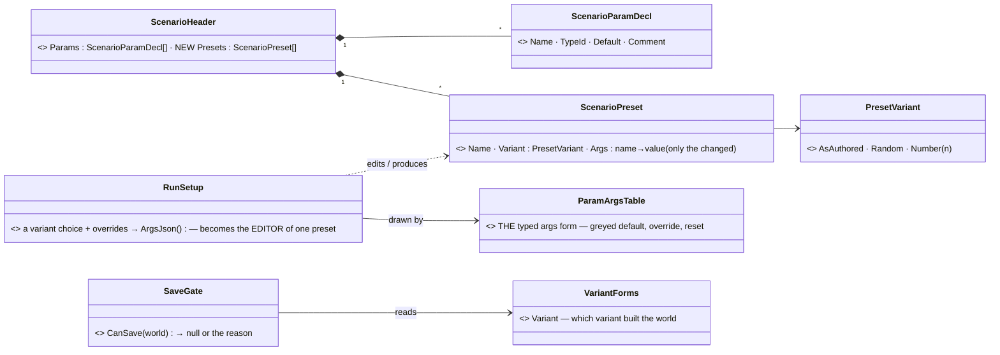
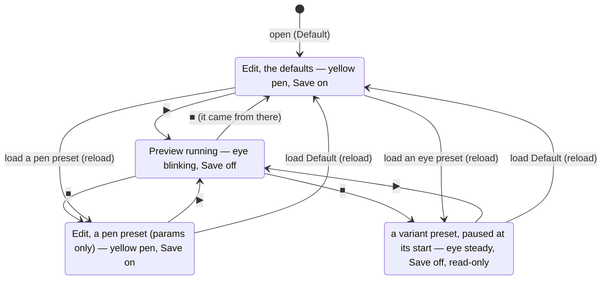
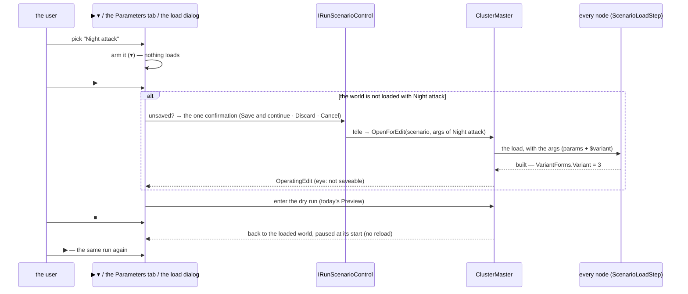
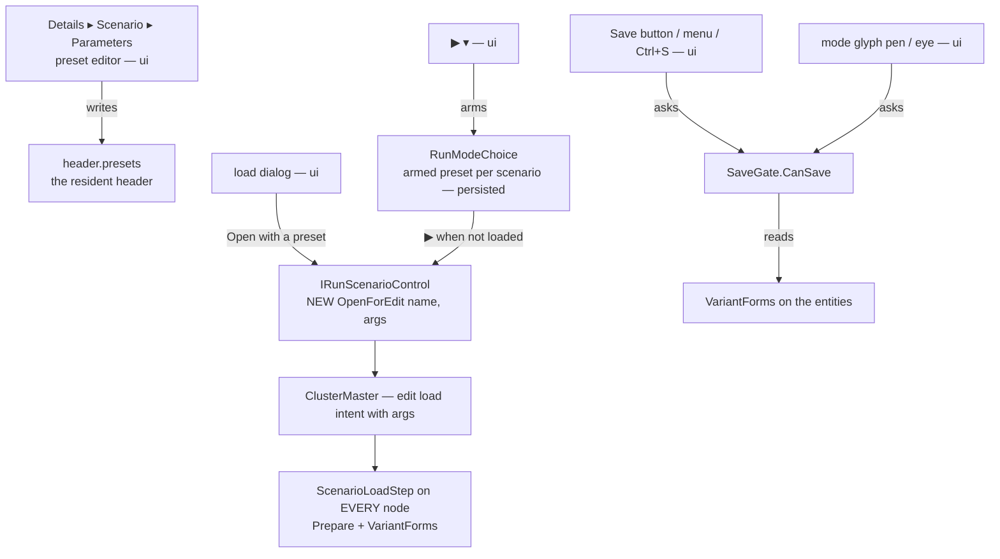
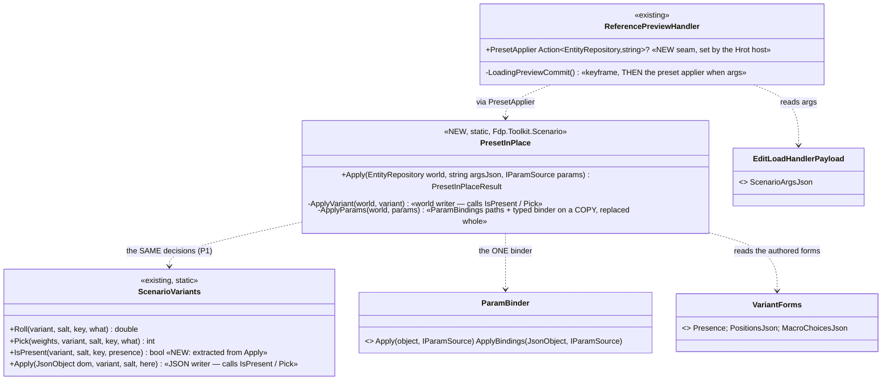
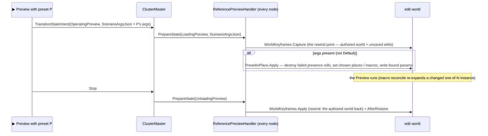
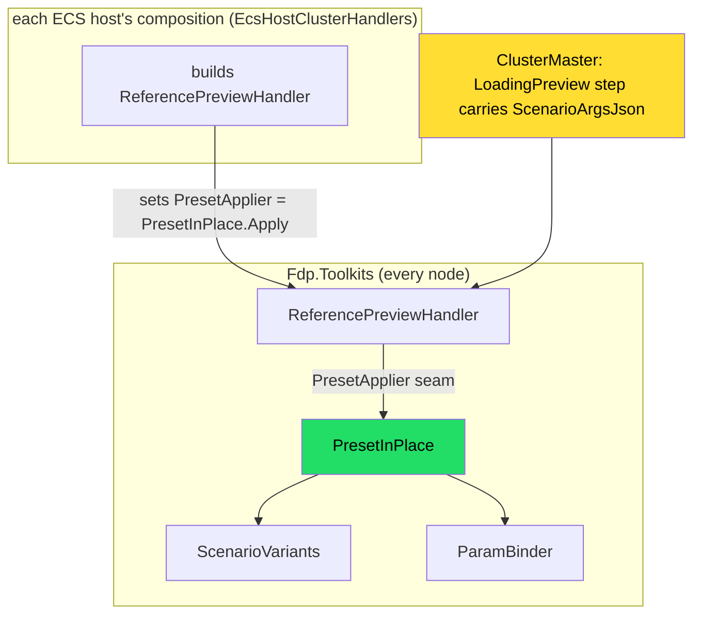

<!--STATUS
state: LIVE
build-state: READY-TO-BUILD (CE-3374 first, then CE-3375)
updated: 2026-11-07 (backend — ✅ D1–D12 APPROVED by the user: "Approved.")
current-answer: the whole file — §1 the model, §2 the states, §3 the sequences, §4 who calls what, §5 the surfaces (mockup), §6 the decisions, §7 the work
stale-below: nothing
known-rot: none
known-conflict: AQ108 D24 (the Live default variant is RANDOM) — reconciled by D7 below, awaits the user · R-3061 / AQ108 D17 (Preview = violet ◐) and
  DESIGN_Colour_Icons.md "Not touched: the mode indicator" — the user replaced ◐ with an eye on 2026-11-07 (D9); fold into AQ108 §1a with the old rule
  under HISTORY when built · LC-11 / CE-4317 (the Run setup on the mode menu, ui, started) — re-scoped by D8 (one picker: the split ▶)
related-designs:
  - docs/DESIGN_Struct_Editor.md — the library the preset editor is built on (step 6)
  - docs/DESIGN_Scenario_Macros.md — §17.1 OWNS the VariantForms holder (CE-3374) that makes a variant-0 world saveable; §5 / §14 SR-168 OWN the bindings that keep a parameter's binding across a save; SR-32 owns MACRO presets (a different concept, D1)
  - docs/UX/DESIGN_Scenario_Lifecycle_Review.md — LC-11 (a Preview that takes the run setup) is answered HERE; §2.8 Run to … runs on any of these worlds
  - docs/blueprints/Architect_Question_108_Run_Mode_Picker.md — D24 (the run setup, the picker's expander), R1 (only the indicator changes mode), D17 (the glyphs); this design replaces D24's expander with presets
  - docs/designs/scenario-picker/README.md — D25 / D26: the one wide picker and its side pane; §5b here re-orders the pane
  - docs/DESIGN_Macro_Authoring_Editor.md — §9: the Parameters section (ParametersDrawer over HeaderParamsSchemaSource) this design extends
  - docs/blueprints/Blueprint_Issues_Tracker.md — CE-4252 (the yellow pen in Edit, open) — D10 here makes the pen mean "Save is on"
  - docs/PLAN_Training_And_Gameplay_Engine.md — P-7 "scenario feature presets": the precedent of a named set stored in the scenario
-->

# DESIGN — **scenario PRESETS**, and the preview with a preset

> 🔒 **User, `2026-11-07`:** *"I also think about presets saved in scenario file … no one wants to enter parameters. People like simple predefined
> choices. That means the scenario parameters tab would also need to become the preset editor (a combo on the top, showing what preset we are
> currently seeing and editing in the table below, with the default parameters being just one of the presets, the first one.)"* · *"The load
> scenario dialog would then allow selecting the scenario preset right under the image thumbnail … before the description text."* · *"extending
> … the play button, to have a little down arrow on the right side … the default play will pick the default preset, while if we press the little
> downward arrow, it will list a drop-down with listing all the available presets … similar … Visual Studio Code … launch settings."* · *"For the
> non-saveable parametrized run we would never show yellow pencil but an icon of an eye (replacing the current half circle …). And the eye would be
> blinking in preview."* · *"The save icon tooltip will always say why the save is not permitted. And the yellow pen will be shown only if the save
> is permitted."* · *"think about the scenario preset editor in the details panel. So it is practical, ergonomic and intuitive."*
> 🔒 Earlier the same day: *"the dry run with setup is basically using the same load path as the live scenario, but it is really not a live mode,
> it is still a dry run."* · *"Accept it, we need to design and fix the gap first."* (the variant gap → [`DESIGN_Scenario_Macros.md`](../DESIGN_Scenario_Macros.md) §17.1)

## 0. INVENTORY *(`2026-11-07`, backend)*

| query | result |
|---|---|
| `search_graph .*Preset.* Class` | **8** — vehicle, seat and map-pick presets; `PresetRoundTripTests` = the Replay Browser's saved SEARCH predicates. ⛔ none is a scenario run setup |
| `search_graph .*RunSetup.* / .*Variant.* / .*ParamArg.* Class` | **0 / 0 / 0** — ⚠ the index is stale for these files (grep sees `RunSetup`, `ParamArgsTable`); grep is the answer below |
| grep `RunSetup` | `Hrot.Presentation/RunMode/RunSetup.cs` (a variant choice + param overrides → `ArgsJson`) · `AssetPickerLauncher.DrawRunSetup` (the load dialog's collapsed expander, under the description) · `RunModeChoice.LastRunSetupOf` (session memory only) |
| grep `ParamArgsTable` | ⭐ THE typed args form — the macro instance's args, the Run setup, and the declaration table's default cells (`VariablesPanelControl.cs:303`) |
| the Parameters section | `ParametersDrawer` over `HeaderParamsSchemaSource` (declarations: add · remove · rename · default · comment, one undo history) in Details ▸ Scenario |
| the load with args | `ScenarioLoadStep.cs:182-199` — params and `$variant` are applied to the scenario TEXT before extraction; `EditLoadIntent(scenario, args)` exists (`ScenarioLoadSequence.cs:92`); `IRunScenarioControl.OpenForEdit(name)` has NO args overload, `LoadForLive(name, args)` has |
| what a save keeps | bindings: kept (SR-168, `ParamBinding.cs` header; ⚠ no end-to-end rail found — macros §17.1 M2) · variant forms: LOST today (§17) → fixed by `VariantForms` (§17.1) |
| editing a bound field | `ComponentEditDrawer.cs:330-336` — the literal is edited and the binding KEPT ⇒ the next load overwrites it from the param |
| designs read | AQ108 (D17, D24, R1, §2.18) · scenario-picker README (D25/D26) · Macros §5, §14, §17 · Rules SR-101 · Lifecycle LC-8/LC-11/LC-14 · CE-4252/4253/4254 · Colour Icons · UI Conventions · P-7. ⛔ No design mentions scenario presets (`docs/` and `.dev/` searched) |

⚠ coverage unchecked — `check_index_coverage` is not in the CLI.

## 1. The model — a preset is a NAMED RUN SETUP

*What the picture shows that prose hid: a preset is exactly what `RunSetup` already holds (a variant choice + the changed params) with a NAME, kept in
the file — no new form, no new args path. **Default** is not stored: it is the declarations' defaults, as authored, always first.*

## 2. The states the editor can be in

*What it shows: ■ always returns to the world the run came from (AQ108's rule) with NO reload — so a preset run repeats with ▶ alone. Only CHANGING
the preset reloads. And there is no new cluster state: every left-hand state is today's `OperatingEdit`, loaded with different args; a running one
is today's `OperatingPreview` (the dry run over a copy).*

| ⭐ the rule | |
|---|---|
| ⭐⭐⭐ **saveable ⇔ the world was built with variant 0** (`VariantForms.Variant`, any entity) | parameter values never block a save: each bound field keeps its binding (SR-168), and the binding wins on the next load |
| ⭐⭐ a pen preset = `Variant: AsAuthored`; an eye preset = `Random` or a `Number ≠ 0` | ⭐ the icon is computed from the preset, never chosen |
| ⭐⭐ the eye state is READ-ONLY (edits greyed — R-4150) | ⛔ an edit that can never be saved is a loss the user does not see coming |

## 3. The sequences

*What it shows: the only new call is `OpenForEdit` WITH args (the edit intent already carries them); the dry run, ■ and the load path are today's.*

## 4. Who calls what

*What it shows: every surface that shows "can I save" asks ONE gate, so the pen, the Save button and its tooltip cannot disagree.*

## 5. The surfaces — 🖼 [`scenario-presets-visual.svg`](scenario-presets-visual.svg) *(generated by `scripts/gen-scenario-presets-mockup.py`)*

### 5a. The preset editor — Details ▸ Scenario ▸ Parameters

| element | why it is there |
|---|---|
| **"The map holds: Default — editable, Save on"** (pen or eye) | ⭐ the table shows a preset; the MAP may hold another — this line keeps them apart |
| **Preset combo** (pen / eye icon per entry, one-line summary under each: *"variant 3 · 2 changed"*) | ⭐ picks what the TABLE shows and edits; ⛔ never reloads the map |
| **[+]** new preset = a copy of the shown one · **[⋮]** Rename · Duplicate · Delete · Move up/down · Reset all to default | ⭐ Default cannot be renamed or deleted |
| **Preview this preset** | ⭐ the one-click path: load (if needed) and ▶ |
| **Variant** row — *As authored · Random each run · Number [n]* — only when the scenario uses variants; a violet line says *"Preview only"* when not As authored | ⭐ the cost of a variant is stated where it is chosen |
| **ONE table**: Name · Type · *Value · <preset>* · Used | ⭐ under Default the value IS the declared default (today's table); under another preset a value equal to the default is GREY with *default*, an override is BRIGHT with an amber bar and **↺** |
| Add / rename / remove / move a parameter work under ANY preset | ⭐ the declaration is shared: a rename renames it in every preset, a remove drops it from every preset — one undo step |

### 5b. The load dialog
The **Preset** combo sits directly under the thumbnail and the name, with its one-line summary; the description goes BELOW it in its own scrolling
box; the Run setup expander is gone (its job is the presets). *Open* loads for editing with the preset (an eye preset opens preview-only); *Open and
go live* starts Live with it.

### 5c. The split ▶ and the states
🖼 **[`run-indicator-visual.svg`](run-indicator-visual.svg)** *(generated by `scripts/gen-run-indicator-mockup.py`; user `2026-11-08`: pen approved, the armed indicator stays, ▶'s GLYPH coloured, not its background)* — every state of the indicator · ▶ · Save. **⭐ SUPERSEDES the indicator sentence below:** the indicator shows the armed mode (dim) in Edit and the running mode in a run, EXCEPT Edit + saveable ⇒ the yellow pen; Save in a run is the amber checkpoint flag. ✅ **Approved `2026-11-08`, and the model changed with it: the indicator SWITCHES the mode at once ([AQ108 §0](../blueprints/Architect_Question_108_Run_Mode_Picker.md), R-3084) — the pen = Edit on a saveable world (R-3083); ▾ only in Edit and Live paused at the start.**

▶ keeps its face; a narrow **▾** at its right opens the preset list (✓ on the armed one, pen / eye icons, *Edit presets…* at the end → §5a). ▾ arms
a preset; ⛔ never the mode (AQ108 R1). The ▶ tooltip names both: *"▶ Preview — Night attack (variant 3: preview only)"*. The mode glyph: **yellow pen
only when Save is on**, the **eye** steady for a loaded eye preset, the eye **blinking** while any Preview runs. Save is greyed with its reason in
every state where it is off.

### 5d. ⚠ Found — TWO "defaults + overrides" forms already exist; the preset editor must not be a third *(`2026-11-07`)*

| form | where | look |
|---|---|---|
| `ParamArgsTable` (`Hrot.Editor.AiShared/Scenarios/ParamArgsTable.cs`) | the macro instance's args, the load dialog's Run setup, the declaration table's default cell | default greyed (alpha 0.55) until overridden; a *reset* button |
| `ParamsDefaultsForm` / `ParamsDefaultsModel` (`Hrot.Presentation/Behavior/ParamsDefaultsForm.cs`) | a BTree / HSM / Blueprint asset's params defaults (`VariablesPanelControl.cs:276`, `BlueprintMyBlueprintWindow.cs:716`) | the DTO's fields; `*` + *Reset* on an override |

⭐ Both are "a value = a default + this owner's overrides, reset per field", over the same StructEdit leaves — one concept, two forms, two looks.
⇒ the preset value column uses ONE of them, and the other folds into it (ui; a tracker row when the presets are built). ⭐ Lean: `ParamArgsTable`'s
row model (it already serves three hosts and the declaration table), with the DTO's fields as its rows for a behaviour asset.

### 5e. ⭐⭐ ONE shared editor, and it looks like the mockup *(user, `2026-11-07`)*

> 🔒 *"The graphical design you made for scenario parameter editing is a nice one, while … the real look of the shared parameter editor … is ugly.
> So it is desired to have one shared editor which looks nice."*

| ⭐ rule | |
|---|---|
| ⭐⭐⭐ the §5a look is built INTO the shared `VariablesPanelControl` (and the one value form, §5d) — not into a Parameters-only copy | ⭐ the blackboard ×3 and the scenario parameters all get it; ⛔ a second, nicer table beside the old one is the duplicate R-174 forbids |
| ⭐⭐ the look is an acceptance spec (R-4138): aligned value column, the amber override bar + ↺, the grey *default*, FontAwesome glyphs in their colours (R-4139), slate headers | ⭐ a frame rail measures it, and the builder compares a real render with the mockup itself (R-4146) |
| ⭐ the host's words, not the blackboard's | 📐 today the Parameters host still says *"[+] Add variable…"* and *"Not referenced by any node — consider removing"* (frame render `2026-11-07`) — the words come from the source, like the columns (`DeclarationFeatures`) |
| ⭐ the host's differences are SETTINGS of the shared table (`DeclarationFeatures`) | 🔒 user: substructures in the generic editor, *"while for scenario parameters … plain data types, so this is a setting"* — [`DESIGN_Field_Declaration_Editor.md`](../DESIGN_Field_Declaration_Editor.md) §6. ⭐ The Parameters host turns struct fields OFF |
| ⛔ out of scope here | a behaviour's params TYPE defined as a JSON asset — **CE-3376**, for the user + coordinator |

## 6. Decisions — ✅ ALL APPROVED (user, `2026-11-07`: *"Approved."*)

| # | question | ⭐ lean | why / rejected |
|---|---|---|---|
| **D1** | what a preset is, and where it lives | ⭐ `header.presets: [{name, variant, args}]` in `scenario.json`; Default implicit | ⭐ a named RUN setup (P-7 precedent). ⛔ SR-32's "one mechanism for every preset" is about AUTHORING presets of a macro (a macro wrapping an instance) — a run setup is not an entity and has no instance to wrap |
| **D2** | what the tab's combo does | ⭐ shows / edits a preset's VALUES; never reloads | ⛔ a combo that reloads the map would lose edits on a mis-click |
| **D3** | one table or two | ⭐ ONE table, the value column follows the combo | ⛔ two tables (declarations + values) — the user would hunt for which one edits what |
| **D4** | variant in a preset | ⭐ three choices: As authored · Random each run · Number | ⭐ the eye follows from it — never a separate flag |
| **D5** | editing in an eye world | ⭐ read-only, grey (R-4150) | ⛔ editable-but-unsaveable — silent loss |
| **D6** | unsaved edits when another preset loads | ⭐ the existing unsaved confirmation (Save and continue · Discard · Cancel) — as Live does | ⛔ a temporary copy of the world — a second save path |
| **D7** | D24 says Live's default variant is RANDOM | ⭐ keep it: when a scenario uses variants, a built-in **Random** preset (not stored) is listed second; **Live arms it by default, Preview arms Default** | ⛔ Default = random — then plain ▶ Preview could not be today's in-memory copy |
| **D8** | where the preset is picked at ▶ | ⭐ the ▾ of ▶ is THE picker; the mode menu shows the armed preset as one read-only line | ⛔ LC-11's run-setup lines on the mode menu as a second picker (re-scope CE-4317, ui) |
| **D9** | the Preview glyph | ⭐ the eye (FontAwesome `eye`), violet kept, in the ONE icon map (`mode/preview`) | the user, 2026-11-07. Supersedes R-3061's ◐ — fold into AQ108 §1a, old rule under HISTORY |
| **D10** | the pen | ⭐ yellow pen ⇔ `CanSave` is null (CE-4252's pen gets its meaning) | the user: *"the yellow pen will be shown only if the save is permitted"* |
| **D11** | the armed preset is remembered | ⭐ per scenario, per mode, in the editor's user settings (persisted) | ⭐ fixes the session-only `LastRunSetupOf` gap (the picker's mockup promised *"Remembered for this scenario"*). ⛔ not in the scenario file — it is a person's choice, not the scenario's |
| **D12** | a field bound to a parameter, edited in the world | ⭐ unchanged (the literal is edited, the binding wins on load) — the chip's tooltip says *"from parameter `speed` — set its value in Parameters"* | ⚠ measured, not changed here |

## 7. The work *(split 2026-11-07 into CE-3375 data · CE-3388 load · CE-3389 CanSave · CE-3390 HTTP · CE-3391 preset editor · CE-3392 load dialog · CE-3393 split ▶ · CE-3394 glyphs — the coordinator assigns lanes: `batches/NOTE_Backend_To_Coordinator_Presets_And_Struct_Editor.md`)*

| item | lane | what | depends on |
|---|---|---|---|
| **CE-3374** | backend | the `VariantForms` holder — macros §17.1 (+ the SR-168 end-to-end rail if missing) | — |
| **CE-3375** | backend | `header.presets` read / write (`ScenarioPreset`, `PresetVariant`), `IRunScenarioControl.OpenForEdit(name, args)`, `SaveGate.CanSave` + reason, the HTTP surface (`GET /scenario/presets`, `POST /scenario/load/edit {preset}`, `/status canSave`) | CE-3374 |
| ui | ui | §5a the preset editor · §5b the load dialog · §5c the split ▶, the eye, the pen, the Save tooltip · D11 persisted armed preset · re-scope CE-4317 (LC-11) | CE-3375 |

⚠ **Measure before building:** M1–M3 in macros §17.1; whether `ScenarioDescription.ArgsOf(world)` (the resident args the recorder reads) names the
loaded preset well enough for *"The map holds: …"* (match by args) or the load should stamp the preset name.

## 8. As-built *(backend, `2026-11-07`, the struct editor overnight N-7)*

| item | as built | deviation |
|---|---|---|
| **CE-3374** | `VariantForms` (macros §17.1 — see its as-built) | — |
| **CE-3375** data | `ScenarioPreset(Name, PresetVariant, Args)` + `PresetVariant(Kind: AsAuthored · Random · Number, n)` in `ScenarioHeader.cs`; `header.Presets` read / written by `ScenarioHeaderJson` (`"Variant": "AsAuthored" \| "Random" \| n`, a stored "Default" ignored); `ScenarioPresets` — THE resolver (`Of(header)` Default first · `HeaderOf(path)` · `TryArgs(header, name, random)` · `ToJson`); `ScenarioPreset.ArgsJson(random)` = the overrides + `$variant` when not as authored. `ScenarioSaveCore.HeaderOf` keeps `Presets` (and `Features` — an edit save had dropped them). Rail `ScenarioPresetsHeaderTests` (3) | ⭐ the resolver lives in `Fdp.Toolkit.Scenario` (one for HTTP and every ui surface), not in `RunSetup` |
| **CE-3389** | `ScenarioSaveGate.CanSave(world)` — null or *"this world was built with variant N — a variant is preview only; load the scenario as authored to save"*; reads `VariantForms.Variant`. Rail in `VariantFormsTests` | — |
| **CE-3388** | `IRunScenarioControl.OpenForEdit(name, argsJson)` (default member → the plain open; the editor session overrides it onto the edit intent's `ScenarioArgsJson`); `ScenarioDoor.Open(…, argsJson)` | the session keeps its own edit intent (fresh `ExerciseId`) rather than `ScenarioLoadSequence.EditLoadIntent` (empty id) — unchanged from today |
| **CE-3390** | `GET /scenario/presets?name=` → `{scenario, presets:[{name, variant, saveable, changed}]}`; `POST /scenario/load/edit\|live {name, preset}` (400 with args / variant, 404 naming the presets there are); `/status` `canSave` + `cannotSave`. Route docs + `EveryRouteIsDocumentedTests` | — |
| **CE-3392** | the load dialog: the **Preset** combo under the thumbnail and the name (the generic picker gained `PickerRequest.DrawUnderHeader`, drawn inside the default pane before the description), Default first, pen / eye glyph per entry, a one-line summary (*as authored · 1 changed* · *variant 3 · preview only*); *Open* with a non-Default preset → `RunModeChoice.OpenForEdit(name, args)` (the door), *Open and go live* passes the preset's args; `ScenarioPaneFacts.Facts.Presets`. Rail `TheRunSetupDrawsTests` (rewritten: 3) | ⭐ the AQ108 D24 **Run setup expander is REMOVED** from the dialog (§5b: *"its job is the presets"*) — ⛔ ad-hoc param edits at load are gone; a set of values is a preset (edited in Details ▸ Scenario ▸ Parameters, CE-3391) |
| **CE-3394** | the eye replaces ◐ for Preview (`Icons` `mode/preview`, `RunModeChoice`); `IScenarioSession.SaveDisabledReason` (the gate, cached per world version) greys Save / Save As with the reason; `SaveCurrent` / `SaveAs` refuse; `POST /scenario/save` 409s. Rail `EditorScenarioSessionSaveTests.AVariantWorld_…` | ⏸ the yellow pen SKIPPED — needs the user (QUESTION [`NOTE_Backend_To_Coordinator_Edit_Pen_Vs_Armed_Indicator.md`](../blueprints/batches/NOTE_Backend_To_Coordinator_Edit_Pen_Vs_Armed_Indicator.md): it conflicts with AQ108 D1's dim armed indicator in Edit) |
| **CE-3393** | the split ▶: a narrow ▾ (`ImGui.ArrowButton`) at ▶'s right, from Edit with Preview / Live armed and a preset besides Default — lists the presets (pen / eye, ✓ on the armed one, the summary as a tooltip) + *Edit presets…* (`RunModeChoice.EditPresets`, greyed until CE-3391); ▾ ARMS (`RunModeChoice.ArmPreset`), never the mode. ▶ Live loads with the armed preset's args; ▶ Preview with a preset the world does not hold reopens with it through the door and starts the dry run when `OperatingEdit` comes back (`_previewWhenEdit`), else the dry run at once; ▶'s tooltip names the preset. D11: `ArmedPresets` (per scenario × mode, `armed-presets.json` in the user folder; `NodeRunControls.For` sets `ArmedPresets.Shared` on every host). "Is it loaded": `PresetText.IsLoaded(preset, IRunScenarioControl.LoadedArgsJson)` — the resident args (`ScenarioDescription.ArgsOf`) matched by overrides + variant (a Random preset matches any non-zero variant). Presets read by construction (`RunModeChoice.PresetsOf`: the scenarios folder, re-read every 2 s). Rails in `RunSetupTests` (5) | ⭐ §7's measure answered: match by ARGS, no preset name stamped; D7 (Live's default = random) holds because Live's Default load draws a variant (`LiveLoadIntent`) — no built-in Random entry is listed |

| **CE-3391** | the preset editor in `ParametersDrawer` (`Hrot.Editor/Scenario`): above the table — *"The map holds: <preset> — editable, Save on"* (pen / eye; host seam `MapHolds` → `MapHolding(PresetName, Editable, Reason)`, read twice a second), the **Preset** combo (`PresetText.Label`, the summary under each, Default first) that picks what the TABLE shows (`Show(name)`; nothing loads), **[+]** a copy of the shown one named *Preset N* (unique), **[⋮]** Rename… · Duplicate · Delete · Move up / down · Reset all to default (Default's Rename / Delete / Move greyed with the reason as tooltip), **Preview this preset** (host seam `PreviewPreset(name)`), the **Variant** row (As authored · Random each run · Number [n], only for a non-Default preset and only when `UsesVariants`; violet *Preview only* line when not saveable). The value column is `PresetDeclarations : IFieldDeclarations` over the params source: under Default the declared defaults (today's table); under a preset `ValueJson` = the preset's `Args[name]` else the declared default, `DefaultJson` = the declared default, so the shared `FieldTable` (`FieldTableSettings.ShowDefaults` ⇒ `DeclaredDefaults`) draws a value equal to it grey and an override amber + ↺; a write goes to `HeaderParamsSchemaSource.SetPresetValue` (a value equal to the default REMOVES the key — an override is a difference; ↺ writes the default, so it removes the key). `HeaderParamsSchemaSource` owns every preset edit (`AddPresetCopyOf` · `DuplicatePreset` · `RenamePreset` · `DeletePreset` · `MovePreset` · `ResetPreset` · `SetPresetVariant` · `SetPresetValue`): each is ONE `EditHistory` step through ONE `ScenarioDescription.Stamp` of a NEW header (`SetState(decls, presets)`), and a param **rename / remove / retype** rewrites every preset's Args (a clone) in the SAME step. `EditorSubsystem.WireParametersDrawer` passes the three seams (map holds by ARGS via `PresetText.IsLoaded` + `SaveDisabledReason`; variants = any entity keeps a `VariantForms`; preview = `Choose(Preview)` → `ArmPreset` → `Play`) and the ▾ menu's *Edit presets…* (`RunModeChoice.EditPresets`) opens the Parameters header. Rails `ThePresetEditorTests` (5) | ⭐ **In a world that cannot be saved (an eye world) the preset buttons, the Variant row and the table are greyed** (D5) — showing another preset in the combo stays enabled. ⭐ A **retype** drops the param's override in every preset (a value of the old type). ⭐ Under a preset **Add** declares the new row plain (its shown value is not a declaration default); **Duplicate** of a param copies its declaration, not the preset's override. ⚠ The mockup's small *default* label beside a grey value is not drawn (grey + the header already say it). ⚠ "Uses variants" is *any entity holds `VariantForms`* — the world, not the file (the load dialog reads the file's `ScenarioVariants.Uses`) |

## 9. ⭐ Preview WITH a preset — applied IN PLACE, no save / reload *(coordinator, `2026-11-08` — ✅ APPROVED by the user (R-4168, *"Approved, send it to backend"*); answers backend's B-6 QUESTION; built as CE-4326)*

🔒 User, `2026-11-08`: *"the preview is largely about showing unsaved edits and quick preview/edit iterations. So not being able to preview unsaved
edit is not what I want"* · *"the preview still needs to stay fast on default settings … i hoped that some preset do not require this autosave-load
dance, in the same way as default preset does not require it. So it should happen only if necessary. can you check?"*

**The constraint backend measured** ([NOTE](../blueprints/batches/NOTE_Backend_To_Coordinator_Preview_Run_Setup_Question.md)): a preset's args are
applied only by the LOAD — `ScenarioParams.Prepare` + `ScenarioVariants.Apply` on the scenario's JSON before the extractor creates entities
(`ScenarioLoadStep.cs:182-200`); a Preview loads nothing — it keyframes the edit world and runs it (`ReferencePreviewHandler`). ⛔ Withdrawn: (B)
*"preview the SAVED file"* — loses the unsaved edits.

**Measured `2026-11-08` — the edit world already holds everything a preset changes, so each part can be applied to the Preview's copy directly:**

| what a preset changes | what the edit world keeps | apply in place | measured |
|---|---|---|---|
| **a parameter's value** (variant 0 — a *pen* preset) | `ParamBindings` on every bound entity: field path → param name (*"Behavior.Params.Speed" → "speed"*), managed, kept in the world for the save | write the preset's value into each bound field (the binding path, the struct editor's path writer) | `ParamBinding.cs:100-110` · `RuleDetails.cs:428-433` reads them in the world today |
| **presence** (a variant) | `VariantForms.Presence` — the authored chance — on the entity | the SAME roll as the load (`ScenarioVariants` roll by variant + entity key, `ScenarioVariants.cs:169`) ⇒ destroy the entity in the Preview's copy; the rewind brings it back | `VariantForms.cs:18-40` |
| **one-of-N place** | `VariantForms.PositionsJson` + `PositionChosen` | the same pick ⇒ set the place | same |
| **one-of-N macro** | `VariantForms.MacroChoicesJson` + `MacroChosen` | replace the `MacroInstance.Macro` with the chosen name ⇒ the `MacroExpansionSystem` already RE-EXPANDS a changed instance live and reconciles its children by GUID (SR-150 / SR-157) | `MacroExpansionSystem.cs:330-360` (runs in a Preview; only a replay stops it, `:71`) |
| **a param bound INTO a macro's args** | the instance's args | the same reconcile — ⚠ but *"a changed behaviour param is applied to NEW children only (S3b)"* (`MacroExpansionSystem.cs:336`) | ⚠ the one known gap |

| ⭐ the rule | |
|---|---|
| **Default (as authored)** | unchanged — keyframe, run, rewind. Zero extra cost |
| **Any other preset** | keyframe, then **apply the preset IN PLACE on the copy** (the table above), run, rewind. Cost: a write per bound field + a destroy per failed presence roll + a re-expansion per changed one-of-N macro — milliseconds, no save, no load, **unsaved edits included** |
| **Only if a part cannot be applied in place** | that preset falls back to the load path (D below), named in the Preview's note — measured gate P2 says which, if any |

| ⚠ gate — measure before building | |
|---|---|
| **P1 — one decision, two places** | the in-place applier must make the SAME choices as the load: it calls the load's own decision functions (the roll, the position pick, the param source) and only WRITES differently — ⛔ never a second copy of the rules (the shared-and-unified rule). Rail: for each fixture scenario × preset, *load with the preset* and *in-place on the authored world* give equal worlds |
| **P2 — macros' behaviour params** | the S3b gap: a param bound into a macro's behaviour args reaches only new children. Either the reconcile applies it to kept children too (a small change to the one expander), or such a preset takes the fallback |
| **P3 — ids** | destroying and re-expanding during a Preview must leave the id authority as the rewind finds it (backend's deterministic-id concern) — the same question every Preview that spawns or kills already answers; confirm with the dry-run rails |

**The fallback (D)**, only where P2 says so: the autosave round (D23) turns the in-memory edit world (unsaved edits included) into scenario JSON,
the load applies the preset to it, the Preview runs it, Stop rewinds. Slower, still with the edits.

### 9a. ⭐ CE-4326 — the build (backend, `2026-11-08`) — `build-state: BUILDING` (part ① BUILT; ② params and ③ P2 next)

**INVENTORY** *(`2026-11-08`: the graph index was stale — `search_graph` found no `VariantForms`; re-indexed in the background; ⚠ these rows are
grep + reading, coverage unchecked)*: the load's variant decisions — `ScenarioVariants.Roll` / `Pick` / `ChoicesOf` / `PositionsOf`, composed inline in
`ScenarioVariants.Apply` (JSON writer, `ScenarioVariants.cs:152`); the entity's roll key = its file key = its `EntityGuid` (`ScenarioSerializer.cs:474`,
CE-4153); the authored forms on the entity = `VariantForms` (immutable, NoReplay); the ONE param binder = `ParamBinder` (`ParamBinding.cs`: JSON
`ApplyBindings`, typed `Apply(object, IParamSource)`) and its JSON source `JsonParamSource` + `ScenarioParams.Prepare` (header defaults ▸ args); the
Preview = `ReferencePreviewHandler` (keyframe on `LoadingPreview`, rewind on `UnloadingPreview`), reached by `PrepareState{LoadingPreview}` whose
payload `EditLoadHandlerPayload` ALREADY carries `ScenarioArgsJson` (the master fills it for load steps only, `ClusterMaster.cs:1720`); the macro
reconcile = `MacroExpansionSystem.MaybeReconcile` (re-expands a changed `MacroInstance` by GUID).

*What the picture shows that prose hid: there is no second rule set — the JSON writer (`Apply`) and the world writer (`PresetInPlace`) are two
WRITERS over one set of decision functions; the rail compares their worlds.*

*The apply sits AFTER the capture, so the rewind needs nothing new: destroyed entities, changed places and params all come back with the keyframe
(P3: the id authority and the entity map are rewound by the same bracket — `_bracket` — as today).*

*Who calls it each frame: nobody — it runs ONCE per Preview entry, inside the `LoadingPreview` commit, on every node the round reaches.*

| decision | why |
|---|---|
| the applier lives in `Fdp.Toolkit.Scenario`, beside `ScenarioVariants` | P1 by construction: the decisions are `ScenarioVariants`' static functions; nothing in Hrot needs to know them |
| default Preview = no args ⇒ the applier is not called | ⭐ zero extra cost (the user's "stay fast on default settings") |
| params: `ParamBindings` paths written by the struct editor's path writer; a managed value bound by the typed binder is COPIED, bound, and replaced whole | ⛔ an in-place mutation of a managed component would rewrite the keyframe too (snapshots hold managed objects by reference — CLAUDE.md, managed components immutable) |
| P2 (a param inside a macro's behaviour args reaching KEPT children) | measured when the params part is built; if the reconcile cannot carry it, such a preset names the fallback in the Preview note |

⭐ Build order: ① the variant part + the flow (args reach every node's handler) — ② the params part — ③ P2. Each with its equality rail
(*load with preset* = *in place on the authored world*).

#### 9a.1 ✅ AS-BUILT part ① (`2026-11-08`) — the variant part and the flow

| what | where |
|---|---|
| the shared decisions | `ScenarioVariants.IsPresent` (extracted from `Apply`) · `ScenarioParams.Resolve` (the param source + effective args, extracted from `Prepare`) — both now called by the load AND by `PresetInPlace` |
| the world writer | `Fdp.Toolkit.Scenario.PresetInPlace.Apply(world, args)` → `Result{Removed, Placed, MacrosChosen, Refused}`: destroys a failed presence roll, sets the chosen place / heading, replaces `MacroInstance` with the chosen macro (`with`), records the choices in `VariantForms`, sets `ScenarioDescriptionResident.Args` (the expander's variant source) |
| the flow | `DryRunIntents.Enter(startPaused, presetArgs)` → `TransitionStateIntent.ScenarioArgsJson` → `ClusterMaster` puts it on the `LoadingPreview` step (`EditLoadHandlerPayload.ScenarioArgsJson`) → `ReferencePreviewHandler` applies it right after the capture; HTTP `POST /preview/enter {args \| variant \| preset}` |
| rails | `VariantFormsTests.CE4326_APresetAppliedInPlace_EqualsTheLoadWithThatPreset_ForEveryVariant` (P1: 200 variants, both roll branches) · `…_DefaultChangesNothing_AnUndeclaredArgIsRefused…` · `…_VariantForms_SurviveTheDryRunKeyframe` (both capture sets) · `ReferencePreviewHandlerTests.CE4326_APresetPreview_AppliesInPlaceAfterTheKeyframe_AndTheRewindRestoresTheAuthoredWorld` |

| deviation from the diagrams above | why |
|---|---|
| ⛔ no `PresetApplier` host seam — the handler calls `PresetInPlace` directly | both live in `Fdp.Toolkits`: every host has it by construction (the silent-default rule needs no seam to forward) |
| ⚠ found and fixed on the way: `FdpAutoSerializer` wrote a nullable value member (`double?`) as NOTHING | the rewind brought a removed entity back with `VariantForms.Presence` null — a save after the Preview would have lost the authored presence. Fixed in the serializer (CE-3305's shape); no recording carried a `T?`, so no format change |
| ⏳ params (variant 0 presets, part ②) and P2 (a param inside a macro's behaviour args) | not built yet: today a pen preset's params reach only `ScenarioDescriptionResident.Args` (what a macro re-expansion reads), not the bound fields of authored entities |
