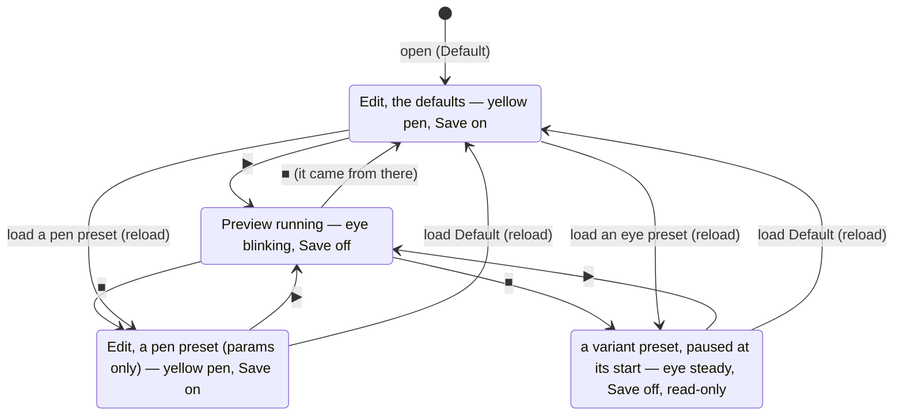
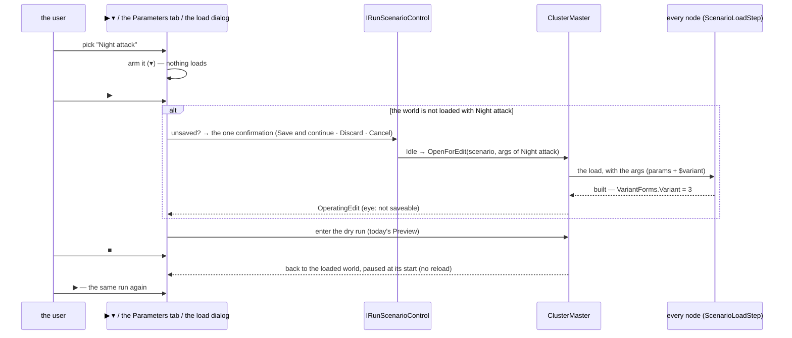
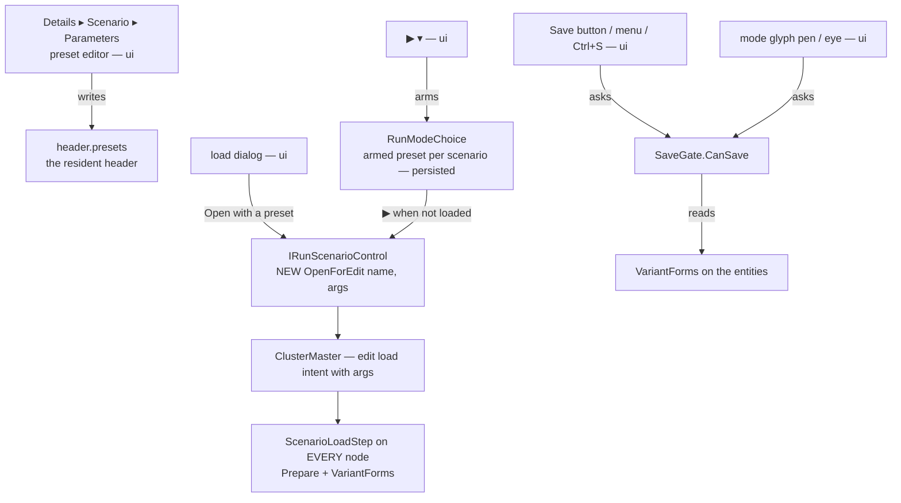

<!--STATUS
state: LIVE
build-state: READY-TO-BUILD (CE-3374 first, then CE-3375)
updated: 2026-11-07 (backend — ✅ D1–D12 APPROVED by the user: "Approved.")
current-answer: the whole file — §1 the model, §2 the states, §3 the sequences, §4 who calls what, §5 the surfaces (mockup), §6 the decisions, §7 the work
stale-below: nothing
known-rot: none
known-conflict: AQ108 D24 (the Live default variant is RANDOM) — reconciled by D7 below, awaits the user · R-3061 / AQ108 D17 (Preview = violet ◐) and
  DESIGN_Colour_Icons.md "Not touched: the mode indicator" — the user replaced ◐ with an eye on 2026-11-07 (D9); fold into AQ108 §1a with the old rule
  under HISTORY when built · LC-11 / CE-4317 (the Run setup on the mode menu, ui, started) — re-scoped by D8 (one picker: the split ▶)
related-designs:
  - docs/DESIGN_Scenario_Macros.md — §17.1 OWNS the VariantForms holder (CE-3374) that makes a variant-0 world saveable; §5 / §14 SR-168 OWN the bindings that keep a parameter's binding across a save; SR-32 owns MACRO presets (a different concept, D1)
  - docs/UX/DESIGN_Scenario_Lifecycle_Review.md — LC-11 (a Preview that takes the run setup) is answered HERE; §2.8 Run to … runs on any of these worlds
  - docs/blueprints/Architect_Question_108_Run_Mode_Picker.md — D24 (the run setup, the picker's expander), R1 (only the indicator changes mode), D17 (the glyphs); this design replaces D24's expander with presets
  - docs/designs/scenario-picker/README.md — D25 / D26: the one wide picker and its side pane; §5b here re-orders the pane
  - docs/DESIGN_Macro_Authoring_Editor.md — §9: the Parameters section (ParametersDrawer over HeaderParamsSchemaSource) this design extends
  - docs/blueprints/Blueprint_Issues_Tracker.md — CE-4252 (the yellow pen in Edit, open) — D10 here makes the pen mean "Save is on"
  - docs/PLAN_Training_And_Gameplay_Engine.md — P-7 "scenario feature presets": the precedent of a named set stored in the scenario
-->

# DESIGN — **scenario PRESETS**, and the preview with a preset

> 🔒 **User, `2026-11-07`:** *"I also think about presets saved in scenario file … no one wants to enter parameters. People like simple predefined
> choices. That means the scenario parameters tab would also need to become the preset editor (a combo on the top, showing what preset we are
> currently seeing and editing in the table below, with the default parameters being just one of the presets, the first one.)"* · *"The load
> scenario dialog would then allow selecting the scenario preset right under the image thumbnail … before the description text."* · *"extending
> … the play button, to have a little down arrow on the right side … the default play will pick the default preset, while if we press the little
> downward arrow, it will list a drop-down with listing all the available presets … similar … Visual Studio Code … launch settings."* · *"For the
> non-saveable parametrized run we would never show yellow pencil but an icon of an eye (replacing the current half circle …). And the eye would be
> blinking in preview."* · *"The save icon tooltip will always say why the save is not permitted. And the yellow pen will be shown only if the save
> is permitted."* · *"think about the scenario preset editor in the details panel. So it is practical, ergonomic and intuitive."*
> 🔒 Earlier the same day: *"the dry run with setup is basically using the same load path as the live scenario, but it is really not a live mode,
> it is still a dry run."* · *"Accept it, we need to design and fix the gap first."* (the variant gap → [`DESIGN_Scenario_Macros.md`](../DESIGN_Scenario_Macros.md) §17.1)

## 0. INVENTORY *(`2026-11-07`, backend)*

| query | result |
|---|---|
| `search_graph .*Preset.* Class` | **8** — vehicle, seat and map-pick presets; `PresetRoundTripTests` = the Replay Browser's saved SEARCH predicates. ⛔ none is a scenario run setup |
| `search_graph .*RunSetup.* / .*Variant.* / .*ParamArg.* Class` | **0 / 0 / 0** — ⚠ the index is stale for these files (grep sees `RunSetup`, `ParamArgsTable`); grep is the answer below |
| grep `RunSetup` | `Hrot.Presentation/RunMode/RunSetup.cs` (a variant choice + param overrides → `ArgsJson`) · `AssetPickerLauncher.DrawRunSetup` (the load dialog's collapsed expander, under the description) · `RunModeChoice.LastRunSetupOf` (session memory only) |
| grep `ParamArgsTable` | ⭐ THE typed args form — the macro instance's args, the Run setup, and the declaration table's default cells (`VariablesPanelControl.cs:303`) |
| the Parameters section | `ParametersDrawer` over `HeaderParamsSchemaSource` (declarations: add · remove · rename · default · comment, one undo history) in Details ▸ Scenario |
| the load with args | `ScenarioLoadStep.cs:182-199` — params and `$variant` are applied to the scenario TEXT before extraction; `EditLoadIntent(scenario, args)` exists (`ScenarioLoadSequence.cs:92`); `IRunScenarioControl.OpenForEdit(name)` has NO args overload, `LoadForLive(name, args)` has |
| what a save keeps | bindings: kept (SR-168, `ParamBinding.cs` header; ⚠ no end-to-end rail found — macros §17.1 M2) · variant forms: LOST today (§17) → fixed by `VariantForms` (§17.1) |
| editing a bound field | `ComponentEditDrawer.cs:330-336` — the literal is edited and the binding KEPT ⇒ the next load overwrites it from the param |
| designs read | AQ108 (D17, D24, R1, §2.18) · scenario-picker README (D25/D26) · Macros §5, §14, §17 · Rules SR-101 · Lifecycle LC-8/LC-11/LC-14 · CE-4252/4253/4254 · Colour Icons · UI Conventions · P-7. ⛔ No design mentions scenario presets (`docs/` and `.dev/` searched) |

⚠ coverage unchecked — `check_index_coverage` is not in the CLI.

## 1. The model — a preset is a NAMED RUN SETUP

*What the picture shows that prose hid: a preset is exactly what `RunSetup` already holds (a variant choice + the changed params) with a NAME, kept in
the file — no new form, no new args path. **Default** is not stored: it is the declarations' defaults, as authored, always first.*

## 2. The states the editor can be in

*What it shows: ■ always returns to the world the run came from (AQ108's rule) with NO reload — so a preset run repeats with ▶ alone. Only CHANGING
the preset reloads. And there is no new cluster state: every left-hand state is today's `OperatingEdit`, loaded with different args; a running one
is today's `OperatingPreview` (the dry run over a copy).*

| ⭐ the rule | |
|---|---|
| ⭐⭐⭐ **saveable ⇔ the world was built with variant 0** (`VariantForms.Variant`, any entity) | parameter values never block a save: each bound field keeps its binding (SR-168), and the binding wins on the next load |
| ⭐⭐ a pen preset = `Variant: AsAuthored`; an eye preset = `Random` or a `Number ≠ 0` | ⭐ the icon is computed from the preset, never chosen |
| ⭐⭐ the eye state is READ-ONLY (edits greyed — R-4150) | ⛔ an edit that can never be saved is a loss the user does not see coming |

## 3. The sequences

*What it shows: the only new call is `OpenForEdit` WITH args (the edit intent already carries them); the dry run, ■ and the load path are today's.*

## 4. Who calls what

*What it shows: every surface that shows "can I save" asks ONE gate, so the pen, the Save button and its tooltip cannot disagree.*

## 5. The surfaces — 🖼 [`scenario-presets-visual.svg`](scenario-presets-visual.svg) *(generated by `scripts/gen-scenario-presets-mockup.py`)*

### 5a. The preset editor — Details ▸ Scenario ▸ Parameters

| element | why it is there |
|---|---|
| **"The map holds: Default — editable, Save on"** (pen or eye) | ⭐ the table shows a preset; the MAP may hold another — this line keeps them apart |
| **Preset combo** (pen / eye icon per entry, one-line summary under each: *"variant 3 · 2 changed"*) | ⭐ picks what the TABLE shows and edits; ⛔ never reloads the map |
| **[+]** new preset = a copy of the shown one · **[⋮]** Rename · Duplicate · Delete · Move up/down · Reset all to default | ⭐ Default cannot be renamed or deleted |
| **Preview this preset** | ⭐ the one-click path: load (if needed) and ▶ |
| **Variant** row — *As authored · Random each run · Number [n]* — only when the scenario uses variants; a violet line says *"Preview only"* when not As authored | ⭐ the cost of a variant is stated where it is chosen |
| **ONE table**: Name · Type · *Value · <preset>* · Used | ⭐ under Default the value IS the declared default (today's table); under another preset a value equal to the default is GREY with *default*, an override is BRIGHT with an amber bar and **↺** |
| Add / rename / remove / move a parameter work under ANY preset | ⭐ the declaration is shared: a rename renames it in every preset, a remove drops it from every preset — one undo step |

### 5b. The load dialog
The **Preset** combo sits directly under the thumbnail and the name, with its one-line summary; the description goes BELOW it in its own scrolling
box; the Run setup expander is gone (its job is the presets). *Open* loads for editing with the preset (an eye preset opens preview-only); *Open and
go live* starts Live with it.

### 5c. The split ▶ and the states
▶ keeps its face; a narrow **▾** at its right opens the preset list (✓ on the armed one, pen / eye icons, *Edit presets…* at the end → §5a). ▾ arms
a preset; ⛔ never the mode (AQ108 R1). The ▶ tooltip names both: *"▶ Preview — Night attack (variant 3: preview only)"*. The mode glyph: **yellow pen
only when Save is on**, the **eye** steady for a loaded eye preset, the eye **blinking** while any Preview runs. Save is greyed with its reason in
every state where it is off.

### 5d. ⚠ Found — TWO "defaults + overrides" forms already exist; the preset editor must not be a third *(`2026-11-07`)*

| form | where | look |
|---|---|---|
| `ParamArgsTable` (`Hrot.Editor.AiShared/Scenarios/ParamArgsTable.cs`) | the macro instance's args, the load dialog's Run setup, the declaration table's default cell | default greyed (alpha 0.55) until overridden; a *reset* button |
| `ParamsDefaultsForm` / `ParamsDefaultsModel` (`Hrot.Presentation/Behavior/ParamsDefaultsForm.cs`) | a BTree / HSM / Blueprint asset's params defaults (`VariablesPanelControl.cs:276`, `BlueprintMyBlueprintWindow.cs:716`) | the DTO's fields; `*` + *Reset* on an override |

⭐ Both are "a value = a default + this owner's overrides, reset per field", over the same StructEdit leaves — one concept, two forms, two looks.
⇒ the preset value column uses ONE of them, and the other folds into it (ui; a tracker row when the presets are built). ⭐ Lean: `ParamArgsTable`'s
row model (it already serves three hosts and the declaration table), with the DTO's fields as its rows for a behaviour asset.

### 5e. ⭐⭐ ONE shared editor, and it looks like the mockup *(user, `2026-11-07`)*

> 🔒 *"The graphical design you made for scenario parameter editing is a nice one, while … the real look of the shared parameter editor … is ugly.
> So it is desired to have one shared editor which looks nice."*

| ⭐ rule | |
|---|---|
| ⭐⭐⭐ the §5a look is built INTO the shared `VariablesPanelControl` (and the one value form, §5d) — not into a Parameters-only copy | ⭐ the blackboard ×3 and the scenario parameters all get it; ⛔ a second, nicer table beside the old one is the duplicate R-174 forbids |
| ⭐⭐ the look is an acceptance spec (R-4138): aligned value column, the amber override bar + ↺, the grey *default*, FontAwesome glyphs in their colours (R-4139), slate headers | ⭐ a frame rail measures it, and the builder compares a real render with the mockup itself (R-4146) |
| ⭐ the host's words, not the blackboard's | 📐 today the Parameters host still says *"[+] Add variable…"* and *"Not referenced by any node — consider removing"* (frame render `2026-11-07`) — the words come from the source, like the columns (`DeclarationFeatures`) |
| ⛔ out of scope here | a behaviour's params TYPE defined as a JSON asset — **CE-3376**, for the user + coordinator |

## 6. Decisions — ✅ ALL APPROVED (user, `2026-11-07`: *"Approved."*)

| # | question | ⭐ lean | why / rejected |
|---|---|---|---|
| **D1** | what a preset is, and where it lives | ⭐ `header.presets: [{name, variant, args}]` in `scenario.json`; Default implicit | ⭐ a named RUN setup (P-7 precedent). ⛔ SR-32's "one mechanism for every preset" is about AUTHORING presets of a macro (a macro wrapping an instance) — a run setup is not an entity and has no instance to wrap |
| **D2** | what the tab's combo does | ⭐ shows / edits a preset's VALUES; never reloads | ⛔ a combo that reloads the map would lose edits on a mis-click |
| **D3** | one table or two | ⭐ ONE table, the value column follows the combo | ⛔ two tables (declarations + values) — the user would hunt for which one edits what |
| **D4** | variant in a preset | ⭐ three choices: As authored · Random each run · Number | ⭐ the eye follows from it — never a separate flag |
| **D5** | editing in an eye world | ⭐ read-only, grey (R-4150) | ⛔ editable-but-unsaveable — silent loss |
| **D6** | unsaved edits when another preset loads | ⭐ the existing unsaved confirmation (Save and continue · Discard · Cancel) — as Live does | ⛔ a temporary copy of the world — a second save path |
| **D7** | D24 says Live's default variant is RANDOM | ⭐ keep it: when a scenario uses variants, a built-in **Random** preset (not stored) is listed second; **Live arms it by default, Preview arms Default** | ⛔ Default = random — then plain ▶ Preview could not be today's in-memory copy |
| **D8** | where the preset is picked at ▶ | ⭐ the ▾ of ▶ is THE picker; the mode menu shows the armed preset as one read-only line | ⛔ LC-11's run-setup lines on the mode menu as a second picker (re-scope CE-4317, ui) |
| **D9** | the Preview glyph | ⭐ the eye (FontAwesome `eye`), violet kept, in the ONE icon map (`mode/preview`) | the user, 2026-11-07. Supersedes R-3061's ◐ — fold into AQ108 §1a, old rule under HISTORY |
| **D10** | the pen | ⭐ yellow pen ⇔ `CanSave` is null (CE-4252's pen gets its meaning) | the user: *"the yellow pen will be shown only if the save is permitted"* |
| **D11** | the armed preset is remembered | ⭐ per scenario, per mode, in the editor's user settings (persisted) | ⭐ fixes the session-only `LastRunSetupOf` gap (the picker's mockup promised *"Remembered for this scenario"*). ⛔ not in the scenario file — it is a person's choice, not the scenario's |
| **D12** | a field bound to a parameter, edited in the world | ⭐ unchanged (the literal is edited, the binding wins on load) — the chip's tooltip says *"from parameter `speed` — set its value in Parameters"* | ⚠ measured, not changed here |

## 7. The work

| item | lane | what | depends on |
|---|---|---|---|
| **CE-3374** | backend | the `VariantForms` holder — macros §17.1 (+ the SR-168 end-to-end rail if missing) | — |
| **CE-3375** | backend | `header.presets` read / write (`ScenarioPreset`, `PresetVariant`), `IRunScenarioControl.OpenForEdit(name, args)`, `SaveGate.CanSave` + reason, the HTTP surface (`GET /scenario/presets`, `POST /scenario/load/edit {preset}`, `/status canSave`) | CE-3374 |
| ui | ui | §5a the preset editor · §5b the load dialog · §5c the split ▶, the eye, the pen, the Save tooltip · D11 persisted armed preset · re-scope CE-4317 (LC-11) | CE-3375 |

⚠ **Measure before building:** M1–M3 in macros §17.1; whether `ScenarioDescription.ArgsOf(world)` (the resident args the recorder reads) names the
loaded preset well enough for *"The map holds: …"* (match by args) or the load should stamp the preset name.
