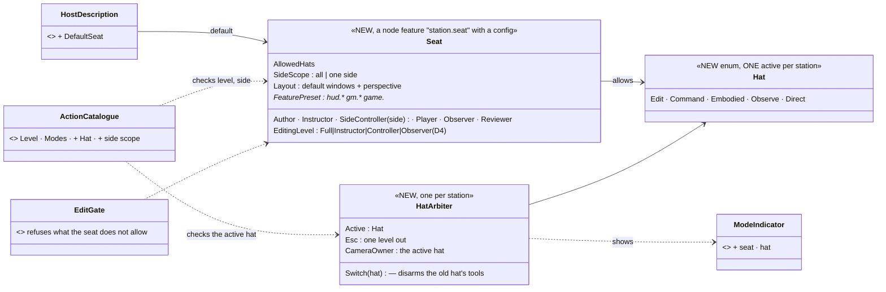
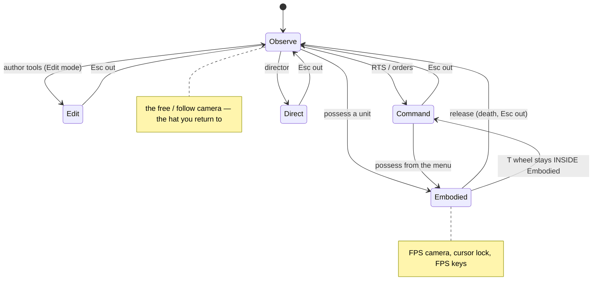
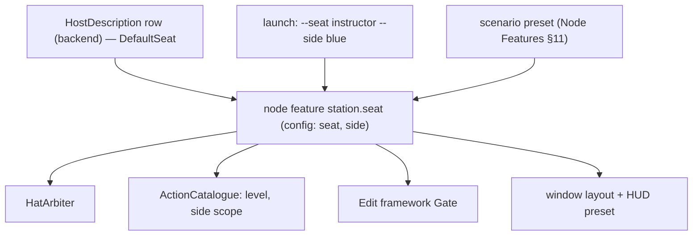

<!--STATUS
state: LIVE
build-state: DESIGN — top-level, for the user's review (R-4122); the building lanes detail it (R-4123)
updated: 2026-11-06 (first version — coordinator; editing-UX design queue item 4: E10 / D17, with D4's editing levels)
current-answer: §2 the model (seat × hat) · §3 stages · §4 questions with leans
stale-below: nothing
known-rot: none
known-conflict: DESIGN_Entity_Control.md C-8 ("one operator per node — the station id is the node id") holds; a fused server hosts several compute roles in one node, but still ONE seat (one person) — §2.1
related-designs:
  - DESIGN_Editing_UX.md — the programme: D17 (the hats), D4 (editing levels per node — folded into the seat here), R-4119 (gated by the entity, not the node), R-4121
  - DESIGN_Action_Catalogue.md — an action's Level / Modes / side scope are read against the station's seat and active hat
  - DESIGN_Edit_Framework.md — the Gate refuses an edit the seat does not allow, with the reason
  - ../DESIGN_Node_Features.md — the seat is a node feature with a config (R-4108), on by default
  - ../DESIGN_Subsystem_Composition_Unification.md — §4.1ag the host as data (HostDescription rows, R-3077): a row gains a DEFAULT seat; NodeRole stays what a node COMPUTES, never a person's role
  - ../DESIGN_Entity_Control.md — OWNS RTS command (§8a), possession / FPS (§8b–§8r), the station claims (C-3′, C-8, C-10 side lock)
  - ../DESIGN_Player_Join.md — OWNS the Player's deploy / respawn / observer (R-4103, D-13, D-14)
  - ../DESIGN_Scenario_Rules.md — SR-13 (the IOS is a composition choice), SR-104 (the game master, Z7 remote GM station open), SR-109
  - ../DESIGN_Unit_Camera.md — the camera drivers this design gives ONE owner
-->

# DESIGN — seats and hats: who a person at a station is, and what they are doing right now

## 0. Why

🔒 User, `2026-11-06`: *"the RTS live mode vs FPS stuff etc it is now all combined together (too many "hats" the single user can wear at once)
- also desires a review. Was added wildly during development, now desires re-thinking to match some well thought concept."*

## 1. INVENTORY *(2026-11-06)*

Queries (`search_graph`, Class): `.*(Role|Hat|Seat|Permission|Possession|RtsCommand|GameMaster|Director|Spectat|Observer).*` (115),
`.*(Station|Seat|Profile).*` (62), `.*Capabilit.*` (39), `.*(Observer|Spectat|Follow|Possess).*` (58); `search_code UserRole|StationRole|OperatorRole|Permission`
(**0**). Read `origin/backend` @ `9ef1079b` for the host rows. Prior art: DCS Combined Arms — slots *Game Master · Tactical Commander · JTAC ·
Observer*, the mission decides which exist ([DCS forum](https://forum.dcs.world/topic/382390-combined-arms-vs-observer-slot/),
[ED on Steam](https://steamcommunity.com/app/223750/discussions/3/4534563767356498653)); Arma Zeus — a Game Master slot owned by a unit, a
UID or the admin ([BI wiki](https://community.bistudio.com/wiki/Arma_Reforger:Game_Master)); VBS — Prepare / Execute / Assess with an
administrator role.

**⛔ There is no person-role anything today.** What a person can do follows from three things that do not know each other: which host
process runs (`-m`, `RunHostKind`), what the shared map pack wires on EVERY map host (`MapInteractionPack.cs:343-391`), and node feature
defaults switched by one boolean `playerDefault` (`HudFeatures.cs:58`). `NodeRole` (Brain, Muscle, Map2D …) is what a node COMPUTES — not a
person (Node Roles §3.4); backend's role table (B7, `RoleCapabilityTable`) is the same compute axis.

| hat today | entered by | offered on | finding |
|---|---|---|---|
| scenario author | Edit mode, tools, Add Entity | ⚠ Add Entity on every map host — **the Player too** (`IgApplication.cs:796`, verified) | **CE-4279** |
| RTS commander | View ▸ RTS Command Mode (a modal tool) | ⚠ every live map host — **the Player too**, any side (`MapInteractionPack.cs:378-394`, verified); only HTTP has a side lock | **CE-4279** |
| menu commander | unit right-click orders | same | — |
| FPS / possession · squad leader | *Possess (P)*, a deploy; T wheel, J / Shift+J | every map host with 3-D | ⚠ nothing disarms RTS / Add Entity / pick tools when possession starts; **Esc** = leave RTS AND release the unit; map shortcuts P R C Space overlap FPS keys R Q E F G |
| Player | `-m player`, deploy screen, Tab, K, respawn | the Player (IG) | its only real limits: HUD defaults, no time control, the deploy flow |
| observer / spectator | implicit: no deploy server (R-4103), respawn 0 (D-14); *Follow* | Player; Follow everywhere | defined by what is missing; no observer camera |
| game master (Zeus) | Window ▸ Game master | ⚠ registered by the editor ONLY (`EditorSubsystem.cs:4993`) though `gm.palette` is on for CGF / SimHost; SR-104 Z7 remote GM open | — |
| instructor (IOS) | Window ▸ Rules, End, injects | the editor only (SR-13: "the server's full UI by default") | — |
| film director · reviewer · debugger · cluster operator | Director window · AAR / Replay Browser · perspectives, breakpoints · run toolbar | editor, Replay Browser; editor + CGF; every operator host | — |
| side controller / white cell | — | **does not exist** | — |
| **camera** | four drivers want `MapCamera3D`: FPS, Follow, director takes, the free / RTS camera | — | ⛔ no single owner; the view before possession is never saved (R-260) |

## 2. The model — two axes

### 2.1 A SEAT (who you are at this station) and a HAT (what you are doing right now)

*What the picture shows that prose hid: today "who you are" and "what you are doing" are one tangle of host kind, map pack and a boolean;
split into a SEAT (set per station, rarely changed — it bounds what is ALLOWED) and a HAT (switched by the person all the time — ONE at a
time, owning the input and the camera). Neither is `NodeRole`: that stays what a node computes.*

### 2.2 The seats

| seat | for | hats allowed | editing level (D4) | side scope | default on |
|---|---|---|---|---|---|
| **Author** | the scenario author, the exercise designer | Edit · Command · Embodied · Observe · Direct (+ Expert switches) | Full | all | the editor |
| **Instructor** *(= game master; one seat)* | the exercise director, IOS, Zeus | Command · Embodied · Observe — + rules control, injects, the game-master palette, End | Instructor (orders, injects, rules, weather and time, heal / damage / resupply, bring in units) | all | ⭐ the fused server, CGF (R-4107: "GM mode is the server's default UI") |
| **Side controller** | a white / blue / red cell | Command · Observe | Controller (orders to its side) | ONE side | — (a launch option) |
| **Player** | the trainee / gamer | Embodied (own claimed unit, squad command of own men) · Observe (dead, waiting, no unit) | none | own side | the Player |
| **Observer** | a visitor, a trainee watching | Observe (+ bookmarks, notes) | Observer | all, or one side | a Player with no deploy server (R-4103) |
| **Reviewer** | after-action review | Observe · Direct (+ notes, branch to live) | none (Review is read-only) | all | the Replay Browser |

⭐ A seat can be changed on a station only to a seat its host allows (an editor may switch Author ↔ Instructor; a Player station cannot
become Author). ⚖️ Trust: stations are on a trusted exercise network — the seat is enforced at the station (catalogue + gate), not as
anti-cheat; an owner-side check is a later option.

### 2.3 The hats — one at a time

*What it shows: Observe is the home hat; every other hat is entered on purpose and left back to it; the squad leader's command wheel is a
tool INSIDE Embodied, not a second hat.*

| | rule |
|---|---|
| **the arbiter disarms** | entering a hat disarms the previous hat's tools (no RTS armed under the FPS view, no placement tool while possessing) |
| **Esc = one level out** | a tool inside the hat → the hat → Observe; ⛔ never two meanings at once |
| **one camera owner** | the active hat owns the camera; each hat REMEMBERS its view, so leaving Embodied returns to where Observe was (fixes R-260) |
| **keys per hat** | the map shortcuts (P, R, C, Space) belong to Edit / Command / Observe; the FPS keys (R, Q, E, F, G) to Embodied — no overlap in one hat |
| **the mode indicator** | shows the run mode, the seat and the hat: *● LIVE · Instructor · Command* — one click switches hat |
| **run mode is not a hat** | Edit / Preview / Live / Review (design 1's `EditingMode`) bounds the hats too: Edit hat only in Edit mode; Embodied / Command only while running |

### 2.4 Where the seat comes from

*What it shows: one value, set once per station from the host row / a flag / the scenario, read by the three things that enforce it — so a
Player station cannot place units by construction (CE-4279), not by every tool remembering to check.*

## 3. Stages

| stage | what | lane |
|---|---|---|
| **H1** | the `station.seat` node feature + `HostDescription.DefaultSeat` (the fused server = Instructor, the Player = Player, the editor = Author, the Replay Browser = Reviewer); the mode indicator shows it | backend + ui |
| **H2** | the catalogue and the gate read the seat: level and side scope (fixes CE-4279: a Player gets no Add Entity, no RTS, no other side's orders) | ui + backend |
| **H3** | the `HatArbiter`: one hat, disarm on switch, Esc one level, the hat in the indicator | ui |
| **H4** | one camera owner with per-hat views (FPS, Follow, director, free) | ui |
| **H5** | the Instructor seat's windows on the fused server and CGF (rules, game master, End) — SR-104 Z7 | ui |
| **H6** | the Side controller seat; the Observer seat's camera | ui |

## 4. Questions — leans for the user

| # | question | ⭐ lean | rejected |
|---|---|---|---|
| **Q1** | two axes | **seat** (who, per station, rarely changed, bounds what is allowed) × **hat** (what now, one at a time, switched freely) | one flat list of modes — mixes permission with activity |
| **Q2** | the seats | **Author · Instructor (= game master) · Side controller · Player · Observer · Reviewer** | instructor and game master as two seats — the same person and rights (R-4107) |
| **Q3** | the hats | **Edit · Command · Embodied · Observe · Direct**, Observe the home hat; the squad wheel inside Embodied | RTS and FPS as independent toggles — today's stacking |
| **Q4** | where the seat lives | a **node feature with a config**, defaulted by the host row, overridable by a launch flag and the scenario; D4's editing level becomes the seat's | a new per-user login — no users in the engine |
| **Q5** | enforcement | **at the station** (catalogue + edit gate), trusted network; owner-side checks later if ever needed | anti-cheat now — out of scope |
| **Q6** | Esc | **one level out** (tool → hat → Observe), everywhere | Esc as "release the unit" and "leave RTS" at once |
| **Q7** | the debugger | **not a seat** — the Author's Expert switches (R-4121) | a Developer seat |
