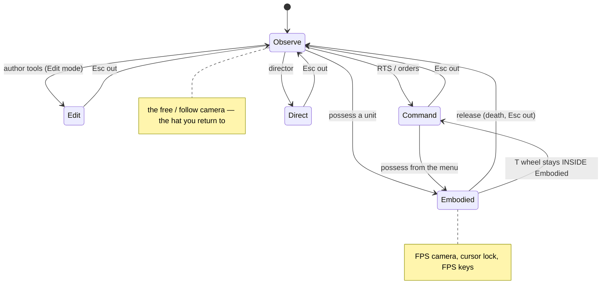
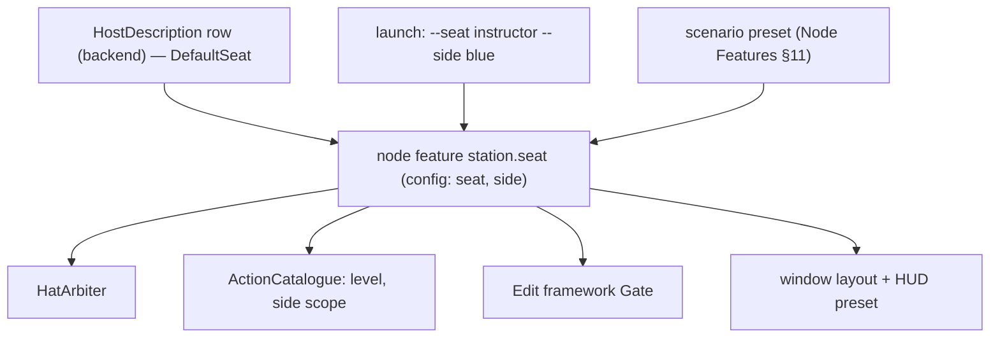
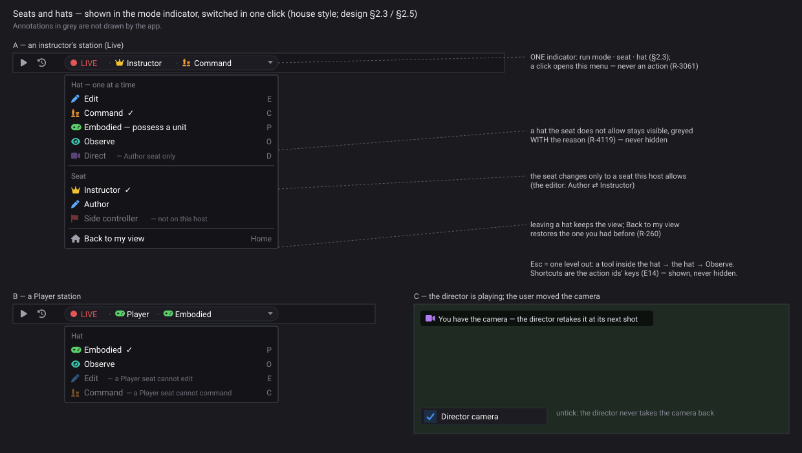
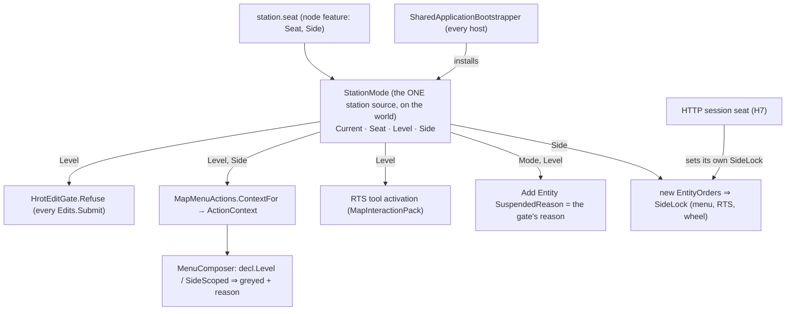
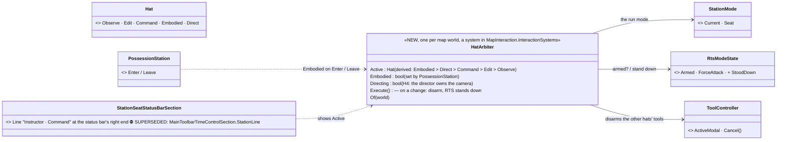
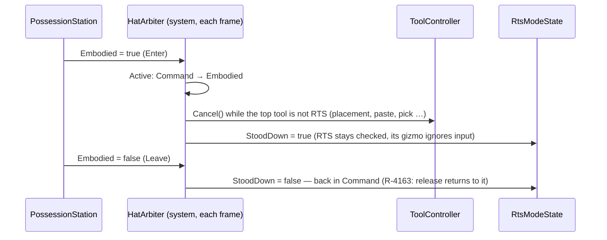
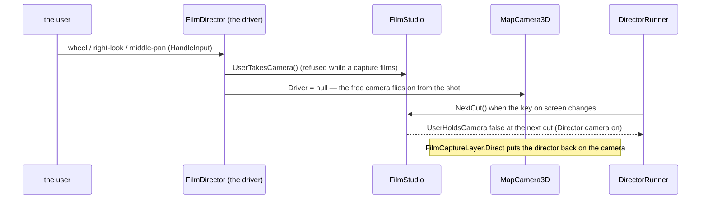
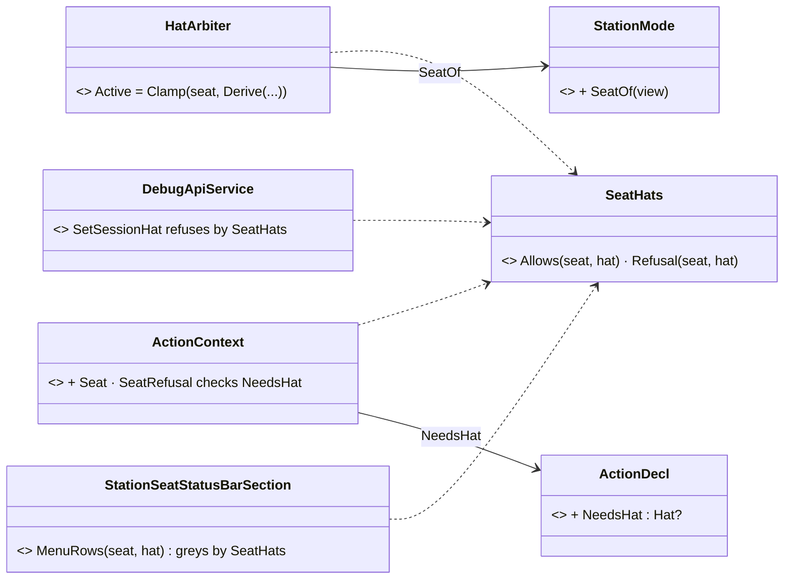

<!--STATUS
state: LIVE
build-state: DESIGN — top-level; ✅ Q1–Q7 APPROVED by the user 2026-11-06 (R-4131); the building lanes detail it (R-4123)
updated: 2026-11-07 (§2.2a R-4164: Zeus = Instructor, live only; the hat follows the run mode; CGF / server / SimHost default Author, the seat from the node config file) · 2026-11-06 (Q1–Q7 approved, R-4131; the director shares the camera with the user) · 2026-11-06 (§2.5 the user's review: HTTP sessions take seats, seat = a node feature preset while the hat is local UI state, the camera keeps the view on leaving a hat, keys → E14) · 2026-11-06 (first version — coordinator; editing-UX design queue item 4: E10 / D17, with D4's editing levels)
current-answer: §2 the model (seat × hat) · §3 stages · §4 questions with leans
stale-below: nothing
known-rot: the node called IG here is the Player node since CE-3371 (backend, 2026-11-06): Hrot.IG → Hrot.Player, IgApplication → PlayerApplication (line numbers cited before the rename may have moved)
known-conflict: DESIGN_Entity_Control.md C-8 ("one operator per node — the station id is the node id") holds; a fused server hosts several compute roles in one node, but still ONE seat (one person) — §2.1
related-designs:
  - DESIGN_Rules_Bundle.md — every host composes the rules windows as ONE bundle; editing decided by the seat (CE-4292)
  - DESIGN_New_Scenario_And_Recipe.md — E12: New Scenario is the Author seat's
  - DESIGN_Map_Interaction.md — E8: the map tools of the Edit hat (and the Instructor's live placement)
  - DESIGN_Input_And_Commands.md — each hat is a keymap scope; central Esc
  - DESIGN_Editing_UX.md — the programme: D17 (the hats), D4 (editing levels per node — folded into the seat here), R-4119 (gated by the entity, not the node), R-4121
  - DESIGN_Action_Catalogue.md — an action's Level / Modes / side scope are read against the station's seat and active hat
  - DESIGN_Edit_Framework.md — the Gate refuses an edit the seat does not allow, with the reason
  - ../DESIGN_Node_Features.md — the seat is a node feature with a config (R-4108), on by default
  - ../DESIGN_Subsystem_Composition_Unification.md — §4.1ag the host as data (HostDescription rows, R-3077): a row gains a DEFAULT seat; NodeRole stays what a node COMPUTES, never a person's role
  - ../DESIGN_Entity_Control.md — OWNS RTS command (§8a), possession / FPS (§8b–§8r), the station claims (C-3′, C-8, C-10 side lock)
  - ../DESIGN_Player_Join.md — OWNS the Player's deploy / respawn / observer (R-4103, D-13, D-14)
  - ../DESIGN_Scenario_Rules.md — SR-13 (the IOS is a composition choice), SR-104 (the game master, Z7 remote GM station open), SR-109
  - ../DESIGN_Unit_Camera.md — the camera drivers this design gives ONE owner
-->

# DESIGN — seats and hats: who a person at a station is, and what they are doing right now

## 0. Why

🔒 User, `2026-11-06`: *"the RTS live mode vs FPS stuff etc it is now all combined together (too many "hats" the single user can wear at once)
- also desires a review. Was added wildly during development, now desires re-thinking to match some well thought concept."*

## 1. INVENTORY *(2026-11-06)*

Queries (`search_graph`, Class): `.*(Role|Hat|Seat|Permission|Possession|RtsCommand|GameMaster|Director|Spectat|Observer).*` (115),
`.*(Station|Seat|Profile).*` (62), `.*Capabilit.*` (39), `.*(Observer|Spectat|Follow|Possess).*` (58); `search_code UserRole|StationRole|OperatorRole|Permission`
(**0**). Read `origin/backend` @ `9ef1079b` for the host rows. Prior art: DCS Combined Arms — slots *Game Master · Tactical Commander · JTAC ·
Observer*, the mission decides which exist ([DCS forum](https://forum.dcs.world/topic/382390-combined-arms-vs-observer-slot/),
[ED on Steam](https://steamcommunity.com/app/223750/discussions/3/4534563767356498653)); Arma Zeus — a Game Master slot owned by a unit, a
UID or the admin ([BI wiki](https://community.bistudio.com/wiki/Arma_Reforger:Game_Master)); VBS — Prepare / Execute / Assess with an
administrator role.

**⛔ There is no person-role anything today.** What a person can do follows from three things that do not know each other: which host
process runs (`-m`, `RunHostKind`), what the shared map pack wires on EVERY map host (`MapInteractionPack.cs:343-391`), and node feature
defaults switched by one boolean `playerDefault` (`HudFeatures.cs:58`). `NodeRole` (Brain, Muscle, Map2D …) is what a node COMPUTES — not a
person (Node Roles §3.4); backend's role table (B7, `RoleCapabilityTable`) is the same compute axis.

| hat today | entered by | offered on | finding |
|---|---|---|---|
| scenario author | Edit mode, tools, Add Entity | ⚠ Add Entity on every map host — **the Player too** (`IgApplication.cs:796`, verified) | **CE-4279** |
| RTS commander | View ▸ RTS Command Mode (a modal tool) | ⚠ every live map host — **the Player too**, any side (`MapInteractionPack.cs:378-394`, verified); only HTTP has a side lock | **CE-4279** |
| menu commander | unit right-click orders | same | — |
| FPS / possession · squad leader | *Possess (P)*, a deploy; T wheel, J / Shift+J | every map host with 3-D | ⚠ nothing disarms RTS / Add Entity / pick tools when possession starts; **Esc** = leave RTS AND release the unit; map shortcuts P R C Space overlap FPS keys R Q E F G |
| Player | `-m player`, deploy screen, Tab, K, respawn | the Player (IG) | its only real limits: HUD defaults, no time control, the deploy flow |
| observer / spectator | implicit: no deploy server (R-4103), respawn 0 (D-14); *Follow* | Player; Follow everywhere | defined by what is missing; no observer camera |
| game master (Zeus) | Window ▸ Game master | ⚠ registered by the editor ONLY (`EditorSubsystem.cs:4993`) though `gm.palette` is on for CGF / SimHost; SR-104 Z7 remote GM open | — |
| instructor (IOS) | Window ▸ Rules, End, injects | the editor only (SR-13: "the server's full UI by default") | — |
| film director · reviewer · debugger · cluster operator | Director window · AAR / Replay Browser · perspectives, breakpoints · run toolbar | editor, Replay Browser; editor + CGF; every operator host | — |
| side controller / white cell | — | **does not exist** | — |
| **camera** | four drivers want `MapCamera3D`: FPS, Follow, director takes, the free / RTS camera | — | ⛔ no single owner; the view before possession is never saved (R-260) |

## 2. The model — two axes

### 2.1 A SEAT (who you are at this station) and a HAT (what you are doing right now)

*What the picture shows that prose hid: today "who you are" and "what you are doing" are one tangle of host kind, map pack and a boolean;
split into a SEAT (set per station, rarely changed — it bounds what is ALLOWED) and a HAT (switched by the person all the time — ONE at a
time, owning the input and the camera). Neither is `NodeRole`: that stays what a node computes.*

### 2.2 The seats

| seat | for | hats allowed | editing level (D4) | side scope | default on |
|---|---|---|---|---|---|
| **Author** | the scenario author, the exercise designer | Edit · Command · Embodied · Observe · Direct (+ Expert switches) | Full | all | the editor |
| **Instructor** *(= game master; one seat)* | the exercise director, IOS, Zeus | Command · Embodied · Observe — + rules control, injects, the game-master palette, End | Instructor (orders, injects, rules, weather and time, heal / damage / resupply, bring in units) | all | ⭐ the fused server, CGF (R-4107: "GM mode is the server's default UI") |
| **Side controller** | a white / blue / red cell | Command · Observe | Controller (orders to its side) | ONE side | — (a launch option) |
| **Player** | the trainee / gamer | Embodied (own claimed unit, squad command of own men) · Observe (dead, waiting, no unit) | none | own side | the Player |
| **Observer** | a visitor, a trainee watching | Observe (+ bookmarks, notes) | Observer | all, or one side | a Player with no deploy server (R-4103) |
| **Reviewer** | after-action review | Observe · Direct (+ notes, branch to live) | none (Review is read-only) | all | the Replay Browser |

#### 2.2a ⭐ The server stations' seat — Author by default, Instructor by config *(R-4164, user `2026-11-07`)*

🔒 *"In some use cases, those nodes are used by the instructor who shouldn't be allowed to edit. But in other use cases, these nodes should be able to edit. This might go to the external config file with the author mode as the hard-coded default if not specified in that config."*

| rule | |
|---|---|
| **Zeus = the Instructor seat** — one thing, not a second hat | the game master works on a RUNNING exercise (Preview / Live); there is no Zeus in Edit mode |
| **the hat follows the run mode** — never picked by hand | Edit mode ⇒ the Edit hat (authoring); Preview / Live ⇒ Observe + the game-master tools, the RTS checked mode (R-4163), first person while possessing |
| **CGF, the fused server and SimHost default to AUTHOR** | Author ⊇ Instructor in Preview / Live (the Full level, every hat) and can author in Edit mode. ⛔ SUPERSEDED: the default Instructor (§2.4 as-built, `CgfNodeBootstrapper.cs:209`, `SimHostNodeBootstrapper.cs:332`) |
| **Instructor (cannot edit) is chosen per node in its CONFIG FILE** | the runner's `--config <file.json>` gains a `features` object — the same partial JSON as `--feature`: `"features": { "station.seat": { "Seat": "Instructor" } }`. Layers: the hard-coded default (Author) < the config file < `--feature` on the command line ([Node Features F-7](../DESIGN_Node_Features.md)). An Instructor in Edit mode sees the scenario but cannot change it |
| the game-master window stays ON for Author too | it is the feature `gm.palette`, not part of the seat — R-4107 holds |

*Rejected — one line each:* a Zeus-vs-Instructor hat switch — they are the same seat · keeping Instructor as the default — an authoring server would need a flag in the common case · blocking the scenario preset for the seat — the layer order already makes it harmless (below)

⭐ **The scenario MAY preset the seat, as the LOWEST override** (user `2026-11-07`: *"we can keep it if it is the lowest priority and the node settings and command line wins over that"*): hard-coded default (Author) < **scenario preset** < node config file < `--feature` (Node Features F-22). ⇒ a node whose config or command line names a seat is never changed by a scenario; a scenario only moves an unconfigured node off Author

⭐ A seat can be changed on a station only to a seat its host allows (an editor may switch Author ↔ Instructor; a Player station cannot
become Author). ⚖️ Trust: stations are on a trusted exercise network — the seat is enforced at the station (catalogue + gate), not as
anti-cheat; an owner-side check is a later option.

### 2.3 The hats — one at a time

*What it shows: Observe is the home hat; every other hat is entered on purpose and left back to it; the squad leader's command wheel is a
tool INSIDE Embodied, not a second hat.*

| | rule |
|---|---|
| **the arbiter disarms** | entering a hat disarms the previous hat's tools (no RTS armed under the FPS view, no placement tool while possessing) |
| **Esc = one level out** | a tool inside the hat → the hat → Observe; ⛔ never two meanings at once |
| **one camera owner** | the active hat owns the camera; leaving a hat hands control back and KEEPS the view (free-fly from the director's last shot); *Back to my view* restores the previous hat's remembered view (fixes R-260) — §2.5 |
| **keys per hat** | each hat is a keymap SCOPE (E14): the map shortcuts (P, R, C, Space) in Edit / Command / Observe, the FPS keys (R, Q, E, F, G) in Embodied — no overlap in one hat |
| **the mode indicator** | shows the run mode, the seat and the hat: *● LIVE · Instructor · Command* — one click switches hat |
| **run mode is not a hat** | Edit / Preview / Live / Review (design 1's `EditingMode`) bounds the hats too: Edit hat only in Edit mode; Embodied / Command only while running |

### 2.4 Where the seat comes from

*What it shows: one value, set once per station from the host row / a flag / the scenario, read by the three things that enforce it — so a
Player station cannot place units by construction (CE-4279), not by every tool remembering to check.*

### 2.5 The user's review *(`2026-11-06`)* — the HTTP API, seat vs hat, the camera, keys

🔒 *"note the HTTP ai debug api should be able to play the roles too if it wants too, for automatic testing purposes"* · *"is the hat just a
dynamic change of feature settings? (i imagine it like that)"* · *"what the "one camera owner" would change from today? … i like the
posibility of free flying the scene after director has changed the camera position."* · *"the key map to app functions scoped to concrete
context should be solved on whole app level … same the unification of how command/actions are registered … no ad hoc direct calls to
features"*

| | answer |
|---|---|
| **the HTTP API takes a seat** | ⭐ an HTTP session is a **virtual station** with its own seat and hat: `POST /session/seat {seat, side}` and `POST /session/hat {hat}`; every route it calls then passes the SAME catalogue / gate checks a person's station would — so an automated test can play a Player, a side controller or the instructor and see the same refusals. It generalises today's `/orders/side-lock` (C-10, `DebugApiHost.cs:1434`), which becomes the session seat's side scope. No seat set ⇒ Author (today's behaviour) |
| **seat = a node feature; hat ≠ feature settings** | the **seat** is ONE node feature (`station.seat`, config `{seat, side}`) — cluster-visible, kept in the recording, rarely changed; it works as a PRESET: it sets the defaults of the features it implies (`hud.*`, `gm.palette`, the editing level D4 — one setting, not two). ⭐ The **hat is NOT feature settings**: it is this station's UI state, changed every few seconds (like the selection — local, not on the wire, not recorded). Flipping cluster features on each hat switch would put UI clicks on the wire and in the recording. What the cluster must know about a hat is already its own state (possession is the replicated `PossessedBy` claim) |
| **"one camera owner" — what changes** | today each driver (FPS, Follow, director take, free) grabs the camera and restores — or not — on its own, unaware of the others. ⭐ Target: **leaving a hat hands control back; the VIEW stays where it is** — after a director take, Observe's free-fly starts from the director's last shot (the user's wish); after releasing a unit, from the unit's eye. An explicit **Back to my view** (a key) returns to the view the previous hat had remembered. ⛔ No snap-back by default |
| **the director and the user share the camera** *(user, `2026-11-06`: "while director is playing, i still like to move around (director overrides whenever he wants but if i pause the playback or even while it is running i still want to be able to operate the camera to watch stuff from different angles)")* | ⭐ the director's playback is a camera SOURCE, not an exclusive owner: **any camera input from the user takes the camera at once** (free-fly from the current shot), during playback or paused; the director **takes it back at its next shot** (its next camera key / cut); a toggle **Director camera on / off** keeps the user in control for the rest of the playback; pausing the playback leaves the camera with the user. The take's other overrides (layers, view) are unaffected |
| **keys and commands** | ⭐ a whole-app concern, not this design's — filed as **E14 (Editing UX queue)**: ONE keymap with scopes (global · map · active hat · focused window · text field), keys bound to ACTION IDS from the catalogue (design 1), never to direct calls. 📐 today ~62 files read keys directly, plus `EditorHotkeyDispatcher` (graph editors), `MenuShortcuts` (map menu letters), the FPS station's own keys — no shared keymap |

### 2.6 The graphical design *(R-4143 — the acceptance spec)*

*What the picture shows that the prose hid:* the person's situation is ONE line (run mode · seat · hat), and every change is one click away in one menu. What the seat forbids is visible and explained, never missing. Generated by `scripts/gen-seats-hats-mockup.py`.
## 3. Stages

| stage | what | lane |
|---|---|---|
| **H1** | the `station.seat` node feature + `HostDescription.DefaultSeat` (the fused server = Instructor, the Player = Player, the editor = Author, the Replay Browser = Reviewer); the mode indicator shows it | backend + ui |
| **H2** | the catalogue and the gate read the seat: level and side scope (fixes CE-4279: a Player gets no Add Entity, no RTS, no other side's orders) | ui + backend |
| **H3** | the `HatArbiter`: one hat, disarm on switch, Esc one level, the hat in the indicator | ui |
| **H4** | one camera owner with per-hat views (FPS, Follow, director, free) — ✅ H4b the director shares the camera (§3.4); ⏸ H4a no snap-back after possession, held for the user | ui |
| **H5** | the Instructor seat's windows on the fused server and CGF (rules, game master, End) — SR-104 Z7 | ui |
| **H6** ✅ | the Side controller seat; the Observer seat's camera — **built, §3.5** | ui |
| **H7** | the HTTP session seat and hat (`/session/seat`, `/session/hat`); `/orders/side-lock` folded in | backend + ui |

### 3.1 ⭐ AS-BUILT — H1 and H7 *(backend, `2026-11-07`, B-15)*

| piece | as built |
|---|---|
| the seat | `Seat` enum + `SeatConfig {Enabled, Seat, Side: FixedString32}` (unmanaged — a `string` Side is null by default, which the relaxed JSON options omit, so every layer naming `Side` was refused as an unknown key) + `StationSeat` (`station.seat`, `Hrot.Core/Infrastructure/StationSeat.cs`) |
| ⭐ the default, by construction | ⚠ **deviation:** there is no `HostDescription` row in code; `SharedApplicationBootstrapper` declares `station.seat` for EVERY host with the host's `DefaultSeat` (virtual, Author) — overridden by CGF (the fused server too) and SimHost = Instructor, the Player = Player; the editor and the rest = Author. ⚠ SimHost (no person at it) is not in §2.2's table — Instructor keeps today's behaviour. The Replay Browser has no bootstrapper of this kind: its own feature gate (`HudFeatures.BootGate(…, seat: Reviewer)`) declares the seat as Reviewer, and its Review mode refuses every edit already |
| reported over HTTP | `GET /features` lists `station.seat` with its effective config and source per subsystem — no new route |
| the launch flag | the existing `--feature station.seat={"Seat":"Observer","Side":"Blue"}` (Node Features F-7) — no new flag |
| the gate reads it | the same bootstrapper installs `HrotEditGate` on every host: mode = Review while replaying (Live / Preview: B-11), level = `HrotEditGate.LevelOf(StationSeat.Of(features))`, read live. ⭐ The level bounds EDITING kinds only: an interaction (possess, embark) or an order is never refused for a Player here — the catalogue's per-action level does that (H2) |
| H7 | `GET /session`, `POST /session/seat {seat, side}` (side = the old `/orders/side-lock`, which stays as an alias), `POST /session/hat {hat}`; the attribute route refuses the session's seat as the station's gate would (no seat ⇒ Author). ⏭ the other write routes adopt it as they move onto `Edits.Submit` |
| ⏭ not here | the mode indicator showing the seat (H1's UI half) — B-16; the catalogue reading level and side (H2) — ✅ §3.2 |

Rails: `NodeFeaturesTests.H1_*`, `EditOutcomeOwnerTests.H1_*`, `TheWriteRoutesAskTheOwnerTests.H7_*`.

### 3.2 ⭐ AS-BUILT — H2 *(ui, `2026-11-07`, B-16; + CE-4305 ①)*

*What the picture shows that prose hid: ONE source answers the seat for five readers — so a Player's station cannot place units or command
another side by construction (CE-4279), not because each surface remembered to check. The HTTP session overrides only its own orders' side lock.*

| piece | as built |
|---|---|
| the source | `StationMode` gains `Seat` · `Level` · `Side` (`Install(world, mode, seat, side)`; `LevelOf(view)` / `SideOf(view)`; none installed ⇒ Full, every side — today's behaviour for rails and the Replay Browser). `StationMode.ParseSide` reads the config's side as a force name or its colour (*Blue* = Friend, *Red* = Hostile, *Green* = Neutral). The gate's level now reads `mode.Level` — one answer |
| the gate | `HrotEditGate.Reason`: ⭐ an **Instructor in Edit mode** is refused (`InstructorDoesNotAuthor`, R-4164) and edits a running exercise; a **side Controller** is refused every editing kind — its orders (`EditKind.Command`) pass |
| the catalogue | `ActionDecl.Level` (default by group: View anyone · Orders, Embark a Controller · Edit, Destructive, Run the Instructor · Debug the Author, Q7) and `SideScoped` (Orders, Embark); *Save selection as macro…* the Author. `ActionContext.Level / Side / UnitSide` + `SeatRefusal(decl)` — the ONE rule; the composer **greys** with the reason, never hides (§2.6). The menu cache key carries level + side mismatch |
| the tools | the RTS tool refuses to arm below Controller; Add Entity greys with the gate's own reason (Player, observer, controller, instructor in Edit) |
| orders | `EntityOrders` starts with `SideLock = StationMode.SideOf(world)` — every order this station sends is side-locked by construction; the HTTP session (H7) sets its own |
| CE-4305 ① | CGF, the fused server and SimHost drop their `DefaultSeat => Instructor` — the shared default, **Author** (§2.2a) |
| CE-4305 ② | the runner's `--config` JSON takes `"features": { "<id>": {partial config} \| "on" \| "off" }` (`HrotRunnerConfiguration.FeaturesOf`, read as `--feature` reads a value); its entries go FIRST in the node override list, so `--feature` wins over the file and both win over the scenario's preset (the order §2.2a rules). Rail `RunnerConfigurationTests.CE4305_TheConfigFilesFeatures_AreANodeOverride_BelowTheCommandLine` |

⏭ **Not here:** the timeline's / toolbar's moment menus (`ActionContext.ForMoment`) carry no seat yet — the Run group is greyed on the map only ·
`RuleEditorServicesFactory` still lets an Instructor edit rules in Edit mode (the gate refuses the edit itself) · H3 the arbiter, H4 the camera.
Rails: `TheActionCatalogueComposesMenusTests.H2_*` (2), `RtsCommandToolTests.H2_APlayerCannotArmTheTool_ASideControllerOrdersOnlyItsSide`.

### 3.3 ⭐ H3 — the `HatArbiter` *(ui, `2026-11-07`; build design → as built)*

**As built (same day):** exactly the diagrams below, plus one measured deviation: ⚠ the arbiter's FIRST frame records the hat and is not a change (the first
build disarmed a tool armed before the arbiter ever ran — caught by its own rail). `Hat` lives in its own file (`Hrot.Common/Editing/Hat.cs`): the DDS
code generator emits one IDL per source file and `Hat.Edit` collided with `EditingMode.Edit`. Rails: `HatArbiterTests` (9, red-proved by mutation) and
`RtsCommandToolTests` — the Esc rail flipped (R-4163: Esc no longer leaves RTS).

INVENTORY: `scripts/cbm.sh search_graph .*(Hat|ToolController|ToolArbiter|ModeIndicator|Possession(Station|State)|RtsModeState).*` (Class) ⇒ 19,
⛔ **no hat type**; the parts it joins: `ToolController` (the modal stack), `RtsModeState` (armed while the RTS gizmo lives, `MapUiStates`),
`PossessionStation.Enter / Leave` (the FPS camera driver), the ONE toolbar time control (`LocalWindowController.ComposeRunControls`). Esc: 41 readers
(Input §5 inventory) — central Esc stays **K3**.

*What the picture shows that prose hid: the hat is DERIVED from facts that already exist (the run mode, the RTS tool, possession) — R-4164 "the hat
follows the run mode, never picked by hand" — so the arbiter adds no second state to keep in step; its only actions are disarming on a change and
standing RTS down under the FPS view.*

| rule | |
|---|---|
| **derived, one precedence** | Embodied (this station drives a unit) > Direct (the director owns the camera — set by H4) > Command (RTS armed, Preview / Live) > Edit (Edit mode) > Observe |
| **disarm on a change** | every armed tool except RTS is cancelled (no placement tool under the FPS view, no Edit tool after ▶) |
| **RTS sticky** (R-4163, Input §6b) | Esc no longer leaves the RTS tool — it drops a half-done right-press; only *View ▸ RTS command mode* leaves. Possessing stands it down; release returns to it |
| **the indicator** | ⛔ SUPERSEDED (R-4170, CE-4329, §3.6): one line beside the mode glyph on the toolbar. ⭐ Now the STATUS BAR's right end shows *Instructor · Command*; the toolbar's indicator is one glyph button again |
| ⏭ not here | the hat menu in the indicator (the mockup's clicks) · central Esc (K3) · the hat as the keymap scope (K2) · H4 the camera |

### 3.4 ⭐ H4 — one camera owner *(ui, `2026-11-07`)*

INVENTORY (grep `Camera3D.Driver =`, 4 drivers): `PossessionStation` (FPS + the fall screen) · `FollowCameraDriver` (`MapViewModeLayer`) · `FilmDirector`
(`FilmCaptureLayer.Direct`) — and the free camera (no driver). ⭐ The camera already has ONE driver slot (`MapCamera3D.Driver`, replacing one detaches
the other) — so "one owner" is structural today; what §2.5 asks for is HOW control passes between them.

*What it shows that prose hid: the director stays the camera's SOURCE every frame — the user's gesture only suspends it until the next cut, so no second
camera state exists; the cut is the runner's own key change.*

| piece | as built — **H4b, the director shares the camera** (🔒 user, `2026-11-06`) |
|---|---|
| the grab | `FilmDirector.HandleInput`: the wheel, the right button (look), the middle button (pan) ⇒ `FilmStudio.UserTakesCamera()` and the driver lets go. ⛔ A left click stays the map's (select) |
| the retake | `DirectorRunner` calls `FilmStudio.NextCut()` when the program's key changes; `UserHoldsCamera` turns false at the next cut while *Director camera* is on |
| the toggle | *Director camera* (Director window, beside *Pilot view*): off ⇒ never taken back for the rest of the playback; the window says *"You have the camera — the director retakes it at its next shot"* |
| a capture | `CameraLocked` (set with a capture, cleared by `Release`) — a captured film is always the program |

✅ **H4a — DECIDED (R-4167, user `2026-11-08`: *"Q3 Lean accepted"*): keep today's return to the map for possession; *Back to my view* only after a director take.** Was: ⏸ **H4a — HELD for the user (R-4156):** §2.5 also says *"after releasing a unit, from the unit's eye … ⛔ no snap-back by default"* with *Back to my view*.
⚠ That reverses possession's measured behaviour, pinned by ~8 rails (`PossessionStationTests` — *"back to the 2-D map it was in"*, *"the map as he had it"*),
and the user's own words in §2.5 are about the DIRECTOR. ⇒ **Question:** should releasing a unit keep the view at the unit's eye (+ a *Back to my view* key),
or keep today's return to the map you had? ⭐ Lean: **keep today's return** for possession (a trainee expects to come back to the map) and offer *Back to my
view* only after a director take — the case the user named. Rails: `FilmTests.H4_AGesture_TakesTheCameraFromTheDirector_WhichRetakesItAtItsNextCut`.

## 4. Questions — ✅ all seven leans APPROVED *(🔒 user, `2026-11-06`: "Q1–Q7 of seats and hats approved")*

| # | question | ⭐ lean | rejected |
|---|---|---|---|
| **Q1** | two axes | **seat** (who, per station, rarely changed, bounds what is allowed) × **hat** (what now, one at a time, switched freely) | one flat list of modes — mixes permission with activity |
| **Q2** | the seats | **Author · Instructor (= game master) · Side controller · Player · Observer · Reviewer** | instructor and game master as two seats — the same person and rights (R-4107) |
| **Q3** | the hats | **Edit · Command · Embodied · Observe · Direct**, Observe the home hat; the squad wheel inside Embodied | RTS and FPS as independent toggles — today's stacking |
| **Q4** | where the seat lives | a **node feature with a config**, defaulted by the host row, overridable by a launch flag and the scenario; D4's editing level becomes the seat's | a new per-user login — no users in the engine |
| **Q5** | enforcement | **at the station** (catalogue + edit gate), trusted network; owner-side checks later if ever needed | anti-cheat now — out of scope |
| **Q6** | Esc | **one level out** (tool → hat → Observe), everywhere — ✏ EXCEPT RTS (R-4163): Command is a sticky mode switched only by its checked menu item; Esc stops at it ([Input §6b](DESIGN_Input_And_Commands.md)) | Esc as "release the unit" and "leave RTS" at once |
| **Q7** | the debugger | **not a seat** — the Author's Expert switches (R-4121) | a Developer seat |

### ⭐ R-4170 — the seat · hat text goes to the STATUS BAR *(user, `2026-11-08`, CE-4329)*

🔒 *"the armed mode icon, which was just a single icon has changed to something saying the seat or roll mode, putting some text in between the armed mode and the play button on the main toolbar, which I don't like, and I think the text which makes clear what role and what seat is active needs to go to the status bar"* — ⛔ SUPERSEDED: H3's *"seat · hat beside the indicator"* (§3.3). The main toolbar keeps the indicator as ONE glyph button next to ▶ (AQ108 D29); the status bar's right end shows *"Author · Observe"* (click = the hat menu, as the toolbar text did). ✅ BUILT — §3.6.

### 3.5 ⭐ H6 — the Side controller and the Observer seats *(ui, `2026-11-08`, Z-4; `build-state: BUILT`)*

INVENTORY: `scripts/cbm.sh search_graph .*(Seat|Hat|StationMode|StatusBar|EditingLevel).*` Class ⇒ 35; grep `Seat.SideController|Seat.Observer` ⇒ the level (`HrotEditGate.LevelOf`), the side lock
(`StationMode.SideOf`, `EntityOrders.SideLock`), the RTS tool's level gate (H2) — all built; ⛔ **no hat limit per seat** existed: the arbiter derived one hat for every seat, so a Side controller in Edit mode
"wore" Edit, and Possess was offered to a seat that may not possess. ⚠ Coverage not checkable through the CLI.

*What the picture shows that prose hid: ONE table (§2.2 "hats allowed") is read by the four things that show or enforce a hat — the arbiter, the menu rows, the HTTP session and the hat menu — so they cannot disagree.*

| | as built |
|---|---|
| the table | `SeatHats.Allows`: Author all five · Instructor Command · Embodied · Observe · Side controller **Command · Observe** · Player Embodied · Observe · **Observer Observe** · Reviewer Observe · Direct. `Refusal` words: *"a Side controller seat cannot possess a unit"*, *"an Observer seat cannot command"* … |
| the arbiter | `HatArbiter.Active` = the derived hat, **clamped**: a hat the seat may not wear is Observe (a Side controller in Edit mode, an Instructor in Edit, an Observer whatever is armed) |
| the Side controller | level **Controller** (H2), side scope ONE side (H2: orders only to its side, `SideLock`), hats Command · Observe (new), launched as `--feature station.seat={"Seat":"SideController","Side":"Blue"}` (F-7, no new flag); **Possess greys** for it (`ActionDecl.NeedsHat = Embodied`, the row says why) |
| the Observer seat | level **Observer** (H2: no edit, no orders, the RTS tool refuses to arm), hat **Observe only**; its CAMERA is the Observe hat's: the free camera and *Follow* / the unit camera (📄 DESIGN_Unit_Camera.md §4 — built, CE-1293) — the View group stays enabled for it (rail). Nothing new is drawn: the design's "no observer camera" was the missing hat limit, not a missing camera |
| the HTTP session | `POST /session/hat` refuses a hat the session's seat may not wear, with the same words |
| rails | `TheActionCatalogueComposesMenusTests.H6_*` (the table cell by cell; Possess greyed, Follow enabled; the seat as launched) · `HatArbiterTests.H6_*` (the clamp, 9 rows; a Side controller wears Command, an Observer never) |
| ⏭ not built | *bookmarks and notes* for the Observer (a Review feature) · the seat menu's host-allowed seats ("Side controller — not on this host" greyed, panel A): seats change at launch only, so the menu lists them greyed with *"the seat is chosen at launch"* (§3.6) |

### 3.6 ⭐ AS-BUILT — CE-4329 (R-4170): the seat · hat text is the status bar's *(ui, `2026-11-08`)*

INVENTORY: `search_graph .*(StatusBar|Seat|Hat).*` — the section mechanism is `StatusBarManager.RegisterSection(id, sortOrder, render, perspective?)` (sections flow left to right, sorted); `RunNoteStatusBarSection`
(60), `MapCursorStatusBarSection` (50), the message log (90). H3's text was `MainToolbarTimeControlSection.StationLine` drawn as `TextDisabled` beside the indicator — ⚠ **there was no hat menu**: §3.3 lists it as
"⏭ not here" (the note's *"the same menu H3 opens today"* named a menu that was never built).

| | as built |
|---|---|
| the toolbar | the run-mode indicator is ONE glyph button next to ▶ (AQ108 D29); `StationLine`, `SeatWord` and the `stationWorld` parameter are gone (⛔ SUPERSEDED: H3's toolbar text) |
| the section | `StationSeatStatusBarSection` (`Hrot.Presentation/Panels`): id `station_seat`, sort order **200** (after the message log) and right-aligned inside the bar; ⛔ the LEFT end is untouched (a source segment there stays first and clear — rail). Plain text, as H3 drew it |
| composed once | `LocalWindowController.ComposeRunControls` registers it over the PICKED owner's world — every host with a run-controls owner (the Player too, which suppresses the toolbar time control but has a seat); none without an owner |
| the click | opens a popup menu: *Hat — one at a time* (Edit · Command · Embodied — possess a unit · Observe · Direct) and *Seat* (the six). The current hat and seat are checked; a hat the seat may not wear is greyed with `SeatHats.Refusal`; every other row is greyed with *"the hat follows what you do … not picked by hand"* / *"the seat is chosen at launch: --feature station.seat"* — ⚠ **deviation from seats.png**: the hat is DERIVED (R-4164) and a seat is set at launch, so the mockup's one-click switching is not built; no glyphs or key hints (the icon map has no seat / hat keys) |
| hot path | the line and the rows are rebuilt only when the seat or hat changes: **0 B** per steady frame (rail) |
| rails | `TheSeatTextIsOnTheStatusBarFrameRail` (Xvfb: nothing between the indicator and ▶ — one item spacing; the right end, the left clear; a click opens the menu; 0 B; the rows) · `HatArbiterTests.TheStatusBarLine_ShowsTheSeatAndTheHat` · `TheStartGateIsComposedOnceTests.CE4329_…` (composed once, every owner). Red-proofs: the toolbar drawing the line again ⇒ the gap rail; no right alignment ⇒ the right-end rail |

