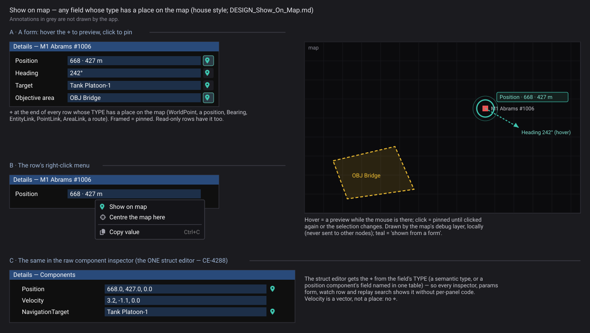
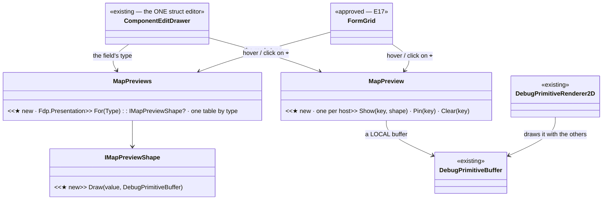
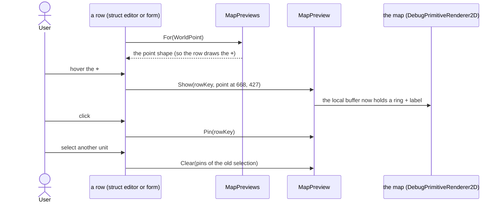
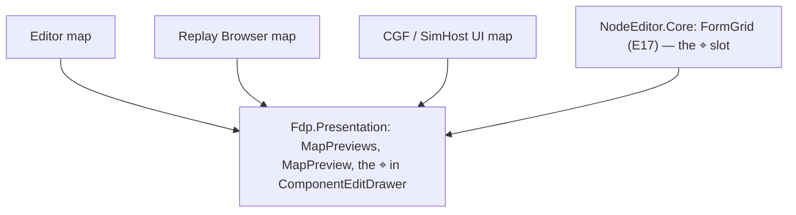

<!--STATUS
state: LIVE
build-state: BUILT (U-10, §2.1) — ✅ Q-M1…Q-M4 approved (R-4155); FormGrid ⌖ with U-12
updated: 2026-11-06 (first version — the user: "wherever there is something that can be shown on the map, like … the position of something, there should be a way to do it for debug purposes")
current-answer: §1 what exists · §2 the design · §2.1 as built · §3 questions
stale-below: nothing
known-rot: none
known-conflict: none
related-designs:
  - docs/DESIGN_Struct_Editor.md — the ⌖ becomes the Map part of each semantic TypeEditor
  - ../DESIGN_Semantic_Value_Types.md — §3 "the TYPE drives the tools": a map preview is one more tool the type drives
  - ../DESIGN_Scenario_Rules.md — §9.8.9 / §9.8.10 OWN WorldPoint, Bearing, EntityLink / PointLink / AreaLink
  - DESIGN_Details_Forms.md — the form rows carry the ⌖ (read-only included, §2.4)
  - DESIGN_Condition_Editor.md — §8: the struct editor (CE-4288) carries the ⌖ for every inspector
  - DESIGN_Map_Interaction.md — the map's hint line and gizmo primitives; a preview is drawn there, not edited
  - DESIGN_Replay_Browser_UX.md — the ⌖ works on a recording too
-->

# DESIGN — show on map: any field whose type has a place on the map

*Generated by `scripts/gen-show-on-map-mockup.py` (R-4143); the acceptance spec for the ⌖, its preview and pin, and the row menu.*

## 0. Why

🔒 *"In various forms, no matter if read-only or not, wherever there is something that can be shown on the map, like for example the position
of something, there should be a way to do it for debug purposes. Maybe some context menu and/or an icon indicating that this is showable on the
map … Similar should work for the other semantic types variables or attributes. This should be applied, for example, to the component
inspector. And basically whatever form which takes the data from appropriate semantic typed variable."* (user, `2026-11-06`)

## 1. What exists *(graph + grep, `2026-11-06`)*

Queries: `search_graph ".*(Semantic|ShowOnMap|MapHighlight|Locate|DebugPrimitive|MapMarker|Highlight).*" Class` (19 results, no map-preview
service); grep for the semantic structs. ⚠ Coverage could not be checked.

| what | where | for this design |
|---|---|---|
| the map-meaning types: `WorldPoint`, `WorldRotation`, `Bearing`; `EntityLink`, `PointLink`, `AreaLink` | `Fdp.Core/World/*.cs`; `Fdp.Toolkits/Replication/Links.cs:32,85,135` | the TYPE says a field has a place — ⭐ no attribute (Semantic types §3) |
| **debug primitives** — a buffer of shapes, drawn on the 2-D map and in 3-D, pickable | `DebugPrimitiveBuffer` (`Fdp.Diagnostics.Contracts`), `DebugPrimitiveRenderer2D` (`Fdp.Presentation/Vis2D/Gizmos`), `DebugPrimitiveRenderer3D` (Stride) | ⭐ the preview draws into a LOCAL buffer — nothing new to render, nothing sent on the wire |
| the selection highlight | `SelectionHighlightGizmo` | an `EntityLink` preview highlights the entity the same way |
| the struct editor's per-type drawers | `IImGuiFieldDrawer` (`TargetType`) | ⭐ the one place a type gets its ⌖ for every inspector |

## 2. The design

| ⭐ rule | |
|---|---|
| **the ⌖ is decided by the field's TYPE** — `MapPreviews.For(type)` answers whether and how it is drawn; generic `Vector3` positions only where one table names them (`Position.Value`, …) | ⛔ no panel decides on its own (R-174) |
| **one service, `MapPreview`** — `Show(key, shape)` / `Pin(key)` / `Clear(key)` into a LOCAL `DebugPrimitiveBuffer` that the map's existing renderers draw | ⛔ never replicated, never recorded; works on every host with a map, the Replay Browser included |
| **hover = preview, click = pin** (until clicked again or the selection changes); right-click: *Show on map · Centre the map here · Copy value* | read-only rows the same (R-4150: still grey, the ⌖ still works) |
| **shapes by type**: a point = a ring + a label; a bearing = an arrow from the entity; an entity = the selection highlight; an area = its dashed outline; a route = its line | one colour, **teal**, for "shown from a form" (Colour Icons palette) |
| **who carries the ⌖**: the struct editor (every raw inspector, params form, watch row, replay search) and `FormGrid` rows (E2 forms) | both read `MapPreviews.For(type)` — one table |

*What the picture shows: the editors only ASK the type table and TELL the preview service; the drawing is the debug-primitive path every map
already renders — no second overlay.*

*Every host that draws a map composes the same `MapPreview`; a host without a map shows no ⌖.*

| stage | what | owner | acceptance |
|---|---|---|---|
| **M1** | `MapPreviews` (point, bearing, entity, area, route) + `MapPreview` over a local buffer | ui | a frame rail: hover draws, click pins, selection change clears; 0 B on a steady frame |
| **M2** | the ⌖ in the struct editor (every inspector) and in `FormGrid` rows | ui | the mockup's three panels, compared by the builder (R-4146) |
| **M3** | the same in the Replay Browser | ui | a recording's Details row shows its point at the playhead |

### 2.1 ⭐ AS BUILT — U-10 (M1, M2 in the struct editor, M3 by construction) *(ui, `2026-11-06`)*

| piece | where | note |
|---|---|---|
| `MapPreviews` — `Has(type)` · `Draw(buffer, value, refs, label)` | `Fdp.Presentation/ImGui/Editing/MapPreview.cs` | point / entity = a screen-size ring + label; area shape = its dashed outline (circle, or the rectangle's four edges by `AreaLink.Contains`' compass maths); an area ENTITY or a link resolves through `ShowTarget` + the scope's positions. Teal, on `DebugTraceLayers.ToolHandles` (always on, never filmed) |
| `MapPreview` — `Hover` · `TogglePin` · `Keep` · `Emit` | same file | ⭐ a pin lives while its row is DRAWN (the row calls `Keep` each frame): a selection change, a collapsed node or a closed panel clears it by construction — no selection event needed. 0 B per steady frame |
| `MapPreviewLayer` | `Fdp.Presentation/Vis2D/Layers/MapPreviewLayer.cs` | added by `MapInteractionPack.AttachMapLayers` just before the gizmo layer ⇒ **all five map hosts** (editor, CGF, SimHost, player, Replay Browser = M3); writes into the host's buffer at DRAW time (after the frame's egress, before the next `EndFrame`) ⇒ never on the wire or recorded; not a scene layer ⇒ never in a film |
| the seam | `IMapPickContext.Preview` → `MapPickBroker.Preview` → `IMapPickService.Preview` → `CanvasMapPickAdapter` (`canvas.Get<MapPreview>()`) | forwarded by `ScopedMapPickContext` and the point form's `PickSink` (silent-default rule) |
| the ⌖ | `ReferenceLeafDrawers.DrawShowOnMap` | a teal crosshairs `GlyphToggle` at the row's end (framed while pinned); hover = preview, click = pin, right-click *Show on map · Centre the map here · Copy value*. ⛔ SUPERSEDED: the `Show` button that only centred the map (CE-4206 R3). The link row's *no stable id* sentence became the forms' warning mark with the sentence as its tooltip — it pushed the ⌖ off the row |

⚠ **Deviations:** `Bearing` has no ⌖ yet — a bare bearing has no origin; the arrow needs the row's owning entity, which the leaf drawer does not know.
No route type exists to preview. ⏳ The ⌖ in `FormGrid` rows lands with the E2 forms (U-12, `FormView`), reading the same `MapPreviews.Has`.
Rails: `MapPreviewTests` (5: type table, hover/pin, selection clears, area outline, 0 B); the rule editor's When tab render shows the ⌖ on its *Thing* row.

## 3. Questions — ✅ all approved (R-4155, user `2026-11-06`: *"M1 to M4 approved"*)

| # | question | lean | rejected |
|---|---|---|---|
| **Q-M1** | how a row says "showable" | **a ⌖ glyph at the row's end** + *Show on map* in the row menu | menu only: nobody finds it |
| **Q-M2** | hover vs click | **hover previews, click pins** | click only: comparing two positions takes four clicks |
| **Q-M3** | plain `Vector3` positions (not yet a semantic type) | **only where one table names them** (`Position.Value`, …) until SV moves them to `WorldPoint` | every `Vector3`: velocities would get a ⌖ |
| **Q-M4** | the colour | **one teal** for everything shown from a form | the field's own colour: clashes with sides' red / blue |
