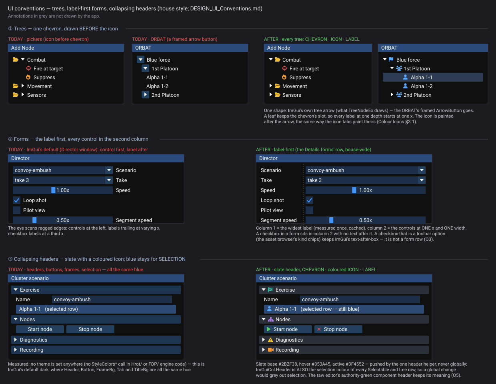
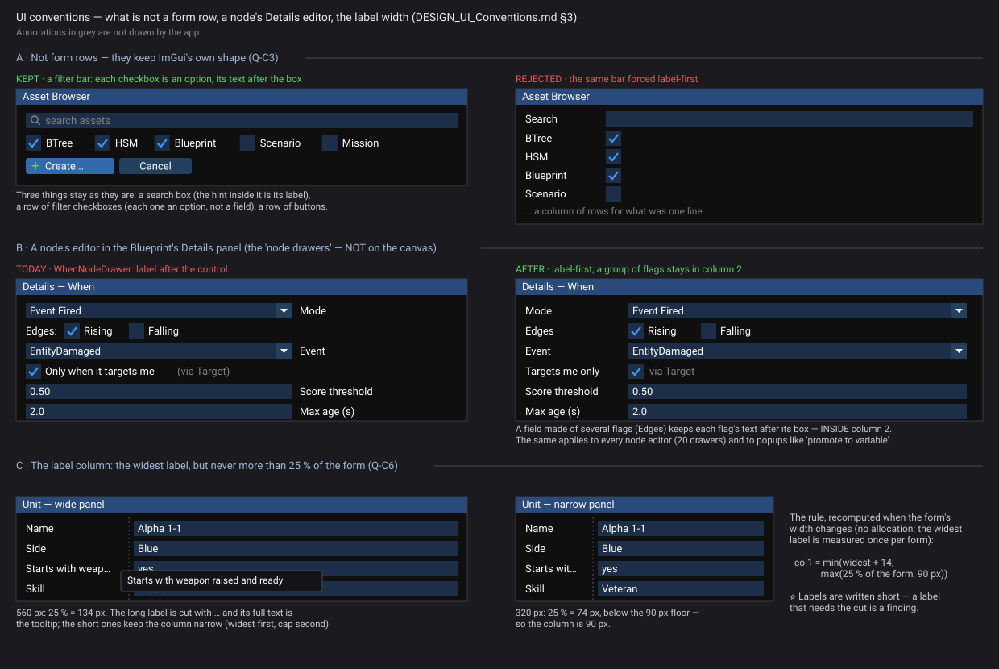
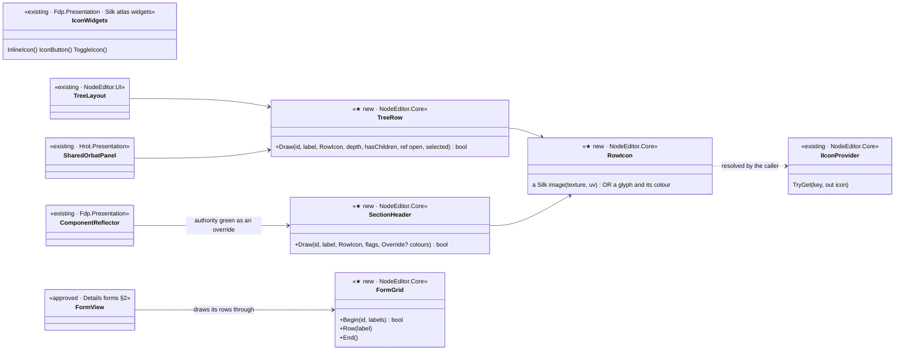
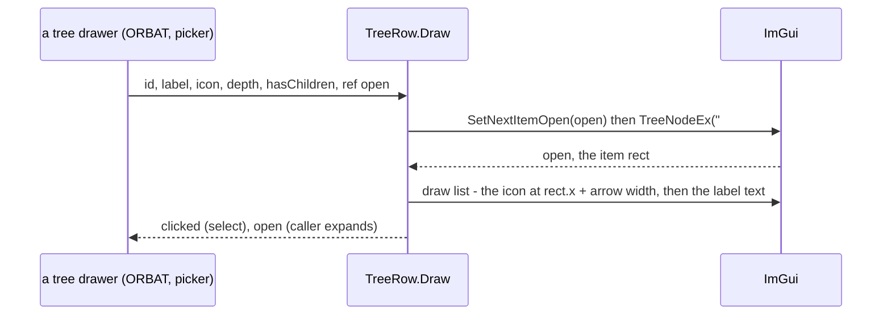
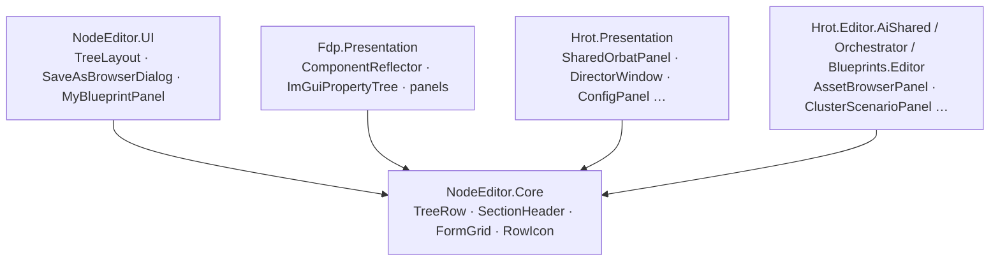

<!--STATUS
state: LIVE
build-state: READY-TO-BUILD — Q-C1, Q-C2, Q-C5 approved (R-4145); Q-C6 revised by the user (a capped width, R-4145); Q-C3 approved (R-4147, §3.1); Q-C4 withdrawn (a wrong premise, §3.2); fidelity checked by the builder, never a stop (R-4146)
updated: 2026-11-06 (Q-C3 approved, R-4147 — every question settled) · 2026-11-06 (the user's review: Q-C1/2/5 approved; Q-C6 → capped width §3.3; Q-C3 drawn §3.1; Q-C4 withdrawn §3.2; §6.1 autonomous fidelity) · 2026-11-06 (first version — the user's review of the New Scenario mockup: chevron before the icon, one chevron, label-first forms, slate collapsing headers with an icon)
current-answer: §2 trees · §3 label-first forms (§3.1 not form rows · §3.2 node editors · §3.3 the label width) · §4 collapsing headers · §5 the classes · §6 stages · §7 questions
stale-below: none
known-rot: none
known-conflict: DESIGN_Colour_Icons.md §4 I1 puts IconGlyph / IconPalette in Fdp.Presentation, which the node-editor pickers cannot reference — Q-C1 moves them to the shared home
related-designs:
  - DESIGN_Details_Forms.md — OWNS FormView and the status slot (§6.2); this design takes the LAYOUT half of its row helper (FormGrid) house-wide
  - DESIGN_Colour_Icons.md — OWNS the glyph → colour map and the icon tabs (§3.1); the tree row and the header paint their icon the same way
  - DESIGN_New_Scenario_And_Recipe.md — §2.5 the mockup whose tree the user chose as the model
  - DESIGN_Editing_UX.md — the programme; slice E17
-->

# DESIGN — three house-wide UI conventions: trees, label-first forms, collapsing headers

*Generated by `scripts/gen-ui-conventions-mockup.py` over `scripts/mockup_kit.py` (R-4143). It is the acceptance spec (R-4138).*

## 0. Why

🔒 User, `2026-11-06`, reviewing the New Scenario mockup:

- *"the chevron. Now it is rendered after the icon, but it makes sense to be rendered before the icon … the Orbat panel is using some weird
  shape of the chevron. These three views should be consistent, and I like the best what is now in your visual design of the new scenario."*
- *"it doesn't follow the IM GUI convention that the description text is on the right … the description text is on the left and all the
  controls are aligned in the second column of the grid … we should use this label first convention anywhere."*
- *"the expanders … an icon on the right of the chevron. And if they didn't use the same blue color like everything else … The collapsing
  headers should have a different color as a background."*

## 1. INVENTORY *(2026-11-06)*

Queries: `search_graph ".*(Picker|Tree|Orbat).*" Class` (91, mostly BTree — no tree-row helper exists) · `search_graph
".*(Label|PropertyRow|FormRow|FieldRow|LabeledField|PropertyGrid|PropertyTable).*" Method` (no shared label-first helper; one local
`InteractionPanel.DrawFieldRow`) · grep for `TreeNodeEx(`, `TreeNode(`, `ArrowButton(`, `CollapsingHeader(`, `ImGuiCol.Header`,
`StyleColors*`, and every input widget with a visible label. ⚠ Coverage could not be checked (`check_index_coverage` is not in the CLI).

| what | measured |
|---|---|
| **icon BEFORE chevron** | `NodeEditor.UI/Picker/Layouts/TreeLayout.cs:197-219` and `Dialogs/SaveAsBrowserDialog.cs:345-359`: `ImGui.Image(folder)` · `SameLine` · `TreeNodeEx` ⇒ the icon, then ImGui's arrow, then the label |
| **leaves already do it right** | `TreeLayout.cs:366-385` paints a leaf's icon with the draw list AFTER the arrow's slot — ⭐ the technique §2 generalises |
| **the ORBAT's chevron** | `SharedOrbatPanel.cs:175` — `ImGui.ArrowButton`: a framed 19 px square button with a triangle (the "weird shape"); a flat list indented by hand (`Indent(depth*12)`), no icon |
| **other trees** | `AssetBrowserPanel.cs:802`, `BehaviorPickerTree.cs:132`, `MyBlueprintPanel.cs:255`, `FindResultsWindow.cs:216,235`, `EntityBrainView.cs:526,716,726`, `ImGuiPropertyTree.cs:142,151`, `ComponentDiffPanel`, `ClusterDiagnosticsPanel`, `ClusterScenarioPanel`, `FolderTreePicker` — plain `TreeNodeEx`, no icon |
| **forms** | **156** input widgets with a visible label (ImGui puts it RIGHT of the control) in **~45** files; top: `DirectorWindow` 22, `WhenNodeDrawer` 12 (a canvas node), `ClusterScenarioPanel` 10, `ConfigPanel` 8, `LiteralNodeDrawer` 7; **49** of them checkboxes. **142** use a hidden `##` label (most inside a table already). **22** pass a label variable |
| **label-first already** | `ComponentReflector.cs:400-405` and `ImGuiPropertyTree.cs:90-96` (2-column tables, `Property` 180 px fixed) · `ComponentEditDrawer` (needs a 2-column table) · ~16 files with a Name/Property column · Details forms §6.2 (`BeginTable("form", 3)`: label · control · status slot) |
| **collapsing headers** | **45** `CollapsingHeader(` in 23 files (`ClusterScenarioPanel` 11, `VariablesPanelControl` 5); **0** framed `TreeNodeEx` |
| **the colours** | ⛔ no `StyleColors*` call in engine code ⇒ ImGui's default dark: `Header`, `Button`, `FrameBg`, `Tab`, `TitleBg` all one blue. ⚠ `ImGuiCol.Header` is ALSO the hover/selection colour of every `Selectable` and tree row |
| **a header colour that means something** | `ComponentReflector.cs:251-260` — green when this node holds authority over the component (raw editor) |
| **where a shared widget can live** | `NodeEditor.UI` references only `NodeEditor.Core` + ImGui.NET; `Fdp.Presentation` references `NodeEditor.Core` but not `NodeEditor.UI` ⇒ ⭐ **`NodeEditor.Core` (has ImGui.NET, `IIconProvider`) is the one assembly every tree can reach**. `Fdp.Presentation/ImGui/Icons/IconWidgets.cs` exists but is out of the pickers' reach |

## 2. Trees — **CHEVRON · ICON · LABEL**, one chevron

| ⭐ the rule | |
|---|---|
| **the chevron is ImGui's own tree arrow** (what `TreeNodeEx` draws) | ⛔ no `ArrowButton`, no hand-drawn triangle |
| **then the icon, then the label** | the row is `TreeNodeEx("##id", flags)` with an empty label; the icon and the text are painted by the draw list at the arrow's right — the leaf technique of `TreeLayout.cs:366-385`, made the one row |
| **a leaf keeps the chevron's slot** | every label at one depth starts at one x |
| **one row helper for every tree** | `TreeRow` (§5) — the ORBAT, the pickers, Save-As, the asset browser; ⛔ no tree draws its own row |
| **zero allocation per frame** | the id and label are the caller's strings; nothing is concatenated per row (R-2084) |

The ORBAT keeps its flat visible-node list (`GetVisibleNodes`, its own expand set): `TreeRow` takes `ref bool open` and a depth and
uses `NoTreePushOnOpen`, so a flat drawer and a recursive one call the same row.

## 3. Forms — **label first, controls in the second column**

| ⭐ the rule | |
|---|---|
| **a form is a grid**: column 1 the label (fixed, the widest label, measured once and cached per form), column 2 the control (stretch, `SetNextItemWidth(-1)`), optional column 3 the status slot (Details forms §6.2) | ⛔ a visible-label input widget (`InputText("Name", …)`) in a form |
| **a checkbox in a form** sits in column 2, no text after it | — |
| **not a form row** (stays as ImGui draws it): a checkbox that is a toolbar option (the asset browser's kind chips), a search box with a hint, a button row | Q-C3 |
| **one layout helper** — `FormGrid` (§5); `FormView` (Details forms) draws its rows THROUGH it | ⛔ a panel's own `BeginTable` + `TableSetupColumn` copy |

*Generated by `scripts/gen-ui-conventions-details-mockup.py`.*

### 3.1 Not form rows — Q-C3 ✅ *approved (R-4147), panel A*

| stays as ImGui draws it | why |
|---|---|
| a **search box** | its hint is its label |
| a **row of filter checkboxes** (the asset browser's kinds) | each box is an option, not a field — forced label-first, one line becomes a column of rows (panel A, right) |
| a **row of buttons** | — |
| ⭐ **a field made of several flags** (a When node's *Edges: Rising / Falling*) | the field's label goes in column 1; each flag keeps its text after its box, INSIDE column 2 |

### 3.2 Node editors — Q-C4 *withdrawn: the premise was wrong*

⛔ The first version called `WhenNodeDrawer`, `LiteralNodeDrawer` … "canvas node bodies". 📐 Measured: the 20 `IBlueprintNodeDrawer`s draw in
the **Blueprint's Details panel** when a node is selected (`BlueprintNodeDetailsView.cs:139-143`), not inside the node on the canvas. ⇒ they are
ordinary forms and follow §3 like any other (panel B). The one input on the canvas itself is the *promote to variable* popup
(`CanvasRenderer.cs:1312-1313`), also a small form.

### 3.3 The label width — Q-C6 *(revised by the user, R-4145)*

🔒 *"Too long label would kill the whole form look. There needs to be some ratio based width calculation, like that the label can occupy at most
25% of the width."*

`col1 = min(widest label + 14, max(25 % of the form's width, 90 px × UI scale))` — recomputed when the width changes; the widest label is measured
once per form (no allocation). A label wider than the column is cut with `…` and shows its full text as the tooltip. ⭐ A label that needs the cut
is a finding: labels are written short (panel C).

## 4. Collapsing headers — **slate, CHEVRON · coloured ICON · LABEL**

| ⭐ the rule | |
|---|---|
| **slate background** `#2B2F38`, hover `#353A45`, active `#3F4552` | pushed by `SectionHeader` around its own `CollapsingHeader` only — ⛔ never a global `ImGuiCol.Header` change, which would grey out every selection |
| **blue now means SELECTED** (a selected row, the active tab line) | the structure (headers, tabs §3.1 of Colour Icons) is grey |
| **an icon right of the chevron**, coloured by meaning (Colour Icons) | painted at the item rect, like the icon tabs; the label is `"##id"`-free text the helper paints |
| **a header whose colour MEANS something keeps it** — the raw editor's authority green | passed as an override; Q-C5 |

## 5. The classes

*What the picture shows that prose hid: the only assembly both the node-editor pickers and the engine panels can reach is `NodeEditor.Core`
— so the three helpers live there, and `IconWidgets` (Silk, `Fdp.Presentation`) is not the home despite its name.*

*Every drawer reaches `NodeEditor.Core`; called each frame by the panel that draws the tree, form or header — no registration, no system.*

## 6. Stages — slice **E17** (ui)

| # | what | acceptance |
|---|---|---|
| **C1** | `RowIcon`, `TreeRow`, `SectionHeader`, `FormGrid` in `NodeEditor.Core` | a frame rail per helper measures the item rects: chevron left of icon left of label; a leaf's label at its depth's x; the header's background is the slate; `GC.GetAllocatedBytesForCurrentThread()` = 0 on a steady frame |
| **C2** | the trees moved onto `TreeRow`: `TreeLayout`, `SaveAsBrowserDialog`, `SharedOrbatPanel` (the user's three), then `AssetBrowserPanel`, `MyBlueprintPanel`, `FolderTreePicker`, `BehaviorPickerTree` | the feature suites of each (T-1) + the C1 rail on the real drawer; a side-by-side with §2 of the mockup |
| **C3** | the 45 `CollapsingHeader` calls onto `SectionHeader`, each with its icon (Colour Icons map) | authority green unchanged in the raw editor |
| **C4** | the label-right forms onto `FormGrid`, by file — panels first (`DirectorWindow`, `ClusterScenarioPanel`, `ConfigPanel`, `WaypointEditorPanel`, `SpawnerPanel`, `ZoneEditorPanel` …), then the existing 2-column tables (`ComponentReflector`, `ImGuiPropertyTree`) re-pointed at `FormGrid` | a rail per migrated panel: every control's left edge equal. ⭐ A sweep can be checked: grep for visible-label input widgets outside the Q-C3 exceptions → 0 |

### 6.1 Fidelity is the builder's job — never a stop *(user, `2026-11-06`, R-4146)*

🔒 *"I would again emphasize the need for implementing the forms in the same shape as in the design … that shouldn't need me when implementing.
This is something that you can check without me … I would like many of these to be done autonomously overnight, and that shouldn't stop just to
ask for confirming something that you can check visually pretty well."*

The builder renders each touched surface's real frame (`xvfb-run -a`, `HROT_RAIL_SHOTS=<scratch>`), reads it next to the mockup panel it
implements, fixes every deviation and renders again until they match. The side-by-side goes into the report and the chat as an FYI. A
deviation ImGui cannot draw is built the closest way, the mockup and this design are updated to the as-built, and the report names it.
⛔ No pause for confirmation.

⭐ Proportionate proof (CLAUDE.md): cosmetic — one key rail per helper, the touched classes' suites; display rails under `xvfb-run -a`.

## 7. Questions — leans, for the user

| # | question | lean | rejected |
|---|---|---|---|
| **Q-C1** ✅ R-4145 | where the helpers live | **`NodeEditor.Core`** — the one assembly every tree drawer can reach; ⭐ move Colour Icons' planned `IconGlyph`/`IconPalette` there too, so the pickers can colour their glyphs | `Fdp.Presentation` (`IconWidgets`) — the node-editor pickers cannot reference it; a new assembly — a project for three classes |
| **Q-C2** ✅ R-4145 | the chevron | **ImGui's own tree arrow** in every tree | a custom chevron glyph (FontAwesome `chevron-right`) — a second shape to keep in step with `TreeNodeEx` |
| **Q-C3** ✅ R-4147 | what is NOT a form row | **search boxes, filter-checkbox rows, button rows** keep ImGui's shape; a multi-flag field keeps its flags' text inside column 2 | label-first for every checkbox — a toolbar of checkboxes would grow a label column |
| ~~**Q-C4**~~ | ⛔ WITHDRAWN — the node drawers are Details-panel forms, not canvas content (§3.2); they follow §3 | — | — |
| **Q-C5** ✅ R-4145 | headers whose colour means something | **keep the meaning** — the raw editor's authority green stays, as an override to the slate | everything slate — loses the authority cue |
| **Q-C6** ✏ revised R-4145 | the label column | **left-aligned**; the widest label, **capped at 25 % of the form** (floor 90 px), cut with … and a tooltip (§3.3) | the widest label uncapped — one long label wrecks the form (user) |
