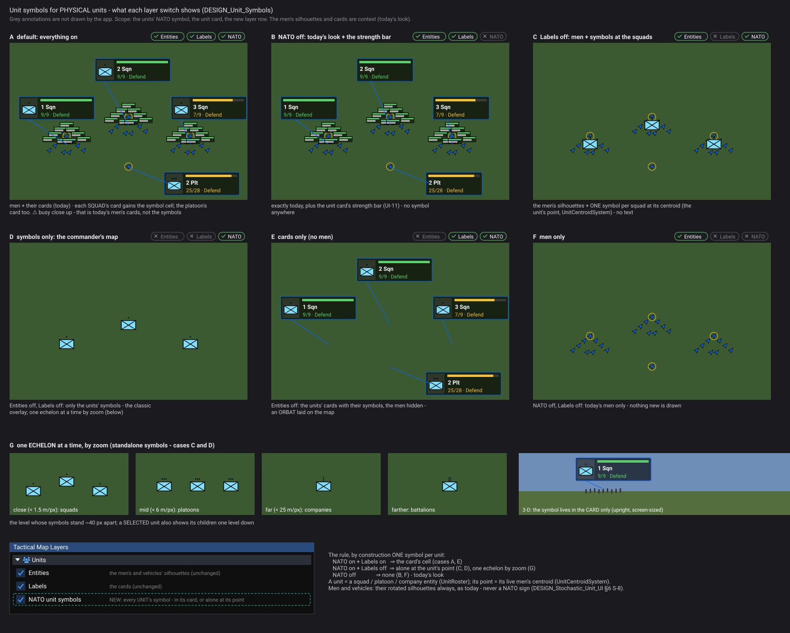
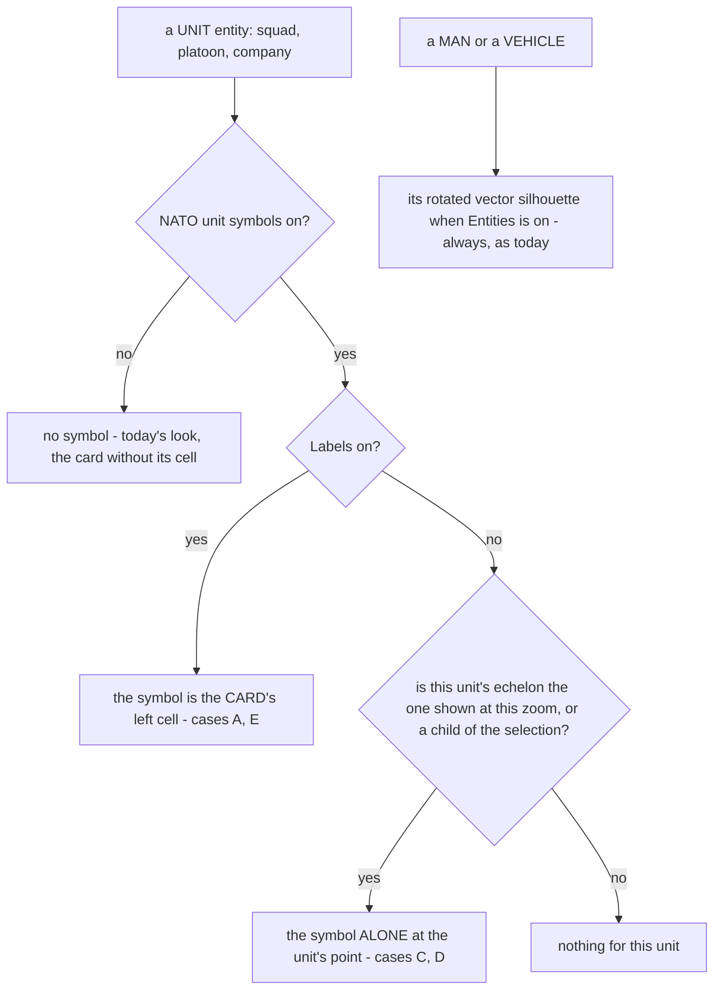

<!--STATUS
state: LIVE
build-state: BUILDING — ✅ APPROVED `2026-11-16` (P-1…P-5 + O-1; O-2 not now) — R-8602; ✅ BUILT: O-1 (CE-8605), P-5 the unit card (CE-8607); ⏳ the symbol (CE-8608…CE-8610)
updated: 2026-11-16
current-answer: the whole file
stale-below: nothing
known-rot: none
known-conflict: none
related-designs:
  - ../designs/aggregate-units/DESIGN_Stochastic_Unit_UI.md — OWNS the symbol itself (§6: SymbolCode, the parts atlas, SymbolRenderer in the gizmo library, the derivation from the content) and the unit card (UI-11); THIS file owns WHEN a PHYSICAL unit's symbol is drawn and WHERE
  - UX_Feature_Entity_Symbology.md — OWNS the men's and vehicles' 2-D symbol paths (silhouette / nato2525 stub, §3.8); unchanged here
  - ../DESIGN_Map_3D_Mode.md — §6am OWNS the card (one card per unit, the Labels layer, hidden behind terrain)
  - ../GUIDE_Debug_Gizmos.md — the Tactical Map Layers panel the new row joins
  - ../designs/group-maneuvers/DESIGN_Squad_Tactics.md — §7 the unit's point = its live members' centroid (UnitCentroidSystem)
-->

# DESIGN — NATO symbols for PHYSICAL units: what each layer switch shows *(exp/agg-ui, CE-8604)*

🔒 User, `2026-11-16`: *"physical unit should get the symbol too. the entity nato symbol should be turnable on/off from the layer panel"* · *"you mean the
current 2d vector symbol while showing the squad virtual commander entity as nato symbol? that would work"* · *"can you pls add a separate design for
physical entities so i can approve that this is what i want? with different options (according of what is turned on or off)"*.

## 1. The picture

*One friend platoon (3 squads × 9 men + the platoon leader) under every combination of the three Units switches (A–F), the echelon by zoom (G), 3-D, and
the new row. Generator: `scripts/gen-unit-symbols-mockup.py`. Scope (R-4151): the UNITS' symbol, the unit card and the row; the men's silhouettes and the men's
cards are drawn as they are today.*

## 2. INVENTORY *(graph re-indexed `2026-11-16`; grep to confirm)*

| query | found |
|---|---|
| `search_graph .*(UnitCentroid\|CommandPicture\|Sector).*` Class (8) | `UnitCentroidSystem` — a unit's `SimTransform` = its LIVE members' centroid; with none it stays where it was |
| grep `EntityClassShapeLibrary` kind 11 | `:81` — a unit entity draws NOTHING on the 2-D map today; only its card (name) |
| grep `UnitLayerGroup` | `LayerControlGizmo.cs:150-165` — Units: Entities · Labels · Hide labels behind terrain · Unit details · Rounds · Concealed · Mind state |
| grep `EntityBodyLayer3D` | `:320-322` — a unit (VisualFamily.Unit) has no 3-D body |
| `search_graph .*(MapLayer\|LayerMask\|TacticalMapLayers).*` Class (20) | the panel `LayerControlGizmo`, `DebugTraceLayers` (the bits), `MapLayerPreferences` (saved per user) |

## 3. The cases *(the mockup's A–G; the rule decides each by construction)*

*What it shows that prose hid: a unit can never show TWO symbols (card and point are exclusive), the men's drawing is untouched by any of the new switches,
and only the standalone case needs the echelon filter — a card is already one per unit.*

| case | Entities | Labels | NATO | what you see |
|---|---|---|---|---|
| **A** default | ✓ | ✓ | ✓ | the men + their cards (today) · each SQUAD's and the PLATOON's card with the symbol cell |
| **B** | ✓ | ✓ | ✗ | today's look; the unit card has its strength bar (UI-11), no symbol |
| **C** | ✓ | ✗ | ✓ | the men + ONE symbol per squad at its centroid, no text |
| **D** | ✗ | ✗ | ✓ | symbols only — the commander's overlay, one echelon by zoom |
| **E** | ✗ | ✓ | ✓ | the units' cards with symbols, no men — an ORBAT on the map |
| **F** | ✓ | ✗ | ✗ | the men only — nothing new |
| **G** | — | ✗ | ✓ | zoom: squads < 1.5 m/px · platoons < 6 · companies < 25 · battalions beyond; a SELECTED unit also shows its children one level down |

## 4. The decisions *(✅ APPROVED `2026-11-16` — 🔒 user: "approved, with O-1 split labels" — R-8602)*

| # | decision (lean) | rejected — one line each | would change it |
|---|---|---|---|
| **P-1** | every UNIT entity (squad, platoon, company — `UnitRoster`) gets the symbol, at its point = its live men's centroid; a man or vehicle NEVER does — they keep their rotated, perspective-correct silhouettes | a symbol per man — 1 000 symbols, and the standard does not symbolise individuals on a tactical map · the symbol at the LEADER — he moves inside the formation; the centroid is what `UnitCentroidSystem` already maintains | — |
| **P-2** | ONE new row **Units ▸ NATO unit symbols** (on by default), the rule of §3: with Labels ⇒ the card's cell, without ⇒ alone at the point | two rows ("symbol in card", "symbol on map") — the user then has to keep them consistent · the symbol always in BOTH — two per unit | — |
| **P-3** | standalone symbols show ONE echelon at a time by zoom (thresholds above, ~40 px apart on screen) + the selection's children | every echelon at once — company, platoon and squad symbols stacked at nearly one point | the thresholds, tuned on a real scenario |
| **P-4** | in 3-D the symbol lives ONLY in the card (upright, screen-sized); with Labels off nothing is shown in 3-D | a billboard sprite over the unit in 3-D — a second 3-D path for one row's sake | the user wanting the symbol in 3-D without cards |
| **P-5** | the unit card shows the unit's STRENGTH bar (`UnitStrength`, the SITREP colour) — for physical units too (case B) | a physical unit's card with name only (today) — the strength is the first thing a commander asks | — |
| ✅ **O-1** *(approved)* | case A is busy close up — the MEN's cards (today's), not the symbols. Lean: split **Labels** into **Unit cards** and **Men's cards** (both on by default, so nothing changes until you untick one) — then "symbols in unit cards, no men's cards" is one click | leave it — case A stays as drawn | your call |
| ⏳ **O-2** *(not now — the lean stands)* | a hostile unit is symbolised only as far as it is KNOWN to the viewing side? — lean: NOT now (the editor and the instructor see ground truth); a later "perceived picture" mode would draw from the command picture instead | — | a trainee-facing perspective needing it |

The symbol itself (how it is composed, cached and rendered — the gizmo library, the parts atlas, the derivation from the unit's content) is
[DESIGN_Stochastic_Unit_UI.md](../designs/aggregate-units/DESIGN_Stochastic_Unit_UI.md) §6; this file only decides when and where a physical unit shows it.
