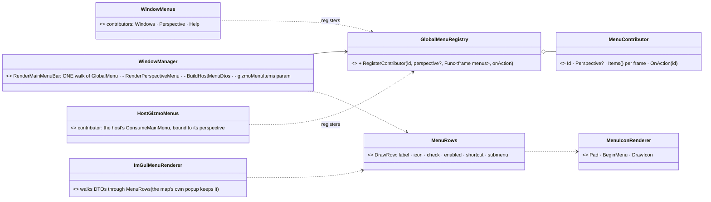
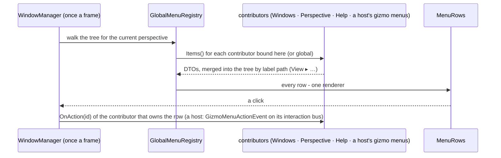
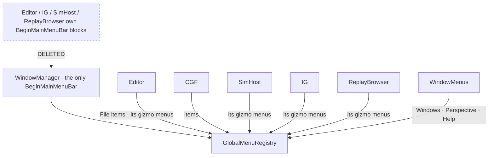

<!--STATUS
state: LIVE
build-state: PARTIAL
verified: 2026-08-28 (coordinator source scan)
current-answer: PARTIAL. Mechanism built + railed (GlobalMenuRegistry.ResolveBinding, WindowManager.RenderGlobalMenu, CE-041..045). MISSING: no production menu item is perspective-scoped (all register global), and 4 hosts' BeginMainMenuBar blocks stay unguarded so --mode all still stacks them.
  ⭐ 2026-10-22: §MB (CE-1243) designs ONE menu bar — one tree with per-frame contributors, one row renderer; leans with the user.
updated: 2026-10-22
known-rot: the "Out of scope" rows "Consolidating the four blocks" and "RenderPerspectiveMenu() and the host-menu DTOs" are SUPERSEDED by §MB (consolidating is now the scope).
related-designs:
  - ../designs/win-mgr-1/DESIGN.md — §4.3 the menu tree, §4.4.1 the shell's fixed Windows / Perspective / Help (what §MB folds into the tree)
  - ../designs/gizmos-1/canvas-context-menu-design.md — the map's context menu (the other user of ImGuiMenuRenderer's DTO walk; §MB keeps it)
-->
# Feature design — the main menu follows focus

> **Design for [UXI-05](UX_Issues.md#uxi-05) · drafted 2026-08-10.**
> **Status: 🟡 PARTIAL — mechanism built + railed (`GlobalMenuRegistry.ResolveBinding`, `WindowManager.RenderGlobalMenu`, CE-041..045); no production menu item is perspective-scoped yet and 4 hosts' `BeginMainMenuBar` blocks stay unguarded.**
>
> Implements [UXR-86](UX_Requirements.md#uxr-86). Vocabulary:
> [Glossary — focus follows perspective](UX_Glossary_Host_Mode_Subsystem.md#-co-running-subsystems-independent-and-focus-follows-perspective).

## 0. Prior art — ✅ checked before designing ([rule 6](UX_Issues.md#rules))

| Exists? | What | Bearing |
|:--:|---|---|
| ⭐ | **`MainToolbarManager`'s perspective filter** — `ToolbarItem.Perspective` (`string?`), set at registration, compared at draw: `item.Perspective == null \|\| item.Perspective == currentPerspective` (`:278-288`) | **This is the model.** Simpler than `WindowScope` — `null` *is* "global", no enum needed |
| ✅ | `ManagedWindow` + `WindowScope` — three-way OR: `Global \|\| _isPinned \|\| OwningPerspective == current` (`:154-168`) | the same idea one layer over; ⚠ its `_isPinned` escape hatch is **not** wanted here (below) |
| ✅ | **`DebugGizmoLayer.DrawMainMenu()`** — the de-duplicated `BeginMainMenuBar`/`DrawMenus`/`End` wrapper (`GizmoMap…/DebugGizmoLayer.cs:379-386`) | 🔴 **exists and not one of the four subsystems calls it** — only `GizmoViewerFrontend.cs:65`, a standalone viewer. [The seam law](UX_Seam_Inventory.md) again |
| ✅ | `MenuItemNode.GetEnabled` (`Func<bool>`) and `DynamicLabel` (`Func<string>`) | the per-frame idiom is **already** in this file — visibility is a sibling, not a new concept |
| ✅ | `WindowManager.CurrentPerspective` is in scope inside `RenderGlobalMenu` | ⇒ **zero new plumbing on the draw side.** It is already used 13 lines later (`:495`) |
| ❌ | Any owner/perspective/scope field on `MenuItemNode`, or any `perspective` parameter on the three `Register*` methods | **the entire gap** |

## ⭐ The union does not come from where the issue says

**`GlobalMenuRegistry` has exactly one production writer — the Editor**, with 10 items, all under
`File/*` (`EditorSubsystem.cs:3519-3538` + `ScenarioMenuCommands.cs:180`). Every other subsystem
registers **zero**. And the Editor **cannot co-run** (validated standalone).

⇒ **The registry is not producing a union today.** The union is produced by something else:

### 🔴 Four copy-pasted `BeginMainMenuBar` blocks, none of which checks focus

| Subsystem | Site |
|---|---|
| Editor | `EditorSubsystem.cs:1918` (block `1914-1926`) |
| SimHost | `SimHostVisualization.cs:376` (block `373-388`) |
| ReplayBrowser | `ReplayBrowserSubsystem.cs:425` (block `421-433`) |
| IG | `IgApplication.cs:1267` (block `1263-1279`) |

Each does `_gizmoLayer?.ConsumeMainMenu()` → and if non-empty, opens its **own** main menu bar and
appends its items. Each fires from its own subsystem update path, gated only on headless flags —
**never on `CurrentPerspective`**. In `--mode all` every composed subsystem appends to the same bar.

> ### ⇒ [UXI-05](UX_Issues.md#uxi-05) and [UXI-13](UX_Issues.md#uxi-13) are one defect seen from two sides
>
> UXI-13 files this as *"copy-pasted ×4, bypassing the overload built for it"*; UXI-05 files it as
> *"the menu is a flat union"*. **The four copies *are* the union.** One fix closes both.

⚠ A fifth direct drawer exists — `ExConMock.cs:196-201` — but it is guarded by `!_panelsWindowManaged`,
i.e. standalone-mock only. Out of scope; note it so it is not "discovered" later.

## The registry half — path is identity, perspective selects the binding

The trie is keyed by path and `RegisterItem` is **last-write-wins** (`TraversePath` returns the existing
node; `:79-87`). Note the sibling registry takes the opposite line:

| | On duplicate |
|---|---|
| `GlobalActionRegistry.Register` | **throws** — *"catches accidental duplicates early"* |
| `GlobalMenuRegistry.RegisterItem` | **silently overwrites** |

⚠ **Latent, not active** — one writer today, so nothing collides yet. But it becomes real the moment this
feature succeeds and a second subsystem contributes. **A visibility flag alone would not fix it: the
losing item never survives registration to be filtered.**

> ### ⭐ The resolution turns the collision into the feature
>
> **Path is the user-facing identity; perspective selects which binding applies.**
>
> Two subsystems both registering `File/Save` is **not** a collision to reject — it is the correct
> outcome. `File/Save` should sit at `File/Save` and do whatever the *focused* subsystem means by it.
>
> ⇒ a leaf holds **bindings, not one action**:
>
> ```csharp
> // MenuItemNode — additive
> public List<MenuBinding> Bindings { get; } = new();   // replaces the single OnClick at leaves
> public sealed record MenuBinding(string? Perspective, Action? OnClick,
>                                  Func<bool>? GetChecked, Action<bool>? OnCheckedChanged);
> ```
>
> **Resolution at draw time, in order:** binding whose `Perspective == CurrentPerspective` → else the
> `null` (global) binding → else **the leaf is not drawn**, and an empty submenu is not drawn either.

### Registration API — one optional parameter, mirroring the toolbar

```csharp
void RegisterItem         (string path, Action onClick,                              string? perspective = null);
void RegisterCheckableItem(string path, Func<bool> get, Action<bool> set,            string? perspective = null);
void RegisterSeparator    (string path,                                              string? perspective = null);
```

`null` = global, exactly as `ToolbarItem.Perspective` already means. **Every existing call site keeps
compiling and keeps its current behaviour** — the Editor's 10 items become global, which is correct for a
subsystem that cannot co-run.

🔒 **No `_isPinned` equivalent.** Windows have it because a user pins a window deliberately; a *menu item*
that ignores focus is the bug being fixed. Do not port the third OR-term.

## Migration

| Step | Change | Gate |
|--:|---|---|
| 1 | `MenuBinding` + `perspective` parameter + draw-time resolution in `RenderGlobalMenu` | **Editor menu byte-identical** — all 10 items are global |
| 2 | Add the focus guard to the four gizmo blocks: skip unless that subsystem's perspective is current | single-subsystem modes unchanged; `--mode all` stops stacking |
| 3 | *(hand to [UXI-13](UX_Issues.md#uxi-13))* replace the four blocks with the existing `DebugGizmoLayer.DrawMainMenu()` | pure de-duplication, no behaviour change |

**Acceptance:** run `--mode all`, switch perspective, and the menu bar's subsystem-dependent entries
change with it while File/Settings/Help/Window stay put — the two-tier rule from the
[Glossary](UX_Glossary_Host_Mode_Subsystem.md#-co-running-subsystems-independent-and-focus-follows-perspective).

⚠ **This is the first requirement in the programme that cannot be verified in a single-subsystem mode.**
`--mode all` (or any comma-list) is mandatory for the walk, and the Editor cannot participate.

## 🔒 Out of scope

| | Why |
|---|---|
| Consolidating the four blocks | [UXI-13](UX_Issues.md#uxi-13) — step 2 makes them correct, step 3 makes them one |
| `ExConMock`'s standalone bar | mock-only, `!_panelsWindowManaged` |
| `RenderPerspectiveMenu()` and the host-menu DTOs | they are *how you switch* perspective — filtering them would strand the user |
| Entity/context menus | [UXI-03](UX_Feature_Entity_Action_Vocabulary.md)/[UXI-04](UX_Feature_Cross_Surface_Actions.md); those already follow focus |

## Risks

| | |
|---|---|
| ⚠ **Perspective names are magic strings** on both sides (`ToolbarItem.Perspective` already is) | a typo silently hides an item **forever**. Register from the same constant the subsystem uses for its windows, and assert it in a test |
| ⚠ **Empty parents** — a `Tools` menu whose children are all filtered out | resolution must skip an intermediate node with no visible descendants, or the bar grows dead headers |
| ⚠ [UXI-06](UX_Issues.md#uxi-06) is adjacent | perspective *restore* validates against subsystem names and drops the Editor's internal ones. If a menu item is bound to `BTree`, a bad restore hides it. Fix UXI-06 first or accept the coupling |
| ⚠ Behaviour change is invisible in every mode we normally test | see the acceptance note above — this needs a deliberate `--mode all` walk on Windows |

## MB. DESIGN — ONE MENU BAR: one model, one row renderer (`CE-1243`, `2026-10-22`, ui) — build-state: BUILDING (✅ MB-1…MB-4 APPROVED by the user `2026-10-22`: *"CE-1243 and CE-1244 leans approved"*)

🔒 User, `2026-10-22`, on `CE-1027` (a menu's icon vanishing while it is open): *"what is strange how comes it behaves differently,
shouldnt the manin menu bar rendering be unified and shared?"* ⇒ this section is the answer: UXI-13's *"one bar"* plus the shell's own
three paths, as one model. ⚠ It **supersedes this document's "Out of scope" rows** for *"Consolidating the four blocks"* and
*"`RenderPerspectiveMenu()` and the host-menu DTOs"* — consolidating them is now the scope; filtering them by perspective still is not.

**INVENTORY** (`2026-10-22`; grep `BeginMainMenuBar` · `ImGuiMenuRenderer.DrawMenus` · `RenderGlobalMenu` · `ConsumeMainMenu`;
⚠ the codebase-memory graph was re-indexing this session, so this is grep + reading each site): FIVE paths draw into the one bar.

| path | draws | where |
|---|---|---|
| ① the menu tree (`GlobalMenuRegistry`) | File · Edit · View · Settings · every registered item | `WindowManager.RenderGlobalMenu` (`WindowManager.cs:636`, `:638`) |
| ② a hand-drawn block | Perspective | `WindowManager.RenderPerspectiveMenu` (`:637`) |
| ③ per-frame DTOs, a second renderer | Windows · Help | `BuildHostMenuDtos` + `ImGuiMenuRenderer.DrawMenus` (`:639-640`) |
| ④ a shell parameter with NO caller | gizmo menus | `WindowManager.Render(gizmoMenuItems, onGizmoMenuAction)` (`:587`, drawn `:642-643`) |
| ⑤ each host's own `BeginMainMenuBar` | gizmo menus (*View ▸ Tactical Map Layers…, 2-D / 3-D Map …*) | Editor `EditorSubsystem.cs:3039` · IG `IgApplication.cs:1434` · SimHost `SimHostVisualization.cs:477` · ReplayBrowser `ReplayBrowserSubsystem.cs:509` (ExCon's `ExConMock.cs:195` is standalone-only) |

| the design rests on | code — how it is | design basis — how it was meant to be |
|---|---|---|
| the shell draws THREE sources with two renderers | ✅ `WindowManager.cs:636-640`; rows in `RenderGlobalMenu` (`:745`) and `ImGuiMenuRenderer.DrawItem` (`ImGuiMenuRenderer.cs:47`) | ✅ win-mgr-1 §4.4.1 planned fixed Windows / Perspective / Help drawn by the shell — the DTO path is that plan, never folded into §4.3's tree |
| the gizmo menus come per frame, as DTOs, possibly from another node | ✅ `DebugGizmoLayer.ConsumeMainMenu`; `MainMenuBinding` primitives (`DebugPrimitiveBuffer.cs:221`) | ✅ gizmos-1 (a gizmo binds a main-menu entry by primitive) |
| four hosts each open their own bar for them; the shell's parameter for them has no caller | ✅ the four sites above; `WindowManager.Render(` is called with no items | ✅ [UXI-13](UX_Issues.md#uxi-13) — *"Prefer this [the shell parameter] … it yields **one** bar"* (open) |
| a tree node can already change per frame (label, enabled) but not its CHILDREN | ✅ `MenuItemNode.GetEnabled` / `DynamicLabel`; no children hook | ✅ this document §0 (prior art) |
| the three row renderers already share the icon helper | ✅ `MenuIconRenderer` (fixed once for CE-1027) | ⛔ searched, none — shared by accident of the gutter work |







*What the pictures show that prose hid: the bar becomes ONE walk of ONE tree, and everything that is computed per frame — the window
list, the perspectives, a host's gizmo menus — is a contributor that tree asks each frame, merged by label into the same menus (a gizmo's
*View ▸ …* lands in the one View menu); and only the shell opens the bar, so a host can no longer append a second one.*

| decision | ✅ approved |
|---|---|
| **MB-1 one row renderer** | `MenuRows.DrawRow` (GizmoMap.Presentation, beside `MenuIconRenderer`) draws a row — label, icon, check, enabled, shortcut, submenu — and both walks call it. A pure refactor; the bar looks the same |
| **MB-2 contributors in the tree** | `GlobalMenuRegistry.RegisterContributor(id, perspective?, items, onAction)`: a node whose children are DTOs computed each frame, merged by label path; the click goes to the contributor that produced the row. The menu snapshot (`PublishSnapshot`) includes them, so a rail sees the whole bar |
| **MB-3 Windows · Perspective · Help as contributors** | registered by the window manager itself (`WindowMenus`); `BuildHostMenuDtos`, `RenderPerspectiveMenu` and the two-model rail surface (`HostMenuLabelsForRail`) go. Order unchanged (CE-1026's leading / trailing split) |
| **MB-4 the hosts' gizmo menus as contributors** | each host registers its `ConsumeMainMenu()` as a contributor bound to its perspective — which is also UXI-05 step 2 (the gizmo items follow focus); the four `BeginMainMenuBar` blocks and the unused `Render(gizmoMenuItems)` parameter are deleted (UXI-13 closed) |

**Rejected — one line each:** *share only the icon helper (done for CE-1027)* — the rows still differ in check / enabled / shortcut, so
the next fix lands in one of three; *register the gizmo DTOs as permanent tree items* — they are produced per frame (and from other nodes),
so stale items would stay; *`DebugGizmoLayer.DrawMainMenu()` for the four blocks* — a tidier copy, still a second bar (UXI-13's own lean);
*filter Windows / Perspective / Help by perspective* — they are how you switch (this document's out-of-scope row stands).

**Blast radius:** FDP `WindowManager` + `GlobalMenuRegistry` (cross-lane, FDP), `GizmoMap.Presentation`, four hosts; the menu snapshot
gains the contributed menus (a deliberate golden change). Slices in order MB-1 → MB-2 → MB-3 → MB-4, each with a frame rail on the bar.
