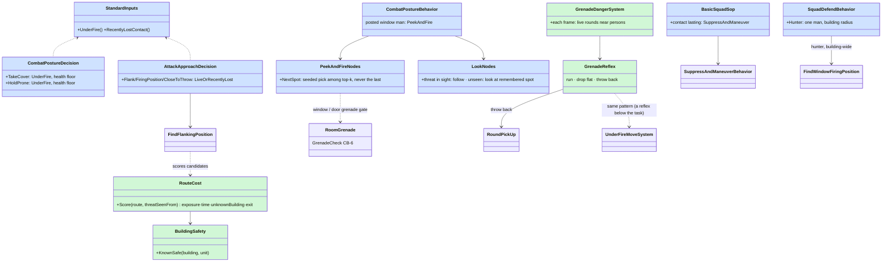
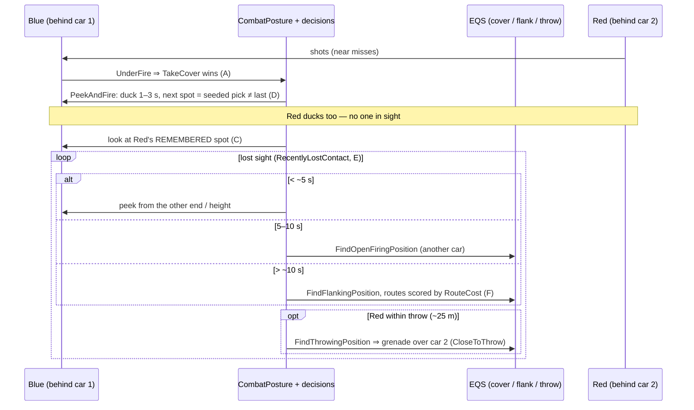
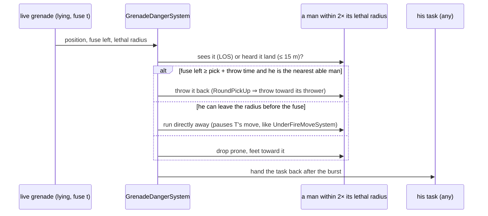
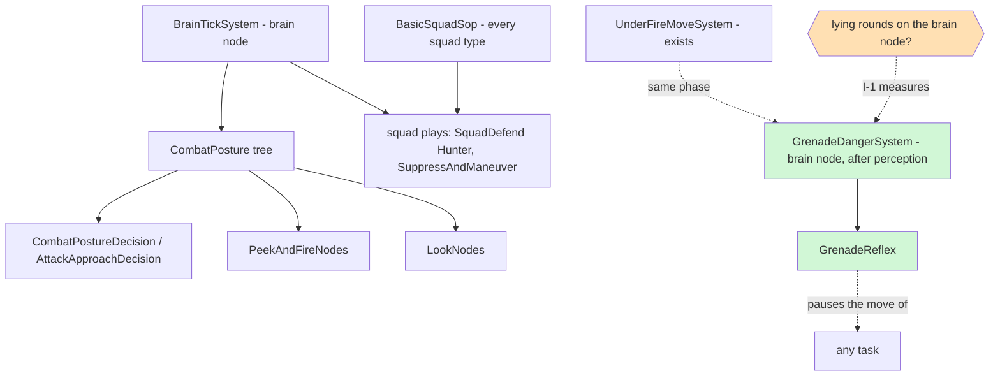

<!--STATUS
state: LIVE — ✅ APPROVED 2026-10-23 on the chat summary (user: "Okay, write the scenario first, then implement it") — A…J as leaned below
updated: 2026-10-23
build-state: READY-TO-BUILD — order §6: the scenarios FIRST (baseline, measured red), then A…I
current-answer: §0 the idea · §3 the diagrams · §4 the sub-questions with their approved leans · §5 the scenarios · §6 the order
stale-below: nothing
known-rot: none yet
known-conflict: docs/designs/group-maneuvers/DESIGN_Defend_And_Attack_Position.md §8c D-2b accepts the dead ground under the upper windows — H here answers it for ONE man (the hunter); the rest of D-2 stands
related-designs:
  - docs/blueprints/Architect_Question_103_Idle_Life.md — OWNS idle life: the one restlessness reflex for a STATIONARY man (no move), the one stay-still rule, and the lying man's calm crawl
  - docs/DESIGN_Peek_And_Fire.md — OWNS PeekAndFire (§8 spot heat, §10 the library node, §11 look-then-shoot, D12 "under fire = stay down", D14 "aim where remembered"); A, B, C, D reuse it
  - docs/blueprints/Architect_Question_97_Default_Reflexes_Soldiers_And_Civilians.md — OWNS the soldier's own SOP reflexes and why they stand aside under command (R-2062); this question puts the fighting reflexes BELOW that gate
  - docs/blueprints/Architect_Question_98_Cover_Reaction_Fights_Back.md — OWNS FightFromCover (R-2070, C″ CE-1269); unchanged
  - docs/blueprints/Architect_Question_96_Movement_Under_Fire.md — OWNS the under-fire move reflex (UnderFireMoveSystem, R-2061); I's grenade reflex follows its pattern
  - docs/designs/group-maneuvers/DESIGN_Defend_And_Attack_Position.md — OWNS SquadDefend posts (DA-40…DA-45 the 4 m bound, DA-38 Displace); H widens the bound for one hunter
  - docs/designs/group-maneuvers/DESIGN_Squad_Tactics.md — OWNS SuppressAndManeuver (§3), FireAndMovement (§7.6), BasicSquadSop's ReactToContact; G wires them as the default squad answer
  - docs/designs/group-maneuvers/DESIGN_Building_Clearing.md — OWNS the grenade before room entry (BC-4, CB-6/CB-30, RoomGrenade.GrenadeCheck); I reuses that gate outside the drill
  - docs/DESIGN_Civilians_And_Crowd_Control.md — OWNS picking up a landed round (AW-8, B-13 RoundPickUp) and the thrown-back canister (B-14); I's throw-back reuses it
  - docs/designs/look-direction/DESIGN_Look_Direction_And_FOV.md — OWNS the look node (LD-3); C changes what an unseen threat's look points at
  - docs/DESIGN_Decision_Layer.md — OWNS the utility decisions (§3.3e G6/A1 out of sight ⇒ flank or firing position); A and E change two of its inputs
  - docs/DESIGN_Utility_AI_Demo_Scenarios.md — the demo/check conventions the five scenarios of §5 follow
-->

# Architect Question 102 — responsive fighting reflexes: duck, find him again, grenades, flank

> 🔒 **User, 2026-10-23:** *"there are cases where the soldiers don't respond in a way that is expected from amusing first-person shooter
> … They are standing in the windows … without trying to take cover when the player starts firing at them … when the player is standing in
> front of the house … close to the wall … they are not trying to find him … without leaving the house."*
>
> 🔒 *"the grenade thing should apply also for the attacker … the intuitive thing is to throw inside a grenade … playing hide and seek behind
> obstacles in otherwise open area … they prefer to stay behind the obstacle without doing much, instead of … flanking him … or at least
> switching the points … pick sites pseudo-randomly … a new testing scenario with one friend and one enemy. And also a squad against
> another squad in the same terrain."*
>
> 🔒 *"when the grenade is thrown, then everyone who see it or hear it should be taking cover … run away and lay down with heads far from the
> grenade … a special counter Reaction is to pick the grenade and throw it back … if the grenade fuse is still expected to last some time."*
>
> 🔒 *"The open ground play should work also for the outside of houses where the house plays the obstacle … whether to take this way
> [through the building] or go around … I don't know how to decide."* · *"being in a house gives the character some kind of advantage …
> On the other hand, it makes it more difficult to shoot at someone who is outside hiding close to the wall."*
>
> 🔒 *"Will this reflexive behavior become part of every soldier?"* → yes (§0) · *"Okay, write the scenario first, then implement it."*

## 0. The idea

**A soldier in a fight never just waits: he keeps working to see the enemy without being seen.** Four reflexes, built ONCE in the parts
every soldier already runs, so no scenario needs a special behaviour:

| reflex | in one line |
|---|---|
| ① **under fire → get down** | duck under the sill / behind the car / prone for 1–3 s, come up somewhere else |
| ② **lost sight → find him again** | look where he was last SEEN; change spot, peek the other side, then flank |
| ③ **grenade near me → away or flat** | run out of its radius, else drop flat facing away; throw it back when the fuse allows |
| ④ **he hides within throw → grenade** | over his cover, through his window or door — under the ROE |

| layer | home | who gets it |
|---|---|---|
| the fight (①②④) | the shared combat blocks: `CombatPostureDecision`, `PeekAndFireNodes`, `LookNodes`, the EQS templates | every soldier who fights, under command or not |
| survival (③) | a reflex system BELOW the behaviours (the `UnderFireMoveSystem` pattern, AQ96) | every person — civilians run only |
| squad tactics | the squad's default SOP and its plays | every squad with the default squad SOP |

## 1. INVENTORY *(2026-10-23 — `scripts/cbm.sh search_graph` + grep; ⚠ `check_index_coverage` is not available through the CLI, so no
negative claim below is a coverage-checked one)*

| query (label Class) | total | what it found |
|---|---|---|
| `.*(PeekAndFire\|FightFromCover\|CombatPosture\|WindowDuel).*` | 25 | `PeekAndFireNodes/Params/State`, `FightFromCoverBehavior`, `CombatPostureBehavior`, `CombatPostureDecision`, `WindowDuelBehavior`, `VehicleFightFromCover*` |
| `.*(Flank\|FiringPosition\|ThrowingPosition\|CoverFromTarget).*` | 7 | `FindFlankingPosition`, `FindOpenFiringPosition`, `FindThrowingPosition`, `FindWindowFiringPosition`, `FindCoverFromTarget`, `FiringPositionMemory` |
| `.*(UnderFire\|NearMiss\|Suppress).*` | 35 | `NearMissSensingSystem`, `EntityUnderFire` (wire), `SuppressAndManeuverBehavior/Play/Maneuver`, `SuppressBehavior`, `SuppressNodes` |
| `.*(Grenade\|Throw\|PickUp).*` | 32 | `RoomGrenade.GrenadeCheck`, `HiddenTargetThrow`, `RoundPickUp` (+ `PickUpRoundEvent`/`PickUpGrantEvent`, wire payloads), `RoundPickUpSystem`, `ThrowArc`, `Civilians.Throwables` |
| `.*(Look\|Gaze).*Node.*` | 5 | `LookNodes`, `LookNodeState`, `LookAtEntityNode`, `LookAtPointNode` |
| grep `Obstacle_` (TKB) | 4 types | the parked car 8806 (4.5×1.8×1.5 m, `car-body`), sandbags 8807, concrete block 8808, crate 8809 — `BdcTkbCatalog.cs:1106-1114` |
| grep `.*GrenadeDanger.*\|LiveGrenade\|grenade.{0,40}(flee\|evade\|prone)` | 0 | ⛔ nothing senses a grenade near a man |

## 2. How it is — the claims the leans rest on

| claim | code (how it IS) | design (how it was MEANT) |
|---|---|---|
| an UNHURT man never picks TakeCover or HoldProne | ✅ both carry `HealthFraction` on `InverseLinear` (0 at full health) in a weighted product (`CombatPostureDecision.cs:45,58`; `ResponseCurveEvaluate.cs:23`) | ⛔ Peek & Fire D12 *"under fire = stay down"*; no design asks for "only the wounded hide" |
| the posture decision has no under-fire input | ✅ `CombatPostureDecision.cs:40-66` | ⛔ searched Decision Layer §3, none |
| a squad man's own SOP reflexes stand aside | ✅ `BasicInfantrySop.btree.json:380` (`UnderCommand` first), `SopConditions.cs:105` | ✅ AQ97 A (R-2062) |
| the window-duel man ducks because peek-and-fire IS his task | ✅ `WindowDuelBehavior.cs:36`, `PeekAndFireNodes.cs:724-746` | ✅ Peek & Fire D10/P-8 (*"demo-local"*) |
| a posted man may not move > 4 m from his post | ✅ `EqsTacticsNodes.cs:41-45`, `PeekAndFireNodes.cs:901,915` | ✅ Defend & Attack DA-44/DA-45 |
| the squad moves men between PLANNED posts by distance only | ✅ `SquadDefendBehavior.cs:217-231` | ✅ DA-38; ⛔ nothing designed for regaining sight below a window |
| his eyes follow a HIDDEN threat's true position | ✅ `LookNodes.cs:96` → `LookRequest.AtEntity` → `LookAtExecutors.cs:87` follows the entity | ⛔ Peek & Fire D14: aim where REMEMBERED |
| a lone man's flank / firing-position / close-to-throw exist — but only inside Advance, and only while the contact is LIVE (~14 s) | ✅ `CombatPostureBehavior.cs:186-199`, `AttackApproachDecision.cs` (every option needs `HaveLiveTarget`) | ✅ Decision Layer §3.3e G6/A1 |
| ⇒ after the live window a hidden enemy leaves only Hold (idle) | ⚠ inferred from the two rows above — ⭐ **the baseline scenario S1 measures it first** | — |
| the next peek spot is the best-scoring one, cooled by heat — deterministic | ✅ `PeekAndFireNodes.cs:292-295` (heat rules); no random | ✅ Peek & Fire §8 B2–B4 |
| the squad's suppress-and-flank exists | ✅ `SuppressAndManeuverBehavior.cs:1-80` (who sees = base of fire; the rest flank via `FindFlankingPosition`) | ✅ Squad Tactics §3 (CE-2123) |
| a squad type may have NO default SOP | ✅ squad 302 in `pc-defend-house` (`BdcTkbCatalog.cs:901,923`) | ⛔ none says a squad may have no SOP |
| a frag grenade lies where it lands until its fuse | ✅ `BallisticsSystem.cs:93-119` (CE-1032 W-4) | ✅ Building Interiors §3k |
| a landed grenade can be picked up and thrown | ✅ `RoundPickUp`, `RoundPickUpSystem` (CE-3235); a thrown-back canister keeps its burn | ✅ Civilians AW-8 (*"a canister, a grenade"*), B-14 |
| prone protects from a burst | ✅ `bt-grenade-posture` (B4) | ✅ Building Interiors §3f |
| the grenade before room entry is built, gated by intensity | ✅ `RoomDrill.cs:55-61,218`, `RoomGrenade.GrenadeCheck` | ✅ Building Clearing CB-6, CB-30, BC-4 (CE-2260) |
| ⛔ does a LYING round exist on the BRAIN node (replicated)? | ⛔ not measured | ⛔ not searched — **I-1 measures it first** |

## 3. The design

### 3.1 Classes *(grey = exists, unchanged · blue = exists, changed · green = new)*

*What the picture shows that prose hid:* only four boxes are new; everything a reflex needs to DO (peek, flank, throw, pick up, suppress and
flank) exists — the defects are in the INPUTS that choose (A, E) and in a missing sense (I).

### 3.2 Sequence — 1v1 behind cars: lost sight escalates instead of idling (E, D, C)

*What the picture shows:* the escalation is ONE timer on the contact's last sighting feeding inputs the decisions already read — not a new
behaviour.

### 3.3 Sequence — a grenade lands (I)

### 3.4 Modules — who runs what, each frame

*Caption:* the one unmeasured edge is orange — the danger system can only run where the brain is if the lying round is there too
(replicated); if not, the round's node raises a "grenade near X" event instead (I-1 decides, before I is built).

## 4. The sub-questions — ✅ approved leans (2026-10-23)

| # | question | ✅ lean | rejected (one line each) |
|---|---|---|---|
| **A** | Why does an unhurt man never take cover? | add `UnderFire` (hit / near miss within ~3 s, `RecentSensesOf`) to TakeCover and HoldProne; health becomes a FLOOR (0.3), not a zero | a new "duck" reaction — under command it would be gated (R-2062) |
| **B** | Posted window defenders | a man posted at a window/frame fights through `PeekAndFire` (its window shape) — duck, peek, fire, switch window — whatever the decision's Suppress/Hold says; the post radius stays | lifting `UnderCommand` — pauses his post order (R-2062 ②) |
| **C** | Where an unseen threat is looked at | in sight now (visual, ≤ 0.5 s) ⇒ follow him; else ⇒ his remembered spot at the eyes of the stance he was seen in (standing 1.6 · crouched 1.0 · prone 0.3 m) | always the remembered spot — a visible man's look would lag |
| **D** | The next peek spot | a SEEDED pick among the top-k (3) spots within 85 % of the best score, never the last used; seed = unit id × spot count (repeatable per run) | true random — unrepeatable tests · best-only — learnable |
| **E** | Lost sight on open ground | `RecentlyLostContact` (a remembered hostile last seen ≤ 60 s) replaces `HaveLiveTarget` in the approach options' gate; the escalation by its age: < 5 s peek elsewhere · 5–10 s another firing position · > 10 s flank · within throw ⇒ grenade | a new "Hunt" behaviour — duplicates Advance's approaches |
| **F** | Through a building or around; a house as cover | route candidates (with and without building interiors) scored by `RouteCost` = exposure from the threat's last-seen spot + time + unknown-building risk + exposed exit; a building counts only if `KnownSafe` (empty in memory or held by his side; a Veteran may clear a small one); near ties ⇒ D's seeded pick · a house window is just a cover point in the same search (must SEE the target's spot), with a grenade-trap penalty within throw range and a one-exit penalty | "always through when there's a door" — the enemy may hold it · "never use houses" — gives up the best cover |
| **G** | Squad v squad | every squad type gets `BasicSquadSop`; its contact answer escalates to `SuppressAndManeuver` (who sees = base of fire; the rest flank on `FindFlankingPosition` scored by F's `RouteCost`) when the contact lasts > ~10 s without a kill | a new flank play — SuppressAndManeuver is it |
| **H** | A known enemy under the defended house | `SquadDefend` assigns ONE hunter (nearest free) to a remembered hostile within ~30 m of the building, unseen > 2 s; his bound widens to the building's openings (`FindWindowFiringPosition` toward the remembered spot, inside the building only); he may drop a grenade (I-④); back to his post after ~15–20 s quiet | everyone hunts — opens the sectors · nobody — the user's complaint |
| **I** | Grenades | **I-1** measure where the lying round lives · **I-2** `GrenadeDangerSystem`: a person within 2× the lethal radius who SEES the round or heard it land (≤ 15 m) · **I-3** reflex: throw back (nearest able man, fuse left ≥ pick + throw, `RoundPickUp`) › run directly away (if he leaves the radius in time) › drop prone facing away; the task resumes after · **I-4** attackers: the existing `RoomGrenade.GrenadeCheck` (CB-6 / CB-30 intensity, no friend in the radius, no non-combatant) gates a grenade through any door or window of a building an attacker assaults — inside or outside `ClearBuilding` | grenade reactions as SOP rows — gated under command · a second ROE rule for frags — CB-6 already is it |
| **J** | Skill | untrained: duck + blind fire at the last spot only · Regular: all of the above within his area, known-safe buildings only · Veteran: switches at once when shot at, other storeys, clears a small building on the way | one level for all — loses the militia/veteran contrast PC-15 built |

**Reach:** A changes a decision every `CombatPosture` user runs (attackers holding hide more under fire — measured on the attack demos);
E changes the approach gate (more flanking everywhere); the rest are additive.

## 5. The scenarios — written FIRST, run as a baseline (measured red), then green one by one

| id | ground | cast | passes when | seed |
|---|---|---|---|---|
| **S1** `rf-car-duel` | `basic-desert`, six parked cars (8806) in two loose rows ~40 m apart | 1 Blue rifleman v 1 Red rifleman, own SOP, no orders | neither idle-hidden > 12 s · ≥ 2 distinct peek spots each, never the same twice running · ≥ 1 flank or firing-position move · a grenade over cover once within 25 m | fixed |
| **S2** `rf-car-squads` | the same ground | a Blue squad v a Red squad (default squad SOP) | a base of fire holds while the rest move · ≥ 70 % of the flankers' path out of the enemy's sight · the flank ends in an assault or the enemy breaks off | fixed |
| **S3** `rf-house-obstacle` | `test-town`, a two-door house between them | 1 v 1; variant A the house empty in memory, variant B unknown | A: the flanker may go THROUGH; B: he goes AROUND | fixed |
| **S4** `rf-wall-hugger` | `test-town` CQB house, 3 window defenders (SquadDefend) | a scripted Red attacker fires at a window, then hugs the wall | defenders duck when shot at (B) · ONE moves inside to see him (H) · a grenade dropped (I-4) · no head tracking him through the wall (C) | fixed |
| **S5** `rf-grenade-reaction` | open ground | a grenade lands among 4 Blue men | all who see/hear it run or drop · one throws it back when the fuse allows | fixed |

⭐ Each gets a check in `scripts/utility-demo-check.py` and an in-process twin in the feature's own suite (`SquadManeuverTests`,
`TacticsTreesTests`, `BasicInfantrySopTests`).

## 6. Order *(each step: rails red-proved, the scenario's numbers re-measured)*

| # | what | lane |
|---|---|---|
| 1 | S1…S5 written + their checks; run ⇒ the baseline numbers recorded here (§7) | behaviors |
| 2 | A + B + C + D (the duck, the window defender, the eyes, the spot pick) | behaviors |
| 3 | E + F (lost sight escalation, route cost, house as cover) | behaviors |
| 4 | G (squad default SOP + SuppressAndManeuver escalation) | behaviors |
| 5 | H (the hunter) | behaviors |
| 6 | I-1 measure → I-2…I-4 (grenade danger, throw-back, attacker grenades) — ⚠ may need a backend replica of lying rounds | behaviors (+ backend if I-1 says so) |
| 7 | J tuned on all five; fold the as-built into Peek & Fire, Defend & Attack, Squad Tactics, Decision Layer | behaviors |

## 7. Baseline *(filled by step 1)*

*(2026-10-23, `--mode all`, at `a0d776ebd` + the load fix `36d95ffda`; the numbers each check prints)*

| scenario | measured | ⇒ the gap, by sub-question |
|---|---|---|
| **S1** `rf-car-duel` | both fight (FightFromCover); Blue idles hidden **12.3 s**, Red 8.4 s · Blue 6 bursts from 2 spots, **4 repeated**; Red 8 from 3, **5 repeated** · both move ~18 m · closest 43 m ⇒ no grenade | **D** (the same peek spot over and over — `PickPeek` takes the sensor's first answer, `PeekAndFireNodes.cs:923-944`) · **E** (never closes to throw) |
| **S2** `rf-car-squads` | **0 rounds fired, no task on any man, nobody moves** in 120 s | **G** — the squads carry no SOP (type 302 has no default) and the men stand aside under command (R-2062) ⇒ nothing at all happens |
| **S3** `rf-house-obstacle` | without prior knowledge: both Idle 120 s (the house hides them). With each other in memory (as now): FightFromCover, **both go THROUGH House A**, close to 5 m, **6 grenades** — but only 1 burst between them | **F** (through was taken with no safety test) · **D/E** (they barely fire) |
| **S4** `rf-wall-hugger` | defenders duck within 2 s of Blue's fire (3 times — `SquadDefend`'s posture already crouches/prones under fire) · Blue never reached the wall in 90 s (stalled at y 116 under fire; recast to start 15 m out) · nobody hunted, no grenade, no look through the wall | **H**, **I-4** · ⚠ **C** passes — re-check once Blue is under the wall |
| **S5** `rf-grenade-reaction` | the M67 lands 1.9 m from the group; **all four stand, exposure 1.0, nobody moves** | **I** entirely |

**After A–D (`348183766`, live):** S1 — idle-hidden 9.9 / 9.8 s (was 12.3 / 8.4), repeated spots 2 / 1 (was 4 / 5) · S4 — a defender ducks
within 2 s of the Shooter (was 0); all three defenders move to see the Hugger (H wants one); no grenade; one look sample tracked an unseen
man (⚠ C's heard-stamp caveat, or the judge's sample timing) · S3 — both fight, both go through House A, 4 grenades; Red 2 spots / 0
repeats, Blue 1 burst.

**After E–I (`810d2db60`, live, 2026-10-23):**

| scenario | measured | open |
|---|---|---|
| **S5** `rf-grenade-reaction` | ✅ **PASS** — Blue 3 picked the M67 up and threw it back (it burst at the Thrower's end, 16 m from the group); all four prone at the burst; each back to his fight ~2.5 s later | — |
| **S2** `rf-car-squads` | ✅ **PASS** — 629–670 rounds; a base of fire holds while three men a side bound (was 0 rounds) | ⚠ the movers are never out of the enemy's sight (judge (2) not enforced) — J |
| **S3** `rf-house-obstacle` | both fight the whole run (35 bursts, 8 grenades), neither idles > 9 s, both go THROUGH House A to 0.5 m | ⚠ "never the same spot twice running" fails — at a window PC-15 keeps several exposures, so the judge is partly wrong there · F (through-or-around by route cost) not built |
| **S1** `rf-car-duel` | they stay in the fight (no Idle after 3 s); longest hidden-and-still 18.8 / 26.6 s (was 12.3 / 8.4 at baseline, 27–33 after the first E) | ⛔ the escalations do not reach another car: the journal shows only PeekAndFire's hide / peek moves between two points behind the same car, closest approach 43 m — E's trigger in this geometry is not yet understood |
| **S4** `rf-wall-hugger` | ducks within 2 s ✅ · eyes never follow an unseen man ✅ · the defenders STAY in the house (0 / 3.5 / 0 m — was 50–60 m: their squad SOP's ReactToContact paused SquadDefend; fixed by the squad-level `NotDefending` guard, DA-55) | ⚠ no hunt visible to the judge (> 4.5 m from the post) · ⛔ no grenade dropped at the Hugger (I-4 not built) |
| `uc-urban-battle` | ⚠ not measurable: an intermittent whole-cluster heartbeat ejection ~36 s after load ([CE-2361](Blueprint_Issues_Tracker.md)), also at the A–D commit — when it does not stall, the ambush plays and only ⑤ fails, as at the base | CE-2361 |

## 8. As built *(the sub-questions as they landed; each row names its deviation, if any)*

| # | as built | deviation from §4 |
|---|---|---|
| **A** (CE-2356) | `StandardInputs.UnderFire` (id `0x2C71`): 1 within 1.5 s of a hit / near miss, falling to 0 at 4 s (`RecentSenses`). ⭐ **Reworked** (`782756536`): TakeCover and HoldProne read `HurtOrUnderFire` (`0x5EF1`) = max(1 − health, UnderFire) on `Linear`, weight 0.8 — out of fire EXACTLY the old `1 − health`, shot at 1 for anyone; Suppress × `1 − 0.7·u` | ⛔ SUPERSEDED: the first build (a health floor `1 − 0.5·h` × a boost `0.6 + 0.4·u`) let an UNHURT man with nobody shooting score HoldProne over Hold and AdvanceAndAttack — 📐 measured by the full Toolkits Utility run (SC-SP-03 / -04 red), which the first gate had filtered out |
| **B** (CE-2356) | `PostureNodes.AtOpeningPost` (a post with a window / set-back / roof template or a frame); `CombatPosture`'s Suppress branch runs `PeekAndFire` first for such a man | — |
| **C** (CE-2356) | `LookAt.Want`: the top threat is followed only when `InSightNow` (a Visual slot stamped ≤ 30 ticks); otherwise `LookAtPoint` at `Remembered` (memory position + the eyes of the stance he was seen in) | ⚠ a SOUND of a seen man also stamps the slot, so a seen man heard nearby still counts as in sight |
| **E** (CE-2357) | Inside `FightFromCoverBehavior.Run`: in cover, a hostile he SAW remembered but unseen for `FlankAfterSeconds` (10 s), Regular or better, no post, ≤ 3 escalations per run (`ShouldFlank` / `MayFlank`, public) ⇒ PeekAndFire released and the escalations ALTERNATE — `EqsTacticsNodes.FlankRemembered` (`FindFlankingPosition` at the REMEMBERED point, 20 m), then `CloseInRemembered` (`FindThrowingPosition` at it, firing and throwing on the way, ends on arrival), then a flank; then a fresh fight from cover there. PeekAndFire's own end (no LIVE threat, ~14 s unseen) while the enemy is still remembered starts an escalation instead of ending the fight | ⛔ SUPERSEDED, both measured live: a flank on the LIVE position, 40 m (`rf-house-obstacle`: the two chased each other round House A and swapped sides without a shot) · ending the fight on PeekAndFire's own end (`rf-car-duel`: both idled 28–33 s) | ⚠ ONE step, not three: the < 5 s "peek elsewhere" is D's seeded pick; the 5–10 s "another firing position" step is not built; `AttackApproachDecision`'s gate is unchanged (the fight from cover is where a lost enemy is handled, so the escalation lives there) |
| **G** (CE-2358) | `Unit_InfantrySquad` carries `defaultSop: "BasicSquadSop"` (TKB); the SOP gains `SopConditions.UnderCommand` after the carrier rows (090…080): a squad under a live platoon lets the platoon's play fight for it; mount / dismount / ride stay its own | 📐 the contact answer's Assault ALREADY is `SuppressAndManeuver` — only the missing SOP was the gap (S2: 0 rounds in 120 s) |
| **H** (CE-2359) | ⭐ + `SquadDefendBehavior.NotDefending` guards `BasicSquadSop`'s four contact rows (DA-55 at the squad level: a defence answers its contacts — 📐 live, ReactToContact had paused SquadDefend and sent two defenders 50–60 m out). `SquadDefendPlay.Hunt` (after Displace / Flanked): a pooled identified hostile ≤ 30 m from the position, unseen by the squad for 2 s ⇒ the posted man nearest him keeps his post but its radius widens to the squad's `SearchRadius`, window way, arc on him — his own window hide ask (must SEE the threat) picks the opening; back to his post after 20 s or when the contact is gone; once per contact | the grenade drop ("he may drop a grenade") is not part of H — it is I-4's |
| **I** (CE-2360) | `GrenadeDangerSystem` (CGF pack, before the brain tick): each live fragmenting time-fuzed round lying on this node — flown here (fuze known) or a `LightweightRound` replica that kept still 0.25 s (fuze = the warhead's less the time since it appeared; thrower = where it appeared) — and each person within 2× its lethal radius (≤ 15 m). Per round the nearest Regular+ man with room in his hands and fuze for react + reach + pick + throw + spare throws it back; every other runs to lethal + 2 m if he gets there in time, else a step away and flat. Each answer is a REACTION at `ReactionUrgency.Grenade` (5) through `SopActions.React` — `EvadeGrenade` runs it; the throw is `Stones.ThrowHeld` (the one hands throw). Live `rf-grenade-reaction` PASS | 📐 **I-1 answered:** the brain's node never flies a man's round (his body's node does) and the replica has neither fuze nor velocity — read as lying in flight until the still test · ⏳ **I-4** (the attacker's grenade through a door / window under `GrenadeCheck`) not built · ⚠ ROE `StayOnTask` still refuses the reaction (R-199's gate, unchanged) |
| **D** (CE-2356) | `PickPeek` (internal, for the draw rail): a seeded draw (`SeedOf(unit, picks)`) among ≤ 3 answers within 85 % of the best, never the last used (`LastPeek`). `Skilled`: behind open-ground cover (the default template, no post) a Regular+ man has ONE exposure per spot; windows keep PC-15 (R-2047) | the per-spot override is how "never the same twice" reaches a STANCE peek (which has no step-out point); three exposures at a single answered spot still burn it (B2–B4) and he waits to cool |

**Rails (CE-2356):** `StarterPackIntegrationTests.CE2356_AnUnhurtMan_ShotAt_TakesCover_AndSuppressesWhenItWearsOff` ·
`TacticsTreesTests.CE2356_AThreatOutOfSight_IsLookedForWhereRemembered_NotFollowed` · `TacticsTreesTests.CE2356_AtOpeningPost_IsAWindowOrFramePost_NotACoverPost` ·
`PeekAndFireNodesTests.CE2356_AStepPeek_NeverStepsOutAtTheSameSpotTwiceRunning` · `…CE2356_ThePeekDraw_NeverRepeatsTheLastSpot_OverManyPicks` ·
`…CE2356_OpenCover_OneExposurePerSpot_AWindowKeepsItsCount`. Mutants: 6 of 7 killed (the boost-only one survives, above).

**Rails (CE-2357…CE-2359):** `BasicInfantrySopTests.CE2357_TheEnemyOutOfSightTooLong_ATrainedManInCoverFlanks` (mutants 6/6) ·
`SquadManeuverTests.CE2358_BasicSquadSop_UnderALivePlatoon_ASquadContact_LeavesTheTaskToThePlatoon` + `NedTkbBuilderCombatTests.CE2262_…`
(the TKB default; mutants 2/2) · `SquadManeuverTests.CE2359_SquadDefend_AKnownEnemyNobodySees_IsHuntedByOneMan_FromAnyOpening_ThenHeGoesBack`
(mutants 4/4).

## 9. Round 2 — after the live results *(✅ approved 2026-10-24, R-2073)*

🔒 **User, `2026-10-24`:** *"maybe that not fighting and keep hiding is a perfectly valid outcome of such a duel if both sides are equal.
I think to make it finish, one of the sides would need to be handicapped somehow, like having lower skills or morale or bravery. But even if
equal, they should still be trying to peek out of their cover few times at irregular interval in the direction where they have seen the
enemy."* · on the attackers' grenades: *"there need to be some condition not to do that if the mission is to clear the houses from
terrorists but saving all the civilians"* · then: *"Leans approved"* — and for the lone pinned man *"I suggest to create a new one
specifically for that case"*.

| # | ✅ lean | tracker |
|---|---|---|
| **R2-1** | S1 between EQUALS may end in a stalemate: its judge becomes "each peeks toward the remembered spot at least every ~10 s, from alternating corners, at irregular intervals"; a handicapped variant **S1b** (one side militia, low nerve) must RESOLVE. E stays the regular's lost-contact move | [CE-2364](Blueprint_Issues_Tracker.md) |
| **R2-2** | stress is [DESIGN_Temperament_And_Stress](../DESIGN_Temperament_And_Stress.md) (R-2034, approved, unbuilt: CE-2269…CE-2272) as written, **plus a FIDGET**: stress between ~0.4 × nerve and nerve ⇒ at irregular moments a 1–2 m shift inside his cover (sometimes exposing him); at nerve, TS-6's break — to ground, no peeks — until calmed | [CE-2365](Blueprint_Issues_Tracker.md) |
| **R2-3** | the man PINNED in the open: after a seeded 6–12 s down with the fire going on, a 2–4 m crawl sideways (perpendicular to the shooter, alternating), firing from each spot; pinned 30 s with no friend within 30 m ⇒ the cover search widens 10 → 30 m. Scenario **S6** `rf-pinned-in-open` (the user's case: squad down, a gunman at a ground-floor window, both also judged on WHERE they aim) | [CE-2362](Blueprint_Issues_Tracker.md), [CE-2363](Blueprint_Issues_Tracker.md) |
| **R2-4** | an attacker's grenade: never a frag with a KNOWN civilian in its lethal radius (the hidden-target throw too); through a door / window a frag only when **HighIntensity** is ordered and no civilian is known inside (`GrenadeCheck.Choose`), else a stun if carried, else none; no intensity ordered = **Precision** ⇒ a "save the civilians" mission throws stuns only | [CE-2360](Blueprint_Issues_Tracker.md) I-4 |
| **R2-5** | `WindowDuel` retires into the standard behaviours later: its scenario authors a window post under the ordinary `CombatPosture` (B already flies a posted window man through PeekAndFire with WindowDuel's shape) | [CE-2366](Blueprint_Issues_Tracker.md) |

⭐ **Order:** R2-3 (S6 first, as a measured baseline) → R2-4 → R2-2 → R2-1 (S1 judge + S1b) → R2-5.

### 9.1 R2-3 as built, and what S6 measured *(2026-10-24)*

| | measured / built | where |
|---|---|---|
| ✅ the scoot | pinned off a move, under steady fire, no cover within 10 m: a seeded 6–12 s down, then a 2–4 m crawl square to the shooter, sides alternating; pinned 30 s with no living friend within 30 m ⇒ a crawl to cover out to 30 m | [AQ96](Architect_Question_96_Movement_Under_Fire.md) §6 · CE-2363 |
| ✅ found by S6, fixed | the three AUTHORED-DEAD squad mates fired ~200 rounds at the window from where they lay: capabilities were stripped only on a killing HIT | CE-2367 (`HealthApplicationSystem.StopTheDown`) |
| ✅ the aim is honest | a crouched man behind the 0.9 m sill shows ~0.92–1.10 m; the aim is that band's middle and the ~0.15 m spread at 50 m puts about half the rounds into the sill. At the man UP in the opening Pinned aimed over the sill (median 0.95 m). His rounds into the wall under the window were BLIND rounds at the Gunman lying prone behind it (CE-2326's remembered body) — the brick stops them | S6 run 5 |
| ⚠ S6's own errors, fixed | the post stood on the window's left jamb (the opening is x 120.5–121.65, sill 0.9 m, lintel ~2.15 m — measured by sight scans), so the "peek" saw wall and the "hide" stood in the opening; Pinned started 10 m from the wreck, so fight-from-cover (60 m search) ran him behind it out of sight | `scripts/gen-rf-scenarios.py` |
| ⛔ still red: nobody keeps him under fire | the posted window man fires ~12 rounds in 120 s — prone under the sill at his hide most of the time, once 6 m back into the house — so every drop LAPSES in 3 s and he rises; the scoot never has a steady fire to answer. ⇒ the user's *"kept firing all the time"* is the window man's peek CADENCE: R2-1 / R2-2's ground, not R2-3's | S6 run 5 timeline |
| ⚠ not covered by the scoot | a man lying in the open by his OWN choice — `HoldProne`, TakeCover's `DownInTheOpen` (CE-2322) — holds no move to scoot with; he still lies still | CE-2363 note |
