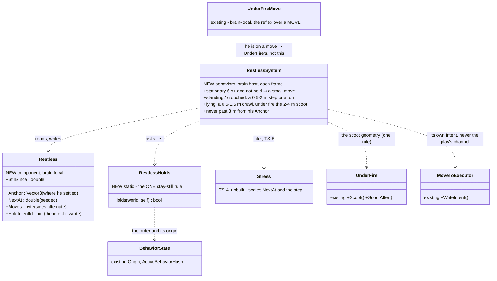
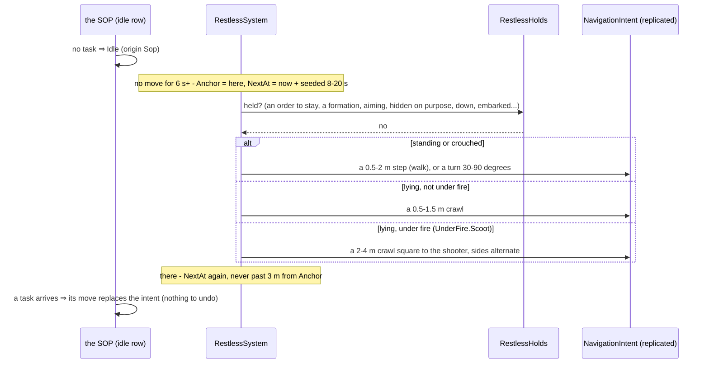
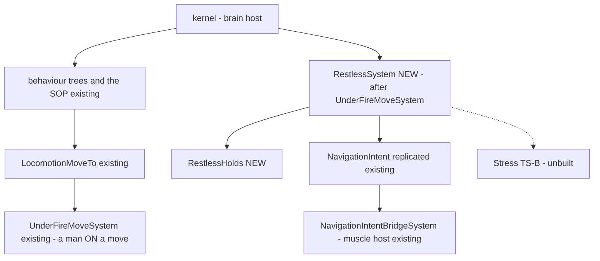

<!--STATUS
state: LIVE
updated: 2026-10-24
build-state: BUILDING — steps 1, 2 and 3b BUILT 2026-10-24 (§7); 3 (in cover), 3c (the nervous head, with TS-B) and 4 (the demo) to come
current-answer: §7 as built · §6 the answers (approved, R-2074) · §4 the sub-questions A–I · §3 the design
stale-below: nothing
related-designs:
  - docs/DESIGN_People_Display.md — OWNS how the four idle gesture kinds (row I) are DRAWN (§7d U19, CE-1308)
  - docs/blueprints/Architect_Question_102_Responsive_Fighting_Reflexes.md — OWNS R2-2 (the stress fidget, CE-2365) and R2-3 (the pinned scoot, CE-2363); this question folds the fidget into one restlessness reflex
  - docs/blueprints/Architect_Question_96_Movement_Under_Fire.md — OWNS the reflex over a play's MOVE (UnderFireMoveSystem); this one is its sibling for a man NOT on a move
  - docs/DESIGN_Temperament_And_Stress.md — OWNS Stress (TS-4, unbuilt) that scales how restless he is; the break (TS-6) holds him still
  - docs/DESIGN_Decision_Layer.md — OWNS the SOP's idle choice (§4, R-198/R-199) that today starts `Idle`
  - docs/designs/look-direction/DESIGN_Look_Direction_And_FOV.md — OWNS the eyes' scan (LD-3, R-2048); this one moves the BODY, never the eyes
  - docs/DESIGN_Civilians_And_Crowd_Control.md — OWNS the civilians' wander and the protest mill ("a frozen crowd reads as a picture") — the precedent
-->

# Architect Question 103 — Idle life: nobody able stands or lies perfectly still

🔒 **User, `2026-10-24`, verbatim:** *"The lying man, unless he is dead or very badly wounded and still can move, then he should move and
not laying still all the time. And that might be not just under fire. Any entity which is just standing doing nothing is feeling weird,
suspicious, not realistic. If nothing else, it should move a little bit here and there, even if idling. This is, of course, not the case
when a soldier is part of a formation or has been given some orders to stay in place. This should be just the default if no such orders
exist."* · earlier (`.dev/_DONE/brain-death/design-talk.md:148`): *"we can assign an entity-specific 'Idle' behavior … which must be
overwritten by each newly triggered task"*.

## 1. INVENTORY *(2026-10-24 — `scripts/cbm.sh search_graph` name_pattern `.*(Idle|Fidget|Mill|Loiter|Wander|LookAround|Shuffle).*`, Method: 91 total, Class: 1; grep; a design-corpus sweep of `docs/` then `.dev/`. ⚠ `check_index_coverage` is not available through the CLI)*

| exists | what it does | verdict |
|---|---|---|
| `CuratedMachines.BuildIdleMachine` (`Idle`) | one state, no transitions — **does nothing** | the stillness the user objects to; ⭐ stays as the ORDERED hold |
| `SopActions.DoWhenIdle` → `BasicInfantrySop` row `c2080…0040` | starts `Idle` with origin **Sop** when he has no task | ⭐ the seam: "no order" is detectable (origin Sop), an ordered hold is Superior/Operator |
| `UnderFire.Step` (AQ96, CE-2363) | keeps a man dropped off a play's MOVE honest: drop, rise, crawl, scoot | the sibling; covers nobody who is not on a move |
| `CivilianBehavior` wander (12 m about home) · protest mill (3 m every 8–15 s) | civilians already move when idle | ⭐ the precedent; its numbers are the starting point |
| `CgfNodes.Action_Wander` / `EqsCombatNodes.Action_Wander` | a demo: random points round the WORLD ORIGIN, 20 m arrival | ⛔ not idle life |
| LD-3 scan (R-2048, CE-2297) | the EYES sweep ±30°/±60° under `CombatPosture` / `PersonHold` | ⭐ kept — this question moves the body only |
| `LocomotionMoveTo.Stop` | clears a MoveTo on the play's CHANNEL only | ⭐ measured: a reflex's own intent (as UnderFire writes) survives a play that calls Stop every tick (`HoldProne`) |

## 2. How it is — the claims the leans rest on

| claim | code — how it IS | design — how it was MEANT |
|---|---|---|
| a soldier with no order runs `Idle`, which does nothing | ✅ `BasicInfantrySop.btree.json:361`, `CuratedMachines.cs:35` | ✅ R-198/R-199 (the SOP's idle choice); ⚠ R-2062: the user called idle *"likely a brain death … weird"* |
| "no order" ≠ "ordered to hold" is readable | ✅ `SopActions.DoWhenIdle` publishes `BehaviorOrigin.Sop`; a hold is `Idle`/`PersonHold` from Superior/Operator (R-188) | ✅ R-188, R-2055 |
| a man lying by his own choice never moves | ✅ `PostureNodes.HoldProne` (Stop + Prone each tick), `EqsTacticsNodes.Run` `DownInTheOpen` | ✅ AQ102 §9.1 records the gap |
| stillness is sometimes the POINT | — | ✅ Peek & Fire D12/B8 (hidden while reloading), DA-96 (ambush holds till the charge), BM-1 / DA-93 (bomber, trigger man), `HoldStun`, CE-2367 (dead/incapacitated) |
| CE-170 *"no orders ⇒ static until destroyed"* | — | ⚠ said of TANKS in a test scenario (`2026-09-04`) — ⇒ §4 F |

## 3. The design

### 3.1 Classes *(grey = exists · green = new)*

*What the picture shows that prose hid: no play changes. The reflex never touches the play's channel — it writes its own move intent, as
AQ96's reflex does — so `HoldProne` calling `Stop` every tick cannot cancel it, and the next real move simply replaces it. And ONE
`RestlessHolds` is the only place that knows every reason to stay still.*

### 3.2 Sequence — a soldier with nothing to do

### 3.3 Modules — who runs it each frame

*What the picture shows that prose hid: it runs where the brain runs (CgfLogicPack, beside `UnderFireMoveSystem`) and writes only the
intent the brain already replicates — no new wire. The dashed edge is the stress model: until TS-B lands the intervals are fixed.*

## 4. The sub-questions — each with the lean

| # | question | ⭐ lean | rejected (one line each) |
|---|---|---|---|
| **A** | where it lives | **one reflex system over every stationary able person** (`RestlessSystem`, brain host, after `UnderFireMoveSystem`), writing its own move intent | a new `IdleLife` behaviour for the SOP's idle row — covers only the no-task man; a man lying in `HoldProne` or hiding in cover stays frozen · a fidget step in each play — a dozen plays, and the next one forgets |
| **B** | what counts as "held still" — **one `RestlessHolds.Holds`** | held when: ① dead / incapacitated / stunned / embarked / carried / carrying · ② an ORDER to stay: `Idle` or `PersonHold` from a Superior/Operator, `CombatPosture` `stay` or a `post` (squad defence posts, the Hold/Watch man) · ③ in a moving formation or on any move (UnderFire's) · ④ the weapon busy — aiming, firing or reloading in the last 3 s · ⑤ hidden on purpose — an ambush cell, the trigger man, the bomber, a sentry (their behaviours, by name, in one list) · ⑥ possessed by an operator. ⭐ **Default: not held.** | per-behaviour opt-IN — the user asked for the default the other way round |
| **C** | what he does | **standing / crouched**: every seeded 8–20 s a 0.5–2 m step (walk, his own stance) or a 30–90° turn of the body · **lying, calm**: every 10–25 s a 0.5–1.5 m crawl · **lying, under fire**: R2-3's scoot (6–12 s, 2–4 m square to the shooter, alternating — `UnderFire.Scoot`, one rule) · **in cover**: the step stays behind it (the nearest cover point within 1.5 m, else no step) — ⭐ R2-2's stressed fidget is this same step, larger and sooner once TS-B gives Stress · never past **3 m from where he settled** | a free wander — he drifts away from his post and his squad · a turn only — reads as a turret |
| **D** | lying — when may he lie at all | ⭐ unchanged: the drop, `HoldProne`, `DownInTheOpen`, the break; only his stillness changes. "Very badly wounded" = incapacitated (CE-2155) ⇒ held (B①); wounded but able ⇒ he moves, slower (`Injury.SpeedFactor`) | — |
| **E** | who has it | **every person** — soldiers, police, insurgents, **civilians** (a civilian with nothing to do shuffles too; their own wander/mill already moves them, so the reflex never fires there) | combatants only — the user said *"any entity"* |
| **F** | vehicles, and CE-170 | **vehicles are out**: a parked vehicle stands still, as CE-170 asked of its tanks. ⭐ CE-170 is reconciled as *"vehicles with no orders stay static"*; for PEOPLE it is superseded by this question | creep a parked vehicle — no real driver does |
| **H** | ⭐ *(added by the user)* a NERVOUS man's head | **the eyes' scan (LD-3) quickens and jerks with stress**: dwell per scan point from 2 s down to ~0.4 s and a snap turn between points, scaled by `Stress` (TS-B) between 0.4 × nerve and nerve — the same band as the fidget. People only. ⚠ needs TS-B (`CE-2270`) for its stress: built with R2-2 (`CE-2365`) | a head jerk from near misses alone — the stress model is what "nervous" means here, and it is approved |
| **I** | ⭐ *(added by the user)* a RELAXED man's idle animation, for the IG | **new `GestureKind`s, the gesture channel the IG already reads** (`Gesture` → `dtGesture` / `EntityGesture`): `Smoking`, `ShiftWeight`, `Stretch`, `LookAbout`. `RestlessSystem` picks one (seeded, per man) when he is idle AND calm (no threat known, no stress) and his gesture is `None`; cleared the moment anything else needs him (a task, a threat, a gesture his behaviour sets — those always win). Soldiers idle or on a boring job (a calm patrol halt, a sentry with nothing seen), and civilians alike. ⚠ the IG side — mapping each kind to an animation — is the ui lane's: a handoff | a separate "idle mood" component — a second channel to the IG beside the one it reads · animation chosen by the IG on its own — the IG cannot know he is calm |
| **G** | the cost on the wire | ⭐ none new: one `NavigationIntent` write per small move (the brain already replicates it) — about one per man per 8–20 s | — |

**Blast radius:** every scenario with people standing about — they now shift. ⭐ Accepted by the user (`2026-10-24`: *"changes in the
behavior of existing scenarios are accepted"*). Rails that assert a man stands EXACTLY on a point while idle are expected to move to a
3 m tolerance or set a hold. **What would change the lean:** a perception rule that makes movement easier to SPOT — then B⑤ grows (a man
hiding would not fidget at all). Today none exists (the corpus sweep found no such rule).

## 5. Sequencing *(if approved)*

| step | what | rails |
|---|---|---|
| 1 | `Restless` component (behaviors' id block) + `RestlessHolds` + `RestlessSystem`, standing / crouched | an idle soldier steps within 3 m every 8–20 s and never past 3 m · each hold ① – ⑥ keeps him still · a task's move replaces the intent |
| 2 | lying: the calm crawl; `HoldProne` and `DownInTheOpen` under fire take R2-3's scoot (moves `UnderFire.Scoot` to the shared rule) | a man in `HoldProne` under steady fire scoots; calm he crawls; incapacitated he does not |
| 3 | in cover: the step stays behind it; R2-2's stressed fidget once TS-B lands (`CE-2365`) | the step never leaves cover |
| 3b | ⭐ I — the idle gestures (`Smoking`, `ShiftWeight`, `Stretch`, `LookAbout`) written by `RestlessSystem` when idle and calm; ⭐ a handoff to ui for their animations | a calm idle man gets one, held 20–60 s; a threat or a task clears it at once; a behaviour's own gesture is never overwritten |
| 3c | ⭐ H — the nervous head, with TS-B and R2-2 (`CE-2365`) | the scan's dwell shrinks with stress |
| 4 | a demo: `il-idle-life` (a squad with no orders, a civilian, a sentry, a held man, an incapacitated man) + its HTTP check | who moved, how far from his anchor, who held |

## 6. Answers

🔒 **User, `2026-10-24`, verbatim:** *"This fidget under stress should not apply to vehicles. This is just something for the human. When a
man is nervous, he will probably look around with his head, Using some jerky fast head movements, maybe. Approved. Also, soldiers who are
actually really idle or waiting in some boring job like patrolling or just feeling relaxed, they might need some animations expressing that
state. Some of them could be smoking a cigarette, some of them just moving their bodies, stepping from one leg to the other. This might need
some flag that the IG can run an animation in such a case that will give a feel of realism. And that of course applies to civilians as
well, not just soldiers."* — and earlier the same day: *"Changing saved snapshot is not an issue, we can regenerate. Also, changes In the
behavior of existing scenarios are accepted"* · *"The order of execution, this task is your choice. Eventually we need to have all of them
done."*

⇒ ✅ **APPROVED — A–G as leaned (R-2074)**, the stress fidget for people only (F already left vehicles out), and two rows ADDED by the user:
**H** (a nervous man's quick, jerky head) and **I** (a relaxed man's idle animation through a flag the IG plays — civilians too).

## 7. As built *(2026-10-24, behaviors — steps 1, 2 and 3b)*

As §3, with these differences (each measured during the build):

| deviation | why |
|---|---|
| ① `Restless` lives in FDP Toolkits (`Behavior/Components`, id **420**, behaviors' block, measured free on backend / ui / coordinator) | beside `UnderFireMove`, registered with it (`CognitiveComponentRegistry`) |
| ② a person = an entity with a `StanceIntent` AND a `BehaviorState` (a brain, not a bare body) | vehicles carry no stance ⇒ F holds by construction |
| ③ `RestlessHolds` reads a posture's `stay` / `post` from the running task's start record (`BehaviorStartRecord.JsonParams`) | no component carries them; the JSON is read only when a shift is due (every 8–20 s), never per frame |
| ④ `FightFromCover` is held (`FightingFromCover`) until step 3 | its peeks and hides already move him; the in-cover shift is step 3 |
| ⑤ the weapon-up hold yields for a man lying UNDER FIRE | R2-3: the pinned man scoots firing (`Holds(calm: false)`) |
| ⑥ a `Sentry` is an ORDER TO STAY (no shift; B②), not a hidden man — so, bored, he may show an idle gesture | 🔒 the user named *"waiting in some boring job like patrolling"*; ⛔ first cut held him as hidden-on-purpose, which barred the gesture too |
| ⑦ idle gestures (I): four `GestureKind`s 7–10 on the existing gesture channel; written only when his gesture is None or idle; calm = not prone, no round near him for 30 s, no enemy SEEN for 10 s (`CoverFightConditions.SeenWithin`), held by nothing but an order to stay; judged at most once a second | the one channel the IG already reads (`dtGesture`); a behaviour's act always wins |
| ⑧ cross-lane (ui's files, said): `EntityBodyLayer3D.Gestured` draws an idle kind as the plain figure; `EffectStateGizmo.GestureWord` gives it no label | ⛔ cast through, an idle kind fell to the figure's default and drew the THROW's wind-up, and the gizmo read "PROTEST". The drawing itself is ui's: [handoff](batches/HANDOFF_Behaviors_To_Ui_Idle_Gestures.md) |

Rails (`TacticsTreesTests`, red-proved by mutants): `CE2368_AnIdleSoldier_StepsALittle_NowAndThen_AndNeverStraysPast3m` ·
`CE2368_TheStayStillRule_EachHoldKeepsHimStill_TheDefaultDoesNot` (7 rows) · `CE2368_LyingHeCrawls_UnderFireHeScootsSquareToTheShooter` ·
`CE2368_ARelaxedIdleMan_ShowsAnIdleGesture_AThreatClearsIt_AnActIsNeverTouched` · `CE2368_MovedByAnythingElse_HeSettlesAnew`.

| live, 2026-10-24 | measured |
|---|---|
| ✅ `il-idle-life` PASS | Idler 1–4: 5–8 shifts each in 90 s, furthest 1.6–3.0 m from where they settled; the Watchman (posted, told to stay), Held and Down: 0 m; idle gestures on 7 of 7 relaxed men (smoking, shifting weight, a stretch) — the Watchman and the waiting civilian included; Down none |
| ⚠ found by the live runs, not the rails | ① a CIVILIAN beside armed soldiers was never "calm" — to a neutral they read as hostiles seen; ⇒ a civilian is calm by his own fear (`CivilianMind.FearOf` < 0.2). ② the library `Sentry` tree ("a dangerous contact within range, then wait 15 s") ENDS at once with no threat — a man ordered it is back on his idle choice; a watchman is a posted `CombatPosture` (advance onto his spot, `Stay`, a `Post`) — and any order to stay counts as waiting for the gesture. ③ the in-process scenario suite: `bc-house-clear` now takes 4 m (was 2.5 m — CE-2363's scoot), `CE2240` 3 m 18 s — slow, not hung; `CE3094` is red at its base too (`CE-2156`) |
