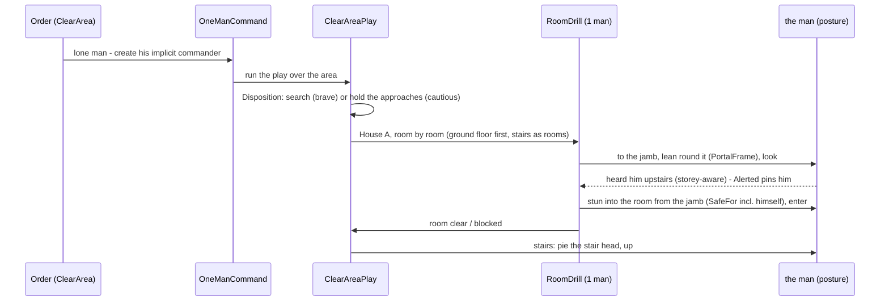
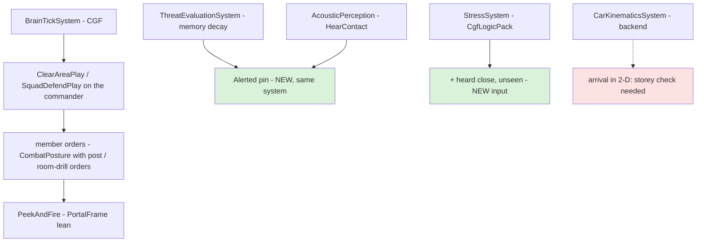

<!--STATUS
state: LIVE — leans written 2026-10-25, AWAITING THE USER
updated: 2026-10-25
build-state: DESIGN
current-answer: §4 the sub-questions with their leans · §3 the diagrams · §2 the claims they rest on · §5 the order
stale-below: nothing
known-rot: none yet
known-conflict: none
related-designs:
  - docs/DESIGN_Peek_And_Fire.md — OWNS the one peek cycle (§12, R-2077/R-2078) and its §12.7 measurement: the attacker inside, both one floor apart for 160 s — the case that opened this question
  - docs/designs/group-maneuvers/DESIGN_Building_Clearing.md — OWNS the squad's room drill (BC-1…BC-5, CB-1…CB-74: stack, pie, GrenadeCheck from the jamb); this question reuses it for ONE man and for an AREA
  - docs/designs/group-maneuvers/DESIGN_Defend_And_Attack_Position.md — OWNS SquadDefend's posts (D-2a…D-2l), the frame lean (R-2059), the reserve at the lowest stair (DA-72…DA-76)
  - docs/designs/group-maneuvers/DESIGN_Platoon_Attack_Defend_Clear.md — OWNS "attack and defend take an AREA, a building is its one-position case" (§5a, R-2060) and E-3b counter-clear
  - docs/DESIGN_Building_Interiors.md — OWNS stairs, slabs, doors, sight and penetration through floors (B1, §3c, §3h, §3j)
  - docs/DESIGN_World_Survey_Sensor.md — OWNS BuildingLayout (rooms, portals incl. stairs, LevelAt) the brain reads instead of geometry (R-2037)
  - docs/DESIGN_Temperament_And_Stress.md — OWNS the traits and Stress (TS-1…TS-6); D and F here add an input and a reader
  - docs/DESIGN_Thermal_And_Acoustic_Sensing.md — OWNS footsteps and heard contacts (R-205, R-207); E here asks for storey-aware matching
  - docs/blueprints/Architect_Question_95_Sound_Signatures_And_Lossless_Hearing.md — OWNS the Band (B3) and the deferred loss through walls (WQ-E Q3, backend)
  - docs/blueprints/Architect_Question_102_Responsive_Fighting_Reflexes.md — OWNS the hunter (H), grenade rules (I, R2-4), lost-sight escalation (E) and the unbuilt KnownSafe building (F)
  - docs/blueprints/Architect_Question_89_Suppress_And_Close.md — OWNS Willingness (the closing gate) that C reuses
-->

# Architect Question 104 — Defend an area, clear an area: the fight inside buildings

🔒 **User, `2026-10-25`, verbatim:** *"in-building combat is a tough discipline, the combatants need to be cautios (keep hidden longer rather
then chasing enemy)/brave (actively searching for an enemy - this is the house clearing) according to their settings/skills, leaning around
corners, using their hearing senses (so they don;t forget about the enemy if not seen for a while), using grenades when appropriate (into
room, behing the corner but in a way to avoid killim the thrower etc) needs proper design as you say"* · *"they should stay alerted until the
enemy is incapacitated, also stress level might go high if enemy is walking around like behind a wall"* · *"the house is not the only place,
i would like we could have also behaviors for "defend given area" and "attack /clear given area" - wider than just a house, maybe the house
is already not an axepction and the behaviors are gereal, that would be great"* · *"for the defend area there might need to be somu guarding
behavior so that the guy does not stay on place but actively makes sure there is no enemy in sight (should the center of the area be
obstructed by obstacles or something) - defendenrs always need to have a good overview of the surroundings"* · *"in case there is a squad or higher level unit this guarding can
be covered by different member so in such a case the goys need to guard clevely not just randomly changing their observation posts"* · *"ad C: if frightened too much/panicking he should also try to flee
G: leaning is driven by skill level (trained guy lean weapon first, civilian/militia combatants exposes more etc.) if not alone, the hearing of
sounds made by squad members should be filtered out, not counted as alterting enemy sounds"*.

📐 **The measured case** ([Peek and Fire §12.7](../DESIGN_Peek_And_Fire.md)): a lone attacker ordered to attack a lone defender in House A
flanks round, enters by the back, and stops on the ground floor under the defender's last-seen spot; the defender upstairs has no window
that sees an enemy inside his own house. Neither fires for 160 s.

## 1. INVENTORY *(2026-10-25 — `scripts/cbm.sh search_graph` `.*(Room|Building|Clear|Stair|Storey|Level).*` Class 70 · `.*Corner.*` Method 32 · `.*(Search|Hunt|Sweep).*` Method; grep; three read-only sweeps of `docs/` then `.dev/`. ⚠ `check_index_coverage` is not available through the CLI — absences are best-effort)*

| exists | where | for one man? |
|---|---|---|
| the room drill: `RoomDrill`, `RoomEntryPlan` (stack, threshold, entry points, sectors; **1–2 entry men** when few), pie steps, grenade from the jamb (`ThrowClears`, `GrenadeCheck.SafeFor` — walls counted) | `Brains/RoomDrill.cs:85`, `RoomEntryPlan.cs:78/177`, `RoomGrenade.cs:72/158` | ⚠ geometry yes; run only by the squad plays `ClearRoomPlay` / `ClearBuildingPlay` (`RoomOrder`: ground floor first, nearest room next) |
| `SquadDefendPlay`: window / roof / cover posts, frames, alternates, the hunter (AQ102 H); the platoon's reserve to the lowest stair (DA-74) | `SquadDefendBehavior.cs`, `PlatoonDefendBehavior.cs:589` | ⛔ squads only — a lone man's DefendArea is `CombatPosture` at the centre, no posts (`DefendAreaMapper`, `CE-2369`) |
| `BuildingLayout`: levels, `LevelAt(z)`, `RoomAt`, portals Door / Window / Gap / **Stair** | `Tk/Terrain/BuildingLayout.cs:34/80/88` | ✅ any brain, through the survey sensor (R-2037) |
| the lean (0.4 m shear: eye, body points, hit boxes) — set ONLY by the window-frame post and the operator | `Tk/Combat/Lean.cs`, `PeekAndFireNodes.cs:874`, `PostureNodes.HoldWatch` | ⚠ no corner / doorway lean |
| `CoverKind` {Cover, WindowFiring} — no Corner, no doorway, no stair-head point | `Tk/Spatial/Eqs/CoverPoint.cs:43` | ⛔ |
| grenades: `ThrowArc` (direct arcs only — no bounce), `HiddenTargetThrow` (stun into buildings; `FriendlyInBurst` = distance only, no walls), `GrenadeDangerSystem` (throw back / run / drop) | `Tk/Combat/ThrowArc.cs`, `HiddenTargetThrow.cs:158`, `GrenadeReflex.cs` | ✅ individual |
| search: `FightFromCover` flank / close-in on the remembered spot (CE-2357, Regular+, no post); the attack's hunt (`AdvanceAndAttack` → `LastKnown`) | `FightFromCoverBehavior.cs:110-200`, `PostureNodes.cs:281` | ✅ individual — ⛔ none knows rooms or storeys |
| temperament `Willingness` (AQ89, ≥ 0.6 closes) · Stress (TS-4 inputs) · proficiency tiers | `CombatTemperament.cs:147`, `StressSystem.cs`, `CombatProficiency.cs:57` | ✅ per man |
| footsteps: range 25 m × speed / 5 m/s (walking ≈ 7.5 m), silent < 0.5 m/s; no door or voice sounds | `SoundEmissionSystem.cs:20,75`, `AcousticEmitter.cs:45` | ✅ — ⛔ no wall / floor loss (`AcousticPerception.cs:209`; the Band "read by nothing yet") |

## 2. How it is — the claims the leans rest on

| claim | code — how it IS | design — how it was MEANT |
|---|---|---|
| a remembered enemy is forgotten ~69 s after the last sighting (live ~14 s) | ✅ ×(1−0.1·dt) decay, forget < 0.5 untracked — `ThreatEvaluationSystem.cs:97,179` | ✅ `DESIGN_Sensors_And_Doctrine.md:325` — ⛔ no in-building or "alerted" exception anywhere (searched docs/, .dev/) |
| the attack's hunt follows the target only while LIVE (~14 s) | ✅ `HiddenTargetThrow.LastKnown` requires live — `HiddenTargetThrow.cs:149` | ⛔ searched, no design for a longer hunt |
| the hunt keeps the target's height, but a person ARRIVES in 2-D | ✅ Z kept to the mover (`PostureNodes.cs:298`, `NavigationDestination.cs:27`); arrival `Vector2.Distance ≤ 5 m` — `CarKinematicsSystem.cs:752`, ArrivalRadius 5 (`CombatPostureBehavior.cs:65`) | ⛔ searched, none: the mover was never designed for storeys (backend's file) |
| a heard contact matches floors in 2-D | ✅ `HearContact` / absorb in XY — `PerceptionComponents.cs:333,352,390` | ⚠ `DESIGN_Thermal_And_Acoustic_Sensing.md` §8 is silent on storeys |
| sound passes walls and floors unattenuated | ✅ `AcousticPerception.cs:209-213` | ✅ deferred by design: WQ-E Q3 (`DESIGN_World_Query_Seam.md`), AQ95 B3 |
| sight passes a stairwell, not slabs | ✅ `TerrainWorld.cs:410-455` | ✅ Building Interiors §3c/§3h |
| one man can run a room drill's geometry | ✅ `RoomEntryPlan.cs:177` (`Entry = min(2, inFight)`) | ⚠ Building Clearing CB-51 assumes a stack of 2+; one man never designed |
| attack / defend are AREA tasks | ⚠ squad/platoon plays take an area; a lone man's DefendArea does not post, his Attack takes one entity | ✅ R-2060 (Platoon §5a): *"a building is its one-position case"* |

## 3. The design

### 3.1 Classes *(grey = exists · blue = changed · green = new)*

*What the picture shows that prose hid: nothing new runs a man — the two area plays already exist for squads; a lone man reaches them through
one implicit commander, and every in-building skill (lean, posts, alerted, stress) is a small piece the plays and the peek cycle read.*

### 3.2 Sequence — a lone attacker clears an area holding House A

### 3.3 Modules — who runs it each frame

*Red: the one piece in backend's code — the person mover's 2-D arrival. Everything else is behaviors-side.*

## 4. The sub-questions — each with the lean

| # | question | ⭐ lean | rejected (one line each) |
|---|---|---|---|
| **A** | how does a LONE man get the area behaviours? | **an implicit one-man commander** (`OneManCommand`, created by the mapper for a lone man's DefendArea / ClearArea, invisible in the editor's hierarchy) — the squad plays run unchanged with a roster of one; `bt-window-duel`'s hand-made one-man squad becomes this | per-man copies of posting and clearing — two implementations of one concept (ruling 9) · the man as his own commander — his task IS the play, an order to himself would replace it |
| **B** | what are the two behaviours? | **DefendArea** = `SquadDefendPlay` over an area (it already posts windows, roof and cover over an area) · **ClearArea** (= "attack an area") = NEW `ClearAreaPlay`: the area's buildings in `RoomOrder` by `ClearBuildingPlay`, open ground by bounds, ends when no live enemy is known in the area. A house is the one-building case (R-2060) | a house-only behaviour — the user: *"the house is not an exception"* |
| **C** | cautious or brave? | **one disposition** from what exists: `Willingness` (AQ89: risk acceptance, nerve, obedience × the order's `assault`) × proficiency. **Hold** (< 0.6): stay hidden, cover the approaches and stair heads, wait for him to come — searching only after a long quiet (Veteran+). **Search** (≥ 0.6): clear actively. Stress above the nervous band pushes toward hold ⭐ **Panic ⇒ flee:** at the break (TS-6: stress at his breaking point) a man of low Resolve FLEES — out of the building / area by the exit away from the enemy he knows (the TS-6 Flee arm, designed; the built break runs to cover and goes prone) — a higher Resolve goes to ground or surrenders as built | a new trait — the four traits already say it · a fixed per-behaviour setting — the user wants *"according to their settings/skills"* |
| **D** | stay alerted until the enemy is down | an **`Alerted`** mark on a man whose task is a DefendArea / ClearArea and who knows an enemy INSIDE the area: his memory slot for that enemy never drops below "remembered" (no forget), and the hunt reads a pinned slot as live; it ends when the enemy is incapacitated (Injury), the area is clear, or after 10 min with no new evidence. This is `CE-2104`'s "alerted" idea, scoped | never forgetting anyone — a battle would fill the 16 slots with ghosts |
| **E** | hearing indoors | ① **storey-aware matching** of heard contacts (`LevelAt(z)` must agree inside a building) — a sound upstairs no longer merges with a man downstairs; ② footsteps through walls / floors **halved per wall or slab crossed** as a v1 of WQ-E Q3 — ⚠ backend's seam: ask them, or build behind their interface; ③ **door sounds** (open / close / breach as a Movement emission) — backend ④ ✅ **his own side is already silent to him**: `AcousticPerception.cs:167` skips a sound whose force is his (*"not his own side's"*) — squad mates' steps and shots never become alerting contacts; a neutral's still do (an unknown sound) | full acoustic propagation — designed (WQ-E), not v1 |
| **F** | stress from an enemy heard close, unseen | a **TS-4 input**: a hostile heard within 10 m in the last 3 s and not seen ⇒ +0.03 / s, × (1 − nerve) — *"walking around behind a wall"* | a separate fear model — Stress is the one model (R-2034) |
| **G** | leaning round corners | generalise the frame lean: `WindowFrame` → **`PortalFrame`** over every `BuildingLayout` portal (door, gap, stair head) + wall corners from room quads; the peek cycle's frame mode and the room drill's pie steps both lean there ⭐ **the lean by skill:** `Lean.Shift` is one 0.4 m for everyone today — `Lean` gains a per-man DEPTH set from proficiency: Regular+ leans WEAPON FIRST, shallow (~0.25–0.3 m: muzzle and one eye), Militia ~0.5 m (shoulder and half the body), Untrained steps out into the open (a step peek, no lean); the exposure time already scales by tier (`ExposeFactor`). ⚠ `Lean` is replicated and drawn by the IG — the depth is a cross-lane field (ui draws it, the LOS / hit readers take it) | a new peek mode — the frame mode is the lean (R-2059) |
| **H** | the defender, enemy inside his building | `SquadDefendPlay`: when an enemy is known INSIDE (survey `BuildingAt`), the posted men's posts switch from windows to **interior portal posts** (`PortalPosts`): the stair head when he is below, the doorway of the room he is in; **hold** ambushes there, **search** counter-clears (E-3b "ClearBuilding in reverse") | only the platoon reserve at the lowest stair (DA-74) — a lone defender has no reserve |
| **I** | the attacker reaching another storey | the hunt and every room-drill move **arrive only on the target's storey**: `PostureNodes` compares `LevelAt` of self and objective and keeps the move going (re-issue) when they differ; ⚠ the person mover's 2-D arrival (`CarKinematicsSystem.cs:752`) is backend's — a note to them for a storey-aware arrival | trusting the mover — it reports "arrived" one floor below (§12.7) |
| **J** | grenades indoors | individual throws reuse the drill's rules: **`GrenadeCheck.SafeFor` for the thrower himself** (walls counted) instead of `FriendlyInBurst`'s distance; throw **from a jamb or corner** and step back behind it before the burst; frag / stun per R2-4. ⛔ no bank / bounce throws in v1 (`ThrowArc` has direct arcs only) | bounce physics now — a new trajectory model for a rare case |
| **L** | a defender's overview of the area | **posts are chosen for COVERAGE, not the centre**: the post ask scores how much of the area and its approaches a point SEES (an EQS coverage score over a ring of probe points — the `FindOverwatchPosition` DA-13 designed, generalised). ⭐ **A squad guards by ASSIGNMENT, not rotation:** the commander picks posts greedily so their views UNION to the area (each next post the one that sees most of what is still unseen) and gives each man his sector — they stay put; a post is re-picked only when a GAP opens (a man fights, falls, displaces, or is pulled to an interior post) and then only the neighbour whose post best covers the hole shifts, never two at once; a platoon splits the area into squad sub-areas (PlatoonDefend already does). ⭐ **A lone man** (or a squad with fewer men than the coverage needs) runs a **guard round**: 2–3 overview posts, visited in an ORDER that keeps the least-recently-watched sector next (not random), 20–60 s each while nothing is known, the look scan (LD-3) sweeping what the post cannot see. A contact ⇒ the peek cycle at the post facing it | standing at the centre — the lone DefendArea today (`CE-2369`), blind when the centre is obstructed · random post changes — leave sectors unwatched in turn · patrolling the whole area — leaves no man watching from cover |
| **K** | demos, written first as a measured baseline | `ia-house-hunt` (lone vs lone, 2-storey House A, both orders), `ia-area-clear` (a fire team clears an area with 2 buildings), `ia-area-defend` (a lone man defends an area with a house + a wall) — each with a live check and an in-process twin; `bt-window-duel` keeps the window fight | — |

## 5. Order *(if approved — each step: rails red-proved, the demos re-measured)*

1. **K** — the three demos, measured red (baseline).
2a. **L** — overview posts and the guard round (with A, it replaces the lone man's stand-at-the-centre).
2. **I** + **D** — reach the right storey; stay alerted (they unblock §12.7 at once).
3. **A** + **B** — the implicit one-man commander; `ClearAreaPlay`.
4. **H** + **G** — interior posts; the portal lean.
5. **C** + **F** — the disposition; the stress input.
6. **J** — thrower safety with walls, throw-and-step-back.
7. **E** — storey-aware hearing (behaviors); wall / floor loss and door sounds handed to backend.

## 6. Answers

*(awaiting the user)*
