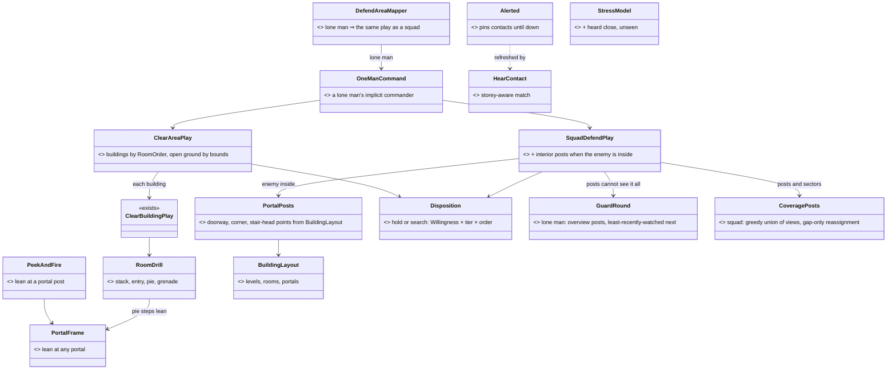
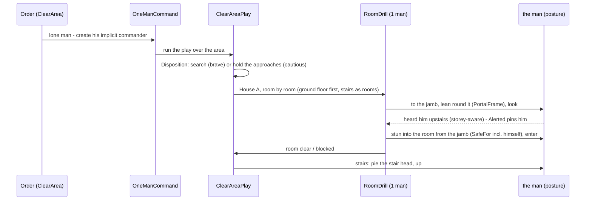
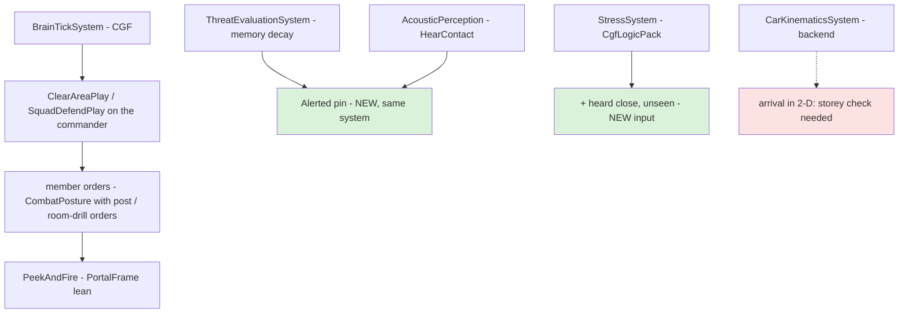
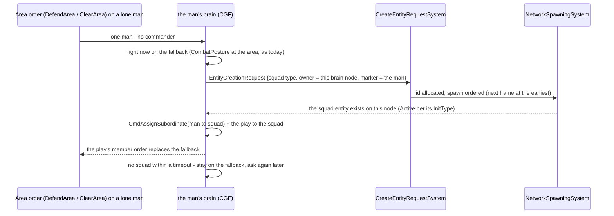
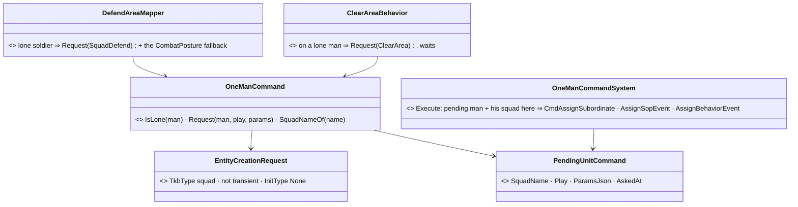

<!--STATUS
state: LIVE — ✅ APPROVED 2026-10-25 (R-2079), A–L as leaned
updated: 2026-10-25
build-state: BUILDING — K, I, D built (§7.1, §7.2); L1 and B built (§7.3); A-1 ✅ approved (R-2081, §7.3a) — building
current-answer: §7.3a the open decision (A) · §6 the answers (approved) · §4 the sub-questions with their leans · §3 the diagrams · §2 the claims they rest on · §5 the order
stale-below: nothing
known-rot: none yet
known-conflict: none
related-designs:
  - docs/DESIGN_Peek_And_Fire.md — OWNS the one peek cycle (§12, R-2077/R-2078) and its §12.7 measurement: the attacker inside, both one floor apart for 160 s — the case that opened this question
  - docs/designs/group-maneuvers/DESIGN_Building_Clearing.md — OWNS the squad's room drill (BC-1…BC-5, CB-1…CB-74: stack, pie, GrenadeCheck from the jamb); this question reuses it for ONE man and for an AREA
  - docs/designs/group-maneuvers/DESIGN_Defend_And_Attack_Position.md — OWNS SquadDefend's posts (D-2a…D-2l), the frame lean (R-2059), the reserve at the lowest stair (DA-72…DA-76)
  - docs/designs/group-maneuvers/DESIGN_Platoon_Attack_Defend_Clear.md — OWNS "attack and defend take an AREA, a building is its one-position case" (§5a, R-2060) and E-3b counter-clear
  - docs/DESIGN_Building_Interiors.md — OWNS stairs, slabs, doors, sight and penetration through floors (B1, §3c, §3h, §3j)
  - docs/DESIGN_World_Survey_Sensor.md — OWNS BuildingLayout (rooms, portals incl. stairs, LevelAt) the brain reads instead of geometry (R-2037)
  - docs/DESIGN_Temperament_And_Stress.md — OWNS the traits and Stress (TS-1…TS-6); D and F here add an input and a reader
  - docs/DESIGN_Thermal_And_Acoustic_Sensing.md — OWNS footsteps and heard contacts (R-205, R-207); E here asks for storey-aware matching
  - docs/blueprints/Architect_Question_95_Sound_Signatures_And_Lossless_Hearing.md — OWNS the Band (B3) and the deferred loss through walls (WQ-E Q3, backend)
  - docs/blueprints/Architect_Question_102_Responsive_Fighting_Reflexes.md — OWNS the hunter (H), grenade rules (I, R2-4), lost-sight escalation (E) and the unbuilt KnownSafe building (F)
  - docs/blueprints/Architect_Question_89_Suppress_And_Close.md — OWNS Willingness (the closing gate) that C reuses
-->

# Architect Question 104 — Defend an area, clear an area: the fight inside buildings

🔒 **User, `2026-10-25`, verbatim:** *"in-building combat is a tough discipline, the combatants need to be cautios (keep hidden longer rather
then chasing enemy)/brave (actively searching for an enemy - this is the house clearing) according to their settings/skills, leaning around
corners, using their hearing senses (so they don;t forget about the enemy if not seen for a while), using grenades when appropriate (into
room, behing the corner but in a way to avoid killim the thrower etc) needs proper design as you say"* · *"they should stay alerted until the
enemy is incapacitated, also stress level might go high if enemy is walking around like behind a wall"* · *"the house is not the only place,
i would like we could have also behaviors for "defend given area" and "attack /clear given area" - wider than just a house, maybe the house
is already not an axepction and the behaviors are gereal, that would be great"* · *"for the defend area there might need to be somu guarding
behavior so that the guy does not stay on place but actively makes sure there is no enemy in sight (should the center of the area be
obstructed by obstacles or something) - defendenrs always need to have a good overview of the surroundings"* · *"in case there is a squad or higher level unit this guarding can
be covered by different member so in such a case the goys need to guard clevely not just randomly changing their observation posts"* · *"ad C: if frightened too much/panicking he should also try to flee
G: leaning is driven by skill level (trained guy lean weapon first, civilian/militia combatants exposes more etc.) if not alone, the hearing of
sounds made by squad members should be filtered out, not counted as alterting enemy sounds"*.

📐 **The measured case** ([Peek and Fire §12.7](../DESIGN_Peek_And_Fire.md)): a lone attacker ordered to attack a lone defender in House A
flanks round, enters by the back, and stops on the ground floor under the defender's last-seen spot; the defender upstairs has no window
that sees an enemy inside his own house. Neither fires for 160 s.

## 1. INVENTORY *(2026-10-25 — `scripts/cbm.sh search_graph` `.*(Room|Building|Clear|Stair|Storey|Level).*` Class 70 · `.*Corner.*` Method 32 · `.*(Search|Hunt|Sweep).*` Method; grep; three read-only sweeps of `docs/` then `.dev/`. ⚠ `check_index_coverage` is not available through the CLI — absences are best-effort)*

| exists | where | for one man? |
|---|---|---|
| the room drill: `RoomDrill`, `RoomEntryPlan` (stack, threshold, entry points, sectors; **1–2 entry men** when few), pie steps, grenade from the jamb (`ThrowClears`, `GrenadeCheck.SafeFor` — walls counted) | `Brains/RoomDrill.cs:85`, `RoomEntryPlan.cs:78/177`, `RoomGrenade.cs:72/158` | ⚠ geometry yes; run only by the squad plays `ClearRoomPlay` / `ClearBuildingPlay` (`RoomOrder`: ground floor first, nearest room next) |
| `SquadDefendPlay`: window / roof / cover posts, frames, alternates, the hunter (AQ102 H); the platoon's reserve to the lowest stair (DA-74) | `SquadDefendBehavior.cs`, `PlatoonDefendBehavior.cs:589` | ⛔ squads only — a lone man's DefendArea is `CombatPosture` at the centre, no posts (`DefendAreaMapper`, `CE-2369`) |
| `BuildingLayout`: levels, `LevelAt(z)`, `RoomAt`, portals Door / Window / Gap / **Stair** | `Tk/Terrain/BuildingLayout.cs:34/80/88` | ✅ any brain, through the survey sensor (R-2037) |
| the lean (0.4 m shear: eye, body points, hit boxes) — set ONLY by the window-frame post and the operator | `Tk/Combat/Lean.cs`, `PeekAndFireNodes.cs:874`, `PostureNodes.HoldWatch` | ⚠ no corner / doorway lean |
| `CoverKind` {Cover, WindowFiring} — no Corner, no doorway, no stair-head point | `Tk/Spatial/Eqs/CoverPoint.cs:43` | ⛔ |
| grenades: `ThrowArc` (direct arcs only — no bounce), `HiddenTargetThrow` (stun into buildings; `FriendlyInBurst` = distance only, no walls), `GrenadeDangerSystem` (throw back / run / drop) | `Tk/Combat/ThrowArc.cs`, `HiddenTargetThrow.cs:158`, `GrenadeReflex.cs` | ✅ individual |
| search: `FightFromCover` flank / close-in on the remembered spot (CE-2357, Regular+, no post); the attack's hunt (`AdvanceAndAttack` → `LastKnown`) | `FightFromCoverBehavior.cs:110-200`, `PostureNodes.cs:281` | ✅ individual — ⛔ none knows rooms or storeys |
| temperament `Willingness` (AQ89, ≥ 0.6 closes) · Stress (TS-4 inputs) · proficiency tiers | `CombatTemperament.cs:147`, `StressSystem.cs`, `CombatProficiency.cs:57` | ✅ per man |
| footsteps: range 25 m × speed / 5 m/s (walking ≈ 7.5 m), silent < 0.5 m/s; no door or voice sounds | `SoundEmissionSystem.cs:20,75`, `AcousticEmitter.cs:45` | ✅ — ⛔ no wall / floor loss (`AcousticPerception.cs:209`; the Band "read by nothing yet") |

## 2. How it is — the claims the leans rest on

| claim | code — how it IS | design — how it was MEANT |
|---|---|---|
| a remembered enemy is forgotten ~69 s after the last sighting (live ~14 s) | ✅ ×(1−0.1·dt) decay, forget < 0.5 untracked — `ThreatEvaluationSystem.cs:97,179` | ✅ `DESIGN_Sensors_And_Doctrine.md:325` — ⛔ no in-building or "alerted" exception anywhere (searched docs/, .dev/) |
| the attack's hunt follows the target only while LIVE (~14 s) | ✅ `HiddenTargetThrow.LastKnown` requires live — `HiddenTargetThrow.cs:149` | ⛔ searched, no design for a longer hunt |
| the hunt keeps the target's height, but a person ARRIVES in 2-D | ✅ Z kept to the mover (`PostureNodes.cs:298`, `NavigationDestination.cs:27`); arrival `Vector2.Distance ≤ 5 m` — `CarKinematicsSystem.cs:752`, ArrivalRadius 5 (`CombatPostureBehavior.cs:65`) | ⛔ searched, none: the mover was never designed for storeys (backend's file) |
| a heard contact matches floors in 2-D | ✅ `HearContact` / absorb in XY — `PerceptionComponents.cs:333,352,390` | ⚠ `DESIGN_Thermal_And_Acoustic_Sensing.md` §8 is silent on storeys |
| sound passes walls and floors unattenuated | ✅ `AcousticPerception.cs:209-213` | ✅ deferred by design: WQ-E Q3 (`DESIGN_World_Query_Seam.md`), AQ95 B3 |
| sight passes a stairwell, not slabs | ✅ `TerrainWorld.cs:410-455` | ✅ Building Interiors §3c/§3h |
| one man can run a room drill's geometry | ✅ `RoomEntryPlan.cs:177` (`Entry = min(2, inFight)`) | ⚠ Building Clearing CB-51 assumes a stack of 2+; one man never designed |
| attack / defend are AREA tasks | ⚠ squad/platoon plays take an area; a lone man's DefendArea does not post, his Attack takes one entity | ✅ R-2060 (Platoon §5a): *"a building is its one-position case"* |

## 3. The design

### 3.1 Classes *(grey = exists · blue = changed · green = new)*

*What the picture shows that prose hid: nothing new runs a man — the two area plays already exist for squads; a lone man reaches them through
one implicit commander, and every in-building skill (lean, posts, alerted, stress) is a small piece the plays and the peek cycle read.*

### 3.2 Sequence — a lone attacker clears an area holding House A

### 3.3 Modules — who runs it each frame

*Red: the one piece in backend's code — the person mover's 2-D arrival. Everything else is behaviors-side.*

## 4. The sub-questions — each with the lean

| # | question | ⭐ lean | rejected (one line each) |
|---|---|---|---|
| **A** | how does a LONE man get the area behaviours? | **an implicit one-man commander** (`OneManCommand`, created by the mapper for a lone man's DefendArea / ClearArea, invisible in the editor's hierarchy) — the squad plays run unchanged with a roster of one; `bt-window-duel`'s hand-made one-man squad becomes this | per-man copies of posting and clearing — two implementations of one concept (ruling 9) · the man as his own commander — his task IS the play, an order to himself would replace it |
| **B** | what are the two behaviours? | **DefendArea** = `SquadDefendPlay` over an area (it already posts windows, roof and cover over an area) · **ClearArea** (= "attack an area") = NEW `ClearAreaPlay`: the area's buildings in `RoomOrder` by `ClearBuildingPlay`, open ground by bounds, ends when no live enemy is known in the area. A house is the one-building case (R-2060) | a house-only behaviour — the user: *"the house is not an exception"* |
| **C** | cautious or brave? | **one disposition** from what exists: `Willingness` (AQ89: risk acceptance, nerve, obedience × the order's `assault`) × proficiency. **Hold** (< 0.6): stay hidden, cover the approaches and stair heads, wait for him to come — searching only after a long quiet (Veteran+). **Search** (≥ 0.6): clear actively. Stress above the nervous band pushes toward hold ⭐ **Panic ⇒ flee:** at the break (TS-6: stress at his breaking point) a man of low Resolve FLEES — out of the building / area by the exit away from the enemy he knows (the TS-6 Flee arm, designed; the built break runs to cover and goes prone) — a higher Resolve goes to ground or surrenders as built | a new trait — the four traits already say it · a fixed per-behaviour setting — the user wants *"according to their settings/skills"* |
| **D** | stay alerted until the enemy is down | an **`Alerted`** mark on a man whose task is a DefendArea / ClearArea and who knows an enemy INSIDE the area: his memory slot for that enemy never drops below "remembered" (no forget), and the hunt reads a pinned slot as live; it ends when the enemy is incapacitated (Injury), the area is clear, or after 10 min with no new evidence. This is `CE-2104`'s "alerted" idea, scoped | never forgetting anyone — a battle would fill the 16 slots with ghosts |
| **E** | hearing indoors | ① **storey-aware matching** of heard contacts (`LevelAt(z)` must agree inside a building) — a sound upstairs no longer merges with a man downstairs; ② footsteps through walls / floors **halved per wall or slab crossed** as a v1 of WQ-E Q3 — ⚠ backend's seam: ask them, or build behind their interface; ③ **door sounds** (open / close / breach as a Movement emission) — backend ④ ✅ **his own side is already silent to him**: `AcousticPerception.cs:167` skips a sound whose force is his (*"not his own side's"*) — squad mates' steps and shots never become alerting contacts; a neutral's still do (an unknown sound) | full acoustic propagation — designed (WQ-E), not v1 |
| **F** | stress from an enemy heard close, unseen | a **TS-4 input**: a hostile heard within 10 m in the last 3 s and not seen ⇒ +0.03 / s, × (1 − nerve) — *"walking around behind a wall"* | a separate fear model — Stress is the one model (R-2034) |
| **G** | leaning round corners | generalise the frame lean: `WindowFrame` → **`PortalFrame`** over every `BuildingLayout` portal (door, gap, stair head) + wall corners from room quads; the peek cycle's frame mode and the room drill's pie steps both lean there ⭐ **the lean by skill:** `Lean.Shift` is one 0.4 m for everyone today — `Lean` gains a per-man DEPTH set from proficiency: Regular+ leans WEAPON FIRST, shallow (~0.25–0.3 m: muzzle and one eye), Militia ~0.5 m (shoulder and half the body), Untrained steps out into the open (a step peek, no lean); the exposure time already scales by tier (`ExposeFactor`). ⚠ `Lean` is replicated and drawn by the IG — the depth is a cross-lane field (ui draws it, the LOS / hit readers take it) | a new peek mode — the frame mode is the lean (R-2059) |
| **H** | the defender, enemy inside his building | `SquadDefendPlay`: when an enemy is known INSIDE (survey `BuildingAt`), the posted men's posts switch from windows to **interior portal posts** (`PortalPosts`): the stair head when he is below, the doorway of the room he is in; **hold** ambushes there, **search** counter-clears (E-3b "ClearBuilding in reverse") | only the platoon reserve at the lowest stair (DA-74) — a lone defender has no reserve |
| **I** | the attacker reaching another storey | the hunt and every room-drill move **arrive only on the target's storey**: `PostureNodes` compares `LevelAt` of self and objective and keeps the move going (re-issue) when they differ; ⚠ the person mover's 2-D arrival (`CarKinematicsSystem.cs:752`) is backend's — a note to them for a storey-aware arrival | trusting the mover — it reports "arrived" one floor below (§12.7) |
| **J** | grenades indoors | individual throws reuse the drill's rules: **`GrenadeCheck.SafeFor` for the thrower himself** (walls counted) instead of `FriendlyInBurst`'s distance; throw **from a jamb or corner** and step back behind it before the burst; frag / stun per R2-4. ⛔ no bank / bounce throws in v1 (`ThrowArc` has direct arcs only) | bounce physics now — a new trajectory model for a rare case |
| **L** | a defender's overview of the area | **posts are chosen for COVERAGE, not the centre**: the post ask scores how much of the area and its approaches a point SEES (an EQS coverage score over a ring of probe points — the `FindOverwatchPosition` DA-13 designed, generalised). ⭐ **A squad guards by ASSIGNMENT, not rotation:** the commander picks posts greedily so their views UNION to the area (each next post the one that sees most of what is still unseen) and gives each man his sector — they stay put; a post is re-picked only when a GAP opens (a man fights, falls, displaces, or is pulled to an interior post) and then only the neighbour whose post best covers the hole shifts, never two at once; a platoon splits the area into squad sub-areas (PlatoonDefend already does). ⭐ **A lone man** (or a squad with fewer men than the coverage needs) runs a **guard round**: 2–3 overview posts, visited in an ORDER that keeps the least-recently-watched sector next (not random), 20–60 s each while nothing is known, the look scan (LD-3) sweeping what the post cannot see. A contact ⇒ the peek cycle at the post facing it | standing at the centre — the lone DefendArea today (`CE-2369`), blind when the centre is obstructed · random post changes — leave sectors unwatched in turn · patrolling the whole area — leaves no man watching from cover |
| **K** | demos, written first as a measured baseline | `ia-house-hunt` (lone vs lone, 2-storey House A, both orders), `ia-area-clear` (a fire team clears an area with 2 buildings), `ia-area-defend` (a lone man defends an area with a house + a wall) — each with a live check and an in-process twin; `bt-window-duel` keeps the window fight | — |

## 5. Order *(if approved — each step: rails red-proved, the demos re-measured)*

1. **K** — the three demos, measured red (baseline).
2a. **L** — overview posts and the guard round (with A, it replaces the lone man's stand-at-the-centre).
2. **I** + **D** — reach the right storey; stay alerted (they unblock §12.7 at once).
3. **A** + **B** — the implicit one-man commander; `ClearAreaPlay`.
4. **H** + **G** — interior posts; the portal lean.
5. **C** + **F** — the disposition; the stress input.
6. **J** — thrower safety with walls, throw-and-step-back.
7. **E** — storey-aware hearing (behaviors); wall / floor loss and door sounds handed to backend.

## 6. Answers

🔒 **User, `2026-10-25`:** *"AQ104 approved."* ⇒ ✅ **A–L as leaned (R-2079)**, with the user's additions folded into C (panic flees), E (his side is silent — already the rule) and G (the lean depth by skill). Build order §5.

## 7. As built

### 7.1 K — the three demos and their baseline *(2026-10-25; `scripts/gen-ia-scenarios.py`, checks `run_ia_*` in `scripts/utility-demo-check.py`, one live run each)*

Each scenario authors TODAY's closest orders (the build steps swap them for the approved ones, marked ⏭ in the generator).

| demo | baseline | what it measured |
|---|---|---|
| `ia-house-hunt` (lone attacker v the one man of a SquadDefend in House A) | ✅ PASS 3/3 this run | the attacker went round to the back door, up the stairs (z 3 at 45 s) and killed the defender at ~50 s (3 rounds v 4). ⚠ unscripted: §12.7's one-floor stalemate (Peek and Fire) did not recur here — repeat runs before calling I done |
| `ia-area-clear` (a fire team, ordered ClearBuilding of House A — ⏭ ClearArea) | ⛔ FAIL 0/2 | House B never visited (the order names one building — expected); the team sat ~100 s before moving; one two-storey house took ~230 s, upstairs at ~330 s; Red 1 bleeding out (7 hp) but not down at 420 s |
| `ia-area-defend` (a lone guard, CombatPosture at the centre — ⏭ DefendArea + L) | ⛔ FAIL 0/4 | **the guard fired 0 rounds in 240 s** (the attackers 235). Live brain probe: under fire his cover reaction spends ~25 s at a time MOVING (the cover search keeps relocating between the cars), never peeking; out of it, "hold: not seen" — the attackers walked to his OLD spot; and twice the TS-6 break (stress 1.0 at 116 s and 194 s: prone, no fire, 40–50 s) under steady fire on an immortal man |

### 7.2 Step 2 — I and D *(2026-10-25)*

| | as built | deviation |
|---|---|---|
| **D** | `Alerted` (component 422, brain-local) + `Alerts.Pin / IsPinned` (FDP Perception): up to 4 leases of 2 s; `ThreatEvaluationSystem` holds a pinned slot at `ForgetThreatScore` instead of forgetting it; `HiddenTargetThrow.LastKnown` reads a pinned slot as live (the hunt follows it). Pinners (`AreaAlert`, behaviors): the attack order's target (`PostureNodes.UntilTargetDown`), and every identified enemy in the squad's picture within the area of `SquadDefend` (max(search radius, 15 m)), `ClearBuilding` and `ClearRoom` (15 m) for every live member — each renewal only while the enemy is in the fight and the man's memory has evidence from the last 10 min | the lease (renewed each tick) instead of a stored "until down": a task that ends lets go by itself, no release path |
| **I** | `PostureNodes.AdvanceAndAttack`: hunting, a move "arrived" while the target is on another storey (> 2 m of height) is re-issued — the first at once, then every 3 s; on his floor "arrived" holds as before | ⚠ only a belt: the person mover arrived in 2-D — ✅ backend's root fix landed (`CE-3319`: no arrival on another level); ⭐ `CE-2373` widened the belt to a posted man and to "not arrived, not moving" (§7.3) |

Rails: `ThreatEvaluationSystemTests.CE2371_AnAlertedContact_IsNotForgotten_WhileTheLeaseRuns` ·
`TacticsTreesTests.CE2371_TheAttackTarget_StaysKnownUntilDown_ButNotOnOldEvidence` · `…CE2371_HuntingATargetUpstairs_AnArrivalBelowHim_IsReissued`.
Red-proofs (one build, three mutations: no lease check, no evidence age, no storey check) ⇒ 3 / 3 red.

<<<<<<< HEAD
📐 **Live after step 2** (one run each, the step-1 orders unchanged): `ia-house-hunt` ✅ 2/2 decided — run 1 the defender shot at his
window at 31 s (the check now accepts a fight won before entry), run 2 inside at 26 s, on his storey at 29 s, defender down ·
`ia-area-clear` ⛔ House B still never entered (the order names one building — B's job) but **both defenders down** (baseline: neither) ·
`ia-area-defend` ⛔ the guard now **fires 16 rounds** (baseline 0) but still second, and never at Blue East — the stand-at-the-centre
L replaces.

### 7.3 Step 3 — L1 and B built; A stopped on a measured hazard *(2026-10-25)*

| | as built | where |
|---|---|---|
| **L** (L1, `CE-2373`) | the all-round `SquadDefend` ranks its candidate posts by COVERAGE — one visibility fan, 32 area probes, the views' greedy union — and a lone man rounds 30 s per post over the first ≤ 3 while no enemy is known in the area | [Defend §8c D-2m](../designs/group-maneuvers/DESIGN_Defend_And_Attack_Position.md) (DL-1…DL-5) — ⏭ L2: the open-ground overview ask, a squad's gap-only reassignment |
| **B** (`CE-2374`) | `ClearArea` — a sequencer over `ClearBuildingPlay`: one area survey, the nearest building next, a blocked one skipped, a known enemy at a cleared building ⇒ once more; the area stays alerted | [Building Clearing §7.4](../designs/group-maneuvers/DESIGN_Building_Clearing.md) (CA-1…CA-5) — ⏭ the open ground by bounds |
| **A** | ⛔ **NOT BUILT — stopped on a measured hazard** (R-106: the item stops, not the batch); the demos keep an authored one-man squad, which runs the same plays today | §7.3a below — a decision for the user |

#### 7.3a A — where the implicit commander can live *(measured; a lean for the user)*

| the choice rests on | code — how it IS | design |
|---|---|---|
| a gameplay system may create an entity at runtime | ✅ `EntityCreationRequest` on the bus (`EjectionSystem.cs:79`, `TrafficPanic.cs:174`); `InitialComponents` applied by reflection, managed ones too (`NetworkSpawningSystem.cs:208`) | ✅ Entity Creation §3.4d (CE-3228) |
| a created commander could start its play by itself | ✅ an `InitialBrainIntent` becomes the `AssignBehaviorEvent` (`InitialBrainMaterializationSystem`) — ⚠ only on the node that holds the managed component (the spawning node) | ✅ Sensors §7.5 |
| ⛔ **the man's link to his commander is SAVED** | ✅ `UnitSubordinate` is `DataPolicy.Default` — recorded, saved, snapshotted (`UnitSubordinate.cs:18`); a `IsTransient` commander carries `ScenarioIgnoreTag` and is NOT saved | ⛔ searched docs/ and .dev/ (`implicit commander`, `one-man`, `transient squad`): no design for a saved man under an unsaved commander |
| the roster is derived, event-driven | ✅ `UnitRoster` is `NoScenario`; `UnitHierarchySystem` changes it only on `CmdAssign/RemoveSubordinate` (`UnitHierarchySystem.cs:146`) — it never sweeps a roster it did not build | ✅ `UnitRoster.cs` header |

⇒ **A transient (unsaved) commander leaves the saved man pointing at nothing** — the next load drops the link or fails on it. That is a
save-format question, not a behaviour one, so it is the user's.

| option | what | ⭐ lean |
|---|---|---|
| **A-1** | the mapper asks for a **real squad entity** (not transient, `Unit_InfantrySquad`), named "⟨man⟩ (command)", then assigns the man under it and gives it the play: saved and loaded like any authored squad; **visible** in the hierarchy | ⭐ **this** — it is exactly what the demos author by hand today, so nothing new can break on save/load; the only cost is a visible squad node, which AQ104 A wanted hidden |
| A-2 | a brain-local commander (created on CGF only, never replicated or saved) and the man's link written there | ⛔ the man's `UnitSubordinate` is replicated and saved — a local-only commander would be a dangling handle on every other node and in every save |
| A-3 | no commander: the lone man's brain runs the squad play itself | ⛔ rejected in §4 A (an order to himself replaces his own task) |

🔒 **User, `2026-10-25`:** *"creating an entity is a cross cluster operation initiated via sending creation request event and is acked by
other nodes … the code needs to wait for confirmation from the local node anyway … this is nothing local and immediate so it needs to be
treated that way."* ⇒ **A-1's sequence is ASYNCHRONOUS:**

*What the picture shows that prose hid:* the man is never idle while his commander is being created, and nothing is assigned until the
entity is really there on this node.

🔒 **User, `2026-10-25`: *"A-1 approved"*** ⇒ ✅ **A-1 (R-2081)**, built asynchronously as the sequence above.

⇒ ⭐ **Lean A-1**, with one ask of the ui lane later: hide a squad whose only member is its creator's lone man (a display filter, not a
model change). **What would change the lean:** if a hidden commander is a must, A-1 still holds and the filter becomes required.

Rails (step 3): `SquadManeuverTests.CE2373_ALoneDefender_IsPostedForCoverage_AndGuardsOnARound_UntilAnEnemyIsKnown` ·
`CE2373_Coverage_GreedyUnion_AndTheRoundGoesWhereItWatchedLeast` · `CE2374_ClearArea_ClearsEveryBuilding_NearestFirst_ThenSucceeds`.
Red-proofs: the picker fed the ask's order ⇒ red · the round ignoring a known enemy ⇒ red · the sequencer stopping after one building ⇒
red · ⏭ the no-round mutation to re-run (its first form did not compile). Six existing defend rails gained one tick (the fan's round trip).

📐 **Live after step 3, on the NEW orders** (one run each, `f6f30cf78`), and the fourth red-proof (no round ⇒ red; 4 / 4 now):

| demo | result | what it measured |
|---|---|---|
| `ia-area-clear` (`ClearArea`) | ⛔ 0/2 | the sequencer picked House A first (nearest) — ✅ — but the team sat ~100 s before moving (the baseline's idle start, unchanged), entered A at 129 s and was still on its ground floor at 410 s with Red 1 alive upstairs; House B never reached because A never finished. ⇒ the limit is the building drill's pace, not the sequencer |
| `ia-area-defend` (one-man `SquadDefend`, L1) | ⛔ 0/4 — **worse than step 2** (2 rounds v 16) | the guard stood at the centre ~110 s under steady fire, never firing at Blue East 7 m away; moved at 145 s, into House A at 186 s. ⏭ **next: a live brain probe** — whether his posts were ever given (the window/coverage stages under fire) or the TS-6 break holds him, as at baseline |

📐 **The live probe of `ia-area-defend`** (guard + his commander, every ~0.8 s): the posts DO go out (the commander's play in Posting,
the guard on `CombatPosture` Superior) — but **both attackers are in sight at t = 0** (Blue South fires at 2 s from 42 m), so the guard is
under fire before he posts; his **stress pins at 1.0 by 11 s** and stays (immortal: the fire never ends), and he cycles Break ⇄
CombatPosture with the weapon "aiming" and locomotion "moving" while neither firing nor changing place. ⇒ ① the demo did not test L: the
attackers now start ~90 m out (Blue South (106,5), Blue East (195,98)) so the guard posts first; ② the pinned stress and the aim-that-never-
fires are step 5's (C + F) — recorded there, not treated as an L defect.

📐 **Re-run with the attackers ~90 m out** (`7d12a9b39`): the guard posted INTO House A within 10 s (L's window post — ✅ he no longer
stands at the centre), but ⛔ **fired ZERO rounds in 240 s** — not at 90 m, not at Blue East a few metres from him inside the house —
while the attackers opened at 2.8 s from ~92 m. ⇒ not a posting defect; ⏭ probing his ROE / stress / weapon state.
=======
### 7.3 I — arrival on the target's level, the mover's half (the root fix under §7.2's belt) *(backend, 2026-10-25; behaviors' handoff item 1)*

| | as built |
|---|---|
| the rule | a PERSON arrives only when he stands on the destination's LEVEL — `Levels.Same` (`World/Levels.cs`): the level of each point by the surfaces stacked at its own (x, y), through the world query (no building code, R-248). Where only the ground stands, any two heights are level 0 — an order authored at z 0 on a hill still arrives. A vehicle keeps the 2-D rule |
| the mover | `CarKinematicsSystem`: the Direct branch and the path's end both refuse `HasArrived` on another level — he stands where he is, the move stays open; its owner re-sends it |
| the planner | `RoutePlanner`'s half-metre short move (two points as asked) only on ONE level — the man under the point gets a navmesh plan (the stairs) instead of a two-point "path" that would arrive at once |
| ⛔ not here | the brain's own check (`PostureNodes`, behaviors' belt) — ⚠ the brain reads no terrain (user, 2026-10-25: *"brain should use map only for rendering, no direct access"*): its level comes from a survey answer, never `BuildingLayout` itself |
| rails | `CarKinematicsSystemTests.AQ104I_APersonUnderTheirDestination_OnAnotherFloor_HasNotArrived` (path + direct, other floor + the same-floor control) · `TerrainHeightTests.AQ104I_AShortMove_ToTheLevelAbove_IsNotTheTwoPoints` — 3 red with the production change stashed, 5/5 green with it |

### 7.4 E ② ③ and G — the backend halves *(backend, 2026-10-25; behaviors' handoff items 2–5)*

| | as built | owning design |
|---|---|---|
| E ② sound through walls / floors | a wall or slab HALVES a high sound's carry (per crossing `min(material dB, 6.02) × band`); `Trace(Sound)` on the world-query seam (WQ-E Q3 v1) | [Sensing §8.8](../DESIGN_Thermal_And_Acoustic_Sensing.md) |
| E ③ door sounds | every sound node hears a replicated `DoorState` change once, at the doorway: lock 5 m, swing 15 m, breach 40 m, of the side of the man at it | Sensing §8.8 |
| AQ105 D the voice | a replica's live shouted `Utterance` (all but `Talk`) is heard 40 m — as a man's sound (kind/class bits are full) | Sensing §8.8 |
| G the lean's depth | `Lean.Depth` (replicated); `Leans.SetDepth(metres)` for behaviors; eye, seen points, hit boxes and aim read `Leans.ShiftOf` | [Hit location §13 LN-9](../designs/hit-location/DESIGN_Body_Parts_And_Hit_Location.md) |
>>>>>>> origin/backend

📐 **Why the guard never fired — measured** (brain + slots snapshot at 8 / 16 / 30 s): L's coverage pass gave him an **UPSTAIRS frame
post** (`Anchor` z 3 — House A's south window, the widest view), and he stayed on the GROUND floor all along: `OffPost` (3-D) kept the
occupy branch running, its move "arrived" in 2-D under the post and then held (the order says Stay) — so he stood one floor below his
window, unable to see out ("hold: not seen"). ⇒ the I belt was too narrow: it re-sent only a HUNT.
⭐ **Fixed (`CE-2373`):** the storey re-send now covers a posted man (`Stay`) too, and — with backend's storey-aware arrival merged
(`CE-3319`, [NOTE](batches/NOTE_Backend_To_Behaviors_Area_Combat_And_Callouts_Done.md) item 1: *"the case left is 'not arrived, not
moving' under the target — a move node must RE-SEND there"*) — a move that has not made half a metre in 3 s on the wrong storey is re-sent,
so the planner takes the stairs. Rail: `TacticsTreesTests.CE2373_APostedManUnderHisUpstairsPost_NotMoving_IsSentAgain`.

📐 **Live after the storey fix** (`930a6f6d2` + backend's `CE-3319`): the guard now **reaches his upstairs window and fires — 11 rounds,
both attackers wounded** (Blue South to 52, Blue East to 62) — but only from ~175 s: he spends the first three minutes on the ground floor
while the stress break (stress 1.0 from ~10 s under steady fire) keeps pausing his posture. ⇒ the remaining gap is step 5 (C + F).

#### 7.3b A-1 as built *(`CE-2375`, R-2081)*

*What the picture shows that prose hid:* the request and the assignment are two different moments, joined only by the pending mark on the
man — nothing assumes the squad exists when the order arrives.

| as built | deviation / why |
|---|---|
| the squad is recognised by its NAME ("⟨man⟩ (command)"), its force and the squad type, with no members yet | ⚠ **a stand-in**: the creation result (ack) goes back over the wire to external requesters only and the spawn may happen on another node, so the brain cannot learn the new entity's id — ⏭ [handoff to backend](batches/HANDOFF_Behaviors_To_Backend_Creation_Result.md) for a result the requester can read; the name key then retires |
| the man fights on the order's fallback (DefendArea: CombatPosture at the area) while he waits; ClearArea on a lone man waits as its own task | the user's "nothing local and immediate" |
| no squad within 20 s ⇒ the wait ends, he stays on the fallback; ⛔ never a second request | two squads for one man is worse than none |
| `OneManCommandSystem` runs on the brain node after `RestlessSystem` (`CgfLogicPack`), gated on the man's brain authority | — |

Rail: `SquadManeuverTests.CE2375_ALoneMansAreaOrder_AsksForASquad_AndOnlyAssignsHimOnceItExists`. ⏭ live: a demo that orders a lone man
`DefendArea` straight (its params are lat/lon — the demos still author the one-man squad by hand).

📐 **Live after step 5** (`01de0b843` + the callouts): the guard fired **0** rounds again. The probe (brain + journal at 20 / 60 / 120 s)
says why: he STARTS IN THE OPEN at the area's centre, both attackers see him at once from ~90 m (fire from 2 s), and walking to his post
(this run a ground-floor frame, (103, 101)) under two rifles his stress reaches his break level within seconds; from then on he cycles
break ⇄ resume (49 s, 59 s, 110 s …) and never arrives. DF-2 (half a near miss in cover) cannot help a man who is never in cover. ⇒ ⭐ the
stress model doing what TS-6 says (a regular caught in the open by two rifles breaks); the DEMO judged "sees them first" of a man not yet
posted. ⇒ the guard now starts INSIDE House A (104.5, 103.5), as a defender would be.
