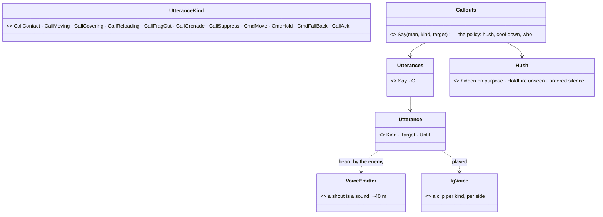
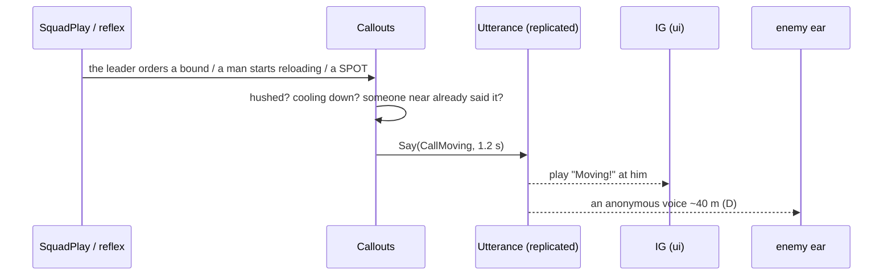
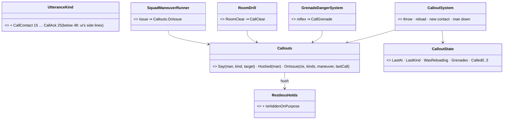

<!--STATUS
state: LIVE — ✅ APPROVED 2026-10-25 (R-2080), A–F as leaned
updated: 2026-10-25
build-state: READY-TO-BUILD — order §5
current-answer: §4 the sub-questions with their leans · §3 the diagrams
stale-below: nothing
known-rot: none yet
known-conflict: none
related-designs:
  - docs/DESIGN_Civilians_And_Crowd_Control.md — OWNS the speech data (§7.18, CE-3264: `Utterance`, `Utterances.Say`, the G1 kinds) — this question adds the squad's kinds and writers
  - docs/DESIGN_People_Display.md — OWNS how an utterance is SHOWN (U15 overhead marks, `OverheadMarkGizmo`) and G1 (§8); the IG's SOUND for it is the ui lane's
  - docs/designs/group-maneuvers/DESIGN_Building_Clearing.md — OWNS CB-27 (challenge, commands, "clear", "man down", R-2033) — load-bearing speech the target's brain reads
  - docs/designs/group-maneuvers/DESIGN_Squad_Tactics.md — OWNS the squad plays whose orders and reports become calls (fire and movement, the SPOT, the casualty)
  - docs/DESIGN_Thermal_And_Acoustic_Sensing.md — OWNS hearing (R-205, R-207); D here makes a shout a sound the enemy can hear — ✅ built in its §8.8 (backend, 2026-10-25)
  - docs/blueprints/Architect_Question_104_Area_And_Building_Combat.md — the in-building fight where calls matter most ("moving", "clear", "grenade")
-->

# Architect Question 105 — Squad callouts: the men shout orders and reports, unless they must stay hidden

🔒 **User, `2026-10-25`, verbatim:** *"not closely related, but very helping the realism and immersion - the squad members are talking/shouting
some kind of orders/reports - uless they need to stay hidden and unrevealed - the behaviors should be firing some "shout" events so the IG can
play sounds"*.

## 1. INVENTORY *(2026-10-25 — `scripts/cbm.sh search_graph` `.*(Utterance|Speech|Shout|Callout|Voice|Radio).*` Class; grep `Utterances.Say|Of`. ⚠ `check_index_coverage` not available through the CLI)*

| exists | where | state |
|---|---|---|
| `Utterance {Kind, Target, Until}` — replicated (`dtUtterance`, NED egress/ingress), one at a time, written only by `Utterances.Say` | `FDP/Toolkits/Fdp.Toolkits/Civilians/Speech.cs` (CE-3264) | ✅ built — ⛔ **no writer** (CE-2249 is behaviors') |
| `UtteranceKind`: Talk, Insult, Warning, Order, Chant, Challenge, CmdDown/Freeze/HandsUp/DropIt/ComeOut, Announce, **CallClear, CallManDown** | same | ⛔ no squad combat calls |
| the overhead mark reads it | `Hrot.Common/Diagnostics/Gizmos/OverheadMarkGizmo.cs:38` (U15) | ✅ drawn — ⛔ no IG sound reads it |
| the squad's reports as data: SPOT, PROGRESS, casualty (`SquadReportNotification`, `CommandReports`) | `Tk/Squad/Command/` | ✅ on the wire (R-2031) — silent |
| hearing: Movement / Shot / Detonation; his own side never heard | `AcousticEmitter.cs:45`, `AcousticPerception.cs:167` | ⛔ no voice |

## 2. How it is

| claim | code | design |
|---|---|---|
| nothing a soldier does makes him speak | ✅ grep `Utterances.Say`: no caller outside the toolkit | ✅ G1 (People Display §8) / CE-2249 — designed, unbuilt |
| a shout gives nothing away today | ✅ no voice emitter | ⛔ searched, no design |
| "stay hidden" already has one home | ✅ `RestlessHolds` B⑤ (ambush, trigger man, bomber) — `RestlessSystem.cs:52` | ✅ AQ103 B (R-2074) |

## 3. The design

## 4. The sub-questions — each with the lean

| # | question | ⭐ lean | rejected |
|---|---|---|---|
| **A** | which calls | append to `UtteranceKind` (a byte, unique names): **CallContact** (with the contact as Target — the IG can say "front / left"), **CallMoving**, **CallCovering**, **CallReloading**, **CallFragOut**, **CallGrenade** (incoming), **CallSuppress**, **CmdMove**, **CmdHold**, **CmdFallBack**, **CallAck**; reuse CallClear / CallManDown | free text — nothing can play or translate it |
| **B** | who says what, when | ONE helper `Callouts.Say` (behaviors) called at the moments that already exist: the squad play ISSUING an order (the leader: CmdMove / CmdHold / CmdFallBack, a member: CallAck), the SPOT (CallContact), fire and movement's bound (CallMoving / CallCovering), the reload start (CallReloading), a throw (CallFragOut), the grenade reflex (CallGrenade), a casualty (CallManDown), the room drill (CallClear, CB-27). A lone man (no friend within earshot) stays silent — calls are for a team | each behaviour writing `Utterance` directly — the hush and the cool-down would be copied a dozen times |
| **C** | stay hidden | `Callouts.Say` is SILENT when the man is **hushed**: hidden on purpose (`RestlessHolds` B⑤: ambush, trigger man, bomber), his ROE is HoldFire and no enemy has seen his side yet, or his order carries **silence** (a new `Silent` flag on the squad orders — noise discipline). Contact breaks it: once his side is seen or fires, the calls start | a per-behaviour flag — the same three reasons everywhere |
| **D** | can the enemy hear a shout? | yes — a shout is a **voice** sound (backend: a Voice class on `AcousticEmitter`, ~40 m, his side silent to him as every sound) — so shouting has the real cost and C has a reason. ⚠ backend's | silent shouts — no cost, C becomes cosmetic |
| **E** | not a chatterbox | a per-man cool-down (3 s), the same call within 10 m in the last 2 s is not repeated, an order is said once per issue; `Utterance` holds one at a time (the newest wins) | every event spoken — noise the user does not want |
| **F** | the IG's sound | the ui lane plays a clip per kind (a voice per side / language later) from the replicated `Utterance`, as `OverheadMarkGizmo` reads it — a handoff to ui with this question | the brain playing audio — the brain has no audio |

## 5. Order *(if approved)*

1. A + B + E — the kinds and `Callouts` with its writers (behaviors); rails per writer, the hush red-proved.
2. C — the hush and the `Silent` order flag.
3. a note to backend (D, the voice sound) and a handoff to ui (F, the clips).

## 6. Answers

🔒 **User, `2026-10-25`:** *"AQ105 approved"* ⇒ ✅ **A–F as leaned (R-2080).**

## 7. As built *(`CE-2372`, behaviors, 2026-10-25 — A, B, C (two of its three reasons), E)*

*What the picture shows that prose hid:* every call — direct or observed — goes through ONE `Say`, so the hush, the cool-down and the
no-echo rule are written once. The three moments that happen in FDP code (the staff's SPOT, the weapon brain's throw, the reload) are
OBSERVED by `CalloutSystem`, because FDP does not reference Hrot.

| as built | deviation / why |
|---|---|
| `Say` is silent: alone (no friend within 25 m) · hushed · within 3 s of his last call (grenade / man down break it) · a friend within 10 m said the same in the last ~2 s | — |
| hush (C): his task is hidden on purpose (`RestlessHolds.IsHiddenOnPurpose` — the AQ103 B⑤ list) · HoldFire and no near miss / hit on him in 60 s | ⏭ the third reason — an order's `Silent` flag (noise discipline) — is not built: no squad order carries it yet |
| at an issue the leader calls the command (fall back · move · suppress · hold) only when it changes; in a bound movers "moving", suppressors "covering"; else the man nearest the leader acks | ⚠ "suppress" is spoken as `CallSuppress` by the leader (the kind's name) |
| contact: the first identified, armed, non-neutral enemy he SEES that he has not called (the last four remembered); the first look learns silently | the SPOT itself is composed by FDP's staff — the call reads the man's memory, the same fact the SPOT is made from |
| frag out: his throwable mount's grenades falling · reloading: a mount going busy (`WeaponAmmo.Busy`) · man down: the live member nearest the fallen | — |

Rails: `CalloutsTests` ×3, red-proved 6/6 (earshot, cool-down, echo, last-call memory, reload edge, hush). ⏭ live: a squad demo with the
IG listening (ui's `SoundSources.Voices`).
