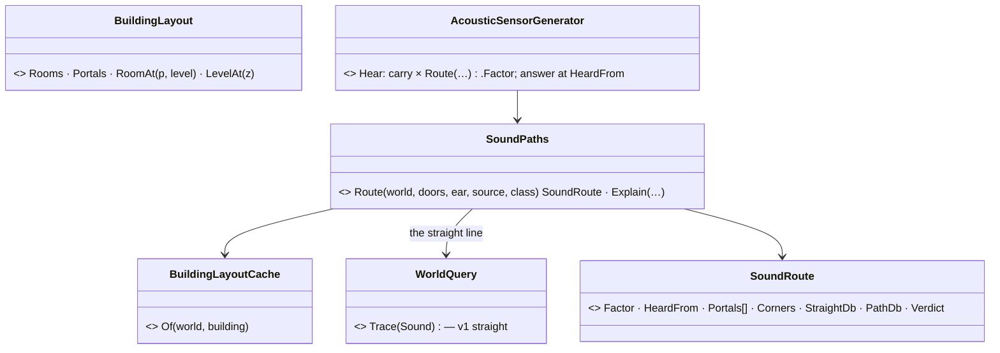
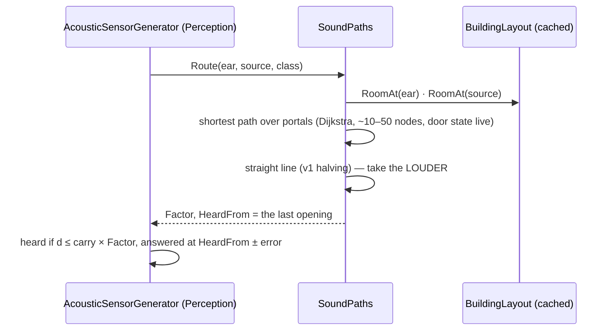
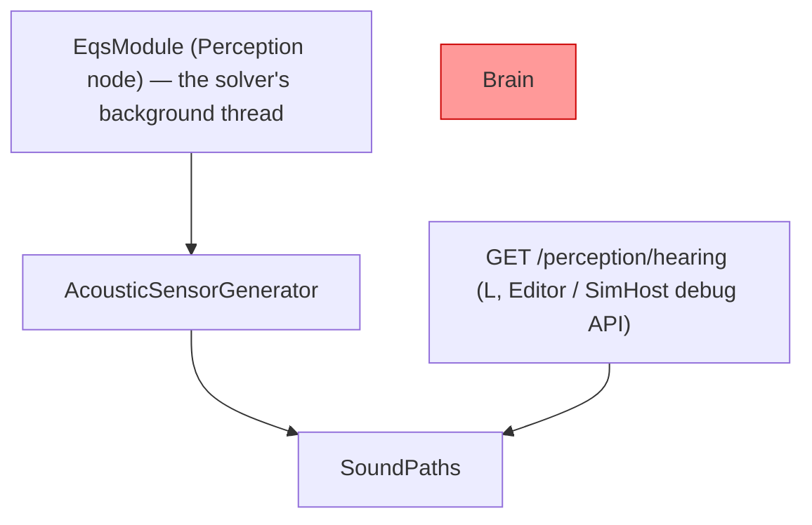

<!--STATUS
state: LIVE — A–J ✅ APPROVED 2026-10-25 (R-3050); K, L leaned, awaiting the user
updated: 2026-10-25
build-state: READY-TO-BUILD (A–J); K, L DESIGN
current-answer: §4 the sub-questions with their leans and verdicts · §3 the diagrams · §2 the claims · §6 the answers
stale-below: nothing
known-rot: none yet
known-conflict: none
related-designs:
  - docs/DESIGN_World_Query_Seam.md — OWNS WQ-E (sound around corners and in buildings) and its slices Q3 (v1, built) / Q4 (v2 — this question builds it)
  - docs/DESIGN_Building_Interiors.md — OWNS B-6 (the sound solver: v1 straight, v2 room/portal) and W-7v2 (blast confinement, I's later reuser)
  - docs/DESIGN_World_Survey_Sensor.md — OWNS BuildingLayout (§6: rooms, portals incl. windows and stairs, OUTSIDE = −1) — the graph this routes on
  - docs/DESIGN_Thermal_And_Acoustic_Sensing.md — OWNS hearing; §8.8 is v1 (the wall halving) this adds the path to
  - docs/blueprints/Architect_Question_104_Area_And_Building_Combat.md — E (hearing indoors) asked for this; J's demos measure it
  - docs/blueprints/Architect_Question_95_Sound_Signatures_And_Lossless_Hearing.md — OWNS the Band (B3) the corner loss scales by
  - docs/DESIGN_Node_Roles_And_Policies.md — §3.0a: sound calculated on Perception, output on every 3-D map host
  - docs/designs/audio/DESIGN_FPS_Audio.md — OWNS the operator's audio, a later reuser of the same path (I)
-->

# Architect Question 106 — Sound round corners, through doors and windows (WQ-E v2)

🔒 **User, `2026-10-25`:** *"'sound round the corners and through windows and doors' are critical for indoor combat, how could we approach them? is
there some simple solution not requiring trilions of raycasts at runtime? some pre-baken sound path maps like a navmesh maybe?"*

## 1. INVENTORY *(2026-10-25)*

⚠ `scripts/cbm.sh` hung on its first-run indexing this session (re-run in the background); the inventory is grep over `FDP/Toolkits`, `Hrot/Engine`,
`Hrot/Subsystems` for `(class|struct|enum) *(Sound|Acoustic|Hearing|Heard|Portal|Diffract)*` — **33 types**, ⛔ coverage not checkable (no
`check_index_coverage` through the CLI).

| found | what it gives | reuse |
|---|---|---|
| `BuildingLayout` / `BuildingPortal` / `BuildingLayoutCache` | rooms per level, portals (Door · Window · Gap · Stair), OUTSIDE = −1, `RoomAt` cell lookup, door state read live, cached per building | ⭐ THE graph |
| `SurveyPortal` | the brain's copy of a portal (survey answer) | — (brain side) |
| `AcousticSensorGenerator` / `AcousticPerception.WallFactor` | the hearing answer; v1's straight loss | ⭐ the caller |
| `HearingGizmo`, `HeardTraces` | the map's hearing layer and the recorded heard estimates | ⭐ L draws on it |
| `TerrainWorldLosStrategy.Explain` + `GET /perception/los` | sight's "why / why not", a dry run of the SAME strategy | ⭐ L's model |
| ⛔ any path / diffraction solver | none found | NEW |

## 2. How it is

| claim | code | design |
|---|---|---|
| a building's rooms and openings are already derived and cached | ✅ `BuildingLayout.cs:9-21`, `BuildingLayoutCache.Of` | ✅ World Survey §6 WS-3: *"the SAME BuildingLayout is what sound v2 … reuse"* |
| hearing today: distance + a halving per wall / slab on the straight line | ✅ `AcousticPerception.WallFactor` | ✅ Sensing §8.8 (R-2079 AQ104 E) |
| sound v2 was planned as room-to-room through openings | — | ✅ WQ-E (World Query Seam), Building Interiors B-6 |
| a portal graph is tens of nodes per building | ⚠ estimated — the first rail measures `house-2f` | — |

## 3. The design

*What the pictures show that prose hid:* the path is computed ONLY where the hearing sensor runs (Perception), on its background snapshot, from a
graph the survey sensor already caches — nothing new is baked or loaded; the debug route (L) calls the SAME solver, so it cannot disagree. The
red box: the brain never calls it (Node Roles §3.0a).

## 4. The sub-questions — each with the lean

| # | question | ⭐ lean | verdict |
|---|---|---|---|
| **A** | where computed | on the Perception node only, over each building's `BuildingLayout`; the brain gets only the anonymous heard contact | ✅ |
| **B** | path or straight line | the LOUDER of the path through the openings and v1's straight line (each wall / slab a halving) | ✅ |
| **C** | a corner's cost | per portal the path TURNS through (≥ 45°): High 3 dB, Mid 2, Low 0.5; a straight pass through a doorway is free | ✅ |
| **D** | a closed door | its material dB, capped at one halving (6 dB) like the walls; breached / open = an opening | ✅ |
| **E** | a window | an opening (the stand-in's windows are holes, no pane state) | ✅ |
| **F** | heard from where | the LAST opening on the path (the doorway or window it came through), with the usual uncertainty | ✅ |
| **G** | outdoors / between buildings | OUTSIDE is one node; outside ↔ outside straight (⚠ amended by K); outside ↔ a room via its outside openings; room → another building's room via OUTSIDE | ✅ (K pending) |
| **H** | runtime cost | the graph comes with the cached layout; per heard sound two cell lookups + a shortest path over ~10–50 nodes (µs); door states live; no raycast beyond v1's one line | ✅ |
| **I** | reuse | one path solver behind the world-query seam; blast confinement (W-7v2) and the operator's audio (ui) may reuse it | ✅ |
| **J** | proof | rails on `house-2f` (round a corner via the hall door · heard from the doorway · a closed door muffles · upstairs via the stair) + `ia-house-hunt` re-measured | ✅ |
| **K** | ⭐ *(user, 2026-10-25: "'behind a corner' on the street should count as some attenuator too")* a street corner | when the straight outdoor line crosses a BUILDING, also take the way ROUND it: the shorter of left / right round its footprint's convex hull (a rubber band from source to ear), each hull corner it turns costing C's corner loss — the louder of round and through wins. At most TWO buildings detoured per sound; past that, the through-walls value. ⛔ No street-canyon gain in v1 (reflections that keep a sound loud along a street) — free field along the street | ⏳ |
| **L** | ⭐ *(user, 2026-10-25: "how could we debug that sounds 'travel' properly?")* debugging | ① **one solver, an explain mode** — `SoundPaths.Explain` returns what `Route` decided, for the SAME inputs (sight's `Explain` model); ② **`GET /perception/hearing?listener=<id>&seconds=10`** (MCP `explain_hearing`): every sound in the ring of the last N s near the listener, each with source, kind / class, carry, distance, straight dB + crossings, route (portals, corners) + dB, effective carry, and the VERDICT — heard, or why not (beyond its carry · beyond his ear · his own side · weather · walls / corners); ③ the **hearing layer** draws, for the selected listener, each such sound's chosen route through the doorways and corners — green heard, red not, labelled in dB — and the heard point at the last opening (ui); ④ the corner / door numbers are placeholders tuned with ③ | ⏳ |

## 5. Order

1. A–H + J — `SoundPaths` with its rails (red-proved), the hearing generator calls it, `ia-house-hunt` re-measured.
2. K — street corners round buildings (rails: a man round a building corner hears less than in the open, more than through it).
3. L ① ② — explain + the HTTP route and MCP tool (backend, R-1030: the catalog regenerated in the same commit); L ③ — the layer (ui handoff).

## 6. Answers

🔒 **User, `2026-10-25`:** *"approved."* ⇒ ✅ **A–J as leaned (R-3050).** K and L were asked in the same message; leans above, awaiting the user.
