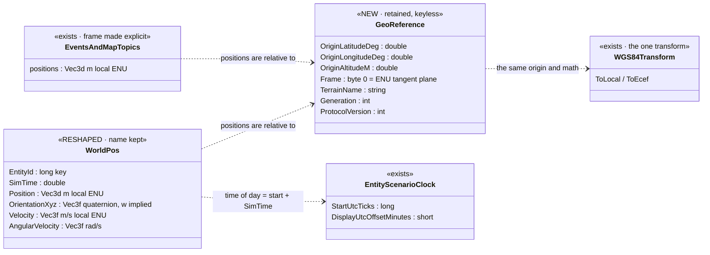
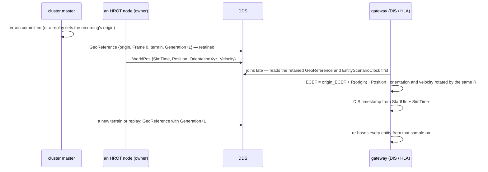

<!--STATUS
state: LIVE — ✅ ALL APPROVED 2026-10-27: A, B, D ruled (R-4092); E, F, G, H, I approved as leaned (R-4093); C decided by the user (R-4094: the orchestrator publishes)
updated: 2026-10-27
build-state: BUILDING — §5 the order; step 1 (CycloneDDS.NET 0.4) under test from a local build; step 4 B + D + E + F BUILT 2026-10-27 (rows B / D / E / F carry the as-built); step 3 C BUILT 2026-10-27 (row C carries the as-built); I — the degree-valued fields — is the next refactor
current-answer: §4 the sub-questions with leans and verdicts · §3 the diagrams (the wire AFTER) · §2 the claims · §5 the order
stale-below: nothing
known-rot: none yet
known-conflict: ../reference/BDC_NED_SST_Descriptor_Rules.md (the authoritative descriptor spec) says entity ids are `long` and is silent on frames — this question rules frames and makes every id int64, which AGREES with it; the spec's other code-vs-spec gaps (NED_DDS_Protocol.md §"Code versus the spec") are not touched here
related-designs:
  - ../reference/NED_DDS_Protocol.md — OWNS the living description of the wire (concepts, rules, every type); this question changes §11 (frames), §15 (names) and the inventory; it is updated when each step lands
  - ../reference/BDC_NED_SST_Descriptor_Rules.md — OWNS the descriptor / EntityMaster / ownership rules; untouched here except id width (agrees)
  - ../DESIGN_Geo_Origin.md — OWNS where the origin comes from (the terrain, R-229; the recording's metadata in a replay); C only PUBLISHES it
  - ../designs/weather/DESIGN_Weather_And_Time.md — OWNS the scenario clock (W-4: UTC = start + sim time); `EntityScenarioClock` already carries it, G relies on it
  - ../DESIGN_Dead_Reckoning.md — OWNS the receiver's projection (position + velocity × age); D changes the velocity it reads to an ENU vector
  - ../designs/mgmt-1/DESIGN.md — §8.10: recordings are ECS frames, not DDS captures — why H needs no recording migration
  - Blueprint_Issues_Tracker.md CE-3000 ⑤ — the CycloneDDS.NET default topic name A depends on; CE-4068 — the vertical-heading loss D removes by construction
-->

# Architect Question 107 — the NED wire: one frame (local metres + a published origin), names from types, `WorldPos` as a quaternion pose

🔒 **User, `2026-10-27`** (the asks, verbatim):
*"there seem to be serious gaps in the NED protocol (local meters vs. geo positions for example), topic name differences from csharp struct names
(redundant name in the table - can be avoided if we unify) and the fact that topic name do not follow the full namespace (risk of collisions), no NED
topic for publishing the geo conversion origin). How could we resolve the situation? maybe we could unify all NED stuff to local meters and publish
the terrain geo origin so the gateway can conver to whatever coordinate system the other side needs (DIS/HLA...) pls suggest"* ·
*"cyclonedds.net likely has a good automatic default for topic names, i bet we simply do not need to specify topic name and problem will be solved.
no one speeks NED besides HROT so changes are allowed."* · *"pls keep the name WorldPos for the topic is possible."* · *"go with quaternion, write
architect question, file the vertical heading bug for backend"* · *"if ok then lets go to aq 107 - approved, use sonnet subagent to do the refactors where possible"*

Why it matters: a DIS/HLA gateway ([SimNetGateway](https://github.com/pjanec/SimNetGateway)) must convert every NED position. Today it cannot —
state is geodetic, events are local metres, and nothing on the wire says where the local frame is.

## 1. INVENTORY *(`2026-10-27`)*

Queries run: `scripts/cbm.sh search_graph name_pattern ".*(WorldPos|GeoPoint|GeoSpatial|GeoOrigin|GeoReference|GeographicTransform).*" label Class`
(**21** results, `has_more: false`) · `grep -rnE "ToGeodetic|ToCartesian" Hrot/Network` · `grep "public int EntityId;"` over the wire roots ·
`scripts/ned-wire-inventory.py` (128 wire types) · reads of `WGS84Transform.cs`, `GeoSpatialEgressTranslator.cs`, `SimTransformBridgeSystem.cs`,
`SimComponents.cs`, the CycloneDDS.NET sources (`pjanec/CycloneDds.NET` HEAD `baafe2e`). ⛔ `check_index_coverage` is not available through the CLI.

| found | what it is | here |
|---|---|---|
| `Hrot.NED.Common.GeoPoint` (in-degree **45**) | lat/lon degrees + altitude m on the wire | ⛔ leaves the wire (B) |
| `Hrot.NED.Descriptors.WorldPos` | the entity pose: `GeoPoint`, Euler degrees, velocity as azimuth/elevation/length, acceleration (always 0), `DateTime` stamp | ⭐ re-shaped, name kept (D) |
| 7 more `GeoPoint` fields | map object `Position` (`MapDescriptors.cs:111`), 2 in `MapMessages.cs` (51, 96), `FinalDestination` (`SimDescriptors.cs:757`), 3 × `BatchOrigin` (`SimDescriptors.cs:860, 974, 996` — a geo anchor + local offsets, a THIRD convention) | ⛔ → local metres (B) |
| `Hrot.BDC.Messages.BdcWorldPos`, `BdcCommon.BdcGeoPoint` | the BDC stack's copy of the same shape (`BDC_` topics) | F |
| **44** `ToGeodetic` / `ToCartesian` calls in **15** NED/BDC files | every geo conversion on the wire path (`DescriptorMapper.cs` 9, `MapVisualOverlayIngressTranslator.cs` 5, `PathfindingTranslators.cs` 5, …) | ⭐ deleted by B — the wire becomes a copy of the ECS |
| `Fdp.Modules.Geographic.Transforms.WGS84Transform` | the ONE transform: an ENU tangent plane at the origin, exact ECEF ↔ local matrices (`WGS84Transform.cs:6-8`) | ⭐ the gateway does the same math |
| `TerrainDefinition.TerrainGeoOrigin`, `RecordingMetadata.GeoOriginRecord` | where the origin comes from (terrain; a replay's recording) | ⭐ C publishes it |
| `EntityScenarioClock` (`SimDescriptors.cs:140`) | UTC ticks at sim 0 + display offset, retained | ⭐ G — time of day already on the wire |
| `SimTransform` / `SimVelocity` (`SimComponents.cs`) | the ECS truth: local `Vector3` position, `Quaternion` rotation, linear m/s, angular rad/s | ⭐ D copies it |
| **25** wire types with `int EntityId` (the rest `long`) | mixed id width | E |
| `DdsTopicAttribute` (CycloneDDS.NET) | documents "null ⇒ full name, dots → underscores"; the generator and DdsMonitor apply it; ⛔ the runtime reader/writer do NOT (CE-3000 ⑤) | A |
| ~144 translators `TopicName => "…"` + 30+ readers/writers built with `(participant)` alone | the topic name repeated as a literal / taken from the attribute | A |
| ⛔ any `GeoReference` / origin topic | none — searched `grep -rniE "originlat|geoorigin|OriginLongitude" Hrot/Network FDP/Network` and the descriptor files (NED_DDS_Protocol §11) | NEW (C) |

## 2. How it is — the claims the leans rest on

| claim | code — how it IS | design — how it was MEANT |
|---|---|---|
| the simulation's truth is local ENU metres at the terrain origin | ✅ `WGS84Transform.cs:6-8`; `SimComponents.cs` | ✅ Geo Origin §2 (R-229); Terrain World (local metres) |
| local ↔ ECEF is exact (a rotation + offset), so local metres + origin lose nothing | ✅ `WGS84Transform` builds `EcefToLocal` / `LocalToEcef` from the origin | — (math) |
| every node learns the origin from its terrain (or a recording); nothing PUBLISHES it | ✅ `TerrainGeoOrigin`, `GeoOriginRecord`; searched (above) | ✅ Geo Origin §2, §5 |
| the descriptors only grow by appending; a layout change is a break | ✅ generated IDL `@appendable` | ✅ R-169 |
| a wire break costs no recording migration | ✅ recordings are ECS flight-recorder frames | ✅ mgmt-1 §8.10 |
| no application outside HROT speaks NED | ⛔ not in the repo — 🔒 **the user, 2026-10-27:** *"no one speeks NED besides HROT so changes are allowed."* | — |
| Euler on the wire loses the rotation near vertical today | ✅ `SimTransformBridgeSystem.cs:26-30` (heading forced to 0, roll kept) — read, not run | ⛔ none — CE-4068 |
| only vehicles fill angular velocity; people and aircraft send 0 | ✅ `CarKinematicsSystem.cs:720` is the only owner-side writer of `SimVelocity.Angular` | — |
| the default topic name exists in the library's intent only | ✅ `DdsWriter.cs:156`, `DdsReader.cs:159` vs `SchemaDiscovery.cs:329` | ✅ the attribute's own doc comment |

## 3. The wire AFTER — diagrams

*What the picture shows that prose hid:* after the change there is ONE frame on the wire and ONE retained sample that defines it — every position
and every time is resolvable from three topics (`GeoReference`, `EntityScenarioClock`, the sample itself), with no out-of-band knowledge.

*What the picture shows that prose hid:* the gateway's whole conversion is one rigid transform fixed by a retained sample, and a change of origin is
an ordinary sample with a new generation — no restart, no configuration.

## 4. Sub-questions — leans and verdicts

| # | question | ⭐ lean / verdict | blast radius | rejected — one line each |
|---|---|---|---|---|
| **A** | topic names | ✅ **RULED** — the topic name is DERIVED from the type (CycloneDDS.NET's documented default, full name with `_`); every name string leaves the attributes AND the ~144 translator literals, all callers read one `DdsTopicName.Of<T>()` | every `[DdsTopic]`, every translator; ⚠ ONE pass after the CE-3000 ⑤ package bump — before it, 30+ readers/writers would open `null` topics | short names + a uniqueness test — prevents collisions by a test, not by construction; keeps 5 naming styles |
| **B** | the frame of every position on the wire | ✅ **RULED** — **local ENU metres** (X east, Y north, Z up) at the published origin, as `double`; `GeoPoint` leaves the wire (the 8 fields above); the 44 conversion calls go | every position-carrying topic; 15 translator files | all geodetic — every node converts twice per sample and DIS wants ECEF anyway · ECEF on the wire — every node pays for what only the gateway needs | ✅ **BUILT 2026-10-27 (as-built):** every position on the NED wire is local ENU metres as `Vec3d` and `GeoPoint` is no longer a `[DdsStruct]`: `WorldPos.Position`, `Waypoint.Position`, `MapVisualOverlay.Points`, `NavigationIntent.FinalDestination`, the three `BatchOrigin` anchors, `MapClickEvent.Position`, `DragEvent.CurrentPosition`. The conversions on the wire path are plain copies (`Replication/Map/Utils/EnuWire.cs`): `ToGeodetic`/`ToCartesian` in `Hrot/Network` went **44 → 2** (the two left are `NeutralGeoBoundary.cs`, below). **Deviations, each with its reason:** (1) **`BatchOrigin` kept as an ANCHOR** (now a local `Vec3d`) — the `RelativeVector3` offsets are `float` *"to limit floating-point error over large maps"* (`SimDescriptors.cs`), so absolute offsets would give that precision back. (2) **`MapVisualOverlay.Points` are ABSOLUTE local positions** — before it three producers had three conventions (relative lat/lon deltas in the spawn builder and the overlay egress; absolute lat/lon in `UpdateEntityCommandEgressTranslator`, which its consumer then read as relative); receivers subtract the entity's own position. (3) **`Vec3f`/`Vec3d`/`Vec4f` moved from IDL file `hrot-generic-msgs` to `hrot-common`** — the position descriptors now use them and `hrot-generic-msgs` already includes `hrot-all-desc`, so the include graph was circular (the generator refuses it); the IDL *type* name is by namespace, so no wire identity changes. (4) **The protocol-NEUTRAL layer stays geodetic** (`MapClickEventDto`, `CreateEntityCommand`, the `WorldPos` update JSON, `CreateRouteEntityAsync`): the fence says not to change units of fields not otherwise touched, so the NED adapters convert at their boundary with the node's transform (`NeutralGeoBoundary.cs`; no transform ⇒ X = lon, Y = lat, the old offline convention). ⚠ A standalone ExCon with no terrain converts through the default origin — the round trip is exact, the intermediate lat/lon is only meaningful with the real origin (C); follow-up: make that layer local ENU. (5) **Not converted — still geodetic and out of the listed fields:** the JSON attribute route (`GeoPosition.Latitude/Longitude/Altitude`, `AttributeIds.GeoLat/GeoLon/GeoAlt`) and `EntityPropertyPatch.GeoPosition` (the type `Hrot.NED.Common.GeoPoint` survives only there, as a plain struct, not in the IDL). (6) The `IGeographicTransform` constructor parameters of the translators that no longer use it are **kept, ignored** (documented at each) so the factories/tests keep their shape — follow-up: drop them. Rails: see D.
| **C** | publishing the origin | lean — a retained, keyless **`GeoReference`** (§3), published by the **cluster master** on terrain commit and when a replay sets the recording's origin; `Generation` +1 on every change; `ProtocolVersion` so a gateway can refuse an unknown wire | one new topic; the master's terrain/replay paths | origin in a gateway config file — two sources of one fact, and a replay changes it · per-node publishing — N copies of one fact that must agree | ✅ **BUILT 2026-10-27 (as-built, R-4094):** the retained, keyless `Hrot.NED.Descriptors.Orchestration.GeoReference` (`OrchestrationMessages.cs`, topic `GeoReference`, Reliable + TransientLocal + KeepLast 1, IDL file `hrot-orchestration`) `{ double OriginLatitudeDeg, OriginLongitudeDeg, OriginAltitudeM; byte Frame; [DdsManaged] string TerrainName; int Generation; int ProtocolVersion }`; the wire version is `NedWire.ProtocolVersion` (= 1) and the frame kind `NedWire.FrameEnuTangentPlane` (= 0) in the new `Orchestration/NedWire.cs` (the lowest NED project, so every NED writer reaches it). **Publisher = the cluster master** (`ClusterMaster.GeoReference.cs`): ONE decision point, `PublishGeoReference` (unchanged ⇒ nothing; a different origin ⇒ `Generation` + 1; the same origin under another terrain name ⇒ republished with the same generation) puts a bus event `GeoReferencePublishedEvent` (`FDP/Toolkits/Fdp.Toolkits/Orchestration/Events/GeoReferenceEvents.cs`, event id 9073) that `ClusterOpMasterTranslator` writes to DDS — the same bus-event → translator → writer path as `ReplaySessionTopic` / `ClusterStateTopic`. **Load:** at the fan-out of a world-boundary load (`Loading{Live,Edit}` entered from Idle) the master reads the named terrain through the nodes' own `TerrainCatalog` (new `TerrainCatalog.ReadDefinition` = the catalog's ONE locate + `TerrainDefinitionParser.Parse`; `TerrainResidency.ApplyOriginAhead` now calls it too, so there is no second parser) and PARKS the origin under the transition's transaction id; it is published when that round SUCCEEDS. A terrain declaring no `origin` ⇒ 0,0,0 with a warning (R-229); a scenario naming no terrain ⇒ 0,0,0. **Replay:** the origin travels in the nodes' existing `PrepareReplay` result — `ReplayPrepareResult` gained `GeoOrigin` + `TerrainName` (the open recording's metadata, via `IRecordReplayController.ActiveReplayGeoOrigin` / `ReplayModule.GeoOrigin`) and `ReplayConsensusAggregator` takes the ANCHOR node's (earliest first frame; 0,0,0 when no recording carries one). **Deviations, each with its reason:** (1) **the load's origin is published when the round succeeds, not at the fan-out** — a load that fails must not leave an origin the nodes never adopted; the cost is that a gateway may briefly see entities before the sample (it re-bases on a `Generation` change anyway). (2) **only a world-boundary load notes an origin** — the live-from-replay branch (`OperatingReplay → LoadingLive`) creates no world and has no scenario, so it keeps the replay's origin; likewise no republish for a review (its aggregate carries no origin) or a late joiner's catch-up. (3) **the replay origin comes through the nodes' prepare result, not a master-side read of the recording** — the master opens no recording file (it has no `PlaybackController`); the node already holds the metadata and the result already carries the other recording facts (span, time map, checkpoints). (4) **`TerrainName` is on the wire sample for a replay too** (the recording's own `RecordingMetadata.TerrainName`). ⚠ **Limits:** a terrain the master cannot find (not on its NAS `terrain/` root nor among ITS shipped terrains) publishes nothing for that load (logged) — the nodes may still resolve their own copy; an in-session terrain change that is not a cluster load (the editor's terrain picker) does not republish. Rails: `ClusterMasterFanOutTests.AQ107C_*` (load: exact origin / generation / zeros / failed round), `ClusterMasterSeekTests.AQ107C_*` (replay entry, the aggregate), `TranslatorRoundTripTests.AQ107C_ALateJoiningReader_ReceivesTheRetainedGeoReference` (real DDS).
| **D** | the pose descriptor | ✅ **RULED** — name **`WorldPos` kept**; **quaternion** orientation sent as **x, y, z with w implied** (w = +√(1 − \|v\|²), clamped ⇒ an all-zero struct is the identity, never NaN); `Position` `Vec3d` m; `Velocity` `Vec3f` m/s ENU; `AngularVelocity` `Vec3f` rad/s; `SimTime` `double` s; **acceleration dropped** (always 0 today; appendable later). ⚠ The angular frame (the ECS comment says *"world coordinates … [roll, pitch, yaw]"*, `SimComponents.cs:49`) is MEASURED before the struct is fixed | `WorldPos` and every reader/writer; dead reckoning reads the ENU velocity | Euler — conventions to get wrong (one already did, `DescriptorMapper.cs:121-126`) and a lossy vertical case (CE-4068) · a full 4-float quaternion — an all-zero default is invalid unless every reader remembers a rule | ✅ **BUILT 2026-10-27 (as-built):** `Hrot.NED.Descriptors.WorldPos` = `{ long EntityId (key); double SimTime; Vec3d Position; Vec3f OrientationXyz; Vec3f Velocity; Vec3f AngularVelocity }`, topic/QoS unchanged; acceleration dropped. `EulerOri`, `AngularVector`, `EulerRate` are **deleted** (nothing else on the NED wire used them — searched `grep -rn "EulerOri\|AngularVector\|EulerRate" Hrot FDP`, only `WorldPos` and tests). The orientation arithmetic is ONE helper, `Fdp.Toolkit.Replication.Components.QuaternionWireCodec` (`Encode`: normalise, negate when `w < 0`; `Decode`: `w = +sqrt(max(0, 1 − |v|²))`, a vector part over unit length is scaled onto the sphere ⇒ `w = 0`, never NaN); the pose mapping is ONE class on top of it, `WorldPosCodec` (NED: egress, ingress, `DescriptorMapper`, `UpdateEntityDescriptorRequestSystem`). `SimStampCodec` is no longer used for position samples (it still serves `EntityTurretPose`). **Deviation:** the stamp is a plain `double`, so the old *"0 ticks = unspecified"* sentinel is gone (sim time 0.0 is legitimate); R6's loud diagnostic now fires on `SimTime <= 0` once the receiver's sim clock is past 1 s. The replica's ingress also writes `SimVelocity` (linear + the new angular) **when the ghost carries one** — it never did before. Thresholds unchanged. **Rails** (in the translators' own suites, each red-proved by a mutation that compiles — outputs in the report): `GeoSpatialEgressTranslatorTests.AQ107D_APoseOnTheDdsWire_RoundTripsEcsToWorldPosToEcs` (real DDS egress → ingress; up, down, w &lt; 0), `GeoSpatialIngressTranslatorTests.AQ107D_APose_RoundTripsEcsToWorldPosToEcs` / `…AnAllZeroWorldPos_DecodesToTheIdentity_NoNaN` / `…AVectorPartOverUnitLength_DecodesToAUnitQuaternion_NotNaN`.
| **E** | entity id width | lean — every entity id on the wire is **`long`** (25 types today `int`), in the same cutover | 25 wire types, their translators | keep mixed — a gateway must know per topic; the spec says `long`  ✅ **BUILT 2026-10-27 (as-built):** every `EntityId` key and every entity-naming field (`CommanderId`, `ContextEntityId`, the map lists `SelectedEntityIds` / `ForSelection`) is `long` in all wire structs (NED + BDC); the `(int)` casts in the translators are gone. ⚠ The NEUTRAL (non-wire) layer stays `int32` — `IDerRepo`, the ExCon/IG DTOs (`MapClickEventDto`, `SelectionChangedEventDto`, `EntityLifecycleAckDto`, …), `ICommandGateway.CreateEntityAsync`, `UpdateEntityDescriptorCommand` — and is narrowed with `checked((int)…)` at the NED boundary (a loud overflow instead of a silent truncation); widening it is a follow-up. Rail: `Hrot.IG.Tests` `EntityMasterTranslatorTests.AQ107E_AnEntityIdAboveInt32_SurvivesEgressDdsAndIngress` (real DDS loopback, id `int.MaxValue + 5`). |
| **F** | the BDC stack (`BDC_WorldPos`, `BdcGeoPoint`) | lean — **the same rules**, in the same cutover (it implements the same `IReplicationModule`) | 4 BDC types, 2 translators | leave BDC geodetic — two conventions behind one interface | ✅ **BUILT 2026-10-27 (as-built):** `BdcWorldPos` = `{ long EntityId (key); double SimTime; BdcVec3d Position; BdcVec3f OrientationXyz; BdcVec3f Velocity; BdcVec3f AngularVelocity }` (BDC's own vector types in `bdc-common`; `BdcGeoPoint`, `BdcEulerOri`, `BdcAngularVector` deleted); same local-ENU rules, the same `QuaternionWireCodec`; `BdcWorldPosCodec` is BDC's one pose mapping. BDC gained an angular velocity it never carried (parity with NED). Rail: `BdcWorldPosTranslatorTests` (a new suite — none existed for the translator): `AQ107F_APoseOnTheBdcWire_RoundTripsEcsToBdcWorldPosToEcs` (real DDS), `AQ107F_TheCodecKeepsTheAngularVelocity_AndAnAllZeroSampleIsTheIdentity`.
| **G** | time of day for a gateway | lean — **nothing new**: `EntityScenarioClock` (UTC at sim 0, retained) + `SimTime` already give it (W-4); the protocol reference says so | docs only | a start time inside `GeoReference` — a second copy of the scenario clock |
| **H** | how to switch | lean — **ONE cutover, no dual publishing** (no other NED speaker — user); recordings untouched (ECS frames); SimNetGateway's simplified model updated in the same breath | the whole NED wire, once | a versioned dual-publish period — pays for compatibility nobody needs |
| **I** | units everywhere else (turret azimuth/elevation, rates in deg/s, …) | lean — **SI in the same cutover** (radians, rad/s), since the wire breaks once anyway; ⚠ the list of degree-valued fields is enumerated in step 0 (struct comments say "degrees" in `Common.cs` and elsewhere; not yet counted field by field) | every angle field | a second break later — two migrations for one rule |

## 5. Order *(backend owns NED; each step green before the next)*

| step | what | depends on |
|---|---|---|
| 0 | measure: the angular-velocity frame (D); the degree-valued fields (I); float precision of `WGS84Transform`'s matrices at 100 km | — |
| 1 | CE-3000 ⑤ in CycloneDDS.NET + package bump | the library repo |
| 2 | A — names derived, every literal removed; the `IGCapabilitiesAnnounce` collision gone | 1 |
| 3 | C — `GeoReference` (additive) | — (can go before 1) |
| 4 | B + D + E + F + I — the one wire cutover; `NED_DDS_Protocol.md` updated; SimNetGateway's model updated | 2, 3 |

Acceptance (rails, in the NED translators' own suites): a pose round-trips ECS → `WorldPos` → ECS exactly (position to 1 mm, rotation to 1e-6,
including a vertical nose — CE-4068's case); an all-zero `WorldPos` decodes to the identity; a late joiner gets `GeoReference` before any entity;
a gateway-side conversion (`origin + R · local`) agrees with `WGS84Transform.ToGeodetic` within 1 mm at 50 km; the verify harness
(`--verify-replay --verify-branch-at`) stays green.

## 5a. Step 0 — measured `2026-10-27` (coordinator)

| question | measured | consequence |
|---|---|---|
| the frame of angular velocity | the ONLY owner-side writer is vehicles: `vel.Angular = (0, 0, yawRate)` — yaw about world Z, counter-clockwise (`CarKinematicsSystem.cs:720`); the ONLY reader is the egress (`GeoSpatialEgressTranslator.cs:217-220`); people and aircraft leave it 0 | ⭐ D: `AngularVelocity` = **rad/s about the local ENU axes** (X east, Y north, Z up), as `SimVelocity.Angular` holds it. 📐 Found on the way: today's wire labels it a compass HEADING rate (clockwise) but sends the counter-clockwise yaw rate — the sign is opposite its documented meaning (consistent round trip; gone with D) |
| float precision of `WGS84Transform` | the float `Matrix4x4` rotates only the LOCAL offset; the origin is added in double (`WGS84Transform.ToGeodetic`) ⇒ millimetres at 100 km | ✅ no concern; a gateway doing the same math in double is exact |
| the degree-valued fields (I) | not yet enumerated field by field | ⏳ the I refactor enumerates them first (its brief) |
| ⛔ **C's premise: "the cluster master publishes the origin"** | the master holds NO ECS world, terrain or geo transform (`OrchestratorSubsystem.cs` — searched `EntityRepository`, `TerrainResidency`, `IGeographicTransform`: none); the origin is set ONLY by a terrain commit on an ECS host (`TerrainResidency.ApplyGeoOrigin`, `TerrainResidency.cs:546` — CGF, the editor, every `NodeBootstrapper` host) and by the Replay Browser | ⛔ **C STOPPED (R-106)** — re-decision for the user, lean below. Every other step goes on |

✅ **C DECIDED by the user (`2026-10-27`, R-4094):** *"there could be multiple CGF nodes and only one needs to publish the georeference, so it
must be the orchestrator. And also the orchestrator can load the terrain header which contains the georeference."* ⇒ the **cluster master
(`ClusterMaster`, the orchestrator)** publishes the retained, keyless `GeoReference`. 📐 Measured, it can: `Hrot.Orchestrator` already references
`Fdp.Toolkits` (`TerrainDefinitionParser.Parse` → `TerrainDefinition.Origin`, `TerrainDefinition.cs:84`), and it reads the load's terrain name
itself (`ReadContentNamesForFanOut`, `ClusterMaster.InSync.cs:154-162`). ⭐ At a LOAD: the terrain header's origin (the same file every node
commits — one fact, one source). ⭐ At a REPLAY entry: the recording's `RecordingMetadata.GeoOrigin` (`RecordingMetadata.cs:86`, written by
`RecorderTickSystem.cs:237`) — the origin the run actually used. `Generation` +1 on each. ⛔ SUPERSEDED below — the World Environment re-lean. ✅ **BUILT as decided, 2026-10-27 — see the row C as-built in §4 (what was built, where, and the four deviations: published at round success; world-boundary loads only; the replay origin rides the nodes' prepare result; `TerrainName` too).**

⛔ *HISTORY — the re-lean the user overruled:* the origin is a descriptor of the **World Environment** entity, `EntityGeoReference`, beside its
`EntityScenarioClock` — published by that entity's owner (the CGF that creates it, an ECS host that HAS the origin from its own terrain commit),
read from the node's `IGeographicTransform` singleton, retained, so a late gateway gets one sample. ⭐ The same pattern as the scenario clock
and the weather (Weather and Time §6.1) — no new publisher. Rejected: the master reading the terrain file itself — a second reader of the terrain
asset, and a replay's origin comes from the recording, which the master does not open.

## 6. Answers

| # | verdict | date | by |
|---|---|---|---|
| A, B, D | ✅ ruled (quotes in the header) | 2026-10-27 | user |
| E, F, G, H, I | ✅ approved as leaned | 2026-10-27 | user |
| C | ✅ the orchestrator publishes it, from the terrain header (load) and the recording's metadata (replay) — R-4094 (§5a) | 2026-10-27 | user |
