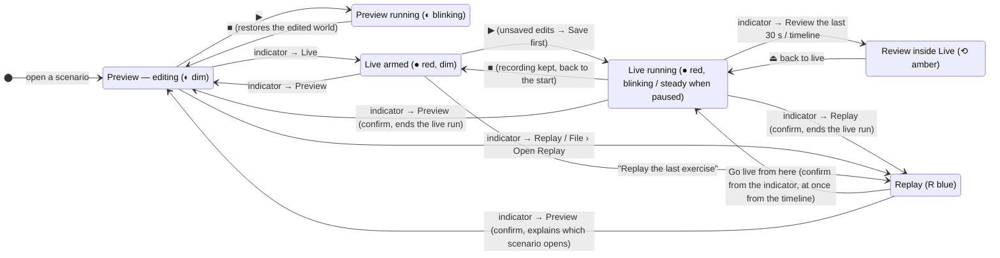
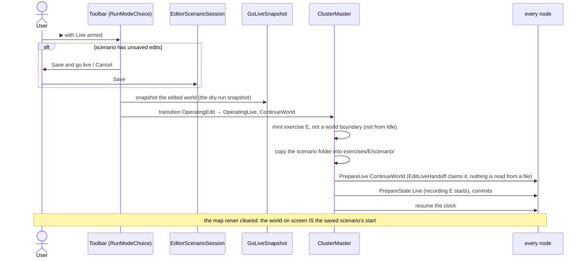
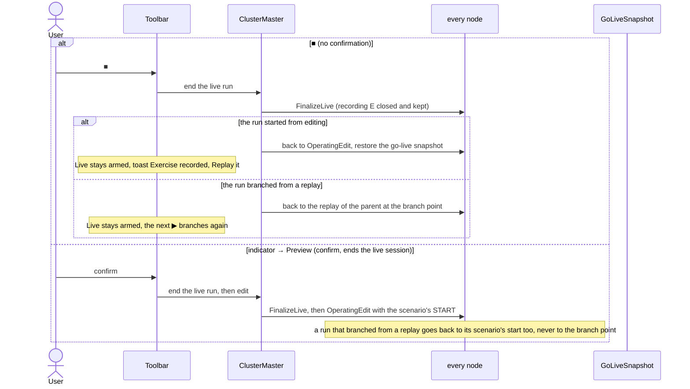
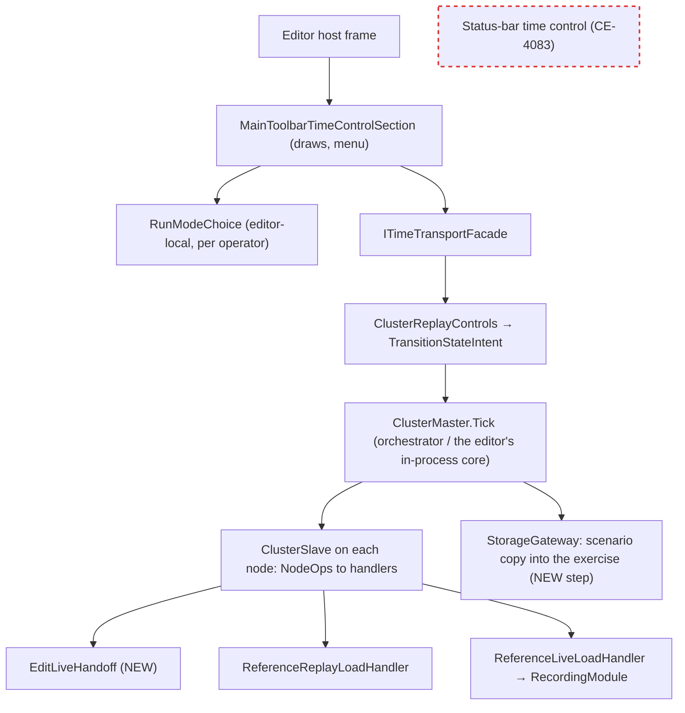

<!--STATUS
state: LIVE — the user shaped every decision in chat (2026-10-28); §4 records each with its verdict. Two rows are still leans (§4 marked ⏸)
updated: 2026-10-28
build-state: DESIGN — not dispatched. Before READY-TO-BUILD: measure M1–M3 (§5)
current-answer: §1 the three rules · §2 the picture (states, classes, sequences, modules) · §3 every move with its confirmation · §4 decisions · §5 what must be measured · §6 the build list
stale-below: nothing
known-rot: none
known-conflict: CGF-1-DESIGN.md:557 removed `RunningEdit → LoadingLive` ("would … leave edit-session resources dangling"); §4 D3 reinstates it as a world-CONTINUING load (the shape of the replay → live branch), which leaves nothing dangling because the edit world is parked in the go-live snapshot
related-designs:
  - ../DESIGN_Replay_Time_Axis_And_Review.md — §9a OWNS the mode indicator and its rule "a click opens a menu, never acts" (R-3060, R-3061); this question grows that menu with the mode choice and keeps the rule
  - ../DESIGN_Checkpoint_And_Dry_Run_Restore.md — OWNS the dry run's RAM snapshot (the preview) and §1h the branch with history (D18); the go-live snapshot and Replay → Live reuse both
  - ../designs/mgmt-1/DESIGN.md — §3 OWNS the operator state machine (Edit / Live / Replay, Live-from-Replay); §8.12 "always recording"
  - ../designs/cgf-1/CGF-1-DESIGN.md — §4.1 OWNS the BUILT transition graph and the note that removed Edit → Live (see known-conflict)
  - ../DESIGN_Deterministic_Network_Ids.md — §11 OWNS "ids and the world reset only on a load entered from Idle" — why a world-continuing go-live must not pass Idle
  - ../designs/main-toolbar-1/DESIGN.md — §7 the toolbar's time group, §10 the ONE asset browser (gains a Recording kind)
  - DESIGN_Time_Architecture.md — OWNS the editor's time controller; unchanged
  - ../DESIGN_Film_Director.md — the director plays takes LIVE (`EditorDirector.LoadLive`); unchanged, but its runs are exercises like any other
  - Blueprint_Issues_Tracker.md CE-4082 (this), CE-4083 (remove the status-bar time control — one transport), CE-4081 (Esc stops a take)
-->

# Architect Question 108 — **the run-mode picker: Preview · Live · Replay at the Play button** (`CE-4082`)

🔒 **User, `2026-10-28`** (the asks, verbatim, in order):
*"in editor i need some way to record a scenario, i.e. somehow switch the time control in the main menu bar between preview and live mode … if the
exercise is not running, the icon should indicate the mode to be run when Start button is pressed (preview, live, replay) maybe just in darker color
than when i finally press the Play - the icon then goes brighter or may be even blinking … Switching modes while running would not be possible. How
to switch model once scenario is already loaded needs to be thought through well."* ·
*"scenario should stay loaded visually as is (no visible unload and reload) and play should start live with recording. When paused or stopped, the
system still know what was the latest exercise … Changes in live mode should be saveable only as another scenario … From replay we could switch to
Live at any time (live will be initialized from current position of the replay) … From live/replay to preview is a step back to editing the original
scenario so whatever current state is discarded - such transitions must be guarded with confirmation dialog. switching to replay when no live has been
loaded asks for opening a recording (using our unified reusable open dialog)"* ·
*"live running -> replay ... here we should use DAR as the first choice … replay as secondary item (with ask - cancels the live)"* ·
*"live feels like it should be starting from the beginning of the scenario always, never from the middle of something else unless it is from replay
where switching to live is intentional (to re-train failed part of scenario)"* ·
*"recording should contain the copy of the scenario (whole folder because of distributed save?) so we can always really start editing the original"* ·
*"STOP in live … starting replay from END is weird … We should be able to run live again quickly (next play after LIVE end = next live start?)"* ·
*"Maybe 'Save' icon during live could create a checkpoint without asking anything, just with toast note"* ·
*"replay -> preview should probably explain the user what is going to happen (in a confirmation dialog). same with Replay -> live if started from
indicator mode switch. if from timeline's menu, it is accepted immediately"* ·
*"Live to Preview is losing a lot, it is ending a live session that might be intended to continue"* ·
*"edits must be allowed in live and preview, whether the user saves them is his responsibility, banner should be ok, rather in status bar - non
obtrusive"* · *"ok leans are fine"*

## 0. INVENTORY

⭐ Graph via `scripts/cbm.sh` + grep, `2026-10-28`. ⚠ `check_index_coverage` is not reachable through the CLI; every count was corroborated by grep.

| query | total | what it settled |
|---|---|---|
| `search_graph ".*(TimeTransport|ModeIndicator|ExerciseMode|SessionMode|Preview).*"` Class | 40 (production: `MainToolbarTimeControlSection`, `ClusterTimeTransportAdapter`, `EditorPreviewAdapter`, `EditorPreviewController`, `PreviewClockProcessManager`) | ONE toolbar transport + a status-bar copy (CE-4083); the preview is the editor's dry run |
| `search_graph ".*(ScenarioLoadSequence|LoadHandler|ScenarioSession|LiveBranch|RecordingModule|RecordingBranch).*"` Class | 15 | `ReferenceLiveLoadHandler` starts the recording; `ReferenceReplayLoadHandler` takes over a live load during a replay (the branch); `ScenarioLoadSequence` is the ONE load path (CE-295) |
| `search_graph` Interface `.*(TimeTransport|ScenarioSession|RecordReplayController|ClusterStateHandler).*` | 5 | the seams: `ITimeTransportFacade`, `IScenarioSession`, `IRecordReplayController`, `IClusterStateHandler` |
| grep `ITimeTransportFacade` (production) | 17 files | one facade read by toolbar, status bar, panels and the debug API |
| grep `"File/Live"`, `"File/Edit"` | `ScenarioMenuCommands.cs:91-97` | the load-in-a-mode menus this question folds away |
| grep `EnterReview(` | 12 sites | a review with no position = the live point (`ClusterReplayControls.cs:19`) — removed (§4 D9) |
| `HrotStateGraph.cs` edges | 19 | no Edit → Live edge (`:18-20`); Replay → Live exists (`:50`); Live ⇄ Review (`:55-58`) |
| `AssetKind` | 6 kinds | no `Recording` kind |
| `RecordingMetadata` | `ScenarioName`, `ScenarioHash` (`:72-79`, CE-4058) | the version is known; the scenario itself is not kept |

## 1. ⭐ The three rules — the spine

| # | rule | why it makes the rest predictable |
|---|---|---|
| **R1** | **Only the mode indicator changes mode.** ▶ ⏸ ■ never do | the user always knows what ▶ will do: the indicator says it, dim before the start, bright while running |
| **R2** | **■ returns to where this run came from, and the armed mode stays** — so the next ▶ repeats the run | Preview: back to the edited world. Live from editing: back to the scenario's start, Live armed (a quick rerun). Live branched from a replay: back to the replay at the branch point, Live armed (re-train the same part). Replay: back to the recording's start |
| **R3** | **A confirmation appears only to explain a jump or to stop losing something**, and it says exactly what will happen | Live → anything that ends the session asks; a deliberate ■ does not (it is the stop, and the run is already a recording) |

## 2. The picture

### 2.1 What the user sees — the modes and the moves

*What the picture shows that prose hid:* every arrow that ENDS a live session starts from `LRun` and is either the deliberate ■ (back to Live armed,
nothing lost) or a confirmed mode switch. Nothing reaches `LRun` except ▶ from Live armed or a branch from a replay — so a live run always starts
from a scenario's beginning or from an intended replay moment.

### 2.2 Classes — existing (grey) and new

```mermaid
classDiagram
  class MainToolbarTimeControlSection { <<existing>> ModeGlyph · ModeMenu · Play/Step/Stop }
  class ITimeTransportFacade { <<existing>> Mode · TogglePlayPause · Stop · EnterReview(at) }
  class RunModeChoice { <<NEW>> Armed : Preview|Live|Replay · LastExercise · LastBranchPoint }
  class ClusterReplayControls { <<existing>> EnterReview(at REQUIRED) · EnterReplay(id, at) }
  class ScenarioMenuCommands { <<existing>> File/Live, File/Edit → File › Open Scenario · File › Open Replay }
  class EditorScenarioSession { <<existing>> OpenForEdit · Save · IsDirty }
  class EditorPreviewController { <<existing>> the dry run: snapshot, run, restore }
  class GoLiveSnapshot { <<NEW, reuses the dry-run snapshot>> taken at ▶ Live · restored at ■ / Live → Preview }
  class EditLiveHandoff { <<NEW handler>> claims PrepareLive in OperatingEdit when ContinueWorld }
  class ReferenceReplayLoadHandler { <<existing>> claims PrepareLive during a replay (the branch, D18) }
  class ReferenceLiveLoadHandler { <<existing>> PrepareState Live → PrepareRecordingAsync(exercise) }
  class HrotStateGraph { <<existing>> + OperatingEdit → LoadingLive (continue-world) NEW }
  class ClusterMaster { <<existing>> mints the exercise id · IsWorldBoundaryLoad (false: not from Idle) }
  class ScenarioCopyIntoExercise { <<NEW, orchestrator>> copies the scenario folder into exercises/id/scenario/ }
  class RecordingMetadata { <<existing>> ScenarioName · ScenarioHash · + RecordedAt NEW }
  class AssetBrowserPanel { <<existing>> + AssetKind.Recording NEW }
  class CheckpointToast { <<NEW>> Save/Ctrl+S in Live or Replay = take checkpoint + toast }
  MainToolbarTimeControlSection --> ITimeTransportFacade
  MainToolbarTimeControlSection --> RunModeChoice : shows, menu sets
  ITimeTransportFacade --> ClusterReplayControls
  RunModeChoice ..> EditorScenarioSession : IsDirty → Save first
  RunModeChoice ..> GoLiveSnapshot
  GoLiveSnapshot ..> EditorPreviewController : same snapshot code
  ClusterMaster --> HrotStateGraph
  ClusterMaster ..> EditLiveHandoff : PrepareLive ContinueWorld
  ClusterMaster ..> ScenarioCopyIntoExercise
  EditLiveHandoff ..> ReferenceLiveLoadHandler : recording starts as for any live
  ReferenceReplayLoadHandler ..> ReferenceLiveLoadHandler
  ScenarioMenuCommands ..> AssetBrowserPanel : Open Replay
  ScenarioCopyIntoExercise ..> RecordingMetadata
```

*What the picture shows that prose hid:* the go-live from editing is the SAME shape as the built replay → live branch — a handler that claims
`PrepareLive` while a world is already open — and the snapshot is the dry run's own. The new code is a choice holder, one handler claim, one graph
edge, one copy step and one asset kind; everything else exists.

### 2.3 Sequence — Preview idle → ▶ Live, no reload

### 2.4 Sequence — ■ in Live, and Live → Preview

### 2.5 Modules — who runs what each frame

*What the picture shows:* the armed mode lives only in the editor (it is a choice of what ▶ will request); everything that actually changes the
world goes through the ONE cluster master, so a CGF or Player host showing the same toolbar sees the same running mode. The status-bar copy (red,
dashed) goes with CE-4083 — one transport, one picker.

## 3. Every move, with what the user is told

| from → to | how | confirmation (R3) | what happens |
|---|---|---|---|
| Preview idle → Live armed | indicator | none | ▶ will now start a live run |
| Live armed → ▶ | Play | only if unsaved: *Save and go live / Cancel* | live from the world on screen, recording on, no reload (§2.3) |
| Preview running → Live / Replay | indicator | *"Stops the preview and returns to the scenario's start"* | the dry run restores, then the chosen mode is armed |
| Live running → Review | indicator *"Review the last 30 s / 2 min / from a checkpoint — live continues after"*, or the timeline's menu at a time | none | DAR as built — ⛔ never at the live end (D9) |
| Live running → Replay | indicator, second item | *"Ends the live session; its recording opens"* | FinalizeLive, then the replay of E |
| Live running → Preview | indicator | *"Ends the live session; you return to editing the scenario at its start"* | §2.4 |
| ■ in Live | Stop | none | §2.4 — Live stays armed; toast *"Exercise recorded (12:31) — Replay it"* |
| Live armed → Replay the last exercise | indicator, or the toast's button | none | the replay of the last exercise, at its START |
| Preview → Replay, or File › Open Replay | indicator / File | unsaved edits → *Save / Discard / Cancel*; File › Open Replay always asks for a recording | the shared open dialog, kind Recording, grouped by scenario: *"hill-attack · run 3 · 14:41 · 12:31 long"* |
| Replay → Live | indicator | *"A new exercise starts from 07:04; this recording stays unchanged"* | the built branch (D18), inheriting the parent's scenario copy |
| Replay → Live | timeline menu | none — the user picked the moment | the same |
| Replay → Preview | indicator | explains which scenario opens; when the saved scenario's hash differs from the recording's: **Open the recorded version (as a copy)** · **Open the current scenario** | edit that scenario at its start |
| ■ in Replay | Stop | none | back to the recording's start, still Replay (R2) |
| Save / Ctrl+S in Live or Replay | toolbar / key | none | a checkpoint, toast *"Checkpoint taken"*; the scenario is never written |
| New scenario from a checkpoint | checkpoint menu / timeline | asks for a new name | the checkpoint's world as a new scenario, opened for editing |
| editing while Preview or Live runs | any tool | none | allowed; the status bar says *"Running — edits are not saved unless you save"* |
| open another scenario | File | unsaved → Save / Discard / Cancel | Preview is armed (never records by accident) |

## 4. Decisions

| # | decision | verdict |
|---|---|---|
| **D1** | the mode is a CHOICE of what ▶ runs, shown dim before the start and bright while running; locked while running except through the confirmed moves of §3 | ✅ user |
| **D2** | Live always starts from a scenario's beginning, or from an intended replay moment (the branch) — never from the middle of a preview | ✅ user |
| **D3** | Preview idle → Live does not reload: the edited world IS the saved scenario's start (unsaved edits are saved first). Built as a world-continuing live load claimed in `OperatingEdit` — the replay branch's shape — with a new `OperatingEdit → LoadingLive` edge; not a world boundary, so no id reset (Deterministic Ids §11) | ✅ user (the behaviour) · ⏸ the mechanism, after M1 |
| **D4** | unsaved edits ask *Save and go live / Cancel* | ✅ user |
| **D5** | ■ follows R2: back to where the run came from, the armed mode stays | ✅ user ("next play after LIVE end = next live start") · the branch case ✅ lean accepted |
| **D6** | replay of a just-ended live run is an explicit step (the indicator, or the toast's button), at the recording's START | ✅ user |
| **D7** | a recording keeps its scenario: the whole scenario folder copied into `exercises/<id>/scenario/` by the orchestrator once at go-live, plus `RecordedAt`; a branch inherits its parent's copy | ✅ user + lean accepted |
| **D8** | Save in Live / Replay = a checkpoint with a toast; a new scenario comes from a checkpoint, never from Save As | ✅ user |
| **D9** | a review always has an explicit start (the indicator's windows, the timeline); the "no position = the live point" default is removed (`ClusterReplayControls.cs:19`, `POST /review`) | ✅ user |
| **D10** | confirmations exactly as §3; Live → Preview always asks (no "don't ask again"); timeline actions never ask | ✅ user |
| **D11** | edits are allowed while Preview or Live runs; a status-bar note, not a banner | ✅ user |
| **D12** | opening a scenario arms Preview | ⏸ lean (accepted in the walkthrough, not stated as a ruling) |
| **D13** | the status-bar time control is removed (CE-4083) — the picker exists once | ✅ user (CE-4083) |

## 5. What must be measured before READY-TO-BUILD

| # | question | why it decides something |
|---|---|---|
| **M1** | does a node in `OperatingEdit` hold anything a live run must not have — editor-only systems, the preview's checkpoint, creation-request ids, role gates that differ between Edit and Live? | D3's mechanism. If something real blocks it, the fallback is a reload that keeps camera and selection |
| **M2** | does the distributed save write per-node parts into the scenario folder? | D7 copies the whole folder either way; this only tells how big the copy is |
| **M3** | does every live recording carry `ScenarioHash` today (editor, director, HTTP loads)? | D7's "changed since" check |

## 6. The build list (for the UI lane, after §5)

1. `RunModeChoice` + the indicator menu (radio items, the Replay items, dim/bright/blink) on `MainToolbarTimeControlSection`.
2. `EditLiveHandoff` + the `OperatingEdit → LoadingLive` continue-world edge + the go-live snapshot (the dry-run snapshot code).
3. ■ per R2 (Live: back to editing or to the branch point, Live armed; Replay: rewind) + the toast.
4. `ScenarioCopyIntoExercise` + `RecordedAt`; Replay → Preview's two-button dialog.
5. `AssetKind.Recording` in the shared open dialog; File › Open Replay; File › Live / File › Edit folded into File › Open Scenario.
6. Save/Ctrl+S = checkpoint + toast in Live/Replay; "New scenario from checkpoint".
7. `EnterReview` without a position refused; the timeline's right-click menu carries Review from here / Go live from here / Take checkpoint here.
8. The status-bar note while a run goes.
