<!--STATUS
state: LIVE — ✅ APPROVED 2026-10-28 (R-4098): the user shaped every decision in chat and accepted every remaining lean ("All your leans accepted")
updated: 2026-10-29 (CE-1439: §2.12 as-built — the Orchestrator composes the scenario menu and the panel asks the one run surfaces) · 2026-10-29 (CE-3340 ② as-built in D7's block, ⑤ in §4b) · 2026-10-29 (CE-1436 ui half: §2.8a deviation 12, the adapter and the editor session read ClusterView) · 2026-10-28 (CE-4097 part two as-built folded into §2.8a) · 2026-10-28 (CE-4097 core as-built folded into §2.8) · 2026-10-28 (CE-4090 as-built folded into §5a; CE-4093 master as-built in §4b)
build-state: READY-TO-BUILD (2026-10-28) — not dispatched. M1–M6 MEASURED 2026-10-28 (§5); D16 (start perspective) and D18 (start with a scenario) decided by the user; M7–M8 measured; READY-TO-BUILD — ⛓ sequenced AFTER the content-layout move (repo `scenarios/` · `assets/` · `recipes/`, a separate short design), because the start surface lists recipes and scenarios
current-answer: ⭐ §2.2–§2.5 REVISED (no continue-world flag) · §1 the three rules · §1a the words (Live / DAR / AAR) · §4 D16 the start perspective, D18 start with a scenario · §2 the picture (states, classes, sequences, modules) · §3 every move with its confirmation · §4 decisions · §5 what must be measured · §6 the build list
stale-below: nothing
known-rot: none
known-conflict: CGF-1-DESIGN.md:557 removed `RunningEdit → LoadingLive` ("would … leave edit-session resources dangling"); §4 D3 reinstates it as a world-CONTINUING load (the shape of the replay → live branch), which leaves nothing dangling because the edit world is parked in the go-live snapshot
related-designs:
  - ../DESIGN_Replay_Time_Axis_And_Review.md — §9a OWNS the mode indicator and its rule "a click opens a menu, never acts" (R-3060, R-3061); this question grows that menu with the mode choice and keeps the rule
  - ../DESIGN_Checkpoint_And_Dry_Run_Restore.md — OWNS the dry run's RAM snapshot (the preview) and §1h the branch with history (D18); the go-live snapshot and Replay → Live reuse both
  - ../designs/mgmt-1/DESIGN.md — §3 OWNS the operator state machine (Edit / Live / Replay, Live-from-Replay); §8.12 "always recording"
  - ../designs/cgf-1/CGF-1-DESIGN.md — §4.1 OWNS the BUILT transition graph and the note that removed Edit → Live (see known-conflict)
  - ../DESIGN_Deterministic_Network_Ids.md — §11 OWNS "ids and the world reset only on a load entered from Idle" — why a world-continuing go-live must not pass Idle
  - ../designs/main-toolbar-1/DESIGN.md — §7 the toolbar's time group, §10 the ONE asset browser (gains a Recording kind)
  - DESIGN_Time_Architecture.md — OWNS the editor's time controller; unchanged
  - ../DESIGN_Film_Director.md — the director plays takes in the PREVIEW (`DirectorRunner.cs:584`); only the scenario verifier loads live (`ScenarioVerifyRun.cs:157`) — unaffected, except D14 must keep recording ON for verify runs
  - ../DESIGN_Distributed_Scenario_Persistence.md — §4a OWNS what a scenario folder holds after a distributed save (one merged scenario.json + foreign/node_<id>.json); D7 copies all of it
  - ../DESIGN_Film_Production.md — F-1 / row ① "any live run records itself" (R-4091) and R-3053 — D14 amends both (recording becomes a setting)
  - ../DESIGN_Cluster_Load_Phase.md — §8:809 records the user 2026-10-05: a production run is "started from scenario file always, never from memory"; D3 supersedes it for the go-live from Preview (the user, 2026-10-28)
  - Blueprint_Issues_Tracker.md CE-4082 (this), CE-4083 (remove the status-bar time control — one transport), CE-4081 (Esc stops a take)
-->

# Architect Question 108 — **the run-mode picker: Preview · Live · Replay at the Play button** (`CE-4082`)

🔒 **User, `2026-10-28`** (the asks, verbatim, in order):
*"in editor i need some way to record a scenario, i.e. somehow switch the time control in the main menu bar between preview and live mode … if the
exercise is not running, the icon should indicate the mode to be run when Start button is pressed (preview, live, replay) maybe just in darker color
than when i finally press the Play - the icon then goes brighter or may be even blinking … Switching modes while running would not be possible. How
to switch model once scenario is already loaded needs to be thought through well."* ·
*"scenario should stay loaded visually as is (no visible unload and reload) and play should start live with recording. When paused or stopped, the
system still know what was the latest exercise … Changes in live mode should be saveable only as another scenario … From replay we could switch to
Live at any time (live will be initialized from current position of the replay) … From live/replay to preview is a step back to editing the original
scenario so whatever current state is discarded - such transitions must be guarded with confirmation dialog. switching to replay when no live has been
loaded asks for opening a recording (using our unified reusable open dialog)"* ·
*"live running -> replay ... here we should use DAR as the first choice … replay as secondary item (with ask - cancels the live)"* ·
*"live feels like it should be starting from the beginning of the scenario always, never from the middle of something else unless it is from replay
where switching to live is intentional (to re-train failed part of scenario)"* ·
*"recording should contain the copy of the scenario (whole folder because of distributed save?) so we can always really start editing the original"* ·
*"STOP in live … starting replay from END is weird … We should be able to run live again quickly (next play after LIVE end = next live start?)"* ·
*"Maybe 'Save' icon during live could create a checkpoint without asking anything, just with toast note"* ·
*"replay -> preview should probably explain the user what is going to happen (in a confirmation dialog). same with Replay -> live if started from
indicator mode switch. if from timeline's menu, it is accepted immediately"* ·
*"Live to Preview is losing a lot, it is ending a live session that might be intended to continue"* ·
*"edits must be allowed in live and preview, whether the user saves them is his responsibility, banner should be ok, rather in status bar - non
obtrusive"* · *"ok leans are fine"*

🔒 **User, `2026-10-28`, the second pass** (verbatim): *"CGF/all-in-one mode should start in live mode by default, editor in preview mode"* · *"review and replay wording would be better to replace with AAR and DAR (or at least DAR as something different from classical replay)"* · *"we should somehow also allow live without recording; live does not mean just recording, it has consequences on whether people control some HID like replicated weapons or drive a replicated cars, outside of our engine, so it differs from preview where no live players are present; maybe some setting in the system can control whether the live does recording at all; and we could ask at the end (gated by another setting) whether we want to discard the recording so it does not pile up"* · *"editor is in 'unsaved new scenario' mode by default and the terrain must be loaded first - can be loaded via terrain-specific scenario recipes which would then read as always creating a scenario first. Scenario must be saved before switching to live but can be previewed at will."*

🔒 **User, `2026-10-28`, the third pass** (verbatim): *"turning off recording will need some gates at different places where the recording is expected to be available now"* · *"Edit mode and live mode are not much different from our ecosystem point of view. The difference is in some parts that are outside of this ecosystem."* · *"today we are allowed to start Editing without the terrain selected, So we are ending up in no terrain situation. Technically this might be okay if we use reference point 0, 0 but it is almost never correct for any production real use case … the cleanest option is to behave like any usual editor. So when it opens empty and the controls are disabled until the user decides whether to create a new scenario by opening a terrain recipe or by loading an already existing scenario, and only then the controls will enable … Meaning that a scenario without a terrain cannot be authored."*

🔒 **User, `2026-10-28`, the fourth pass — THE START PERSPECTIVE** (verbatim): *"the application start with basically nothing, with just the main menu and no panels, with a special perspective, which means 'nothing allowed, First you need to either open a scenario to be edited, or start a new scenario to be edited, or load an existing scenario into live mode, or load an existing recording into replay mode.' This is very clean and follows the cluster state machine … flat 0,0 terrain kind of scenario can be opened when we select start a new scenario from flat terrain empty recipe. That means we do not need to support a special flat terrain … the initial state when the editor opens with an empty world, but in the idle state of the cluster state machine is some relict from the development of the system … when we go back to idle, whenever during the session, the UI should switch back to this 'you can do nothing' Perspective."* · *"Regarding the harnesses … maybe for those we can leave it as it is … The only change here is that the UI will switch into the start perspective at the beginning. So the empty world is still there at the background, but there is no way how to touch it"* · *"the Stride host, I'm not using it anymore … keeping it just like an example"* · *"let's support from the very beginning the option that the cluster can be started with a concrete scenario loaded that requires the cluster waits until all mandatory nodes or roles are present, and only then it loads the scenario."*

🔒 **User, `2026-10-28`, the fifth pass** (verbatim): *"Maybe the open for editing is the default because we already support going live from the preview, which is still at the beginning. that would reduce the menu to open scenario, and whether we are going to edit or [live] could depend on what node is opening. If it is editor, it could start in the editing mode by default, and if it is the CGF, then it could start in the live mode by default. As the start perspective should be something shared and unified across the nodes, 'am I starting in live or in preview?' should be one of little host specific parametrizing the otherwise unified and shared bootstrap code. Startup scenario lives on the command line of the cluster runner. and it is meant for the orchestrator node. And if the startup scenario is the recipe, then we are loading an unsaved new scenario based on the recipe. And if the scenario is an already saved scenario, meaning not a recipe, we are loading that scenario … just by the scenario name, we should be able to somehow determine whether it is a recipe or an already existing scenario."*

🔒 **User, `2026-10-28`, the approval:** *"top-level recipes folder, and go with your lean on behaviours, All your leans accepted."* ⇒ every ⏸ lean in §4 and §5 is approved as written (R-4098).

🔒 **User, `2026-10-28`, the sixth pass** (verbatim): *"There should be also 'Recent' section in the picker dialog So we can easily pick whatever was picked the last time. The recent items should be remembered in the user folder."* · *"Mode can be changed also by clicking the timeline and selecting something like replay from this place or similar."* · *"How do we recognize there are any unsaved changes? … comparing the current state of the world with the snapshot … this might differ per node."* · *"The continue the world flag. Is it required given that the load of the world is quick … What I meant by no reloading was that we shouldn't reload any terrain or big assets that are already loaded in the memory. Could the solution be more clean if we avoid using the continue the world flag?"* · *"Please break the implementation into tasks so we can give them to different sessions as needed - ui, backend etc."*

🔒 **User, `2026-10-28`, the seventh pass** (verbatim): *"Yes, HTTP server face stays explicit."* · *"I think setting the change flag from any change operation is very fragile and will break easily. Comparing the current world with the world state at the beginning is a relatively simple and very reliable way. We just need to find out how to do it across the cluster, When and how often, and how to share this flag with others so everyone can show the unsaved scenario flag in the UI."*

🔒 **User, `2026-10-28`, the eighth pass** (verbatim): *"We likely really need to know whether something has changed only when we are going to switch the mode, So maybe we do not even to detect it too often."*

🔒 **User, `2026-10-28`, the ninth pass** (verbatim): *"Do we need to check only what goes into the scenario? Maybe that anything that changes is a good reason for showing the change flag. Maybe the checkpoint, which is now created as a keyframe in the flight recorder on every preview start, is pretty good for comparing … I agree that we should do it on demand only and drop the change indicator, But I would still compare the full world, not just the parts that go into the scenario. Alternatively, we could be snapshotting the world and serializing into JSON on purpose in periodical intervals as part of autosave feature, so that we can recover from editor crash … If we do the JSON serialization from a temporary ECS world snapshot in a separate backend task, it could be asynchronous, and we will not care about how much time it takes because it will not be blocking anything."*

## 0. INVENTORY

⭐ Graph via `scripts/cbm.sh` + grep, `2026-10-28`. ⚠ `check_index_coverage` is not reachable through the CLI; every count was corroborated by grep.

| query | total | what it settled |
|---|---|---|
| `search_graph ".*(TimeTransport|ModeIndicator|ExerciseMode|SessionMode|Preview).*"` Class | 40 (production: `MainToolbarTimeControlSection`, `ClusterTimeTransportAdapter`, `EditorPreviewAdapter`, `EditorPreviewController`, `PreviewClockProcessManager`) | ONE toolbar transport + a status-bar copy (CE-4083); the preview is the editor's dry run |
| `search_graph ".*(ScenarioLoadSequence|LoadHandler|ScenarioSession|LiveBranch|RecordingModule|RecordingBranch).*"` Class | 15 | `ReferenceLiveLoadHandler` starts the recording; `ReferenceReplayLoadHandler` takes over a live load during a replay (the branch); `ScenarioLoadSequence` is the ONE load path (CE-295) |
| `search_graph` Interface `.*(TimeTransport|ScenarioSession|RecordReplayController|ClusterStateHandler).*` | 5 | the seams: `ITimeTransportFacade`, `IScenarioSession`, `IRecordReplayController`, `IClusterStateHandler` |
| grep `ITimeTransportFacade` (production) | 17 files | one facade read by toolbar, status bar, panels and the debug API |
| grep `"File/Live"`, `"File/Edit"` | `ScenarioMenuCommands.cs:91-97` | the load-in-a-mode menus this question folds away |
| grep `EnterReview(` | 12 sites | a review with no position = the live point (`ClusterReplayControls.cs:19`) — removed (§4 D9) |
| `HrotStateGraph.cs` edges | 21 | no Edit → Live edge (`:18-20`); Replay → Live exists (`:50`); Live ⇄ Review (`:55-58`) |
| `AssetKind` | 6 kinds | no `Recording` kind |
| `RecordingMetadata` | `ScenarioName`, `ScenarioHash` (`:72-79`, CE-4058) | the version is known; the scenario itself is not kept |

## 1. ⭐ The three rules — the spine

| # | rule | why it makes the rest predictable |
|---|---|---|
| **R1** | **Only the mode indicator changes mode.** ▶ ⏸ ■ never do | the user always knows what ▶ will do: the indicator says it, dim before the start, bright while running |
| **R2** | **■ returns to where this run came from, and the armed mode stays** — so the next ▶ repeats the run | Preview: back to the edited world. Live from editing: back to the scenario's start, Live armed (a quick rerun). Live branched from a replay: back to the replay at the branch point, Live armed (re-train the same part). Replay: back to the recording's start |
| **R3** | **A confirmation appears only to explain a jump or to stop losing something**, and it says exactly what will happen | Live → anything that ends the session asks; a deliberate ■ does not (it is the stop, and the run is already a recording) |

### 1a. ⭐ The words the user sees (D17)

| word | means | indicator |
|---|---|---|
| **Preview** | a dry run of the scenario being edited — no live players, nothing recorded, ■ restores | ◐ violet |
| **Live** | the exercise with live players: people outside the engine drive replicated vehicles and weapons (HID, simulators). ⭐ **Live is NOT "recording"** — it records only when the system setting says so (D14) | ● **red** when recording · ● **green** when not |
| **DAR** — During Action Review | looking back INSIDE a running live session; live continues after ⏏ | ⟲ amber, tooltip "DAR" |
| **AAR** — After Action Review | playing a recording (an ended exercise, or one opened from a file); "Replay" disappears from the user's vocabulary | blue **AAR** badge |

⭐ Only the words the user sees change. ⛔ The code keeps `TransportMode.Replay` / `Review` and `ClusterState.OperatingReplay` / `OperatingReview` — renaming them buys nothing and touches the wire and every test.

## 2. The picture

### 2.1 What the user sees — the modes and the moves

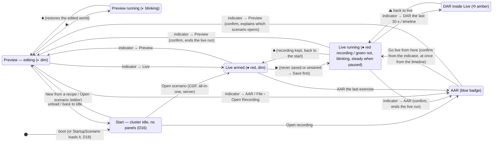

*What the picture shows that prose hid:* nothing is reachable without leaving `Start`, and every way out of `Start` is an ordinary state-machine load — so no host ever shows panels over the Idle world. Every arrow that ENDS a live session starts from `LRun` and is either the deliberate ■ (back to Live armed,
nothing lost) or a confirmed mode switch. Nothing reaches `LRun` except ▶ from Live armed or a branch from a replay — so a live run always starts
from a scenario's beginning or from an intended replay moment.

### 2.2 Classes — existing (grey) and new *(revised `2026-10-28`, sixth pass: no continue-world flag)*

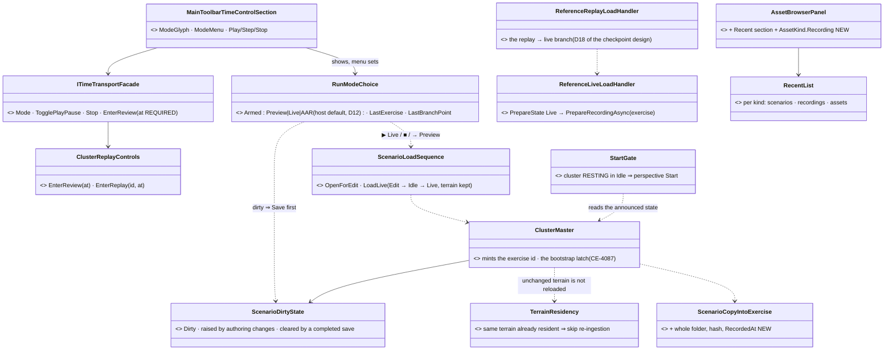

*What the picture shows that prose hid:* every mode change except the replay branch is an ORDINARY load through the one load path — the
"continue the world" flag of the first draft is gone (sixth pass, user). It costs no big reload because entering Idle clears only the entities
(`LoadPhaseChain.OnEnteredIdle`) and an unchanged terrain is not re-ingested (`TerrainResidency.cs:174-203`); the knowledge base is a no-op
(`KnowledgeBaseLoadStep.cs:99`). Bonus: a live run's ids are the canonical ones of a fresh load, and its recording matches its scenario file.

### 2.3 Sequence — Preview idle → ▶ Live (only the scenario file is re-read)

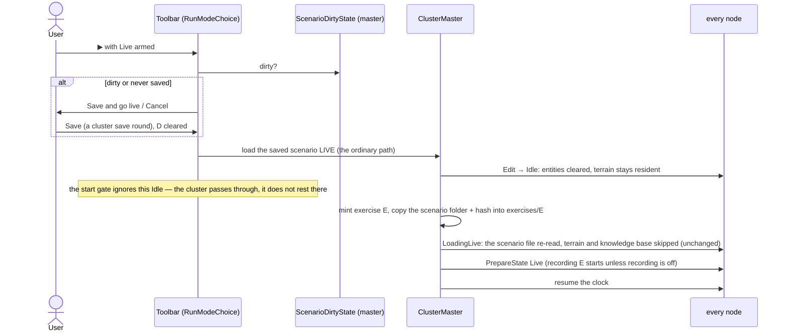

### 2.4 Sequence — ■ in Live, and Live → Preview

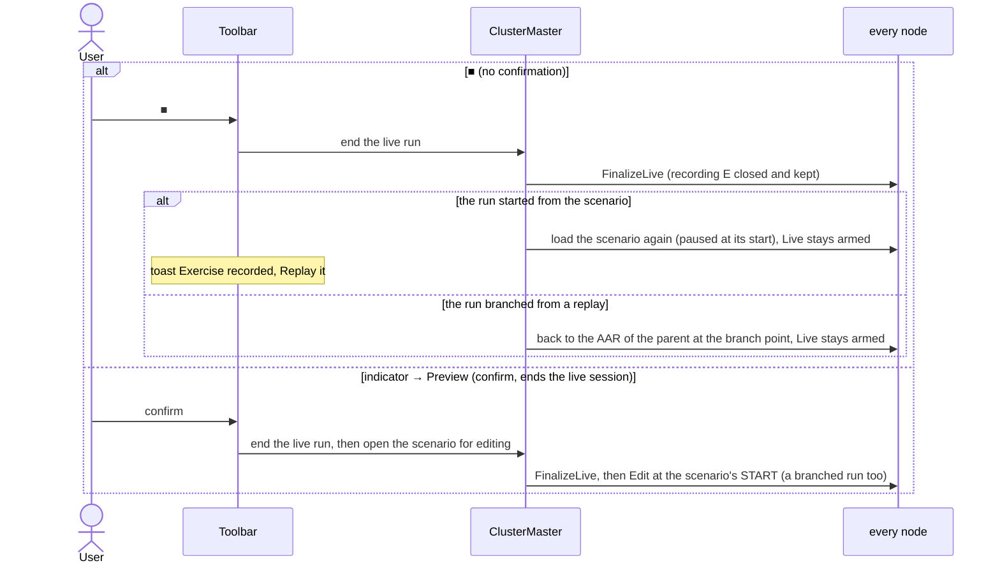

### 2.5 Modules — who runs what each frame

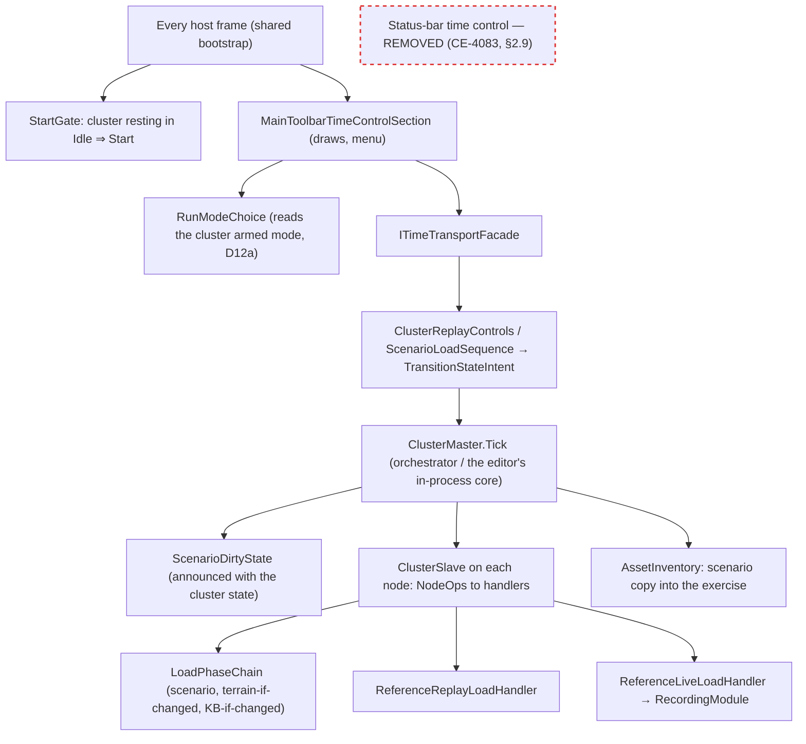

⭐ **AS-BUILT `2026-10-29` (CE-4083):** the dashed box is a **removed** edge — **SUPERSEDED**: until `2026-10-29` it was a live second transport (`ClusterTimeControlStatusBarSection`, wrapped by the editor's `TimeControlStatusBarSection`); it is gone and no status-bar section is a time control (§2.9).

*What the picture shows:* the armed mode is per host; every change to the world goes through the ONE cluster master and the ONE load path; the
dirty state lives with the master and is announced like the cluster state, so every host shows the same `name*` (UXR-03).

### 2.6 CE-4096 — the start gate — ⭐ **AS-BUILT `2026-10-28` (ui)** (built before CE-4089; the user: *"yes, build CE-4096 now"*)

⭐ **AS-BUILT:** the picture below is the BUILT one (deviations: the table after the sequence diagram; the pre-build form is struck where it was wrong). Build-state of §2.6: **BUILT** — the content-folder listing on the surface follows CE-4089.

**INVENTORY** (graph + grep; ⚠ `check_index_coverage` not available through the CLI): `search_graph .*(StartGate|StartSurface|StartPerspective|IdleGate|RestingIdle).*`
→ **0** (nothing to extend). `search_graph .*(ClusterState|ClusterUiCache|MasterGone|ClusterStatus).*` (Class/Interface) → `ClusterUiCache`,
`SimpleClusterStateCache`, `ClusterStates`, `IClusterStateUpdateObserver`, the events. Production `new WindowManager(` → **one** cluster-runner site,
`LocalWindowController.cs:109` (+ the exempt Stride host). Backend's CE-4094 API: `WindowManager.StartPerspectiveName` / `RememberedPerspective` /
`IsStartShowing` / `TrySwitchPerspective` refusal / `LeaveStartPerspective` ([NOTE](batches/NOTE_Backend_To_Ui_Run_Modes_Start_Http.md)).
Cluster state per host: `ISubsystemDebugProvider.ClusterState` (+ `PerspectiveScopedDispatcher.ClusterStateAnyNode`, the one-cluster-one-fact
fallback) — set by Orchestrator, Editor, ExCon, RB only; ⛔ **SUPERSEDED (found at build): CGF / SimHost / IG / Traffic set none** — they ALL pass `EcsNodeDebugProvider.For` (CE-163), which fills `ClusterState` from `ClusterSlave.LocalClusterState`: the node's own COMMITTED state, which stays Idle while the cluster loads. ⭐ So the gate needed a second, distinct fact (`FollowedClusterState`, below), not a first one. Every node's `ClusterSlave` follows the
master's broadcast (`ClusterSlave.FollowClusterSession`, private `_clusterState`, MasterGone handled).

| the lean rests on | code | design |
|---|---|---|
| one place composes every cluster-runner host's window manager | ✅ `LocalWindowController.cs:109` (one `new WindowManager`) | ✅ D16 "one gate … registered by the shared bootstrapper" |
| an announced Idle CAN be a pass-through | ✅ the ordinary load is TWO requests (`ScenarioLoadSequence.Request`: Idle, then the load — CE-295) ⇒ every host sees a real Idle between them | ✅ D3 ⚠ "never an Idle a trajectory passes through" |
| every node knows the master's state and MasterGone | ✅ `ClusterSlave.cs:638-660` | ✅ D16 "reads the cluster state every host already has" |

```mermaid
classDiagram
  class WindowManager { <<existing, CE-4094; CE-4096 additions>> StartPerspectiveName · RememberedPerspective · IsStartShowing · TrySwitchPerspective refuses in Start · LeaveStartPerspective() · GetSelectablePerspectives() without Start · Render hides non-Start non-volatile windows and the toolbar while Start shows }
  class StartGate { <<NEW, Fdp.Presentation>> +Tick(now, ClusterRest) · SettleSeconds = 0.5 · Variant }
  class ClusterRest { <<NEW record struct>> State? (null = no master yet) · MasterGone · CanOperate · IsResting }
  class IClusterRestSource { <<NEW>> ReadClusterRest() implemented by EditorSubsystem, which builds no provider }
  class ClusterRestReader { <<NEW, ClusterRunner>> From(subsystems) the ONE fold: first non-Idle state · any MasterGone · any Master }
  class StartSurfaceWindow { <<NEW, claims Start>> Model() · draws AllowedInIdleItems as buttons · or the waiting text }
  class GlobalMenuRegistry { <<existing>> RegisterItem(path, ..., allowedInIdle) · AllowedInIdleItems() · IdleOnlyWhen and Offers() · PruneToIdle for contributors }
  class MenuItemNode { <<existing>> AllowedInIdle }
  class ContextMenuItemDto { <<existing, GizmoMap.Contracts>> AllowedInIdle for contributed items }
  class LocalWindowController { <<existing, cluster runner>> ComposeStartSurface(wm) · TickStartGate() · ArmedMode · RequestExit and TakeExitRequest }
  class ISubsystemDebugProvider { <<existing>> ClusterState node-committed on an ECS node · FollowedClusterState the cluster as last heard · MasterGone · Master }
  class ClusterSlave { <<existing>> FollowedClusterState · HasFollowedState · MasterGone public reads of what it already follows }
  class EcsNodeDebugProvider { <<existing, CE-163>> passes followedClusterState and masterGone from the node slave: CGF, SimHost, IG, Traffic alike }
  class HostArmedMode { <<NEW, one bootstrap parameter>> editor Preview · everything else Live · read by CE-4097 }
  LocalWindowController --> StartGate : Tick before Render
  LocalWindowController --> StartSurfaceWindow : registers
  LocalWindowController --> ClusterRestReader : feeds the gate
  LocalWindowController --> HostArmedMode : carries
  StartGate --> WindowManager : SwitchPerspective(Start) / LeaveStartPerspective
  StartGate ..> ClusterRest : any node (one cluster, one fact)
  ClusterRestReader ..> ISubsystemDebugProvider : every node provider
  ClusterRestReader ..> IClusterRestSource : the editor
  EcsNodeDebugProvider ..> ClusterSlave : CGF / SimHost / IG / Traffic now answer
  EcsNodeDebugProvider ..|> ISubsystemDebugProvider
  StartSurfaceWindow --> GlobalMenuRegistry : the same actions as the menu
  GlobalMenuRegistry --> MenuItemNode : leaves carry AllowedInIdle
  GlobalMenuRegistry --> ContextMenuItemDto : contributed leaves carry it too
  WindowManager --> GlobalMenuRegistry : IdleOnlyWhen is IsStartShowing, so the bar draws only Offers()
```

*What the picture shows that prose hid:* the start surface owns NO action — it draws the menu items marked *allowed in Idle* (New from a recipe,
Open scenario, Open recording, Exit, Help) and invokes the SAME bindings, so the surface and the menu cannot disagree; and the gate's only input is
one `ClusterRest` read from any node, so every host family behaves alike by construction.

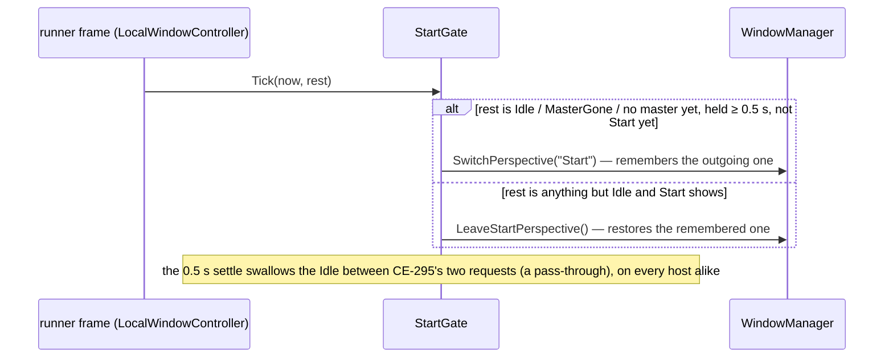

⭐ **Decisions:** ① **resting = Idle held ≥ 0.5 s** (also MasterGone, and "no master yet" at a node's boot) — the two-request load leaves a real
Idle for one round trip; a settle on the HOST needs no wire change. ② **Variants** from `ClusterRest`: `CanOperate` (a provider in this process
offers `Master`, and the host is not a Player) ⇒ the actions; else *"Waiting for the server to load a scenario"*; MasterGone ⇒ *"Server lost —
waiting"*. ③ **Exempt:** a process whose only subsystem is the Replay Browser (offline), and the Stride host. ④ **The surface's actions are the
menu's:** a host that registers no Open/New items (today CGF's come from `ScenarioCatalogContributor`) shows what it has — until CE-4089 they open
today's dialogs on today's folders, after it the same dialogs on the new ones. ⑤ **`HostArmedMode`** is defined and set here (editor Preview,
else Live), read by CE-4097.
Rejected: **a "resting" flag on the master's broadcast** — a wire change in backend's lane, and the master cannot know a requester's second
request is coming · **per-host gates** — four copies (R "shared and unified") · **a Start provider with no world** — M7 rejected it.
⚠ **Then fix** `ClusterConformanceRails` and `TheUiBaselineIsPinnedPerHostRails` (they switch perspective without a load — backend's NOTE).

⭐ **Done:** both rails now call `ClusterConformanceRails.LeaveStartAsync` (one helper: when `/status.perspective` is `Start`, load the conformance scenario, then wait for the gate to hand the window back) before they walk the perspectives.

**AS-BUILT deviations from the design above** *(the design text is kept; each row is where the build differs and why)*

| # | design said | built | why (measured) |
|---|---|---|---|
| 1 | CGF / SimHost / IG / Traffic set no `ClusterState`; make them answer through their slave | they already did — as the node's COMMITTED state (`EcsNodeDebugProvider.cs`, `ClusterStateFrom` → `LocalClusterState`), which stays Idle while the cluster loads. Added a SECOND member `FollowedClusterState` (the cluster as last heard; null = none yet) + `MasterGone`, as interface defaults (`FollowedClusterState => ClusterState`, `MasterGone => false`) so the Orchestrator / ExCon / Replay Browser keep what they have | reading the committed state would show Start for the whole load on every ECS node, and forever on a node outside the scenario |
| 2 | `ClusterRest` from the providers, "first non-null state" | first NON-IDLE state any node reports, else Idle if any says Idle, else null | a node lagging into (or out of) Idle must not hold Start up or let it in; the settle covers the rest |
| 3 | providers carry every host | the **Editor builds no `ISubsystemDebugProvider` in the runner** — it implements the new `IClusterRestSource` (state = its session's, `CanOperate` = true, never MasterGone); `ClusterRestReader` folds both | measured: `IProvidesDebugSurface` implementers = Traffic, IG, Orchestrator, CGF, ReplayBrowser, SimHost, ExCon (no Editor) |
| 4 | "Exit" is an allowed-in-Idle item | **no Exit menu item existed** (grep `"File/Exit"`, `"Exit"`, `RequestExit`, `"Quit"`: only the window's [X] + `/shutdown`). Added `File/Exit` in `LocalWindowController` → `RequestExit`, taken by the frame loop exactly like the [X] (every `IAppExitGuard` asked first) | one path out, guards respected |
| 5 | "Open Recording (AAR)" is allowed in Idle | **no such menu item exists yet** (grep `Open Recording`, replay items under `File`): marked `Open Scenario`, `New Scenario`, `Load Scenario` (File/Live), Help › About, Exit. The recording entry arrives with CE-4089 and later | nothing to mark |
| 6 | `CanOperate` excludes a Player host | no reliable signal at the runner (R-4096 `OrdersOffered` is a per-world singleton, not a host role; the runner has no Player) ⇒ `CanOperate` = some provider's `Master != null` only. ⚠ every ECS node's `Master` is the bus-based control (`OrchestrationBusMasterControl.Via`), so SimHost / IG alone also read `CanOperate` and show the surface's Help / Exit buttons rather than "Waiting for the server" | the waiting text therefore shows today only while no master was ever heard from a node that cannot operate, and for server-lost; a finer signal is a follow-up |
| 7 | `Start` claimed by one window | `Start` stays in `GetPerspectives()` (A0 needs the claimed set) but is excluded from `GetSelectablePerspectives()` — used by the Perspective menu, the toolbar and the `/perspectives` API switcher — and from the startup choice (`ResolveStartupPerspective`) | otherwise the user (or an MCP caller) could pick `Start`, and a host with a perspective sorting after it could start in it |
| 8 | "verify Global-scope windows" | **they DO draw in Start** (`ManagedWindow.Render` shows `Scope == Global or IsPinned or owner == current`): `WindowManager.Render` skips every non-Start, non-volatile window while Start shows (volatile = dialogs, still drawn; pickers draw from the subsystems' `DrawUI`, unaffected); the main toolbar is hidden too | "no panels" |
| 9 | the menu bar draws only allowed-in-Idle items | one visibility test `GlobalMenuRegistry.Offers` (binding AND, while `IdleOnlyWhen`, allowed-in-Idle) used by the drawn bar, the `/panels` menu model and `HasVisibleDescendant`; contributors (Help, Windows, Perspective) are pruned through the DTO flag `ContextMenuItemDto.AllowedInIdle`; separators drop | drawn bar and model cannot disagree |
| 10 | `Fdp.Presentation` reaches `ClusterState` | it does (project reference to `Fdp.Toolkits`); `ClusterRest.State` is the real enum | — |
| 11 | ⛔ **SUPERSEDED by §2.10 (CE-1437): `HostArmedMode(s)` and `LocalWindowController.ArmedMode` are DELETED — the table is `RunArmedDefaults`.** `HostArmedMode` "set from the runner's mode" | `HostArmedModes.For(config.RequestedSubsystems)` (editor ⇒ Preview, else Live) passed to `LocalWindowController`'s constructor, exposed as `ArmedMode`; no behaviour yet | CE-4097 reads it |
| 12 | "New scenario from a recipe" | the item marked is today's `File/Edit/New Scenario` (`ClearWorld`, a local blank) — the recipe form follows CE-4089 | content-folder listing follows CE-4089 |
| 13 | one headless frame rail per host family | no headless frame harness drives a real runner frame here: the gate is driven through the real `LocalWindowController` with a fake shell (`TheStartGateIsComposedOnceTests`) and the draw through `ImGuiTestFixture` (`StartGateTests`). The per-host system rails (`ClusterConformanceRails`, `TheUiBaselineIsPinnedPerHostRails`) are compiled but boot a real editor process | — |

### 2.7 CE-4098 — the picker's Recent section + recordings in the picker — ⭐ **AS-BUILT `2026-10-28` (ui)** (built before CE-4089, by the user's decision)

⭐ **AS-BUILT:** build-state of §2.7 **BUILT**. §2.2's `RecentList` box is **not a new class** — it is the existing `RecentStore` (NodeEditor.UI), extended; the
box `ClusterReplayControls.EnterReplay(id, at)` of §2.2 does not exist and was not added (the opener is the session's, see the table).

**INVENTORY** (graph + grep; ⚠ `check_index_coverage` not available through the CLI): `search_graph .*Recent.*` → **one** picker store, `Picker.RecentStore` (in-memory, per
context, move-to-front, cap 16), read by `PickerState.Refilter` and pushed by `PickerWindow.Confirm`; **no** asset-browser recent; the Tree layout (what the Open-Asset and
scenario pickers use) drew **no** Recent section — only the flat layouts had the "↻ Recent" header. `search_graph .*Picker.*` (Class) → the pickers: `AssetPickerLauncher`
(File › Open Asset, and the scenario Open/Load items through `ScenarioMenuCommands`' `openPicker` seam), `AssetPickerModal` + `AssetBrowserPanel` (docked browser),
`TerrainPickerLauncher` (not a user-open picker — a scenario terrain choice; left alone), no recording list. Recording opener: `IRecordingOpener` is the **Replay Browser's, for
FILES**; the cluster's, for EXERCISES, is `ReplaySessionIntents.EnterReplay(exerciseId)` (what `POST /replay {exerciseId}` and the orchestrator's *Load Replay* end in).
Exercise list: `ClusterUiCache.AvailableExercises` (editor, orchestrator, ExCon) / `ClusterSlave.KnownExercises` (ECS nodes, via `SubsystemDebugProvider.ExercisesFrom`).

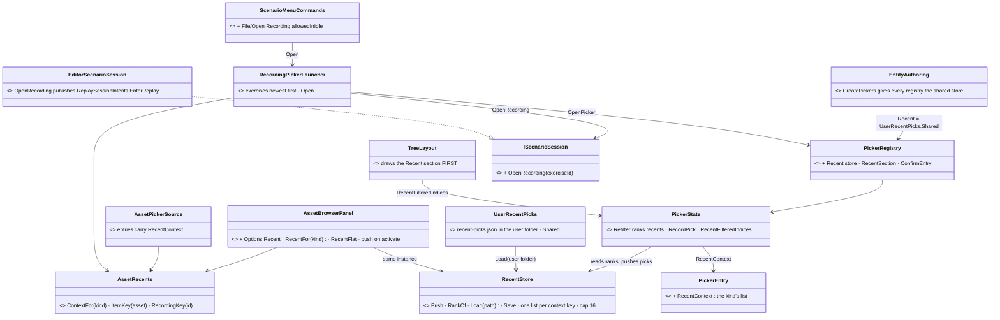

*What the picture shows that prose hid:* there is ONE list store and ONE place that names a list (`AssetRecents.ContextFor(kind)`); every picker reaches it through the
registry the hosts already build (`EntityAuthoring.CreatePickers`, so the editor and CGF cannot differ) and the browser through the same instance. The opener of a recording is
the SESSION's `OpenRecording`, which publishes the one replay intent — no second open path beside `POST /replay`.

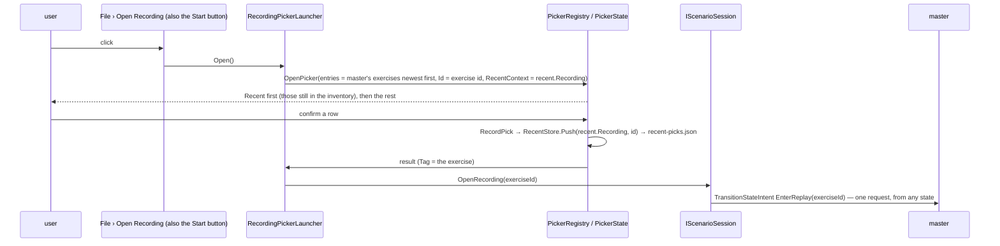

**AS-BUILT deviations from the design above** *(§2.2's text is kept; each row is where the build differs and why)*

| # | design said | built | why (measured) |
|---|---|---|---|
| 1 | `RecentList` — a NEW class, one list per kind (scenarios · recordings · assets) | no new list class: `RecentStore` (NodeEditor.UI) gained `Load(path)` / `Save` (every `Push` writes) and `RankOf`; `UserRecentPicks` (Hrot.Presentation) only names the user-folder file and owns the shared instance | `NodeEditor.UI` is referenced by `Hrot.Presentation` and `Hrot.Editor.AiShared`, so the dependency direction allows it — one store, not two lists (R "shared and unified") |
| 2 | per kind | one list per `AssetKind`, named `recent.<Kind>` (`AssetRecents.ContextFor`); a `PickerEntry` names its kind through the new `RecentContext` (null ⇒ the picker's own context) | the Open-Asset picker (all kinds), File › Open Scenario (scenario only) and the docked browser must share the scenario list; `PickerRequest.ContextKey` is per picker, not per kind |
| 3 | an item's identity | the identity the picker already uses: `IEditableAsset.AssetId` (for a scenario it is derived from the path RELATIVE to the scenarios root — `ScenarioCatalogContributor.DeriveAssetId`), a recording's EXERCISE id. Never an absolute path | the content-folder move (CE-4089) must not stale an entry; one that no longer resolves is not in the list the picker draws, so it is not shown |
| 4 | "every open picker shows a Recent section first" | the flat layouts already ranked recents first (header "↻ Recent"); the **Tree layout drew none** — it now draws the section first (`TreeLayout.RecentSectionRows` = `PickerState.RecentFilteredIndices`); `AssetBrowserPanel` got `RecentFor` / `RecentFlat` + a drawn section in every tab | Open Asset and the scenario pickers are Tree pickers |
| 5 | `AssetKind.Recording` | added at the END of the enum; **not a catalog kind** — `AssetKindFilterMapping.IsCatalogKind` is false, `FromKind` throws, no filter flag, no browser tab; icon `asset/recording` (atlas cell `d8`) | a recording is listed by the master's inventory, not by any `IAssetCatalog`; a flag would add an empty Recording tab to every "All" browser. The `FromKind_AllKinds_Audited` rail now audits the catalog kinds |
| 6 | "through the ONE existing recording opener (`IRecordingOpener`, `POST /replay`, `EnterReplay`)" | `IScenarioSession.OpenRecording(exerciseId)` → `ReplaySessionIntents.EnterReplay(exerciseId)` published on the orchestration bus (drops a queued scenario load, leaves a dry run first, like the loads) | `IRecordingOpener` opens FILES and exists only on the Replay Browser host (`DebugApiService.OpenRecordingFiles`: *"A cluster replays the exercises its master recorded"*); the cluster's EXERCISE open is `EnterReplay(exerciseId)`, which `POST /replay {exerciseId}` also ends in — so there is one construction, not a second path. §2.2's `ClusterReplayControls.EnterReplay(id, at)` box does not exist in code and was not added |
| 7 | list = the cluster read model's exercises | the editor: `_orchestratorCore.UiCache.AvailableExercises` (what `GET /exercises` serves); CGF: its slave's `KnownExercises` (`SubsystemDebugProvider.ExercisesFrom`); a host with no picker registry passes none ⇒ the item is greyed with its cause (ruling 49) | one launcher (`RecordingPickerLauncher`), two inventories |
| 8 | `allowedInIdle: true` | `File/Open Recording` (a top-level File item: a recording is not a scenario, and it names no mode) is registered by `ScenarioMenuCommands.Register` on every host and marked allowed-in-Idle, so the Start surface offers it (§2.6 deviation 5 is closed) | — |
| 9 | (not said) | not guarded by the CE-1025 "a run is running" confirm | AQ108 §3 owns every move's confirmation (a later task); the master plans the unload from any state |

⚠ **Not done here (belongs to CE-4089 / later):** listing recipes, scenarios and recordings from the content folders on the Start surface; the Replay Browser's own file
open (an `IRecordingOpener` caller) does not push to this list — it is a different host with no cluster inventory.

### 2.8 CE-4097 — the mode picker's core — ⭐ **AS-BUILT `2026-10-28` (ui; core built, the repeating parts follow)** (coordinator NOTE: start the core now; CE-4093's master round and CE-4091 to come)

⭐ **AS-BUILT:** the CORE is built — the class diagram below is the BUILT one (changes marked ⭐; the pre-build form is where the deviation table says). Build-state of §2.8: **core BUILT · part two BUILT (§2.8a)**. The as-built block with the deviations table is after the decisions paragraph.

**INVENTORY** (graph + grep; ⚠ coverage not checkable through the CLI): `search_graph .*(RunMode|ArmedMode|ModeIndicator|ModeChoice|TimeControlSection|TimeTransport).*`
→ `ITimeTransportFacade` (one interface), `ClusterTimeTransportAdapter` (its one implementation — built by the editor `EditorSubsystem.cs:2463`, CGF
`:1832`, SimHost `:341`), `MainToolbarTimeControlSection` (`ModeGlyph` / `ModeMenu`: the indicator SHOWS the cluster state today, it does not
choose), `HostArmedMode` (CE-4096, per host); no `RunModeChoice` (0). The scenario actions every operator host already has: `IScenarioSession`
(`LoadedScenarioName`, `LoadForLive`, `OpenForEdit`, `OpenRecording`, `SaveCurrent`, `TakeCheckpoint` — editor + CGF). The live run's scenario on
EVERY host: the broadcast's `ExerciseId` → `ExerciseInventoryItem.ScenarioId` (the inventory lists the run in progress since CE-4054).

| the lean rests on | code | design |
|---|---|---|
| ■ today sends Live to Idle (⇒ now the Start screen) | ✅ `ClusterTimeTransportAdapter.Stop` | ⛔ R2 / D5: back to the scenario's start, Live armed |
| every host can name the live run's scenario without a wire change | ✅ `ExerciseInventoryItem(…, ScenarioId)` + broadcast `ExerciseId` | ✅ D7 (the recording keeps its scenario) |
| a branched run's parent and branch point are NOT on any host | ✅ the inventory has no parent field (`ExerciseInventoryItem`); ⚠ corrected: the RECORDING has them (`RecordingMetadata.ParentExerciseId` / `BranchWallTicks`, `RecordingModule.cs:89`) — only the inventory lacks them (coordinator HANDOFF to backend) | D5 branch case — ⚠ falls back to the scenario's start until backend publishes the parent (filed in the NOTE) |
| POST /sim/stop and ■ are one Stop | ✅ both reach `ITimeTransportFacade.Stop` | ✅ D22 |

```mermaid
classDiagram
  class ITimeTransportFacade { <<existing>> Mode · IsPaused · TogglePlayPause · Stop · Seek · EnterReviewAtSim · Session }
  class ClusterTimeTransportAdapter { <<existing>> Stop() · TogglePlayPause() · StepBy() ⭐ delegate to the run choice (Stop in every state, ▶ Step from Edit) · ⭐ AttachRunChoice(hostDefault, control, unsaved) · ⭐ RecordsLiveRuns · ActiveExercise · ActiveExerciseScenario }
  class IRunTransport { <<NEW seam, implemented by the adapter>> raw: StopRaw · EnterDryRun · Resume · Seek · BranchLive · readings: Mode · IsPaused · TotalTime · RecordsLiveRuns · ActiveExercise · ActiveExerciseScenario }
  class RunModeChoice { <<NEW, per host, Hrot.Presentation/RunMode>> Armed : Preview|Live|AAR · HostDefault (D12) · LastExercise · Play() · Stop() · Choose(mode) · Moves() · Pending : RunModeConfirmation? · Indicator · Toast · PlayDisabledReason · SaveAsPrompt · OnClusterState(state) }
  class IRunScenarioControl { <<NEW seam>> LoadedScenarioName · LoadForLive · OpenForEdit · OpenRecording · SaveCurrent · TakeCheckpoint }
  class IScenarioSession { <<existing>> ⭐ : IRunScenarioControl (declares none of the six again) }
  class IUnsavedChangesQuery { <<NEW seam>> Ask(reply : Changed|Unchanged|NeverSaved) }
  class ScenarioNameUnsavedChangesQuery { <<NEW, production default until CE-4093's master round>> NeverSaved if no loaded name, else Unchanged }
  class RunModeConfirmation { <<NEW, ONE dialog shape>> Text · Buttons · Resolve(button) }
  class MainToolbarTimeControlSection { <<existing>> ctor choice? · the indicator draws RunModeChoice.Indicator · the menu is Moves() after the DAR items · modal for Pending · toast · ▶ ■ call the facade }
  ClusterTimeTransportAdapter ..|> ITimeTransportFacade
  ClusterTimeTransportAdapter ..|> IRunTransport
  ClusterTimeTransportAdapter --> RunModeChoice : delegates Stop / Play from Edit · feeds OnClusterState (D12)
  RunModeChoice --> IRunTransport : the raw transport (dry run, review exit, seek, branch)
  RunModeChoice --> IRunScenarioControl
  RunModeChoice --> IUnsavedChangesQuery
  RunModeChoice --> RunModeConfirmation : R3
  ScenarioNameUnsavedChangesQuery ..|> IUnsavedChangesQuery
  IScenarioSession --|> IRunScenarioControl
  MainToolbarTimeControlSection --> RunModeChoice
```

*What the picture shows that prose hid:* ■ and `POST /sim/stop` stay ONE call (`facade.Stop`), and R2 lives behind it in ONE object per host;
the scenario actions are the session's existing ones, reached through a narrow interface the session implements — nothing is re-implemented.

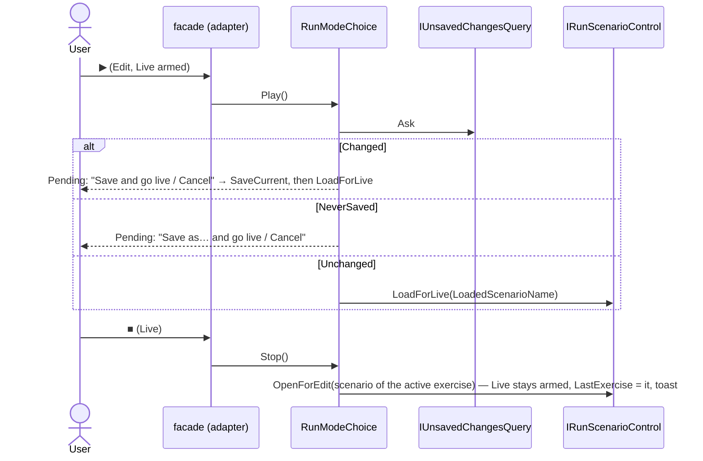

⭐ **Decisions:** ① **`RunModeChoice` per host** holds the armed mode, set to the host default on each open (D12), and owns R1–R3; the indicator
shows it DIM in Edit, BRIGHT steady while a run is paused, BLINKING while it plays (D1); Live RED when the broadcast says runs are recorded,
GREEN when not (CE-4090). ② **■ per R2** inside `facade.Stop` via the choice: Preview → the dry run's exit (today's) · DAR → back to live
(today's) · Live → `OpenForEdit(scenario of the active exercise)`, armed stays Live · AAR → seek to 0, stays AAR. ③ **▶ from Edit** follows the
armed mode: Preview → the dry run (today's) · Live → the unsaved check, then `LoadForLive` · AAR → `OpenRecording(LastExercise)` at its start.
④ **One confirmation shape** (`RunModeConfirmation`), texts exactly §3. ⑤ **The unsaved check is a seam** with a fake in rails (coordinator
NOTE) — ⛔ no round of ui's own. ⑥ **SimHost / IG** (no scenario session): Live-armed ▶ disabled with the reason, indicator still shown.
Rejected: **R2 in the master** — a new intent in backend's lane, and the inventory already names the scenario · **the toolbar deciding ■** —
`POST /sim/stop` would then differ from ■ (D22) · **a parallel scenario-action interface** — the session already has them.
**Built in two parts:** core (this section — Sonnet from this design, reviewed); then the repeating parts (§3's remaining texts and toasts, the
timeline's right-click menu, the words, `POST /sim/stop` / `POST /run-mode` / `GET /status.armedMode`, Save = checkpoint in Live / AAR, the
status-bar note, the File-menu fold). CE-4091's *open the recorded copy* item last.

**AS-BUILT `2026-10-28` (ui) — the core.** Rails: `TheOneTimeFacadeTests.CE4097_*` (the adapter + choice on a real bus), `MainToolbarTimeControlTests.CE4097_*` (indicator, moves, confirmations, ■ = the facade's Stop, the draw), `EditorScenarioSessionLoadTests.CE4097_*` (the real session), `TheRunChoiceIsOnEveryHostTests` (the constructed editor + CGF).

| # | design said | built | why (measured) |
|---|---|---|---|
| 1 | `HostDefault` read from CE-4096's `HostArmedMode` | `AttachRunChoice(hostDefault, …)` takes the default as an argument; the **editor passes Preview, CGF and SimHost pass Live** — the same table as `HostArmedModes.For` (editor ⇒ Preview, else Live) | `HostArmedMode` is `internal` to `Hrot.ClusterRunner`, which references the subsystems (not the reverse): a subsystem cannot read it. `--mode all` requests the token `all`, not `editor`, so the two tables agree today. ⚠ Two places state the default; unify when the runner hands the subsystems a shared host parameter (a follow-up) |
| 2 | "hook where the host learns a scenario was opened for editing (`IScenarioSession` / the cluster state reaching OperatingEdit with a new scenario)" | **the cluster state**: `RunModeChoice.OnClusterState`, fed by the adapter for every broadcast — the cluster reaching `OperatingEdit` from anything but a dry run resets `Armed` to the host default | one hook for every way in (File menu, Start surface, `POST /scenario/load/edit`) instead of one per opener. The choice's OWN returns to editing (■ in Live, → Preview) set a keep-flag the next Edit consumes — R2 says the armed mode stays. ⚠ If such a return never reaches Edit the flag stays until the next Edit |
| 3 | `IRunScenarioControl` + `IScenarioSession` extends it | as designed; the interface lives in `Hrot.Presentation` (`Hrot.UI.Common.RunMode`) — `Hrot.Editor.AiShared` already references it, so no third home was needed. The six members moved (with their docs) off `IScenarioSession` | one declaration; a rail pins that the session interface re-declares none |
| 4 | the raw transport "for the cases that keep today's behaviour" | `IRunTransport` (a narrow interface the adapter implements): `StopRaw` (today's `Stop`: review exit / dry-run exit / else Idle), `EnterDryRun`, `Resume`, `Seek`, `BranchLive` + the readings `RecordsLiveRuns`, `ActiveExercise`, `ActiveExerciseScenario`, `Mode`, `IsPaused`, `TotalTime` | the choice must not hold the whole facade; a fake transport is possible |
| 5 | `RecordsLiveRuns` "from the CE-4090 field" | in a live run / DAR / AAR: `!ClusterStateUpdateEvent.RunNotRecorded` (the run's own sticky flag); before one (Edit, Preview): `!RecordLiveRunsOff` (the setting) | the armed Live icon shows the setting, the running one shows the run |
| 6 | `ActiveExerciseScenario` from the events the adapter drains | the adapter folds `AssetInventoryUpdateEvent` (Local + Archived + UnarchivedLocal items, `ExerciseId → ScenarioId`) and reads the broadcast's `ExerciseId`; a ■ whose inventory has not listed the run yet falls back to the session's `LoadedScenarioName`; with neither, ■ does nothing (⛔ never Idle) | no `ClusterUiCache` on a CGF node — the adapter's own bus is the one source on every host |
| 7 | ■ in Live on a host with no session | keeps TODAY's ■ (to Idle) — the adapter's raw stop | "hosts without one are unchanged"; the choice has no action to return to editing with |
| 8 | ▶ "live from the world on screen, no reload" (§2.3 sequence: *resume the clock*) | ▶ in Live armed calls `LoadForLive` (the session's load, which lands PAUSED — Q86 §4-G) and the choice then publishes ONE `ResumeTimeIntent` when the cluster reaches `OperatingLive` — only for a load its own ▶ started | without it ▶ would leave a paused live run and a ▶ button to press again. ⚠ Added, not designed in §2.8 — delete `_resumeWhenLive` if the master should resume |
| 9 | "Save ⇒ SaveCurrent then LoadForLive" | exactly that, back to back on the bus | ⚠ the save is a cluster round (`ExecuteStorageOpIntent`); that the master finishes it before the load's unload is NOT measured here — a rail on a real cluster belongs with CE-4093's round |
| 10 | "Save as… and go live" | `RunModeChoice.SaveAsPrompt` — a host seam: *asks for a name, SAVES under it, then calls back with the name*; the editor's Save-As dialog (`openScenarioSaveAs`, now taking an optional callback) and CGF's (`OpenScenarioSaveAsDialog`) are wired to it. Null on a host with no dialog ⇒ the button does nothing | `IRunScenarioControl` has no `SaveAs` (the interface lists six members) |
| 11 | "AAR armed ▶ → `OpenRecording(LastExercise)`" with none yet | ▶ is disabled with the reason *"No exercise to review yet"* unless the host sets `PickRecording` (not wired by any host in this run) | File › Open Recording already is the picker; the indicator's "ask for a recording" is part two |
| 12 | the menu "offers the moves of §3 that start from the current state" | `RunModeChoice.Moves()` (model, with `ConfirmText` / `DisabledReason`) + the section shows them after the DAR items; the existing DAR items keep their labels ("Review the last 30 s…") | the words DAR / AAR are on the indicator and in the moves; renaming the DAR items touches the pinned label rails — part two |
| 13 | not in the list | a toast on ■ in Live (`"Exercise recorded (m:ss) — Replay it"` — a button that arms AAR and opens the run at its start — or `"Live run ended"` when not recorded), drawn beside the transport for 8 s | the list asked for exactly these two |
| 14 | `IRunScenarioControl` from the *session* | `ScenarioNameUnsavedChangesQuery` is the default `IUnsavedChangesQuery` (NeverSaved when no name, else Unchanged) — ⚠ **a LIE for an edited, saved scenario**: ▶ in Live armed goes live without the Save-first prompt until backend's CE-4093 master round replaces it (the TODO is on the class) | the round is backend's |

⛔ **HISTORY — SUPERSEDED `2026-10-28` by §2.8a below (part two BUILT):** *"Part two (not built): the remaining §3 toasts and confirmations, the timeline's right-click menu (D21), `POST /sim/stop` / `POST /run-mode` / `GET /status.armedMode` (⚠ `POST /sim/play` and `/sim/step` in Edit now follow the armed mode through the facade …), Save / Ctrl+S = checkpoint, the status-bar note (D11), the File-menu fold, `EnterReview()`'s default (D9)."* — all built in §2.8a except what its "Not built" list names.

### 2.8a CE-4097 part two — ⭐ **AS-BUILT `2026-10-28` (ui)** — D22 first, the real unsaved check, §3's remaining moves, the words, the timeline menu, HTTP, Save = checkpoint, the status note, the File fold

⭐ Build-state of §2.8 + §2.8a: **BUILT** — incl. (merged from backend `7b1939e25`) ■ on a branched run returning to the parent's AAR at the branch point (D5) and the AAR → Preview *Open the recorded version (as a copy)* / *Open the current scenario* buttons (CE-4091); **except** (b) D15's *Keep / Discard* prompt (CE-4090 built only `DELETE /exercises/{id}` — **no "ask to keep recordings" setting exists**: grep `AskToKeep|ask.to.keep|KeepRecordings|AskKeep` over the WHOLE tree finds only AQ108's own text — so there is nothing to gate the prompt on and none was built), (c) D9's `EnterReview()` "no position = the live point" default (not in this task's list; the HTTP half is CE-4090's).

**INVENTORY** (graph + grep; ⚠ `check_index_coverage` not available through the CLI): `search_graph .*Timeline.*` (Class) → ONE panel `TimelinePanel` (`FDP/Engine/Fdp.Presentation/ImGui/Panels/Timeline`) with ONE cluster cursor `ClusterTimelineCursor` (+ the `AxisCursor` wrapper and the Replay Browser's `FederatedReplayCursor`) — the right-click menu is `TimelinePanel.MenuItems`, no second menu. Callers of the facade's play from a USER control: `MainToolbarTimeControlSection`, `ClusterTimeControlStatusBarSection` (the status-bar copy), `ClusterTimelineCursor.TogglePlay` (Space); HTTP: `DebugApiService.Play/Pause/Step` (one service for the editor AND the cluster runner — `PerspectiveScopedDispatcher.Drive` resolves the same facade, so one route table answers both hosts). Save paths: `ShellSaveCommands` (the toolbar / Ctrl+S, both hosts' `saveScenarioAction`) and `ScenarioMenuCommands` `scenario.save` — all end in `EditorScenarioSession.SaveCurrent`. `unsavedCheck:` passed to a `SubsystemDebugProvider`: Orchestrator, Editor (in-process core), ExCon — **never an ECS node** (`EcsNodeDebugProvider` passes none).

```mermaid
classDiagram
  class UserTransport { <<NEW static>> UserPlayPause · UserStep · IsUserPlayEnabled · IsUserStepEnabled }
  class ITimeTransportFacade { <<existing>> TogglePlayPause / Step RAW · Stop delegates · RunChoice default null }
  class ClusterTimeTransportAdapter { <<existing>> raw play / step · Stop → choice · Update → choice.Update · AttachRunChoice(…, unsavedReads) }
  class RunModeChoice { <<existing core>> + Update · OpenRecording · OpenScenario · LeavingEditing · AarFromHere · GoLiveFromHere · TakeCheckpoint · DarDisabledReason · SaveIntercept }
  class IUnsavedChangesQuery { <<existing seam>> Ask · Poll NEW }
  class ClusterUnsavedChangesQuery { <<NEW, replaces ScenarioNameUnsavedChangesQuery>> Ask publishes ONE CheckUnsavedIntent · Poll reads UnsavedCheck · no timeout (R-4001), Cancel }
  class UnsavedCheckReads { <<NEW record>> Observes · Outcome(requestId) }
  class IClusterMasterControl { <<existing CE-4093>> CheckUnsaved }
  class ISubsystemDebugProvider { <<existing CE-4093>> UnsavedCheck · ObservesUnsavedChecks }
  class ISaveInterception { <<NEW>> SaveIntercept }
  class EditorScenarioSession { <<existing>> SaveCurrent intercepted · OpenRecording(id, simSeconds) }
  class ITimelineCursor { <<existing>> ModeMenuItems(wallTicks, time) NEW }
  class ClusterTimelineCursor { <<existing>> AAR from here · Go live from here · Take checkpoint here }
  class TimelinePanel { <<existing>> MenuItems adds the cursor's mode items · DAR labels }
  class RunNoteStatusBarSection { <<NEW>> NoteNow : Preview or Live }
  class DebugApiService { <<existing>> Stop · SetRunMode · status.armedMode }
  class ScenarioMenuCommands { <<existing>> LoadLive item FOLDED away · Open / New top-level · openScenario seam }
  ClusterTimeTransportAdapter ..|> ITimeTransportFacade
  UserTransport ..> ITimeTransportFacade : a user control asks the choice from Edit
  ClusterTimeTransportAdapter --> RunModeChoice
  RunModeChoice --> IUnsavedChangesQuery
  ClusterUnsavedChangesQuery ..|> IUnsavedChangesQuery
  ClusterUnsavedChangesQuery --> IClusterMasterControl : ONE round per move
  ClusterUnsavedChangesQuery --> UnsavedCheckReads
  UnsavedCheckReads ..> ISubsystemDebugProvider : node provider / the editor core's cache
  RunModeChoice ..> ISaveInterception : installs the intercept
  EditorScenarioSession ..|> ISaveInterception
  ClusterTimelineCursor ..|> ITimelineCursor
  ClusterTimelineCursor --> RunModeChoice : the moment's moves, no confirmation
  TimelinePanel --> ITimelineCursor
  DebugApiService --> ITimeTransportFacade : Stop = the toolbar's ■ · RunChoice.Choose
  ScenarioMenuCommands --> RunModeChoice : File › Open Scenario (guarded)
  RunNoteStatusBarSection --> ITimeTransportFacade
```

*What the picture shows that prose hid:* the facade's play/step and the choice meet in ONE place (`UserTransport`) that only user controls call — an HTTP route reaches the raw facade and can never follow the armed mode; every "does this leave unsaved edits?" question of every host is the same `ClusterUnsavedChangesQuery` → `CheckUnsavedIntent` → `UnsavedCheck(requestId)` (nothing of ui's own); and the save is routed by the session the choice is attached to, so no host can forget it.

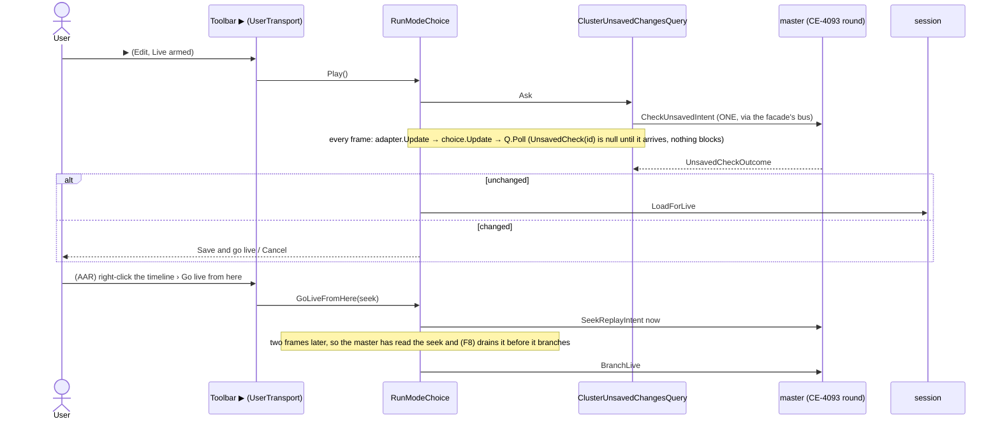

⭐ **Decisions / what was built**

| # | item | built |
|---|---|---|
| 1 | **D22 fix** | `ClusterTimeTransportAdapter.TogglePlayPause` / `StepBy` / `IsPlayPauseEnabled` are RAW again (from Edit: the dry run, whatever is armed) — `POST /sim/play` / `/sim/step` call them. `Stop` keeps delegating (`POST /sim/stop` = ■). The toolbar's ▶ / Step, the **status-bar copy's** and the timeline's **Space** call `UserTransport.UserPlayPause` / `UserStep` (the choice's `Play` from Edit). `ITimeTransportFacade.RunChoice` (default null) lets any consumer reach the choice. |
| 2 | **the real unsaved check** | `ClusterUnsavedChangesQuery` (replaces `ScenarioNameUnsavedChangesQuery`, deleted): `IClusterMasterControl.CheckUnsaved(new CheckUnsavedIntent{…})` through the adapter's bus, answer read through `UnsavedCheckReads` (= `ISubsystemDebugProvider.UnsavedCheck(requestId)` / `ObservesUnsavedChecks`; the editor reads its in-process core's `ClusterUiCache`), polled by `RunModeChoice.Update()` (the adapter's per-frame `Update`). `Observes` false ⇒ asks nothing, **unchanged**; NeverSaved = empty `LoadedScenarioName`, no round; a master refusal ⇒ unchanged; no answer in 15 s ⇒ **Changed** (fail closed, like the HTTP gate's 504). Asked ONLY for moves that LEAVE EDITING: ▶ Live (*Save and go live / Cancel*), ▶ AAR and **File › Open Recording** (*Save / Discard / Cancel*), **File › Open Scenario** (*Save / Discard / Cancel*) — ONE `LeavingEditing` guard. The CGF host observes nothing today (see INVENTORY) ⇒ its ▶ asks no round. |
| 2a | ⭐ **R-4001 fold `2026-10-29` (ui; R-3066 pause, coordinator NOTE item 2)** | ⛔ SUPERSEDED: the 15 s `Deadline` that read as Changed. Now no timeout — the master's round ends by itself (a node whose heartbeat stops leaves it); while it runs the toolbar shows *"Checking every node for unsaved edits…"* with **Cancel** (`RunModeChoice.IsCheckingUnsaved` / `CancelCheck` → `IUnsavedChangesQuery.Cancel`); a cancelled move is not made and a late answer is ignored. Same rule as backend's CE-3340 ⑤ for the HTTP gate — ONE rule, not two timeouts. Rail: `CE4097_TheUnsavedCheck_NotObserved_NeverSaved_Refused_AndNoTimeout_OnlyACancel` |
| 3 | **§3 confirmations and toasts** | *Checkpoint taken* toast; the ■ toast now reads *Exercise recorded (m:ss) — open the AAR* (its button = `ReplayLastExercise`, which now opens through the guarded open, at the recording's START, D6); *Live run ended* with no AAR button when not recorded; DAR items and "AAR the last exercise" greyed *this run was not recorded* (D14, `RunNotRecorded`). |
| 4 | **the words (D17)** | toolbar menu (*DAR — the last 30 s*, *DAR from the start*, header *DAR · …*, the indicator names *DAR* / *AAR*, ■ tooltip *Leave the AAR*), the timeline menu (*DAR from …*), the toasts, the orchestrator panel's section (*AAR (After Action Review)*, button *Open AAR*), the choice's disabled reasons. Code names unchanged. ⛔ Left alone: *Replay Browser* (an application's name), the HTTP route names `/replay` `/review` (D17 itself), the film director's *replay segment* (a film term). |
| 5 | **timeline menu (D21)** | `ITimelineCursor.ModeMenuItems(wallTicks, time)` (default none; `AxisCursor` converts the click to wall ticks): in Live *AAR from here* (the frame's sim time); in an AAR *Go live from here* (seek, then the built branch two frames later); in Live / DAR / AAR *Take checkpoint here*. None asks. |
| 6 | **HTTP (D22)** | `POST /sim/stop` → `ITimeTransportFacade.Stop` (409 in editing / Idle); `POST /run-mode {armed, confirm?}` → `RunModeChoice.Choose` (409 + the confirmation's text, and the question is cancelled, unless `confirm:true`; 400 on a bad word; 503 with no choice); `GET /status.armedMode`. ONE `DebugApiService` / route table answers the editor AND the cluster runner (`PerspectiveScopedDispatcher.Drive` is the same facade) — no second routing. MCP catalog + skill regenerated (`gen-catalog.mjs`, `generate-skill.mjs`). |
| 7 | **Save / Ctrl+S in a run** | `ISaveInterception` on the session, installed by the choice's constructor: in Live / DAR a Save is `TakeCheckpoint` + toast, **never a scenario write**; in an AAR / an unrecorded run nothing is published and the toast says why. HTTP `POST /scenario/save` stays explicit (409, CE-4090). |
| 8 | **status-bar note (D11)** | `RunNoteStatusBarSection` (*Running — edits are not saved unless you save*) while Preview or Live runs; registered on the editor and CGF beside the time controls (perspective `Scenario`). |
| 9 | **File fold** | `File/Live/Load Scenario` is gone (the id `scenario.loadLive` retired); **Open Scenario** and **New Scenario** are top-level (`File/Open Scenario`, `File/New Scenario`) beside **Open Recording**; Open always opens INTO editing, the armed mode decides ▶ (D12). AQ108 §3 does not specify the fold's exact shape — the minimal one was done. `File/Live/New Exercise` (the cluster reset) and the `File/Edit/…` save items are unchanged. |

**AS-BUILT deviations from the design above** *(the design text is kept; each row is where the build differs and why)*

| # | design said | built | why (measured) |
|---|---|---|---|
| 1 | "Take checkpoint here" everywhere (D21) | enabled only in **Live at the live edge** (±1 s); a past click, a DAR and an AAR show it greyed with the reason | a checkpoint is a keyframe of the LIVE recorder (`ReferenceCheckpointHandler.cs:99` throws on a node that is not recording — an AAR has none); there is no mechanism for a past moment (§5a note) |
| 2 | Save / Ctrl+S = checkpoint in Live **and AAR** | in an AAR the Save is intercepted (the scenario is not written) but **no checkpoint is taken** — the toast says *a recording cannot take a checkpoint — go live from a moment first* | same: an AAR has no recorder |
| 3 | toast *"Exercise recorded (12:31) — Replay it"* | *"… — open the AAR"* | D17 (§1a) retires "Replay" from the user's words; §3's table text was written before it |
| 4 | the ask for "back to Start" / exit | not wired — no ui move reaches `Start` through the choice, and `File/Exit` (CE-4096) is guarded by `IAppExitGuard` only | the task limits the check to the choice's moves; the same `ClusterUnsavedChangesQuery` is the seam when it is built |
| 5 | "Go live from here (the branch)" at a moment | the cursor seeks, the choice publishes the existing `BranchLive` **two frames later** | the branch takes the replay's current position and the master drains seeks in flight before leaving a replay (`ClusterMaster` CE-3329 F8). ⚠ proven by the rails on a real bus, **not** on a live multi-process cluster |
| 6 | the CGF host asks the round | CGF passes `UnsavedCheckReads.From(its debug provider)`; that provider observes nothing today | `EcsNodeDebugProvider` passes no `unsavedCheck` (INVENTORY) — a backend change would make CGF's ▶ ask with no ui change |
| 7 | (not said) | `Save as…` / `SaveAs` in a run is unchanged | D8 wants a new scenario from a checkpoint only — that mechanism has no code (§5a note) |
| 8 | status-bar note "on every host" | registered where the time controls are (editor, CGF; perspective `Scenario`); SimHost has no scenario session and no window of its own | one registration per host family that shows the time controls |
| 10 | ■ in a branched run → the parent's AAR at the branch point (D5, backend `ParentExerciseId` / `BranchWallTicks`) | `StopLive` reads `IRunTransport.ActiveExerciseBranch` (the adapter's inventory fold); opens the parent at its START, Live stays armed, then `Update` seeks (`IRunTransport.SeekWall`, the timeline's wall→axis conversion) once the replay session's zero is known | the branch point is in the PARENT's wall ticks and the zero exists only after the replay opens; rail on a real bus, not a live cluster |
| 11 | AAR → Preview *Open the recorded version (as a copy)* (CE-4091) | the button opens `OpenForEdit(RecordedScenarioNames.ForExercise(exercise))` (`Recipes/Recorded/<id>`, what `POST /scenario/load/edit {recorded}` derives); shown only when the host seam `RunModeChoice.RecordedVersionDiffers` says the hashes differ | no host can tell yet (see Not built) |
| 9 | the facade's `IsPlayPauseEnabled` carried the "Live armed, no session" disabling (core) | raw again; the USER's ▶ is disabled by `UserTransport.IsUserPlayEnabled` | D22 — an HTTP play from Edit works on every host |
| 12 | **§2.8a — the adapter reads `ClusterView`** (CE-1436, ui half, `2026-10-29`): the adapter's own fold of `ClusterStateUpdateEvent` (state, axis, exercise, `RunNotRecorded`, `RecordLiveRunsOff`), `AssetInventoryUpdateEvent` (its `_exerciseItems`) and `ReplaySessionUpdateEvent`; the editor session's `_currentClusterState` | ⭐ `ClusterTimeTransportAdapter(bus, Func<ClusterView?> view, …)` and `EditorScenarioSession(…, Func<ClusterView?>, …)` READ the node's ONE view (`ClusterSlave.View`; on the editor the node's slave, which its in-process core's cache shares); the adapter keeps only the `SwitchTimeModeEvent` fold (pause / scale / sim time — the view carries no time facts). The ▶ gate reads `EcsNodeDebugProvider.UnsavedCheck` → the same view. ‘Active exercise’ scans the view's Local + Archived + UnarchivedLocal lists (the scopes the adapter always folded). ‘Run choice learns the state’ is now a per-frame compare against the view's state (`OnClusterState` was already idempotent on equal states) | ⛔ SUPERSEDED: the adapter / session folds, deviation 6's "CGF passes `UnsavedCheckReads.From(its debug provider)`; that provider observes nothing today" and rows 10's "the adapter's inventory fold" — all read the one view now. Two kinds of fold of the same facts would drift (`RunNotRecorded` was folded three times; the inventory scopes differed) — [`DESIGN_Cluster_View.md`](../DESIGN_Cluster_View.md) §5; the rails are `TheOneTimeFacadeTests.CE1436_*`, `EditorScenarioSessionLoadTests.CE1436_*`, `HrotNodeBuilderTests.CE1436_CgfShapedHost_*`. One behaviour change: `RunNotRecorded` / `RecordLiveRunsOff` are not touched by a `MasterGone` broadcast any more (the view's rule; the adapter used to take them from it) |

⚠ **Not built (named):** a host that supplies `RunModeChoice.RecordedVersionDiffers` (the saved-vs-recorded hash compare — the inventory carries no hash and the copy's `RecordedScenarioStamp` lives in the master's staging, so until a host reads it the AAR → Preview confirmation is the plain one; the two-button form is built and railed); D15's *Keep / Discard* prompt and its setting (CE-4090 built none); `EnterReview()`'s default (D9, UI facade); a back-to-`Start` / exit guard; a live multi-process proof of *Go live from here* and of an ECS node answering the check round.
⛔ **SUPERSEDED `2026-10-29` (CE-1436, backend built it; ui's half is deviation 12) — the gap below is CLOSED:** every ECS node now keeps one `ClusterView` fed by one ingress, `EcsNodeDebugProvider` passes `unsavedCheck:`, and ▶ on CGF asks the round (`HrotNodeBuilderTests.CE1436_CgfShapedHost_PlayLive_…`). Kept as the record of why:

⚠ **Gap measured `2026-10-29` (ui):** on an ECS-node host (CGF / SimHost / IG / Traffic) the unsaved check asks NO round — `EcsNodeDebugProvider` passes no `unsavedCheck:`, and it could not: the master's answer (`ClusterOpCompletedEvent` → DDS `ClusterOpStatus`, `ClusterOpMasterTranslator.cs:66`) is read back only by `OrchestrationObserverTranslator` (ExCon); the node's `NodeOpSlaveTranslator` has no `ClusterOpStatus` reader. ⇒ a CGF-host ▶ Live goes live without the *Save and go live* prompt. ⭐ Root cause: two cluster ingress translators and two cluster read models — handed to backend as one unification frame, CE-1436 ([NOTE](batches/NOTE_Ui_To_Backend_One_Cluster_Ingress_And_Read_Model.md)); the provider answers on every host when it lands.

### 2.9 CE-4083 — the status-bar time control is removed — ⭐ **AS-BUILT `2026-10-29` (ui)**

| host | before | now |
|---|---|---|
| editor | toolbar group + status-bar `editor_time_controls` (`TimeControlStatusBarSection` → `ClusterTimeControlStatusBarSection`) | toolbar group only (`ShellTimeControlToolbar`) |
| CGF | toolbar group + status-bar `cgf_time_controls` | toolbar group only |
| SimHost | ⚠ **status-bar `simhost_time_controls` ONLY — no toolbar group** (its `AttachRunChoice` comment said the toolbar section was not registered) | **toolbar group added** (`SimHostSubsystem.RegisterTimeTransport` → `ShellTimeControlToolbar.Register` over the host's one facade + the choice it holds); status-bar copy gone |
| IG · ReplayBrowser · ClusterRunner window | no time control (build no `ClusterTimeTransportAdapter`) | unchanged — they never had one |

**Deleted:** `ClusterTimeControlStatusBarSection`, the editor's `TimeControlStatusBarSection` wrapper and the former's 2 smoke tests (mechanical; the toolbar section's `Render_*` rails cover the same render path). **Kept:** `RunNoteStatusBarSection` (D11 — a note, not a time control). **Added seam:** `StatusBarManager.SectionIds`. ⚠ SimHost's `SimHostControlsWindow` panel keeps its own Play/Pause/Step on the same facade (`vis.UI.TimeFacade`) — a panel, not the status bar; untouched. Rails: `TheRunChoiceIsOnEveryHostTests` (editor, CGF, SimHost).

### 2.10 CE-1437 — the run controls are composed ONCE PER PROCESS (R-3066 audit #1, #2, #10) — ⭐ **AS-BUILT `2026-10-29` (ui)** (design text kept; the build's deviations are the table at the end of this section)

| the lean rests on | code | design |
|---|---|---|
| the toolbar time control is ONE process-wide entry, last registration wins | ✅ `ShellTimeControlToolbar.cs:40,72` (`EntryId`, no perspective) → `MainToolbarManager.RegisterEntry` replace-or-add | ✅ D13 "the picker exists once" |
| three hosts register it, so in a multi-host process the LAST host owns ▶ | ✅ `EditorSubsystem.cs:5426`, `CgfSubsystem.cs:1865`, `SimHostSubsystem.cs:364`; order = subsystem order in `LocalWindowController` | ⛔ R-3066 / CLAUDE.md "make hosts agree by construction" |
| the armed default is owned twice | ✅ `HostArmedModes.For` (runner, internal) → `LocalWindowController.ArmedMode`, read by nothing · literals at the three `AttachRunChoice` sites | ✅ D12 "ONE host parameter of the shared bootstrap" |
| SimHost's panel ▶ bypasses the user entry | ✅ `SimHostControlPanels.cs:61,64` call the facade raw | ✅ D22: user controls follow the armed mode (`UserTransport`), routes stay raw |

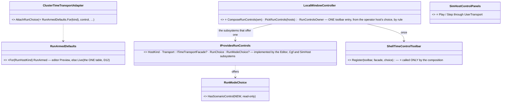

*What the picture shows that prose hid:* the time control's owner moves from three hosts to the one place every host's window is composed (as the
start gate did, §2.6), and its pick becomes a RULE — ⛔ never registration order.

⭐ **Decisions:** ① **the rule:** the run controls of a host whose choice HAS a scenario session (an operator host: editor, CGF) win; with none,
the first offered (SimHost alone keeps its own); with two operators in one process (none today), the editor's. ② **one armed-default table**
(`RunArmedDefaults`, in Hrot.Presentation so both the subsystems and the runner read it); `HostArmedMode(s)` in the runner is deleted.
③ **`UserTransport` is the only user play entry** — the SimHost panel calls it. ④ every subsystem still builds its own adapter (each node drives
its own bus); only the TOOLBAR surface is composed once. Rejected: **perspective-scoped entries** (one per host) — the toolbar would change with
the perspective while the cluster clock is one · **first-registered wins** — still order, not a rule.

**AS-BUILT deviations from the design above** *(each row is where the build differs and why)*

| # | design said | built | why (measured) |
|---|---|---|---|
| 1 | `RunArmedDefaults.For(hostKind)`; `IProvidesRunControls { Transport, RunChoice }` | `For(RunHostKind)` with `RunHostKind { Editor, Cgf, SimHost, Other }`; the interface has a THIRD member `HostKind` | the editor tie-break ("with two operators, the editor's") needs the rule to know which offer is the editor's without a subsystem-name string compare; the same value keys the table at the host's `AttachRunChoice` |
| 2 | "an offered choice whose scenario control is not null" | `RunModeChoice.HasScenarioControl` (read-only, `_control is not null`) | the choice held the session privately; nothing exposed it |
| 3 | `LocalWindowController.ComposeRunControls(wm)` picks and registers | the rule is `PickRunControls` (static, pure); `ComposeRunControls(wm)` registers over its pick and records it as `RunControlsOwner`; called in `OpenLocalWindow` right after `ComposeStartSurface`, i.e. after every host's `RegisterWindows` | the hosts build their adapter inside `RegisterWindows`, so the composer must run after it; a host whose `Transport` is still null (headless, no bus) offers nothing |
| 4 | SimHost's `RegisterTimeTransport` goes | gone; its adapter + choice come from `SimHostSubsystem.CreateTimeTransport(bus, simTime)` (the host's single `AttachRunChoice` site, now a static) | the real SimHost needs a graphics window for `RegisterWindows`, so no rail could reach its choice; the factory is the constructed piece |
| 5 | the editor registered its toolbar behind `_previewController != null && _timeController != null && _world != null && MainToolbar != null` | the editor offers `_timeTransport` whenever it is built; that guard now only gates its run-note status-bar section | the guard protected the toolbar registration, which moved to the composer |
| 6 | SimHost panel Play / Step through `UserTransport` | `SimHostSimulationControlsPanel` gets `IsPlayEnabled`, `IsStepEnabled`, `PlayDisabledReason`, `PlayPause()`, `Step()` (all `UserTransport`); `Render` disables the buttons with the choice's reason as the tooltip | so the routing is assertable without an ImGui frame (the suite's own rule: "pin the routing, not the rendering") |
| 7 | — | **left per host: `RunNoteStatusBarSection.Register`** (editor, CGF) | D11's note is a status-bar note, not a time control; not part of this item |

### 2.11 CE-1438 — one confirmation shape, and the "a run is running" guard inside the run choice (R-3066 audit #5, #6, #7) — ⭐ **AS-BUILT `2026-10-29` (ui)**

| the lean rests on | code (measured before the build, `ui@2cd9d28ff`) | design |
|---|---|---|
| three confirmation shapes: `ConfirmPromptController` (title / message / confirm label, `Resolve*`), `AppExitPromptController` (`IsPrompting`, three `Resolve*`), `RunModeConfirmation` (text + N buttons, last = Cancel) | ✅ `ConfirmPromptController.cs:23`, `AppExitPromptController.cs:19`, `RunModeTypes.cs:185`; three draw sites: `EditorSubsystem` `DrawExitPromptModal` / `DrawConfirmModal` (two hand-written `BeginPopupModal`s) and `MainToolbarTimeControlSection.DrawConfirmation` | ✅ AQ108 §1 **R3** + **D10** call `RunModeConfirmation` *"the ONE confirmation shape"*; `ConfirmPromptController`'s own header says a second shape is what the seam law forbids |
| the editor warns *Stop & Load* over a run, CGF does not | ✅ editor passes `runningRun` + `confirmLoad` (`EditorSubsystem.cs` ~4625-4628 → `ScenarioMenuCommands.Guarded`); CGF's `Register` call passes neither (`CgfSubsystem.cs` ~2899-2941) ⇒ its File › Open Scenario goes straight on | ✅ D20 already says *"the File › Open Scenario item of every host ends here"* (the run choice); CE-1025 (`DESIGN_Cluster_Load_Phase.md` §9.1) wrote the warning for the *interactive* host only because it lived in a menu seam |
| "a run is running" is defined twice | ✅ `ScenarioLoadGuard.RunningRun(inPreview, ClusterState)` (`ScenarioLoadGuard.cs:13`; the editor's seam and `DebugApiService.cs:1306`) vs the facade's `TransportMode` (`ClusterReplayControls.ModeOf`) that `RunModeChoice` reads | ✅ CE-1436 (one cluster read model) / CE-3329 row 21 (one facade) |
| the editor's `inPreview` flag is not needed to say "dry run" | ✅ `EditorPreviewController.IsInPreviewMode` ≡ `state == OperatingPreview` (`EditorSubsystem.cs:754`) ≡ `TransportMode.Preview`; ⚠ a *live* run can still read as "in preview" on another adapter (CE-4054, `DirectorRunner.cs:570`) ⇒ the override stays as an optional argument | ⛔ no design says otherwise; `ScenarioLoadGuardTests` pins it |
| no other caller of `ScenarioMenuCommands.Guarded` / `runningRun` / `confirmLoad` | ✅ whole tree `grep -rn "runningRun\|confirmLoad\|Guarded(" Hrot --include=*.cs`: only the registrar, the editor, `ScenarioLoadGuardTests` | — |

```mermaid
classDiagram
  class RunModeConfirmation { <<existing, now PUBLIC ctor>> Text · Buttons (last = Cancel) · ⭐Title · ⭐PopupId · Resolve(button) · ⭐Cancel() · ⭐WithCancel(...) }
  class ConfirmationModal { <<NEW static, Hrot.Presentation>> Draw(RunModeConfirmation?) — the ONE ImGui modal; Esc / X = Cancel }
  class RunModeRunGuard { <<NEW static, Hrot.Presentation>> Of(TransportMode, inDryRun) : "a live run" / "a dry run" / null · LoadPrompt · RecordingPrompt · StopAndLoad }
  class RunModeChoice { <<existing>> OpenScenario · OpenRecording — ⭐ AskStopAndLoad first, then LeavingEditing (unchanged) }
  class ScenarioLoadGuard { <<existing, SHRUNK>> RunningRun(inPreview, state) = RunModeRunGuard.Of(ModeOf(state)) — HTTP's stoppedRun only }
  class ConfirmPromptController { <<existing, THIN>> Request · Pending : RunModeConfirmation — one slot, no title / label of its own }
  class AppExitPromptController { <<existing, THIN>> RequestExit · Pending : RunModeConfirmation (Save All and Exit · Discard and Exit · Cancel) }
  class ScenarioMenuCommands { <<existing>> ⛔ runningRun / confirmLoad / Guarded RETIRED — Open Scenario = openScenario ?? session.OpenForEdit }
  class MainToolbarTimeControlSection { <<existing>> DrawConfirmation → ConfirmationModal.Draw(choice.Pending) }
  class EditorSubsystem { <<existing>> DrawPromptModals → ConfirmationModal.Draw ×2 · ⛔ _loadConfirm and the two hand-written modals gone }
  class DebugApiService { <<existing>> LeaveRunForLoad → ScenarioLoadGuard.RunningRun (UNCHANGED call, same 409 / stoppedRun text) }
  RunModeChoice ..> RunModeRunGuard : the ONE definition
  RunModeChoice ..> RunModeConfirmation : Pending
  ScenarioLoadGuard ..> RunModeRunGuard
  DebugApiService ..> ScenarioLoadGuard
  ConfirmPromptController ..> RunModeConfirmation : produces
  AppExitPromptController ..> RunModeConfirmation : produces
  ConfirmationModal ..> RunModeConfirmation : draws
  MainToolbarTimeControlSection ..> ConfirmationModal
  EditorSubsystem ..> ConfirmationModal
  ScenarioMenuCommands ..> RunModeChoice : via the host's openScenario
```

*What the picture shows that prose hid:* the guard has no host-side seam left to forget — CGF and the editor both hand `File › Open Scenario` to the choice they already attach, and the
choice is the only place that knows both "a run is running" and "what the confirmation looks like".

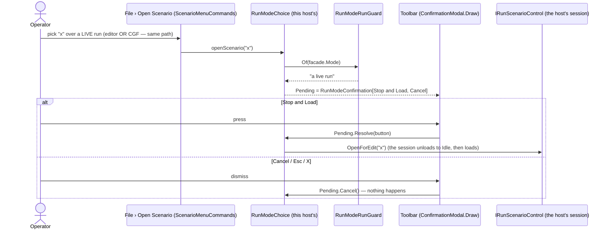

⭐ **Decisions** *(all three leans adopted)*: ① **`RunModeConfirmation` is THE model**; ONE draw (`ConfirmationModal.Draw`) is used by the toolbar and by the editor's exit and *New Exercise* prompts;
the two controllers stay as thin PRODUCERS (they own a one-slot / a decision, not a shape) and lose their own title / message / label / button handling.
② **The run guard moves into `RunModeChoice.OpenScenario` / `OpenRecording`** — every host with a choice warns by construction; the registrar's `runningRun` / `confirmLoad` seams and `Guarded` retire.
③ **One definition of "running"**: `RunModeRunGuard.Of(TransportMode)`; `ScenarioLoadGuard` keeps only `RunningRun` for HTTP.
*Rejected:* **passing `runningRun` / `confirmLoad` from CGF too** — fixes one host, keeps the copy-paste seam (the next host forgets again) · **a confirmation service object** — a second owner of a shape that
a plain model + one static draw already covers · **retiring the two controllers** — the exit prompt's *"is it safe to close?"* decision and `ConfirmPromptController`'s one-slot drop rule are logic worth a headless seam; only their SHAPE was duplicate.

**AS-BUILT deviations from the design above**

| # | design said | built | why (measured) |
|---|---|---|---|
| 1 | "a run is running" = the facade `Mode` | `Live` and `Preview` only — a DAR (`Review`) and an AAR (`Replay`) are not a run to stop here; and `LoadingLive` / `LoadingPreview` (which `ScenarioLoadGuard` used to name) map to `Idle` in `ModeOf`, so HTTP's `stoppedRun` is now `null` during those two *loading* states | keeps CE-1025's behaviour for review / replay (a load over them never warned); the loading-state narrowing is the price of ONE definition — the load itself still goes out, only the answer's text differs. `ScenarioLoadGuardTests` pins the table |
| 2 | `OpenRecording` and `OpenScenario` guarded | both; ⚠ `OpenRecording` over a run is a NEW warning on every host (the editor never had one) | a recording opened over a live run stops it exactly as a scenario load does (`TheOneTimeFacadeTests.CE4097_OnlyAMoveThatLeavesEditing…` used to assert it went straight on — updated) |
| 3 | `ConfirmPromptController` / `AppExitPromptController` "thin producers (or retired)" | both kept, public `Resolve*` kept; `ConfirmPromptController` keeps only `Pending` / `IsPrompting` / `Request`; the exit prompt's document list is now text inside the model (it was a bulleted ImGui list) | the existing rails call `ResolveConfirm` / `ResolveSaveAndExit` directly; the bullet list is the only visual change of the exit modal |
| 4 | — | `CgfSubsystem.NodeForTest` (internal) added | the constructed-host rail needs the node's bus + cluster view to "hear" `OperatingLive` |

### 2.12 CE-1439 — the scenario actions on every operator host (R-3066 audit #8, #9) — ⭐ **AS-BUILT `2026-10-29` (ui)**

**INVENTORY** (graph + grep; ⚠ `check_index_coverage` is not available through the CLI, and the graph index was still building when this was written — every row below is a whole-tree grep, re-run when the graph is up):
`grep -rn "ScenarioMenuCommands.Register(" Hrot --include=*.cs` → production callers **two** (`EditorSubsystem.cs:4490`, `CgfSubsystem.cs:2908`) before this item, the rest tests ·
`grep -rn "new EditorScenarioSession(" Hrot` → editor, CGF, tests · `grep -rn "ClusterScenarioPanel" Hrot` → the panel, `OrchestratorCore`, `OrchestratorWindow`, `ClusterControlWindow`, `EditorSubsystem`, `ExConSubsystem` (retiring, R-3067) ·
`grep -rn "IProvidesRunControls" Hrot` → editor, CGF, SimHost (CE-1437) + this item's Orchestrator.

| the lean rests on | code | design basis |
|---|---|---|
| the Start surface draws ONLY menu items marked allowed-in-Idle | ✅ `StartSurfaceWindow.Model()` ← `GlobalMenuRegistry.AllowedInIdleItems()` | ✅ §2.6; D16 "Open scenario · Open recording · New … on every host that can operate the cluster" |
| *Open Scenario / New Scenario / Open Recording* are registered by ONE registrar, and only the editor and CGF called it | ✅ `ScenarioMenuCommands.cs:199-257`; callers above | ✅ AQ60 R2 / ruling 58 "one registration list" |
| an Orchestrator-only window at Idle shows only Help + Exit | ✅ the Orchestrator registers no `File/…` item (`OrchestratorSubsystem.RegisterWindows` registered two windows) | ✅ CE-1437 rule "make hosts agree by construction" |
| the session NEEDS a world | ⛔ **false**: the only `_world` / `_fileService` readers in `EditorScenarioSession` are `ClearWorld`, `SaveTo` (no production caller, CE-275) and `GetMigrationSidecars`; every cluster verb (`OpenForEdit`, `LoadForLive`, `OpenRecording`, `SaveCurrent/As`, `TakeCheckpoint`, `NewExercise`) publishes on the bus and reads the `ClusterView` | ✅ `DESIGN_Cgf_Scenario_Session_Slice.md` §3: *"the world is a constructor parameter"* |
| the Orchestrator has a bus, a `ClusterView` and the master's inventory | ✅ `OrchestratorSubsystem._bus`; `OrchestratorCore.UiCache.View` (CE-1436, the cache composes it); `UiCache.AvailableScenarios / AvailableExercises` | ✅ `DESIGN_Cluster_View.md` |
| the panel is a second control surface | ✅ it published its own `PauseTimeIntent` / `StepTimeIntent` / `TakeCheckpointIntent`, ran its own `ScenarioLoadSequence` (CE-295's copy) and built its own replay `TransitionPayloadDto` | ✅ AQ108 D22 "the user's controls are one entry" · §2.10 |
| two operators in one process (Orchestrator + CGF, the all-in-one) would both register the menu | ✅ `ShellCommands.Register` / `GlobalMenu.RegisterItem` replace by id/path — the LAST registration wins (the CE-1437 disease) | ✅ §2.10 "never registration order" |

```mermaid
classDiagram
  class EditorScenarioSession { <<existing, AiShared>> ⭐ NEW ctor: no world (bus, view, scenariosRoot) · ClearWorld / SaveTo / GetMigrationSidecars act only on a local world }
  class ScenarioMenuCommands { <<existing>> Register(...) — Open Scenario / New Scenario / Open Recording allowed-in-Idle }
  class IProvidesRunControls { <<existing, CE-1437>> HostKind · Transport · RunChoice · ⭐ ComposeScenarioActions(wm) default no-op }
  class RunHostKind { <<enum>> Editor · Cgf · SimHost · ⭐ Orchestrator · Other }
  class OrchestratorSubsystem { <<existing>> ⭐ implements IProvidesRunControls · builds adapter + world-less session + choice in Initialize · ComposeScenarioActions registers the menu + pickers · DrawUI draws pickers + New Exercise confirm }
  class LocalWindowController { <<existing>> PickRunControls: OperatorRank Editor, Cgf, Orchestrator · ComposeRunControls calls owner.ComposeScenarioActions }
  class ClusterPanelRunControls { <<NEW, Orchestrator>> PauseOrResume · Step · SetTimeScale · LoadIntoEdit · LoadIntoLive · OpenAar · TakeCheckpoint · OverBus(bus, view) }
  class ClusterScenarioPanel { <<existing, now the MONITOR>> RunControls · ⛔ no ScenarioLoadSequence · ⛔ no pause / step / checkpoint / replay-transition requests }
  class UserTransport { <<existing>> ⭐ UserStepBy(seconds, choice) }
  class RunModeChoice { <<existing>> OpenScenario · OpenRecording · TakeCheckpoint · CheckpointDisabledReason }
  class ClusterTimeTransportAdapter { <<existing>> AttachRunChoice }
  class StartSurfaceWindow { <<existing, CE-4096>> draws the allowed-in-Idle items }
  class EditorSubsystem { <<existing>> passes ITS transport, choice, session to the panel }
  class ExConSubsystem { <<existing, RETIRING R-3067, UNTOUCHED>> its panel builds the same shared classes over its own bus }
  OrchestratorSubsystem ..|> IProvidesRunControls
  OrchestratorSubsystem --> EditorScenarioSession : world-less
  OrchestratorSubsystem --> ClusterTimeTransportAdapter
  OrchestratorSubsystem --> ClusterPanelRunControls : passes to the panel
  OrchestratorSubsystem ..> ScenarioMenuCommands : ComposeScenarioActions
  LocalWindowController --> IProvidesRunControls : picks ONE owner by rule
  ClusterScenarioPanel --> ClusterPanelRunControls
  ClusterPanelRunControls ..> UserTransport
  ClusterPanelRunControls ..> RunModeChoice
  ClusterPanelRunControls ..> EditorScenarioSession
  ClusterTimeTransportAdapter --> RunModeChoice
  RunModeChoice --> EditorScenarioSession : IRunScenarioControl
  StartSurfaceWindow ..> ScenarioMenuCommands : the SAME bindings
  EditorSubsystem --> ClusterPanelRunControls : passes
  ExConSubsystem ..> ClusterScenarioPanel : unchanged
```

*What the picture shows that prose hid:* the panel and the Start surface do not gain features of their own — both now stand on the objects every operator host already composes (the transport's user entry, the run
choice, the session, the one menu registrar), and the process's scenario menu belongs to the host that owns ▶, picked by the same rule — ⛔ not to whichever host registered last.

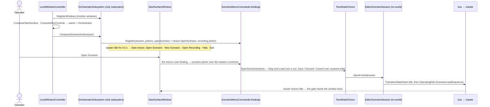

⭐ **Decisions** *(the lean adopted; the three measured differences are the AS-BUILT table)*: ① **the Orchestrator composes the SAME session** (`EditorScenarioSession`, a world-less constructor), the same adapter + `RunModeChoice` (offered through `IProvidesRunControls`, armed Live by the table) and the same registrar; ⛔ no Orchestrator-private menu list.
② **the scenario menu is registered by the host that OWNS ▶** (`IProvidesRunControls.ComposeScenarioActions`, called by the composer on the picked owner) — so Orchestrator + CGF (the all-in-one) keeps CGF's items exactly as before, and an Orchestrator-only process gets its own.
③ **the owner rule gains a rank among operators**: editor, then CGF, then the Orchestrator (the one that holds a world to author in wins; the world-less master's window is the fallback owner).
④ **the panel stays as the MONITOR** (node health, transactions, inventory, the state-machine buttons, terrain / assets / archive) — a duplicate *surface* is kept where it is a monitor, a duplicate *code path* is not: its Pause / Resume / Step / speed → the transport's USER entry; *Load into Edit* → the run choice's guarded open; *Load into Live* → the session's explicit live load; *Open AAR* → the run choice's recording open; *Take Checkpoint* → the choice's checkpoint (and its reason).
⑤ **the editor passes its own surfaces to the panel; ExCon (retiring) is untouched** and its panel builds the same shared classes over its own bus.
*Rejected:* **registering the scenario items in every host's `RegisterWindows`** — the last registration wins, so the world-less Orchestrator would overwrite CGF's real `New Scenario` in `--mode all` · **a Start-surface-only set of Orchestrator buttons** — a second action list the menu does not know (the surface owns no action, §2.6) · **a no-op world object** — a fake that hides what the host cannot do; an explicit world-less constructor says it · **retiring the panel** — it is the only window showing nodes, transactions and the inventory · **deleting *Load into Live*** — it is the only explicit-mode load left besides HTTP (D22: an explicit control does what it names) · **adding the items to ExCon** — R-3067.

**AS-BUILT deviations from the design above**

| # | design said | built | why (measured) |
|---|---|---|---|
| 1 | — | `Hrot.Orchestrator` now references `Hrot.Editor.AiShared` | the session, registrar and pickers live there; measured acyclic (AiShared references neither the Orchestrator nor anything that does) and `Stride/HrotStrideApp.Game` already references `Hrot.Editor` ⇒ AiShared |
| 2 | *Save Scenario As* offered | **greyed with its reason** on the Orchestrator (`openSaveAsDialog: null`, ruling 49); `RunModeChoice.SaveAsPrompt` is null | the Save-As browser is CGF's / the editor's own composition over their local world; nothing is authored on this host. *Save Scenario* of a loaded scenario still publishes the cluster-wide save (`SaveCurrent`). Follow-up: fold `OpenScenarioSaveAsDialog` (CGF) + `openScenarioSaveAs` (editor) into one shared launcher |
| 3 | *New Scenario* | the shared binding (`session.ClearWorld`): on a world-less host it forgets the loaded name and the migration alert, wipes nothing | the same limitation the editor and CGF carry until CE-4089 makes *New* a recipe the cluster opens (§2.6 deviation 12) — stated, not hidden |
| 4 | *Load into Live* keeps its *Start paused* checkbox | the live load is the session's (`TimeMode = Deterministic`, paused at 0, Q86 §4-G); the checkbox still applies to the state-machine buttons below it | ONE live load; "running after a load is a property of the load" and the session's does not ask for it |
| 5 | — | `RunHostKind.Orchestrator` added (armed Live, from the table) and `UserTransport.UserStepBy(seconds)`; `ConfirmPromptController.RequestNewExercise` (the one wording of *New Exercise*, now also the editor's) | the pick rule needs to know the owner's kind; the panel's *Step (s)* box has a size; the destructive reset reads the same on both windowed hosts |
| 6 | the panel's `SendRequest` bus switch | its `PauseTime` / `ResumeTime` / `StepTime` / `SetTimeScale` / `TakeCheckpoint` arms are deleted | nothing builds those requests any more (the duplicate mapping of intents the transport publishes) |

## 3. Every move, with what the user is told

| from → to | how | confirmation (R3) | what happens |
|---|---|---|---|
| Preview idle → Live armed | indicator | none | ▶ will now start a live run |
| Live armed → ▶ | Play | only if unsaved: *Save and go live / Cancel* | live from the world on screen, recording on, no reload (§2.3) |
| Preview running → Live / AAR | indicator | *"Stops the preview and returns to the scenario's start"* | the dry run restores, then the chosen mode is armed |
| Live running → DAR | indicator *"DAR — the last 30 s / 2 min / from a checkpoint (live continues after)"*, or the timeline's menu at a time | none | DAR as built — ⛔ never at the live end (D9) |
| Live running → AAR | indicator, second item | *"Ends the live session; its recording opens for AAR"* | FinalizeLive, then the AAR of E |
| Live running → Preview | indicator | *"Ends the live session; you return to editing the scenario at its start"* | §2.4 |
| ■ in Live | Stop | none | §2.4 — Live stays armed; toast *"Exercise recorded (12:31) — Replay it"* |
| Live armed → AAR the last exercise | indicator, or the toast's button | none | the replay of the last exercise, at its START |
| Preview → AAR, or File › Open Recording | indicator / File | unsaved edits → *Save / Discard / Cancel*; File › Open Recording always asks for one | the shared open dialog, kind Recording, grouped by scenario: *"hill-attack · run 3 · 14:41 · 12:31 long"* |
| AAR → Live | indicator | *"A new exercise starts from 07:04; this recording stays unchanged"* | the built branch (D18), inheriting the parent's scenario copy |
| AAR → Live | timeline menu | none — the user picked the moment | the same |
| AAR → Preview | indicator | explains which scenario opens; when the saved scenario's hash differs from the recording's: **Open the recorded version (as a copy)** · **Open the current scenario** | edit that scenario at its start |
| ■ in AAR | Stop | none | back to the recording's start, still AAR (R2) |
| Save / Ctrl+S in Live or AAR | toolbar / key | none | a checkpoint, toast *"Checkpoint taken"*; the scenario is never written |
| New scenario from a checkpoint | checkpoint menu / timeline | asks for a new name | the checkpoint's world as a new scenario, opened for editing |
| editing while Preview or Live runs | any tool | none | allowed; the status bar says *"Running — edits are not saved unless you save"* |
| open another scenario | File | unsaved → Save / Discard / Cancel | the HOST's default mode is armed (D12): Preview in the editor, Live on CGF / all-in-one |
| editor start | — | none | EMPTY: run controls and authoring tools disabled, the indicator dim; the only ways in are **New scenario (from a terrain recipe)** and **Open scenario** (and File › Open Recording for an AAR) |
| Live armed → ▶ on a never-saved scenario | Play | *Save as… and go live / Cancel* | Live needs a saved scenario (D16) — it is what the recording keeps (D7) |
| ■ in Live with recording OFF (D14) | Stop | none | as ■ (§2.4), toast *"Live run ended"* — no AAR button; DAR and "AAR the last exercise" are greyed *"this run was not recorded"* |
| ■ in Live with "ask to keep recordings" ON (D15) | Stop | *"Keep this recording? (12:31, hill-attack) — Keep / Discard"* | Discard deletes `exercises/<id>/`; Keep is the default button |

## 4. Decisions

| # | decision | verdict |
|---|---|---|
| **D1** | the mode is a CHOICE of what ▶ runs, shown dim before the start and bright while running; locked while running except through the confirmed moves of §3 | ✅ user |
| **D2** | Live always starts from a scenario's beginning, or from an intended replay moment (the branch) — never from the middle of a preview | ✅ user |
| **D3** | ⭐ **REVISED `2026-10-28` (sixth pass, user):** going Live from editing is the ORDINARY load path (Edit → Idle → Live, the saved scenario re-read) — ⛔ no "continue the world" flag. "No reload" means no reload of the TERRAIN and other big assets, and that already holds: entering Idle clears only the entities (`LoadPhaseChain.OnEnteredIdle`), an unchanged terrain is not re-ingested (`TerrainResidency.cs:174-203`), the knowledge base is a no-op (`KnowledgeBaseLoadStep.cs:99`). Gains: no new handler, no new graph edge, canonical ids, the recording matches its scenario file; ■ and Live → Preview are ordinary loads too. ⚠ The start gate (D16) must react only to the cluster RESTING in Idle, never to an Idle a planned trajectory passes through. ⛔ SUPERSEDED: the first form (a world-continuing `OperatingEdit → LoadingLive` with a go-live snapshot) — M1 showed it feasible but it is no longer needed | ✅ user |
| **D4** | unsaved edits ask *Save and go live / Cancel*; a never-saved scenario asks *Save as… and go live / Cancel* (D16) | ✅ user |
| **D5** | ■ follows R2: back to where the run came from, the armed mode stays | ✅ user ("next play after LIVE end = next live start") · the branch case ✅ lean accepted |
| **D6** | replay of a just-ended live run is an explicit step (the indicator, or the toast's button), at the recording's START | ✅ user |
| **D7** | a recording keeps its scenario: the EXISTING master-side copy (CE-3119, `AssetInventoryProcessManager.SnapshotScenario`) grows to the WHOLE folder (subfolders too) and stamps name + hash + `RecordedAt` at go-live from the saved file (M3: today the stamp is load-time only and goes stale after a Save); a branch inherits its parent's copy | ✅ user + lean accepted · mechanism from M2/M3 |
| **D8** | Save in Live / Replay = a checkpoint with a toast; a new scenario comes from a checkpoint, never from Save As | ✅ user |
| **D9** | a review always has an explicit start (the indicator's windows, the timeline); the "no position = the live point" default is removed (`ClusterReplayControls.cs:19`, `POST /review`) | ✅ user · ✅ the HTTP half BUILT (CE-4090: `POST /review` needs `atSeconds` / `atSimSeconds`; the UI facade default is CE-4097's) |
| **D10** | confirmations exactly as §3; Live → Preview always asks (no "don't ask again"); timeline actions never ask | ✅ user |
| **D11** | edits are allowed while Preview or Live runs; a status-bar note, not a banner | ✅ user |
| **D12** | the armed mode after opening a scenario is the HOST's default: **Preview in the editor, Live on CGF, the all-in-one and the server** — ⭐ ONE host parameter of the shared, unified bootstrap (the start perspective and everything else are the same code on every host) | ✅ user |
| **D12a** | ⭐ **AMENDMENT (R-3068) — the armed mode is synced across the cluster; the host's default travels as its own message.** The master holds the armed mode (beside *Record live runs*, CE-4090) and broadcasts it with the cluster state; every node reads it through `ClusterView`. The host that STARTS a load sends its default FIRST, as its own `SetRunSettings` op (`armed`), then the unchanged load request — same topic, same writer ⇒ ordered. ⭐ No host-specific code: the default is ONE bootstrap parameter of the shared code (`RunArmedDefaults.For(RunHostKind)` — Preview for the editor, Live elsewhere; the editor never runs with CGF), sent by the ONE shared operator load path. ⛔ The HTTP / agent loads send NO armed mode (D22: routes stay explicit) — so the send lives in the operator UI's load path, not in `ScenarioLoadSequence`, which the HTTP routes share. The master never resets the armed mode on a load; the indicator menu and `POST /run-mode` change it through the same op on any host. ⛔ SUPERSEDES: the per-host `RunModeChoice.Armed` as the owner (it becomes a reader of the cluster fact) | ✅ user: *"It should be."* · *"if the host who triggers the loading then sends also the armed mode selection requirement"* · *"the choice what kind of armed mode will be sent from each host together with the scenario load should be just some bootstrap parameterization of a shared code."* |
| **D13** | the status-bar time control is removed (CE-4083) — the picker exists once | ✅ user (CE-4083) — ⭐ **BUILT `2026-10-29`, §2.9** |
| **D14** | **Live does not imply recording.** A system setting *"Record live runs"* (default ON) decides; the Live icon says which (red recording · green not). Not a conflict with mgmt-1 §8.12 "Always Recording" — that rule keeps the recorder running while the clock is PAUSED, it does not make every live run record | ✅ user (the setting) · ⏸ lean: default ON, one cluster-wide setting the master hands to every node with the live load · ✅ **BUILT (CE-4090)** — §5a as-built |
| **D15** | at ■ in Live, *"Keep this recording?"* — gated by a second setting *"Ask to keep recordings"* | ✅ user (the prompt + its gate) · ⏸ lean: default OFF (keep silently), Keep is the default button · ✅ the backend half BUILT (CE-4090: `DELETE /exercises/{id}`; the prompt and its second setting are CE-4097) |
| **D16** | ⭐⭐ **THE START PERSPECTIVE.** While the cluster is **Idle** (at boot, and whenever it returns to Idle — an unload, a stop to Idle, the master gone), EVERY host shows the perspective `Start`: no panels, only the menu items marked *allowed in Idle* — **New scenario from a recipe** (an unsaved scenario based on it; the empty flat-terrain recipe listed first), **Open scenario**, **Open recording (AAR)**, Exit, Help. ⭐ **Open always loads into the editing state** (clock stopped, nothing recorded); what ▶ then does is the host's armed mode (D12) — going live from there is the no-reload go-live (D3), so a separate "Open live" is not needed (fifth pass). Each of them leaves Idle through the ordinary state machine; leaving Idle restores the host's remembered perspective. ⭐ Enforced BY CONSTRUCTION: one gate in the shared presentation layer, registered by the shared bootstrapper, reads the cluster state every host already has (`ClusterStateUpdateEvent`, `MasterGone`); `Start` is claimed by ONE shared window (the start surface — UXR-01), so the A0 rule (`WindowManager.cs:276-297`) holds. While `Start` shows, the perspective toolbar and `POST /perspective` refuse with *"load a scenario first"*. A host that cannot operate the cluster (a Player, SimHost alone) shows *"Waiting for the server to load a scenario"* with no actions; the master gone shows *"Server lost — waiting"*. The Replay Browser (offline, no cluster) and the Stride host (an example only) are exempt. ⛔ No special flat terrain: an existing terrain's empty recipe does it. ⭐ The empty Idle world stays as it is behind `Start` — harnesses and tools that use it keep working; only the UI can no longer reach it | ✅ user |
| **D18** | ⭐ **a cluster may be started with a scenario**: a cluster-runner command-line option for the ORCHESTRATOR node (`--startup-scenario <name>`). ⭐ The name decides what is loaded: a name under the reserved recipes folder (`Recipes/<seed>`, `ScenarioNewAssetService.SeedSubfolder`) loads an UNSAVED new scenario based on that recipe; any other name loads that saved scenario. Either way it lands in the editing state with the hosts' armed modes (D12) — nothing records until ▶. ⚠ The rule needs one guard: nothing may be SAVED under `Recipes/` (a save there would turn a scenario into a recipe). The master WAITS until every mandatory node / role is present, THEN loads it through the ordinary state machine. ⭐ ⚠ M8 found: the latch's `LoadWaitSeconds` (30 s) would REFUSE a start-up load whose nodes boot later — ⭐ lean: the start-up scenario waits WITHOUT a deadline (the operator can cancel it; `load.notice` shows what it waits for); the 30 s refusal stays for operator-issued loads. Built on the EXISTING bootstrap latch (`ClusterConfiguration.Mandatory`, `ClusterMaster.CheckBootstrapLatch`, CGF-1-DESIGN §3.5) — today it rejects every transition until the named mandatory subsystems are in Idle (default: none, so it opens at once), and a mandatory node's ejection re-engages it; CE-4087 extends it to ROLES (Brain + MuscleGround always) and makes a load WAIT instead of being rejected. Without the setting a cluster boots Idle into `Start` | ✅ user (command line, orchestrator node, recipe-vs-saved by name) |
| **D19** | **Recent**: every open picker (scenarios, recordings, assets) shows a *Recent* section first — the items last picked, per kind — remembered in the user folder (beside the layout's user files) | ✅ user |
| **D20** | ⭐ **FINAL `2026-10-28` (ninth pass, user): unsaved changes = the WHOLE WORLD compared, ON DEMAND, with NO indicator.** ⭐ **What:** each node captures its whole world as a binary keyframe — the flight recorder's own writer, the same capture the preview's dry-run snapshot uses (`WorldKeyframes.Capture(repo, CaptureOptions)`, `FDP/Toolkits/Fdp.Toolkits/Replay/WorldKeyframes.cs:94`; 📐 19–31 ms and 4–8 MiB per host on `uc-urban-battle`, Debug) — and keeps only its HASH; anything that changed counts (user: *"anything that changes is a good reason"*), not only the scenario's parts, and no JSON is produced. ⭐ **Baseline:** taken by each node when a load into editing commits, after every completed save round, and at a late joiner's catch-up. ⭐ **When:** ONLY in a CHECK ROUND the master asks and every node answers, before a step that would lose edits — going live, opening another scenario, back to `Start`, exit, an HTTP load without `discardUnsaved` (D22). ⛔ No indicator, no periodic check. ⭐ **Why it is safe:** the binary keyframe follows the storage layout, so it can only err towards "changed" (an identical unit deleted and re-added, a slot shift) — a needless "save first?"; it cannot report unchanged for a changed world (bar a hash collision). ⚠ **Rail first (the noise test):** load, move the camera, select, open panels, touch nothing else ⇒ every round answers "unchanged" on every node. In Edit the clock is stopped, but systems that write while paused (map culling, styles, network bookkeeping) would make every round "changed"; if they do, their component types are excluded from the capture by their own type flags (`Transient` / `NoSnapshot`), never by a second list. ⛔ SUPERSEDED: a flag raised by every authoring change (fragile); a periodic check with a `name*` (not needed); the hash of the save's JSON extraction (slow on a large scenario) | ✅ user |
| **D21** | the timeline's right-click menu changes mode at the clicked moment, without asking: in Live — *DAR from here* (live continues) · *AAR from here* (ends the live run); in AAR — *Go live from here* (a branch); everywhere — *Take checkpoint here* | ✅ user |
| **D22** | ⭐ **the HTTP surface stays EXPLICIT** (user, seventh pass): routes do what they name and never follow the armed mode. The changes: while `Start` shows the dispatcher routes `Start` to the remembered perspective and `POST /perspective` answers 409; `GET /status` reports `perspective: Start`, `routedTo`, `scenarioDirty`, `recording`, `armedMode`; `POST /scenario/load/live` answers 409 while the scenario is dirty or never saved unless `discardUnsaved:true`; `POST /scenario/save` answers 409 in Live and AAR (take a checkpoint, then make a scenario from it); a new `POST /sim/stop` calls the SAME `ITimeTransportFacade.Stop` as ■; `POST /review` needs its start (D9); with recording off `/checkpoint`, `/checkpoint/restore`, `/review`, `/replay` of the last run and `/exercises/keep` answer 409 *"this run was not recorded"*; new `DELETE /exercises/{id}` (D15), `POST /scenario/load/edit {recorded}` (D7), `POST /scenario/from-checkpoint` (D8), `POST /run-mode {armed}` (a thin route over the indicator's choice, for agents that drive the UI); `POST /sim/play` in a resting Idle keeps today's behaviour for harnesses; the route names `/replay` and `/review` stay (D17); the MCP skill and catalog are regenerated from their sources | ✅ user (explicit) · leans accepted with it |
| **D23** | ⭐ **AUTOSAVE (ninth pass, user)** — a separate feature: while editing, every N minutes each node captures its world (the fast binary keyframe, ~30 ms on the frame) and a BACKGROUND task rebuilds it in a temporary world (`new EntityRepository()` + the keyframe apply — the precedent is `RecordingExportService`'s `sandboxRepo`, `RecordingExportService.cs:44,299`), runs the ordinary scenario save extraction on it and writes the JSON to an autosave location; nothing blocks. On the next open of that scenario (or at editor start after a crash), an autosave newer than the saved scenario is offered: *"Recover unsaved changes from 14:41?"*. ⏸ Leans: per node, its own slice, merged by the master like a save; the autosave lives beside the scenario on the NAS (`scenarios/<name>/.autosave/`, never listed by Open); N = 2 minutes, a user setting; an autosave is deleted by the next real save. Its own task (CE-4099), after CE-4093 | ✅ user (the feature) · ⏸ leans |
| **D17** | the user-facing words: **DAR** (inside a live session) and **AAR** (a recording played back) replace "Review" and "Replay"; the code names stay (§1a) | ✅ user (the words) · ⏸ lean: code names unchanged |

### 4a. ⭐ As-built — D20, the node side (`CE-4093`, `2026-10-28`)

📐 **Measured on `uc-urban-battle`** (on demo-city, 682 units, in a real headless editor; the noise test is `TheWorldChangeCheckOnTheEditorTests`). The master's check round is built in §4b.

| | what was built |
|---|---|
| **the class** | `Fdp.Toolkit.Replay.WorldChangeCheck` (`FDP/Toolkits/Fdp.Toolkits/Replay/`): `Hash` / `TakeBaseline` / `HasChanged` / `HasBaseline` + `BeginSettling` / `SettleStep`. One per node, built in `EcsHostClusterHandlers.Compose` and kept on the record (`ChangeCheck`) — its state lives in the composition, never in the ECS world |
| **what is captured** | `WorldKeyframes.Capture` with `KeyframeTypes.Recorded`, **singletons off**. ⛔ SUPERSEDES "the preview's capture": the snapshotable set leaves out `RoutePlan`, `ActiveMissionPlan`, `SimCombatDef`, `TkbCompositionDef`, `SensorConfigPayload` (they are `NoPreview`), so a route or mission edit would read "unchanged"; the singleton tables hold the clock (`GlobalTime` moves every frame, paused) and runtime machinery, none of it authored |
| **what the hash skips** | exactly three things that are not content: the keyframe's tick (bytes 0–7) and wall clock (9–16), and **every entity's `EntityMetadataCold.LastChangeTick`** (the entity index's cold chunks) — touching ANY component, a runtime-only one included, stamps it, so *selecting a unit* read as an edited world. Hash: FNV-1a 64 (`StableHash.Fnv1a64`, added beside the 32-bit one); a frame the walker cannot parse throws |
| **types flagged** | **one: `CullingState` → `NoReplay`** (it already was `NoScenario`). Camera view state, rewritten for every unit every frame from the map's viewport — panning changed ~half of it. Not scenario or world state; the same reason and the same flag as `SelectionState` (`CE-4049`). Nothing else churned: 200 quiet frames, camera pans, select/deselect, windows registered ⇒ "unchanged" |
| **baseline — a load into editing, and a late joiner's catch-up** | **one call site: `LoadPhaseChain.DrainDeferredAcks`** (`Hrot/Engine/Hrot.Core/Services/LoadPhase/LoadPhaseChain.cs:323` the step, `:340` the start) — the chain every host runs; a catch-up is the same chain (`IsCatchUp`). ⭐ **It SETTLES first (refines "when a load commits")**: the frame after the chain resolves, the simulation initialises the loaded units once (9 types — poses, blueprint blackboards, behaviour/SOP state, brain journal — then nothing moves); a baseline taken at the resolve read "changed" from frame 1. `BeginSettling` drops the baseline ("no-baseline" meanwhile); `SettleStep` takes it at the first frame whose content equals the previous frame's (cap 20, logged). `OnEnteredIdle` clears it. Not for a live load |
| **baseline — a completed save round** | `BaselineAfterSaveHandler` (`Fdp.Toolkits/Orchestration/Handlers/`) wraps the host's scenario-save handler **in `Compose`** (`EcsHostClusterHandlers.cs:164`), so no host can forget; its `Commit` — this node's slice is written — re-baselines. ⚠ The node's part only: a master that fails the round later (slice pull, merge) must treat the scenario as unsaved itself |
| **the op** | `NodeOpType.CheckUnsaved = 35` in both enums, ⛔ permanent (R-42). `WorldChangeCheckHandler` (registered in `Compose`, `:150`) answers the string `"changed"` / `"unchanged"` / `"no-baseline"` as the op's `ResultPayload` (a JSON string on the wire — `NodeOpMasterTranslator` got its case, as `ExportCheckpoint`'s) → the master's `NodeResponses[node][CheckUnsaved]`; `WorldChangeCheckHandler.Parse` / `MeansChanged` read it (only an explicit "unchanged" means saved; a silent or unknown answer reads as changed). A host with no ECS world registers none ⇒ the slave answers `IsParticipating = false`, empty |
| **cost** | `uc-urban-battle`: keyframe 6.8 MiB; capture ≈ 33 ms + hash ≈ 24 ms (median of 10, Debug) ⇒ one node's answer ≈ 56 ms |

⚠ **Open edges, named:** a late joiner's replicated world still arriving after its catch-up resolves is waited for by the settling only while it keeps moving frame to frame; the master must also treat a failed save round as unsaved. 📌 Found on the way, **pre-existing at base `1a5bd73a1`**: saving a freshly loaded `uc-urban-battle` (and `hill-attack`) in the headless editor throws `SaveResolver: entity Entity.Null is not in the save map` with no edit made; `pc-defend-house` and `test-move` save.

### 4b. ⭐ As-built (CE-4093 master) — the CHECK ROUND, `2026-10-28`

📐 Built on the node side above; **no new round mechanism** — the round is `CollectCheckpoint`'s shape (`Participants()` → `FanOutNodeOp` → a `GenericTransactionTracker` that completes through an aggregator). ⚠ Open edge 2 of §4a ("a failed save round") is closed here.

| | what was built |
|---|---|
| **the op** | `ClusterOpType.CheckUnsavedChanges = 26` in both enums, ⛔ permanent (R-42). ⚠ **Deviation: not `CheckUnsaved`** — IDL scopes enum members by module and `NodeOpType.CheckUnsaved = 35` is in the same module (`idlc: Declaration 'CheckUnsaved' collides`), as `NodeReplaySeek` / `ReplaySeek` before it. New `CheckUnsavedIntent` (EventId 9075, no payload) with its egress / ingress translator arms (`ClusterOpEgressTranslator`, `ClusterOpMasterTranslator`) and a `case` in `ClusterMaster`'s op switch. Any host's debug surface publishes it through `IClusterMasterControl.CheckUnsaved` |
| **the round** | `ClusterMaster.StartUnsavedCheck` (`ClusterMaster.UnsavedCheck.cs`). **Refused outside `OperatingEdit`** (Rejected + `UnsavedCheckOutcome.NotEditingReason`): Idle has nothing to lose, Preview / Live / a replay hold a run's world, not the scenario's. Zero participants ⇒ Success "unchanged" at once (only the master's own fact below can say otherwise) |
| **the answer** | `UnsavedCheckAggregator` (registered in `OrchestratorCore` beside the others) → `UnsavedCheckResult { Changed, ChangedNodes[] }` (`Fdp.Toolkit.Orchestration`). Changed when ANY non-empty answer `MeansChanged` (only an explicit "unchanged" is saved; "no-baseline" and unreadable answers are changed); **empty answers are skipped** (a host with no ECS world). The master folds its own fact in through the tracker's `RefineResult` hook and keeps `LastUnsavedCheck`; no aggregator registered ⇒ "changed" (never a silent "saved") |
| **the master's own fact** | `SaveFailedSinceLoad`: a scenario-save round whose node round FAILS, or whose NAS pull / merge fails (`StorageProcessManager` now publishes `ScenarioSaveFinishedEvent`), makes the master report Changed — the nodes re-baselined at `Commit` and cannot know. Cleared by a save whose pull + merge completes, by a load of a scenario into editing, and by Idle (`NoteLoadForUnsavedCheck`) |
| **who sees the answer** | the answer is the op's `ResultPayload`, which reaches EVERY host's bus. `ClusterUiCache` keeps the last 32 op outcomes by request id (`UnsavedCheckOutcomeFor`) and `LastUnsavedCheck` (cleared when the cluster leaves editing); the providers expose `UnsavedCheck(requestId)` / `ScenarioDirty` / `ObservesUnsavedChecks` (dispatcher `…AnyNode`, one cluster one fact). ⚠ **Wire trap fixed:** `OrchestrationObserverTranslator` decoded EVERY op result as `ReplayPrepareResult`, which "succeeds" from any JSON object — `DecodeResult` now recognises the verdict by its `changedNodes` property first |
| **HTTP** | `POST /scenario/check-unsaved` → `{changed, changedNodes}` (409 outside editing; one round per call). `POST /scenario/load/live`, and `load/edit` of ANOTHER scenario than the one open, run **one helper** (`GateUnsavedChangesAsync`) at their top: 409 *"the scenario has unsaved changes"* while a round says changed, unless `discardUnsaved: true`; asked only while the cluster is in editing and this host can see the answer. `GET /status.scenarioDirty` = the last verdict (null: none ran, or the cluster left editing) — **never runs a round**. Route docs, MCP skill and catalog regenerated |
| **measured** | headless editor, `uc-urban-battle` (682 units): `POST /scenario/check-unsaved` from request to answer, 5 rounds (ms) **189, 191, 240, 225, 222 — median 222** (master fan-out, the node's capture ≈ 32 ms + hash ≈ 21 ms, aggregation, read model, the route's polling; frames pumped back to back) |

⭐ **As-built (CE-3340 ⑤, backend, `2026-10-29`; R-4001) — the HTTP gate has NO deadline of its own.** ~~a hard-coded `GateUnsavedChangesAsync` timeout of 15 s answers 504~~ is gone. **Measured** (`ClusterMasterUnsavedCheckTests.ARoundWhoseNodeIsEjected_StillCompletes_OnTheNodesThatRemain`): a node that never answers HOLDS the round (nothing times it out); when its heartbeat stops the master ejects it (`EjectNode` → `DropFromInFlightRounds`) and completes the round on the nodes that remain — the aggregate is the survivors' verdict. So an answer ALWAYS arrives, within the heartbeat timeout (the one time limit, R-4001), and a 504 on a valid round was a false failure. `RunCheckRoundAsync` (both routes' one helper) now polls until the outcome arrives, bounded only by the host's lifetime (`_shutdown`, cancelled at `Dispose` ⇒ 503). ⚠ **Measured limit:** `HttpListener` raises no per-request abort signal, so a client that gave up leaves one cheap poll (a queued main-thread read per 20 ms) running until the round ends — bounded by the same heartbeat. ⛔ No second timeout policy was introduced: the other long HTTP waits (`ScenarioReadyTimeoutSeconds` 30 s for a load's readiness, `StepAckTimeoutSeconds` 20 s) wait for a STATE edge the protocol does not promise, not for a round, and stay as they are. Rails: `TheUnsavedCheckRoutesTests.ARoundTheMasterTakesLongToEnd_IsStillAnswered_NeverA504` (a 17 s round: `/scenario/check-unsaved` 200, the load gate 409) + the master rail above. ⚠ **Open (ui lane's file, not touched):** `ClusterUnsavedChangesQuery.Deadline` (`Hrot.Presentation/RunMode/RunModeTypes.cs`) is the same 15 s, reading no-answer as *Changed* — the same R-4001 defect on the UI path.

⚠ **Open edges after this:** a `load/edit` of the scenario already open is NOT gated (the harnesses' "start over") — D22's *"never saved"* half (a scenario with no file) and the UI's *Save / Discard / Cancel* are CE-4097's; the multi-process cluster path (observer decode over DDS) is covered by a unit rail on `DecodeResult`, not by a live DDS run.

### 4c. ⭐ Design — D23 AUTOSAVE (`CE-4099`, backend, `2026-10-29`) — READY-TO-BUILD, gated on A0

📐 **Inventory** (graph `search_graph` on `.*(Autosave|AutoSave|ScenarioSave|SaveCore|Sandbox).*`, 40 hits + grep `-i autosave` over `Hrot/ FDP/`): no
autosave code exists (the grep hits are CE-4091's dot-folder skip, `StorageGatewayModule.cs:893`, and the unrelated AI-JSON `_aiJsonAutoSaveOnEdit` in
`EditorSubsystem`); ⚠ there are TWO node save handlers — `ExConScenarioSaveHandler` (ExCon has no ECS world; it writes its observer state as a
foreign slice) beside `HrotScenarioSaveHandler`, so the `Autosave` flag must route ExCon's slice into `.autosave/` too (or ExCon declines an autosave —
measure what its slice holds). The pieces it composes exist — `HrotScenarioSaveHandler` (the ONE node save: `ScenarioSaveCore.Write(serializer, world, file, header)`, which needs only a
serializer and an `EntityRepository`), the master's `SaveScenario` fan-out + `StorageProcessManager` pull/merge, `WorldKeyframes.Capture/Apply`, the
sandbox-repo precedent (`RecordingExportService.cs:44`), the CE-4093 check round, and CE-4091's prefetch stager for loading a substitute file.

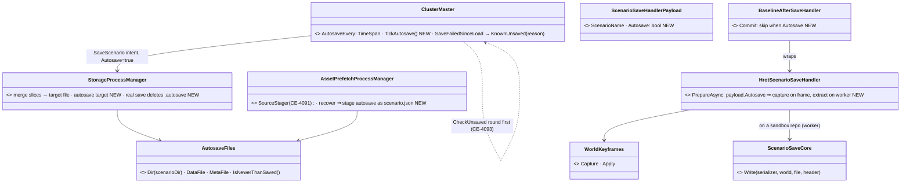

*What the picture shows that prose hid:* there is NO second save path. Autosave is the existing save round with one flag. The flag changes three
things and nothing else: where the merged file goes, whether the node re-baselines, and whether the node extracts on a worker.

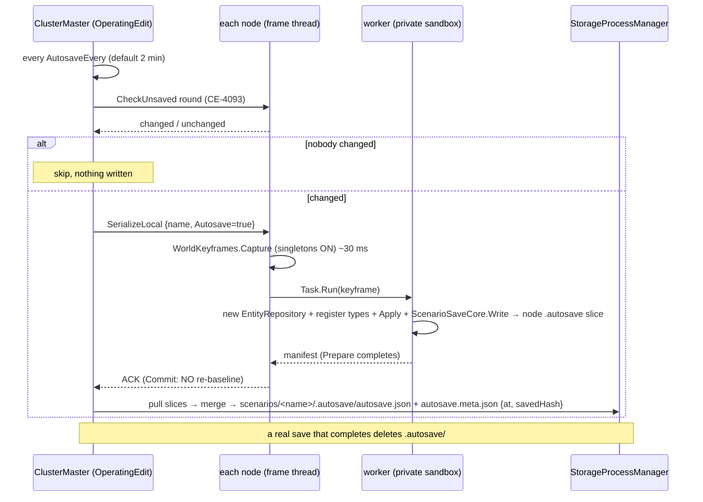

| # | decision | why |
|---|---|---|
| **A0** | ⛔ **GATE — measure first, build only if it holds:** for 3 curated scenarios (incl. `uc-urban-battle` and `pc-defend-house`), `ScenarioSaveCore.Write` on the live world and on a sandbox repo rebuilt from `WorldKeyframes.Capture(…, singletons ON)` produce **byte-identical JSON**; and `ScenarioSerializer` holds no mutable state a frame-thread caller writes (read every field). If either fails: STOP, report which types/fields differ | the whole design rests on "the keyframe carries everything the save reads". The check round's capture leaves singletons OFF (§4a); the save reads `TerrainDefinition.ResidentName` / `ScenarioDescription.ResidentOf` — singletons — so autosave's capture turns them ON |
| **A1** | the trigger is the MASTER: every `AutosaveEvery` (default 2 min; `POST /run-settings {autosaveMinutes}`, 0 = off) while `OperatingEdit`, it first runs the CE-4093 check round; only "changed" starts an autosave round | one clock, one decision for the cluster; an untouched scenario writes nothing; reuses the check round instead of a second change detector |
| **A2** | the round IS the save round with `ScenarioSaveHandlerPayload.Autosave = true` — the same fan-out, handler, pull and merge | ⛔ no second save implementation (the shared-and-unified rule) |
| **A3** | an autosave is NOT a save: no node re-baselines (`BaselineAfterSaveHandler` skips it), the master's unsaved fact is untouched, a failed autosave only logs (never a 409, never a user toast) | otherwise an autosave would make the world read "saved" and the next go-live would skip *Save first?* |
| **A4** | the node extracts on a WORKER from a private sandbox repo (capture on the frame thread, ≈30 ms) | R-4001: only work that touches no shared data runs on a worker — the sandbox is private; the frame never blocks for the JSON |
| **A5** | files: `scenarios/<name>/.autosave/autosave.json` (NOT `scenario.json`, so no scenario enumerator ever lists it) + `autosave.meta.json {at, savedHash}` (`savedHash` = the hash of the `scenario.json` it was based on); dot-folder already skipped by CE-4091's copy | Open never lists it by construction, not by a filter every listing must remember |
| **A6** | a real save that completes (pull + merge) deletes `.autosave/` | D23 |
| **A7** | recovery: `GET /scenarios/{name}/autosave` → `{at}` when an autosave exists whose `savedHash` equals the current `scenario.json`'s hash (else it is stale: the file was saved elsewhere since — reported, not offered); `POST /scenario/load/edit {name, recoverAutosave:true}` loads it — the prefetch stager (CE-4091) stages `autosave.json` as the node's `scenario.json` for this load only; the master then holds a `KnownUnsaved("recovered autosave")` fact (generalising `SaveFailedSinceLoad`) so the check round says changed until a real save | the scenario keeps its own name and folder; the recovered world is honestly "unsaved"; the start surface / Open prompt (*"Recover unsaved changes from 14:41?"*) is ui's and reads these two routes |

| **A8** | ⭐ **a NEVER-SAVED scenario** (a new one from a recipe, D18 — no `scenarios/<name>/`, no `scenario.json`): its autosave lives in the NAS **opened-not-saved area** — the ONE home CE-4089 gives opened recorded copies (D7) — keyed by the recipe it came from + the time it was opened, `savedHash` empty. Offered back on the start surface's *New from a recipe* / start, never on Open (Open lists saved scenarios only): `GET /autosaves` lists every never-saved autosave `{recipe, openedAt, at}`; `POST /scenario/load/edit {recoverAutosave: <id>}` reopens it as the same unsaved new scenario. The first real *Save As* deletes it (A6's rule, this home) | coordinator review `NOTE_Coordinator_To_Backend_CE4099_Design_Review.md` (`2026-10-29`): the plan's done-when is *"an edited, unsaved scenario survives a killed editor"*, and the commonest unsaved scenario has no folder for A5/A7 to point at |

**Cost (asked by the review):** one capture per node per interval — ≈30 ms (`uc-urban-battle` 6.8 MiB keyframe, Debug; §4a measured capture ≈33 ms) every 2 min = one frame hitch per node per interval, ONLY while editing (the clock is stopped). The JSON extraction and the write run on the worker. ⛔ Never in Live, Preview or AAR — no autosave runs outside `OperatingEdit` (A1).

`build-state` for §4c: **READY-TO-BUILD, gated on A0** (the review accepted A0–A7; A8 added at its request).

## 5. 📐 Measured `2026-10-28` (M1–M6) — design documents first, then code; spot-verified rows marked ✓

| # | answer | what it changes here |
|---|---|---|
| **M1** go-live from Preview without a reload | ✅ **feasible.** Nothing in an Edit session needs tearing down: `ReferenceEditLoadHandler` (`:77`) holds nothing, the dry-run keyframe exists only inside a preview, and no node gates on Edit vs Live. The edge was the ORIGINAL design (`mgmt-1` §3.1 "Promote to Live", `.dev/_DONE/mgmt-1/GAP-ANALYSIS.md:542`); it was dropped because CGF-1 had written a 4-step trajectory table the BFS would contradict (`.dev/_DONE/cgf-1/reports/CGF-1-BATCH-04-REPORT.md:94`) — the "dangling resources" note came later and no failure was ever measured | D3's mechanism, five specifics: ① a **planner flag** (`ContinueWorld`), NOT a bare graph edge — a bare edge makes BFS route EVERY Edit→Live request the short way (`TransitionPlannerTests.cs:105`, `TheWorldBoundaryResetsTheIdAuthorityTests.cs:252` would flip, and a load without a scenario id would silently continue instead of reload); ② `EditLiveHandoff` registered BEFORE `LoadPhaseChain` (which claims every `PrepareLive` and would re-read the file; `EcsHostClusterHandlers.Compose` gives an op to the first claimant, as for the replay branch); ③ the handoff starts the recording itself, as `ReferenceReplayLoadHandler` does; ④ the master mints the exercise id for this path too (`ClusterMaster.cs:1517-1540` mints only for a branch or a load from Idle); ⑤ the intent carries the scenario id so the snapshot (D7) runs. ⚠ Ids in a continued world follow the edit history, not a fresh load's 1000-block — a go-live run is not id-identical to a fresh load of its own scenario copy |
| **M2** the scenario folder | per-node slices are merged by the master into ONE `scenario.json`; incompatible ones stay as `foreign/node_<id>.json` (+ `foreign/index.json`); other writers add `checks.json`, `golden.json` (the verifier) and `takes/*.take.json` (the director) | D7 copies the WHOLE folder — today's copy takes top-level files only (`StorageGatewayModule.cs:854`) and misses `takes/` and `foreign/` |
| **M3** recordings know their scenario version | ⚠ **only partly:** `ScenarioDescription.Stamp` runs once, at the load (`ScenarioLoadStep.cs:178`), on Brain nodes only; ⛔ nothing restamps on Save — an edit → save → go-live recording carries the hash of the file AS LOADED | D7 stamps name + hash + `RecordedAt` AT GO-LIVE, from the saved file, on the master's copy (one writer) |
| **M4** editor start / terrain-less *(D16 now answers it with the start perspective)* | the editor opens Idle with an empty world, no terrain, no scenario (`UX_Requirements.md` UXR-01/02, still true); terrain-less scenarios are LEGAL by design (R-211, `DESIGN_Geo_Origin.md` row B: origin 0,0,0); File › Edit › New Scenario still makes a blank one (only the New Asset dialog refuses, `ScenarioNewAssetService.cs:118`); ⚠ suspected race in "new from recipe": load and save-as published back to back (unverified) | D16 — see the open proposal (a built-in flat terrain) |
| **M5** what expects a recording | every consumer fails DEEP, none at a gate — table below. No recording-off switch exists; an empty exercise id is the only de-facto one | D14's gates |
| **M7** the HTTP surface in `Start` | ✅ measured: the world IS there (the empty Idle world); the issue is ROUTING. On the runner, every world/time/AI route resolves through `PerspectiveScopedDispatcher.Active()` = the provider OWNING the active perspective's name (`PerspectiveScopedDispatcher.cs:104,108`); no provider owns `Start` ⇒ on a multi-provider host (`--mode all`) `/entities*`, `/view`, `/sim/*`, `/world/info`, the AI routes would answer 501 (today: 200 with an empty world) — a regression. Unaffected: the scenario load routes, `/cluster/*`, `/exercises`, `/scenarios`, `POST /replay`, `/capabilities` (they use the master / any-node accessors). The editor's service has no dispatcher, so the editor is unaffected; its `/status.perspective` is always null today (`DebugApiService.cs:709`). On a single-provider host the dispatcher's fallback would REPORT the provider's name instead of `Start` (`/status` and `GET /perspectives` would disagree) | ⭐ fix in ONE place: a `Start` ALIAS in the dispatcher — `Active()` routes `Start` to the gate's remembered perspective (the one D16 restores on leaving Idle), and `CurrentPerspective` reports `Start` honestly (+ `routedTo` in `/status`); the `POST /perspective` refusal lives in `WindowManager.SwitchPerspective` (the only funnel) and returns 409 with the reason; the editor's `/status.perspective` reads the window manager. Rejected: a `Start` provider with no world (every Idle read 501); per-route fallbacks (~40 sites); "first provider" fallback (forbidden by the dispatcher's own rule and rail `SeveralProviders_UnclaimedPerspective_ResolvesToNone`). ⚠ To fix with D16: the MCP skill's "switch perspective at boot" steps; scripts `ui-snapshot.py`, `ownership-e2e.py`; system rails that switch perspective with no load (`PerspectiveReachTests`, `PanelGoldenRails:409`, `TheUiBaselineIsPinnedPerHostRails:131`) — and the `if (!switched.Ok) continue` pattern (`ClusterConformanceRails:90`) would pass VACUOUSLY under the refusal. 🐞 Found: `PerspectiveCoordinatorSystem.cs:72-80` leaks a gizmo listener when entering any perspective not in its map (CE-4088) |
| **M8** the runner's `--wait-for` | ✅ dead, and `--no-wait` too: parsed and REQUIRED for a single-subsystem launch, read by nothing (`Program.cs` reads neither). `docs/designs/modular-2/DESIGN.md` §1.3 ruled "remove the `--wait-for` and `--no-wait` CLI options"; the build deleted the waiting room and kept the options. The documented `--wait-for orchestrator` is even rejected by the validation | ⭐ retire `--wait-for` and its "required" throw; keep `--no-wait` as an accepted no-op (≈10 callers: run scripts, `cluster-node.sh`, Dirigent, the MCP launcher, `EditorProcess`) with a deprecation note. NOT routed to the latch: the latch lives on the master and already waits on roles by default |
| **M6** Edit vs Live inside the ecosystem | the difference lives in the master, the toolbar and the recorder, not in the nodes (clock always paused in Edit, `ClusterMaster.cs:1441`; recording only on OperatingLive, `LoadPhaseChain.cs:190`; snapshot, ledger, DAR, checkpoints Live-only). ⚠ Nothing gates people or HID on Live: possession and orders gate on HOST type (`MapInteractionPack.cs:343-354`) — a person can possess a unit during a Preview, and the dry run's rewind does not undo what happened outside | confirms D3 is cheap. ⚠ "Live" means two things in the code: a connected live STATION (R-4096, `OrdersOffered`) and the cluster STATE — keep them apart in D12/D14 wording |

> ⭐ **As-built (CE-4094 + CE-4088, backend, `2026-10-28`) — M7's fix, the backend half; the start gate that SHOWS `Start` is CE-4096 (ui).**
> - **`WindowManager`** (`FDP/Engine/Fdp.Presentation/ImGui/WindowManager/WindowManager.cs`) owns it all: `StartPerspectiveName = "Start"`; `RememberedPerspective` (set in the ONE funnel `ApplyPerspective` when `Start` is entered; cleared on leaving); `IsStartShowing`; `TrySwitchPerspective(name, out reason)` — `SwitchPerspective` delegates to it — is REFUSED (with a reason) while `Start` is current; **`LeaveStartPerspective(out reason)` is the gate's only way out** (restores the remembered one, keeps the `A0` claimed-set check, so a remembered name no longer claimed leaves `Start` showing). `SaveSettings` persists the remembered perspective, never `Start`. ⛔ **CE-4096 must use these — not build another remember-and-restore.** `IPerspectiveSwitcher` carries `TrySwitchPerspective` + `RememberedPerspective` (pass-through).
> - **Dispatcher alias in ONE place** (`PerspectiveScopedDispatcher`): a new optional ctor delegate `rememberedPerspective` (read live, like `currentPerspective`; `ClusterDebugApiComposition.Dispatcher` takes it, `Program.cs` passes `WindowManager.RememberedPerspective`); `Active()` resolves `RoutedTo` (= the remembered perspective while `Start` shows, else the current one; the one-provider fallback applies to the routed name); `CurrentPerspective` reports `Start` honestly. No first-provider fallback (`SeveralProviders_UnclaimedPerspective_ResolvesToNone` unchanged).
> - **HTTP:** `GET /status` carries `perspective` + `routedTo` on the runner (dispatcher) AND the editor (window manager through the perspective seam — it was always `null` there); `POST /perspective` answers **409 + the window manager's reason** while `Start` shows (checked before the claimed-set 400). The Stride node shell keeps its fixed `"SimHost"` perspective (no window manager, never shows `Start`).
> - **CE-4088:** `PerspectiveCoordinatorSystem` removes the OUTGOING gizmo listener whatever the incoming perspective is. The 409 contract in the MCP skill: `tools/ai-debug-mcp` — "load first, then switch" in the mental model, notes on the `/perspective` and `/status` RouteDocs (catalog regenerated from them); scripts `ui-snapshot.py` / `ownership-e2e.py` stop instead of reading the wrong node; the system rails' vacuous `if (!switched.Ok) continue` are now assertions, `PerspectiveReachTests` loads first (`PanelGoldenRails` already did — its fixture loads once).

### 5a. D14's gates (from M5) — each greyed with a reason at the TOP, never a throw deep in a node

| consumer | fails today with no recording | gate |
|---|---|---|
| DAR | `ReferenceReviewHandler.cs:100` throws in prepare — after `ReviewProcessManager.cs:62` already PAUSED the live run | master refuses at `ReviewProcessManager:62`; menu item greyed |
| checkpoint / restore | `ReferenceCheckpointHandler.cs:99`, `:130` throw on every node; the File › Checkpoint item is always enabled | master refuses (`StartCheckpoint`, `ClusterMaster.cs:830`); menu greyed |
| "AAR the last exercise", export / keep | the inventory ledger is created on EVERY OperatingLive entry (`AssetInventoryProcessManager.cs:63-70`) — a non-recorded run would be offered, or an empty archive written | ONE gate at ledger creation |
| replay → live branch | the branch always records (`ReferenceReplayLoadHandler.cs:~300`) | the branch follows the setting like any live run |
| the scenario verifier (H1a / H5) | fails cleanly ("the live run recorded nothing", `ScenarioVerifyRun.cs:340`) | verify runs force recording ON |
| the director's takes | unaffected (they run in the preview) | none |
| retention (D15) | `ExerciseRetention` (CE-3218) prunes by count at start | reuse it for the keep/discard prompt's discard |

> ⭐ **As-built (CE-4090, backend, `2026-10-28`) — D14 · D15 · D9 · D22 and every gate of the table above.** *Live does not imply recording.* The prior state of §5a ("fails deep in a node") is SUPERSEDED by the gates below.
> - **The setting — held by the master, one flag, one wire.** `ClusterMaster.RecordLiveRuns` (default **ON**; `ClusterMaster.RunSettings.cs`) is set by `SetRunSettingsIntent` — a bus intent on the master's host, a new ClusterOp **`SetRunSettings = 24`** from any other (⛔ permanent wire value, R-42, both enums) — and read at the next live LOAD: `NoteRunRecording` (from `ExecuteTransitionTrajectory`) turns it into the master's `RunNotRecorded`. It reaches every node on the load itself: `EditLoadHandlerPayload.RecordingOff` → `NodeTransitionPayloadDto.RecordingOff` (Master/SlaveTranslator) → `LoadPhaseContext.RecordingOff` → **`LoadPhaseChain`** starts no recorder (`Hrot.Core/Services/LoadPhase/LoadPhaseChain.cs`; the legacy `ReferenceLiveLoadHandler` honours the same field). ⭐ **Inverse polarity on purpose** (`RecordingOff`, `RunNotRecorded`): `default` and an older sender both mean today's behaviour — record. The same flag rides every cluster-state broadcast (`ClusterStateTopic.RunNotRecorded` → `ClusterStateUpdateEvent` → `ClusterSlave.RunNotRecorded` / `ClusterUiCache.RunNotRecorded` → `ISubsystemDebugProvider.RunNotRecorded`), so every host's HTTP gate and (later, CE-4097) the Live icon read ONE fact. ⭐ **The SETTING is on the same broadcast** (follow-up, same task): `RecordLiveRunsOff` (inverted, so an old sender reads ON) → `ClusterSlave` / `ClusterUiCache.RecordLiveRunsOff` → `ISubsystemDebugProvider.RecordLiveRunsOff`; the master republishes the state when the setting changes; **`GET /run-settings` → `{recordLiveRuns}`** on every host reads it (the armed Live icon's source for CE-4097).
> - **Sticky by design:** the flag describes the LAST live run until the next live load or a replay entry, so "replay / keep the last run" still knows it was not recorded after the run has ended.
> - **DAR** — refused at the master (`ClusterMaster.ProcessTransitionStateIntent`, the `OperatingReview` block) **and** `ReviewProcessManager.Tick` no longer pauses the live clock for it (`runNotRecorded` ctor arg, wired by `OrchestratorCore`) — the old order paused first and threw in every node's prepare.
> - **checkpoint / restore** — `ClusterMaster.StartCheckpoint` / `StartRestore`: `Rejected` with the reason `"this run was not recorded"` (`Fdp.Toolkit.Orchestration.RunRecordingGates.NotRecordedReason`, the ONE text) before any fan-out or pause.
> - **the inventory ledger** — ONE gate at its creation: `AssetInventoryProcessManager.Tick` skips the ledger entry **and** the scenario copy when `ClusterStateUpdateEvent.RunNotRecorded`, so nothing offers the run for AAR / keep / export.
> - **keep / export** — `ClusterMaster.ProcessStorageOpIntent`: an `Export` of the active, unrecorded exercise is rejected; HTTP `POST /exercises/keep` with no id answers 409 (never "the newest older exercise").
> - **replay of the last run** — `ProcessTransitionStateIntent`: a replay naming no exercise is rejected when the last run was not recorded; naming one still works.
> - **the replay → live branch** follows the setting (`ReferenceReplayLoadHandler`, PrepareLive: replay torn down, no recorder when `RecordingOff`).
> - **the verifier forces ON** — `TransitionStateIntent.ForceRecording` (+ DTO), set only by `DebugApiService.LoadScenarioLive(…, forceRecording: true)` from the verifier's `loadLive` lambda (`EditorSubsystem`); ⛔ no HTTP route sets it.
> - **D5 branch case — the data ui needs (CE-4097; backend, as built 2026-10-28)** — `ExerciseInventoryItem` gained `ParentExerciseId` (`Guid.Empty` = not a branch) and `BranchWallTicks` (the recording metadata's own unit: the PARENT's wall ticks at the branch frame). ⛔ No second record: finished exercises read it off the sidecars through the one reader `ExerciseBranch.Of` (`StorageGatewayModule.ScanNasExercises` / `ScanLocalExercises`, `RecordingGroupInventory.Scan` for the Replay Browser; earliest node wins); the LIVE run's comes from the nodes — `LiveBranchResult` (PrepareLive's answer, `ReferenceReplayLoadHandler`) carries the very `RecordingBranch` the node writes its sidecar from, `LiveBranchAggregator` takes the earliest recording node's, and `AssetInventoryProcessManager` (master) labels the run's ledger entry (`RecordingLedgerEntry` gained both, default = not a branch) whether the answer lands before or after the cluster state. Wire: the inventory JSON carries both (an old peer reads empty); HTTP `GET /exercises` → `parentExerciseId` (null = began at a load) + `branchWallTicks`. **Units:** no sim-seconds twin — a host converts on the replay axis it already seeks by: `atSeconds = (branchWallTicks − zero) / 1e7`, `zero` = `ReplayPosition`'s zero once the parent is the open replay (`DebugApiService.ReplaySeek.cs`). ⚠ Not covered: a CHECKPOINT-restore branch (a live → live branch, `CheckpointRestoreResult`) — its sidecar carries the parent, so an ARCHIVED one lists it, but the master's ledger entry (live and unarchived) is not labelled (D5's ■ case is the replay → live branch). Rails: `AssetInventoryProcessManagerTests` (CE4097 ×3) · `ClusterMasterBranchTests` · `ClusterMasterCheckpointTests` (aggregator) · `ReferenceHandlerTests` · `RecordingGroupInventoryBranchTests` · `TheClusterControlRoutesTests`.
> - **HTTP (D22)** — the host gates read the same flag and answer **409** (`DebugApiHost.ResultOf` ⇒ `RunRecordingGates.IsConflict`): `/checkpoint`, `/checkpoint/restore`, `/review`, `/exercises/keep` and `/replay` (no id). **`POST /review` needs its start** (`atSeconds` or `atSimSeconds`, else 400 — D9; ⚠ the UI facade's `EnterReview()` default "the live point" in `Hrot.Presentation/Facades/ClusterReplayControls.cs` is CE-4097's to retire). **`POST /scenario/save` is 409 in Live** (host guard + `ClusterMaster.ProcessStorageOpIntent`, extending CE-3329 P3's refusal while replaying — one rule) **and in AAR** (that existing guard). **`POST /run-settings {recordLiveRuns}`** (the minimal route; no name was fixed in D14/D22). **`DELETE /exercises/{id}`** → `StorageOpType.Delete` / ClusterOp **`DeleteExercise = 25`** → `ClusterMaster.ProcessDeleteExercise` → `AssetInventoryProcessManager.DeleteExercise` → **`ExerciseRetention.Delete`** (CE-3218's deleter, new single-id form): the ledger entry, its scenario copy and every `exercises/<id>` under the master's staging root; 404 for an id the inventory does not list (a **kept** exercise stays); the run still recording is refused. ⚠ Node-local copies on OTHER machines are pruned by retention, not deleted here. **`GET /status.recording`** = the run the cluster shows is recorded (Live / DAR / AAR and not flagged), false in Idle / Edit / Preview.
> ⭐ **As-built (CE-4091, backend, `2026-10-28`) — D7: the recording keeps its scenario (M2, M3) and D22's `POST /scenario/load/edit {recorded}`.** The prior state (M2/M3 above: *"top-level files only"*, *"stamp at load only"*) is SUPERSEDED by this.
> - **The copy is the WHOLE folder.** `StorageGatewayModule.CopyScenarioFiles` recurses (`foreign/`, `takes/`, any nested file); ⛔ it skips directories whose name starts with a dot (`.slices`, the save's working folder; `.autosave` of CE-4099) — scratch, not scenario. The node PREFETCH is unchanged (top-level files + `foreign/node_*.json`: what a node loads). One copier for the go-live snapshot, the export's archive copy and the open-for-edit staging.
> - **The stamp — one source for "which version ran".** At go-live `AssetInventoryProcessManager.SnapshotScenario` (the existing CE-3119 copy, on the master) writes `recorded.stamp` into the copy: `{scenarioName, scenarioHash, recordedAt}` — the hash is `ScenarioDescription.HashOf` (the one rule) of the SAVED `scenario.json` just copied (`Fdp.Toolkit.Scenario.RecordedScenarioStamp`, next to `ScenarioDescription`). It rides the copy to the archive. **Decision: the go-live stamp is THE source a reader trusts; the load-time stamp (`ScenarioDescriptionResident` via `ScenarioLoadStep`, M3) stays** for its other readers — its `Text` is what a Save writes back, and its name/hash feed the recorder's `RecordingMetadata.ScenarioName/Hash`, kept as the fallback for a recording without a copy (before CE-4091, recording off). ⚠ The recording meta's hash is therefore "as loaded": ⛔ nothing may use it for "which version ran". ⚠ ~~Open edge: the director's `TakeStore.ScenarioHash` still reads that meta hash~~ — ⭐ **CLOSED by CE-3340 ② (backend, `2026-10-29`), see the next bullet.**
> - ⭐⭐ **As-built (CE-3340 ②) — ONE reader of "which version ran": `RecordedScenarioStamp.VersionOf(stagingRoot, meta)`** (`Fdp.Toolkits/Scenario/RecordedScenarioStamp.cs`). It finds the recording's copy (`FindCopy`: the master's ledger snapshot `{staging}/nodes/node-N/recording_ledger/<id>.scenario` while unarchived, else the archive `{shared}/exercises/<id>/scenario` — the master's own two places in the same order; the path pieces now live once in `OrchestrationConstants`, which `AssetInventoryProcessManager` also uses) and returns the stamp's hash; **only when no copy / stamp / hash is reachable does it return the recording meta's load-time `ScenarioHash`** (a recording from before CE-4091; a host that sees neither ledger nor archive). The director's takes (`ReplayBrowserSubsystem.Director.cs` → `TakeStore.ScenarioHash` → `Take.ScenarioHash` / `TakePromotion` / `DirectorRunner`) read through it, so a take compares against the SAVED version after edit → save → go-live. **Decision on the meta's `ScenarioHash`:** it has exactly ONE reader left — that fallback inside `VersionOf` (`grep -rniE "scenarioHash"` over `Hrot FDP tools`, non-test: the director delegate was its only reader; the Save's write-back uses the RESIDENT description's `Text`, not the recording meta). It is still WRITTEN (`RecorderTickSystem.StampWorld`, as loaded) because the fallback needs it for old recordings and for a host that cannot see the copy, and the file format stays readable; its doc now says "as loaded, not the version that ran". ⚠ `RunModeChoice.RecordedVersionDiffers` (the AAR → Preview button's host seam) is still supplied by no host; when one does, it reads `VersionOf` too. Rails: `RecordedScenarioStampTests` (`Fdp.Toolkits.Tests`: archive stamp beats the meta hash · ledger found and wins · no copy / no stamp / empty hash / no exercise id fall back) · `CE3340_2_TheDirectorsTakes_ReadTheGoLiveStamp_AndAnOldRecordingFallsBackToItsMetaHash` (`Hrot.ReplayBrowser.Tests`).
> - **A branch inherits its parent's copy (D7).** The inventory copies the PARENT's copy — ledger snapshot, else the archive's `exercises/<parent>/scenario` — stamp included, so the two are equal; whether the nodes' branch answer (`LiveBranchResult`) reaches the manager before the state event (used at entry) or after it (`InheritParentCopy` replaces the copy made from the file). A branch that names no scenario still gets the copy. CE-3299 D18's branch (`ReferenceReplayLoadHandler`) writes only the recording sidecar's `RecordingBranch`; before this task a branch's copy was the scenario file AS IT IS NOW — the defect D7 names.
> - **`POST /scenario/load/edit {recorded: <exerciseId>}` — opened as a new scenario, by a NAME.** A scenario load is a name every node resolves against its own scenarios root, and a name under the reserved `Recipes/` folder is how "New from a recipe" already opens a scenario that has no file of its own (found: no other unsaved-scenario state exists — `LoadPhaseContext.IsNewScenario` is always `false` in production, `NodeOpSlaveTranslator.cs:219`). So: the host derives `Recipes/Recorded/<id>` (`RecordedScenarioNames`, `ScenarioNewAssetService.SeedSubfolder` now points at the same constant) and sends the ordinary edit load (same unsaved-changes gate, 409 / `discardUnsaved`); the master's PREFETCH runs `AssetPrefetchProcessManager.SourceStager` (= `AssetInventoryProcessManager.StageRecordedScenario`, on its worker thread, before the gateway copy) which puts the recording's copy — minus its stamp — at `<nas>/scenarios/Recipes/Recorded/<id>/`. ⛔ It writes only that new folder: never the original scenario folder, never the recording or its copy. No new ClusterOp, no new wire value; no copy ⇒ the prefetch fails and the load is refused like any scenario that is not there. 404 for an id the host's inventory does not list, 400 for `recorded` + `name`, and for `recorded` on `load/live`. ⚠ Open edges: the staged folder is a recipe-named scenario in the Open list until the picker (CE-4096/4098) hides `Recipes/`, and a Save of it under that name is the guard of D18 (CE-4092).
> - **Rails:** `AssetInventoryProcessManagerTests` (`CE4091_*`: stamp from the saved file · every subfolder in the ledger and the archive · a branch equals its parent, answer before / after the state, archived parent, no scenario named · the open stages a new name and writes neither original nor recording · the prefetch runs the stager) · `TheUnsavedCheckRoutesTests` (the route: name, 404, 400s, the gate) · `DistributedScenarioSaveTests` (`ClusterRunner.Integration.Tests`, a real in-process cluster: edit → save → go-live carries the saved file's hash and `foreign/`).
> - **Rails (CE-4090):** `ClusterMasterRunRecordingTests` · `ClusterMasterReviewTests` · `ClusterMasterBranchTests` · `AssetInventoryProcessManagerTests` · `TranslatorDtoTests` / `NodeOpMasterTranslatorTests` (Orchestrator.Tests) · `LoadPhaseChainTests` / `NodeOpSlaveTranslatorTests` (SimHost.Tests) · `ReferenceHandlerTests` / `ExerciseRetentionTests` (Fdp.Toolkits.Tests) · `TheRunRecordingGatesAnswer409Tests` (Editor.Tests, real HTTP) · `CheckpointClusterTests` (ClusterRunner.Integration.Tests, a real in-process cluster).

⚠ Two words already taken: `POST /exercises/keep` archives a run to the shared NAS — D15's "keep" must not reuse that name for "do not delete". And D8's "new scenario from a checkpoint" has no code yet (the checkpoint menu holds only Take Checkpoint); a checkpoint taken during AAR has no mechanism either (a replay has no live recorder).

## 6. The build list

⭐ Broken into lane tasks in [`PLAN_Run_Modes_And_Content_Build.md`](PLAN_Run_Modes_And_Content_Build.md) (sixth pass) — that plan is the dispatch record; this section no longer lists steps.
