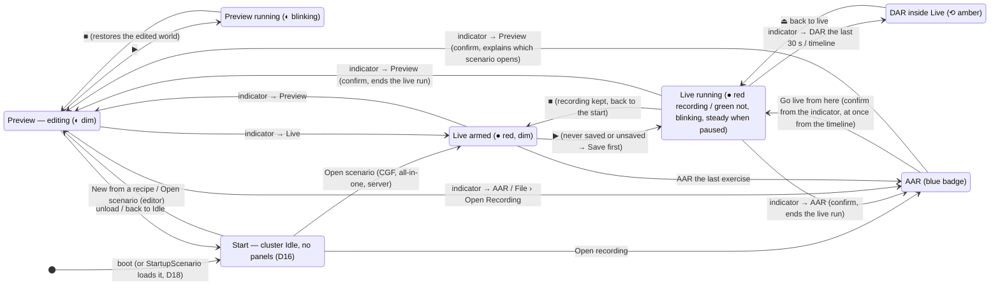
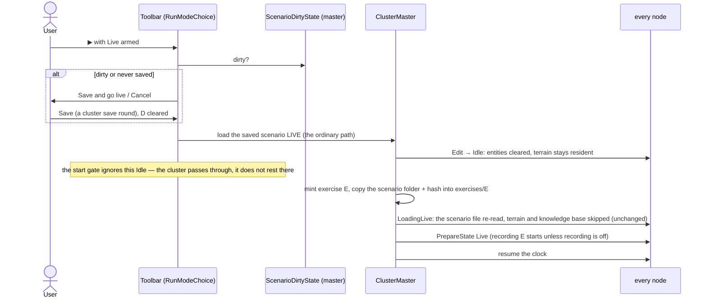
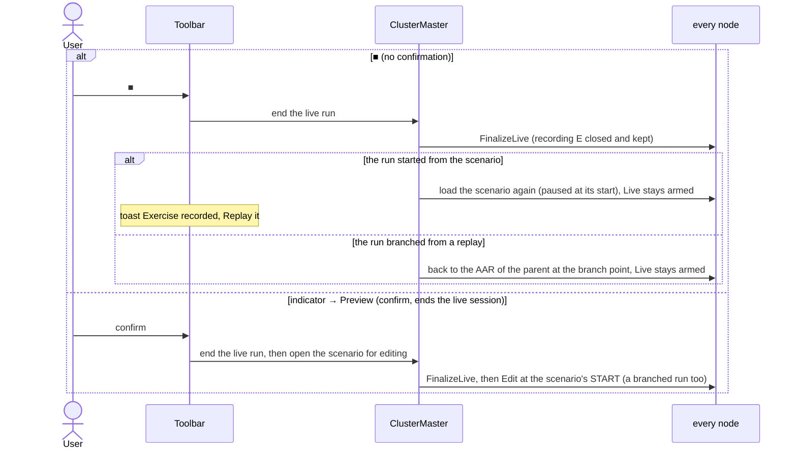
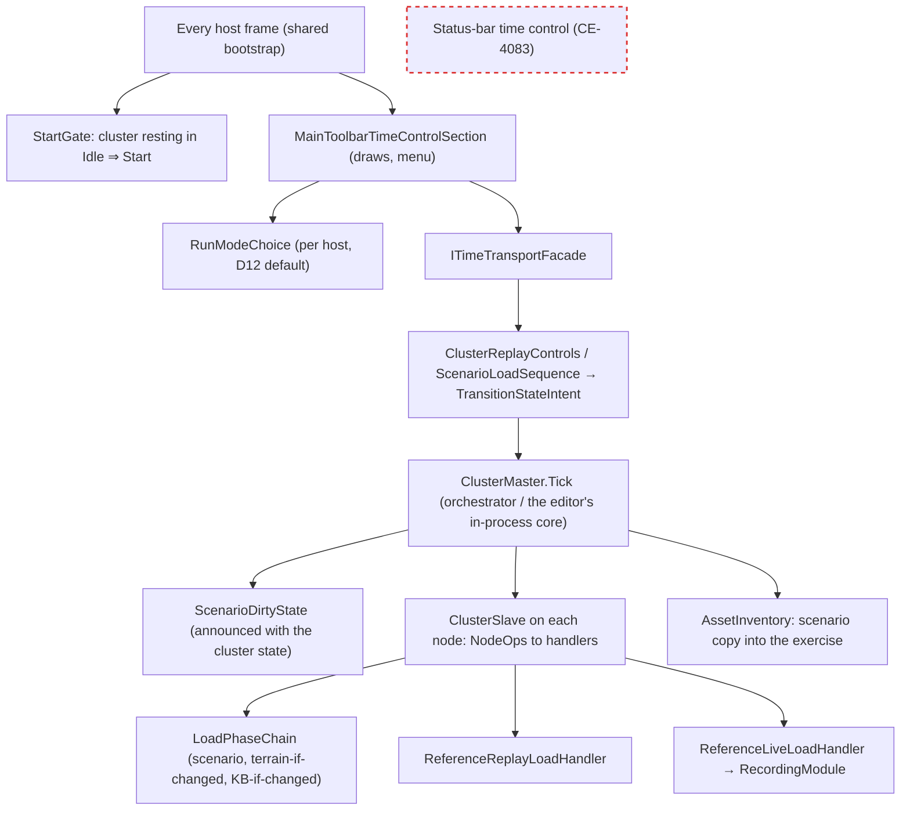

<!--STATUS
state: LIVE — ✅ APPROVED 2026-10-28 (R-4098): the user shaped every decision in chat and accepted every remaining lean ("All your leans accepted")
updated: 2026-10-28 (CE-4090 as-built folded into §5a)
build-state: READY-TO-BUILD (2026-10-28) — not dispatched. M1–M6 MEASURED 2026-10-28 (§5); D16 (start perspective) and D18 (start with a scenario) decided by the user; M7–M8 measured; READY-TO-BUILD — ⛓ sequenced AFTER the content-layout move (repo `scenarios/` · `assets/` · `recipes/`, a separate short design), because the start surface lists recipes and scenarios
current-answer: ⭐ §2.2–§2.5 REVISED (no continue-world flag) · §1 the three rules · §1a the words (Live / DAR / AAR) · §4 D16 the start perspective, D18 start with a scenario · §2 the picture (states, classes, sequences, modules) · §3 every move with its confirmation · §4 decisions · §5 what must be measured · §6 the build list
stale-below: nothing
known-rot: none
known-conflict: CGF-1-DESIGN.md:557 removed `RunningEdit → LoadingLive` ("would … leave edit-session resources dangling"); §4 D3 reinstates it as a world-CONTINUING load (the shape of the replay → live branch), which leaves nothing dangling because the edit world is parked in the go-live snapshot
related-designs:
  - ../DESIGN_Replay_Time_Axis_And_Review.md — §9a OWNS the mode indicator and its rule "a click opens a menu, never acts" (R-3060, R-3061); this question grows that menu with the mode choice and keeps the rule
  - ../DESIGN_Checkpoint_And_Dry_Run_Restore.md — OWNS the dry run's RAM snapshot (the preview) and §1h the branch with history (D18); the go-live snapshot and Replay → Live reuse both
  - ../designs/mgmt-1/DESIGN.md — §3 OWNS the operator state machine (Edit / Live / Replay, Live-from-Replay); §8.12 "always recording"
  - ../designs/cgf-1/CGF-1-DESIGN.md — §4.1 OWNS the BUILT transition graph and the note that removed Edit → Live (see known-conflict)
  - ../DESIGN_Deterministic_Network_Ids.md — §11 OWNS "ids and the world reset only on a load entered from Idle" — why a world-continuing go-live must not pass Idle
  - ../designs/main-toolbar-1/DESIGN.md — §7 the toolbar's time group, §10 the ONE asset browser (gains a Recording kind)
  - DESIGN_Time_Architecture.md — OWNS the editor's time controller; unchanged
  - ../DESIGN_Film_Director.md — the director plays takes in the PREVIEW (`DirectorRunner.cs:584`); only the scenario verifier loads live (`ScenarioVerifyRun.cs:157`) — unaffected, except D14 must keep recording ON for verify runs
  - ../DESIGN_Distributed_Scenario_Persistence.md — §4a OWNS what a scenario folder holds after a distributed save (one merged scenario.json + foreign/node_<id>.json); D7 copies all of it
  - ../DESIGN_Film_Production.md — F-1 / row ① "any live run records itself" (R-4091) and R-3053 — D14 amends both (recording becomes a setting)
  - ../DESIGN_Cluster_Load_Phase.md — §8:809 records the user 2026-10-05: a production run is "started from scenario file always, never from memory"; D3 supersedes it for the go-live from Preview (the user, 2026-10-28)
  - Blueprint_Issues_Tracker.md CE-4082 (this), CE-4083 (remove the status-bar time control — one transport), CE-4081 (Esc stops a take)
-->

# Architect Question 108 — **the run-mode picker: Preview · Live · Replay at the Play button** (`CE-4082`)

🔒 **User, `2026-10-28`** (the asks, verbatim, in order):
*"in editor i need some way to record a scenario, i.e. somehow switch the time control in the main menu bar between preview and live mode … if the
exercise is not running, the icon should indicate the mode to be run when Start button is pressed (preview, live, replay) maybe just in darker color
than when i finally press the Play - the icon then goes brighter or may be even blinking … Switching modes while running would not be possible. How
to switch model once scenario is already loaded needs to be thought through well."* ·
*"scenario should stay loaded visually as is (no visible unload and reload) and play should start live with recording. When paused or stopped, the
system still know what was the latest exercise … Changes in live mode should be saveable only as another scenario … From replay we could switch to
Live at any time (live will be initialized from current position of the replay) … From live/replay to preview is a step back to editing the original
scenario so whatever current state is discarded - such transitions must be guarded with confirmation dialog. switching to replay when no live has been
loaded asks for opening a recording (using our unified reusable open dialog)"* ·
*"live running -> replay ... here we should use DAR as the first choice … replay as secondary item (with ask - cancels the live)"* ·
*"live feels like it should be starting from the beginning of the scenario always, never from the middle of something else unless it is from replay
where switching to live is intentional (to re-train failed part of scenario)"* ·
*"recording should contain the copy of the scenario (whole folder because of distributed save?) so we can always really start editing the original"* ·
*"STOP in live … starting replay from END is weird … We should be able to run live again quickly (next play after LIVE end = next live start?)"* ·
*"Maybe 'Save' icon during live could create a checkpoint without asking anything, just with toast note"* ·
*"replay -> preview should probably explain the user what is going to happen (in a confirmation dialog). same with Replay -> live if started from
indicator mode switch. if from timeline's menu, it is accepted immediately"* ·
*"Live to Preview is losing a lot, it is ending a live session that might be intended to continue"* ·
*"edits must be allowed in live and preview, whether the user saves them is his responsibility, banner should be ok, rather in status bar - non
obtrusive"* · *"ok leans are fine"*

🔒 **User, `2026-10-28`, the second pass** (verbatim): *"CGF/all-in-one mode should start in live mode by default, editor in preview mode"* · *"review and replay wording would be better to replace with AAR and DAR (or at least DAR as something different from classical replay)"* · *"we should somehow also allow live without recording; live does not mean just recording, it has consequences on whether people control some HID like replicated weapons or drive a replicated cars, outside of our engine, so it differs from preview where no live players are present; maybe some setting in the system can control whether the live does recording at all; and we could ask at the end (gated by another setting) whether we want to discard the recording so it does not pile up"* · *"editor is in 'unsaved new scenario' mode by default and the terrain must be loaded first - can be loaded via terrain-specific scenario recipes which would then read as always creating a scenario first. Scenario must be saved before switching to live but can be previewed at will."*

🔒 **User, `2026-10-28`, the third pass** (verbatim): *"turning off recording will need some gates at different places where the recording is expected to be available now"* · *"Edit mode and live mode are not much different from our ecosystem point of view. The difference is in some parts that are outside of this ecosystem."* · *"today we are allowed to start Editing without the terrain selected, So we are ending up in no terrain situation. Technically this might be okay if we use reference point 0, 0 but it is almost never correct for any production real use case … the cleanest option is to behave like any usual editor. So when it opens empty and the controls are disabled until the user decides whether to create a new scenario by opening a terrain recipe or by loading an already existing scenario, and only then the controls will enable … Meaning that a scenario without a terrain cannot be authored."*

🔒 **User, `2026-10-28`, the fourth pass — THE START PERSPECTIVE** (verbatim): *"the application start with basically nothing, with just the main menu and no panels, with a special perspective, which means 'nothing allowed, First you need to either open a scenario to be edited, or start a new scenario to be edited, or load an existing scenario into live mode, or load an existing recording into replay mode.' This is very clean and follows the cluster state machine … flat 0,0 terrain kind of scenario can be opened when we select start a new scenario from flat terrain empty recipe. That means we do not need to support a special flat terrain … the initial state when the editor opens with an empty world, but in the idle state of the cluster state machine is some relict from the development of the system … when we go back to idle, whenever during the session, the UI should switch back to this 'you can do nothing' Perspective."* · *"Regarding the harnesses … maybe for those we can leave it as it is … The only change here is that the UI will switch into the start perspective at the beginning. So the empty world is still there at the background, but there is no way how to touch it"* · *"the Stride host, I'm not using it anymore … keeping it just like an example"* · *"let's support from the very beginning the option that the cluster can be started with a concrete scenario loaded that requires the cluster waits until all mandatory nodes or roles are present, and only then it loads the scenario."*

🔒 **User, `2026-10-28`, the fifth pass** (verbatim): *"Maybe the open for editing is the default because we already support going live from the preview, which is still at the beginning. that would reduce the menu to open scenario, and whether we are going to edit or [live] could depend on what node is opening. If it is editor, it could start in the editing mode by default, and if it is the CGF, then it could start in the live mode by default. As the start perspective should be something shared and unified across the nodes, 'am I starting in live or in preview?' should be one of little host specific parametrizing the otherwise unified and shared bootstrap code. Startup scenario lives on the command line of the cluster runner. and it is meant for the orchestrator node. And if the startup scenario is the recipe, then we are loading an unsaved new scenario based on the recipe. And if the scenario is an already saved scenario, meaning not a recipe, we are loading that scenario … just by the scenario name, we should be able to somehow determine whether it is a recipe or an already existing scenario."*

🔒 **User, `2026-10-28`, the approval:** *"top-level recipes folder, and go with your lean on behaviours, All your leans accepted."* ⇒ every ⏸ lean in §4 and §5 is approved as written (R-4098).

🔒 **User, `2026-10-28`, the sixth pass** (verbatim): *"There should be also 'Recent' section in the picker dialog So we can easily pick whatever was picked the last time. The recent items should be remembered in the user folder."* · *"Mode can be changed also by clicking the timeline and selecting something like replay from this place or similar."* · *"How do we recognize there are any unsaved changes? … comparing the current state of the world with the snapshot … this might differ per node."* · *"The continue the world flag. Is it required given that the load of the world is quick … What I meant by no reloading was that we shouldn't reload any terrain or big assets that are already loaded in the memory. Could the solution be more clean if we avoid using the continue the world flag?"* · *"Please break the implementation into tasks so we can give them to different sessions as needed - ui, backend etc."*

🔒 **User, `2026-10-28`, the seventh pass** (verbatim): *"Yes, HTTP server face stays explicit."* · *"I think setting the change flag from any change operation is very fragile and will break easily. Comparing the current world with the world state at the beginning is a relatively simple and very reliable way. We just need to find out how to do it across the cluster, When and how often, and how to share this flag with others so everyone can show the unsaved scenario flag in the UI."*

🔒 **User, `2026-10-28`, the eighth pass** (verbatim): *"We likely really need to know whether something has changed only when we are going to switch the mode, So maybe we do not even to detect it too often."*

🔒 **User, `2026-10-28`, the ninth pass** (verbatim): *"Do we need to check only what goes into the scenario? Maybe that anything that changes is a good reason for showing the change flag. Maybe the checkpoint, which is now created as a keyframe in the flight recorder on every preview start, is pretty good for comparing … I agree that we should do it on demand only and drop the change indicator, But I would still compare the full world, not just the parts that go into the scenario. Alternatively, we could be snapshotting the world and serializing into JSON on purpose in periodical intervals as part of autosave feature, so that we can recover from editor crash … If we do the JSON serialization from a temporary ECS world snapshot in a separate backend task, it could be asynchronous, and we will not care about how much time it takes because it will not be blocking anything."*

## 0. INVENTORY

⭐ Graph via `scripts/cbm.sh` + grep, `2026-10-28`. ⚠ `check_index_coverage` is not reachable through the CLI; every count was corroborated by grep.

| query | total | what it settled |
|---|---|---|
| `search_graph ".*(TimeTransport|ModeIndicator|ExerciseMode|SessionMode|Preview).*"` Class | 40 (production: `MainToolbarTimeControlSection`, `ClusterTimeTransportAdapter`, `EditorPreviewAdapter`, `EditorPreviewController`, `PreviewClockProcessManager`) | ONE toolbar transport + a status-bar copy (CE-4083); the preview is the editor's dry run |
| `search_graph ".*(ScenarioLoadSequence|LoadHandler|ScenarioSession|LiveBranch|RecordingModule|RecordingBranch).*"` Class | 15 | `ReferenceLiveLoadHandler` starts the recording; `ReferenceReplayLoadHandler` takes over a live load during a replay (the branch); `ScenarioLoadSequence` is the ONE load path (CE-295) |
| `search_graph` Interface `.*(TimeTransport|ScenarioSession|RecordReplayController|ClusterStateHandler).*` | 5 | the seams: `ITimeTransportFacade`, `IScenarioSession`, `IRecordReplayController`, `IClusterStateHandler` |
| grep `ITimeTransportFacade` (production) | 17 files | one facade read by toolbar, status bar, panels and the debug API |
| grep `"File/Live"`, `"File/Edit"` | `ScenarioMenuCommands.cs:91-97` | the load-in-a-mode menus this question folds away |
| grep `EnterReview(` | 12 sites | a review with no position = the live point (`ClusterReplayControls.cs:19`) — removed (§4 D9) |
| `HrotStateGraph.cs` edges | 21 | no Edit → Live edge (`:18-20`); Replay → Live exists (`:50`); Live ⇄ Review (`:55-58`) |
| `AssetKind` | 6 kinds | no `Recording` kind |
| `RecordingMetadata` | `ScenarioName`, `ScenarioHash` (`:72-79`, CE-4058) | the version is known; the scenario itself is not kept |

## 1. ⭐ The three rules — the spine

| # | rule | why it makes the rest predictable |
|---|---|---|
| **R1** | **Only the mode indicator changes mode.** ▶ ⏸ ■ never do | the user always knows what ▶ will do: the indicator says it, dim before the start, bright while running |
| **R2** | **■ returns to where this run came from, and the armed mode stays** — so the next ▶ repeats the run | Preview: back to the edited world. Live from editing: back to the scenario's start, Live armed (a quick rerun). Live branched from a replay: back to the replay at the branch point, Live armed (re-train the same part). Replay: back to the recording's start |
| **R3** | **A confirmation appears only to explain a jump or to stop losing something**, and it says exactly what will happen | Live → anything that ends the session asks; a deliberate ■ does not (it is the stop, and the run is already a recording) |

### 1a. ⭐ The words the user sees (D17)

| word | means | indicator |
|---|---|---|
| **Preview** | a dry run of the scenario being edited — no live players, nothing recorded, ■ restores | ◐ violet |
| **Live** | the exercise with live players: people outside the engine drive replicated vehicles and weapons (HID, simulators). ⭐ **Live is NOT "recording"** — it records only when the system setting says so (D14) | ● **red** when recording · ● **green** when not |
| **DAR** — During Action Review | looking back INSIDE a running live session; live continues after ⏏ | ⟲ amber, tooltip "DAR" |
| **AAR** — After Action Review | playing a recording (an ended exercise, or one opened from a file); "Replay" disappears from the user's vocabulary | blue **AAR** badge |

⭐ Only the words the user sees change. ⛔ The code keeps `TransportMode.Replay` / `Review` and `ClusterState.OperatingReplay` / `OperatingReview` — renaming them buys nothing and touches the wire and every test.

## 2. The picture

### 2.1 What the user sees — the modes and the moves

*What the picture shows that prose hid:* nothing is reachable without leaving `Start`, and every way out of `Start` is an ordinary state-machine load — so no host ever shows panels over the Idle world. Every arrow that ENDS a live session starts from `LRun` and is either the deliberate ■ (back to Live armed,
nothing lost) or a confirmed mode switch. Nothing reaches `LRun` except ▶ from Live armed or a branch from a replay — so a live run always starts
from a scenario's beginning or from an intended replay moment.

### 2.2 Classes — existing (grey) and new *(revised `2026-10-28`, sixth pass: no continue-world flag)*

*What the picture shows that prose hid:* every mode change except the replay branch is an ORDINARY load through the one load path — the
"continue the world" flag of the first draft is gone (sixth pass, user). It costs no big reload because entering Idle clears only the entities
(`LoadPhaseChain.OnEnteredIdle`) and an unchanged terrain is not re-ingested (`TerrainResidency.cs:174-203`); the knowledge base is a no-op
(`KnowledgeBaseLoadStep.cs:99`). Bonus: a live run's ids are the canonical ones of a fresh load, and its recording matches its scenario file.

### 2.3 Sequence — Preview idle → ▶ Live (only the scenario file is re-read)

### 2.4 Sequence — ■ in Live, and Live → Preview

### 2.5 Modules — who runs what each frame

*What the picture shows:* the armed mode is per host; every change to the world goes through the ONE cluster master and the ONE load path; the
dirty state lives with the master and is announced like the cluster state, so every host shows the same `name*` (UXR-03).

## 3. Every move, with what the user is told

| from → to | how | confirmation (R3) | what happens |
|---|---|---|---|
| Preview idle → Live armed | indicator | none | ▶ will now start a live run |
| Live armed → ▶ | Play | only if unsaved: *Save and go live / Cancel* | live from the world on screen, recording on, no reload (§2.3) |
| Preview running → Live / AAR | indicator | *"Stops the preview and returns to the scenario's start"* | the dry run restores, then the chosen mode is armed |
| Live running → DAR | indicator *"DAR — the last 30 s / 2 min / from a checkpoint (live continues after)"*, or the timeline's menu at a time | none | DAR as built — ⛔ never at the live end (D9) |
| Live running → AAR | indicator, second item | *"Ends the live session; its recording opens for AAR"* | FinalizeLive, then the AAR of E |
| Live running → Preview | indicator | *"Ends the live session; you return to editing the scenario at its start"* | §2.4 |
| ■ in Live | Stop | none | §2.4 — Live stays armed; toast *"Exercise recorded (12:31) — Replay it"* |
| Live armed → AAR the last exercise | indicator, or the toast's button | none | the replay of the last exercise, at its START |
| Preview → AAR, or File › Open Recording | indicator / File | unsaved edits → *Save / Discard / Cancel*; File › Open Recording always asks for one | the shared open dialog, kind Recording, grouped by scenario: *"hill-attack · run 3 · 14:41 · 12:31 long"* |
| AAR → Live | indicator | *"A new exercise starts from 07:04; this recording stays unchanged"* | the built branch (D18), inheriting the parent's scenario copy |
| AAR → Live | timeline menu | none — the user picked the moment | the same |
| AAR → Preview | indicator | explains which scenario opens; when the saved scenario's hash differs from the recording's: **Open the recorded version (as a copy)** · **Open the current scenario** | edit that scenario at its start |
| ■ in AAR | Stop | none | back to the recording's start, still AAR (R2) |
| Save / Ctrl+S in Live or AAR | toolbar / key | none | a checkpoint, toast *"Checkpoint taken"*; the scenario is never written |
| New scenario from a checkpoint | checkpoint menu / timeline | asks for a new name | the checkpoint's world as a new scenario, opened for editing |
| editing while Preview or Live runs | any tool | none | allowed; the status bar says *"Running — edits are not saved unless you save"* |
| open another scenario | File | unsaved → Save / Discard / Cancel | the HOST's default mode is armed (D12): Preview in the editor, Live on CGF / all-in-one |
| editor start | — | none | EMPTY: run controls and authoring tools disabled, the indicator dim; the only ways in are **New scenario (from a terrain recipe)** and **Open scenario** (and File › Open Recording for an AAR) |
| Live armed → ▶ on a never-saved scenario | Play | *Save as… and go live / Cancel* | Live needs a saved scenario (D16) — it is what the recording keeps (D7) |
| ■ in Live with recording OFF (D14) | Stop | none | as ■ (§2.4), toast *"Live run ended"* — no AAR button; DAR and "AAR the last exercise" are greyed *"this run was not recorded"* |
| ■ in Live with "ask to keep recordings" ON (D15) | Stop | *"Keep this recording? (12:31, hill-attack) — Keep / Discard"* | Discard deletes `exercises/<id>/`; Keep is the default button |

## 4. Decisions

| # | decision | verdict |
|---|---|---|
| **D1** | the mode is a CHOICE of what ▶ runs, shown dim before the start and bright while running; locked while running except through the confirmed moves of §3 | ✅ user |
| **D2** | Live always starts from a scenario's beginning, or from an intended replay moment (the branch) — never from the middle of a preview | ✅ user |
| **D3** | ⭐ **REVISED `2026-10-28` (sixth pass, user):** going Live from editing is the ORDINARY load path (Edit → Idle → Live, the saved scenario re-read) — ⛔ no "continue the world" flag. "No reload" means no reload of the TERRAIN and other big assets, and that already holds: entering Idle clears only the entities (`LoadPhaseChain.OnEnteredIdle`), an unchanged terrain is not re-ingested (`TerrainResidency.cs:174-203`), the knowledge base is a no-op (`KnowledgeBaseLoadStep.cs:99`). Gains: no new handler, no new graph edge, canonical ids, the recording matches its scenario file; ■ and Live → Preview are ordinary loads too. ⚠ The start gate (D16) must react only to the cluster RESTING in Idle, never to an Idle a planned trajectory passes through. ⛔ SUPERSEDED: the first form (a world-continuing `OperatingEdit → LoadingLive` with a go-live snapshot) — M1 showed it feasible but it is no longer needed | ✅ user |
| **D4** | unsaved edits ask *Save and go live / Cancel*; a never-saved scenario asks *Save as… and go live / Cancel* (D16) | ✅ user |
| **D5** | ■ follows R2: back to where the run came from, the armed mode stays | ✅ user ("next play after LIVE end = next live start") · the branch case ✅ lean accepted |
| **D6** | replay of a just-ended live run is an explicit step (the indicator, or the toast's button), at the recording's START | ✅ user |
| **D7** | a recording keeps its scenario: the EXISTING master-side copy (CE-3119, `AssetInventoryProcessManager.SnapshotScenario`) grows to the WHOLE folder (subfolders too) and stamps name + hash + `RecordedAt` at go-live from the saved file (M3: today the stamp is load-time only and goes stale after a Save); a branch inherits its parent's copy | ✅ user + lean accepted · mechanism from M2/M3 |
| **D8** | Save in Live / Replay = a checkpoint with a toast; a new scenario comes from a checkpoint, never from Save As | ✅ user |
| **D9** | a review always has an explicit start (the indicator's windows, the timeline); the "no position = the live point" default is removed (`ClusterReplayControls.cs:19`, `POST /review`) | ✅ user · ✅ the HTTP half BUILT (CE-4090: `POST /review` needs `atSeconds` / `atSimSeconds`; the UI facade default is CE-4097's) |
| **D10** | confirmations exactly as §3; Live → Preview always asks (no "don't ask again"); timeline actions never ask | ✅ user |
| **D11** | edits are allowed while Preview or Live runs; a status-bar note, not a banner | ✅ user |
| **D12** | the armed mode after opening a scenario is the HOST's default: **Preview in the editor, Live on CGF, the all-in-one and the server** — ⭐ ONE host parameter of the shared, unified bootstrap (the start perspective and everything else are the same code on every host) | ✅ user |
| **D13** | the status-bar time control is removed (CE-4083) — the picker exists once | ✅ user (CE-4083) |
| **D14** | **Live does not imply recording.** A system setting *"Record live runs"* (default ON) decides; the Live icon says which (red recording · green not). Not a conflict with mgmt-1 §8.12 "Always Recording" — that rule keeps the recorder running while the clock is PAUSED, it does not make every live run record | ✅ user (the setting) · ⏸ lean: default ON, one cluster-wide setting the master hands to every node with the live load · ✅ **BUILT (CE-4090)** — §5a as-built |
| **D15** | at ■ in Live, *"Keep this recording?"* — gated by a second setting *"Ask to keep recordings"* | ✅ user (the prompt + its gate) · ⏸ lean: default OFF (keep silently), Keep is the default button · ✅ the backend half BUILT (CE-4090: `DELETE /exercises/{id}`; the prompt and its second setting are CE-4097) |
| **D16** | ⭐⭐ **THE START PERSPECTIVE.** While the cluster is **Idle** (at boot, and whenever it returns to Idle — an unload, a stop to Idle, the master gone), EVERY host shows the perspective `Start`: no panels, only the menu items marked *allowed in Idle* — **New scenario from a recipe** (an unsaved scenario based on it; the empty flat-terrain recipe listed first), **Open scenario**, **Open recording (AAR)**, Exit, Help. ⭐ **Open always loads into the editing state** (clock stopped, nothing recorded); what ▶ then does is the host's armed mode (D12) — going live from there is the no-reload go-live (D3), so a separate "Open live" is not needed (fifth pass). Each of them leaves Idle through the ordinary state machine; leaving Idle restores the host's remembered perspective. ⭐ Enforced BY CONSTRUCTION: one gate in the shared presentation layer, registered by the shared bootstrapper, reads the cluster state every host already has (`ClusterStateUpdateEvent`, `MasterGone`); `Start` is claimed by ONE shared window (the start surface — UXR-01), so the A0 rule (`WindowManager.cs:276-297`) holds. While `Start` shows, the perspective toolbar and `POST /perspective` refuse with *"load a scenario first"*. A host that cannot operate the cluster (a Player, SimHost alone) shows *"Waiting for the server to load a scenario"* with no actions; the master gone shows *"Server lost — waiting"*. The Replay Browser (offline, no cluster) and the Stride host (an example only) are exempt. ⛔ No special flat terrain: an existing terrain's empty recipe does it. ⭐ The empty Idle world stays as it is behind `Start` — harnesses and tools that use it keep working; only the UI can no longer reach it | ✅ user |
| **D18** | ⭐ **a cluster may be started with a scenario**: a cluster-runner command-line option for the ORCHESTRATOR node (`--startup-scenario <name>`). ⭐ The name decides what is loaded: a name under the reserved recipes folder (`Recipes/<seed>`, `ScenarioNewAssetService.SeedSubfolder`) loads an UNSAVED new scenario based on that recipe; any other name loads that saved scenario. Either way it lands in the editing state with the hosts' armed modes (D12) — nothing records until ▶. ⚠ The rule needs one guard: nothing may be SAVED under `Recipes/` (a save there would turn a scenario into a recipe). The master WAITS until every mandatory node / role is present, THEN loads it through the ordinary state machine. ⭐ ⚠ M8 found: the latch's `LoadWaitSeconds` (30 s) would REFUSE a start-up load whose nodes boot later — ⭐ lean: the start-up scenario waits WITHOUT a deadline (the operator can cancel it; `load.notice` shows what it waits for); the 30 s refusal stays for operator-issued loads. Built on the EXISTING bootstrap latch (`ClusterConfiguration.Mandatory`, `ClusterMaster.CheckBootstrapLatch`, CGF-1-DESIGN §3.5) — today it rejects every transition until the named mandatory subsystems are in Idle (default: none, so it opens at once), and a mandatory node's ejection re-engages it; CE-4087 extends it to ROLES (Brain + MuscleGround always) and makes a load WAIT instead of being rejected. Without the setting a cluster boots Idle into `Start` | ✅ user (command line, orchestrator node, recipe-vs-saved by name) |
| **D19** | **Recent**: every open picker (scenarios, recordings, assets) shows a *Recent* section first — the items last picked, per kind — remembered in the user folder (beside the layout's user files) | ✅ user |
| **D20** | ⭐ **FINAL `2026-10-28` (ninth pass, user): unsaved changes = the WHOLE WORLD compared, ON DEMAND, with NO indicator.** ⭐ **What:** each node captures its whole world as a binary keyframe — the flight recorder's own writer, the same capture the preview's dry-run snapshot uses (`WorldKeyframes.Capture(repo, CaptureOptions)`, `FDP/Toolkits/Fdp.Toolkits/Replay/WorldKeyframes.cs:94`; 📐 19–31 ms and 4–8 MiB per host on `uc-urban-battle`, Debug) — and keeps only its HASH; anything that changed counts (user: *"anything that changes is a good reason"*), not only the scenario's parts, and no JSON is produced. ⭐ **Baseline:** taken by each node when a load into editing commits, after every completed save round, and at a late joiner's catch-up. ⭐ **When:** ONLY in a CHECK ROUND the master asks and every node answers, before a step that would lose edits — going live, opening another scenario, back to `Start`, exit, an HTTP load without `discardUnsaved` (D22). ⛔ No indicator, no periodic check. ⭐ **Why it is safe:** the binary keyframe follows the storage layout, so it can only err towards "changed" (an identical unit deleted and re-added, a slot shift) — a needless "save first?"; it cannot report unchanged for a changed world (bar a hash collision). ⚠ **Rail first (the noise test):** load, move the camera, select, open panels, touch nothing else ⇒ every round answers "unchanged" on every node. In Edit the clock is stopped, but systems that write while paused (map culling, styles, network bookkeeping) would make every round "changed"; if they do, their component types are excluded from the capture by their own type flags (`Transient` / `NoSnapshot`), never by a second list. ⛔ SUPERSEDED: a flag raised by every authoring change (fragile); a periodic check with a `name*` (not needed); the hash of the save's JSON extraction (slow on a large scenario) | ✅ user |
| **D21** | the timeline's right-click menu changes mode at the clicked moment, without asking: in Live — *DAR from here* (live continues) · *AAR from here* (ends the live run); in AAR — *Go live from here* (a branch); everywhere — *Take checkpoint here* | ✅ user |
| **D22** | ⭐ **the HTTP surface stays EXPLICIT** (user, seventh pass): routes do what they name and never follow the armed mode. The changes: while `Start` shows the dispatcher routes `Start` to the remembered perspective and `POST /perspective` answers 409; `GET /status` reports `perspective: Start`, `routedTo`, `scenarioDirty`, `recording`, `armedMode`; `POST /scenario/load/live` answers 409 while the scenario is dirty or never saved unless `discardUnsaved:true`; `POST /scenario/save` answers 409 in Live and AAR (take a checkpoint, then make a scenario from it); a new `POST /sim/stop` calls the SAME `ITimeTransportFacade.Stop` as ■; `POST /review` needs its start (D9); with recording off `/checkpoint`, `/checkpoint/restore`, `/review`, `/replay` of the last run and `/exercises/keep` answer 409 *"this run was not recorded"*; new `DELETE /exercises/{id}` (D15), `POST /scenario/load/edit {recorded}` (D7), `POST /scenario/from-checkpoint` (D8), `POST /run-mode {armed}` (a thin route over the indicator's choice, for agents that drive the UI); `POST /sim/play` in a resting Idle keeps today's behaviour for harnesses; the route names `/replay` and `/review` stay (D17); the MCP skill and catalog are regenerated from their sources | ✅ user (explicit) · leans accepted with it |
| **D23** | ⭐ **AUTOSAVE (ninth pass, user)** — a separate feature: while editing, every N minutes each node captures its world (the fast binary keyframe, ~30 ms on the frame) and a BACKGROUND task rebuilds it in a temporary world (`new EntityRepository()` + the keyframe apply — the precedent is `RecordingExportService`'s `sandboxRepo`, `RecordingExportService.cs:44,299`), runs the ordinary scenario save extraction on it and writes the JSON to an autosave location; nothing blocks. On the next open of that scenario (or at editor start after a crash), an autosave newer than the saved scenario is offered: *"Recover unsaved changes from 14:41?"*. ⏸ Leans: per node, its own slice, merged by the master like a save; the autosave lives beside the scenario on the NAS (`scenarios/<name>/.autosave/`, never listed by Open); N = 2 minutes, a user setting; an autosave is deleted by the next real save. Its own task (CE-4099), after CE-4093 | ✅ user (the feature) · ⏸ leans |
| **D17** | the user-facing words: **DAR** (inside a live session) and **AAR** (a recording played back) replace "Review" and "Replay"; the code names stay (§1a) | ✅ user (the words) · ⏸ lean: code names unchanged |

## 5. 📐 Measured `2026-10-28` (M1–M6) — design documents first, then code; spot-verified rows marked ✓

| # | answer | what it changes here |
|---|---|---|
| **M1** go-live from Preview without a reload | ✅ **feasible.** Nothing in an Edit session needs tearing down: `ReferenceEditLoadHandler` (`:77`) holds nothing, the dry-run keyframe exists only inside a preview, and no node gates on Edit vs Live. The edge was the ORIGINAL design (`mgmt-1` §3.1 "Promote to Live", `.dev/_DONE/mgmt-1/GAP-ANALYSIS.md:542`); it was dropped because CGF-1 had written a 4-step trajectory table the BFS would contradict (`.dev/_DONE/cgf-1/reports/CGF-1-BATCH-04-REPORT.md:94`) — the "dangling resources" note came later and no failure was ever measured | D3's mechanism, five specifics: ① a **planner flag** (`ContinueWorld`), NOT a bare graph edge — a bare edge makes BFS route EVERY Edit→Live request the short way (`TransitionPlannerTests.cs:105`, `TheWorldBoundaryResetsTheIdAuthorityTests.cs:252` would flip, and a load without a scenario id would silently continue instead of reload); ② `EditLiveHandoff` registered BEFORE `LoadPhaseChain` (which claims every `PrepareLive` and would re-read the file; `EcsHostClusterHandlers.Compose` gives an op to the first claimant, as for the replay branch); ③ the handoff starts the recording itself, as `ReferenceReplayLoadHandler` does; ④ the master mints the exercise id for this path too (`ClusterMaster.cs:1517-1540` mints only for a branch or a load from Idle); ⑤ the intent carries the scenario id so the snapshot (D7) runs. ⚠ Ids in a continued world follow the edit history, not a fresh load's 1000-block — a go-live run is not id-identical to a fresh load of its own scenario copy |
| **M2** the scenario folder | per-node slices are merged by the master into ONE `scenario.json`; incompatible ones stay as `foreign/node_<id>.json` (+ `foreign/index.json`); other writers add `checks.json`, `golden.json` (the verifier) and `takes/*.take.json` (the director) | D7 copies the WHOLE folder — today's copy takes top-level files only (`StorageGatewayModule.cs:854`) and misses `takes/` and `foreign/` |
| **M3** recordings know their scenario version | ⚠ **only partly:** `ScenarioDescription.Stamp` runs once, at the load (`ScenarioLoadStep.cs:178`), on Brain nodes only; ⛔ nothing restamps on Save — an edit → save → go-live recording carries the hash of the file AS LOADED | D7 stamps name + hash + `RecordedAt` AT GO-LIVE, from the saved file, on the master's copy (one writer) |
| **M4** editor start / terrain-less *(D16 now answers it with the start perspective)* | the editor opens Idle with an empty world, no terrain, no scenario (`UX_Requirements.md` UXR-01/02, still true); terrain-less scenarios are LEGAL by design (R-211, `DESIGN_Geo_Origin.md` row B: origin 0,0,0); File › Edit › New Scenario still makes a blank one (only the New Asset dialog refuses, `ScenarioNewAssetService.cs:118`); ⚠ suspected race in "new from recipe": load and save-as published back to back (unverified) | D16 — see the open proposal (a built-in flat terrain) |
| **M5** what expects a recording | every consumer fails DEEP, none at a gate — table below. No recording-off switch exists; an empty exercise id is the only de-facto one | D14's gates |
| **M7** the HTTP surface in `Start` | ✅ measured: the world IS there (the empty Idle world); the issue is ROUTING. On the runner, every world/time/AI route resolves through `PerspectiveScopedDispatcher.Active()` = the provider OWNING the active perspective's name (`PerspectiveScopedDispatcher.cs:104,108`); no provider owns `Start` ⇒ on a multi-provider host (`--mode all`) `/entities*`, `/view`, `/sim/*`, `/world/info`, the AI routes would answer 501 (today: 200 with an empty world) — a regression. Unaffected: the scenario load routes, `/cluster/*`, `/exercises`, `/scenarios`, `POST /replay`, `/capabilities` (they use the master / any-node accessors). The editor's service has no dispatcher, so the editor is unaffected; its `/status.perspective` is always null today (`DebugApiService.cs:709`). On a single-provider host the dispatcher's fallback would REPORT the provider's name instead of `Start` (`/status` and `GET /perspectives` would disagree) | ⭐ fix in ONE place: a `Start` ALIAS in the dispatcher — `Active()` routes `Start` to the gate's remembered perspective (the one D16 restores on leaving Idle), and `CurrentPerspective` reports `Start` honestly (+ `routedTo` in `/status`); the `POST /perspective` refusal lives in `WindowManager.SwitchPerspective` (the only funnel) and returns 409 with the reason; the editor's `/status.perspective` reads the window manager. Rejected: a `Start` provider with no world (every Idle read 501); per-route fallbacks (~40 sites); "first provider" fallback (forbidden by the dispatcher's own rule and rail `SeveralProviders_UnclaimedPerspective_ResolvesToNone`). ⚠ To fix with D16: the MCP skill's "switch perspective at boot" steps; scripts `ui-snapshot.py`, `ownership-e2e.py`; system rails that switch perspective with no load (`PerspectiveReachTests`, `PanelGoldenRails:409`, `TheUiBaselineIsPinnedPerHostRails:131`) — and the `if (!switched.Ok) continue` pattern (`ClusterConformanceRails:90`) would pass VACUOUSLY under the refusal. 🐞 Found: `PerspectiveCoordinatorSystem.cs:72-80` leaks a gizmo listener when entering any perspective not in its map (CE-4088) |
| **M8** the runner's `--wait-for` | ✅ dead, and `--no-wait` too: parsed and REQUIRED for a single-subsystem launch, read by nothing (`Program.cs` reads neither). `docs/designs/modular-2/DESIGN.md` §1.3 ruled "remove the `--wait-for` and `--no-wait` CLI options"; the build deleted the waiting room and kept the options. The documented `--wait-for orchestrator` is even rejected by the validation | ⭐ retire `--wait-for` and its "required" throw; keep `--no-wait` as an accepted no-op (≈10 callers: run scripts, `cluster-node.sh`, Dirigent, the MCP launcher, `EditorProcess`) with a deprecation note. NOT routed to the latch: the latch lives on the master and already waits on roles by default |
| **M6** Edit vs Live inside the ecosystem | the difference lives in the master, the toolbar and the recorder, not in the nodes (clock always paused in Edit, `ClusterMaster.cs:1441`; recording only on OperatingLive, `LoadPhaseChain.cs:190`; snapshot, ledger, DAR, checkpoints Live-only). ⚠ Nothing gates people or HID on Live: possession and orders gate on HOST type (`MapInteractionPack.cs:343-354`) — a person can possess a unit during a Preview, and the dry run's rewind does not undo what happened outside | confirms D3 is cheap. ⚠ "Live" means two things in the code: a connected live STATION (R-4096, `OrdersOffered`) and the cluster STATE — keep them apart in D12/D14 wording |

> ⭐ **As-built (CE-4094 + CE-4088, backend, `2026-10-28`) — M7's fix, the backend half; the start gate that SHOWS `Start` is CE-4096 (ui).**
> - **`WindowManager`** (`FDP/Engine/Fdp.Presentation/ImGui/WindowManager/WindowManager.cs`) owns it all: `StartPerspectiveName = "Start"`; `RememberedPerspective` (set in the ONE funnel `ApplyPerspective` when `Start` is entered; cleared on leaving); `IsStartShowing`; `TrySwitchPerspective(name, out reason)` — `SwitchPerspective` delegates to it — is REFUSED (with a reason) while `Start` is current; **`LeaveStartPerspective(out reason)` is the gate's only way out** (restores the remembered one, keeps the `A0` claimed-set check, so a remembered name no longer claimed leaves `Start` showing). `SaveSettings` persists the remembered perspective, never `Start`. ⛔ **CE-4096 must use these — not build another remember-and-restore.** `IPerspectiveSwitcher` carries `TrySwitchPerspective` + `RememberedPerspective` (pass-through).
> - **Dispatcher alias in ONE place** (`PerspectiveScopedDispatcher`): a new optional ctor delegate `rememberedPerspective` (read live, like `currentPerspective`; `ClusterDebugApiComposition.Dispatcher` takes it, `Program.cs` passes `WindowManager.RememberedPerspective`); `Active()` resolves `RoutedTo` (= the remembered perspective while `Start` shows, else the current one; the one-provider fallback applies to the routed name); `CurrentPerspective` reports `Start` honestly. No first-provider fallback (`SeveralProviders_UnclaimedPerspective_ResolvesToNone` unchanged).
> - **HTTP:** `GET /status` carries `perspective` + `routedTo` on the runner (dispatcher) AND the editor (window manager through the perspective seam — it was always `null` there); `POST /perspective` answers **409 + the window manager's reason** while `Start` shows (checked before the claimed-set 400). The Stride node shell keeps its fixed `"SimHost"` perspective (no window manager, never shows `Start`).
> - **CE-4088:** `PerspectiveCoordinatorSystem` removes the OUTGOING gizmo listener whatever the incoming perspective is. The 409 contract in the MCP skill: `tools/ai-debug-mcp` — "load first, then switch" in the mental model, notes on the `/perspective` and `/status` RouteDocs (catalog regenerated from them); scripts `ui-snapshot.py` / `ownership-e2e.py` stop instead of reading the wrong node; the system rails' vacuous `if (!switched.Ok) continue` are now assertions, `PerspectiveReachTests` loads first (`PanelGoldenRails` already did — its fixture loads once).

### 5a. D14's gates (from M5) — each greyed with a reason at the TOP, never a throw deep in a node

| consumer | fails today with no recording | gate |
|---|---|---|
| DAR | `ReferenceReviewHandler.cs:100` throws in prepare — after `ReviewProcessManager.cs:62` already PAUSED the live run | master refuses at `ReviewProcessManager:62`; menu item greyed |
| checkpoint / restore | `ReferenceCheckpointHandler.cs:99`, `:130` throw on every node; the File › Checkpoint item is always enabled | master refuses (`StartCheckpoint`, `ClusterMaster.cs:830`); menu greyed |
| "AAR the last exercise", export / keep | the inventory ledger is created on EVERY OperatingLive entry (`AssetInventoryProcessManager.cs:63-70`) — a non-recorded run would be offered, or an empty archive written | ONE gate at ledger creation |
| replay → live branch | the branch always records (`ReferenceReplayLoadHandler.cs:~300`) | the branch follows the setting like any live run |
| the scenario verifier (H1a / H5) | fails cleanly ("the live run recorded nothing", `ScenarioVerifyRun.cs:340`) | verify runs force recording ON |
| the director's takes | unaffected (they run in the preview) | none |
| retention (D15) | `ExerciseRetention` (CE-3218) prunes by count at start | reuse it for the keep/discard prompt's discard |

> ⭐ **As-built (CE-4090, backend, `2026-10-28`) — D14 · D15 · D9 · D22 and every gate of the table above.** *Live does not imply recording.* The prior state of §5a ("fails deep in a node") is SUPERSEDED by the gates below.
> - **The setting — held by the master, one flag, one wire.** `ClusterMaster.RecordLiveRuns` (default **ON**; `ClusterMaster.RunSettings.cs`) is set by `SetRunSettingsIntent` — a bus intent on the master's host, a new ClusterOp **`SetRunSettings = 24`** from any other (⛔ permanent wire value, R-42, both enums) — and read at the next live LOAD: `NoteRunRecording` (from `ExecuteTransitionTrajectory`) turns it into the master's `RunNotRecorded`. It reaches every node on the load itself: `EditLoadHandlerPayload.RecordingOff` → `NodeTransitionPayloadDto.RecordingOff` (Master/SlaveTranslator) → `LoadPhaseContext.RecordingOff` → **`LoadPhaseChain`** starts no recorder (`Hrot.Core/Services/LoadPhase/LoadPhaseChain.cs`; the legacy `ReferenceLiveLoadHandler` honours the same field). ⭐ **Inverse polarity on purpose** (`RecordingOff`, `RunNotRecorded`): `default` and an older sender both mean today's behaviour — record. The same flag rides every cluster-state broadcast (`ClusterStateTopic.RunNotRecorded` → `ClusterStateUpdateEvent` → `ClusterSlave.RunNotRecorded` / `ClusterUiCache.RunNotRecorded` → `ISubsystemDebugProvider.RunNotRecorded`), so every host's HTTP gate and (later, CE-4097) the Live icon read ONE fact. ⭐ **The SETTING is on the same broadcast** (follow-up, same task): `RecordLiveRunsOff` (inverted, so an old sender reads ON) → `ClusterSlave` / `ClusterUiCache.RecordLiveRunsOff` → `ISubsystemDebugProvider.RecordLiveRunsOff`; the master republishes the state when the setting changes; **`GET /run-settings` → `{recordLiveRuns}`** on every host reads it (the armed Live icon's source for CE-4097).
> - **Sticky by design:** the flag describes the LAST live run until the next live load or a replay entry, so "replay / keep the last run" still knows it was not recorded after the run has ended.
> - **DAR** — refused at the master (`ClusterMaster.ProcessTransitionStateIntent`, the `OperatingReview` block) **and** `ReviewProcessManager.Tick` no longer pauses the live clock for it (`runNotRecorded` ctor arg, wired by `OrchestratorCore`) — the old order paused first and threw in every node's prepare.
> - **checkpoint / restore** — `ClusterMaster.StartCheckpoint` / `StartRestore`: `Rejected` with the reason `"this run was not recorded"` (`Fdp.Toolkit.Orchestration.RunRecordingGates.NotRecordedReason`, the ONE text) before any fan-out or pause.
> - **the inventory ledger** — ONE gate at its creation: `AssetInventoryProcessManager.Tick` skips the ledger entry **and** the scenario copy when `ClusterStateUpdateEvent.RunNotRecorded`, so nothing offers the run for AAR / keep / export.
> - **keep / export** — `ClusterMaster.ProcessStorageOpIntent`: an `Export` of the active, unrecorded exercise is rejected; HTTP `POST /exercises/keep` with no id answers 409 (never "the newest older exercise").
> - **replay of the last run** — `ProcessTransitionStateIntent`: a replay naming no exercise is rejected when the last run was not recorded; naming one still works.
> - **the replay → live branch** follows the setting (`ReferenceReplayLoadHandler`, PrepareLive: replay torn down, no recorder when `RecordingOff`).
> - **the verifier forces ON** — `TransitionStateIntent.ForceRecording` (+ DTO), set only by `DebugApiService.LoadScenarioLive(…, forceRecording: true)` from the verifier's `loadLive` lambda (`EditorSubsystem`); ⛔ no HTTP route sets it.
> - **HTTP (D22)** — the host gates read the same flag and answer **409** (`DebugApiHost.ResultOf` ⇒ `RunRecordingGates.IsConflict`): `/checkpoint`, `/checkpoint/restore`, `/review`, `/exercises/keep` and `/replay` (no id). **`POST /review` needs its start** (`atSeconds` or `atSimSeconds`, else 400 — D9; ⚠ the UI facade's `EnterReview()` default "the live point" in `Hrot.Presentation/Facades/ClusterReplayControls.cs` is CE-4097's to retire). **`POST /scenario/save` is 409 in Live** (host guard + `ClusterMaster.ProcessStorageOpIntent`, extending CE-3329 P3's refusal while replaying — one rule) **and in AAR** (that existing guard). **`POST /run-settings {recordLiveRuns}`** (the minimal route; no name was fixed in D14/D22). **`DELETE /exercises/{id}`** → `StorageOpType.Delete` / ClusterOp **`DeleteExercise = 25`** → `ClusterMaster.ProcessDeleteExercise` → `AssetInventoryProcessManager.DeleteExercise` → **`ExerciseRetention.Delete`** (CE-3218's deleter, new single-id form): the ledger entry, its scenario copy and every `exercises/<id>` under the master's staging root; 404 for an id the inventory does not list (a **kept** exercise stays); the run still recording is refused. ⚠ Node-local copies on OTHER machines are pruned by retention, not deleted here. **`GET /status.recording`** = the run the cluster shows is recorded (Live / DAR / AAR and not flagged), false in Idle / Edit / Preview.
> - **Rails:** `ClusterMasterRunRecordingTests` · `ClusterMasterReviewTests` · `ClusterMasterBranchTests` · `AssetInventoryProcessManagerTests` · `TranslatorDtoTests` / `NodeOpMasterTranslatorTests` (Orchestrator.Tests) · `LoadPhaseChainTests` / `NodeOpSlaveTranslatorTests` (SimHost.Tests) · `ReferenceHandlerTests` / `ExerciseRetentionTests` (Fdp.Toolkits.Tests) · `TheRunRecordingGatesAnswer409Tests` (Editor.Tests, real HTTP) · `CheckpointClusterTests` (ClusterRunner.Integration.Tests, a real in-process cluster).

⚠ Two words already taken: `POST /exercises/keep` archives a run to the shared NAS — D15's "keep" must not reuse that name for "do not delete". And D8's "new scenario from a checkpoint" has no code yet (the checkpoint menu holds only Take Checkpoint); a checkpoint taken during AAR has no mechanism either (a replay has no live recorder).

## 6. The build list

⭐ Broken into lane tasks in [`PLAN_Run_Modes_And_Content_Build.md`](PLAN_Run_Modes_And_Content_Build.md) (sixth pass) — that plan is the dispatch record; this section no longer lists steps.
