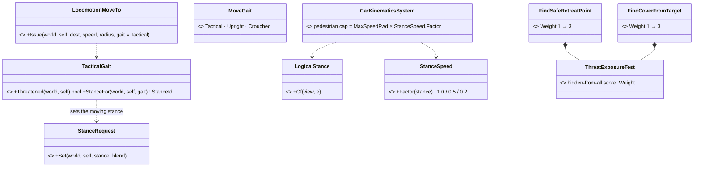
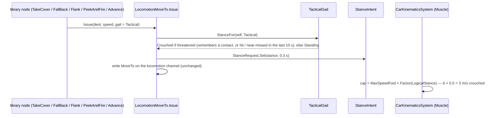

<!--STATUS
state: LIVE
build-state: READY-TO-BUILD
updated: 2026-10-10
current-answer: §4 ANSWERED 2026-10-11 (R-265) · §5 the build design (build-state READY-TO-BUILD) — §3 is the question as asked
stale-below: nothing
known-rot: none
known-conflict: none
related-designs:
  - DESIGN_Peek_And_Fire.md — OWNS the fight-from-cover node; its relocation speed (4.5 m/s) is one of the clamped asks (§2 row 2)
  - docs/designs/navig-2/Navigation_Design_v2_0.md — OWNS the move pipeline; §11 stance speed ratios exist for the crowd agent only
  - FDP/Docs/projects/toolkits/FDP.Toolkit.CarKinem.md — OWNS the pedestrian mover ("Human gait"): the MaxSpeedFwd clamp is here
  - DESIGN_Eqs_Consuming_Behaviours.md — OWNS FallBack and its retreat query (FindSafeRetreatPoint)
  - REVIEW_Behaviour_Library_Genericity.md — §6 the retreat (R-259: FallBack is THE retreat)
-->

# Architect Question 88 — a soldier cannot run, and his retreat hides from only one threat

📌 **Measured** on `ua-universal-soldier` (`CE-3159`, motion + node-phase probes in `PostureScenarioTests.CE3094`, `d13b0945b` /
`53aba97f4`): wounded by Hostile 2 at ~55 m, the rifleman flees **upright at 2.00 m/s** with stop-and-go, stays in Hostile 2's
sight, is hit again, takes cover and is killed **walking to his hide point** (0.3 s into TakeCover, 0 rounds fired).
`CE-3097` (*"units move at ⅓ of Speed"*) is **refuted**: asked 2.00 ⇒ 2.00 m/s, asked 1.20 ⇒ 1.20 m/s.

## 1. INVENTORY *(2026-10-10)*

| query | total | what it settles |
|---|---|---|
| `search_graph name_pattern=.*(NavigationIntentBridge\|Locomotion.*System\|Steering.*System\|PathFollow.*System\|Crowd.*System\|MovementSystem\|KinematicsSystem).* label=Class` | 13 (5 production movers) | a SimHost soldier is moved by `CarKinematicsSystem` (`VehicleClass.Pedestrian` ⇒ `HumanGait`) — measured `VehicleState` present, `NavState CustomTrajectory`, no crowd agent |
| `grep MaxSpeedFwd` over TKB catalogs | `InfantrySoldier` 2.0, other pedestrian types 2.0 / 1.5 | the cap is the TYPE's, copied from the generic pedestrian preset (`VehicleClass.cs:119` *"Walking speed"*) |
| `grep (Speed\|RelocateSpeed) = ` over library behaviours | advance 3 · flank 3 · firing position 3 · fallback 2.5 · PeekAndFire relocate 4.5 · duel B 5 | every library ask above 2 m/s is clamped |
| `grep StanceRequest` in tactics/posture nodes | HoldProne only | nothing crouches while moving |

## 2. Claim table

| the leans rest on | code — how it IS | design — how it was MEANT |
|---|---|---|
| asked speed is honoured up to the type's cap | ✅ `CarKinematicsSystem.cs:326` `Min(finalTargetSpeed, MaxSpeedFwd)`; probe: asked 2.5/4.5 ⇒ 2.00 | ✅ `FDP.Toolkit.CarKinem.md` "Human gait"; ⛔ no design states a soldier's top speed (searched `docs/`+`.dev/`: none) |
| the authors expected a soldier to run | ✅ CombatPosture asks 3 / 2.5, PeekAndFire 4.5 (`PeekAndFireNodes.cs` defaults) | ✅ `DESIGN_Peek_And_Fire.md` §8.4 relocation 4.5 m/s ("a dash") |
| the retreat is hidden from ONE threat | ✅ `StarterTemplates.cs:79` `CheapLineOfSightTest { Viewer = Slot, Require = Hidden }` + soft `ThreatExposureTest` | ⛔ `DESIGN_Eqs_Consuming_Behaviours.md` FallBack: "hidden from the threat" (singular) — not searched further for a multi-threat rule |
| threat ranking cannot prefer the shooter | ✅ `ThreatRankingDecision.cs`: LOS, distance, threat level, health, assigned — no "hit me" input | ⛔ not searched |
| a moving soldier stays upright | ✅ only `PostureNodes.HoldProne` requests a stance | ✅ Nav design §11: stance speed ratios 1.0 / 0.5 / 0.2 — crowd agent only, not the SimHost mover |

## 3. Sub-questions

| # | question | ⭐ lean | rejected (one line each) | blast radius |
|---|---|---|---|---|
| **A** | a soldier's top speed | ⭐ **`InfantrySoldier` (and the other soldier types) `MaxSpeedFwd` 2 → 5 m/s, `MaxAccel` 1 → 2.5 m/s²** — the cap becomes a SPRINT; every behaviour still asks its own speed (advance 3, fall back 2.5, dash 4.5). The generic `Pedestrian` preset (civilians) stays 2 | keep 2 — every library ask above a walk is silently a walk · per-behaviour clamps — the type, not the behaviour, knows what the body can do | every infantry scenario whose behaviour asks > 2 m/s moves faster; timing-budget rails may tighten (they get MORE margin, not less) |
| **B** | moving under fire | ⭐ **later, not now** — a crouched run (`StanceRequest` Crouched + the Nav §11 0.5 ratio on the SimHost mover) is one change in two places; do A first and re-measure | do it now — two unknowns in one measurement | `HumanGait` speed target, `FallBack`/`PeekAndFire` moves |
| **C** | which threats a retreat hides from | ⭐ **the threat that is HITTING him wins**: `FallBack` points its sensor at the freshest damage source (the shot's shooter, `RecentSenses` Hit) when there is one, else the top threat — the PeekAndFire `FreshestEvidence` rule, reused | hidden from ALL threats — on open ground it answers nothing and the unit freezes · a "hit me" utility input — the ranking is the decision layer's (behaviors lane), a larger change | `EqsTacticsNodes.FallBack` sensor aim; the CombatPosture Flee option |

⇒ **Recommended order:** A (one TKB edit, re-run `CE3094` and the posture suite) → C → re-measure → B only if still needed.

## 4. Answers *(user, `2026-10-11`, R-265)*

> 🔒 *"On soldiers walking to cover. I guess they should run in slightly crouched pose whenever they feel threatened or are just cautios.  Also threatened civilians can run fast, they are just usually not using the crouched stance and just run.  Hiding from multiple enemies is desired."*

| # | ruling | vs the lean |
|---|---|---|
| **A** | ✅ a person can RUN: the type's cap stops clamping every ask to a walk — soldiers AND threatened civilians run fast | lean taken, extended to civilians |
| **B** | ⭐ **now, not later:** a soldier who is **threatened or cautious** moves in a **slight crouch** (a crouched run); a threatened civilian runs **upright** | ⛔ lean "later" overruled |
| **C** | ⭐ **hide from MULTIPLE enemies** — the retreat (and cover) prefer points hidden from every known threat, not only one | ⛔ lean "the shooter wins" overruled; the open-ground case (no point hidden from all) still needs an answer — §5 |

## 5. The build *(design `2026-10-11`, from §4)*

*What the picture shows: no new mover and no new stance rule — the speed cap joins the readers of the ONE logical stance (hit
model, fire chain, perception, now the mover), and the gait choice sits in the ONE move every library node already uses.*

| item | decision | basis |
|---|---|---|
| **A — the cap** | soldiers, insurgents, grenadiers, civilians: `MaxSpeedFwd` 2 → **6 m/s** (a sprint), `MaxAccel` 1 → **2.5**; mortar team 1.5 → **4**; the generic `Pedestrian` preset follows (6 / 2.5) | §4 A: *"threatened civilians can run fast"*. Speed passes through unchanged and 0 = stop (`MoveToExecutor.cs:53`), so only asks above 2 m/s change |
| **B — stance caps speed** | `StanceSpeed.Factor` = Standing 1.0 · Crouched 0.5 · Prone 0.2, applied to a pedestrian's cap from its LOGICAL stance | ✅ the ratios are Nav design §11's (*"default ratios: Standing=1.0, Crouched=0.5, Prone=0.2"*); the logical stance is Buildings §3f's one rule (`LogicalStance`), not the animation's `StanceStatus` §11 named |
| **B — who crouches** | `LocomotionMoveTo.Issue` takes a `MoveGait`: **Tactical** (default for library nodes) = crouched when threatened, upright otherwise; **Crouched** = cautious (the danger-area nodes always pass it); **Upright** = civilians and anything that must not crouch | §4 B: *"whenever they feel threatened or are just cautious"*. "Threatened" reuses what exists: `TargetMemory` holds a contact, or `RecentSenses` Hit/NearMiss within 10 s |
| **C — hide from all** | `ThreatExposureTest.Weight` 1 → **3** in `FindSafeRetreatPoint` and `FindCoverFromTarget`: hidden-from-every-known-threat now outweighs distance + path cost (each ≤ 1) | §4 C. ⭐ the open-ground answer comes free: the test is a SCORE, so with no point hidden from all the least-exposed wins and the unit never freezes. The hard filter (hidden from the top threat) stays | ⚠ **`2026-10-14` (CE-2164, R-3004):** measured, that hard filter left NOTHING on open ground (430 points, 0 hidden) and the unit froze after all; it now softens when it rejects every point ([EQS §19.6a](../designs/eqs-2/EQS_Design_v1.3_final.md)), which makes "never freezes" true.

⚠ **Not in this build:** a per-type ratio in the TKB (§11 says "TKB-configurable"; the defaults serve every type today) · a scenario-level "cautious" mode (the danger-area nodes are the cautious moves that exist) · counting remembered-but-unseen contacts in the exposure test (it counts `Acquired` only — re-measure on `CE3094` first).

