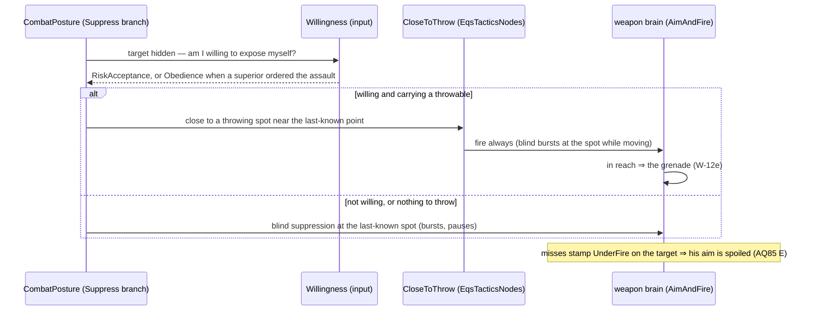
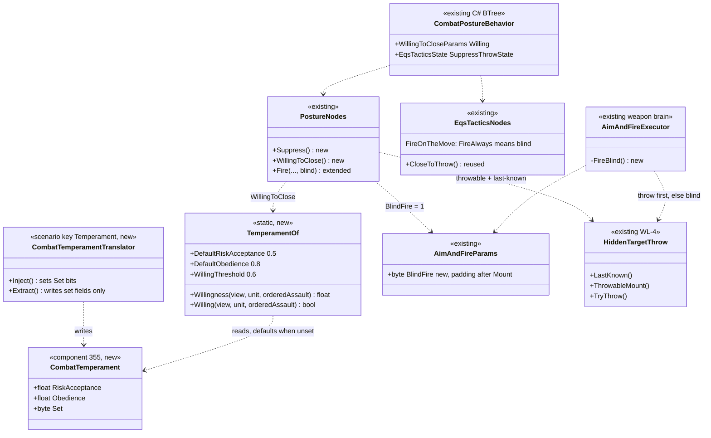
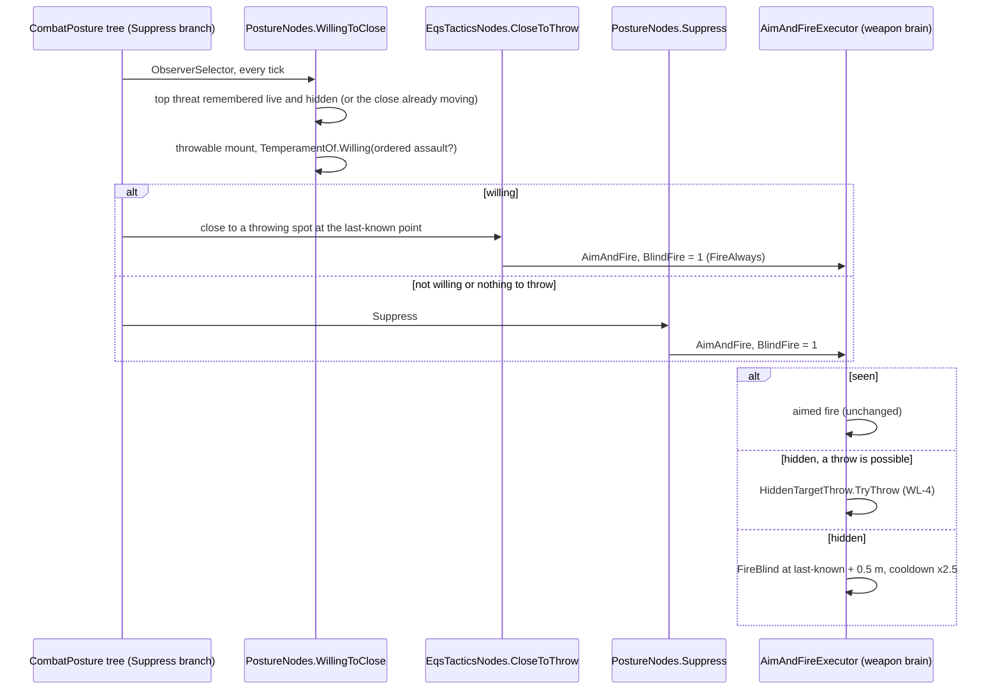

<!--STATUS
state: LIVE
updated: 2026-10-11
current-answer: §3 — sub-questions A–F, ✅ APPROVED as leaned (R-269); §4 the as-built
stale-below: nothing yet
known-rot: none
known-conflict: none
related-designs:
  - docs/DESIGN_Weapon_Layers.md — §5f WL-4 (the grenade at a hidden target): this question is what its scenario found missing
  - docs/DESIGN_Decision_Layer.md — §3.3 the CombatPosture decision (Suppress, CE-2072) that this changes
  - docs/blueprints/Architect_Question_85_Hit_Chance.md — §E `UnderFire`: why blind suppression has an effect at all
  - docs/DESIGN_Peek_And_Fire.md — the blind burst at a remembered spot (the existing at-point fire this reuses)
  - docs/DESIGN_Sensors_And_Doctrine.md — §7.4 doctrine and order origin (the commander's "aggressive / defensive" lever)
  - docs/designs/group-maneuvers/DESIGN_Squad_Wiring.md — §6 bounding overwatch: the covering element suppresses while the other moves
-->

# Architect Question 89 — suppress and close: blind suppression, bravery, obedience

> ✅ **APPROVED, `2026-10-11` (R-269).** 🔒 **User:** *"Approved. Trait component needs some defaults to never come up unfilled/zeroed as that would ruin the behavior."*

> 🔒 **User, `2026-10-11`:** *"Blind suppress fire might still make sense to buy some time for closing to grenade distance (bunker
> attack) but that only makes sense if the soldier is brave enough (because he exposes himself when advancing) or is told to do so by
> his commander. The moral (obedience) level and bravery (risk acceptance) is something we might want to count with."*

## 1. What the WL-4 scenario found *(measured, `ua-grenade-or-rifle` on the cluster)*

| claim | code — how it IS | design basis |
|---|---|---|
| a hidden, EQUALLY armed enemy makes the unit Suppress, not Advance | trace: posture winner 3 for 15 s; `EnemyStrengthRatio` = 0.5 (`StandardInputs.cs`, `ThreatDanger.Of` = 1 for any armed unit) | ✅ CE-2072, Decision Layer §3.3: *"suppresses a matched or stronger one"* |
| Suppress at a hidden target does NOTHING | `PostureNodes.Engage` → `AimAndFire` → `HoldNotSeen` every frame (the D4 seen-now gate) | ⛔ searched Decision Layer + Peek-and-Fire: no record of what Suppress does when blind |
| ⇒ the unit stands still until its memory fades (~13 s), then walks straight at the enemy | trace: idle f0–f960, then Direct to the objective, rifle at 4 m | — |
| the approach options (Flank, CloseToThrow) run only under AdvanceAndAttack | `CombatPostureBehavior.cs` (the approach is nested in the advance) | ✅ Decision Layer §3.3e |
| missed fire DOES suppress: it spoils the target's aim | `UnderFire` stamped by near misses, read by `HitModel.Sigma` | ✅ AQ85 §E (approved, R-216) |
| fire at a remembered spot exists | `PeekAndFireNodes` blind burst; `FireAtPointExecutor` (at-point) | ✅ Peek-and-Fire design |

## INVENTORY *(graph CLI + grep, `2026-10-11`)*

| query | result |
|---|---|
| graph + grep `.*Morale.*`, `.*Brave.*`, `.*Courage.*`, `.*Obedien.*`, `.*Temperament.*`, `.*RiskAccept.*` (Class/Struct) | ⛔ none |
| `docs/` + `.dev/` for morale / bravery / obedience / risk acceptance | ⛔ none — one REJECTED mention: AQ85 §E *"a morale / pinned state (a behaviour concern, already expressible as a posture)"* |
| what can order a unit | `BehaviorOrigin` (Superior / Operator / …), doctrine `Origin` gate (Sensors §7.4), `AssignTacticalIntentEvent` (BoundingOverwatch's orders) |
| blind fire | `PeekAndFireNodes` (blind burst at `ThreatPosition`), `FireAtPointExecutor` |

## 2. The shape *(lean)*

*What the picture shows: nothing new in the posture SCORING — the change is what the Suppress branch DOES, and one input decides
between holding the line and closing under one's own fire.*

## 3. Sub-questions

| # | question | ⭐ lean | blast radius | rejected — one line |
|---|---|---|---|---|
| **A** | what Suppress does at a HIDDEN target | blind bursts at the last-known spot (the at-point fire), a few rounds then a pause, only while the memory is live and the ROE permits — they stamp `UnderFire` and spoil his aim | every Suppress posture with a hidden target fires instead of idling (posture rails re-run) | idle hold (today — buys nothing) |
| **B** | how willingness is modelled | a new component `CombatTemperament { RiskAcceptance, Obedience }` (0..1), defaulted per TKB type (soldier 0.5 / 0.8), overridable per scenario entity; ONE utility input `Willingness` = Obedience when the current task was ordered as an assault by a superior, else RiskAcceptance | new component + TKB descriptor field + scenario translator; no existing unit changes until a value differs | dynamic morale now (falls with casualties / fire) — later, on the same component (F) |
| **C** | where closing enters the decision | INSIDE the Suppress branch: hidden + willing (≥ 0.6) + a throwable + a scored throwing spot ⇒ CloseToThrow with fire-always (blind bursts while moving); else blind suppression (A). The outer posture scores are untouched | only the Suppress branch's content; Advance / approach unchanged | re-scoring Suppress vs Advance — moves every posture in every scenario |
| **D** | "told to by his commander" | `CombatPosture`'s contract gains `assault: true` (default false); an order carrying it (a superior's `AssignTacticalIntent`, the moving element of bounding overwatch) makes `Willingness` read Obedience | one optional DTO field; BoundingOverwatch's movers set it | a separate "assault" behaviour — two postures for one fight |
| **E** | the threshold | willing when `Willingness ≥ 0.6` — deterministic (R-212: expected values, no dice) | — | a probability roll per decision |
| **F** | morale that changes | out of scope: filed — the same component later gains a live `Resolve` lowered by hits / near misses / casualties and restored over time | none now | — |

⇒ **For `ua-grenade-or-rifle`:** the Grenadier is authored brave (`RiskAcceptance` 0.8): he closes under his own blind fire and
throws; the Rifleman keeps the default (0.5): he blind-suppresses, spoiling the hostile's aim. A second run with the Grenadier at
0.5 shows him holding — the same scenario demonstrates the trait.

## 4. As built *(`2026-10-11`, R-269)*

*What the picture shows: one new component and one new translator. Everything else is an existing class given one flag or one node, and
the close REUSES WL-4's `CloseToThrow` with its own working state, not the approach's.*

*What the picture shows that prose hid: the posture never chooses the weapon (R-261). It asks for SUPPRESSION; the weapon brain
throws if it can, else fires blind, else fires aimed once he is seen.*

| as built | note |
|---|---|
| **A** `AimAndFireParams.BlindFire` (byte 13, padding) · `AimAndFireExecutor.FireBlind` | the round aims at the last-known point **+ 0.5 m** (a crouched man's middle): it strikes the cover in front of him, which is inside `NearMissRadius` (3 m) ⇒ `UnderFire` (AQ85 E). Gates: a live identified memory slot, magazine, friendly line to the POINT, ROE. An indirect mount never fires blind. Cooldown × 2.5 |
| **B** `CombatTemperament` (id 355, shared registry) · `TemperamentOf` | ⛔ 0 is a legitimate trait value, so "unset" is a `Set` bit per field, not 0 (🔒 user: *"never come up unfilled/zeroed"*). Absent component, zero-filled component or unregistered type ⇒ 0.5 / 0.8 |
| **B** scenario | `CombatTemperamentTranslator`, key `"Temperament": {"riskAcceptance", "obedience"}`, either optional; extract writes only SET fields, so a save never freezes the default |
| ⚠ **B — measured on the cluster** | CGF loads a scenario into a STAGING world and `StagingEntityExtractor` drops every translator-consumed component unless the translator is `IsExtractionSafe` (they usually hold staging-only entity handles). The temperament holds none ⇒ `IsExtractionSafe = true`. 🔴 Without it the brave Grenadier ran on the default 0.5 and never closed. Rail: `StagingEntityExtractorTests.Extract_CarriesAnAuthoredTemperament_ToTheCreationRequest` |
| ⚠ **B deviation** — no TKB per-type descriptor and no utility input | the per-type default is the code constant (one soldier profile today); the willingness is a CONDITION (`WillingToClose`), not a scored input, because C keeps the closing choice out of the scoring. A TKB descriptor is the next step when a second profile is needed |
| **C** `ObserverSelector(WillingToClose → CloseToThrow, Suppress)` inside Suppress | the close keeps going once moving even if the target is glimpsed (its own `SuppressThrowState.Moving` latch; the deactivator resets it) |
| **D** `CombatPostureParamsJsonDto.assault` → `WillingToCloseParams.Assault` | counts as an order unless the running origin is `Sop` or `Reaction` |
| **E** `TemperamentOf.WillingThreshold` = 0.6 | deterministic |
| rails | `CombatTemperamentTests` (defaults never zero; set-at-zero counts; threshold) · `AimAndFireExecutorTests.AQ89_A_*` · `TacticsTreesTests.AQ89_A_*`, `AQ89_C_*` (4 cases) · cluster `GrenadeOrRifleScenarioTests` ✅ (the Grenadier closes under blind fire from 31 m, throws at ~24 m, the lob clears the sandbags, the hostile is hurt) |
