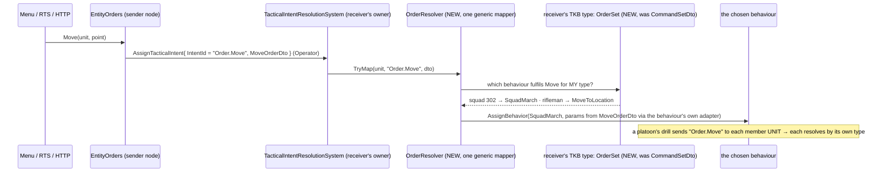
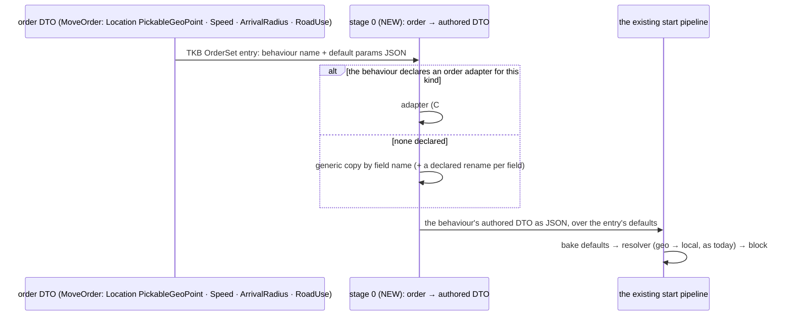
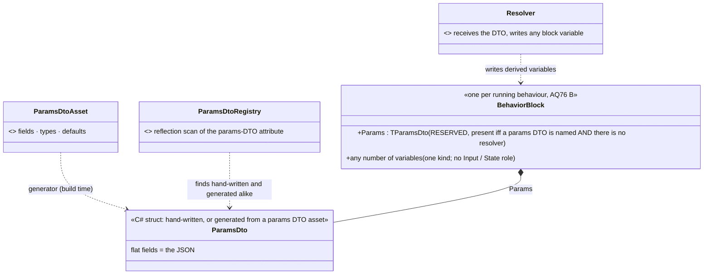

<!--STATUS
state: LIVE
updated: 2026-10-12
current-answer: ⭐ "THE PROPOSAL IN ONE PAGE" (above §1) is the consolidated answer, ✅ approved in principle (R-277 (behaviors)) with §2.3k's amendments; the sections below are how it was reached. §0 the four user rulings (R-273 (behaviors), R-274 (behaviors), R-275 (behaviors)) · §2 A — how the receiver decides: sub-questions A1–A6 (§2.2), A7 order → params (§2.3a), A2′ the naming convention (§2.3b — lean: adopt it with three guards; supersedes A2 + A7 if agreed), A3′ which behaviours and orders an entity supports (§2.3c), the shared order DTO + contract on the behaviour + enums (§2.3d), DTO sharing, assets and entity classes measured (§2.3e), what the parameter design means (§2.3f), ⭐ the four things kept apart + corrected lean (§2.3g, supersedes §2.3e row 1 and §2.3f's pointer), ⭐ the user's one-Input / flat-JSON model (§2.3h, R-276 ruled, R-277 lean), ⭐ no Input role — one block, one params target (§2.3i, lean; corrects §2.3h on blueprint behaviours), ⭐ the reserved Params variable + params DTO assets + registry (§2.3j, refines §2.3i), awaiting the user · §3 B, C and the Health capability: ruled, details designed when built
stale-below: nothing
known-rot: none
known-conflict: docs/DESIGN_Entity_Control.md §3.1 and §10 map an order to a soldier behaviour IN THE SENDER (EntityOrders → MoveToLocation / CombatPosture / Idle); R-273 (behaviors) overrules that. docs/UX/UX_Feature_Entity_Commanding.md §2.4 lets a TKB CommandEntry name a behaviour that the MENU reads; A3 here narrows the menu to order kinds
related-designs:
  - docs/designs/tactical-intent/DESIGN.md — OWNS the receiver-side resolution (TacticalIntentResolutionSystem + mapper registry); its stated goal "senders fully agnostic of the recipient's unit type" is what R-273 (behaviors) re-affirms
  - docs/DESIGN_Entity_Control.md — OWNS EntityOrders, the one order service for HTTP, menu and RTS (R-270); A1 changes what it publishes
  - docs/UX/Architect_Question_29_Entity_Commanding.md — §H (an order to a formation is an order to its commander) and §I (the command set comes from the TKB) — ruled 2026-08-13, not built
  - docs/UX/UX_Feature_Entity_Commanding.md — OWNS the menu design and CommandSetDto (§2.4), NOT-BUILT; A2/A3 re-aim it
  - docs/designs/group-maneuvers/DESIGN_Squad_Tactics.md — OWNS the squad runner and drills (§3.1 "order = AssignBehavior to the commander") and the unit commander (§7, R-272 (behaviors))
  - docs/DESIGN_Entity_Interactions.md — OWNS embarkation (§7); B and C extend it
  - docs/blueprints/Architect_Question_83_Doctrine_And_Order_Origin.md — OWNS the origin gate (R-188), the SOP slot (R-189); its "an order as a GOAL" idea (deferred) is A2's rejected alternative
  - docs/blueprints/Behavior_Parameter_Resolver_Detailed_Design.md — OWNS the three shapes and "one shape by default" (§3.2) and foresaw a shared param-type as an additive change (§3.1); §2.3f maps orders onto it
  - docs/blueprints/Architect_Question_76_One_Blackboard_Block_Per_Primitive.md — OWNS one block per running behaviour (B approved) and "Role=Input optional" (§12.3b); §2.3i takes it to no Input role
  - docs/blueprints/DESIGN_Parameter_Model.md — OWNS the behaviour start pipeline and the resolver (§P.2, R-152/R-154) that A7 puts one stage in front of
  - docs/UX/Architect_Question_25_Scenario_Authoring_Golden_Path.md — Q25-C: the asset declares its category mask + param schema (recommended, awaiting approval); §2.3e builds on it
  - docs/DESIGN_Operations_Behaviour_Catalogue.md — OWNS the injury states (D1 / R-263) C depends on, and the echelon gap (T6)
-->

# Architect Question 90 — orders to a unit, carrying by vehicle type, carrying a person

## 0. The user's rulings *(2026-10-12)*

| # | 🔒 user, verbatim | ruling |
|---|---|---|
| **A** | *"the unit entity receiving the RTS order needs to decide on its own how to fulfill the command (what behavior it should start), nothing else should know (the UI level the least)"* | ✅ **R-273 (behaviors)**: the receiver picks the behaviour. The sender names only WHAT is ordered. §2 asks HOW |
| **B** | *"carrying capacity and seats (driver, gunner, passenger) belong to the vehicle type" — yes* | ✅ **R-274 (behaviors)**, first half |
| **C** | *"a soldier carrying or dragging a wounded comrade is the same embark mechanism with a 'human carrier' profile" — yes* | ✅ **R-274 (behaviors)**, second half |
| **D** | *"every ECS node participating in a live exercise capable of owning live entities should be equal regarding the capabilities, so i guess yes, every usual host"* | ✅ **R-275 (behaviors)**: `HealthApplicationSystem` joins the cross-role set; the principle generalises the I-2 *"no per-host initialisations"* |
| — | *"no building, we are still discussing features and designs"* | nothing here is dispatched |

## ⭐ THE PROPOSAL IN ONE PAGE *(consolidated 2026-10-12 — this supersedes the step-by-step leans in §2.2–§2.3j where they differ)*

| area | proposal | status |
|---|---|---|
| **who decides** | the receiver picks the behaviour that fulfils an order; senders and UI name only WHAT is ordered | ✅ R-273 (behaviors) |
| **orders** | `enum OrderKind` in `Hrot.AI.Behaviors` (users add orders there); each kind has ONE order DTO marked `[Order(kind)]` (`Hold` → empty `HoldOrder`). Outside the AI assembly everything is generic over the discovered order catalogue; RTS gestures are declared on the DTO (§2.3k ①) | ✅ R-277 |
| **entity classes** | ⭐ none: a behaviour declares the DIS-type PATTERN it serves; it replaces `BehaviorCategory` and the hard-coded switch. Units need real aggregate DIS types first (§2.3k ⑤) | lean (amended) |
| **which behaviour runs** | the behaviour whose params DTO is the order's DTO and whose DIS pattern matches the entity most specifically; a tie is a load error; no map table. `<Class><Order>` stays a naming guideline. No fallback for a body-less unit | lean (amended) |
| **echelons** | a unit's drill orders member UNITS by order kind (each decides for itself, recursively) and directs its own soldiers by behaviour. A drill that ends releases its members to their SOPs | lean |
| **which orders a unit accepts / the menu** | per CLASS, computed on demand from the node's behaviour catalogue: the K for which `<Class>K` is registered. Nothing is stored per entity. Every node runs the catalogue scan (they are one executable; R-275 (behaviors)). The menu builds its follow-up picks from the order DTO's field types (`PickableGeoPoint` → point, `EntityRef` → entity), so a new order kind is one DTO and a new class's behaviour is just registered | lean |
| **validity of a behaviour for a class** | declared on the BEHAVIOUR, not its DTO: C# attribute `[Behavior(Params = typeof(…), Classes = …)]`; on assets a `Classes` property edited in a new shared asset-level Details view `details.behaviour` (`HasAsset`) | lean |
| **params DTO** | each behaviour names EXACTLY 1 params DTO (empty `NoParams` when it takes nothing), its public contract; several behaviours may share one (all `<Class>Move` share `MoveOrder`). JSON params are always that DTO's fields, flat, never wrapped. It may be a class: params travel only as JSON | ✅ R-276 (behaviors) + lean |
| **blackboard variables** | ONE block per running behaviour with ONE kind of variable (no Input / State role). **No resolver:** the JSON lands in the reserved `Params` variable (typed as the DTO; not authored in the variable editor; then the DTO must be an unmanaged struct, checked at load). **With a resolver:** the resolver receives the DTO and writes any variables; there is no `Params` | lean (extends AQ76 B) |
| **variables as params for others** | unchanged: an action binds a field of any variable and reads it live (R-155); a hosted sub-behaviour is given a host variable typed as its params DTO, copied into its `Params` at start | unchanged |
| **authoring params DTOs** | a new `*.params.json` asset (fields, types, defaults, an optional order name) with a build-time generator emitting the C# DTO. **A params DTO asset editor** creates and edits it: a field list with the same name / type / default / comment rows the AI editors already have (`VariablesPanelControl` for BTree / HSM, `ParameterRowsView` for blueprints), the same type combo, and an "order name" field that turns the DTO into an order DTO. One editor registry from one reflection scan finds hand-written and generated DTOs alike; the assets live in the asset browser like the other AI assets. ⛔ Not measured: whether either row control can host a standalone asset outside its owning editor | lean |
| **carrying** | vehicle type declares capacity and seats (driver, gunner, passenger); a person carrying or dragging a wounded comrade is embark with a human-carrier profile | ✅ R-274 (behaviors) |
| **node equality** | every node able to own live entities has the same capabilities; `HealthApplicationSystem` joins the cross-role set | ✅ R-275 (behaviors) |

⛔ Main costs: behaviour renames to `<Class><Order>`; the 25 `[BehaviorContract]` uses move to their behaviours; multi-Input assets
and the four Parameter-declaring blueprints get C# (or generated) params DTOs; three saved scenario params strings are rewritten.
⛔ Not measured: the generator changes (named DTO, `Params`), the carry-over manifest, the catalogue scan's cost on IG, an empty struct.

## 1. INVENTORY *(graph CLI — the MCP server failed to connect this session; index refreshed 2026-10-12 — plus grep and one corpus sweep over `docs/` and `.dev/`)*

| query | total | result |
|---|---|---|
| `search_graph` `.*IntentMapper.*` / `.*TacticalIntent.*` (Class) | 2 / 15 | `TacticalIntentMapperRegistry` · `TacticalIntentResolutionSystem` · `AssignTacticalIntentEvent` · the DDS pair `TacticalIntentEgress/IngressTranslator` + `TacticalIntentRequest` · `CommanderNodes.IssueTacticalIntent*` |
| `search_graph` `.*Mapper$` (Class), order mappers only | 4 | `DefendAreaMapper` (switches on TKB type: APC → ConvoyEscort, infantry → CombatPosture) · `HullDownAttackMapper` (tanks only) · `ForceManeuverMapper` / `ClearForceManeuverMapper` (squad; never registered, AQ29 L67) |
| `search_graph` `.*EntityOrders.*` | 1 | `Hrot/Engine/Hrot.Common/Orders/EntityOrders.cs` |
| grep: a soldier behaviour named outside the AI layer | 3 sites | `EntityOrders.cs:98,113,117` (Move → `MoveToLocation`, Attack → `CombatPosture`, Hold → `Idle`) · `NedSimHostMissionSender.cs:49` (a mission task's `BehaviorId`) |
| grep: callers of `EntityOrders.Move/Attack/Hold/Behavior` | 3 front-ends | `MenuOrders` (Move Here · Engage · Stop) · `RtsCommands.cs:66,85` · `DebugApiService.Orders.cs:70-94` (also `Behavior(name)`) |
| grep: tests pinning a behaviour name on an order | 8 files | `MenuOrdersTests` (`:95` "MoveToLocation") · `RtsCommandToolTests` · `DebugApiOrdersTests` · `ABehaviourAdvertisesItsRealParametersTests` · 4 mission-control files |
| `search_graph` / grep `CommandSetDto` | 0 | the TKB command set (AQ29 §I) was designed, never built |

## 2. A — how the receiving unit decides

### 2.0 Claims *(both columns)*

| claim | code — how it IS | design — how it was MEANT |
|---|---|---|
| the receiver's node already resolves every intent: mapper by intent id, else intent id = behaviour name | ✅ `TacticalIntentResolutionSystem.cs:110-140`, gated on owning `BehaviorState` | ✅ tactical-intent DESIGN §2.1; goal: *"Keeps senders … fully agnostic of the recipient's unit type"* (:32) |
| the menu and the RTS tool speak ORDER KINDS (Move, Attack, Stop), not behaviours | ✅ `MenuOrders.cs:47-52`, `RtsCommands.cs:66,85` | ✅ Entity Control §3.1: *"three front-ends, one publish"* |
| ⛔ the order SERVICE picks the soldier behaviour, on the SENDING node | ✅ `EntityOrders.cs:98,113,117` | ⛔ contradicts the tactical-intent goal; Entity Control §10 wrote it in (*"`EntityOrders.Attack` → `CombatPosture`"*) |
| ⇒ an order to a squad starts a soldier behaviour on a body-less commander; the members get nothing | ✅ HANDOFF_Embark_I2d §3A (measured) | ✅ R-272 (behaviors): the commander has no body |
| a per-type command set in the TKB was ruled and never built | ✅ grep `CommandSetDto` = 0 | ✅ AQ29 §I (ruled 2026-08-13); UX Entity Commanding §2.4 |
| an order to a formation = an order to its commander entity, by its own TKB type | — | ✅ AQ29 §H |
| an existing mapper already decides by the receiver's type — but in central code | ✅ `DefendAreaMapper.cs` `switch (tkbType)` | ✅ hill-attack DESIGN §3.3 (the tank-only mapper) |
| a drill orders its soldiers by BEHAVIOUR name (`AdvanceTo` / `CombatPosture`, origin Superior) | ✅ `SquadManeuverRunner` Issue | ✅ Squad Tactics §3.1, Overview §9 |
| a mission task carries a behaviour id authored in the scenario | ✅ `MissionAdapterSystem.cs:108-111` → the same intent path | ⛔ searched: no design ties mission tasks to orders |

### 2.1 The lean, as one picture

*What the picture shows that prose hid: the sender's last fact is the order kind. The behaviour name first appears on the
receiver's node, read from the receiver's own type, so adding a unit type touches neither the UI nor the order service.*

### 2.2 Sub-questions

| # | question | ⭐ lean | blast radius | what would change the lean |
|---|---|---|---|---|
| **A1** | what does the sender publish? | an **order kind** as the intent id: `Order.Move`, `Order.Attack`, `Order.Hold` (later `Order.Defend`, …), each with an order DTO (Move: lat/lon, speed, arrival radius, road use; Attack: target; Hold: none). `EntityOrders` stops naming behaviours | `EntityOrders` (3 methods); the 4 order-test files re-pin the kind; the DDS intent topic is unchanged (the id is a string) | — |
| **A2** | where does the receiver's choice live? | ⭐ in the receiver's **TKB type**: AQ29 §I's command set, re-aimed as an `OrderSet` — order kind → behaviour name (+ default params). ONE generic `OrderResolver` mapper per order kind reads it on the owner node. The **behaviour** converts the order DTO into its own params (an adapter declared next to its params DTO). The type picks; the behaviour converts | new TKB descriptor + catalog entries for the types that take orders; one mapper; one adapter per fulfilling behaviour (≈ 6: MoveToLocation, CombatPosture, Idle, SquadMarch, SquadHold, the squad attack drill) | if you want the choice to depend on the situation (e.g. a squad under fire answers Move with a bound rather than a march), the `OrderSet` entry should name a **decision** (a utility decision, like `SquadContactResponse`) instead of a behaviour — the same table, one more level |
| **A3** | what does the menu show? | **only the order kinds the unit's type declares** (read from the same `OrderSet`), never a behaviour name; a `UnitEntity` gets no Possess | `MenuOrders`, the context-menu projector; AQ29 §I's "command = behaviour" menu becomes "command = order kind" | — |
| **A4** | down the echelons | a drill orders a member that is itself a **unit** by order kind (it then decides on its own, recursively); it keeps directing its own **soldiers** by behaviour, because a drill step (bound to here, suppress from there) is finer than any operator order and *is* the squad deciding how to fulfil its order | `SquadManeuverRunner.Issue` gains a branch on the member being a `UnitEntity`; platoon drills are later work | if you want soldiers to receive orders too, the order vocabulary must grow to drill-step kinds (Bound, Suppress, Hold-and-cover); every soldier type then needs an `OrderSet` |
| **A5** | stop and release | `Order.Hold` resolves per type (squad → `SquadHold`). Releasing a unit (Clear) ends its drill, and **a drill that ends, for any reason, clears the Superior orders it gave its members**, so each member's own SOP picks next | `SquadManeuverRunner` end/abort path; fixes `SquadMarchBehavior.cs:233` (release recalls nobody) | if you want members to HOLD where they are rather than return to their SOP, the runner issues `Order.Hold` instead of a clear |
| **A6** | the two paths that name a behaviour on purpose | keep `EntityOrders.Behavior(name)` for the **debug API / MCP only** (a test tool that scripts a unit), never on the menu or RTS. A mission task may name an **order kind** as well as a behaviour (both arrive as the same intent string, so it costs nothing) | none for the debug API; mission authoring gains an option | if you want no path at all to name a behaviour from outside, the debug route is removed and tests author behaviours through mission tasks |

### 2.3 Terms and the parameter hand-over *(added 2026-10-12, answering the user's follow-up)*

- **A drill:** a group behaviour that runs on a unit's commander entity through `SquadManeuverRunner`. Its body is a play
  (`ISquadPlay`): a phase table saying which members do what and when the phase changes. Each tick the runner sends each live
  member what it should do now (today a soldier behaviour, origin Superior). The built drills are `SquadMarch`,
  `BoundingOverwatch`, `SuppressAndManeuver`, `SquadHold`, `BreakContact` and `ReactToContact`. A drill is an ordinary
  registered behaviour, so an `OrderSet` entry can name one.
- **A platoon (A4):**
  1. The platoon's commander receives `Order.Move`. Its type's `OrderSet` names a platoon drill (e.g. `PlatoonMarch`), which starts on the platoon commander.
  2. That drill decides each squad's part (lead squad to the point, the others following at an interval) and sends each squad commander `Order.Move(its point)`. It never names `SquadMarch`.
  3. Each squad commander resolves that order through its own type and starts `SquadMarch`, which directs its soldiers.

  Not built: there is no platoon-of-squads type (`BdcTkbCatalog.cs:230-235`), and the tank platoon's members are vehicles,
  ordered by behaviour (`HillAttackCommanderNodes.cs:161-164,484-487`).
- **Parameters (A2):** the order does NOT carry the behaviour's params DTO, because that would force the sender to know which
  behaviour runs. Each order kind has its own small DTO. The behaviour's params are built on the receiver in two layers:
  1. the TKB `OrderSet` entry's default params (e.g. the squad's march shape, Wedge);
  2. overlaid with what the fulfilling behaviour's **adapter** takes from the order (`MoveOrder.Target` → `SquadMarch.Objective`).

  The adapter is code next to the behaviour's params DTO, because it converts lat/lon with the node's geographic transform.
  Precedent: `DefendAreaMapper.PostureAt` already turns `DefendAreaIntentDto` into `CombatPosture`'s params.

### 2.3a A7 — who converts the order's DTO into the behaviour's params *(added 2026-10-12, the user's follow-up; supersedes §2.3's "adapter is code" line)*

| claim | code — how it IS | design — how it was MEANT |
|---|---|---|
| a behaviour already has ONE optional conversion step at start (the resolver): the intent's JSON → its authored DTO → the resolver writes the block; with no resolver, a copy **by field name** | ✅ `BehaviorDefinition.ResolveStage` (CE-443, built) | ✅ Parameter Model §P.2; R-152 (one per behaviour, its job is conversion) |
| a resolver may be hand-written C# (`[BehaviorResolver]`) or a **blueprint resolver asset** that names its behaviour | ✅ `T40Resolver.bp.json` (`ResolverSubject`) | ✅ R-149 (a region names its resolver), R-154 (looked up by behaviour name), CE-428 |
| blueprints have typed To JSON / From JSON nodes for any `[BehaviorContract]` DTO | ✅ CE-472 built | ✅ DESIGN_Typed_Intent_And_Json_Nodes §3 |
| the world-location TYPE is `PickableGeoPoint` (lat/lon) — the type alone makes a member map-pickable | ✅ `Behavior/Params/PickableGeoPoint.cs` | ✅ DESIGN_Map_Picking_Unification (supersedes `[MapPickableWorldLocation]`) |
| ⛔ but no production behaviour DTO uses it: places are lat/lon doubles (`MoveToLocation`) or a local `Vector3 Objective` (`SquadMarch`, `AdvanceTo`, `CombatPosture.Advance`) | ✅ grep — only a test fixture uses `PickableGeoPoint` | ⛔ searched: no design says why |

*What the picture shows that prose hid: the order adds ONE stage in front of a pipeline that already converts. The existing
pipeline is untouched, and the behaviour's authored DTO stays the one description of what it accepts, for the editor form, the
mission task, the debug API and now the order.*

| A7 | ⭐ lean |
|---|---|
| **generic case** (no code) | copy by field name and type. ⭐ It works for most orders once behaviour DTOs use the vocabulary types: `PickableGeoPoint` for a place, `EntityRef` for a target, floats for speed and radius. The lat/lon → local conversion then stays in the behaviour's own resolver, whose designed job it already is. A field whose name differs is declared on the behaviour's DTO (`[FromOrder("Move", "Location")] Objective`, or the same property on a blueprint parameter) |
| **computed case** | an **order adapter**, one per behaviour per order kind, declared BY THE BEHAVIOUR, like its resolver: hand-written C#, or a **blueprint adapter asset** naming its behaviour and order kind (looked up by behaviour name, R-154). In a blueprint: From JSON the order DTO, compute, To JSON the authored DTO |
| **the TKB entry** | names only order kind → behaviour + optional default params. ⛔ Not the adapter: it belongs to the behaviour, or every unit type that uses `SquadMarch` for Move would repeat it |
| **validation** | at TKB load: an entry whose behaviour cannot be filled from the order (no adapter, and a required field matches nothing) is a load error, not a silent run with defaults |

Rejected:
- **The order carries the behaviour's DTO:** the sender must then know the behaviour (R-273).
- **The behaviour's resolver takes the order directly:** the resolver would need one input type per order kind (against R-152's one source), and the authored DTO would stop describing what the behaviour accepts.
- **The TKB entry names the adapter:** it repeats per unit type.
- **Copy by name only:** it fails where the meaning differs (an area's radius vs. a posture's arrival radius).

⛔ Not measured:
- whether a blueprint asset can RETURN a whole DTO today (a resolver writes through `ref block`; an adapter needs an output). This may need a new dispatch kind beside `Library`.
- how many behaviour DTOs would move to `PickableGeoPoint`.

### 2.3b A2′ — the user's alternative: a naming convention instead of the map *(2026-10-12)*

> 🔒 *User: "would it make sense to avoid the order-to-behavior map and use some kind of simple convention instead, like that if
> the Move order reaches the platoon commander virtual unit, the behavior to run would need to have name like
> <UnitTypeName><OrderName>, i.e. "PlatoonMove", and the PlatoonMove will be expected to support the Move order parameters?
> Native json to DTO translation will ensure the fields with same name are recognized."*

| claim | code — how it IS | design — how it was MEANT |
|---|---|---|
| TKB types are concrete MODELS: `Tank_M1Abrams` / `Tank_T72`, `Unit_TankPlatoon` / `Unit_TankPlatoon_Auto`, `Infantry_Rifleman` / `InfantrySoldier` / `Insurgent` | ✅ `TkbEntityTypes.cs:6-61` | — |
| no TKB type declares a class or a parent; type → class is a hard-coded switch, and it misses `Infantry_Rifleman` (200 falls to the default list) | ✅ `BehaviorCatalog.cs:72-82` | ⛔ searched: no TKB inheritance design |
| JSON → DTO matches by field name; a missing field keeps its default; unknown fields are skipped | ✅ Parameter Model §P.2 "applied by field name" | ✅ same |
| the registry keys a behaviour by name → id; a second name for one definition is not a built feature | ✅ `BehaviorRegistry.Register(name, …)` | — |

**Verdict: adopt it, with three guards.** The convention removes the TKB map AND A7's adapter stage. The behaviour IS the
contract: it must accept the order's fields under the order's names and types, and anything computed happens inside it (its
resolver, C# or blueprint, already exists for exactly that, §P.2).

| guard | why |
|---|---|
| ① key on an **order class** declared once per TKB type (one field, e.g. `OrderClass = "Squad"`, `"Tank"`, `"Infantry"`), not on the concrete type name | ⛔ by type name, `Tank_M1Abrams` and `Tank_T72` each need their own `…Move`, and so does every new model. One class per doctrine (an insurgent is `Infantry`) makes sharing the normal case |
| ② a **load-time contract check**: for every registered `<Class><Order>`, each order field exists in its params DTO with the same type; and every type that declares a class lists which orders it lacks | ⛔ name matching is silent: a field with the right name and the wrong type (lat/lon vs `Vector3`) fails or zeroes, and a missing one keeps its default — `Objective` (0,0,0) marches the squad to the map origin. A typo drops orders with no error |
| ③ **no generic fallback** (`<Order>` alone) for a body-less unit | ⛔ that fallback is exactly today's defect: a soldier behaviour on a `UnitEntity` (R-272 (behaviors)) |

**Cost:** existing names move. Today's fulfilling behaviours (`MoveToLocation`, `CombatPosture`, `Idle`, `SquadMarch`,
`SquadHold`) are named by scenarios, mission tasks and tests (§2.4). The new names are `InfantryMove`, `SquadMove`, and so on;
each is either a rename or a thin wrapper. ⛔ Not measured: whether the registry can register one definition under two
names without side effects on name-keyed resolvers, params types and the replicated behaviour hash.

What the convention does NOT lose:
- A situational choice (march when quiet, bound under fire) lives inside `SquadMove`.
- The menu lists a type's orders by asking which `<Class><Order>` names exist.
- A blueprint behaviour joins by its name and its parameters.

⇒ **A2 and A7 are superseded by this, if the user agrees.**

### 2.3c A3′ — which behaviours and which orders an entity supports *(2026-10-12; user: "I think the MissionPlan editor panel already filters behavior per entity type")*

| claim | code — how it IS | design — how it was MEANT |
|---|---|---|
| the filter exists: a behaviour's params DTO carries `[BehaviorContract(name, BehaviorCategory flags)]`; `BehaviorCatalog` collects them by reflection | ✅ `BehaviorCatalog.cs:45-64`; 25 attributes (`AllMilitary` 8 · `Commander` 7 · …) | ✅ AQ29 §I row 2 |
| ⛔ the TYPE → category step is a hard-coded switch over 8 type ids; everything else (both tanks, `Infantry_Rifleman`, the officer, aircraft) gets a fixed default list | ✅ `BehaviorCatalog.cs:72-82` | ⛔ AQ29 §I wanted the command set FROM THE TKB (ruling 43/46) — not built |
| ⛔ the categories are a fixed 5-flag enum; `Commander` lumps a tank platoon and a squad together | ✅ `BehaviorCategory.cs` | — |
| ⛔ every editor-authored behaviour (BTree / HSM / blueprint) is appended to EVERY type, unfiltered | ✅ `ScenarioMissionService.cs:121-140` and its own TODO *"gate by per-asset … affinity mask"* | ✅ R-268 / CE-446: see all technologies (the filter was never meant to hide them, only nobody declared their category) |
| three consumers: the mission panel (`ScenarioMissionService`), ExCon (`MissionEditorService.cs:73`), the debug API's `GET /behaviors?entityId=` | ✅ grep | — |
| the unit menu runs on CGF, IG, the editor, SimHost and the replay browser (no orders there); IG says it holds no behaviour registry | ✅ `MapInteractionPack.Build` callers; `IgApplication.cs:812` | — |

**Lean — the convention's class IS this category, made data:**

| question | ⭐ answer |
|---|---|
| what class is an entity? | its TKB type declares it: `BehaviorProfile.Class` (a string: `Squad`, `TankPlatoon`, `Tank`, `Infantry`, `Civilian`, …). It **replaces the switch** and the fixed enum; an open set, so a new type or a user's new class needs no code |
| which behaviours may it run? *(mission panel, AI section, debug API)* | a behaviour declares the classes it is valid for: the existing `[BehaviorContract]` with class NAMES instead of flags; a blueprint / BTree / HSM behaviour has the same property on its asset (closing the TODO). ⭐ A `<Class><Order>` behaviour is valid for its class without declaring it |
| which orders does it accept? *(the menu)* | ⭐ **nothing is stored per entity.** It depends only on the CLASS: `orders(class)` = the order kinds K for which `<Class>K` is in the node's behaviour catalog, computed on first use and cached per class (a handful of classes, not thousands of entities). An entity's class comes from its TKB type, which every entity already carries (`TkbIdentity`) |
| which node can answer? | every node: they are ONE executable (`ClusterRunner --mode` picks the roles) with the same behaviour assemblies. The registry is filled by one scan (`CgfBehaviorSetup.LoadFromAiAssembly`, `CgfSubsystem.cs:783-795`). IG's is null only because IG never runs that scan (`IgNodeBootstrapper.cs:191` → the base's `GetBehaviorRegistry() => null`, `SharedApplicationBootstrapper.cs:486`). ⇒ per R-275 (behaviors), every node runs the scan |
| how a behaviour declares its classes | the params DTO's existing `[BehaviorContract(name, …)]` (Hrot.Core, readable without the AI assembly, so ExCon keeps working) takes class NAMES instead of the 5-flag enum: `[BehaviorContract(BehaviorNames.SquadHold, "Squad")]`. A blueprint / BTree / HSM asset gets the same `Classes` property, carried by its generated registrar. An order behaviour (`<Class><Order>`) needs no declaration; its name says it |
| is the menu extensible with no code? | ✅ **a new behaviour for an existing order kind** — e.g. `TankPlatoonMove` — appears in that class's menu by being registered. **A new order KIND** is one order DTO with an `[Order("Ambush", Label = …)]` attribute. The menu builds its follow-up picks from the DTO's field TYPES (`PickableGeoPoint` ⇒ pick a point, `EntityRef` ⇒ pick an entity), which the map-picking unification already makes pickable by type. ⛔ Today the menu hard-codes Move ⇒ point, Engage ⇒ enemy (`MenuOrders.cs:47-71`); that becomes generic |

⛔ SUPERSEDED same day (user: *"we can have thousands of entities, where the accepted orders would be stored?"*): an earlier lean
here replicated an `AcceptedOrders` mask per unit, computed on the brain owner. Wrong shape: the answer is per class, and every
node can compute it.

⛔ Not measured: the time and memory the catalog scan costs on IG (CGF pays it at boot today); whether a lighter catalog (names,
classes, params types, without compiled trees) should be split from the registry for nodes that never run a brain.

### 2.3d The shared order DTO, where the contract lives, enums *(2026-10-12; user follow-up)*

| claim | code — how it IS | design — how it was MEANT |
|---|---|---|
| `[BehaviorContract(name, categories)]` sits on the params DTO, ONE per DTO (`AllowMultiple = false`), so a DTO can serve only one behaviour | ✅ `BehaviorContractAttribute.cs` | — |
| it does three jobs: binds behaviour name → authored DTO for every host (`BindJsonParamsDtoTypes`, CE-235); the category filter; the blueprint Send Intent palette and the UI schema / remapper | ✅ `CgfBehaviorSetup.cs:57-62`, `BehaviorCatalog.cs:45-64`, `IntentContractPaletteEntries.cs:50`, `BehaviorSchemaDiscovery` | ✅ CE-235: *"[BehaviorContract] on the DTOs in Hrot.Core is the one producer"* |
| it sits in Hrot.Core so readers without the AI assembly can see it; ExCon is the one such reader (it references Presentation / Common, not `Hrot.AI.Behaviors`) | ✅ `Hrot.ExCon.csproj`, `MissionEditorService.cs:73` | — |
| the behaviour's own attribute `[BTreeDefinition]` lives in the generic FastBTree kernel (`FDP/ExtDeps`), BTree only | ✅ `BTreeDefinitionAttribute.cs` | — |
| entity TYPES are already C# constants (`TkbEntityTypes`) and the TKB catalog is C# (`BdcTkbCatalog`) | ✅ | — |

| question | ⭐ lean |
|---|---|
| **a shared order DTO** *(its superset clause is SUPERSEDED by §2.3e: the params type equals the order DTO)* | ✅ yes: the order DTO (`MoveOrder`) IS the shared contract of every `<Class>Move`. A behaviour's params are that DTO, or a SUPERSET with the same field names and types (`SquadMove` adds `Shape`, `Spacing`; they keep their baked defaults when started by an order). The load-time check (§2.3b ②) asserts the superset. A blueprint behaviour that implements Move gets the order's fields added to its Parameters by the editor |
| **where the contract lives** | ⭐ **on the behaviour, not the DTO.** With shared DTOs the DTO can no longer name its behaviour, so the binding inverts: the behaviour names its DTO and its classes. C#: one engine-level attribute on the behaviour class, in Hrot.Core (not `BTreeDefinition`, which is the generic BTree kernel's): `[Behavior(Params = typeof(MoveOrder), Classes = new[] { EntityClass.Squad })]`. HSM / blueprint / BTree assets: the same two properties, carried by their generated registrar. The DTO becomes pure data, with `[Order(OrderKind.Move)]` when it is an order's DTO. One producer still (the behaviour), so CE-235's rule holds |
| **entity classes as an enum** | ✅ yes: `enum EntityClass` (one per TKB type, declared in its profile), replacing the 5-flag `BehaviorCategory`. Order kinds likewise: `enum OrderKind`. The only place a `<Class><Order>` name is composed is one helper (`OrderBehaviors.NameOf(EntityClass, OrderKind)`), and the load check compares it with what is registered. Cost: a new class is a code change and a rebuild. That is consistent with how TKB types are defined today, and a blueprint author picks a class from a dropdown |

Blast radius:
- the 25 `[BehaviorContract]` uses move onto their behaviours;
- `BehaviorCatalog`, `BehaviorSchemaDiscovery` (bind, UI schema, remapper), the blueprint Send Intent palette (it becomes "Send Order: Move" from the order DTOs), and `BTreeBridgeEmitCore.cs:1720`;
- ExCon: it can no longer see behaviours without the AI assembly. Lean: it asks a live node through the existing `GET /behaviors?entityId=`. ⛔ Not measured: whether ExCon already holds an HTTP route to a node.

Rejected:
- **Keep the contract on the DTO with `AllowMultiple = true`:** the DTO would list every behaviour that uses it, so adding `TankPlatoonMove` edits the shared order DTO.
- **Strings for classes:** typos and no completion; the user's ask.

### 2.3e Measured: can behaviours share one params DTO, can an asset pick one, where entity classes are set *(2026-10-12; one docs sweep, one code sweep, key lines re-read)*

| claim | code — how it IS | design — how it was MEANT |
|---|---|---|
| sharing a DTO was considered and deferred, not forbidden | — | ✅ Resolver design §3.1 (:133): *"No shared param-contract layer … If one ever appears it is an additive change (a behavior points at a shared named param-type)"* |
| the runtime keys everything by behaviour NAME; no type → name map; two names on one type collide nowhere | ✅ `BehaviorRegistry.cs:370-404` (every dictionary), `RegisterJsonParamsDtoType` :571-584; `BehaviorUiRegistry` and `ScenarioBehaviorRemapper` by name; the curated generator emits nothing per type (`CuratedBehaviorGenerator.cs:246-285`); saved state is name + JSON (`BehaviorStartRecord`, `MissionTask`, `PausedTask`, `SopState`) | ✅ R-154: looked up by behaviour name |
| the ONE blocker: `[BehaviorContract]` is one-per-DTO and names one behaviour | ✅ `BehaviorContractAttribute.cs:5,8` | — |
| one small collision: the blueprint palette keys To / From JSON by the DTO's type (`Json.To.{Fqn}`), so a DTO with two behaviour ids would list twice | ✅ `IntentContractPaletteEntries.cs:106,115,124` | — |
| no two behaviours share a DTO today | ✅ every `ParamsType` and every `BehaviorId` unique | — |
| an ASSET declares its params field by field: BTree / HSM Input variables (`VariablesPanelControl`), blueprint Parameters (`ParameterRowsView`). The type pickers list primitives, `EntityRef` and `[BlackboardDtoStruct]` structs; order / `[BehaviorContract]` DTOs are NOT offered | ✅ `BlackboardTypeChoiceBuilder.cs:40-128`, `BlueprintTypeSystem.SelectableTypeIds :289-335` | ✅ Parameter Model §P.7: *"the authored contract IS the block's `In` struct"* (BTree), the asset's Parameters (blueprint) |
| a whole hand-written struct as the blackboard ("Category-1", `Managed = false`) exists in the asset model, but no editor UI sets it | ✅ `BehaviorTreeAssetDto.cs:54-57`; set only by the new-asset services | ✅ Blackboard Authoring design (Category-1 / Category-2) |
| no asset model (BTree, HSM, blueprint) has an entity type / class field, and no editor has an asset-level properties panel; the asset-level surfaces are the blackboard window (BTree / HSM) and the graph signature window (blueprint) | ✅ `BehaviorTreeAssetDto.cs:386-440`, `HsmAssetDto.cs:335-376`, `BlueprintAsset.cs`; `BlackboardAuthoringWindow`, `GraphSignatureWindow` | ✅ AQ25 Q25-C recommended *"the asset declares its category mask + param schema, authored in the editor"* (awaiting approval); the code's own TODO |

**Leans:**

| question | ⭐ lean |
|---|---|
| sharing | ✅ allowed. It is the *"additive change"* the resolver design anticipated, and it needs only two changes: the contract moves onto the behaviour (§2.3d), and the palette de-duplicates by DTO type |
| an ASSET implementing an order *(⛔ WITHDRAWN 2026-10-12 — it conflated an Input variable with the params DTO; see §2.3g)* | ⭐ **(revised twice 2026-10-12; user: "behavior parameters are always a single dto, always pickable … Therd must be way already, no new picker should be necessary")** — **no new setting.** Measured: an asset declares its inputs as blackboard variables with Role = Input (the default role, `BlackboardVariableEnums.cs:10`), each one typed through the EXISTING type combo (primitives, `EntityRef`, `[BlackboardDtoStruct]` structs). Single-DTO is the common shape: `PlatoonHillAttack.btree.json` has ONE Input `Params : PlatoonHillAttackParams` plus one State. Field-by-field also exists: `BasicSquadSop.btree.json` has three Inputs (`underFire`, `leaderDown`, `contact`, each a `SopSenseParams`). The JSON contract is the generated mirror of the Inputs, keyed by VARIABLE name, so one DTO-typed Input nests as `{"Params":{…}}` (`BTreeBridgeEmitCore.cs:1710-1729`). A curated C# behaviour gets a flat contract from its `[BehaviorContract]` DTO plus a resolver instead (PlatoonHillAttack: `HillAttackCommanderNodes.cs:712`). ⇒ **Rule:** an asset whose Inputs are exactly ONE variable typed as an `[Order]` DTO implements that order. The generator then binds `JsonParamsDtoType` to the DTO itself and parses the order JSON straight into that one variable (unwrapped). The order DTOs carry `[BlackboardDtoStruct]` so the existing combo lists them. Blueprints: one Parameter typed as the order DTO, same rule. The order kind comes from the DTO, `Hold` has an empty `HoldOrder {}`, and the asset's extra knobs are State variables with defaults. ⛔ The earlier "Params type: own / order DTO" setting is withdrawn; "own" only meant "any other Inputs, as today" |
| entity classes on an asset | a new asset property **`Classes: EntityClass[]`** on all three asset models, persisted in the asset JSON and emitted by each generator into the registrar |
| where both are edited | ⭐ **(revised 2026-10-12, user: "There is 'details panel' supporting switchable views, one of them might be asset level setting")** — correct; the sweep missed it. The Details panel is one shell with switchable views (`DetailsViewRegistry` + `DetailsViewDescriptor(Id, Title, Rank, AppliesTo, Create)`, DESIGN_Details_Panel_View_Switching §2). The predicate `DetailsViewPredicates.HasAsset` (*"asset context"*) is exactly an asset-level view, and the design's catalogue already lists **"Layout / byte budget · Asset settings"** (§6 L3, :507), today carried inside the `details.blackboard` view (BTree / HSM; measured satisfied, §7, :970). Blueprint has `details.graphsignature`. ⇒ add ONE shared view **`details.behaviour` ("Behaviour")** in `Hrot.Editor.AiShared/Shell`, `AppliesTo: HasAsset`, registered by all three editors. It shows the order the asset implements (read-only, derived from its one order-typed Input) and `Classes` (multi-select of `EntityClass`) |

⛔ Not measured: the generator change to unwrap a single order-typed Input (`EmitParseParamsLocal`, the JSON schema publisher), and
whether an empty struct (`HoldOrder {}`) passes the blackboard layout code.

### 2.3f What the parameter design MEANS — read end to end *(2026-10-12; user: "You might also read the docs to find out what it is meant to be")*

| the design says | where |
|---|---|
| the behaviour's PUBLIC description is a JSON/DTO only; the blackboard is internal. 🔒 *"the behavior spec from scenario or from mcp server or from wherever always comes with json/dto only … the blackboard DTO should never appear in any public behavior description"* | Parameter Model §3.1 "AS BUILT CE-235" |
| a behaviour has up to THREE shapes: the **authored DTO** (the public contract, a transient parse buffer), the **usable params** (`Role = Input` variables), the **working state** (`Role = State`). *"There is no 'Param' role — Input IS the parameter role"* | Resolver design §3.2; Parameter Model §1, §3.1 |
| **one shape by default:** the author declares the Input variables in the variables panel, and the authored DTO is *"an attached mirror of them — same field names and types, auto-generated, not separately editable"* | Resolver design §3.2, §4.1 |
| **two shapes only on divergence** (geo point vs Cartesian, network id vs `Entity`, a derived field): the authored shape is declared separately and a resolver bridges. Hand-written C# declares it with a `[BehaviorContract]` DTO; a resolver asset declares it with its Parameters (✅ approved 2026-09-30) | Resolver design §3.2, §4.2; Parameter Model §P.7 |
| the behaviour IS the contract, keyed by its name; one public DTO per behaviour (`JsonParamsDtoType`) | Resolver design §3.1; Parameter Model §3.1 table |
| **a shared contract was foreseen:** *"If one ever appears it is an additive change (a behavior points at a shared named param-type) that does not break the behavior-owns-it model"* | Resolver design §3.1 |

⇒ **Both statements are true, at different layers.** *"A behaviour's params are one DTO"* is true of the PUBLIC contract
(`JsonParamsDtoType`). For curated behaviours that DTO is C#. For editor assets it is GENERATED from the Input variables, which
the author edits field by field in the variables panel. That generated mirror is what I wrongly called "own".

⇒ **The order case is exactly the foreseen additive change:** the behaviour POINTS at a shared named param-type (`MoveOrder`)
as its authored contract. Mapped onto the design:
- **Authored DTO:** the shared order DTO, pointed at instead of mirrored.
- **Usable params:** the Input variables. Identical to the DTO, they are filled by the default copy (§P.2, which needs identical shapes). Divergent (geo → local), the behaviour's own resolver bridges, exactly as today.
- ⛔ *(withdrawn, §2.3g)* **The pointer, with no new picker:** the existing type combo. An asset whose Inputs are ONE variable typed as an `[Order]` DTO points at that DTO; the generator publishes it as the `JsonParamsDtoType` and unwraps it (§2.3e). A curated C# behaviour points with its behaviour attribute (§2.3d).

⛔ Where this deviates from the written design, and is therefore a decision for the user:
- §3.2 says the default authored shape is a mirror keyed by VARIABLE name. Treating a single order-typed Input as "this DTO is my contract" is a special case of that rule.
- The alternative that stays inside the rule: the asset declares the order's fields as separate Inputs with the same names, and the check is structural. It is more work for the author and drifts when the DTO changes.

### 2.3g ⭐ The four things, kept apart — and the corrected lean *(2026-10-12; user: "No matter how many state variables a behavior has, there is up to one parameter dto. I think you are still mixing apples and oranges … read some explainer doc")*

Source: EXPLAINER_Where_Parameters_And_State_Live §1, §3, §7.1 (the measurement record), with Parameter Model §1, §3.1 and the
resolver design §3.2 (the intent).

| # | thing | what it is | how many | public? |
|---|---|---|---|---|
| ① | **JSON params** | the text a scenario, mission, MCP call or order carries (`behaviorParams`) | one per assignment | the wire form |
| ② | **the params DTO** (`JsonParamsDtoType`, "authored DTO") | the ONE type ① deserializes into: a transient parse buffer at start | **0 or 1 per behaviour** | ✅ the behaviour's public contract (`GET /behaviors`, the mission panel). 🔒 *"the behavior spec … always comes with json/dto only"* |
| ③ | **Input variables** (`Role = Input`, "usable params") | the behaviour's OWN copy of its inputs, in its root params slot; filled ONCE at start from ②, by the default copy (by field name) or by its resolver (conversion) | any number | ⛔ internal (the blackboard) |
| ④ | **State variables** (`Role = State`) | working memory, reset at start | any number | ⛔ internal; never part of ② |

Who produces ②:
- **Curated C#:** a hand-written `[BehaviorContract]` class.
- **Editor asset:** GENERATED as the mirror of its ③ (one field per Input variable; `BTreeBridgeEmitCore.cs:1710-1729`).
- **Asset with a resolver asset:** that resolver's Parameters (§P.7).

⛔ Not pickable for an editor asset today: *"an editor-authored behaviour cannot have an authored shape different from `In`
today"* (Parameter Model §P.7).

⇒ **Where I mixed them (§2.3e / §2.3f, withdrawn):** I proposed "an asset whose ONE Input variable is typed `MoveOrder`
implements Move". That uses a ③ (an internal landing variable) to stand for ② (the public contract). Read correctly, a
single DTO-typed Input yields a GENERATED ② with one field, `{ Params: MoveOrder }`; that is why it nests, and it is not
`MoveOrder`.

**Corrected lean — an order behaviour's ② IS the order DTO:**
- **Curated C#:** the behaviour names its ② (`Params = typeof(MoveOrder)`, §2.3d).
- **Editor asset:** the asset names its ② instead of generating one. This is the change the resolver design foresaw (§3.1: *"a behavior points at a shared named param-type"*). Its ③ stays its own:
  - mirror the DTO's fields, filled by the default copy;
  - or differ, and its resolver converts (geo → local), as today.
- **One asset setting is needed, "Params DTO": generated from Inputs (default) | a picked order DTO.** Measured: no editor UI sets an asset's ② today (§P.7). It belongs in the asset-level `details.behaviour` view (§2.3e).
- **The order kind** comes from ②'s `[Order]` attribute.
- **`Hold`:** an empty `HoldOrder`.

⛔ Not measured: the generator change to publish a named ② and parse ① into it before the copy or resolver (the curated path
already does this, so it is a reuse, not a new mechanism).

### 2.3h The user's model: at most ONE Input variable, and the JSON never nests *(2026-10-12)*

> 🔒 *User: "Yes we must be able to specify authored param dto per behavior. I am still not getting if we need to generate one
> from input variables. I thought there is at most one input variable of the dto struct type which can be either identical to
> authored dto or different if resolver needs to do some conversion. Params json should never needs to nest Params subfield."*

✅ **Ruled:** the authored params DTO (②) is specifiable per behaviour (R-276 (behaviors)).

The rest is a model the user STATED; measured against the corpus and the written design, it is a NEW rule, not the as-built:

| claim | measured / written |
|---|---|
| the design treats several Inputs as the general case: the authored DTO is *"an attached mirror of them"*, and *"'a single struct-typed input' is the degenerate case of the multi-field model, not a rival to it"* | resolver design §3.2; EXPLAINER §3 |
| shipped assets (non-test) by Input count: **0 → 6 · 1 → 6 · 2 → 2 · 3 → 2 · 6 → 1**. Multi-Input: `FiringPosition`, `Flank` (2), `BasicInfantrySop`, `BasicSquadSop` (3), `DangerCrossing` (6) | parse of every `.btree.json` / `.hsm.json` under `Assets/` |
| ⛔ the JSON DOES nest today, by variable name: `{"sentry":{"Count":1,…}}` for `Sentry` (one Input!) and `{"sensor":{…},"walk":{…}}` for `DangerCrossing` | `scenarios/ua-danger-crossing/scenario.json:51,102`, `ua-danger-crossing-bp/scenario.json:102` |
| the user's model already exists ONCE: `PlatoonHillAttack` has one Input `Params : PlatoonHillAttackParams`, a separate authored DTO, and a resolver; its JSON is flat | `PlatoonHillAttack.btree.json`; `scenarios/hill-attack/scenario.json:21` |

**Lean: adopt the user's model as the rule** (R-277 (behaviors), awaiting approval):

| rule | consequence |
|---|---|
| a behaviour has **0 or 1 Input variable**, typed as a C# DTO struct | no generated mirror any more; params structs are C# (the user: *"for now editable only in csharp"*) |
| its authored DTO (②) is **picked per behaviour**; default = the Input variable's own type | identity ⇒ the default copy; different ⇒ the behaviour's resolver converts (§P.2, unchanged) |
| the JSON (①) is **always ②'s fields, flat** | `Sentry`'s JSON becomes `{"Count":1,…}` |
| an order behaviour picks the order DTO as ② | §2.3g, unchanged |

Blast radius:
- the five multi-Input library assets each get ONE C# params struct holding their current Inputs (e.g. `FlankParams { tactics; engage }`); their JSON keeps those fields, which are now the DTO's own fields, not a wrapper;
- the six single-Input assets drop the variable-name wrapper;
- 3 saved `behaviorParams` in 2 scenarios are rewritten;
- the test assets with several Inputs follow;
- the generator emits `JsonParamsDtoType` = ② and parses ① straight into it.

Blueprints:
- ⛔ *(wrong — corrected in §2.3i: blueprint behaviours exist, 9 assets)* a blueprint as a behaviour is still planned (§P.1 "O9, planned"), so it can start under this rule. ⚠ It conflicts with §P.7 (approved 2026-09-30), which declares a resolver asset's authored shape as several Parameters; under this rule that shape is one picked DTO;
- blueprint ACTIONS are untouched: they read the host live and take no params copy (R-155).

What would change the lean: if authoring params WITHOUT writing C# matters now. The generated mirror is what lets an
editor-only author do that today.

### 2.3i No Input role at all — one block, one params target *(2026-10-12; user: "Maybe by adopting the single input param dto approach the input variables go away completely and all become just state, where one of them happens to be filled from params (if there is no resolver) or any can be touched by resolver?")*

⛔ **Correction to §2.3h:** blueprint behaviours EXIST. §2.3h quoted Parameter Model §P.1's *"blueprint as a behaviour (O9,
planned)"*, which is stale. Measured: **9** `.bp.json` assets with `Dispatch: "Behavior"`, registered at `BrainTierBlueprint`
(CE-446; `BehaviorIngressSystem.cs:1120,1396`). §P.1's line is now marked known-rot there.

| claim | measured / written |
|---|---|
| params ARE authorable without C# today, two ways: BTree / HSM Input variables (generated mirror) and blueprint **Parameters**. 4 of the 9 behaviour blueprints declare Parameters field by field: `DangerCrossingBp` (Vector3, floats), `PlatoonHillAttackBp` (6, `PickableGeoPoint`…), `Demo_TaskChain` / `Demo_MissionPlan` (Parameters typed as C# contract DTOs) | parse of every `Dispatch: "Behavior"` asset |
| the approved storage design already heads here: ONE block per running behaviour (decision B, ✅ 2026-09-29), the resolver may write **the whole block**, and *"`Role=Input` becomes optional"*. 🔒 *"in case of custom resolver there does not even need to be any role=Input variable defined"* | AQ76 §4 B, §12.3b |
| the Input / State split's original reason (a 100-byte inline budget) is gone (now 16 096 B) | EXPLAINER §7.9a |
| *"the 'custom resolver can do whatever' case is the SHIPPED curated case, and the generated case is the degenerate one where the authored DTO equals the Input region and the resolver is a memcpy"* | AQ76 §12.3b |

⇒ ⭐ **The user's model is the endpoint AQ76 stopped short of, and the lean is to take it:**

| rule | |
|---|---|
| a behaviour has ONE block of variables; **no `Input` / `State` role** | every variable is the behaviour's own memory |
| a behaviour names its params DTO (R-276 (behaviors)), or none | the public contract; flat JSON |
| ⛔ *(refined in §2.3j: a reserved `Params` variable, never chosen by type)* **no resolver:** the JSON lands in the ONE variable whose type is the params DTO (the params target) | the default copy, as today, but into a named variable instead of an "Input region" |
| **a resolver:** it receives the DTO and writes ANY variables of the block | AQ76 §12.3's grant, unchanged |
| everything else starts at its baked default | AQ76's bake stage (which also closes CE-420) |

What the `Input` role does today, each re-homed:

| job | re-homed to |
|---|---|
| sizes the copy (`InputBytes`, CE-429) | the params target's size and offset |
| defines the generated authored mirror | gone: the DTO is named |
| the default copy's target region | the params target variable |
| bake applies to Input only (CE-420) | the whole block (AQ76 already) |
| editor sections "Inputs" / "State" (Parameter Model §5.1) | ONE "Variables" section; the params target is marked |
| a hosted child's input: a host variable typed as the child's Inputs struct (AQ76 §12.28e) | a host variable typed as the child's params DTO |
| the curated `[SharedAiAction(typeof(Dto),"Field")]` binding to a field of THE params struct | a field of the block (AQ76's block DTO) |
| ⛔ not measured | the carry-over manifest across a behaviour change (AQ76 :1896, *"an EMPTY manifest is an authority"*) |

**What it costs, stated plainly:**
- params can no longer be authored without C#. Today's two editor ways go: BTree / HSM Inputs, and blueprint Parameters;
- the four Parameter-declaring behaviour blueprints and the five multi-Input library assets each get one C# params DTO;
- Parameter Model §P.7 (approved 2026-09-30, a resolver asset's authored shape = its Parameters) is superseded;
- the user said params DTOs are C#-only, and this makes that true.

### 2.3j Refined: a reserved `Params` variable, editor-authored params DTO assets, and block variables as params for others *(2026-10-12)*

> 🔒 *User: "the json needs to land in what used to be the input variable, not just by variable type as the behavior can contain
> multiple vars of the same type. That input one can be called specifically as it is no longer authored in the blackboard variable
> editor. The inability to define in editor could be easily fixed by adding editor capability to define parameter dto assets (with
> generator that produces the csharp dto). Editor would have param dto registry filled from reflection scan for param dto structs.
> Note that vars in the blackboard are often serving as params for actions and sub behaviors."*

*What the picture shows that prose hid: `Params` is a fixed slot of the block, not a variable the author creates, so "which
variable gets the JSON" has one answer regardless of how many variables share its type. Every other variable, `Params`
included, is equally available to the behaviour's actions and to the sub-behaviours it hosts.*

| rule | ⭐ lean |
|---|---|
| **where the JSON lands** *(revised 2026-10-12, user: "Storing param dto as state var in blackboard is only necessary if there is no resolver")* | **no resolver:** in the reserved variable **`Params`**, typed as the params DTO. It is not authored in the variable editor and is never chosen by type. **With a resolver:** the DTO is only the transient parse buffer it always was (Parameter Model §3.1 row 1); the resolver receives it and writes any block variables, and there is no `Params` variable. ⛔ The earlier lean (`Params` always holds the DTO, the resolver only adds) is withdrawn: it forced every DTO to be blittable for nothing |
| **the resolver** | optional; it receives the DTO and writes any block variables (geo → local, a resolved `Entity`, a derived direction), exactly as the curated resolvers do today (`PlatoonHillAttack`) |
| **block variables as params for others** | unchanged and central. An ACTION binds a field of any block variable, `Params` included, and reads it live (R-155). A hosted SUB-BEHAVIOUR names a host variable typed as the child's params DTO (`ParamsVariable`, AQ76 §12.28e); at the child's start that variable is copied into the child's own `Params` |
| **editor-authored params DTOs** | a **params DTO asset** (`*.params.json`: fields, types, defaults) with a build-time generator that emits the C# struct. It uses the path the editor-managed blackboard already takes: the asset JSON is the source and the C# struct is generated at build (Category-2; Blackboard Authoring design, Enum design §"netstandard2.0 generators see only JSON text") |
| **the editor's params DTO registry** | ONE reflection scan for one params-DTO attribute, which finds hand-written and generated DTOs alike. It replaces today's two scans: `[BlackboardDtoStruct]` (`BlackboardTypeChoiceBuilder`) and `[BehaviorContract]` (`BehaviorSchemaDiscovery`). Order DTOs are params DTOs that also carry `[Order]` |

⭐ **The DTO may be a class** *(revised 2026-10-12, user)*. Params are persisted and carried only as JSON text, never as the
struct, so the DTO's own shape is unconstrained:

| where params travel | form |
|---|---|
| scenario mission task, `BehaviorStartRecord`, `PausedTask`, `SopState` | name + JSON string |
| the bus (`AssignTacticalIntentEvent`, `AssignBehaviorEvent`) | `JsonParams` string (`AssignBehaviorEvent.cs:29`) |
| the wire (`TacticalIntentRequest`) | `JsonParams` string (`TacticalIntentMessages.cs`) |

⇒ the one place the DTO's shape matters is the `Params` variable, which exists only WITHOUT a resolver. **Validation (load
time):** a behaviour with a params DTO and no resolver requires the DTO to be an unmanaged struct; a class there is an error
that names the behaviour. Today's 10 class DTOs (`PlatoonHillAttackParamsJsonDto` and the others) all sit on behaviours with
a curated resolver or with no asset, so they stay classes. ⛔ Not measured per DTO; the load check will list any exception.

### 2.3k Amendments after the one-page proposal *(2026-10-12; user: "Good, i like it." then six points)*

✅ **The one-page proposal is approved in principle** (R-277 (behaviors)), with the amendments below. 🔒 *"Lets postpone
embarkation until we finish this order/param/unit stuff."* ⇒ CE-3110 I-2d and the S3 Dismount drill wait.

| # | user | answer / lean |
|---|---|---|
| 1 | *"Order kind enum needs to be defined in behavior ai assembly so users are free to add new orders."* | ✅ `OrderKind` and the order DTOs live in `Hrot.AI.Behaviors`. ⚠ Measured: `Hrot.Common` (`EntityOrders`) and `Hrot.Presentation` (`MenuOrders`, `RtsCommands`) reference `Hrot.Core` but NOT `Hrot.AI.Behaviors` (their `.csproj`). ⇒ everything outside the AI assembly is GENERIC over the discovered order catalogue: an order is its name plus its DTO's JSON schema. HTTP becomes `order {kind, params}`, and the menu lists the catalogue. The two gestures that need a specific order (RTS click on ground ⇒ Move, on an enemy ⇒ Attack) are DECLARED on the order DTO (`[Order(OrderKind.Move, Gesture = OrderGesture.GroundClick)]`), so no order name is written in UI code |
| 2 | *"Unit drill is a behavior as any other, just having its authored param dto marked as the order param, correct?"* | ✅ yes. A behaviour fulfils an order exactly when its params DTO is that order's DTO; nothing else marks it |
| 3 | *"Order is undistinguishable from other behavior … Ai debug and mcp might keep sending behaviors to any entity?"* | ✅ yes. An order is "start the behaviour that fulfils this order DTO for me"; once chosen, it runs like any behaviour. The debug API and MCP keep assigning a behaviour by name directly (§2.2 A6) |
| 4 | *"Unit entity is responsible for making sure members know what to do … and there is no strict way how?"* | ✅ yes. The fulfilling behaviour decides. `SquadManeuverRunner` is one library helper, not a mandate |
| 5 | *"Could the entity class be derived from its tkb dis entity type … so no new extra class for orders is necessary?"* | ⭐ yes, and it removes `EntityClass`. `DISEntityType` is hierarchical (`Kind · Domain · Country · Category · Subcategory · Specific`, packed in one `ulong`, `FDP/Engine/Fdp.Core/DISEntityType.cs`). A behaviour declares the DIS PATTERN it serves (0 = any), e.g. tanks = `{Kind 1, Domain 1, Category 1}` covering M1 and T-72 across countries. **Lookup:** among the behaviours whose params DTO is the order's DTO, take those whose pattern matches the entity's DIS type; the most specific wins; a tie is a load error. ⇒ the `<Class><Order>` NAME stops being the key and becomes only a naming guideline. ⛔ **Measured blocker:** the unit types are not distinguishable by DIS today. `Unit_TankPlatoon`, `Unit_InfantrySquad` and `Unit_TankPlatoon_Auto` all carry `{Kind 1, Domain 1, US}` with Category 0, i.e. "any US land platform" (`BdcTkbCatalog.cs:236,257,277`), which also matches every tank. ⇒ units need real aggregate types (SISO-REF-010 aggregate / echelon codes). ⛔ Not measured: who else reads a unit's DIS type (scenario translator `DisEntityTypeTranslator`, IG `SetDisType` at `IgApplication.cs:2235`) |
| 6 | *"Can we enforce no param == empty param dto to eliminate the no param dto case?"* | ✅ yes. Every behaviour has exactly one params DTO; a behaviour that takes nothing names the shared empty `NoParams`. An order with no fields gets its OWN empty DTO (`HoldOrder`), because the type is what identifies the order. An empty DTO stores nothing: AQ76 already omits an empty half (*"an empty C# struct is one byte"*, :1811) |

### 2.3l Two more user decisions *(2026-10-12)*

| 🔒 user | consequence |
|---|---|
| *"Param dtos including the order params are in registry where the order name can be string with no reference to order kind enum, for the purpose of building menus."* | the params-DTO registry (one reflection scan) lists every params DTO; an order DTO's entry carries its order NAME as a string. Menus, HTTP and RTS read the registry and never reference `OrderKind`. That settles §2.3k ① from the UI side |
| *"Dis entity type mask needs to support number ranged and number list and wildcard for each segment, not just single number … Of course units need specific dis type different from ordinary ones."* | a behaviour's DIS mask has, PER SEGMENT (Kind, Domain, Country, Category, Subcategory, Specific, Extra), one of: `*` (any) · a number · a range `a-b` · a list `a,b,c` (and lists of ranges). "Most specific wins" must be defined over these, e.g. compare segment by segment from Kind down: an exact number beats a list/range, which beats `*`. Units get their own aggregate DIS types |

Measurements requested next (*"Do the missing measurements, no building yet"*) run as three read-only sweeps: DIS readers / mask
prior art / aggregate types; the params pipeline (carry-over, empty DTO, generator precedence, class DTOs); the catalogue's
consumers, the rename radius, ExCon's channel to a node, IG and the catalogue scan, the menu's pick wiring. Results land in §2.3m.

### 2.4 Every place a behaviour is named from outside the unit today, and what A1/A6 do to it *(grep `new AssignTacticalIntentEvent` / `new AssignBehaviorEvent`, production only)*

| site | who names the behaviour | lean |
|---|---|---|
| `EntityOrders.Move/Attack/Hold` (`EntityOrders.cs:98,113,117`) ← the menu, the RTS tool, HTTP `move` / `attack` / `hold` | the order service | ⛔ **loses it**: publishes `Order.*` (A1) |
| `SimHostVisualization.cs:442` → `NedSimHostMissionSender.cs:49` (a click in the SimHost debug window sends a `MoveToLocation` mission over DDS) | a UI | ⛔ **loses it**: becomes `Order.Move` |
| HTTP `kind:"behavior"` → `EntityOrders.Behavior(name)` (`DebugApiService.Orders.cs:80-87`); the MCP tools use it | a test tool | ✅ keeps it (A6) |
| the editor's AI section, Task row (`EntityAiDetailsView.ApplyTask`, `:163-166`), in Edit and while running | the author / operator in the inspector | ✅ keeps it, as the AI-debugging inspector (A6; the user may rule otherwise) |
| scenario mission tasks (`MissionAdapterSystem.cs:108-111`) and a scenario entity's authored behaviour / SOP (`InitialBrainMaterializationSystem.cs:42`) | the scenario author | ✅ keeps it; a task may also name an `Order.*` (A6) |
| the blueprint Send Intent node (`Nodes.cs:1385`, intent id = a `[BehaviorContract]` id) | a blueprint author | ✅ keeps it; it also offers the order kinds |
| commanders ordering members: `SquadManeuverRunner.cs:402` (soldiers), `HillAttackCommanderNodes.cs:161,484` (tanks), `CommanderNodes.cs:80` (stub, `"DefendArea"`) | the unit's own drill | ✅ keeps it for soldier and vehicle members; ⭐ a **unit** member gets `Order.*` (A4) |
| the unit's own sources: TKB `DefaultBehavior` / `DefaultSop`, `SopActions.React`, a possession resume, a brain restart | the unit itself | ✅ unchanged: this IS the unit deciding |

**Rejected (one line each):**
- **One C# mapper per order kind switching on the TKB type** (the `DefendAreaMapper` shape): it puts every unit type's choice in central code, so a new type edits shared code. That is the coupling R-273 (behaviors) forbids.
- **The unit's SOP slot (R-189) decodes the order**: the order would compete with reactions under the origin gate, and every type would need an authored SOP just to accept a Move. AQ83 already deferred "an order as a goal".
- **The order service asks the receiver's type** (the TKB is readable on every node): the sender still holds the mapping, which is the UI-level knowledge the ruling excludes.

## 3. B, C and the Health capability — ruled; designed when built

| # | ruling | already measured *(HANDOFF_Embark_I2d §3)* | left to its design (Entity Interactions §7) |
|---|---|---|---|
| **B** | the vehicle **type** declares capacity and seats with roles (driver, gunner, passenger); only a declaring type gets a `PassengerBuffer`; crew are seated passengers with a role | capacity is a fixed 8 on every carrier (`InteractionComponents.cs:16`); every brained entity, soldiers included, gets an empty `PassengerBuffer` (`BehaviorTkbTranslator.cs:161-162`); `OpenPassengerCabin` is the per-type precedent | the seat model, who drives when the driver seat is empty, per-seat exposure (rejected until seats exist, §7.2) |
| **C** | carrying or dragging a person is **embark with a carrier profile** declared by the carrier's type: capacity 1, exposed, does not die with the carrier, a speed penalty, an attach offset; a drag is another profile | no wounded state exists (`Health {Current, Max}`); Treat / Drag / Carry are catalogue entries only | depends on the R-263 injury states being built first; composes with B (a profile is what a type declares) |
| **D** | `HealthApplicationSystem` joins the cross-role infrastructure (`CoreInfrastructureCapabilities`), declared on every host plan that can own live entities, like `Interactions` | registered only in `CgfLogicPack.cs:198,230`; it gates itself on owning `Health`, so running everywhere costs nothing where nothing is owned | ⛔ not measured: whether anything on CGF depends on its position in the phase (`HsmDamageBridgeSystem` reads its result), and whether `DamageAssessedEvent` reaches a non-CGF owner (`EntityHitDamageIngressTranslator`'s hosts) |
